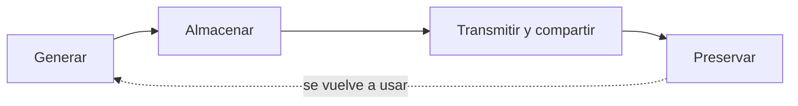
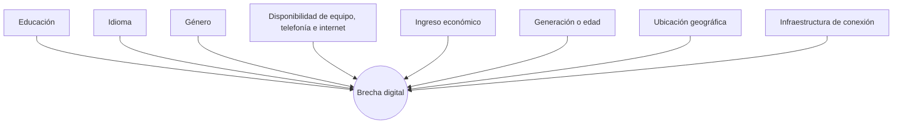

# 01 - Revolución sociotecnológica y herramental TIC

> Unidad 1 de *Introducción a la ciberseguridad* (Raptor Dev Services Academy, curso `cyber-intro`). Material recreado con palabras propias a partir del temario de un diplomado de ciberseguridad; las fuentes van al final en APA 7. Actualización al 2026 donde se indica.

## Por qué importa

Las tecnologías de la información y la comunicación (TIC) son de los inventos más útiles que ha producido la humanidad: con ellas estudiamos, trabajamos, compramos, votamos y nos enteramos de lo que pasa en el mundo. Son, además, el vehículo más eficaz que tenemos para ejercer el derecho humano a buscar y recibir información. Pero la misma red que acerca a las personas también acerca a quien quiere dañarlas. Ese lado oscuro, la inseguridad, es la razón de ser de la ciberseguridad.

Cuando una persona, una empresa o un gobierno opera en línea, no solo se comunica o se entretiene: crea relaciones jurídicas que tocan su patrimonio, su identidad, su reputación y hasta su intimidad. Cualquier cosa que viva en un sistema conectado puede ser atacada, copiada, expuesta, vendida o usada de forma ilícita: una identidad, un sistema, un equipo, un sitio web, una base de datos, una fotografía, un repositorio en la nube o un expediente con datos personales. Por eso conviene entender primero de dónde viene la dependencia tecnológica actual, qué es exactamente una herramienta TIC y qué principios protegen su uso libre. Sin esa base, cualquier discusión sobre riesgos, delitos o controles queda en el aire.

Esta nota abre la materia. Recorre la revolución tecnológica del siglo XX, el paso de la sociedad de la información a las sociedades del conocimiento, las características de las TIC, su potencial y sus desventajas, la idea de "informatizar" la información, la brecha digital, el acceso a internet como derecho y el principio de neutralidad de la red.

## Las revoluciones como motor de cambio

En la historia de cualquier pueblo hay revoluciones, y no todas son violentas ni negativas. La Revolución Industrial cambió la manera de producir; las revoluciones de independencia cambiaron la manera de gobernarse. En la segunda mitad del siglo XX varios estudiosos empezaron a hablar de una **revolución tecnológica**: una transformación que impulsó como nunca a las sociedades de consumo y que generalizó, en pocas décadas, el acceso a las computadoras, a las telecomunicaciones y después a internet.

El resultado es una sociedad que depende de la tecnología y que organiza buena parte de su evolución alrededor de esa dependencia. Para la ciberseguridad esto tiene una consecuencia práctica: cuanto más depende una actividad de un sistema conectado, más valioso se vuelve atacarlo y más grave es que falle.

## La tecnología como herramienta

Una idea atraviesa toda la materia: **la tecnología es, ante todo, una herramienta**. No es buena ni mala por sí misma; su efecto depende de quién la usa y para qué. Esa herramienta ya rebasó lo que se esperaba de ella, así que conviene distinguir entre "la tecnología" en general y las tecnologías de la información en particular, y conocer sus rasgos, ventajas, desventajas y alcance. Un teléfono o un navegador son apenas la parte visible.

Vista así, la tecnología es el instrumento con el que se informatiza la información y se produce conocimiento. Su uso masivo también generó **principios que los propios usuarios se impusieron** desde que el acceso se volvió general. No son normas jurídicas, pero han servido para defender tres cosas: la neutralidad de la red, la libertad de acceder a la información y la libertad de expresarse. Con ellos se busca impedir que algunos actores, a veces por vías ilegales, controlen o condicionen uno de los servicios más importantes de nuestro tiempo: el acceso a internet.

De ahí una recomendación que se repite en toda la materia: **decidir con información**. Quien no conoce cómo funciona una herramienta termina dependiendo de lo que otros le cuentan, y muchos medios presentan como verdad absoluta lo que conviene a intereses particulares. La alternativa es formarse un criterio propio, de forma voluntaria y documentada. La propia educación a distancia es un ejemplo de beneficio tecnológico: permite aprender ciberseguridad sin moverse de casa.

> **Para pensar:** una máquina puede sustituir el trabajo de muchas personas comunes, pero ninguna sustituye el criterio de una persona preparada (idea atribuida a Elbert Hubbard).

## Qué entendemos por tecnología y por ciencia

Desde sus formas más primitivas, la tecnología acompañó la evolución humana: cada vez que alguien perfeccionó una herramienta para resolver un problema cotidiano, mejoró la vida diaria y aumentó la probabilidad de sobrevivir. Dos definiciones citadas en la bibliografía del tema ayudan a precisar el término:

| Autor | Idea central de su definición (parafraseada) |
|---|---|
| Aquiles (2008) | La tecnología es un cuerpo ordenado de saberes y de procesos orientado a producir bienes y servicios; toma en cuenta la técnica, la ciencia y el contexto económico, social y cultural, y su fin es mejorar la vida de las personas |
| Gallo (2000) | La tecnología reúne habilidades, saberes, procedimientos, herramientas e instrumentos que se aplican para transformar objetos materiales y físicos |

La tecnología moderna descansa sobre la **ciencia**. El diccionario jurídico de Ossorio (1999) registra cuatro acepciones de esa palabra, que aquí se resumen:

1. Saber cierto de las cosas a partir de sus principios y sus causas.
2. Conocimiento amplio o erudición.
3. Conjunto de doctrina formado con método, que constituye una rama específica del saber.
4. Destreza o dominio en una actividad.

Una vez que la ciencia se definió y se reconoció como tal, sentó las bases del desarrollo tecnológico que hoy usamos y del que ya se está gestando para los próximos años.

## De la sociedad de la información a las sociedades del conocimiento

### Sociedad de la información

Cremades (2003) describe la sociedad de la información como una etapa del desarrollo social en la que sus integrantes pueden conseguir y compartir cualquier dato al instante, desde cualquier lugar y en el formato que prefieran. La descripción coincide con lo que hacemos a diario con un teléfono conectado.

### Sociedades del conocimiento

La transición no fue fácil ni rápida. La UNESCO impulsó la idea de **sociedades del conocimiento** (en plural, porque no hay un solo modelo) para superar el concepto inicial de sociedad de la información. La diferencia de fondo es que información y conocimiento están relacionados, pero no son lo mismo: la información circula; el conocimiento es lo que las personas logran hacer con ella. El intercambio de información por medio de las TIC tiene un enorme poder para transformar economías y sociedades, siempre que se acompañe de condiciones que lo conviertan en conocimiento.

En su informe mundial *Hacia las sociedades del conocimiento* (UNESCO, 2005), la organización fijó cuatro principios para construirlas:

| Principio | Qué protege |
|---|---|
| Libertad de expresión | Que cada persona pueda opinar y difundir ideas sin censura previa |
| Acceso universal a la información y al conocimiento | Que nadie quede fuera por su ubicación, ingreso o condición |
| Respeto a la diversidad cultural y lingüística | Que la red no imponga una sola lengua ni una sola cultura |
| Educación de calidad para todos | Que las personas tengan las capacidades para convertir la información en conocimiento |

Algunas presentaciones del tema resumen esos principios agregando la privacidad y la ética en el uso de las TIC, y la capacitación tecnológica, como condiciones transversales. No contradicen el informe: la privacidad y la formación son las que hacen posible ejercer los otros cuatro con seguridad.

### Sociedad del conocimiento y sociedad red

Desde la sociología, Krüger (2006) explica que "sociedad del conocimiento" es un término central en el debate de las ciencias sociales y de la política europea. Sirve a la vez para describir los cambios sociales en curso, para analizarlos y para orientar decisiones públicas hacia el futuro. Su adopción ha sido desigual según la lengua, y compite con otras etiquetas como "sociedad de la información" y "sociedad red", esta última asociada a Manuel Castells.

La frontera entre sociedad del conocimiento y sociedad en red es tan delgada que muchos autores las tratan como una sola. La distinción depende del enfoque: una pone el acento en el saber; la otra, en la estructura de conexiones. Ninguna pierde vigencia.

| Etiqueta | Dónde pone el acento |
|---|---|
| Sociedad de la información | En la capacidad técnica de obtener y compartir datos |
| Sociedad del conocimiento | En lo que las personas aprenden y crean con esos datos |
| Sociedad red | En la organización social alrededor de redes de comunicación |

## Las TIC: la herramienta tecnológica

Una herramienta puede ser tan simple como una llave o tan compleja como la Estación Espacial Internacional o el Gran Colisionador de Hadrones en Suiza. Lo que vuelve **tecnológica** a una herramienta es que su funcionamiento combina componentes informáticos, físicos y humanos, y que puede conectarse a una red, privada o pública como internet.

En la línea de la definición que difunde la Fundación Telefónica, las TIC son el conjunto de tecnologías que sirven para gestionar y transformar información; en especial, las computadoras y los programas con los que la creamos, la modificamos, la guardamos, la protegemos y la recuperamos.

### Características de las TIC

Belloch, a partir de Cabero, enumera once rasgos de las TIC. Se resumen con una explicación propia de cada uno:

| Rasgo | Qué significa en la práctica |
|---|---|
| Inmaterialidad | Trabajan con información que no ocupa un lugar físico y puede viajar casi al instante a cualquier distancia |
| Interactividad | El usuario y el sistema intercambian información; el recurso se adapta a lo que cada quien necesita |
| Interconexión | Al combinar tecnologías aparecen otras nuevas, como el correo electrónico al unir informática y telecomunicaciones |
| Instantaneidad | La comunicación y el envío de datos ocurren en tiempo real, sin importar la distancia |
| Alta calidad de imagen y sonido | La digitalización permite transmitir audio y video con gran fidelidad |
| Digitalización | Textos, sonidos e imágenes se convierten a un formato común que cualquier equipo puede procesar |
| Más influencia en los procesos que en los productos | Cambian la manera de llegar a un resultado, no solo el resultado |
| Penetración en todos los sectores | Afectan la cultura, la economía, la educación, la industria y la vida doméstica |
| Innovación | Producen cambios constantes que dejan obsoletas a las herramientas anteriores |
| Tendencia a la automatización | Cada vez más tareas se hacen sin intervención humana directa |
| Diversidad | Hay herramientas para funciones muy distintas, desde comunicarse hasta procesar datos masivos |

### Beneficios

Desde que el uso de las TIC se generalizó, sus beneficios se pueden medir: cuántas personas tienen acceso, cuánto tiempo las usan, de qué edades son, qué temas buscan, y para qué las usan (jugar, comunicarse, aprender, convivir). También facilitaron el trabajo colaborativo y el emprendimiento, porque exigen poca inversión inicial y su alcance es difícil de cuantificar. Hoy es posible generar ingresos lícitos desde casa y trabajar al propio ritmo, algo especialmente atractivo para las generaciones más jóvenes.

### Desventajas

Las ventajas suelen repetirse en todas partes, así que vale la pena mirar con cuidado las desventajas. Cambian según el campo de aplicación. En educación, que es donde más se han estudiado, las más mencionadas son:

- **Distracción y dispersión:** la misma pantalla que sirve para estudiar ofrece entretenimiento inmediato.
- **Información de calidad desigual:** abundan fuentes sin respaldo, y el alumno no siempre sabe distinguirlas.
- **Dependencia y uso excesivo:** el tiempo frente a la pantalla desplaza otras actividades (se trata a fondo en la nota 03).
- **Aislamiento:** la interacción mediada puede sustituir al contacto directo.
- **Desigualdad de acceso:** quien no tiene equipo o conexión queda en desventaja (la brecha digital, más abajo).
- **Riesgos de seguridad y privacidad:** cada plataforma recaba datos y abre una puerta más a posibles ataques.
- **Costos ocultos:** equipos, licencias, mantenimiento y capacitación.

### Un potencial difícil de medir

El alcance de estas herramientas crece tan rápido que resulta difícil acotarlo. Dos ejemplos:

- **Chips que imitan sinapsis.** En 2020, ingenieros del MIT construyeron un chip más pequeño que un confeti con decenas de miles de memristores de una aleación de plata, cobre y silicio; esos componentes imitan a las sinapsis del cerebro y lograron guardar y reproducir imágenes con más fiabilidad que diseños anteriores (MIT News, 2020).
- **Malware escrito en ADN.** En 2017, un equipo de la Universidad de Washington codificó un programa malicioso en una cadena sintética de ADN; cuando la secuencia se leyó y se procesó con un software vulnerable, el código tomó el control de la computadora que analizaba los datos (Ney et al., 2017). La revista *MIT Technology Review* lo divulgó como la primera vez que un ADN "hackeaba" una computadora (Regalado, 2017). El experimento se hizo en condiciones de laboratorio muy favorables para el atacante, pero mostró que hasta una muestra biológica puede ser vector de ataque.

Lo que se conoce públicamente es apenas una muestra. Es razonable suponer que los desarrollos de seguridad nacional y de uso militar van bastante más adelante de lo que un ciudadano promedio imagina.

## Informatización de la información

"Informatizar" es aplicar métodos informáticos a un negocio, un proyecto o cualquier otra área. Reconocer el trabajo de informatización que se ha hecho en el mundo es reconocer cuatro acciones sobre la información:

La cuarta acción, **preservar**, es la que más se olvida. Toda información con valor histórico, cultural, educativo, técnico o científico debe procesarse para que no se pierda. Dos ejemplos lo ilustran:

- El incendio de la catedral de Notre Dame, en París, en abril de 2019, destruyó parte de su patrimonio. Los levantamientos digitales que existían del edificio se usaron después en su restauración.
- En la Antigüedad, la Biblioteca de Alejandría perdió una cantidad incalculable de rollos y papiros. Una "informatización" de ese acervo, si hubiera sido posible, habría salvado ese conocimiento.

> **Actualización al 2026:** la catedral de Notre Dame reabrió al culto y al público en diciembre de 2024, tras cinco años de restauración.

### Instrumentos internacionales sobre preservación y sociedad de la información

Varios acuerdos respaldan la necesidad de resguardar documentos y contenidos digitales. Además de las Cumbres Mundiales sobre la Sociedad de la Información (Ginebra 2003 y Túnez 2005), destacan:

| Año | Instrumento | De qué trata |
|---|---|---|
| 2000 | Estrategia de Lisboa (Unión Europea) | Hacer de la economía europea una economía basada en el conocimiento |
| 2001 | Principios y Plan de acción de Lund | Coordinar la digitalización del patrimonio cultural entre países europeos |
| 2002 | Resolución del Consejo de la UE del 25 de junio | Conservar los contenidos digitales para las generaciones futuras ("preservar la memoria del mañana") |
| 2003 | Carta de la UNESCO sobre la preservación del patrimonio digital | Reconocer que el patrimonio nacido en formato digital está en riesgo y debe protegerse |
| 2005 y 2010 | Planes de acción eEurope e i2010; Agenda Digital para Europa (2010, dentro de la estrategia Europa 2020) | Políticas europeas para extender la sociedad de la información |
| 2010 | Manifiesto IFLA/UNESCO sobre bibliotecas digitales | Promover bibliotecas digitales como servicio público de acceso al conocimiento |

> **Actualización al 2026:** la Carta de la UNESCO sobre el patrimonio digital se adoptó el 15 de octubre de 2003 (algunas presentaciones la fechan en 2005). La Agenda Digital para Europa quedó sustituida por el programa "Década Digital 2030", establecido por la Decisión (UE) 2022/2481.

## La brecha digital

La idea de **brecha digital** apareció a principios de los años noventa, cuando las computadoras personales llegaron al público general y el avance de las telecomunicaciones y de internet permitió mover información a gran escala. Designa la desigualdad entre quienes pueden usar las tecnologías de la información y quienes no, y explica las diferencias de recursos, de formación y de oportunidades entre comunidades y grupos socioeconómicos.

Definirla con precisión es difícil, porque depende de la comunidad, del país y del grupo de edad que se estudie. El núcleo es siempre el mismo: unos acceden a los recursos y servicios tecnológicos y otros no. Para entenderla hay que revisar varios factores a la vez:

El análisis suele hacerse desde lo social y deja de lado lo técnico, cuando muchas veces el problema de fondo es más elemental: en numerosas localidades simplemente no hay infraestructura de conexión. La brecha generacional, el analfabetismo digital y la inclusión digital se tratan en la nota [02 - Era digital y TIC](02-era-digital-y-tic.md).

## El acceso a internet como derecho

En 2011, el relator especial de la ONU sobre libertad de opinión y de expresión, Frank La Rue, presentó un informe que se volvió referencia: cortar o restringir internet equivale a restringir la libertad de expresión, y los Estados deben procurar que la red esté disponible, sea accesible y resulte asequible para todos los sectores de la población (La Rue, 2011). Ese mismo año, la Organización para la Seguridad y la Cooperación en Europa también vinculó el acceso a internet con la libertad de expresión. Estas declaraciones no son jurídicamente vinculantes, pero marcaron el camino.

El Consejo de Derechos Humanos de la ONU adoptó después varias resoluciones sobre la promoción, la protección y el disfrute de los derechos humanos en internet; la de 2018 (A/HRC/RES/38/7) reafirma que los derechos que las personas tienen fuera de línea deben protegerse también en línea, y pide cerrar las brechas digitales. Organizaciones civiles mexicanas como la Red en Defensa de los Derechos Digitales (R3D) advierten un riesgo: si no se actúa, la brecha puede ampliarse en lugar de cerrarse, porque las personas ya conectadas avanzan más rápido.

Junto con el acceso, el uso de internet se apoya en tres principios:

| Principio | Idea |
|---|---|
| Universalidad | La red debe estar al alcance de todas las personas |
| Igualdad | Nadie debe recibir un trato peor por quién es o dónde vive |
| Neutralidad de la red | Todo el tráfico se trata igual, sin importar su contenido, origen o destino |

Según la ONU, la protección del acceso a internet sigue pendiente. Se relaciona con otros derechos, como la libertad de expresión, y con la Agenda 2030 para el Desarrollo Sostenible: el acceso facilita el desarrollo social, económico y educativo, y por eso es una condición para mejorar la calidad de vida (meta 9.c de los Objetivos de Desarrollo Sostenible).

### Por qué estos derechos importan a la ciberseguridad

Casi toda la información está disponible a través de internet y de sus servicios, y no existe nada completamente seguro. Por eso estos derechos son el mínimo que debe respetarse. La información en línea está expuesta, como mínimo, a:

- programas maliciosos (malware) y virus;
- ciberdelitos;
- incidentes de cualquier tipo que la afecten, incluidos los que comprometen datos personales.

Para profundizar en los derechos humanos que fundamentan el uso de internet, el capítulo de Del Río (2009) sobre TIC, derechos humanos y desarrollo es una buena lectura complementaria.

## Neutralidad de la red

Mantener la neutralidad de la red significa que todos los datos que circulan por internet reciben el mismo trato, sin discriminar por tipo de contenido o de servicio. Un proveedor neutral no acelera el video de su socio comercial ni frena el de la competencia; no bloquea una aplicación porque no le conviene. Es una garantía de acceso equitativo a la información y evita que ciertos servicios o sitios obtengan ventajas artificiales.

En México, la neutralidad está en la ley que regula a los proveedores de acceso a internet:

> **Artículo 131.** Los concesionarios y autorizados que presten el servicio de acceso a Internet deberán sujetarse a los lineamientos de carácter general que al efecto expida la Comisión.
>
> Dichos lineamientos serán emitidos conforme a principios de libre elección, no discriminación, privacidad, transparencia y derechos establecidos en la Constitución, en esta Ley, en las recomendaciones de organismos internacionales expertos en la materia, en los tratados y acuerdos internacionales suscritos por México, en lo que resulte aplicable.
>
> **Artículo 132.** Los concesionarios y los autorizados deberán prestar el servicio de acceso a Internet respetando la capacidad, velocidad y calidad contratada por el usuario, con independencia del contenido, origen, destino, terminal o aplicación, así como de los servicios que se provean a través de Internet, en cumplimiento de lo señalado en el artículo anterior.
>
> (Ley en Materia de Telecomunicaciones y Radiodifusión, DOF 16-07-2025)

> **Actualización al 2026:** la Ley Federal de Telecomunicaciones y Radiodifusión de 2014 fue abrogada por la Ley en Materia de Telecomunicaciones y Radiodifusión (DOF 16 de julio de 2025). El Instituto Federal de Telecomunicaciones se extinguió; la "Comisión" que emite los lineamientos de neutralidad es ahora la Comisión Reguladora de Telecomunicaciones. Organizaciones civiles señalaron que la nueva ley ya no detalla en su texto los parámetros de neutralidad que sí desarrollaban los lineamientos de 2021.

## Lo que hay que llevarse

- La revolución tecnológica creó una dependencia; la ciberseguridad existe porque esa dependencia vuelve valiosa y frágil a la información.
- La tecnología es una herramienta: se juzga por su uso, y se usa bien solo si se conoce.
- Información no es conocimiento; las sociedades del conocimiento se apoyan en libertad de expresión, acceso universal, diversidad y educación.
- Informatizar es generar, almacenar, transmitir y **preservar**.
- La brecha digital tiene causas sociales y también de infraestructura.
- El acceso a internet, la universalidad, la igualdad y la neutralidad son principios que hay que defender activamente.

## Glosario

| Término | Definición |
|---|---|
| TIC | Tecnologías que sirven para crear, transformar, guardar, proteger y recuperar información, sobre todo computadoras, redes y programas |
| Revolución tecnológica | Transformación social del siglo XX en la que el acceso masivo a computadoras, telecomunicaciones e internet volvió dependiente de la tecnología a la sociedad |
| Tecnología | Saberes, procesos y herramientas ordenados para producir bienes y servicios que mejoran la vida humana |
| Sociedad de la información | Etapa social en la que las personas pueden obtener y compartir datos al instante, desde cualquier lugar |
| Sociedades del conocimiento | Concepto impulsado por la UNESCO que pone el acento en convertir la información en conocimiento útil, con libertad, acceso universal, diversidad y educación |
| Sociedad red | Enfoque que explica la sociedad actual por las redes de comunicación que la organizan |
| Informatización | Aplicación de métodos informáticos para generar, almacenar, transmitir y preservar información |
| Patrimonio digital | Información con valor cultural, educativo, técnico o científico que existe o se conserva en formato digital |
| Brecha digital | Desigualdad entre quienes pueden acceder y aprovechar las TIC y quienes no |
| Neutralidad de la red | Principio por el que el proveedor de internet trata igual todo el tráfico, sin importar contenido, origen, destino o aplicación |
| Memristor | Componente electrónico cuya resistencia "recuerda" la corriente que lo atravesó; se usa para imitar sinapsis |
| Malware | Programa diseñado para dañar, espiar o tomar el control de un sistema sin permiso de su dueño |

## Referencias

- Belloch, C. (s. f.). *Las tecnologías de la información y comunicación (T.I.C.)*. Universitat de València. https://www.uv.es/~bellochc/pdf/pwtic1.pdf
- Consejo de Derechos Humanos de las Naciones Unidas. (2018). *Promoción, protección y disfrute de los derechos humanos en Internet* (A/HRC/RES/38/7). https://digitallibrary.un.org/record/1639840
- Consejo de la Unión Europea. (2002). Resolución del Consejo de 25 de junio de 2002 sobre la conservación de la memoria del futuro: conservación de los contenidos digitales para las generaciones futuras. *Diario Oficial de las Comunidades Europeas*, C 162. https://eur-lex.europa.eu/legal-content/ES/TXT/?uri=CELEX:32002G0706(02)
- Del Río Sánchez, O. (2009). *TIC, derechos humanos y desarrollo: nuevos escenarios de la comunicación social*. Universitat Autònoma de Barcelona. https://ddd.uab.cat/record/51405
- Krüger, K. (2006). El concepto de sociedad del conocimiento. *Biblio 3W. Revista Bibliográfica de Geografía y Ciencias Sociales*, 11(683). Universidad de Barcelona. https://www.ub.edu/geocrit/b3w-683.htm
- La Rue, F. (2011). *Informe del Relator Especial sobre la promoción y protección del derecho a la libertad de opinión y de expresión* (A/HRC/17/27). Consejo de Derechos Humanos de las Naciones Unidas. https://digitallibrary.un.org/record/706331
- Ley en Materia de Telecomunicaciones y Radiodifusión. (2025). *Diario Oficial de la Federación*, 16 de julio de 2025. Cámara de Diputados. https://www.diputados.gob.mx/LeyesBiblio/pdf/LMTR.pdf
- MIT News. (2020, 8 de junio). *Engineers put tens of thousands of artificial brain synapses on a single chip*. Massachusetts Institute of Technology. https://news.mit.edu/2020/thousands-artificial-brain-synapses-single-chip-0608
- Ney, P., Koscher, K., Organick, L., Ceze, L. y Kohno, T. (2017). Computer security, privacy, and DNA sequencing: Compromising computers with synthesized DNA, privacy leaks, and more. En *26th USENIX Security Symposium*. USENIX. https://www.usenix.org/conference/usenixsecurity17/technical-sessions/presentation/ney
- Organización de las Naciones Unidas. (s. f.). *Objetivo 9: Construir infraestructuras resilientes, promover la industrialización sostenible y fomentar la innovación*. https://www.un.org/sustainabledevelopment/es/infrastructure/
- Red en Defensa de los Derechos Digitales. (s. f.). *R3D*. https://r3d.mx/
- Regalado, A. (2017). *ADN cargado con un virus informático hackea un ordenador por primera vez*. MIT Technology Review en español. https://www.technologyreview.es/
- UNESCO. (2003). *Carta sobre la preservación del patrimonio digital*. https://www.unesco.org/es/legal-affairs/charter-preservation-digital-heritage
- UNESCO. (2005). *Hacia las sociedades del conocimiento: informe mundial de la UNESCO*. https://unesdoc.unesco.org/ark:/48223/pf0000141908
- Unión Europea. (2022). Decisión (UE) 2022/2481 del Parlamento Europeo y del Consejo, de 14 de diciembre de 2022, por la que se establece el programa estratégico de la Década Digital para 2030. EUR-Lex. https://eur-lex.europa.eu/eli/dec/2022/2481/oj
- Citas secundarias sin obra original localizada: Aquiles (2008) y Gallo (2000), definiciones de tecnología; Ossorio (1999), *Diccionario de ciencias jurídicas, políticas y sociales*, Heliasta; Cremades (2003), definición de sociedad de la información; Fundación Telefónica, definición de TIC.

---

*Rogelio Arriaga Gonzalez*
