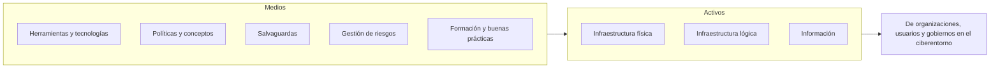

# 02 - Era digital y TIC

> Unidad 1 de *Introducción a la ciberseguridad* (Raptor Dev Services Academy, curso `cyber-intro`). Material recreado con palabras propias a partir del temario de un diplomado de ciberseguridad; las fuentes van al final en APA 7. Actualización al 2026 donde se indica.

## Por qué importa

Vivimos en una época que se define por lo digital. La mayoría de los trámites, las compras, las clases y buena parte de la vida social pasan por una pantalla. Esa época trae derechos nuevos (o derechos viejos que se ejercen de otra forma), pero también deja fuera a quien no tiene acceso o no sabe usar las herramientas. Y cada tecnología que llega a la vida diaria, de la geolocalización a la nube, abre una puerta más por la que alguien puede entrar sin permiso.

Esta nota explica qué es la era digital, qué derechos la sostienen (información, expresión, acceso a internet), cómo se manifiestan la brecha generacional, el analfabetismo digital y la migración digital, qué tecnologías emergentes conviene conocer y por qué todo eso desemboca en la necesidad de la ciberseguridad, tal como la define la Recomendación UIT-T X.1205.

## Qué es una era

Una era es un periodo largo que transforma de manera profunda a las sociedades, a la cultura y hasta al planeta. Algunas tienen fechas claras de inicio y de fin; otras se reconocen por un acontecimiento que cambió el rumbo de la historia. En México, por ejemplo, el sismo del 19 de septiembre de 1985 suele tomarse como un parteaguas: después de él cambiaron la organización ciudadana, la conciencia de protección civil y las normas de construcción. Una era, en suma, es un cambio duradero en el desarrollo humano y cultural.

### La era digital

La era digital arranca con la revolución tecnológica (ver [01 - Revolución sociotecnológica y herramental TIC](01-revolucion-sociotecnologica-y-tic.md)) y marca el momento en que surge una **cultura digital**. También se le llama era tecnológica. Trae muchas ventajas gracias al avance técnico, pero con frecuencia descuida el aspecto humano, y eso es en sí mismo un cambio social de primer orden.

Las TIC son la herramienta central de esta época y se adoptaron en casi todo el mundo. Lo nuevo, sin embargo, siempre trae riesgos. Como todo cambio histórico, la era digital plantea desafíos propios, y uno de los más serios es **cómo manejar, transmitir y proteger el exceso de información disponible**.

### Desarrollo tecnológico: entre herramienta y arma

Nadie discute que el desarrollo tecnológico sirve para casi cualquier actividad profesional o personal; la sociedad incluso lo exige. Para algunas personas la conectividad es tan central que estar desconectado se siente como no existir. Conviene recordar lo obvio: una persona es mucho más que su perfil en una red social o sus videos, y tener millones de seguidores la hace más conocida, no mejor.

El problema de fondo no es la herramienta, ni siquiera la informatización masiva de datos. Es la **falta de límites**: no hay fronteras claras que ayuden al usuario a aprender un uso responsable e informado de la herramienta más potente de la historia. Ya Hobbes, en el *Leviatán*, asociaba conocimiento y poder (*scientia potentia est*), y hoy la cantidad de información a la que se llega en segundos, incluso la que debería ser secreta, le da ventaja a quien sabe encontrarla y usarla.

Esa información, cierta o falsa, puede usarse de forma indebida o ilícita. De ahí dos necesidades: saber buscar en el lugar correcto y conocer los principios y derechos que aplican. También hay que asumir que uno puede cometer una conducta indebida sin proponérselo, y que hay quienes dañan a otros usuarios a propósito; cuando esa conducta reúne ciertas características, la ley la llama delito, y en este terreno, delito informático o ciberdelito.

Usar la tecnología a nuestro favor es lo mínimo, pero acompañado de conocimiento: sus ámbitos de aplicación, las novedades, los derechos que la fundamentan, sus riesgos, las consecuencias del exceso y el peligro para nuestra información, reputación y patrimonio. La tecnología no es mala; es una herramienta más, pero con rasgos que hacen muy delgada la línea entre **herramienta y arma**, y difícil ver el momento exacto en que empieza el riesgo. Esa es la justificación de toda la materia, que se aborda con una mirada objetiva, directa y humana: el usuario es la razón de ser de estas tecnologías y, al mismo tiempo, su principal vulnerabilidad.

## Derecho a la información y acceso a internet

En toda sociedad las personas tienen derechos y obligaciones fijados por las leyes, y la era digital no es la excepción. La diferencia es que la regulación va bastante atrás de la velocidad con la que cambia la tecnología. Por eso conviene conocer los derechos humanos ya reconocidos en el ámbito digital, sobre todo los que se relacionan con los servicios que hoy usamos a diario.

### Qué es "información"

La palabra tiene muchos significados según la disciplina que la use, así que siempre hay que fijar el contexto. Para esta materia, información es un conjunto de datos con significado que permite a las personas organizar su pensamiento; cada campo del conocimiento la precisa a su manera.

### Derechos humanos

La ONU explica los derechos humanos como derechos que pertenecen a toda persona por el solo hecho de serlo, sin que importen su nacionalidad, su domicilio, su sexo, su origen étnico o nacional, su color, su religión, su lengua o cualquier otra condición. Todas las personas los tienen por igual y sin discriminación, y se caracterizan por estar **interrelacionados, ser interdependientes y ser indivisibles**: no se puede respetar uno y desatender otro.

### El fundamento internacional: artículo 19 de la Declaración Universal

El derecho de acceso a la información descansa en la Declaración Universal de los Derechos Humanos de 1948:

> **Artículo 19.** Todo individuo tiene derecho a la libertad de opinión y de expresión; este derecho incluye el de no ser molestado a causa de sus opiniones, el de investigar y recibir informaciones y opiniones, y el de difundirlas, sin limitación de fronteras, por cualquier medio de expresión.

La frase "por cualquier medio de expresión" es la que, setenta años después, permite incluir a internet y a todas las tecnologías que facilitan llegar a la información.

### El fundamento en México: artículo 6o. constitucional

La Constitución Política de los Estados Unidos Mexicanos recoge el derecho a la información, el acceso plural a ella y el acceso a las TIC e internet:

> **Artículo 6o.** La manifestación de las ideas no será objeto de ninguna inquisición judicial o administrativa, sino en el caso de que ataque a la moral, la vida privada o los derechos de terceros, provoque algún delito, o perturbe el orden público; el derecho de réplica será ejercido en los términos dispuestos por la ley. El derecho a la información será garantizado por el Estado.
>
> Toda persona tiene derecho al libre acceso a información plural y oportuna, así como a buscar, recibir y difundir información e ideas de toda índole por cualquier medio de expresión.
>
> El Estado garantizará el derecho de acceso a las tecnologías de la información y comunicación, así como a los servicios de radiodifusión y telecomunicaciones, incluido el de banda ancha e Internet. Para tales efectos, el Ejecutivo Federal a través de la dependencia encargada de elaborar y conducir las políticas de telecomunicaciones y radiodifusión, establecerá condiciones de competencia efectiva en la prestación de dichos servicios.
>
> (CPEUM, texto vigente; tercer párrafo reformado DOF 20-12-2024)

En la práctica, este derecho abarca varias facultades: acceder a la información, expresarse con libertad, proteger los propios datos personales y conocer la información pública que permite exigir transparencia y rendición de cuentas a quien gobierna. Así, el acceso a las TIC y a internet es un derecho humano reconocido en la legislación mexicana, aunque el Estado no pueda garantizarlo todavía en todo el territorio.

### Las tres vertientes del derecho a la información

Siguiendo a Carpizo, citado por Rodríguez, el derecho a la información se puede descomponer en tres facultades:

| Vertiente | Qué permite |
|---|---|
| Derecho a allegarse información | Consultar archivos, registros y documentos públicos, y elegir libremente qué medio leer, escuchar o ver |
| Derecho a informar | Ejercer las libertades de expresión y de imprenta, y fundar empresas o sociedades dedicadas a informar |
| Derecho a ser informado | Recibir información objetiva, oportuna y completa, enterarse de las noticias, y que esa información llegue a todas las personas sin excluir a nadie |

### Sus límites

El derecho a la información y la libertad de expresión no son absolutos. El propio primer párrafo del artículo 6o. marca dónde terminan: cuando se ataca la moral, la vida privada o los derechos de terceros, cuando se provoca un delito o cuando se perturba el orden público. Soto (2010) desarrolla estas restricciones con más detalle. Para la ciberseguridad, la frontera con la **vida privada** es la más relevante: publicar datos de otra persona no está protegido por la libertad de expresión.

### Acceso no significa gratuidad

Que el acceso a internet sea un derecho no obliga a que sea gratis. Como otros servicios públicos, se paga. Cada Estado decide si ofrece conexión gratuita en algunos espacios públicos, pero no está obligado a darla sin costo en todas partes.

> **Actualización al 2026:** el Instituto Nacional de Transparencia, Acceso a la Información y Protección de Datos Personales (INAI) se extinguió en marzo de 2025, tras la reforma constitucional del 20 de diciembre de 2024 y la nueva Ley General de Transparencia y Acceso a la Información Pública (DOF 20-03-2025). Sus funciones en el ámbito federal pasaron a "Transparencia para el Pueblo", órgano desconcentrado de la Secretaría Anticorrupción y Buen Gobierno. Ese mismo día se publicó una nueva Ley Federal de Protección de Datos Personales en Posesión de los Particulares.

## Brecha generacional, analfabetismo y migración digitales

### La brecha y el analfabetismo digital

Los cambios acelerados que traen las tecnologías a la vida social y laboral han provocado que las herramientas TIC no lleguen a todos, por razones muy variadas. La brecha digital no viene sola: con ella aparecen otras desigualdades, como el **analfabetismo digital**, que es no tener las habilidades para usar las TIC de manera eficaz y segura, desde manejar un dispositivo hasta entender cómo funcionan internet, las aplicaciones y los servicios en línea.

En 2019 se difundió, con base en un reporte periodístico de la agencia Notimex, que 43 por ciento de la población mexicana no usaba internet o no tenía acceso a los medios para hacerlo. La cifra ilustra lo grave que era el problema en ese momento.

### Alfabetización digital

Lo que contrarresta el analfabetismo digital es una **alfabetización integral**, que no se limita a enseñar botones. Según Torvisco (2019), debe incluir:

- respeto a los derechos humanos en línea;
- conducta ética y responsabilidad por las consecuencias de lo que se publica o se hace;
- criterios para reconocer fuentes fiables en internet, que es uno de los problemas más frecuentes;
- reglas de convivencia en la red, conocidas como **netiqueta**.

### Nativos e inmigrantes digitales

Prensky (2001) propuso dos categorías que se volvieron clásicas:

| Categoría | Quiénes son |
|---|---|
| Nativos digitales | Personas que nacieron y crecieron junto con el desarrollo tecnológico, cuando las TIC ya estaban en plena expansión |
| Inmigrantes digitales | Personas que nacieron y se formaron antes de esa expansión, y que tuvieron que aprender las herramientas ya de adultas |

Prensky subraya que los nuevos esquemas de trabajo, estudio y entretenimiento exigen usar herramientas digitales para aprovecharlos, y que nativos e inmigrantes se relacionan con la tecnología de maneras distintas.

### Migración digital

La **migración digital** es la convivencia obligada de varias generaciones en el trabajo, en la vida profesional y en el tiempo libre, ahora que muchas herramientas tecnológicas son indispensables. Muchas de esas generaciones crecieron sin computadoras ni teléfonos inteligentes, porque no existían. La sociedad de la información ha hecho esfuerzos para incluirlas, y también para integrar a las generaciones más jóvenes, con esquemas como el trabajo desde casa, el trabajo independiente por proyecto y el aprendizaje en línea. Casi todos dependen de plataformas digitales, y eso vuelve indispensable la alfabetización digital.

### La brecha generacional

Palacios (2017) observa que la brecha entre generaciones no es nueva, pero hoy se nota más. Las personas tienen cada vez más acceso a información y conocimiento, de modo que la distancia ya no se explica tanto por falta de recursos u oportunidades como por la edad y por decisiones o temores personales. Mucha gente desconoce la variedad de tecnologías disponibles: conoce las redes sociales y algunos trámites en línea, y se limita a reenviar mensajes o subir fotos, sin aprovechar las herramientas a su favor.

La Encuesta Nacional sobre Disponibilidad y Uso de Tecnologías de la Información en los Hogares (ENDUTIH) de 2018 registró 74.3 millones de usuarios de internet de seis años o más en México. El grupo de 55 años o más era el de menor uso; las cifras reportadas para ese grupo fueron 4.1 por ciento en mujeres y 4.0 por ciento en hombres. The Social Intelligence Unit (2017) concluye que la brecha generacional no solo ayuda a explicar la brecha digital: para los adultos que no usan internet, se convierte en un obstáculo para ejercer plenamente su derecho a la información y a la libre expresión.

> **Actualización al 2026:** la ENDUTIH 2025 del INEGI estima 104.9 millones de personas usuarias de internet, 86.1 por ciento de la población de seis años o más (en 2015 eran 57.4 por ciento). La brecha persiste por lugar de residencia: 88.9 por ciento en zonas urbanas frente a 75.2 por ciento en zonas rurales. A escala mundial, la UIT calcula unos 6,000 millones de personas conectadas en 2025, alrededor de tres cuartas partes de la humanidad, y 2,200 millones todavía fuera de línea.

## Nuevas tecnologías y ciberseguridad

### Tecnologías emergentes

Una tecnología emergente es una innovación en desarrollo o recién introducida que puede cambiar a fondo un sector o la sociedad entera. Suelen incluirse la inteligencia artificial, la biotecnología, la realidad virtual y aumentada, la robótica, el blockchain y la computación cuántica. Su efecto puede transformar industrias, abrir mercados nuevos y resolver problemas complejos; también abre superficies de ataque nuevas.

| Tecnología | Qué es, en una línea | Riesgo de seguridad que conviene tener presente |
|---|---|---|
| Realidad aumentada | Superpone información digital sobre la imagen del mundo real, normalmente a través de la cámara del teléfono | Recaba imágenes del entorno y ubicación del usuario |
| Big data | Conjuntos de datos tan grandes, variados y veloces que requieren herramientas especiales para analizarse (Oracle, s. f.) | Una sola fuga expone a millones de personas |
| Tecnología 4D | Experiencias que suman a la imagen tridimensional efectos físicos o el factor tiempo | Dispositivos conectados con sensores |
| Inteligencia artificial | Sistemas que aprenden de datos para clasificar, predecir o generar contenido (Argentina, Secretaría de Innovación Pública, s. f.) | Suplantación, desinformación y decisiones opacas |
| Blockchain | Registro distribuido en el que cada bloque queda encadenado criptográficamente al anterior, lo que dificulta alterarlo | El registro es fuerte, pero las llaves y las aplicaciones alrededor no siempre lo son |

### Cinco ejemplos que ya usamos

**1. Trazabilidad y geolocalización.** El proyecto europeo AgroSMARTcoop (2017) explica la trazabilidad como el conjunto de procedimientos que permiten reconstruir la historia, la ubicación y el recorrido de un producto o lote a lo largo de la cadena de suministro, con herramientas concretas. Las TIC la facilitan con etiquetas de radiofrecuencia (RFID) o con códigos QR impresos que permiten al consumidor conocer el origen de lo que compra. La geolocalización es la versión cotidiana de esa idea: la ubicación que calculan los teléfonos, los localizadores GPS de los autos, los dispositivos de recuperación de vehículos robados y las aplicaciones que nos guían a un lugar desconocido. Todo ese rastro también es un dato personal.

**2. Identificación biométrica.** La biometría usa medidas biológicas o rasgos físicos para identificar a una persona: huella, rostro, iris, voz. Kaspersky (s. f.) señala que esos rasgos son bastante estables y distinguibles, incluso entre gemelos, por lo que se usan para reemplazar o reforzar contraseñas en computadoras, teléfonos y accesos a edificios. Su gran ventaja es también su riesgo: una contraseña filtrada se cambia; una huella filtrada no.

**3. Internet 2.** Red académica de alta velocidad para investigación y educación. En México, la red de este tipo arrancó en 1999 con la Corporación Universitaria para el Desarrollo de Internet (CUDI), una asociación civil fundada por las principales universidades del país. En Estados Unidos, Internet2 es una comunidad de tecnología avanzada impulsada por sus miembros, donde instituciones de investigación y educación resuelven juntas retos técnicos. Hacia 2016 integraba 317 instituciones de educación superior estadounidenses, decenas de corporaciones y agencias federales, 43 redes regionales y estatales de educación, y alianzas con redes nacionales de investigación de más de cien países.

> **Actualización al 2026:** los conteos públicos más recientes de Internet2 hablan de unas 330 universidades, cerca de 60 agencias de gobierno y 46 redes regionales y estatales; la cifra exacta cambia cada año y se consulta en su directorio de miembros.

**4. Internet de las cosas (IoT).** Es la conexión a internet de objetos cotidianos para que se comuniquen y compartan datos entre sí. Ya en 2014 la revista Forbes describía cómo esa conectividad rebasaba a teléfonos, tabletas y computadoras para llegar a casi cualquier objeto. La idea es que cada dispositivo tenga una dirección en la red y pueda hablar con otros, muchas veces sin que lo notemos. Se conectan por wifi, WiMAX, RFID, 3G, LTE, Bluetooth, NFC o 5G. El beneficio es la automatización y la eficiencia; el costo es que cada foco, cámara o reloj conectado es un equipo más que se puede atacar. Kaspersky advirtió, por ejemplo, que los dispositivos médicos conectados y los servicios de salud quedarían cada vez más expuestos a ataques dirigidos (Namestnikova, 2021), y ESET dedicó su informe *Tendencias 2019* a la privacidad en un mundo de dispositivos inteligentes.

**5. Cómputo en la nube.** Microsoft Azure la describe como la entrega de servicios de cómputo (servidores, almacenamiento, bases de datos, redes, software, análisis e inteligencia) a través de internet, con tres promesas: innovar más rápido, disponer de recursos flexibles y aprovechar economías de escala. Normalmente se paga solo lo que se usa, lo que baja los costos de operación y permite crecer cuando el negocio lo requiere. Servicios de almacenamiento conocidos son Box, Dropbox, Google Drive e iCloud. Guardar datos en servidores ajenos tiene riesgos: los términos de servicio son **contratos de adhesión**, redactados por una sola parte, que el usuario acepta sin negociar y que pueden generarle problemas jurídicos (dónde se guardan sus datos, quién puede acceder a ellos, qué pasa si el servicio cierra).

### La ciberseguridad según la Recomendación UIT-T X.1205

La Unión Internacional de Telecomunicaciones publicó en 2008 la Recomendación UIT-T X.1205, que define la ciberseguridad y clasifica las amenazas desde el punto de vista de una organización. Describe los tipos de amenaza, los puntos débiles de los sistemas y las herramientas más usadas por los atacantes en distintas capas de la red.

En términos propios, la definición dice que la ciberseguridad es **todo lo que una organización reúne para proteger sus activos en el ciberentorno**: herramientas, políticas y conceptos de seguridad, salvaguardas que reducen riesgos, métodos de gestión de riesgos, acciones, formación de los usuarios, buenas prácticas y tecnologías. Lo que se protege son los activos informáticos físicos y lógicos, y la información, tanto de la organización como de sus usuarios y de los gobiernos.

La misma recomendación define el **ciberentorno** como el conjunto de usuarios, redes, dispositivos, programas, procesos, información almacenada o en tránsito, aplicaciones, servicios y sistemas conectados directa o indirectamente a las redes.

Implementarla bien requiere especialistas de varios perfiles: analistas de seguridad, ingenieros de sistemas, expertos en cumplimiento normativo y profesionales de formación y concientización. Cada uno aporta lo suyo, y el trabajo conjunto es el que eleva el nivel de protección. Cualquier persona puede ser víctima de un delito informático, por eso la ciberseguridad es un asunto de todos; las siguientes unidades lo desarrollan.

## Brecha digital e inclusión digital

La brecha digital es la desigualdad en el acceso y en el uso de la tecnología e internet entre grupos de personas, por razones económicas, geográficas o educativas. La **inclusión digital** es la respuesta: que todas las personas, sin importar su contexto, puedan llegar a la información, a la educación y a las oportunidades económicas del entorno digital. Jarque (2021) lo plantea como un desafío universal, porque una sociedad con una parte desconectada no puede ser equitativa ni justa. Promover la inclusión digital no es solo conectar: también es formar, para que quien se conecta no quede expuesto a riesgos que no sabe reconocer.

## Lo que hay que llevarse

- La era digital es una cultura nueva que trae ventajas y descuida con frecuencia lo humano; su reto central es el exceso de información.
- El derecho a la información (artículo 19 de la Declaración Universal y artículo 6o. constitucional) incluye buscar, recibir y difundir información por cualquier medio, y en México incluye el acceso a las TIC e internet.
- Ese derecho tiene límites, y el más importante para la ciberseguridad es la vida privada de otras personas.
- La brecha digital convive con la generacional y con el analfabetismo digital; la respuesta es la alfabetización integral.
- Cada tecnología cotidiana (geolocalización, biometría, IoT, nube) trae un riesgo propio.
- La ciberseguridad, según la UIT, es el conjunto de medios para proteger activos físicos, lógicos e información en el ciberentorno.

## Glosario

| Término | Definición |
|---|---|
| Era digital | Periodo histórico marcado por la revolución tecnológica y por una cultura organizada alrededor de lo digital |
| Información | Conjunto de datos con significado que permite organizar el pensamiento; cada disciplina la define a su manera |
| Derecho a la información | Facultad de allegarse información, de informar y de ser informado, por cualquier medio de expresión |
| Analfabetismo digital | Falta de habilidades para usar las TIC de manera eficaz y segura |
| Alfabetización digital | Formación integral para usar las TIC con criterio, ética, seguridad y fuentes fiables |
| Netiqueta | Reglas de convivencia y cortesía en la comunicación en línea |
| Nativo digital | Persona que creció cuando las TIC ya estaban extendidas |
| Inmigrante digital | Persona que aprendió a usar las TIC ya formada, porque creció antes de su expansión |
| Migración digital | Convivencia de varias generaciones obligadas a usar las mismas herramientas digitales |
| Biometría | Identificación de personas por rasgos físicos o biológicos medibles |
| Internet de las cosas | Conexión a internet de objetos cotidianos que intercambian datos entre sí |
| Nube | Servicios de cómputo entregados por internet y pagados según su uso |
| Contrato de adhesión | Contrato redactado por una sola parte que la otra solo puede aceptar o rechazar |
| Ciberentorno | Conjunto de usuarios, redes, dispositivos, programas, datos y servicios conectados a las redes |
| Ciberseguridad | Medios técnicos, organizativos y formativos para proteger activos e información en el ciberentorno |
| Inclusión digital | Garantía de que todas las personas puedan acceder y aprovechar el entorno digital |

## Referencias

- AgroSMARTcoop. (2017). *Trazabilidad en la cadena agroalimentaria* [proyecto Interreg Sudoe]. Programa Interreg Sudoe. https://www.interreg-sudoe.eu/
- Argentina, Secretaría de Innovación Pública. (s. f.). *Inteligencia artificial para inteligencias reales* [manual]. https://www.argentina.gob.ar/sites/default/files/manual_-_inteligencia_artificial.pdf
- Constitución Política de los Estados Unidos Mexicanos. (1917, última reforma DOF 07-10-2026). Cámara de Diputados. https://www.diputados.gob.mx/LeyesBiblio/pdf/CPEUM.pdf
- Corporación Universitaria para el Desarrollo de Internet. (s. f.). *CUDI*. https://www.cudi.edu.mx/
- ESET. (2018, 18 de diciembre). *Tendencias 2019: privacidad e intrusión en la aldea global*. WeLiveSecurity. https://www.welivesecurity.com/la-es/2018/12/18/tendencias-2019-ciberseguridad/
- Instituto Nacional de Estadística y Geografía. (2019). *Encuesta Nacional sobre Disponibilidad y Uso de Tecnologías de la Información en los Hogares (ENDUTIH) 2018*. https://www.inegi.org.mx/programas/dutih/2018/
- Instituto Nacional de Estadística y Geografía. (2026). *Encuesta Nacional sobre Disponibilidad y Uso de Tecnologías de la Información en los Hogares (ENDUTIH) 2025* [comunicado de prensa]. https://www.inegi.org.mx/contenidos/saladeprensa/boletines/2026/endutih/ENDUTIH_25_RR.pdf
- Internet2. (s. f.). *Community*. https://internet2.edu/community/
- Kaspersky. (s. f.). *¿Qué es la biometría?* https://latam.kaspersky.com/resource-center/definitions/biometrics
- Ley General de Transparencia y Acceso a la Información Pública. (2025). *Diario Oficial de la Federación*, 20 de marzo de 2025. Cámara de Diputados. https://www.diputados.gob.mx/LeyesBiblio/pdf/LGTAIP.pdf
- Microsoft Azure. (s. f.). *¿Qué es la informática en la nube?* https://azure.microsoft.com/es-es/resources/cloud-computing-dictionary/what-is-cloud-computing
- Namestnikova, M. (2021). *The dangers of "connected" healthcare: predictions for 2022*. Securelist, Kaspersky. https://securelist.com/connected-healthcare-predictions-for-2022/104969/
- Oracle. (s. f.). *¿Qué es el big data?* https://www.oracle.com/mx/big-data/what-is-big-data/
- Organización de las Naciones Unidas. (1948). *Declaración Universal de los Derechos Humanos*. https://www.un.org/es/about-us/universal-declaration-of-human-rights
- Prensky, M. (2001). Digital natives, digital immigrants. *On the Horizon, 9*(5), 1-6. https://doi.org/10.1108/10748120110424816
- Unión Internacional de Telecomunicaciones. (2008). *Recomendación UIT-T X.1205: Aspectos generales de la ciberseguridad*. https://www.itu.int/rec/T-REC-X.1205-200804-I/es
- Unión Internacional de Telecomunicaciones. (2025, 17 de noviembre). *Aumenta el número mundial de usuarios de Internet, pero las disparidades profundizan las principales brechas digitales* [comunicado]. https://www.itu.int/es/mediacentre/Pages/PR-2025-11-17-Facts-and-Figures.aspx
- Citas secundarias sin obra original localizada: Carpizo, citado por Rodríguez (vertientes del derecho a la información); Soto (2010), límites al derecho a la información; Notimex (2019); Torvisco (2019); Palacios (2017); The Social Intelligence Unit (2017); Forbes (2014), internet de las cosas; Jarque (2021), *El desafío de la inclusión digital universal*.

---

*Rogelio Arriaga Gonzalez*
