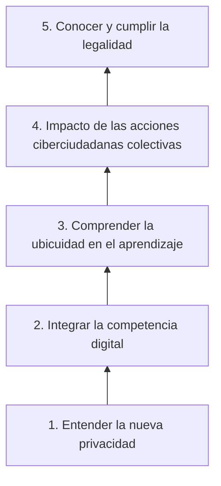

# 04 - Cambio sociopolítico y TIC

> Unidad 2 de *Introducción a la ciberseguridad* (Raptor Dev Services Academy, curso `cyber-intro`). Material recreado con palabras propias a partir del temario de un diplomado de ciberseguridad; las fuentes van al final en APA 7. Actualización al 2026 donde se indica.

## Por qué importa

Cuando un trámite, una protesta o una conversación con un diputado pasan por una pantalla, la relación entre la persona y el Estado cambia de forma. Ya no basta con saber qué derechos se tienen: hay que saber ejercerlos con herramientas digitales, y saber qué rastro, qué identidad y qué riesgos quedan en el camino. A esa forma de ser ciudadano a través de la tecnología se le llama ciudadanía digital, e-ciudadanía o ciberciudadanía.

Para la ciberseguridad el tema importa: la identidad con la que alguien entra a un portal de gobierno es un activo que se roba; la participación en línea produce datos personales que se acumulan; y los gobiernos que digitalizan servicios amplían la superficie que hay que proteger. Esta nota recorre cómo las TIC transforman la vida política y social, qué obligaciones tiene el Estado para que todos puedan usarlas, qué pasa con la identidad en el ciberentorno y cuáles son los campos donde la ciberciudadanía se construye.

## De la ciudadanía a la ciberciudadanía

Los gobiernos no quedaron fuera de la transformación tecnológica. A medida que las TIC se extendieron, alteraron la manera de hacer política y la interacción dentro de la sociedad de la información, y con ello aparecieron términos nuevos que se montan sobre conceptos viejos. El punto de partida es que las políticas públicas se formulan a partir de los intereses y las necesidades de la ciudadanía, así que la ciudadanía sigue siendo el centro aunque cambie el medio.

Una definición muy citada en la literatura en español, atribuida a Mila Gascó, entiende la ciberciudadanía como la manera de ejercer derechos y deberes constitucionales y libertades políticas por medio de las tecnologías de información y comunicación: internet, televisión, radio y telefonía móvil. La definición tiene una consecuencia práctica: tener acceso a la herramienta no garantiza que los derechos se ejerzan. Hace falta alfabetización digital, porque la tecnología solo vale algo cuando hay personas preparadas para usarla.

| Término | Énfasis |
|---|---|
| Ciudadanía digital | La condición de ciudadano trasladada al entorno digital, con derechos, deberes y competencias |
| E-ciudadanía | La relación electrónica con el gobierno: trámites, consultas, información pública |
| Ciberciudadanía | El ejercicio activo de derechos y libertades políticas mediante TIC, incluida la participación y la protesta |

En la práctica se usan casi como sinónimos.

## Apropiación de las TIC: servicio y función del Estado

En México, garantizar que la población pueda usar las TIC es una obligación constitucional, no una cortesía. La reforma de telecomunicaciones de 2013 agregó al artículo 6o. un párrafo sobre el acceso a las tecnologías, que hoy dice:

> El Estado garantizará el derecho de acceso a las tecnologías de la información y comunicación, así como a los servicios de radiodifusión y telecomunicaciones, incluido el de banda ancha e Internet. Para tales efectos, el Ejecutivo Federal a través de la dependencia encargada de elaborar y conducir las políticas de telecomunicaciones y radiodifusión, establecerá condiciones de competencia efectiva en la prestación de dichos servicios.

> **Actualización al 2026:** ese párrafo fue reformado el 20 de diciembre de 2024. Antes encargaba la competencia efectiva a un órgano autónomo; ahora la encarga a una dependencia del Ejecutivo Federal, como parte de la reforma que extinguió a varios órganos autónomos.

La obligación se repite en los planes nacionales de desarrollo y en tratados que México ha firmado: es política de Estado, no programa sexenal. En términos operativos, el Estado debe tener programas que acerquen el acceso y la educación digital a todos los sectores, no solo a los que ya están conectados.

La apropiación tecnológica se puede resumir en tres palabras: es una **necesidad** (sin ella hay trámites, empleos y servicios que no se alcanzan), una **oportunidad** (abre canales directos con la autoridad) y una **obligación** (del Estado de facilitarla y del ciudadano de usarla con responsabilidad).

### Gobierno abierto

Antes de hablar de derechos conviene fijar la idea de gobierno abierto: una forma de gobernar en la que los asuntos públicos son transparentes para la ciudadanía y en la que internet y las TIC le dan a la sociedad civil instrumentos para generar conocimiento, organizarse, participar y colaborar en tiempo real, sin fronteras. México fue uno de los ocho países fundadores de la Alianza para el Gobierno Abierto en 2011 (Open Government Partnership, s. f.).

### Cómo usa el sector público las TIC

| Uso | En qué consiste |
|---|---|
| Gobierno electrónico | Plataformas para hacer trámites en línea y consultar información pública |
| Transparencia y rendición de cuentas | Publicación de datos abiertos para que cualquiera vigile la gestión |
| Participación ciudadana | Aplicaciones para opinar, proponer y votar decisiones públicas |
| Mejora de servicios | Salud, educación y seguridad con procesos más eficientes |
| Comunicación permanente | Redes sociales oficiales y colaboración entre dependencias |
| Capacitación interna | Alfabetización digital de los propios servidores públicos |

### Los límites de la apropiación

La apropiación todavía es dispareja. Hay recursos, iniciativas y servicios que podrían usarse y no se han incorporado del todo. Cada gobernante decide qué temas digitaliza, con criterios que rara vez se explican, y el resultado es una integración irregular y poco equitativa. Los números ayudan a dimensionar el problema:

- En el mundo, la Unión Internacional de Telecomunicaciones estimó para 2025 unos 6,000 millones de personas en línea (74 % de la población) y 2,200 millones todavía desconectadas, casi todas en países de ingreso bajo y medio (ITU, 2025).
- En México, la ENDUTIH 2024 contó 100.2 millones de usuarios de internet, el 83.1 % de la población de seis años o más; en zonas urbanas el uso llegó a 86.9 % y en las rurales a 68.5 % (INEGI, 2025).

Casi veinte puntos de diferencia entre ciudad y campo: un servicio que solo existe en línea deja fuera a mucha gente.

## Campos de apropiación y aplicación de las TIC

El tema organiza la apropiación en cinco niveles que van de lo más básico a lo más exigente. Cada nivel tiene una lectura de apoyo; aquí se recoge lo que aportan.

### 1. Entender la nueva privacidad

Josu Osés (2014) habla de una "neo-privacidad" porque el volumen de datos cambió la naturaleza del problema. Recoge una proyección según la cual el universo digital crecería 300 veces entre 2005 y 2020, de 130 a 40,000 exabytes, y lo explica por dos vectores: el almacenamiento en la nube, que aleja los datos de su dueño y los reparte en servidores de ubicación incierta, y el internet de las cosas, con dispositivos que miden la salud, el sueño o el consumo de energía de una casa. Su diagnóstico tiene cuatro piezas:

- **Neutralidad de la red.** Si los proveedores cobran distinto según la velocidad, la red se vuelve discriminatoria, y con ella la protección de los datos.
- **Mercantilización de los datos.** Ofertas de conexión gratuita a cambio de revender lo que el usuario navega.
- **Vigilancia masiva.** Las filtraciones sobre la NSA mostraron la mezcla de opacidad e intromisión. En abril de 2014 el Tribunal de Justicia de la Unión Europea anuló la Directiva 2006/24/CE de conservación de datos de comunicaciones por desproporcionada.
- **Responsabilidad compartida.** Su conclusión es que la nueva privacidad depende de tres cosas a la vez: responsabilidad individual, conciencia social y protección institucional. Ninguna sola basta, y la gente, advierte, cuida poco su identidad digital.

Osés citaba como contraejemplo la ley mexicana de telecomunicaciones de 2014, que obligaba a los concesionarios a entregar la ubicación en tiempo real de los equipos y a conservar registros de comunicaciones.

> **Actualización al 2026:** la Ley Federal de Telecomunicaciones y Radiodifusión de 2014 fue abrogada por la Ley en Materia de Telecomunicaciones y Radiodifusión, publicada en el DOF el 16 de julio de 2025. La colaboración con la justicia, incluida la geolocalización de equipos, sigue regulada y fue uno de los puntos más debatidos de la nueva ley.

### 2. Integrar la competencia digital

Miguel Mandujano (2017) analiza la estrategia Europa 2020 y su agenda digital, y critica que reduzca la ciudadanía digital a crecimiento económico y a una alfabetización puramente técnica. Su indicador de economía y sociedad digital medía cinco dimensiones: conectividad, capital humano, uso de internet, integración de la tecnología en las empresas y servicios públicos digitales. Para el autor, eso mide habilidades pero no las condiciones materiales y educativas que las hacen posibles.

Identifica dos acuerdos generales sobre la ciudadanía digital: el primero, que los Estados deben garantizar acceso, servicios y un trato legal de la relación digital entre ciudadanos y representantes; el segundo, que hace falta educación, alfabetización o competencia. Para esta última, el marco europeo DigComp organiza la competencia digital en cinco áreas: información, comunicación, creación de contenido, seguridad y resolución de problemas (Ferrari, 2013, citado por Mandujano). Mandujano propone pasar de la noción de competencia a la de educación digital, y formar prosumidores: usuarios que no solo consumen información, sino que la producen con criterio.

> **Actualización al 2026:** Europa 2020 terminó; la Unión Europea la sustituyó por el programa Década Digital 2030 (Decisión (UE) 2022/2481). El marco DigComp se actualizó como DigComp 2.2 en 2022, con las mismas cinco áreas y 21 competencias, entre ellas la de seguridad.

### 3. Comprender la ubicuidad en el aprendizaje

La información digital ya no está atada a un lugar ni a un horario. Rodrigo y de Castro plantean que el contenido educativo digital es un modelo nuevo para un aprendizaje ubicuo: se aprende en cualquier sitio y en cualquier momento, y eso obliga a enseñar a buscar, filtrar y evaluar fuentes, no solo a memorizar.

### 4. Impacto de las acciones ciberciudadanas colectivas

Alejandro Ramos Chávez (2015) estudia cómo la información en línea produce acción colectiva. Retoma cinco rasgos que distinguen a internet de otros medios y que moldean una ciudadanía nueva:

| Rasgo | Qué cambia |
|---|---|
| Inmediatez | Los mensajes se producen y reciben al instante; se borran barreras de tiempo y distancia |
| Interactividad | Se pasa del modelo uno a muchos al de muchos a muchos |
| Multiautoría | Cualquiera puede producir y enriquecer información (el prosumidor) |
| Accesibilidad | El costo bajo permite llegar a grupos amplios, aunque choca con la brecha digital |
| Libertad de expresión | Texto, imagen, audio y video al alcance de cualquier persona |

Sus ejemplos trazan una línea histórica: la protesta contra la Organización Mundial del Comercio en Seattle en 1999, coordinada por internet; el movimiento 15-M en España (2011) y el movimiento estudiantil #YoSoy132 en México (2012); la elección estadounidense de 2012, en la que Twitter se volvió un medio de seguimiento masivo; y las elecciones mexicanas de 2015, en las que un candidato independiente ganó una gubernatura y otro una diputación local en Jalisco con campañas casi exclusivamente en redes.

El mismo autor advierte los problemas: la brecha digital por ubicación, ingreso y alfabetización; la desigualdad en la producción de contenidos (se ha estimado que una minoría muy pequeña de usuarios genera la mayor parte de lo publicado); el sesgo por edad, educación e ingreso; que quienes más participan en línea son los que ya participaban fuera de ella; que muchos políticos usan las redes como propaganda y no como diálogo; y la saturación informativa.

### 5. Conocer y cumplir la legalidad

El nivel más alto es saber que en línea siguen vigentes los derechos humanos y las leyes. Pérez Luño (2002) estudia la relación entre internet y derechos humanos: las libertades se ejercen en la red con los mismos límites que fuera de ella. Un ciberciudadano informado sabe qué puede exigir y qué no puede hacer.

## Ni identidad, ni ciudadanía: la ciudadanía global

### La identidad como derecho

La identidad es un derecho humano y la forma legal de individualizar a una persona. La Constitución lo reconoce en el artículo 4o.:

> Toda persona tiene derecho a la identidad y a ser registrado de manera inmediata a su nacimiento. El Estado garantizará el cumplimiento de estos derechos. La autoridad competente expedirá gratuitamente la primera copia certificada del acta de registro de nacimiento.

Y el artículo 20, apartado C, protege la identidad de las víctimas:

> V. Al resguardo de su identidad y otros datos personales en los siguientes casos: cuando sean menores de edad; cuando se trate de delitos de violación, trata de personas, secuestro o delincuencia organizada; y cuando a juicio del juzgador sea necesario para su protección, salvaguardando en todo caso los derechos de la defensa.

Definir identidad no es sencillo porque cada disciplina la entiende distinto. Una definición jurídica la reduce al registro que identifica a una persona física a partir de su filiación y sus señas particulares. La Suprema Corte va más lejos: la vincula con el reconocimiento de cada persona como sujeto de derechos y obligaciones, con su pertenencia a un Estado, un territorio, una sociedad y una familia, y la considera condición para preservar la dignidad individual y colectiva. Por eso la liga con los **atributos de la personalidad**.

Los atributos de la personalidad son las cualidades jurídicas que vuelven a alguien único, identificable e inconfundible: nombre, sexo, estado civil, domicilio, filiación, nacionalidad y edad. Se adquieren al nacer y se extinguen con la muerte. El jurista Cipriano Gómez Lara describía la personalidad como la suma de los atributos jurídicos de una persona, y códigos civiles como el de Jalisco protegen los derechos de la personalidad frente a otras personas y frente al Estado. Todo eso debe protegerse igual en el ciberentorno.

### La identidad en el ciberentorno

En línea, saber con certeza quién está del otro lado es difícil. A eso se suma que existen muchos tipos de identidad (religiosa, cultural, social, de género, nacional, legal, personal, profesional, política) y todos pueden representarse en entornos virtuales. Sin certeza sobre el interlocutor tampoco hay base para confiar en su trabajo, sus negocios o sus invitaciones, y lo peor no es la duda: es el riesgo de suplantación, acoso o engaño que la duda permite.

Sobre cuántas identidades conviene tener hay tres posturas:

| Postura | Idea | Problema o ventaja |
|---|---|---|
| Identidades múltiples | Una identidad por servicio o entorno | Cada perfil puede terminar con una personalidad distinta y aumenta la confusión |
| Identidad multinivel (Gascó, 2008) | Una misma identidad para entornos presenciales y virtuales | Más coherente y fácil de verificar |
| Identidad global (La Rosa, 2009) | La identidad ciudadana válida en cualquier país | Responde a que el ciberciudadano actúa en todo el mundo |

La idea de una identidad global se justifica porque el ciberciudadano participa en consultas, encuestas, opiniones y protestas de otros países, lo que se ha llamado **ciberacciones**, y deja atrás barreras jurídicas como la jurisdicción y barreras geográficas. Conoce personas y visita países sin salir de casa, pero cada nueva relación puede traer consecuencias jurídicas nuevas.

### El contacto con los representantes

En política, el contacto directo entre ciudadanos y representantes suele ser más promesa que realidad. En 2016 el sitio de la entonces Asamblea Legislativa del Distrito Federal permitía localizar al diputado de cada distrito con sus datos y formas de contacto, pero lo más probable es que respondiera su equipo y no el legislador. Eso genera desánimo y desconfianza en el canal, aunque no en el potencial de la herramienta.

> **Actualización al 2026:** la Asamblea Legislativa del Distrito Federal dejó de existir en 2018; su lugar lo ocupa el Congreso de la Ciudad de México.

## Edificación de la ciberciudadanía

Un ciberciudadano participa activamente en el entorno digital: se informa, interactúa, opina y toma parte en procesos democráticos con TIC, y promueve un uso responsable y ético de ellas. Construir esa ciudadanía requiere alfabetización tecnológica, habilidades digitales, comportamiento adecuado en línea (netiqueta) y ética. El tema propone siete frentes:

| Frente | Qué aporta |
|---|---|
| A. Transparencia y rendición de cuentas | Acceso a la información pública como base para exigir |
| B. Participación ciudadana | Pasar de audiencia a actor de las decisiones públicas |
| C. Presupuesto participativo | Decidir directamente sobre una parte del gasto |
| D. Ciudadanía digital e iniciativa de normas | Influir en leyes y políticas, incluso para detenerlas |
| E. Educación en ciudadanía digital | Formación y certificación de competencias |
| F. Trámites y servicios | Gobierno electrónico que funciona |
| G. Debate social y conciencia crítica | Espacios para discutir con información |

### B. Participación ciudadana y ciberdemocracia

Francisco Sierra Caballero y Carlos del Valle (2007) sostienen que las TIC no son solo máquinas: son medios de organización e ingeniería social. Las redes distribuidas de comunicación permiten que el ciudadano pase de consumidor a productor de medios y de información, bajo el principio de "hazlo tú mismo" de los medios alternativos, y abren la puerta a nuevas formas de representación y decisión. A la vez, observan que las iniciativas públicas de participación electrónica responden a una crisis de legitimidad de los gobiernos, y piden estudiarlas con sentido crítico y no solo como casos de éxito local.

### C. Presupuesto participativo

Jorge Francisco Aguirre Sala (2014) distingue la participación ciudadana, autónoma, de la participación política institucionalizada, y ve en el presupuesto participativo el instrumento más democratizador porque se repite cada año, obliga a deliberar y combina la representación con la decisión directa. Sus datos sobre México, con corte a 2013:

- El 87.5 % de las entidades tenía ley de participación ciudadana o equivalente; faltaba en cuatro estados.
- El presupuesto participativo solo estaba previsto expresamente en el Distrito Federal y Sonora (6.25 % de las entidades).
- Había 23 experiencias municipales o delegacionales con otros nombres, apenas 0.93 % de los 2,473 municipios, y en 34.78 % de ellas no existía obligación jurídica.
- La ley de participación del Distrito Federal de 2010 destinaba el 3 % del presupuesto anual de las delegaciones a proyectos decididos por los vecinos.

Para que funcione, el autor retoma condiciones como la voluntad política, una sociedad organizada, funcionarios competentes, comunidades de tamaño manejable, recursos suficientes, un marco legal que lo incentive y gobiernos locales electos democráticamente. Y documenta el efecto de lo digital: en Belo Horizonte, Brasil, la versión electrónica tuvo siete veces más participación que la presencial con una cuarta parte de los recursos. Los medios digitales bajan el costo de participar, atraen a jóvenes y a clases medias, reducen la asimetría de información y permiten votar en secreto, lo que debilita el control corporativo del voto.

> **Actualización al 2026:** la ley de 2010 fue abrogada. La Ley de Participación Ciudadana de la Ciudad de México, publicada en agosto de 2019, fija en su artículo 116 que el presupuesto participativo corresponde al 4 % del presupuesto anual de las alcaldías; el porcentaje subió en forma gradual desde 3.25 % en 2020.

### D. Ciudadanía digital e iniciativa de normas

Lo presencial y lo virtual se refuerzan: una comunidad que se identifica en línea con un fin común puede lograr que una política pública o un proyecto de ley se retire. El caso de referencia en México es la iniciativa de delitos informáticos presentada en el Senado por el entonces senador Omar Fayad, criticada por tipificar de manera excesiva el uso de la red y retirada tras la reacción en línea (Notimex, s. f.).

### E. Educación en ciudadanía digital

Algunos gobiernos no solo capacitan: certifican. Colombia, por ejemplo, difundió por su Ministerio TIC un programa para certificarse en ciudadanía digital, y una universidad colombiana reportaba que desde 2012 ese tipo de certificación tenía reconocimiento en 148 países. La certificación da al ciudadano un valor agregado y, de paso, oportunidades de empleo y negocio.

### F. Trámites y servicios

El portal del Servicio de Administración Tributaria es uno de los ejemplos más completos de gobierno electrónico en México: declaraciones, facturas y firma electrónica pasan por ahí, y por eso mismo es un blanco atractivo.

### G. Debate social y conciencia crítica

Las redes sirven a fines distintos. Twitter, hoy X, fue durante años el espacio preferido para el debate público, con usuarios que firmaban con su identidad y discutían temas serios; pero también hay foros y wikis que permiten deliberar de forma más ordenada y colaborativa. La Organización de los Estados Americanos promovió un debate público sobre uso responsable de la tecnología, democracia y privacidad en el mundo moderno.

## Lecturas de profundización

- **Participación electrónica.** Gil-García, Criado y Téllez (2017) relacionan la participación electrónica con el uso de redes sociales y la participación política dentro de la administración pública.
- **Ciberciudadanía responsable.** Rodríguez Gordo (2017) analiza el papel del ciudadano en una sociedad mediada por la tecnología: la sobreinformación, la orientación política de las reformas educativas y la aparición de nuevos medios exigen que el ciudadano distinga fuentes confiables de desinformación.
- **Teledemocracia.** Garcés Noblecía (s. f.) evalúa críticamente las nuevas modalidades de participación política en línea y la intervención de actores sociales en ese entorno.
- **Plataformas y seguridad jurídica.** Díaz Santana y García Rodríguez (2022) muestran que el tráfico de datos personales en plataformas digitales genera inseguridad jurídica; citan un estudio de la Asociación de Internet en México según el cual en el mercado negro se compraban datos personales desde 100 pesos (correo, cuentas bancarias, firma electrónica, actas de nacimiento). Proponen normas hechas democráticamente, que protejan derechos, se apliquen a todos por igual y se cumplan siempre.

> **Actualización al 2026:** el organismo federal de protección de datos (INAI) se extinguió en 2025. La nueva Ley Federal de Protección de Datos Personales en Posesión de los Particulares, publicada el 20 de marzo de 2025, asigna la protección de datos frente a particulares a la Secretaría Anticorrupción y Buen Gobierno.

Una última advertencia: ciudadano o político, quien publica debe pensar en las consecuencias, porque lo que entra a internet se queda.

## Glosario

| Término | Definición |
|---|---|
| Ciberciudadanía | Ejercicio de derechos, deberes y libertades políticas por medio de las TIC |
| Ciudadanía digital | Condición de ciudadano en el entorno digital, con sus derechos, deberes y competencias |
| Apropiación de las TIC | Proceso por el que personas e instituciones incorporan la tecnología a su vida y su función |
| Gobierno abierto | Forma de gobernar basada en transparencia, participación y colaboración con apoyo de las TIC |
| Gobierno electrónico | Prestación de trámites y servicios públicos por medios digitales |
| Brecha digital | Desigualdad en el acceso, el uso y el aprovechamiento de las TIC |
| Neo-privacidad | Privacidad replanteada ante el volumen de datos, la nube y el internet de las cosas |
| Competencia digital | Saberes y habilidades para usar la tecnología con criterio y seguridad |
| Prosumidor | Usuario que consume y produce contenidos al mismo tiempo |
| Identidad | Conjunto de datos y atributos que individualizan jurídicamente a una persona |
| Atributos de la personalidad | Nombre, sexo, estado civil, domicilio, filiación, nacionalidad y edad |
| Identidad multinivel | Propuesta de usar una sola identidad en entornos presenciales y virtuales |
| Ciberacciones | Participación ciudadana en línea que cruza fronteras: consultas, opiniones, protestas |
| Presupuesto participativo | Instrumento por el que la ciudadanía decide en qué se gasta una parte del presupuesto público |

## Referencias

- Aguirre Sala, J. F. (2014). El potencial de los medios digitales ante la participación ciudadana tradicional y en el presupuesto participativo. *Comunicación y Sociedad*, (22), 211-229. https://www.scielo.org.mx/scielo.php?script=sci_arttext&pid=S0188-252X2014000200009
- Cámara de Diputados del H. Congreso de la Unión. (2026). *Constitución Política de los Estados Unidos Mexicanos* (última reforma DOF 07-10-2026). https://www.diputados.gob.mx/LeyesBiblio/pdf/CPEUM.pdf
- Cámara de Diputados del H. Congreso de la Unión. (2025a). *Ley en Materia de Telecomunicaciones y Radiodifusión* (DOF 16-07-2025). https://www.diputados.gob.mx/LeyesBiblio/pdf/LMTR.pdf
- Cámara de Diputados del H. Congreso de la Unión. (2025b). *Ley Federal de Protección de Datos Personales en Posesión de los Particulares* (DOF 20-03-2025). https://www.diputados.gob.mx/LeyesBiblio/pdf/LFPDPPP.pdf
- Consejería Jurídica y de Servicios Legales de la Ciudad de México. (2022). *Ley de Participación Ciudadana de la Ciudad de México* (texto vigente, última reforma 27-10-2022). https://data.consejeria.cdmx.gob.mx//images/leyes/leyes/LEY_DE_PARTICIPACION_CIUDADANA_DE_LA_CDMX4.pdf
- Díaz Santana, K. J., y García Rodríguez, M. P. (2022). Seguridad jurídica de los usuarios de plataformas digitales en México vinculada con la cultura de la paz y de la legalidad. En M. Cantero Ramírez, J. C. Guzmán Díaz y L. Martínez Martínez (Coords.), *La cultura de paz y legalidad desde una visión multidisciplinaria* (pp. 187-204). Prometeo Editores; Universidad de Guadalajara. https://www.cusur.udg.mx
- Garcés Noblecía, R. (s. f.). *República electrónica y teledemocracia*.
- Gil-García, J., Criado, J., y Téllez, J. (2017). *Tecnologías de información y comunicación en la administración pública: conceptos, enfoques, aplicaciones y resultados*.
- Instituto Nacional de Estadística y Geografía. (2025). *Encuesta Nacional sobre Disponibilidad y Uso de Tecnologías de la Información en los Hogares (ENDUTIH) 2024* [Comunicado de prensa]. https://www.inegi.org.mx/contenidos/saladeprensa/boletines/2025/endutih/ENDUTIH_24_RR.pdf
- International Telecommunication Union. (2025). *Measuring digital development: Facts and Figures 2025*. https://www.itu.int/itu-d/reports/statistics/facts-figures-2025/
- Mandujano Estrada, M. (2017). Ciudadanía y competencia digital: sobre los presupuestos de una civilización digital global a partir de la iniciativa Europa 2020. *Argumentos de Razón Técnica*, (20), 103-117. https://institucional.us.es/revistas/argumentos/20/07%20ARTMandujano.pdf
- Notimex. (s. f.). *El senador Fayad retira la iniciativa que causó polémica por criminalizar el uso de la red* [Nota informativa].
- Open Government Partnership. (s. f.). *Mexico*. https://www.opengovpartnership.org/members/mexico/
- Osés Abando, J. (2014, 2 de octubre). Ciberciudadanía y "nuevos" derechos: hacia la neo-privacidad. *Diario La Ley*. https://www.aelpa.org/actualidad/201410/Ciberciudadania-JosuOses.pdf
- Parlamento Europeo y Consejo de la Unión Europea. (2022). Decisión (UE) 2022/2481 por la que se establece el programa estratégico de la Década Digital para 2030. *Diario Oficial de la Unión Europea*, L 323. https://eur-lex.europa.eu/eli/dec/2022/2481/oj
- Pérez Luño, A. E. (2002). Internet y los derechos humanos. *Derecho y Conocimiento*, 2, 101-121. https://ariasmontano.uhu.es/entities/publication/61f28a8f-fba4-4ee4-919b-c93e5fee5357/full
- Ramos Chávez, A. (2015). Ciudadanía en la pantalla. Información y acción colectiva a través de Internet. *Revista General de Información y Documentación*, 25(2), 603-626. https://doi.org/10.5209/rev_RGID.2015.v25.n2.51231
- Rodrigo, C., y de Castro, C. (s. f.). *La información digital actual, un nuevo modelo de contenido educativo para un entorno de aprendizaje ubicuo*. Google Books. https://books.google.es/books?id=jSgwDgAAQBAJ
- Rodríguez Gordo, C. (2017). La educación en ciberciudadanía responsable. *Quaderns de Filosofia*, 4(1), 57-68. https://doi.org/10.7203/qfia.4.1.9443
- Servicio de Administración Tributaria. (s. f.). *Portal del SAT*. https://www.sat.gob.mx
- Sierra Caballero, F., y del Valle, C. (2007). Nuevas tecnologías de la información y participación ciudadana. *Redes.com: Revista de Estudios para el Desarrollo Social de la Comunicación*, (4). https://dialnet.unirioja.es/servlet/articulo?codigo=3671344
- Vuorikari, R., Kluzer, S., y Punie, Y. (2022). *DigComp 2.2: The Digital Competence Framework for Citizens*. Publications Office of the European Union. https://doi.org/10.2760/115376

---

*Rogelio Arriaga Gonzalez*
