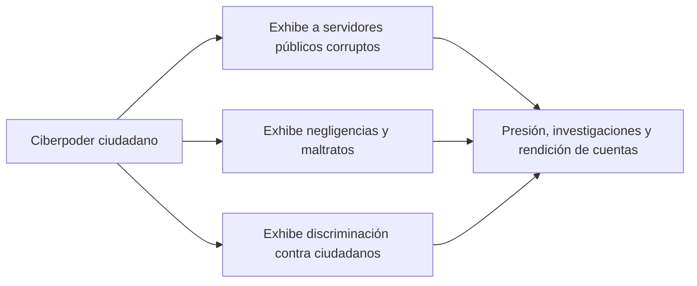

# 05 - Ciberciudadanía y ciberparticipación

> Unidad 2 de *Introducción a la ciberseguridad* (Raptor Dev Services Academy, curso `cyber-intro`). Material recreado con palabras propias a partir del temario de un diplomado de ciberseguridad; las fuentes van al final en APA 7. Actualización al 2026 donde se indica.

## Por qué importa

La nota anterior dejó puestas las bases: qué es la ciberciudadanía, qué obligaciones tiene el Estado y cómo se construye. Esta se ocupa de lo que pasa cuando la ciudadanía digital se pone en movimiento: cuando alguien firma una petición, convoca una marcha por redes, exhibe a un funcionario o le exige cuentas a un candidato. Son tres temas encadenados: la **ciberparticipación**, el **empoderamiento ciudadano** en el ciberespacio y el **compromiso político** que se construye (o se simula) en redes sociales.

Para la ciberseguridad esto tiene dos caras. Por un lado, la participación en línea es un derecho que depende de plataformas confiables, de identidades auténticas y de información verificable. Por otro, es un terreno donde operan la desinformación, la manipulación de la opinión, el robo de cuentas y el fraude que aprovecha el exceso de confianza. Entender cómo funciona la participación ayuda a reconocer cuándo alguien la está explotando.

## La tecnología no lo resuelve todo

Llevar la tecnología a la política, a la vida social y a los servicios públicos trae beneficios grandes, pero no es perfecto ni del todo seguro. La tecnología no cumplirá todas las aspiraciones, menos en política, donde influyen demasiados factores; ningún país, por democrático que sea, ha logrado un buen gobierno solo con herramientas digitales.

Lo que sí hizo fue facilitar la participación y el involucramiento. La recomendación del tema es una actitud: observar, escuchar y analizar más allá de lo que opina la mayoría, probar antes de opinar y dudar para aprender. Usar las TIC para informarse sobre asuntos públicos permite decidir con fundamento, y eso es justamente lo que protege el derecho de acceso a la información pública. Participar así, sin dejarse manipular ni desinformar, es una forma renovada de intervenir en lo público.

## A. Impacto de la ciberparticipación

La **ciberparticipación** es el ejercicio del derecho legítimo de participación ciudadana con y mediante herramientas TIC. Para entenderla hay que separar dos conceptos que suelen confundirse:

| Concepto | Qué es | Ejemplos |
|---|---|---|
| Participación ciudadana | Acciones autónomas de la sociedad que interactúan con el Estado para influir en las políticas públicas | Organizaciones vecinales, colectivos, peticiones, observatorios |
| Participación política institucionalizada | Mecanismos que la ley reconoce y que obligan a la autoridad | Voto, iniciativa ciudadana, consulta popular, revocación de mandato, presupuesto participativo |

Hernández de Velazco, Alvarado y Velazco (2013) analizan cómo las TIC afectan ambas formas y su relación con la opinión pública. Aguirre Sala (2014) agrega que la participación autónoma que no se institucionaliza corre el riesgo de dar logros efímeros: la gente se desgasta y termina desilusionada porque el costo del trabajo colectivo parece mayor que el beneficio.

En México, varias formas de participación política tienen rango constitucional. El artículo 35 reconoce como derechos de la ciudadanía, entre otros:

> VII. Iniciar leyes, en los términos y con los requisitos que señalen esta Constitución y la Ley del Congreso. El Instituto Nacional Electoral tendrá las facultades que en esta materia le otorgue la ley;
>
> VIII. Votar en las consultas populares sobre temas de trascendencia nacional o regional (...)
>
> IX. Participar en los procesos de revocación de mandato.

La revocación de mandato se agregó en diciembre de 2019 y la consulta popular se reformó ese mismo año. Son vías formales que las TIC pueden hacer más accesibles, por ejemplo con la recolección electrónica de apoyos.

### Participación no es ciberactivismo

La participación ciudadana y el ciberactivismo son cosas distintas. La primera busca incidir por cauces reconocidos; el segundo usa la red para movilizar, presionar y difundir causas, a veces fuera de esos cauces. Resina (2010) compara las movilizaciones sociales en España y el papel de las redes en la deliberación, y muestra que la red cambia la escala y la velocidad de la protesta, no necesariamente su eficacia.

En México hay que mirar las grandes movilizaciones nacionales de los últimos años. Algunas empiezan como participación y ciberparticipación, y se transforman en expresiones de descontento más amplias, sobre todo como respuesta a delitos de la delincuencia organizada y a abusos de autoridad. Un ejemplo de 2022: cuando un periodista fue señalado públicamente desde la tribuna presidencial, miles de personas lo respaldaron en un foro en vivo en redes sociales (Olvera, 2022). El caso muestra la capacidad de convocatoria inmediata de las plataformas.

### El marco legal y lo que falta

La ciberparticipación en México avanza de forma gradual y deja ver que la relación entre gobierno y ciudadanía necesita fortalecerse. Para que funcione hacen falta tres cosas:

1. **Marcos jurídicos accesibles.** Leyes que fundamenten la participación digital, que creen programas para hacerla efectiva y que cualquier persona entienda: qué mecanismos existen, cómo se usan y qué obligan a la autoridad.
2. **Transparencia y plataformas de diálogo.** Políticas de rendición de cuentas y plataformas que faciliten la colaboración entre gobierno y ciudadanía.
3. **Cultura de ciberseguridad.** Proteger los datos de quienes participan. Una plataforma de participación que filtra los datos de sus usuarios desalienta la participación misma.

## B. El ciberempoderamiento ciudadano

El **empoderamiento ciudadano** en el ciberespacio es una forma particular de poder, distinta del poder tradicional, que las personas ejercen por medios digitales. El desaparecido Laboratorio para la Ciudad, área de experimentación del gobierno capitalino, lo definía como la acción fortalecida de una persona o un grupo, en lo político, lo social, lo educativo y lo económico, que impulsa la participación en procesos de gobierno y en la toma de decisiones para mejorar sus comunidades y ciudades.

> **Actualización al 2026:** el Laboratorio para la Ciudad funcionó de 2013 a 2018; la definición se conserva como referencia histórica.

Ese poder se expresa en opiniones e interacciones en plataformas y tiene impacto real en la sociedad. No depende del medio: el poder del ciudadano existe con o sin redes, pero las redes lo vuelven más visible y más rápido. Bien usado, permite organizarse, movilizarse y expresar demandas, y empuja políticas y actuaciones de autoridades.

### La ciberanimación

Viché (2016) usa el término **ciberanimación** para el uso de estrategias y herramientas digitales que fomentan la participación activa en lo social y lo político: campañas de sensibilización, eventos virtuales y contenidos multimedia que movilizan, informan y conectan grupos distintos. La idea de fondo es que el ciberespacio puede ser un lugar efectivo de deliberación y acción colectiva, un puente entre lo digital y la vida cívica.

### Movimientos con huella digital

| Movimiento | Periodo | Qué hizo la red |
|---|---|---|
| Primavera Árabe | 2010-2012 | Coordinó protestas contra regímenes autoritarios del norte de África y Medio Oriente |
| Occupy Wall Street | 2011 | Difundió la demanda de igualdad económica y social |
| Black Lives Matter | 2013 a la fecha | Amplificó denuncias contra la violencia racial en Twitter e Instagram |
| #MeToo | 2017 en adelante | Visibilizó el acoso sexual y provocó renuncias, investigaciones y cambios de políticas |
| March for Our Lives | 2018 | Jóvenes organizaron marchas por el control de armas tras tiroteos escolares |
| Fridays for Future | 2018 en adelante | Huelgas climáticas coordinadas a escala global |
| Protestas en Hong Kong | 2019 | Organización descentralizada que cruzó fronteras |
| Movimientos latinoamericanos | Varios | Protestas contra la desigualdad convocadas en redes |

Aguirre también documenta cómo las redes amplifican la vida cotidiana y aceleran convocatorias. Pero tener presencia en línea no garantiza cumplir expectativas, sobre todo en política. La relación entre ciberparticipación y resultados políticos es compleja, y de eso trata el siguiente apartado.

## C. Ciberpolítica: el compromiso político en redes

En muchos países el cumplimiento de las promesas de campaña es incierto o simplemente no ocurre. Entonces, ¿por qué esperar que el ciberpoder ciudadano consiga respuestas políticas? A primera vista parece poco realista, pero la experiencia muestra que todos, incluidos los políticos, pueden usar las redes para conseguir lo que buscan.

### El presidente 2.0

La campaña de Barack Obama en 2008 es el caso clásico: su triunfo se atribuyó en buena parte al uso estratégico de internet para movilizar votantes, recaudar fondos y difundir su mensaje, y se le apodó el primer "presidente 2.0". Compte (2017) compara después a Obama, Donald Trump y Emmanuel Macron como presidentes que gobiernan y hacen campaña desde las redes. El propio Obama resumió la idea de que el papel de la ciudadanía en una democracia no se agota en el día de la elección.

Los medios siguen pesando mucho, y no siempre para bien. Durante su primer mandato Trump usó la inmediatez de las redes para descalificar a México una y otra vez. Las promesas de campaña de cualquier candidato llegan a millones de personas, pero ningún mecanismo obliga a cumplirlas una vez electo; ni siquiera la reputación basta. Aguirre recoge un dato de Przeworski: en la evidencia histórica ningún tribunal ha fallado a favor del electorado y en contra de un gobierno por incumplir lo prometido en campaña.

### Lo que el ciberpoder sí consigue

Pese al escepticismo, el ciberpoder tiene éxitos claros, sobre todo como mecanismo de exhibición:

La participación en redes es benéfica porque da voz a perspectivas diversas, permite la vigilancia ciudadana y la denuncia de abusos, y sirve para organizar movimientos en torno a causas comunes. Cáceres y Escalante (2019) relacionan la participación ciudadana en la lucha anticorrupción con el fortalecimiento del Estado de derecho.

### Los servidores públicos no pueden bloquear a quien les pregunta

Un criterio central de la unidad viene de la Suprema Corte. En el amparo en revisión 1005/2018, resuelto por la Segunda Sala el 20 de marzo de 2019, un periodista de Veracruz que cubría temas de inseguridad y desapariciones descubrió que el fiscal general del estado lo había bloqueado en Twitter. La Corte razonó así:

1. Las leyes no obligan a un funcionario a tener cuenta en redes, pero si decide usar su cuenta, aunque sea personal, para informar sobre su encargo, asume las consecuencias jurídicas de ese uso.
2. La información sobre actividades públicas difundida en esa cuenta es de interés general y cualquier usuario puede consultarla.
3. Bloquear a un seguidor restringe su derecho de acceso a la información y constituye un acto de autoridad que se puede combatir con amparo.
4. En ese caso, el derecho a la información prevalece sobre la privacidad del servidor público.

La Corte confirmó el amparo y ordenó desbloquear al periodista (Suprema Corte de Justicia de la Nación [SCJN], 2019). La consecuencia práctica: mientras alguien ocupa un cargo y usa una cuenta para hablar de su función, no puede bloquear a quien le pregunta con respeto sobre esa función. Eso no impide denunciar o moderar conductas ilícitas, pero sí cerrar la puerta a la crítica legítima. Hernández (2019) difundió el criterio en la prensa.

### El riesgo del exceso de credibilidad

Un riesgo de participar en redes es creer demasiado. La confianza excesiva en lo que circula abre la puerta a delitos como el fraude, la suplantación y la difusión de información falsa. El ciberpoder es real, pero no tiene fuerza para obligar a un político a cumplir.

## D. Desenredando el impacto de las redes sociales

Las redes son una herramienta de comunicación excelente: masivas, baratas y accesibles, y por eso las usan personas, organizaciones y gobiernos. Tienen dos caras. Gómez (2020) estudia cómo influyen en la percepción ciudadana sobre la compra del voto en México: las redes pueden destapar prácticas ilegales y, al mismo tiempo, moldear percepciones sin verificar.

La influencia de los medios sociales en la participación pide una mirada nueva. La información llega rápido y a mucha gente, así que hay que revisar qué tan válida es la información cívica que circula. Las redes motivan, movilizan, abren debates y amplifican voces, pero esa velocidad exige una gestión crítica de los contenidos sobre los que se basa la participación democrática.

## E. Obstáculos al uso de las TIC en la construcción de ciudadanía

### Educación en ciudadanía digital

Formar ciudadanos digitales significa enseñar a usar la tecnología de manera ética y efectiva: alfabetización mediática, protección de la privacidad, participación informada. Ávila Muñoz (s. f.) plantea la construcción de ciudadanía digital como un reto para la educación, formal e informal, y la vincula con la democracia digital y una cultura de respeto en línea.

### La brecha digital

Aun con todas sus ventajas, el acceso y el uso de las TIC siguen siendo un desafío mundial, y la brecha digital es un obstáculo previo a cualquier participación generalizada. No se va a cerrar pronto: requiere esfuerzos continuos para una inclusión equitativa.

| Dato | Fuente |
|---|---|
| 2,200 millones de personas sin internet en el mundo en 2025; 96 % vive en países de ingreso bajo y medio | ITU (2025) |
| 94 % de uso de internet en países de ingreso alto contra 23 % en los de ingreso bajo | ITU (2025) |
| 77 % de los hombres y 71 % de las mujeres del mundo usan internet | ITU (2025) |
| En México, alrededor de 20 millones de personas de seis años o más no usaban internet en 2024 | INEGI (2025) |

## F. Ciberpolítica: nuevas formas de acción y comunicación

Caballero Álvarez (2016) sostiene que la política en redes ayuda a recuperar la vieja idea aristotélica del ser humano como animal político, porque abre formas más amplias de participación. Las plataformas democratizaron el acceso a la información y facilitaron la interacción directa entre gobernantes y gobernados.

Pero los resultados rara vez coinciden con las expectativas. Las promesas de más transparencia y participación tropiezan con la **desinformación**, la **polarización** y la **manipulación de la opinión pública**. La recomendación es doble: adaptarse a un entorno que cambia rápido, con políticas que aprovechen las TIC y mitiguen sus riesgos, y mantener expectativas realistas sobre lo que la ciberpolítica puede lograr para fortalecer la democracia.

## Lo que se lleva de este tema

- Entender los términos nuevos del ciberentorno ayuda a reconocer las actividades y a darles formalidad. Estar informado es participar mejor.
- El usuario de una red es también ciberciudadano. Su conducta (respeto, uso responsable y ético, constancia) influye en cómo lo percibe y responde la autoridad; aun cuando la autoridad falla, la presión bien fundada en redes puede obtener respuesta.
- Las convocatorias digitales suelen ser más eficaces que las tradicionales. Ese poder debe usarse de forma legal, informada y fundamentada, sin provocaciones que expongan a usuarios legítimos a abusos o delitos.
- No hay que abusar de las redes ni temerles: son una oportunidad para educar y construir cultura de ciberseguridad desde la escuela.
- Los políticos, sea cual sea su "versión", tienen que aprender a usar los medios digitales con responsabilidad, porque su reputación y la de la función pública están en juego. Las redes no son un arma: son una herramienta para todos.

## Glosario

| Término | Definición |
|---|---|
| Ciberparticipación | Ejercicio del derecho de participación ciudadana con y mediante TIC |
| Participación ciudadana | Acciones autónomas de la sociedad para influir en las políticas públicas |
| Participación política institucionalizada | Mecanismos legales que obligan a la autoridad: voto, consulta, iniciativa, revocación |
| Ciberempoderamiento | Poder que personas o grupos ejercen por medios digitales para incidir en lo público |
| Ciberanimación | Estrategias digitales para movilizar y fomentar la participación social y política |
| Ciberpoder | Capacidad de la ciudadanía conectada para exhibir, presionar y movilizar |
| Ciberpolítica | Acción y comunicación política que ocurre en plataformas digitales |
| Ciberactivismo | Uso de herramientas digitales para promover causas y generar cambio social |
| Revocación de mandato | Mecanismo por el que la ciudadanía decide si un gobernante concluye su periodo |
| Acto de autoridad | Acción de un servidor público que afecta derechos y puede combatirse con amparo |
| Desinformación | Información falsa difundida para engañar o manipular |
| Polarización | Separación de la opinión pública en bandos cada vez más opuestos |
| Brecha digital | Desigualdad en el acceso y el aprovechamiento de las TIC |

## Referencias

- Aguirre Sala, J. F. (2014). El potencial de los medios digitales ante la participación ciudadana tradicional y en el presupuesto participativo. *Comunicación y Sociedad*, (22), 211-229. https://www.scielo.org.mx/scielo.php?script=sci_arttext&pid=S0188-252X2014000200009
- Ávila Muñoz. (s. f.). *Construcción de ciudadanía digital: un reto para la educación*.
- Caballero Álvarez, R. (2016). *Ciberpolítica: las nuevas formas de acción y comunicación políticas*.
- Cáceres, M., y Escalante, D. (2019). *Ciudadanía y lucha anticorrupción abonan al Estado de derecho*.
- Cámara de Diputados del H. Congreso de la Unión. (2026). *Constitución Política de los Estados Unidos Mexicanos* (última reforma DOF 07-10-2026). https://www.diputados.gob.mx/LeyesBiblio/pdf/CPEUM.pdf
- Compte, F. (2017). *Macron, Trump y Obama, presidentes de las redes sociales*.
- Gómez, R. (2020). Impacto de las redes sociales en la percepción ciudadana sobre la compra del voto en México. *Revista Mexicana de Opinión Pública*.
- Hernández, L. (2019). *Funcionarios no pueden bloquear en redes sociales* [Nota informativa].
- Hernández de Velazco, J., Alvarado, L., y Velazco, J. (2013). *Participación ciudadana, tecnologías de información-comunicación y opinión pública*.
- Instituto Nacional de Estadística y Geografía. (2025). *Encuesta Nacional sobre Disponibilidad y Uso de Tecnologías de la Información en los Hogares (ENDUTIH) 2024* [Comunicado de prensa]. https://www.inegi.org.mx/contenidos/saladeprensa/boletines/2025/endutih/ENDUTIH_24_RR.pdf
- International Telecommunication Union. (2025, 17 de noviembre). *Connecting the world and beyond: Facts and Figures 2025* [Comunicado de prensa]. https://www.itu.int/en/mediacentre/Pages/PR-2025-11-17-facts-and-figures.aspx
- Olvera, E. (2022). *Apoyan miles a Loret en foro de redes sociales en vivo* [Nota informativa].
- Ramos Chávez, A. (2015). Ciudadanía en la pantalla. Información y acción colectiva a través de Internet. *Revista General de Información y Documentación*, 25(2), 603-626. https://doi.org/10.5209/rev_RGID.2015.v25.n2.51231
- Resina de la Fuente, J. (2010). Ciberpolítica, redes sociales y nuevas movilizaciones en España: el impacto digital en los procesos de deliberación y participación ciudadana. *Mediaciones Sociales*, (7), 143-164. https://revistas.ucm.es/index.php/MESO/article/view/MESO1010220143A
- Suprema Corte de Justicia de la Nación. (2019). *Amparo en revisión 1005/2018* (Segunda Sala, 20 de marzo de 2019) [Resumen y sentencia]. https://www.scjn.gob.mx/derechos-humanos/sites/default/files/sentencias-emblematicas/sentencia/2022-01/AR1005-2018.pdf
- Viché, M. (2016). *El empoderamiento de los ciudadanos internautas*.

---

*Rogelio Arriaga Gonzalez*
