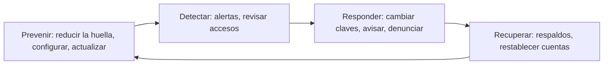

# 06 - Ciberseguridad, in-seguridad y ciberprevención

> Unidad 2 de *Introducción a la ciberseguridad* (Raptor Dev Services Academy, curso `cyber-intro`). Material recreado con palabras propias a partir del temario de un diplomado de ciberseguridad; las fuentes van al final en APA 7. Actualización al 2026 donde se indica.

## Por qué importa

Todo lo que una persona hace en línea deja marca: lo que publica, lo que compra, lo que busca, dónde estuvo. Esa marca, la **huella digital**, es materia prima para quien quiere suplantar una identidad, adivinar una contraseña o armar un engaño creíble. Por eso uno de los pilares de la ciberseguridad personal es conocer la propia huella y reducirla.

Esta nota cierra la unidad con tres ideas que se encadenan. La primera es que entre participar en línea y hacer ciberactivismo hay un paso corto, y que algunas formas de activismo cruzan la línea de lo legal. La segunda es un juego de palabras con fondo: no es lo mismo **inseguridad** que **in-seguridad**, que significa estar dentro de la seguridad. La tercera es la **ciberprevención**: anticiparse al daño, porque en lo digital, como en la protección civil, prevenir cuesta menos que remediar.

## Huella digital y ciberprevención

La huella digital es el rastro que dejan las actividades en línea de una persona: datos compartidos en redes, historial de navegación, compras, ubicaciones, comentarios. Reducirla no significa desaparecer de internet; significa decidir qué se comparte, proteger lo sensible y adoptar prácticas que bajen el riesgo de robo de identidad o de acceso no autorizado.

Muchos riesgos de ciberseguridad nacen del comportamiento y las decisiones de las personas. De ahí surge la ciberprevención como disciplina: protegerse de los riesgos que existen y cambiar la percepción de inseguridad por una de in-seguridad. Tiene tres rasgos:

- **Es una responsabilidad social compartida.** Su conocimiento debe estar al alcance de todos, porque prevenir los factores de riesgo en el ciberespacio es a la vez obligación y derecho de quien usa internet.
- **Es anterior al daño.** La prevención consiste en tomar con anticipación las medidas necesarias para contrarrestar un perjuicio o reducir sus efectos. Si llega después, ya no es prevención.
- **Se aprende por experiencia, propia o ajena.** Mucha gente ya conoció lo que cuesta no prevenir: una cuenta de correo o de redes tomada, información personal expuesta.

### De la prevención a la ciberresiliencia

Algunos especialistas prefieren hablar de **ciberresiliencia**, porque además de prevenir incluye prepararse para recuperarse rápido y limitar el impacto cuando un incidente ocurre. El término pesa más en empresas y gobiernos, que son blancos más frecuentes, pero la vulnerabilidad es de todos: la dependencia de la tecnología y la interconexión global ponen en riesgo a cualquier persona, sea cual sea su perfil. La ciberseguridad es un desafío compartido que pide preparación y vigilancia constantes.

## A. ¿Proximidad ciudadana o ciberactivismo?

En los últimos años las redes y las plataformas aumentaron la participación en la política y en las decisiones públicas, y algunos países adoptaron el voto electrónico. La búsqueda sigue hacia estrategias que incluyan a más personas, no solo en lo político, sino también en programas oficiales de orden público.

### Proximidad social

La antigua Secretaría de Seguridad Pública federal promovía la **proximidad social**: que policías, ciudadanos y autoridades formaran una comunidad de aprendizaje para mejorar la calidad de vida, de modo que todos pudieran hacer actividades lícitas sin riesgo para su integridad ni para sus bienes. El tema propone leerla en los dos sentidos: no solo la autoridad que se acerca a la comunidad, sino también el ciudadano que establece una relación directa con la autoridad. Esa relación más horizontal es distinta del discurso tradicional de las instituciones de seguridad.

> **Actualización al 2026:** la Secretaría de Seguridad Pública federal desapareció a inicios de 2013 y sus funciones pasaron a Gobernación; desde diciembre de 2018 existe la Secretaría de Seguridad y Protección Ciudadana.

### Vigilancia vecinal en redes

Ante la deficiencia y la corrupción de algunas autoridades, en muchas colonias se formaron grupos de vigilancia vecinal en Facebook y WhatsApp para cuidar a las familias y mantener la paz. Las redes también sirvieron como canal de las autodefensas en algunas regiones del país (García, 2014). Facilitan la movilización rápida frente a la inseguridad, pero cuando una convocatoria se vuelve masiva y sin control deja de ser ciberparticipación y se convierte en protesta o en conflicto, lejos de la acción ciudadana legítima.

### Qué es el ciberactivismo

El **ciberactivismo** es el uso de herramientas y plataformas digitales (redes sociales, sitios web, aplicaciones móviles) para promover causas sociales, políticas o ambientales y generar cambios. Organiza campañas, moviliza a la opinión pública, presiona a quien decide políticas y crea conciencia sobre temas concretos. Lo que busca, ante todo, es difundir un mensaje aprovechando tres ventajas de la tecnología:

| Ventaja | Qué significa |
|---|---|
| Velocidad | El mensaje llega en segundos, sin intermediarios |
| Viralidad | Cada receptor puede reenviarlo, y el alcance crece de forma exponencial |
| Horizontalidad | No hay jerarquía: cualquiera puede emitir, sin pedir permiso a un medio |

Su objetivo es volver visibles problemas que no están en la agenda pública y organizar acciones que fortalezcan una organización política, para consolidar el cambio social y la participación colectiva. Según Cortés y Garzón (2017), hoy los movimientos sociales y el ciberactivismo avanzan juntos. Fernández Prados (2012) propone una forma de conceptualizar y medir el ciberactivismo y analiza los factores que lo alientan.

### El hacktivismo

Entre las formas de ciberactivismo, a veces descritas como el despertar de una conciencia colectiva, el **hacktivismo** es la más riesgosa. Combina activismo y habilidades técnicas: va de la protesta virtual a la intrusión en sistemas, la caída de sitios por saturación o la alteración de páginas. Anonymous es el colectivo más conocido, pero no el único. Sus métodos son con frecuencia ilegales y su efecto sobre los movimientos sociales es irregular.

La distinción que importa es entre usar la tecnología para impulsar causas de forma ética y legal, y usarla de forma indebida. En el ciberespacio, como fuera de él, hay normas que protegen derechos individuales y colectivos. En México, entrar sin autorización a sistemas o alterar su información está tipificado en el Código Penal Federal (artículos 211 bis 1 a 211 bis 7), sin importar la causa que se invoque. Respetar las normas mantiene un entorno digital confiable y la confianza pública en las plataformas y en las instituciones.

## B. De la inseguridad a la in-seguridad

### Dos palabras opuestas

**Inseguridad** es la falta de seguridad. **In-seguridad**, con guion, es lo contrario: estar *dentro* de la seguridad. El tema pide quedarse con ese segundo sentido. Estar en la in-seguridad es un ideal, pero también un estado posible si se aprende lo necesario, se decide bien y la conciencia personal se vuelve constante. Como usar internet es cotidiano y necesario, estar en la in-seguridad mientras se usa la tecnología llega a ser casi una obligación: adoptar prácticas de ciberseguridad como responsabilidad continua y no como meta que se alcanza una vez.

La seguridad no es un lujo. En la jerarquía de necesidades de Abraham Maslow, la seguridad aparece en el segundo nivel, justo después de las necesidades fisiológicas (Vázquez y Valbuena, 2018). Si la vida diaria ya ocurre en buena parte en línea, la seguridad digital forma parte de esa necesidad básica.

### Por qué el ciberentorno invita a portarse mal

El ciberentorno se presta a conductas inapropiadas por dos percepciones: la de **anonimato** y la de falta de contacto físico. La sensación de invisibilidad hace que algunas personas se sientan menos responsables, y eso facilita el ciberacoso, el fraude y la difusión de contenido indebido. Ocultar la identidad es fácil, y la creencia de que no habrá consecuencias hace el resto.

Frente a eso hay tres límites:

1. **Reglas de seguridad.** Formuladas por especialistas, protegen la información personal y dan un marco para un entorno más confiable.
2. **Valores y ética.** Actuar con integridad y respeto hacia los demás.
3. **Legalidad.** Las normas jurídicas, que fijan el límite más estricto. Una complicación adicional: cambian de un país a otro, y eso hace más compleja la ciberseguridad global.

La conclusión es que el ciberentorno puede dar una falsa sensación de impunidad, pero la responsabilidad sigue siendo personal. La seguridad absoluta probablemente no existe; la educación, las decisiones informadas y la concientización permanente acercan al ideal de in-seguridad.

### La libertad de expresión tiene límites

Un mal uso típico de las redes es atacar, humillar, amenazar o acusar a personas e instituciones desde un canal de video o una cuenta. Un caso muy comentado en México ocurrió en diciembre de 2011: la hija adolescente de un precandidato presidencial reenvió un mensaje que insultaba a los críticos de su padre, lo que provocó indignación en Twitter y dañó la imagen del político (Vargas, 2011). La lección no es el escándalo, sino que una publicación impulsiva repercute en otros.

Todos gozamos de libertad de expresión, pero con límites, sobre todo el respeto a los demás. La Constitución los marca en el primer párrafo del artículo 6o.:

> La manifestación de las ideas no será objeto de ninguna inquisición judicial o administrativa, sino en el caso de que ataque a la moral, la vida privada o los derechos de terceros, provoque algún delito, o perturbe el orden público; el derecho de réplica será ejercido en los términos dispuestos por la ley. El derecho a la información será garantizado por el Estado.

Y el artículo 7o. remite a esos mismos límites para la difusión por cualquier medio, incluidas las TIC:

> Ninguna ley ni autoridad puede establecer la previa censura, ni coartar la libertad de difusión, que no tiene más límites que los previstos en el primer párrafo del artículo 6o. de esta Constitución.

### Información que cruza fronteras

El flujo transfronterizo de información complica todo, porque las leyes de un país tienen alcance limitado fuera de su territorio. Ese principio de soberanía hace difícil regular y proteger los datos a escala internacional: un servidor en otro país, un agresor en un tercero y una víctima aquí.

### Los nueve elementos de la ciudadanía digital

Tamez (2015) difundió en español los nueve elementos de la ciudadanía digital de Mike Ribble como base imprescindible para la ciberseguridad. Ribble los actualizó en 2023 y los agrupa en tres principios: segura, informada y social.

| Elemento (versión 2023) | Qué abarca |
|---|---|
| Acceso digital | Participación plena y equitativa en la sociedad digital |
| Comercio digital | Comprar y vender en línea con conciencia de derechos y riesgos |
| Comunicación y colaboración | Intercambio de información y trabajo conjunto por medios digitales |
| Etiqueta y empatía | Normas de conducta y consideración hacia los demás |
| Fluidez digital | Saber usar la tecnología y evaluar la información con criterio |
| Bienestar digital | Salud física y emocional en un mundo conectado |
| Ley digital | Responsabilidad legal por lo que se hace en línea |
| Derechos y responsabilidades | Libertades que se tienen y deberes que las acompañan |
| Seguridad digital | Precauciones para protegerse a uno mismo y a los demás |

> **Actualización al 2026:** la lista original de Ribble usaba nombres como alfabetización, salud y bienestar o etiqueta; la versión actual del autor los renombró como aparecen en la tabla y añadió el marco "S3" (segura, informada, social).

## C. El valor agregado de la ciberprevención

La vida digital y la interconexión crean necesidades nuevas, y una de ellas es saber prevenir. El diccionario académico define prevención, en su segunda acepción, como la preparación y disposición que se hace por anticipado para evitar un riesgo. Llevada al ciberespacio, la ciberprevención protege el entorno digital para que todos puedan ejercer su ciudadanía digital y hacer actividades lícitas dentro de la ley. Importa especialmente para formar a los más jóvenes con un uso responsable de la tecnología.

### Por qué cuesta en la práctica

Hay derechos humanos, leyes internacionales y programas sobre ciberseguridad, pero aplicarlos es difícil. Los negocios, el entretenimiento, las redes y el acceso ilimitado a información poco educativa reciben más atención que la formación en ciberseguridad. En México la conciencia preventiva suele crecer solo después de un desastre: un sismo o un ciberataque.

### En qué consiste el valor agregado

El valor de la ciberprevención está en anticiparse a los incidentes, lo que permite administrar los cambios de la sociedad digital en lugar de padecerlos. Consiste en aplicar de forma continua acciones y decisiones para proteger los bienes digitales, en especial la información, y garantizar que siga accesible, disponible, íntegra y confidencial aun después de un incidente. En la práctica, eso significa protegerla en tres planos: material (equipos y respaldos), técnico (configuración, cifrado, actualizaciones) y legal (contratos, avisos de privacidad, denuncia).

Un video de UNAM Global (2021) explica por qué los datos personales valen más en el mercado ilegal cuanto más vulnerables son sus titulares. A eso se suma un dilema clásico de la seguridad: **libertad contra seguridad**. Proteger los sistemas impone restricciones, y el equilibrio no siempre es cómodo. El investigador Gene Spafford lo ilustró con una exageración famosa: el único sistema de verdad seguro sería uno apagado, desconectado y encerrado bajo custodia armada, y aun así no apostaría por él (Spafford, s. f.). El dilema puede desanimar, pero entenderlo prepara mejor para responder a las amenazas sin renunciar a las libertades.

## D. Cuatro razones para cuidar la huella digital

La Internet Society publicó en 2016 un video sobre por qué cuidar las huellas digitales. La huella es la suma de interacciones y actividades en línea, desde publicaciones hasta transacciones, y define la presencia digital de una persona. Importa por cuatro motivos que se desprenden del tema:

| Razón | Por qué |
|---|---|
| Permanece | Lo publicado se copia, se indexa y se archiva; borrarlo del todo casi nunca es posible |
| Construye reputación | Influye en oportunidades personales y profesionales |
| La usan terceros | Empresas, delincuentes o curiosos la recolectan para fines benignos o maliciosos |
| Revela más de lo que parece | Cada clic, comentario o compra deja detalles de la vida íntima y laboral |

Para un especialista en ciberseguridad, conocer la huella implica entender cómo la usan otros y reducir riesgos como el robo de identidad, el fraude o la exposición de información sensible. Las medidas van desde la configuración de privacidad en redes hasta el cifrado y la autenticación de dos factores.

### Lista mínima de ciberprevención personal

- Buscar el propio nombre, correo y teléfono en buscadores para saber qué hay publicado.
- Revisar la configuración de privacidad de cada red y quitar lo que no hace falta mostrar (fecha de nacimiento, escuela, ubicación).
- Activar la autenticación de dos factores o, donde exista, llaves de acceso (passkeys).
- Usar un gestor de contraseñas y una contraseña distinta por servicio.
- Mantener actualizados el sistema operativo, el navegador y las aplicaciones.
- Respaldar la información importante fuera del equipo.
- Revisar qué aplicaciones tienen acceso a la cuenta y revocar las que ya no se usan.
- Pensar antes de publicar: lo que se sube hoy puede usarse dentro de diez años.

## E. Ciberactivismo y movimientos sociales

Martínez Martínez (2013) documenta ejemplos de ciberactivismo con impacto en la comunidad internacional. En México el fenómeno aún no alcanza los niveles de otros países, pero merece atención: explorar este tipo de activismo puede abrir vías nuevas para la participación, la defensa de derechos y la influencia política. Lo recomendable es seguir su desarrollo y fomentarlo de forma responsable, reconociendo su capacidad para amplificar voces.

## F. Google sabe más de ti que tu madre

Arenas (2018) pregunta con ejemplos si las personas saben cuánta información sobre ellas existe en internet, y explica cómo protegerla. Las grandes plataformas ofrecen herramientas para verlo: el historial de actividad de la cuenta, el registro de ubicaciones y la descarga de todos los datos que guardan. Revisarlas es un ejercicio de ciberprevención: casi siempre sorprende la cantidad.

## Para ir más lejos

Material opcional de la unidad, útil para profundizar:

- **Derecho a la desconexión digital.** Malacara (2021) propone cinco consejos para ejercerlo. En México, quien trabaja a distancia tiene ese derecho por ley: el artículo 330-E de la Ley Federal del Trabajo, adicionado en enero de 2021, obliga al patrón a respetar la desconexión al terminar la jornada.
- **Ciberresiliencia en organizaciones.** IT Governance (2015) explica de forma gráfica cómo combinar ciberseguridad y continuidad del negocio para recuperarse de un incidente.
- **Introducción a la ciberseguridad.** El instituto español de ciberseguridad (INCIBE, 2015) resume en video los conceptos básicos y cómo protegerse como usuario.
- **Consejos de un especialista.** La Vanguardia (2018) entrevistó al especialista Deepak Daswani sobre hábitos de seguridad para personas y empresas.
- **Derechos y deberes digitales.** López, Serrano y Fernández (2017) sistematizan los derechos y obligaciones de la ciudadanía en el entorno digital.

## Cierre del tema

- Muchos términos nuevos se usan sin cuidado, pero conservan un sentido preciso. La proximidad ciudadana por medios digitales acercó a la gente al Estado; abusada, una comunicación puede volverse una convocatoria fuera de control.
- De la participación al ciberactivismo hay un paso. Hacer justicia por propia mano en redes puede llevar a cometer delitos o a exponer datos personales de otros.
- Toca cambiar de mentalidad: menos atención a la inseguridad y más a aprovechar la tecnología con resiliencia personal y buenas prácticas. La responsabilidad no es solo del Estado.
- La prevención ya salvó vidas en la protección civil; en lo digital debe volverse una forma de vida.
- La presencia en línea sobrevive a las personas. Conviene decidir con cuidado a quién se confía la información, porque hoy está en muchas manos, a menudo sin que el titular lo sepa.

> **Actualización al 2026:** Twitter cambió su nombre a X en 2023. En México, la protección de datos personales frente a particulares pasó en 2025 del INAI, que se extinguió, a la Secretaría Anticorrupción y Buen Gobierno, con una nueva ley federal publicada el 20 de marzo de 2025.

## Glosario

| Término | Definición |
|---|---|
| Huella digital | Rastro que dejan las actividades en línea de una persona |
| Ciberprevención | Anticiparse al daño informático con medidas previas para evitarlo o reducirlo |
| Ciberresiliencia | Capacidad de prevenir, resistir y recuperarse rápido de un incidente |
| In-seguridad | Estar dentro de la seguridad; lo opuesto a inseguridad |
| Proximidad social | Relación cercana y en dos sentidos entre ciudadanía y autoridades de seguridad |
| Ciberactivismo | Uso de herramientas digitales para promover causas y generar cambio social |
| Hacktivismo | Activismo que emplea técnicas de intrusión o sabotaje informático; con frecuencia ilegal |
| Viralidad | Propagación exponencial de un mensaje por reenvíos sucesivos |
| Horizontalidad | Comunicación sin jerarquías en la que cualquiera puede emitir |
| Anonimato percibido | Sensación de no ser identificable que reduce la responsabilidad en línea |
| Flujo transfronterizo | Circulación de datos entre países con leyes distintas |
| Autenticación de dos factores | Verificación que pide algo que se sabe y algo que se tiene |
| Ciudadanía digital (Ribble) | Normas de uso responsable de la tecnología en nueve elementos |

## Referencias

- Arenas, G. (2018, 24 de abril). Google sabe más de ti que tu propia madre. *GQ España*. https://www.revistagq.com/noticias/tecnologia/articulos/datos-que-google-sabe/28869
- Cámara de Diputados del H. Congreso de la Unión. (2025). *Ley Federal de Protección de Datos Personales en Posesión de los Particulares* (DOF 20-03-2025, última reforma DOF 14-11-2025). https://www.diputados.gob.mx/LeyesBiblio/pdf/LFPDPPP.pdf
- Cámara de Diputados del H. Congreso de la Unión. (2026a). *Constitución Política de los Estados Unidos Mexicanos* (última reforma DOF 07-10-2026). https://www.diputados.gob.mx/LeyesBiblio/pdf/CPEUM.pdf
- Cámara de Diputados del H. Congreso de la Unión. (2026b). *Código Penal Federal* (última reforma DOF 13-03-2026). https://www.diputados.gob.mx/LeyesBiblio/pdf/CPF.pdf
- Cámara de Diputados del H. Congreso de la Unión. (2026c). *Ley Federal del Trabajo* (última reforma DOF 14-05-2026). https://www.diputados.gob.mx/LeyesBiblio/pdf/LFT.pdf
- ComputerHoy. (2015). *¿Qué es Anonymous?* [Video]. YouTube. https://youtu.be/DDC4SPhkWZg
- Cortés, D., y Garzón, T. (2017). *El ciberactivismo en las revoluciones posmodernas*.
- Fernández Prados, J. S. (2012). Ciberactivismo: conceptualización, hipótesis y medida. *Arbor. Ciencia, Pensamiento y Cultura*, 188(756), 631-639. https://doi.org/10.3989/arbor.2012.756n4001
- García, I. (2014). *Redes sociales, el otro campo de acción de las autodefensas* [Nota informativa].
- INCIBE. (2015, 4 de diciembre). *Introducción a la ciberseguridad* [Video]. YouTube. https://youtu.be/TM-OT1U3P0k
- Internet Society. (2016, 12 de enero). *Cuatro razones para cuidar nuestras huellas digitales* [Video]. YouTube. https://youtu.be/cpH-zSRV6Ug
- IT Governance. (2015). *Cyber resilience: Cyber security and business resilience*. https://www.itgovernance.co.uk/download/cyber-resilience.pdf
- La Vanguardia. (2018). *El experto en ciberseguridad Deepak Daswani nos aconseja cómo mejorar nuestra seguridad* [Video]. YouTube. https://youtu.be/eY3dB6SlhLI
- López, D., Serrano, M., y Fernández, C. (2017). *Derechos y obligaciones de los ciudadanos/as en el entorno digital*.
- Malacara, N. (2021, 12 de julio). 5 tips para ejercer tu derecho a la desconexión digital. *Expansión*. https://expansion.mx/carrera/2021/07/12/5-tips-ejercer-derecho-desconexion-digital
- Martínez Martínez, H. (2013). Ciberactivismo y movimientos sociales urbanos contemporáneos. Un mapa de la investigación en España. En *Investigar la comunicación hoy. Revisión de políticas científicas y aportaciones metodológicas: Simposio Internacional sobre Política Científica en Comunicación* (Vol. 2, pp. 447-458). Universidad de Valladolid. https://dialnet.unirioja.es/servlet/articulo?codigo=4228937
- Real Academia Española. (s. f.). Prevención. En *Diccionario de la lengua española* (23.a ed., versión 23.8 en línea). https://dle.rae.es/prevenci%C3%B3n
- Ribble, M. (2023). *Nine elements of digital citizenship*. Digital Citizenship. https://www.digitalcitizenship.net/nine-elements.html
- Spafford, E. H. (s. f.). *Quotable Spaf*. Purdue University, CERIAS. https://spaf.cerias.purdue.edu/quotes.html
- Tamez, E. (2015). *Nueve elementos de la ciudadanía digital*. Jason Ohler. http://www.jasonohler.com/wordpressii/wp-content/uploads/2013/12/Nueve-elementos-de-la-cudadania-digital.pdf
- UNAM Global TV. (2021). *Datos personales: entre más vulnerables, más valiosos. ¿Por qué?* [Video]. YouTube. https://www.youtube.com/watch?v=YDWirXAlivA
- Vargas, E. (2011). *Hija de Peña Nieto causa ira en Twitter al reenviar mensaje que insulta a críticos* [Nota informativa].
- Vázquez, M., y Valbuena, F. (2018). *La pirámide de necesidades de Abraham Maslow*.

---

*Rogelio Arriaga Gonzalez*
