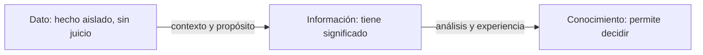

# 07 - Ciberentorno: aproximaciones y tendencias

> Unidad 3 de *Introducción a la ciberseguridad* (Raptor Dev Services Academy, curso `cyber-intro`). Material recreado con palabras propias a partir del temario de un diplomado de ciberseguridad; las fuentes van al final en APA 7. Actualización al 2026 donde se indica.

## Por qué importa

Sobre internet cada quien tiene una opinión, y casi siempre esa opinión cuenta más de la experiencia de quien la da que de la red misma. Para quien estudia ciberseguridad conviene quitarse ese filtro: el ciberentorno tiene dos caras al mismo tiempo. En muy pocos años cambió la manera de trabajar, aprender, comprar y convivir, y esa misma potencia, en ciertas condiciones, abre la puerta a conductas abusivas que dañan la información de las personas y de las organizaciones. Los daños son reales aunque ocurran en un espacio que no se ve.

A los riesgos propios de usar la red se suman las vulnerabilidades, y buena parte de ellas no es técnica sino humana: depende de quién administra la información, de cómo están organizados los equipos y de qué tan preparados están los responsables de proteger, prevenir y recuperar los sistemas cuando algo sale mal. Como la seguridad absoluta no existe, siempre habrá riesgos, vulnerabilidades y amenazas; lo que sí se puede hacer es adelantarse a ellos con aprendizaje constante.

Estudiar las tendencias del ciberentorno sirve justo para eso: anticipar amenazas que todavía no llegan. La innovación avanza rápido y los atacantes se profesionalizan igual de rápido; una organización que deja de vigilar el panorama se vuelve blanco fácil y paga con dinero, con datos expuestos y con reputación. Esta nota aclara el vocabulario básico (internet, ciberentorno, dato, información, seguridad informática, seguridad de la información) y revisa las tecnologías disruptivas que hoy marcan la agenda, con sus promesas y sus puntos débiles.

## Internet y ciberentorno no son sinónimos

### Qué es internet

Internet es una red mundial de redes de computadoras que se comunican entre sí con un conjunto común de reglas, los protocolos. El protocolo IP le da a cada equipo conectado una dirección única para que los paquetes de datos sepan a dónde ir; encima de él, TCP cuida que los paquetes lleguen completos y en orden, y protocolos de aplicación como HTTP permiten pedir y entregar páginas y recursos.

Debajo de los protocolos hay una infraestructura física muy concreta: fibra óptica, cables submarinos que cruzan océanos, centros de datos, servidores, enrutadores y conmutadores. Cuando se dice que algo "está en la nube", está en alguno de esos edificios.

Sobre esa red corren servicios. La World Wide Web es uno de ellos: documentos y recursos enlazados entre sí por hipervínculos y direcciones URL. Otros servicios son el correo electrónico, la mensajería, las redes sociales, el video bajo demanda, el comercio y la banca en línea, los buscadores y las plataformas de trabajo y estudio.

Una definición técnica muy citada es la que aprobó el Federal Networking Council de Estados Unidos el 24 de octubre de 1995 (recogida por Leiner et al., 1997). Dicha con otras palabras, describe internet como un sistema global de información con tres rasgos:

1. Sus equipos están ligados lógicamente por un solo espacio de direcciones basado en IP o en sus versiones posteriores.
2. Puede transportar comunicaciones con la familia de protocolos TCP/IP, sus sucesores u otros protocolos compatibles con IP.
3. Ofrece, de forma pública o privada, servicios de alto nivel montados sobre esas capas de comunicación y la infraestructura relacionada.

En México, el área de investigación de la Cámara de Diputados publicó en 2006 un estudio sobre la regulación jurídica de internet que retoma esa definición y explica su funcionamiento (Trejo García, 2006).

### Para qué sirve

| Ámbito | Qué aporta internet |
|---|---|
| Comunicación | Mensajes, correo, videollamadas y redes sociales al instante y sin importar la distancia |
| Conocimiento | Acceso a noticias, investigaciones, cursos y bibliotecas digitales |
| Economía | Comercio electrónico, banca en línea y servicios financieros digitales |
| Innovación | Base para nuevas aplicaciones y servicios en casi cualquier industria |
| Colaboración | Equipos y organizaciones que trabajan juntos en tiempo real desde distintos países |

La misma omnipresencia que la vuelve indispensable la vuelve también un problema de seguridad y de privacidad.

### El entorno híbrido

Lo virtual suele sentirse como un mundo aparte, pero no lo es. Lo que decidimos en línea tiene efectos directos en la vida física: una transferencia bancaria, un contrato, una publicación que daña una reputación, una cita médica. Por eso se habla de un entorno **híbrido**, donde lo físico y lo digital se superponen. En los dos espacios ocurre lo mismo en el fondo: personas que intercambian información y comunicación, solo que en uno el lugar parece indeterminado.

### Por qué el ciberentorno es más amplio

Internet es la red que conecta; el ciberentorno es todo lo que queda conectado. La UIT, en su recomendación X.1205 de 2008, lo describe como el conjunto de usuarios, redes, dispositivos, programas, procesos, información almacenada o en tránsito, aplicaciones, servicios y sistemas enlazados directa o indirectamente a las redes (UIT, 2008).

| | Internet | Ciberentorno |
|---|---|---|
| Qué es | La red de redes y sus protocolos | Todo el ecosistema digital que opera sobre ella |
| Incluye | Infraestructura, direcciones, protocolos y servicios | Además: personas, procesos, datos, sistemas de información, dispositivos conectados e infraestructuras críticas |
| Pregunta que responde | ¿Cómo viajan los datos? | ¿Qué hay que proteger y quién interviene? |

Un estudio español sobre seguridad nacional y ciberdefensa subraya que el ciberespacio está estrechamente ligado a los demás espacios (tierra, mar, aire), y que la información que circula en él está clasificada y protegida por la ley en la mayoría de los países (Escuela Superior de Ingenieros de Telecomunicaciones, 2013).

## Dato, información y comunicación

### El dato

Un dato es la representación formal de un hecho, un concepto o una instrucción, lista para que una persona o una máquina la comunique, interprete o procese. Puede ser un número, un texto, una imagen, un sonido o un video. Según cómo se organizan, se distinguen tres tipos:

| Tipo | Cómo se organiza | Ejemplos |
|---|---|---|
| Estructurado | Con un formato definido de antemano | Tablas de una base de datos, hojas de cálculo |
| No estructurado | Sin modelo previo | Correos, documentos de texto, videos, publicaciones en redes |
| Semiestructurado | Mezcla de los dos, con etiquetas que dan orden | Archivos XML o JSON |

Hoy los datos son materia prima de decisiones, de innovación y de servicios personalizados: quien puede reunir, procesar y analizar grandes volúmenes obtiene conclusiones que antes no estaban a su alcance.

### Del dato a la información

Antes de internet, la información llegaba en documentos o en mensajes que se oían o se veían. Como todo mensaje, tiene alguien que la emite y alguien que la recibe, y la forma en que se percibe influye en los juicios y en la conducta. La palabra "informar" viene de "dar forma": en sentido estricto, es quien recibe el mensaje quien decide si de verdad lo informa. Las noticias falsas lo ilustran bien: su efecto depende de que el receptor sepa reconocerlas.

El dato, aislado, describe apenas un fragmento de la realidad. No trae juicio de valor ni interpretación, así que no orienta la acción por sí mismo: las decisiones se apoyan en datos, pero los datos no dicen qué hacer ni qué es importante. Por eso son la base sobre la que las organizaciones construyen información.

La información, en cambio, tiene significado, pertinencia y un propósito. Un dato se vuelve información cuando se le agrega contexto y valor. Y aquí cabe una advertencia: el canal no es el contenido. Tener un teléfono no garantiza conversaciones interesantes, y tener más tecnologías de información a la mano no garantiza estar mejor informado (UNAM, s. f.).

### Información y comunicación

Son conceptos vecinos pero distintos. La información es el contenido; la comunicación es el proceso por el que ese contenido pasa de una persona o entidad a otra. Puede haber información guardada que nadie comunica, pero no hay comunicación sin información que transmitir.

### El dato en la ley mexicana

Para la ciberseguridad, el dato que más importa proteger es el personal. La ley mexicana distingue el dato personal del dato personal sensible. Así lo dice la ley vigente para el sector público:

> **Ley General de Protección de Datos Personales en Posesión de Sujetos Obligados, artículo 3:**
> IX. Datos personales: Cualquier información concerniente a una persona identificada o identificable. Se considera que una persona es identificable cuando su identidad pueda determinarse directa o indirectamente a través de cualquier información;
> X. Datos personales sensibles: Aquellos que se refieran a la esfera más íntima de su titular, o cuya utilización indebida pueda dar origen a discriminación o conlleve un riesgo grave para ésta. De manera enunciativa más no limitativa, se consideran sensibles los datos personales que puedan revelar aspectos como origen racial o étnico, estado de salud presente o futuro, información genética, creencias religiosas, filosóficas y morales, opiniones políticas y preferencia sexual;

> **Actualización al 2026:** la ley de 2017 que citaba el temario original fue abrogada. El 20 de marzo de 2025 se publicó en el DOF una nueva Ley General de Protección de Datos Personales en Posesión de Sujetos Obligados (última reforma DOF 14-11-2025); las fracciones IX y X del artículo 3 conservan las mismas dos definiciones.

## Seguridad informática y seguridad de la información

Se usan como sinónimos, pero no abarcan lo mismo.

- La **seguridad informática** cuida los sistemas de cómputo: hardware, software y redes. Busca impedir el acceso no autorizado, el robo, el daño o la interrupción de esos sistemas, con medidas como cortafuegos, antivirus, controles de acceso y políticas de red.
- La **seguridad de la información** cuida la información en cualquier soporte (digital, en papel o dicha de viva voz) y en todo su ciclo de vida: cuando se crea, se guarda, se transmite y se destruye. Además de los controles técnicos, usa políticas, procedimientos, capacitación, cultura y gestión de riesgos.

La relación es de continente y contenido: la seguridad de la información es el marco amplio y la seguridad informática es una de sus piezas. Ninguna es más importante que la otra; se complementan. Junto a ellas aparece un tercer término, **aseguramiento de la información** (*information assurance*), con matices de enfoque y de método, pero con el mismo fin: proteger la información sensible de la organización.

| | Seguridad informática | Seguridad de la información |
|---|---|---|
| Objeto | Equipos, programas y redes | La información en cualquier forma |
| Alcance | Técnico | Técnico, organizacional, legal y humano |
| Herramientas típicas | Cortafuegos, antivirus, control de acceso, parches | Políticas, clasificación de la información, capacitación, contratos, gestión de riesgos, más todo lo técnico |
| Pregunta | ¿El sistema resiste? | ¿La información sigue siendo confiable, reservada y accesible? |

## Las propiedades que se protegen

El INCIBE, el instituto de ciberseguridad del gobierno español, resume en tres propiedades lo que la seguridad de la información debe garantizar con ayuda de los métodos de la seguridad informática (INCIBE, 2017):

| Propiedad | Qué garantiza | Ejemplo de falla |
|---|---|---|
| Confidencialidad | Que solo lean la información las personas, entidades o sistemas autorizados; el principio de "necesidad de saber" (*need to know*) | Un expediente médico visible para cualquier empleado |
| Integridad | Que la información sea exacta y no haya sido alterada, por error o a propósito | Un monto modificado en una transferencia antes de autorizarla |
| Disponibilidad | Que la información pueda consultarse en el momento en que se necesita | El sistema de cobro caído en plena quincena |

A estas tres se agregan dos propiedades con peso jurídico:

- **No repudio.** Quien firmó un documento electrónico no puede negar después que lo hizo. En México, la firma electrónica avanzada lo garantiza, y por eso la ley le da el mismo valor que a la firma autógrafa: quien la usa se ahorra tener que demostrar en juicio, una por una, la autoría y la integridad del documento. Es el mismo principio que sostiene la factura electrónica (Linares, s. f.; Martínez, 2005).
- **Autenticidad.** Certeza de que el documento o mensaje proviene de quien dice haberlo emitido.

> **Ley de Firma Electrónica Avanzada, artículo 8 (fragmento):**
> II. Autenticidad: Consiste en que la firma electrónica avanzada en un documento electrónico o, en su caso, en un mensaje de datos, permite dar certeza de que el mismo ha sido emitido por el firmante de manera tal que su contenido le es atribuible al igual que las consecuencias jurídicas que de él deriven;
> V. No Repudio: Consiste en que la firma electrónica avanzada contenida en documentos electrónicos garantiza la autoría e integridad del documento y que dicha firma corresponde exclusivamente al firmante, y

El mismo artículo enumera otros cuatro principios rectores: equivalencia funcional, integridad, neutralidad tecnológica y confidencialidad.

> **Actualización al 2026:** la Ley de Firma Electrónica Avanzada (DOF 11-01-2012) sigue vigente; su última reforma es del DOF 14-11-2025 y el artículo 8 conserva los seis principios.

## Tecnologías disruptivas: innovación y preocupación

### Qué las hace disruptivas

Una tecnología disruptiva cambia de raíz un sector o un mercado: altera las reglas, desplaza productos y modelos de negocio establecidos y, con frecuencia, crea mercados que no existían. El término viene del inglés *disruptive*, "que produce una ruptura brusca", y describe innovaciones que compiten contra la tecnología dominante con una estrategia distinta, no mejorándola poco a poco (Dabirian y Loza Matovelle, 2015; Universia Knowledge Wharton, 2014).

Clayton M. Christensen, profesor de la Escuela de Negocios de Harvard, popularizó la idea en *The Innovator's Dilemma* (1997), donde separa dos clases de innovación:

| Tipo | Rasgos |
|---|---|
| Tecnología sostenida | Mejora paso a paso algo que ya está establecido |
| Tecnología disruptiva | Llega poco pulida, con fallas de desempeño por ser nueva, con un público reducido y a veces sin un uso práctico demostrado; con el tiempo puede desplazar a la dominante |

Esa falta de madurez es justo lo que preocupa desde la seguridad: muchas innovaciones salen al mercado pensando en la función y no en cómo se usará, se guardará o se consultará la información del usuario final. Una vulnerabilidad en una innovación es una debilidad que un atacante puede aprovechar para comprometer datos, sistemas o personas, y con frecuencia introduce riesgos que los sistemas tradicionales no tenían.

### Tres ejemplos

**Bioinformática.** Estudia la información biológica apoyándose en la teoría de la información, la computación y las matemáticas (Serrano, citado en el temario). Se volvió indispensable para entender cómo funcionan los seres vivos y se aplica en el diagnóstico y tratamiento de enfermedades y en la medicina genética. Su vertiente más inquietante es la unión de software y cuerpo humano: en 2017, la agencia de investigación militar de Estados Unidos (DARPA) anunció un programa de estimulación neuronal para acelerar el aprendizaje (Ecoticias, 2017). La idea de pensar y aprender mejor es valiosa, pero un implante con hardware y software puede ser atacado como cualquier otro dispositivo, y además conlleva riesgos para la salud.

**Realidad aumentada.** Añade capas de información digital a lo que se ve del mundo físico, mediante dispositivos con cámara o visión artificial: un teléfono que muestra la ruta sobre la calle, unos lentes que superponen instrucciones a una máquina. Plantea preguntas nuevas de privacidad (qué graba la cámara, quién procesa esas imágenes) y de regulación (Centros Conacyt, 2016; Juanes, 2019).

**Realidad virtual.** Un sistema que genera en tiempo real representaciones de una realidad que solo existe dentro de la computadora: una ilusión perceptiva sin soporte físico. Capta los movimientos naturales del usuario y los traslada a un mundo simulado, a veces idéntico al real o "mejor", al grado de que la persona siente que ese mundo es el suyo (Facultat d'Informàtica de Barcelona, s. f.). En 2019 se reportaron vulnerabilidades en Bigscreen, una plataforma de reuniones en realidad virtual, que permitían a un intruso espiar sesiones y tomar control de la computadora de otros participantes (CIBERSEC, 2019).

### Biohacking

El biohacking agrupa prácticas que buscan "mejorar" el cuerpo y la mente con tecnología: dispositivos que miden el sueño o el ritmo cardíaco, implantes de chips bajo la piel para abrir puertas o pagar, dietas y suplementos medidos con datos, e incluso biología experimental hecha fuera de los laboratorios. La Fundación Telefónica lo presenta como un fenómeno con dos lados: oportunidades reales para la salud y el bienestar, y riesgos éticos, sanitarios y de seguridad, porque cada dato biométrico o implante conectado es también información sensible que puede filtrarse o manipularse (Fundación Telefónica, s. f.).

## La importancia social de la información

La información sostiene el funcionamiento de las sociedades modernas. Impulsa decisiones e innovación, pero también la participación ciudadana, el acceso a servicios y la vida comunitaria. Cuando circula con libertad, las personas pueden participar en la vida democrática y aprovechar oportunidades educativas y económicas; cuando se oculta, se dificulta la transparencia y la rendición de cuentas de gobiernos y empresas. Gestionarla bien y garantizar el acceso a ella son condiciones del progreso social (Alfonso, 2001).

## El factor humano, el punto más débil

Las personas son el eslabón más vulnerable porque sus percepciones, decisiones y hábitos pueden comprometer la información aunque la tecnología funcione bien. Una de las causas es que no siempre se percibe el valor de lo que se maneja: quien cree que "sus datos no le interesan a nadie" comparte contraseñas, publica de más o abre archivos sin pensarlo (Bursztein, 2014). La respuesta combina educación, políticas claras y una cultura organizacional que trate la protección de los datos como un valor y no como un trámite.

## Tendencias del ciberentorno

Lo visto apunta a varias tendencias que se profundizan en los siguientes temas:

- **Más cosas conectadas.** Además de computadoras y teléfonos, se conectan autos, cámaras, electrodomésticos, equipo médico e industrial. Cada dispositivo suma superficie de ataque.
- **Datos como recurso estratégico.** Quien concentra datos concentra poder de decisión, y también se convierte en blanco.
- **Innovación antes que seguridad.** Las tecnologías disruptivas llegan al usuario antes de que se conozcan sus debilidades.
- **Lo digital toca el cuerpo.** Biometría, implantes y biohacking llevan la ciberseguridad al terreno de la salud y la integridad física.
- **El factor humano sigue decidiendo.** Ninguna herramienta compensa la falta de conocimiento de quien la usa.

Entender estas dinámicas permite ajustar estrategias, reforzar la protección y aprovechar el ciberentorno de forma responsable.

> **Actualización al 2026:** la UIT mantiene vigente la recomendación X.1205 (04/2008) como su panorama general de ciberseguridad; la definición de ciberentorno que se usa aquí sigue siendo la de esa recomendación.

## Glosario

| Término | Definición |
|---|---|
| Internet | Red mundial de redes que se comunican con protocolos comunes, sobre todo TCP/IP, y que ofrece servicios de alto nivel |
| Ciberentorno | Conjunto de personas, redes, dispositivos, programas, procesos, información, aplicaciones y servicios conectados a las redes |
| Entorno híbrido | Superposición de las actividades físicas y digitales, donde lo decidido en línea tiene efectos en la vida real |
| Dato | Representación formal de un hecho, concepto o instrucción, sin juicio de valor por sí misma |
| Información | Datos con contexto, significado y propósito |
| Dato personal sensible | Dato de la esfera más íntima cuyo mal uso puede discriminar o poner en riesgo grave a su titular |
| Seguridad informática | Protección de equipos, programas y redes contra accesos, daños o interrupciones |
| Seguridad de la información | Protección de la información en cualquier soporte y en todo su ciclo de vida, con medios técnicos, organizacionales y legales |
| Confidencialidad | Propiedad de que solo accedan a la información quienes tienen autorización |
| Integridad | Propiedad de que la información sea exacta y no haya sido alterada |
| Disponibilidad | Propiedad de que la información pueda consultarse cuando se necesita |
| No repudio | Imposibilidad de que el firmante niegue haber emitido un documento firmado electrónicamente |
| Tecnología disruptiva | Innovación que cambia las reglas de un mercado y desplaza a la tecnología dominante |
| Bioinformática | Estudio de la información biológica con herramientas de computación, matemáticas y teoría de la información |
| Biohacking | Uso de tecnología, datos o implantes para intervenir el cuerpo o la mente con el fin de "mejorarlos" |

## Referencias

- Alfonso, I. (2001). *La importancia social de la información*. Lectura citada por el temario; sin enlace verificado al 2026.
- Bursztein, S. (2014). *Factor humano: el talón de Aquiles de la seguridad (I). La percepción del valor de la información*. Lectura citada por el temario; sin enlace verificado al 2026.
- Centros Conacyt. (2016, 18 de noviembre). *La realidad aumentada* [Video]. YouTube. https://youtu.be/OD8Om02yQEk
- Christensen, C. M. (1997). *The innovator's dilemma: When new technologies cause great firms to fail*. Harvard Business School Press. https://www.christenseninstitute.org/theory/disruptive-innovation/
- CIBERSEC. (2019). *Se detectan vulnerabilidades en la plataforma virtual Bigscreen*. Lectura citada por el temario; sin enlace verificado al 2026.
- Dabirian, R., y Loza Matovelle, D. (2015). Introducción a la tecnología disruptiva y su implementación en equipos científicos. *Revista Politécnica, 36*(3). https://doaj.org/article/c466239818ff413ebccd085e508af9c5
- Ecoticias. (2017). *DARPA empieza a trabajar en su programa de hackeo de cerebros para acelerar el aprendizaje*. Lectura citada por el temario; sin enlace verificado al 2026.
- Escuela Superior de Ingenieros de Telecomunicaciones. (2013). *Seguridad nacional y ciberdefensa: aproximación conceptual*. Lectura citada por el temario; sin enlace verificado al 2026.
- Facultat d'Informàtica de Barcelona. (s. f.). *Realidad virtual*. Lectura citada por el temario; sin enlace verificado al 2026.
- Fundación Telefónica. (s. f.). *Biohacking. Conviértete en la mejor versión de ti mismo*. Lectura citada por el temario; sin enlace verificado al 2026.
- INCIBE. (2017). *Amenaza vs vulnerabilidad, ¿sabes en qué se diferencian?* Instituto Nacional de Ciberseguridad. https://www.incibe.es/empresas/blog/amenaza-vs-vulnerabilidad-sabes-se-diferencian
- Juanes, B. (2019). *Cómo normar un mundo de realidad aumentada*. Lectura citada por el temario; sin enlace verificado al 2026.
- Leiner, B. M., Cerf, V. G., Clark, D. D., Kahn, R. E., Kleinrock, L., Lynch, D. C., Postel, J., Roberts, L. G., y Wolff, S. (1997). *A brief history of the Internet*. Internet Society. https://www.internetsociety.org/internet/history-internet/brief-history-internet/
- Ley de Firma Electrónica Avanzada. (2012, 11 de enero; última reforma DOF 14-11-2025). Cámara de Diputados del H. Congreso de la Unión. https://www.diputados.gob.mx/LeyesBiblio/pdf/LFEA.pdf
- Ley General de Protección de Datos Personales en Posesión de Sujetos Obligados. (2025, 20 de marzo; última reforma DOF 14-11-2025). Cámara de Diputados del H. Congreso de la Unión. https://www.diputados.gob.mx/LeyesBiblio/pdf/LGPDPPSO.pdf
- Linares, A. (s. f.). *No repudio*. Lectura citada por el temario; sin enlace verificado al 2026.
- Martínez, F. (2005). *Medios electrónicos en la administración tributaria. Factura electrónica. Comprobantes fiscales digitales*. Lectura citada por el temario; sin enlace verificado al 2026.
- Trejo García, E. del C. (2006). *Regulación jurídica de internet*. Centro de Documentación, Información y Análisis, Cámara de Diputados. Lectura citada por el temario; sin enlace verificado al 2026.
- Unión Internacional de Telecomunicaciones. (2008). *Recomendación UIT-T X.1205: Aspectos generales de la ciberseguridad*. https://www.itu.int/rec/T-REC-X.1205-200804-I/es
- Universia Knowledge Wharton. (2014). *Tecnología disruptiva*. Lectura citada por el temario; sin enlace verificado al 2026.
- Universidad Nacional Autónoma de México. (s. f.). *Diferencia entre dato, información y conocimiento*. Lectura citada por el temario; sin enlace verificado al 2026.

---

*Rogelio Arriaga Gonzalez*
