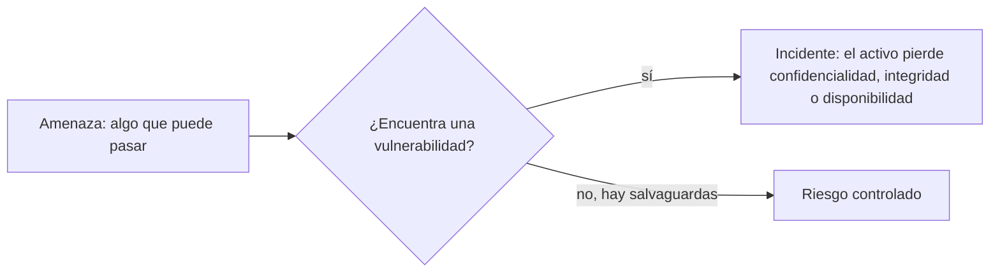
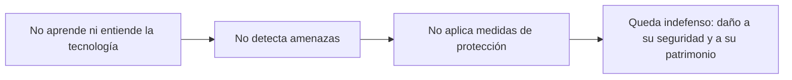

# 08 - ¿Riesgos o vulnerabilidades?

> Unidad 3 de *Introducción a la ciberseguridad* (Raptor Dev Services Academy, curso `cyber-intro`). Material recreado con palabras propias a partir del temario de un diplomado de ciberseguridad; las fuentes van al final en APA 7. Actualización al 2026 donde se indica.

## Por qué importa

"Riesgo", "vulnerabilidad", "amenaza" y "peligro" se usan en la conversación diaria como si fueran lo mismo. En seguridad de la información no lo son, y confundirlos tiene consecuencias prácticas: no se puede medir lo que no se distingue, y no se puede priorizar lo que no se mide. Quien reporta un incidente, quien redacta una política o quien presenta una denuncia necesita nombrar con precisión qué falló, qué pudo pasar y qué pasó.

Esta nota separa los cuatro conceptos, explica cómo medir el riesgo con fórmulas sencillas y dedica la segunda mitad a tres riesgos de raíz humana que casi nunca aparecen en los reportes técnicos: el analfabetismo digital, el incumplimiento profesional y la obsolescencia jurídica.

> "Lo único seguro en la industria de la tecnología es el cambio." (Marc Benioff, citado en el temario)

## Cuatro palabras que no son sinónimos

### Lo que dice el diccionario

- **Vulnerabilidad.** Para la RAE es la "cualidad de vulnerable". Viene del latín *vulnerabilis*, formado por *vulnus* (herida) y el sufijo *-abilis* (posibilidad): literalmente, la condición de poder ser herido. En informática describe la posibilidad de sufrir accesos, daños, fallas o intrusiones indebidas por una debilidad en sistemas, equipos, redes o aplicaciones. Esa debilidad deja al sistema expuesto a peligros que van desde un desastre natural hasta un delito, igual que en la vida presencial estamos expuestos a delitos comunes, y puede facilitar el uso indebido de información personal o institucional con consecuencias legales y prácticas graves.
- **Riesgo.** La RAE lo define como la contingencia o cercanía de un daño. Es la posibilidad de que algo, ajeno a nosotros o provocado por nuestros actos, nos cause un perjuicio, sea en lo personal o en los equipos. Un riesgo puede materializarse o no, y su efecto varía incluso dentro de una misma comunidad: en un sismo unas casas se dañan y otras quedan intactas; en la pandemia todos corrían el riesgo de contagio, pero no todos enfermaron.
- **Peligro.** La RAE lo describe como el riesgo o la contingencia inminente de que ocurra un mal, y también como el lugar u obstáculo donde esa inminencia crece. En lo digital es especialmente traicionero porque no se ve: rara vez se percibe al atacante, y eso aumenta la exposición.
- **Amenaza.** Para la RAE es la acción de amenazar, lo que se dice o hace para amenazar y, como delito, intimidar a alguien anunciándole un mal grave para él o su familia. En seguridad, una amenaza alcanza también a equipos y a toda la infraestructura tecnológica; ninguna marca es invulnerable, aunque su publicidad lo sugiera.

### Lo que significan en ciberseguridad

| Concepto | Definición operativa | Pregunta que contesta |
|---|---|---|
| Vulnerabilidad | Debilidad de un sistema, red, aplicación o dispositivo que un atacante puede aprovechar para acceder sin permiso, alterar, robar, destruir datos o interrumpir el servicio | ¿Por dónde pueden entrar? |
| Amenaza | Situación o evento capaz de causar daño; se vuelve concreta cuando ya se materializó al menos una vez | ¿Qué puede pasar? |
| Riesgo | Posibilidad de que ocurra un daño; crece cuando una vulnerabilidad permite que una amenaza actúe | ¿Qué tan probable es y cuánto dolería? |
| Peligro | Factibilidad de un daño específico; es una de las causas del riesgo | ¿Qué tan inminente es? |

La distinción entre riesgo y peligro se resume así: el riesgo es la posibilidad de sufrir un daño; el peligro, la probabilidad concreta de que ocurra un accidente o una afectación. El peligro alimenta al riesgo.

En el ciberentorno nadie quiere ser atacado, pero los ataques son inevitables y pueden llegar en cualquier momento. La probabilidad de que uno tenga éxito sube con cada vulnerabilidad del sistema: más huecos, más gravedad, más riesgo. La amenaza se vuelve real en proporción al número y a la seriedad de las debilidades presentes.

### La versión del INCIBE

El INCIBE, instituto de ciberseguridad del gobierno español, propone definiciones que se usan mucho en la práctica (INCIBE, 2017a):

- Una **vulnerabilidad** es una debilidad o falla de un sistema de información que pone en riesgo su seguridad porque permite a un atacante comprometer la integridad, la disponibilidad o la confidencialidad. Hay que encontrarlas, contenerlas y eliminarlas cuanto antes. Pueden nacer de errores de diseño, de configuración o de procedimientos que faltan.
- Una **amenaza** es una circunstancia adversa que, si ocurre, afecta negativamente a los activos de información: los deja sin servicio, los hace funcionar mal o les quita valor. Puede tener origen natural, accidental o intencional. Si coincide con una vulnerabilidad, o la aprovecha, se convierte en un incidente de seguridad.

El mismo instituto agrupa las amenazas en tres familias: los **ataques** (fraudes, robos, código malicioso), los **sucesos físicos** (incendios, inundaciones) y la **negligencia o decisiones institucionales** (contraseñas mal gestionadas, información sin cifrar). Pueden venir de dentro o de fuera de la organización.

### Un panorama que crece

Las principales clases de ciberataque se vigilan y clasifican cada año por organismos y empresas especializadas, que publican sus listas a principios de año y las actualizan con datos reales. El Foro Económico Mundial advirtió en su informe de riesgos de 2021 sobre el aumento del cibercrimen, y una nota de prensa de 2022 reportó que el robo de datos a empresas creció 151 % durante 2021 (Hernández, 2022).

> **Actualización al 2026:** el *ENISA Threat Landscape 2026*, publicado el 22 de septiembre de 2026, analizó 8,257 incidentes ocurridos entre el 1 de enero y el 31 de diciembre de 2025: la denegación de servicio fue el 51.3 % de los incidentes y el acceso no autorizado, el 39.5 %; el phishing fue la técnica de ingeniería social más usada (77.8 %), la explotación de vulnerabilidades abrió el 60.4 % de los accesos no autorizados con vía de entrada identificada, y el ransomware siguió como la amenaza de mayor impacto a corto plazo (ENISA, 2026).

## Las tres propiedades que el riesgo amenaza

La seguridad informática protege la información frente a riesgos que pueden afectar una o varias de sus tres propiedades básicas:

| Propiedad | Se pierde cuando... |
|---|---|
| Confidencialidad | alguien sin permiso lee o copia la información |
| Disponibilidad | la información o el servicio no está cuando se necesita |
| Integridad | la información se altera, por error o a propósito |

Ninguna herramienta elimina el riesgo por completo. En mayo de 2019 se supo que una falla de programación en WhatsApp permitió instalar software espía en decenas de teléfonos sin que sus dueños hicieran nada: el espía podía encender la cámara y el micrófono y descargar datos personales y de ubicación. El cifrado de extremo a extremo no se rompió; simplemente deja de proteger cuando el sistema del teléfono ya está comprometido (Associated Press, 2019). La lección: el cifrado protege el contenido mientras viaja, pero no protege un dispositivo comprometido, los respaldos sin cifrar ni los metadatos (con quién, cuándo y desde dónde se habla). Ante tanta información técnica que publican las empresas de mensajería, la pregunta útil es qué protege cada medida y qué deja fuera.

## Medir el riesgo

### Primero, una autoevaluación

Antes de cualquier fórmula, cada persona puede estimar su propio riesgo a partir de su **dependencia tecnológica**. El INCIBE la clasifica en alta, moderada o baja según la cantidad, la calidad y el tiempo que dedicamos a las herramientas digitales, sin justificaciones ni excusas. La relación es directa: a más dependencia, más riesgo. Hay quien sostiene que la tecnología funciona como un producto adictivo y que debería regularse como tal (Alonso, 2018).

### Clasificar antes de medir

El riesgo informático se clasifica de muchas maneras (por peligrosidad, por tipo de equipo, por proceso afectado), y el método de análisis cambia según la clase. El objetivo de medir siempre es el mismo: estimar el impacto y el costo que puede generar.

El INCIBE propone un análisis de riesgos en seis pasos pensado para empresas pequeñas (INCIBE, 2017b):

| Paso | Qué se hace |
|---|---|
| 1. Definir el alcance | Decidir qué se analiza: toda la organización, un departamento, un proceso o un sistema |
| 2. Identificar los activos | Inventariar lo más valioso dentro de ese alcance; una hoja de cálculo basta |
| 3. Identificar las amenazas | Para cada activo, qué le puede pasar; el catálogo de MAGERIT sirve de punto de partida |
| 4. Identificar vulnerabilidades y salvaguardas | Qué debilidades tiene cada activo y qué medidas ya existen |
| 5. Evaluar el riesgo | Estimar probabilidad e impacto de cada par activo y amenaza, con número o con matriz |
| 6. Tratar el riesgo | Para lo que supere el umbral fijado: transferirlo (un seguro), eliminarlo (quitar el proceso), aceptarlo con justificación o mitigarlo con controles |

### Las fórmulas

**Fórmula 1: riesgo = probabilidad × impacto.** La probabilidad es qué tan posible es que la amenaza se materialice; el impacto, cuánto daño causaría. El riesgo vive en la intersección de tres cosas: la amenaza, el activo y la vulnerabilidad. La probabilidad se estima por dos vías:

- **Empírica:** lo que ya pasó antes, en la propia organización o en otras parecidas.
- **Subjetiva:** opiniones fundadas o conjeturas de quienes conocen el sistema.

**Fórmula 2: riesgo = (amenaza × vulnerabilidad) / contramedidas.** Una vez detectado el nivel de riesgo se aplican **contramedidas**, también llamadas controles o salvaguardas: acciones que reducen la probabilidad del daño o que mitigan sus consecuencias. Como están en el denominador, cada contramedida eficaz baja el resultado.

Un ejemplo propio con escalas de 1 a 5:

| Activo | Amenaza | Probabilidad | Impacto | Riesgo (P × I) | Decisión con umbral 10 |
|---|---|---|---|---|---|
| Base de clientes | Robo por contraseña débil | 4 | 5 | 20 | Mitigar: segundo factor y cifrado |
| Sitio informativo | Desfiguración | 2 | 2 | 4 | Aceptar y documentar |
| Servidor de nómina | Falla de disco | 3 | 4 | 12 | Mitigar: respaldo probado |
| Laptops de ventas | Robo físico | 3 | 3 | 9 | Transferir: seguro, y cifrar disco |

Conocer las fórmulas no significa aplicarlas tal cual: indican qué hay que evaluar. Cada organización las adapta con matrices, tablas o anexos propios, y lo ideal es hacerlo con apoyo de los responsables de seguridad informática o del equipo de ciberseguridad, que saben ajustarlas a la realidad del negocio.

### Amenazas que ya se miden

Un ejemplo de amenazas graves documentadas con método es el informe periódico de amenazas adversarias de Meta, firmado por sus responsables de inteligencia de amenazas, que describe redes de influencia y de espionaje desmanteladas en sus plataformas (Meta, s. f.).

> **Actualización al 2026:** Meta sigue publicando sus informes de amenazas adversarias de forma semestral en su Centro de Transparencia; el más reciente listado corresponde al segundo semestre de 2026 (Meta, s. f.).

## Riesgos que no aparecen en el reporte técnico

Además de los riesgos técnicos hay otros, igual de serios y mucho más comunes de lo que se cree, que encarecen cualquier incidente. Los tres que siguen tienen origen humano y se reducen con educación.

### Analfabetismo digital y tecnológico

Las tecnologías de la información entraron en la rutina de millones de personas, expertas o no, y dieron lugar a modelos de negocio enteros (redes sociales, dispositivos, plataformas). Eso es positivo cuando ayuda a la educación y al desarrollo, pero la industria también debería ocuparse de cómo se usan sus productos y comprometerse con la alfabetización digital de sus usuarios. La responsabilidad es compartida, y usar bien la tecnología exige tres condiciones:

1. **Operación técnica correcta:** que la herramienta funcione como debe.
2. **Uso funcional adecuado:** que se use para lo que fue hecha.
3. **Responsabilidad consciente:** que quien la usa conozca sus obligaciones y las consecuencias de sus actos.

Alfabetizar no es enseñar a pulsar botones: es formar criterio para entender las consecuencias de cada decisión en línea y hacer un análisis de riesgos casi instintivo antes de actuar. El analfabetismo digital toma cuatro formas (Colombia Digital, 2012):

| Tipo | Quién lo padece | Por qué lo deja expuesto |
|---|---|---|
| Por ignorancia | Quien no tiene conocimientos básicos | No reconoce las amenazas ni sabe cómo responder |
| Por resistencia al cambio | Quien entiende lo básico pero no quiere actualizarse | Se queda sin defensa ante las amenazas nuevas |
| Por desactualización | Quien aprendió en su momento y dejó de seguir los cambios | No sabe usar las herramientas de protección actuales |
| Por aplicación inadecuada | Quien sabe, pero aplica mal lo que sabe | Configura mal la seguridad o usa la tecnología de forma ineficaz, y deja huecos |

### Incumplimiento profesional

Las organizaciones acumulan, semana tras semana, enormes cantidades de datos sobre su personal y su operación: registros de asistencia con huella o rostro (datos personales sensibles), expedientes, contratos y hasta fórmulas químicas que costaron años de investigación y están protegidas como propiedad intelectual. Quien administra esa información tiene obligaciones concretas. Una lista mínima de tareas de quien resguarda la información del personal:

- Revisar que los servidores estén encendidos y funcionando.
- Mantener habilitados los cortafuegos.
- Comprobar que internet y los servicios autorizados operen correctamente.
- Tener el software actualizado.
- Verificar que la red y los equipos estén libres de malware.
- Definir y configurar bien los privilegios de cada usuario.
- Monitorear la red según lo que indique la bitácora.
- Capacitar de forma continua a todo el personal en políticas, buenas prácticas y seguridad de la información.

No cumplir una obligación profesional o contractual genera responsabilidad. Puede haber razones (falta de tiempo, de presupuesto o de comprensión), pero ninguna exime de las consecuencias: sanciones económicas, demandas, daño a la reputación o acciones legales. El incumplimiento suele presentarse de dos formas:

| Forma | En qué consiste |
|---|---|
| Mala praxis | No hacer el análisis que correspondía o no saber qué hacer: error, olvido, distracción, poca motivación, descuido, negligencia, imprudencia, ignorancia, culpa e incluso dolo |
| Manipulación | Alterar, sustituir, contaminar, dañar, destruir, falsificar o degradar la información o los sistemas |

Seguridad y cumplimiento normativo van juntos en la gestión de riesgos. Cumplir la ley no es la meta final sino el piso: debe servir de incentivo para proteger de verdad las aplicaciones y los datos. Incluso un programa de seguridad sólido necesita ajustes para medir, supervisar y demostrar su cumplimiento frente a las amenazas del momento, y debe incluir un plan para recuperarse si el ataque ocurre. Integrar la estrategia de cumplimiento con la de seguridad informática reduce el riesgo total, sobre todo en tres frentes: la seguridad de las aplicaciones, el control de acceso a los datos y la gestión de identidades y accesos.

Invertir en prevención sale más barato que pagar las pérdidas de un ataque más el costo de recuperarse. Y el costo no lo pagan solo las empresas: también las personas cuyos datos se exponen. Ya en 2019 se estimaba que las ganancias del cibercrimen superarían a las del narcotráfico (AETecno, 2019).

### Obsolescencia jurídica

Las normas que regulan bienes, servicios y la vida diaria sostienen el orden social; quien las incumple enfrenta consecuencias civiles, penales, económicas o incluso la cárcel. El problema aparece cuando la ley no alcanza a la tecnología. La obsolescencia jurídica deja zonas sin protección y dificulta aplicar la ley a situaciones nuevas. Tiene tres causas principales:

| Causa | Qué significa | Ejemplo |
|---|---|---|
| Lagunas | La ley no contempla una situación o no dice cómo resolverla | Una modalidad nueva de fraude en línea que ningún tipo penal describe |
| Insuficiencia jurídica | La ley existe pero es tan general que no cubre los casos concretos | Una norma de datos personales que no prevé ataques con inteligencia artificial |
| Falta de precedentes | No hay casos anteriores que orienten cómo aplicar la norma | Las primeras denuncias por un tipo de ciberdelito que los tribunales nunca habían resuelto |

Cuando se presentan, las conductas que causan incidentes de seguridad pueden quedar sin castigo, porque ni la norma ni la jurisprudencia están preparadas para identificar y sancionar los delitos informáticos.

En México, la legislación vigente toca la seguridad de la información en estos frentes:

| Materia | Qué regula |
|---|---|
| Delitos informáticos | Acceso sin autorización a sistemas y equipos; daño, modificación o borrado de información; uso indebido de herramientas digitales y suplantación de identidad en varios tipos penales |
| Comercio electrónico | Reglas para que comprar y vender en línea sea seguro y confiable |
| Propiedad intelectual | Derechos de autor y propiedad industrial contra el uso no autorizado |
| Responsabilidad profesional en TI | Obligaciones de quienes trabajan con tecnologías de la información |
| Intervención de comunicaciones | Condiciones y límites para intervenir comunicaciones, entre la seguridad y la privacidad |
| Firma electrónica | Validez legal de la firma electrónica para autenticar documentos digitales |
| Datos personales | Reglas para recabar, guardar y usar datos personales con seguridad y transparencia |
| Criptoactivos y lavado de dinero | Uso comercial de activos virtuales y prevención de lavado y financiamiento del terrorismo |
| Difusión de contenido íntimo | Protección contra la divulgación no autorizada de información íntima y privada |

> **Actualización al 2026:** el 20 de marzo de 2025 el DOF publicó nuevas leyes de protección de datos personales para el sector público y para los particulares, que sustituyeron a las de 2017 y 2010; el organismo garante que las aplicaba desapareció y sus funciones pasaron al gobierno federal. La difusión no consentida de contenido íntimo se tipificó a nivel federal con las reformas de 2021 conocidas como Ley Olimpia, y los activos virtuales se regulan desde 2018 en la Ley para Regular las Instituciones de Tecnología Financiera. Los detalles se ven en las notas de la unidad 4.

## Privacidad y seguridad: una forma de vida

Los dos aspectos más importantes de la ciberseguridad son la privacidad y la seguridad de la información (Fundación Telefónica, 2016). Ambos enfrentan hoy riesgos serios, sobre todo en el terreno financiero: las amenazas son cada vez más numerosas y variadas, y la digitalización acelerada de todo multiplica las oportunidades de ataque. La seguridad absoluta no existe, pero estar informado sobre las amenazas y saber reconocerlas reduce mucho la exposición. Por eso la seguridad de la información no debería ser un tema que se estudia una vez, sino un hábito que atraviesa todo: el uso personal de la tecnología, la operación de sistemas financieros y el cuidado de los datos sensibles.

## Gestión de riesgos

La gestión de riesgos une todo lo anterior: relaciona amenazas, vulnerabilidades, impacto y probabilidad para decidir qué se protege primero y cómo (INCIBE, 2015). Combina dos actividades: el **análisis** (identificar y valorar) y el **tratamiento** (decidir qué hacer con cada riesgo y vigilar que la decisión funcione).

> **Actualización al 2026:** el INCIBE publicó una actualización de su guía *Gestión de riesgos. Una guía de aproximación para el empresario* (versión 04/2025, página actualizada en febrero de 2026), que conserva la relación entre activo, amenaza, vulnerabilidad e impacto (INCIBE, 2025).

## Cierre

Distinguir riesgo de vulnerabilidad es la base de cualquier estrategia de protección: el riesgo es la posibilidad de daño cuando una amenaza explota una debilidad, y la vulnerabilidad es la debilidad misma. Los riesgos son previsibles y deben reducirse al mínimo; algunas amenazas no se controlan, pero sí se puede perder la menor cantidad de información y recuperar la operación de inmediato. Cuando la información se daña, conviene asignarle un valor económico conforme a la ley, como a cualquier otro bien jurídico.

## Para profundizar

- Las seis salvaguardas básicas para proteger la información de una empresa, en la sección "Protección de la información" del INCIBE (s. f.).
- Identidad digital y reputación en línea, y sus riesgos, en la guía del INCIBE (2023) para empresas.
- El video del INCIBE (2017c) sobre cómo hacer un análisis de riesgos a partir de las amenazas y las medidas preventivas.
- Consejos para configurar la privacidad y la seguridad de una cuenta de Google, donde suele concentrarse mucha información personal (HHP, 2018).

## Glosario

| Término | Definición |
|---|---|
| Vulnerabilidad | Debilidad de un sistema, red, aplicación o proceso que un atacante puede aprovechar |
| Amenaza | Circunstancia o evento capaz de dañar los activos de información |
| Riesgo | Posibilidad de daño que resulta de combinar una amenaza con una vulnerabilidad; se estima con probabilidad e impacto |
| Peligro | Factibilidad o inminencia de un daño concreto; una causa del riesgo |
| Activo de información | Recurso valioso para la persona o la empresa cuya pérdida o deterioro causa un perjuicio |
| Incidente de seguridad | Evento en el que una amenaza aprovecha una vulnerabilidad y afecta la información |
| Contramedida | Control o salvaguarda que reduce la probabilidad o el impacto de un riesgo |
| Dependencia tecnológica | Grado en que una persona depende de las herramientas digitales; a más dependencia, más riesgo |
| Analfabetismo digital | Falta de conocimientos, actualización o criterio para usar la tecnología con seguridad |
| Incumplimiento profesional | Falta a una obligación profesional o contractual de proteger la información, por mala praxis o manipulación |
| Obsolescencia jurídica | Desfase entre la ley y la tecnología por lagunas, insuficiencia o falta de precedentes |
| Tratamiento del riesgo | Decisión de transferir, eliminar, aceptar o mitigar un riesgo |

## Referencias

- AETecno. (2019, 20 de febrero). Ganancias de los ciberdelincuentes superarán a las del narcotráfico. *AméricaEconomía*. https://web.archive.org/web/20190221210758/https://tecno.americaeconomia.com/articulos/ganancias-de-los-ciberdelincuentes-superaran-las-del-narcotrafico
- Alonso, N. (2018, 12 de febrero). La tecnología es un producto adictivo y debe ser regulado como tal. *El País*. https://elpais.com/tecnologia/2018/02/09/actualidad/1518209058_401300.html
- Associated Press. (2019, 14 de mayo). Vulnerabilidad de WhatsApp permitió hackear celulares. *Voz de América*. https://www.vozdeamerica.com/a/vulnerabilidad-de-whatsapp-permitio-hackear-celulares/4917891.html (el temario citaba la misma nota de agencia publicada en *El Universal*).
- Colombia Digital. (2012, 16 de noviembre). *¿Qué es el analfabetismo digital?* [Video]. YouTube. https://youtu.be/ygOBFJzJmtU
- ENISA. (2026). *ENISA threat landscape 2026*. Agencia de la Unión Europea para la Ciberseguridad. https://www.enisa.europa.eu/publications/enisa-threat-landscape-2026
- Fundación Telefónica. (2016). *Ciberseguridad, la protección de la información en un mundo digital*. https://www.fundaciontelefonica.com/publications/ciberseguridad-la-proteccion-de-la-informacion-en-un-mundo-digital/
- Hernández, L. (2022, 18 de enero). Ciberataques en el mundo: robo de datos a compañías se dispara 151 % en 2021. *El Financiero*. https://www.elfinanciero.com.mx/economia/2022/01/18/ciberataques-en-el-mundo-robo-de-datos-a-companias-se-dispara-151-en-2021/
- HHP. (2018, 28 de diciembre). *Seguridad informática* [Video]. YouTube. https://www.youtube.com/watch?v=1Cg70xiRmBY
- INCIBE. (2015). *Gestión de riesgos. Una guía de aproximación para el empresario*. Instituto Nacional de Ciberseguridad. https://www.incibe.es/empresas/guias/gestion-de-riesgos-una-guia-de-aproximacion-para-el-empresario-actualizacion
- INCIBE. (2017a). *Amenaza vs vulnerabilidad, ¿sabes en qué se diferencian?* Instituto Nacional de Ciberseguridad. https://www.incibe.es/empresas/blog/amenaza-vs-vulnerabilidad-sabes-se-diferencian
- INCIBE. (2017b). *¡Fácil y sencillo! Análisis de riesgos en 6 pasos*. Instituto Nacional de Ciberseguridad. https://www.incibe.es/empresas/blog/analisis-riesgos-pasos-sencillo
- INCIBE. (2017c, 14 de septiembre). *Análisis de riesgos* [Video]. YouTube. https://www.youtube.com/watch?v=knxhzpNFWGI
- INCIBE. (2023). *Ciberseguridad en la identidad digital y la reputación online. Guía de recomendaciones para empresas*. Instituto Nacional de Ciberseguridad. https://www.incibe.es/empresas/guias/guia-ciberseguridad-identidad-online
- INCIBE. (2025). *Guía de gestión de riesgos* (actualización 04/2025). Instituto Nacional de Ciberseguridad. https://www.incibe.es/sites/default/files/2026-02/Gu%C3%ADa%20de%20gesti%C3%B3n%20de%20riesgos_INCIBE_Actualizacion_04_2025.pdf
- INCIBE. (s. f.). *Protección de la información*. Instituto Nacional de Ciberseguridad. https://www.incibe.es/empresas/que-te-interesa/proteccion-informacion
- Meta. (s. f.). *Meta's threat disruptions* [Informes de amenazas adversarias]. Transparency Center. https://transparency.meta.com/metasecurity/threat-reporting
- Real Academia Española. (s. f.). *Diccionario de la lengua española* (23.ª ed.). https://dle.rae.es/

---

*Rogelio Arriaga Gonzalez*
