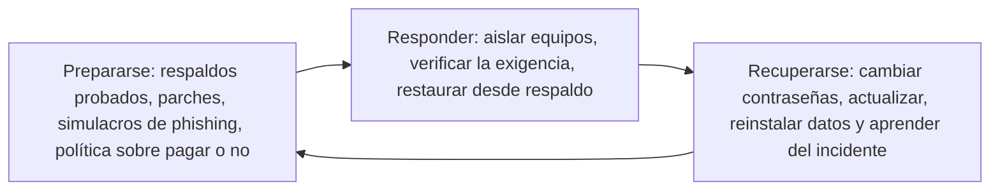
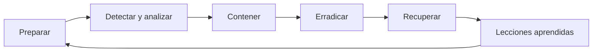

# 09 - Ciberamenazas: principales dimensiones

> Unidad 3 de *Introducción a la ciberseguridad* (Raptor Dev Services Academy, curso `cyber-intro`). Material recreado con palabras propias a partir del temario de un diplomado de ciberseguridad; las fuentes van al final en APA 7. Actualización al 2026 donde se indica.

## Por qué importa

¿Cuáles son las amenazas principales del mundo digital, qué conductas las alimentan, quién las ejecuta y para qué? Contestar esas preguntas es el primer paso para no ser blanco de un delito informático.

Evaluar amenazas no es lo mismo que medir riesgos. La medición de riesgos (nota 08) la puede hacer cada organización con sus propios datos; la evaluación de amenazas requiere especialistas, se hace por lo general una vez al año salvo que un incidente masivo obligue a adelantarla, y sus resultados se publican a nivel mundial, ordenados por tipo de amenaza o por daño causado, porque una misma amenaza cruza fronteras junto con la información.

Cuando el incidente ya ocurrió, hace falta seguir pasos ordenados para volver al estado anterior. Para una persona no son complicados; para una empresa se vuelven metodologías completas de gestión de incidentes. La comparación útil es con la protección civil: igual que ante un sismo, la recuperación es un ciclo que se aprende y se ensaya antes de necesitarlo, y forma parte de la prevención.

> "La tecnología, con todas sus promesas y su potencial, se ha ido del control del hombre, tanto que amenaza contra la humanidad." (Kim J. Vicente, citado en el temario)

## A. Qué, quién y por qué

### El daño y las conductas que lo causan

La idea de daño va unida a las de peligro, precaución y alerta: nos ayuda a reconocer las actividades en las que podemos salir afectados, directa o indirectamente, y en seguridad de la información funciona igual. Cualquier acción que comprometa la seguridad, la integridad o la confidencialidad de la información en sistemas, bases de datos, plataformas, equipos, redes, nubes o sitios web es una conducta lesiva. La historia está llena de ataques que cambiaron las reglas: solo los mayores robos de datos documentados hasta 2017 sumaban más de 5 mil millones de registros y 229 empresas afectadas (Sánchez, 2017).

No todos los riesgos vienen de extraños. El *sharenting* (padres que publican fotos y datos de sus hijos) expone a niñas, niños y adolescentes a consecuencias que pueden acompañarlos toda la vida y, de paso, les enseña con el ejemplo a exponerse ellos mismos (Casi Creativos, 2023).

Conductas inapropiadas o delictivas frecuentes en el ciberentorno, agrupadas por lo que dañan:

| Contra las personas | Contra los sistemas | Contra la información y el mercado |
|---|---|---|
| Acoso | Intrusión a sistemas | Uso indebido de información personal |
| Amenazas | Borrado de información | Información falsa (noticias falsas) |
| Suplantación de identidad | Ataques directos a sitios | Información no solicitada (spam) |
| Ataques a la reputación | Pérdida de operatividad | Venta de bienes o servicios ilegales en línea |
| Publicación de contenido sexual privado | Sistemas o bases de datos comprometidos | Incitación al delito |
| Pornografía infantil | | |

### Quién las ejecuta

A quien usa la tecnología para dañar a personas, empresas o gobiernos se le suele llamar *hacker*, pero antes de ponerle esa etiqueta a cualquier experto conviene entender qué sabe hacer: programación, redes, sistemas operativos, criptografía, curiosidad y paciencia para encontrar fallas (Universia, 2018). Esas habilidades no son buenas ni malas por sí mismas.

Actuar de forma ética o dañina es una decisión: el libre albedrío, que la RAE define como la potestad de obrar por reflexión y elección. Quien elige dañar puede, una vez que la ley lo señala como delincuente, reorientar su experiencia; hay *hackers* rehabilitados que hoy investigan y combaten el cibercrimen (Invdes, 2019). Para quien sabe que actúa ilegalmente, la norma jurídica es el camino para fijar su responsabilidad y sancionarlo, igual que con cualquier delito del mundo físico.

**Caso Ashley Madison (2015).** Un grupo expuso unos 10 GB de datos de usuarios de un sitio canadiense de citas para personas casadas, con clientes en 46 países. Hubo extorsiones, rupturas familiares y suicidios. Sigue siendo uno de los incidentes más graves por la difusión de información personal y sensible, y en mayo de 2024 se estrenó una serie documental sobre el caso (Univisión Noticias, 2015).

**Sector salud.** Hospitales y laboratorios se volvieron blanco preferente desde la pandemia, con técnicas dirigidas que no han desaparecido (Itech-Learning, 2021).

**Ransomware global.** El 12 de mayo de 2017 WannaCry afectó a más de 200,000 equipos de hospitales, empresas y gobiernos en al menos 100 países aprovechando una falla de Windows sin parchar (National Audit Office, 2017); semanas después, Petya (en su variante conocida como NotPetya) paralizó otra vez a grandes organizaciones (Molist, 2017). El ransomware es código malicioso que cifra la información y exige un rescate para devolverla.

**Infraestructura crítica.** Redes eléctricas, agua, telecomunicaciones, transporte y servicios financieros sostienen la vida de un país; un ataque contra ellas compromete su estabilidad y su seguridad (González, 2022).

### Por qué atacan

Los ataques grandes rara vez son espontáneos: los planea y ordena la delincuencia informática organizada, con estructura jerárquica y metas definidas, como otras formas de crimen organizado. Las motivaciones más comunes:

| Motivación | En qué consiste |
|---|---|
| Económica | Robo de datos para venderlos, secuestro de sistemas con ransomware, fraude electrónico |
| Ideológica (ciberactivismo y hacktivismo) | Promover una causa política, religiosa o social, protestar o exhibir injusticias, sin buscar dinero |
| Desestabilización | Debilitar gobiernos, instituciones o sociedades; a veces con respaldo de un Estado |
| Reputación y prestigio | Ganar notoriedad en la comunidad de atacantes demostrando habilidad |
| Explotación de vulnerabilidades | El reto técnico mismo, sin otro objetivo que probar que se puede |

Entender el motivo orienta la defensa: quien busca dinero se va al blanco más fácil; quien busca una causa elige el blanco más visible.

## El panorama en cifras

El Parlamento Europeo resumió el informe de 2022 de ENISA, la agencia de ciberseguridad de la Unión Europea, en ocho amenazas principales (Parlamento Europeo, 2022):

| Amenaza | Qué es | Dato del informe |
|---|---|---|
| Ransomware | Toma de control de los datos a cambio de un rescate | La mayor demanda pasó de 13 a 62 millones de euros entre 2019 y 2021; el rescate promedio pagado se duplicó de 71 mil a 150 mil euros entre 2019 y 2020 |
| Malware | Software que daña un sistema: virus, gusanos, troyanos, espías | Repuntó a fines de 2021 con el regreso a las oficinas; en el primer semestre de 2022 hubo más ataques al internet de las cosas que en los cuatro años previos |
| Ingeniería social | Engañar a las personas para obtener acceso | Casi el 60 % de los ataques en Europa, Medio Oriente y África tuvo un componente de este tipo |
| Amenazas contra los datos | Violaciones intencionales y fugas involuntarias | El dinero es el motivo más común; en el 10 % de los casos, el espionaje |
| Denegación de servicio | Saturar la infraestructura para dejar sin servicio | Creciente contra redes móviles y dispositivos conectados |
| Amenazas contra internet | Toma física, destrucción o censura de la infraestructura | Visto en los territorios ucranianos ocupados |
| Desinformación | Difusión de contenido falso, incluidos *deepfakes* y bots | Usada por ambos bandos en la guerra de Ucrania |
| Cadena de suministro | Atacar al proveedor para llegar al cliente | Cada vez más común por la cantidad de proveedores difíciles de supervisar |

Entre junio de 2021 y junio de 2022, los sectores más atacados fueron la administración pública (24 % de los incidentes), los servicios digitales (13 %), el público en general (12.4 %), los servicios (11.8 %), el sector financiero (8.6 %) y el de salud (7.2 %).

> **Actualización al 2026:** el Parlamento Europeo actualizó esa página en julio de 2025 con el informe de ENISA de 2024, que redujo la lista a siete amenazas encabezadas por los ataques a la disponibilidad, el ransomware y las amenazas contra los datos, con la administración pública como sector más afectado (19 %). El *ENISA Threat Landscape 2026*, publicado el 22 de septiembre de 2026, analizó 8,257 incidentes ocurridos entre el 1 de enero y el 31 de diciembre de 2025: la denegación de servicio fue el 51.3 % de los incidentes y el acceso no autorizado, el 39.5 %; el phishing fue la técnica de ingeniería social más usada (77.8 %), la explotación de vulnerabilidades abrió el 60.4 % de los accesos no autorizados con vía de entrada identificada, y el ransomware siguió como la amenaza de mayor impacto a corto plazo (ENISA, 2026).

### Malware

El malware es software hecho por delincuentes para su beneficio: robar información, dañar sistemas o tomar el control del equipo (García Monje, 2017). Sus familias más conocidas:

| Tipo | Cómo actúa |
|---|---|
| Virus | Se aloja en otro programa y se activa cuando el usuario lo ejecuta |
| Gusano | Se copia solo y se propaga por la red sin intervención humana |
| Troyano | Se disfraza de programa legítimo para abrir la puerta a otros ataques |
| Spyware | Se instala sin aviso y recopila la actividad del usuario |
| Adware | Llena la pantalla de publicidad no solicitada |
| Puerta trasera | Permite entrar al sistema saltándose la autenticación |
| Botnet | Red de equipos infectados que un atacante controla a distancia |
| Rootkit | Se esconde en lo profundo del sistema para ocultar a otros programas maliciosos |
| Keylogger | Registra lo que se teclea, incluidas contraseñas |
| Ransomware | Cifra o bloquea la información y pide rescate |

Llega por correo con adjuntos o enlaces, por sitios web y ventanas emergentes engañosas, por memorias USB que se ejecutan solas, por programas piratas y por fallas de seguridad sin parchar. Señales de alerta: ventanas emergentes constantes, antivirus o cortafuegos desactivados sin que nadie lo hiciera, archivos que desaparecen o cambian de extensión, aplicaciones en otro idioma, navegación redirigida, conexión lenta sin descargas y disco trabajando sin motivo. La prevención es conocida y casi siempre suficiente: antivirus y cortafuegos activos, actualizaciones al día, software legal, desconfiar de correos inesperados y analizar cada archivo nuevo. Entre los programas maliciosos más dañinos de la historia figuran CIH, Melissa, ILOVEYOU, Code Red, Slammer, Mydoom, Stuxnet, Zeus, CryptoLocker, WannaCry y NotPetya.

### Ransomware en América Latina

El ransomware es una de las amenazas más peligrosas de la región (Ávila Niño, 2023). Entre 2014 y 2017 crecía alrededor de 30 % al año; tras WannaCry hubo una pausa, y desde 2018 retomó un ritmo cercano a 7 % anual. México aparece de forma constante entre los países más afectados: segundo lugar regional en detecciones según un reporte de 2020 (22.57 %, detrás de Brasil) y segundo en detecciones empresariales de ransomware en 2020 según ESET (14.9 %, detrás de Perú). En noviembre de 2019, Pemex reportó un ataque que afectó cerca del 5 % de sus computadoras, con una exigencia de 565 bitcoins.

Vías de entrada más usadas: correos con enlaces o adjuntos maliciosos (documentos de Word y hojas de Excel sobre todo), redes sociales, el protocolo de escritorio remoto expuesto, publicidad maliciosa, descargas automáticas, propagación dentro de la red, memorias USB, software ilegal, descargas en redes entre pares y aplicaciones móviles. Además existe el ransomware como servicio: quien quiere atacar a una organización paga a los criminales o les cede un porcentaje del rescate.

El Cyber Readiness Institute (2020) propone tres pasos para enfrentarlo:

La pregunta "¿pagar o no pagar?" se decide antes del ataque, no durante él. Si hay respaldos que funcionan, no hace falta pagar.

### Phishing y sus variantes

El phishing es un correo que finge venir de una persona o empresa de confianza para robar contraseñas o datos, o para tomar el control del equipo. Tiene parientes: el **smishing** llega por mensaje de texto, el **vishing** por llamada telefónica y el **spear phishing** va dirigido a una persona concreta con datos reales de su vida o su trabajo (Secretaría de Comunicaciones y Transportes, 2023). En Ecuador, entre 2014 y 2020, cuatro de cada diez delitos informáticos denunciados fueron suplantación de identidad por esta vía, lo que lo convierte en un riesgo de frecuencia muy alta y de impacto alto (Rosero Tejada, 2021). La defensa combina detección técnica, sanciones a los atacantes y, sobre todo, educación de los usuarios.

### Denegación de servicio

Un ataque de denegación de servicio busca que un sitio o aplicación deje de estar disponible, casi siempre inundándolo de tráfico; si el tráfico sale de muchos equipos a la vez (una botnet), es distribuido (DDoS). Según el modelo OSI, se distinguen dos familias (Amazon Web Services, 2018):

| Familia | Capas | Ejemplos |
|---|---|---|
| Infraestructura | 3 y 4 (red y transporte) | Reflexión UDP, que abusa de un protocolo sin estado; inundación SYN, que abre conexiones sin completar el saludo de tres pasos y agota las del servidor |
| Aplicación | 6 y 7 (presentación y aplicación) | Inundación HTTP, ataques que esquivan la caché, abuso de TLS, inundación de consultas DNS |

Se mitigan reduciendo lo expuesto a internet, con capacidad para absorber picos y con redes de distribución de contenido que filtran el tráfico antes de que llegue al servidor.

## B. Medir la amenaza: el antes y el después

Asumido que casi cualquier activo de información puede ser atacado con éxito, el objetivo es reducir el riesgo con métricas: saber dónde se está para defender o mitigar en proporción al ataque. De esas métricas depende la metodología de mitigación y, si hace falta, de recuperación.

Un matiz que se olvida: empresas y gobiernos rara vez procesan ellos mismos todos sus datos; lo hacen terceros. Si el proveedor sufre una brecha, los controles y responsabilidades del dueño también quedan comprometidos. El caso Cambridge Analytica lo mostró en 2018: datos de millones de usuarios de Facebook, obtenidos por medio de una aplicación de terceros, se usaron para perfilar votantes e influir en la política de un país (BBC News Mundo, 2018).

Cada día aparecen vulnerabilidades, técnicas de explotación, dispositivos y aplicaciones nuevas, así que estar completamente al día es imposible (Kubovič, citado en el temario). Y ya no solo hay que cuidarse de personas: los sistemas de aprendizaje automático detectan patrones de ataque, pero también pueden manipularse o usarse para generar código malicioso que cambia y evoluciona rápido. La defensa debe incluir las amenazas producidas por máquinas.

## C. ¡Incidente de seguridad! ¿Y luego qué?

### Evento no es incidente

Un **evento** es un hecho imprevisto que afecta algún activo (hardware, ancho de banda, software o una aplicación) sin que la información quede comprometida. Un **incidente** sí compromete la información y la seguridad de los usuarios. Los titulares de prensa ("hackeados", "vulneraron sus datos") suelen exagerar o minimizar; la magnitud real solo la establecen los especialistas y, después, las propias víctimas. Uber ocultó durante un año un ataque de 2016 que expuso datos de 57 millones de personas, y ocultarlo agravó el daño (Redondo, 2017).

### Cuánto cuesta un incidente

El derecho suele valorar el daño en dinero, igual que pone precio a bienes irremplazables como la vida para fines de reparación. La información es invaluable, pero se le asigna un monto para estimar el impacto y buscar la reparación, que en la práctica rara vez es completa. Los impactos típicos son cuatro: pérdida de datos críticos, exposición de información confidencial con consecuencias legales y de reputación, interrupción del servicio y daño a la confianza del mercado.

No todo evento es negativo: descubrir vulnerabilidades, conocer nuevas formas de explotarlas, actualizar firmas de malware y detectar conductas emergentes también fortalece la seguridad.

### Cómo responder

La prevención se apoya en marcos de buenas prácticas como las normas ISO, ITIL y COBIT, que ayudan a detectar anomalías a tiempo. Detectado el incidente, hay que actuar rápido y adaptar la respuesta al ataque y a la organización. Microsoft sugería este orden de prioridades:

1. Proteger la vida humana y la seguridad de las personas.
2. Proteger la información secreta y confidencial.
3. Proteger otra información: datos científicos, propiedad intelectual, documentos directivos.
4. Proteger el hardware y el software.
5. Reducir al mínimo la interrupción de los recursos informáticos.

El temario agrupa estas pautas bajo el nombre de "indicadores de compromiso", porque orientan el diagnóstico de causas y consecuencias. En el uso técnico actual, un indicador de compromiso es otra cosa: el rastro concreto que delata una intrusión (un archivo, una dirección, un dominio) y que se registra al cerrar el incidente para detectarlo la próxima vez. Lo recomendable es un ciclo continuo de prevención y respuesta como el que describe el INCIBE.

La gravedad depende del contexto: un ransomware puede detener por completo a una pequeña empresa; una filtración en un banco trae pérdida de confianza, multas y demandas; una denegación de servicio contra un servicio público pone en riesgo a la población. Los respaldos y controles de acceso son indispensables, pero ocurrido el incidente se necesita una respuesta a la medida y mejora continua.

> **Actualización al 2026:** el NIST publicó en abril de 2025 la revisión 3 de su guía SP 800-61, que reorganiza la respuesta a incidentes alrededor de las seis funciones del NIST CSF 2.0 (gobernar, identificar, proteger, detectar, responder y recuperar). Microsoft mantiene su guía vigente en Microsoft Learn; la norma ISO/IEC 27001 vigente es la edición 2022.

## D. Ciberactivismo y hacktivismo

En 2013 circuló un video de un grupo identificado con Anonymous que firmaba un "manifiesto zapatista" en apoyo a ese movimiento y en protesta contra decisiones políticas y nombramientos del gobierno mexicano de entonces (MexicanH Team, 2013). El ciberactivismo, entendido como usar medios digitales para promover causas sociales, políticas o ambientales, no es ilegal en sí (Fernández Prados, 2012). Se vuelve sancionable cuando difunde mensajes que incitan al delito o promueven conductas ilegales, y se convierte en hacktivismo cuando recurre a intrusiones o ataques para desestabilizar sistemas, con consecuencias legales serias.

## E. Ingeniería social

La ingeniería social manipula a las personas, no a las máquinas: aprovecha la confianza, el miedo o la curiosidad para conseguir contraseñas o datos, o para que la víctima haga algo que la perjudica. Llega por correos falsos, llamadas, mensajes y redes sociales (Google Help, 2016). Contra ella, la mejor herramienta es una pausa: verificar por otro canal quién pide algo, desconfiar de la urgencia y nunca entregar códigos ni contraseñas.

## Cierre

Las ciberamenazas van desde el malware sofisticado y las vulnerabilidades de día cero hasta el engaño psicológico. La convergencia de tecnologías emergentes y la interconexión global amplían la superficie de ataque, y la respuesta tiene que ser integral: infraestructura actualizada, personal capacitado de forma continua y colaboración entre países. Después de un incidente las condiciones nunca vuelven a ser idénticas; lo que se decide después es lo que previene el siguiente.

## Para profundizar

- Cuánto saben de cada usuario las plataformas que usa a diario (Arenas, 2018).
- Los nueve elementos de la ciudadanía digital como base de la prevención (Tamez, 2015).
- Los congresos especializados, como Infosecurity, donde se presentan las amenazas del año (Infosecurity, 2018).

## Glosario

| Término | Definición |
|---|---|
| Ciberamenaza | Posibilidad de que una conducta o un evento dañe información o sistemas en el ciberentorno |
| Evento de seguridad | Hecho imprevisto que afecta un activo sin comprometer la información |
| Incidente de seguridad | Hecho que sí compromete la información o la seguridad de los usuarios |
| Malware | Software creado para dañar, robar información o controlar un equipo |
| Ransomware | Malware que cifra o bloquea la información y exige un rescate |
| Ransomware como servicio | Modelo en que los criminales rentan su ransomware a cambio de un pago o porcentaje |
| Phishing | Engaño por correo que suplanta a alguien de confianza para robar datos |
| Smishing y vishing | Variantes del phishing por mensaje de texto y por llamada |
| Denegación de servicio | Ataque que satura un servicio para dejarlo fuera de línea; distribuida si usa muchos equipos |
| Botnet | Red de equipos infectados controlados a distancia |
| Ingeniería social | Manipulación psicológica para obtener información o acciones de la víctima |
| Hacktivismo | Uso de ataques informáticos con fines políticos o sociales |
| Infraestructura crítica | Sistemas esenciales para un país: energía, agua, comunicaciones, transporte, finanzas |
| Cadena de suministro | Relación con proveedores que un atacante usa para llegar al cliente |
| Indicador de compromiso | Rastro técnico que delata una intrusión y permite detectarla de nuevo |

## Referencias

- Amazon Web Services. (2018). *Mejores prácticas de AWS para la resistencia a los DDoS*. Versión vigente (2026): https://docs.aws.amazon.com/whitepapers/latest/aws-best-practices-ddos-resiliency/aws-best-practices-ddos-resiliency.html
- Arenas, G. (2018, 24 de abril). Google sabe más de ti que tu propia madre. *GQ España*. https://www.revistagq.com/noticias/tecnologia/articulos/datos-que-google-sabe/28869
- Ávila Niño, F. Y. (2023). Ransomware, una amenaza latente en Latinoamérica. *InterSedes, 24*(49), 92-119. https://doi.org/10.15517/isucr.v24i49.50765
- BBC News Mundo. (2018). *Cómo Cambridge Analytica analizó la personalidad de millones de usuarios de Facebook* [Video]. YouTube. https://www.youtube.com/watch?v=7831NGClsrM
- Casi Creativos. (2023). *El sharenting, la historia de Ella* [Video]. YouTube. https://www.youtube.com/watch?v=dRa-6Du9OBE
- Cyber Readiness Institute. (2020). *Manual de estrategias para actuar ante ataques de ransomware*. https://cyberreadinessinstitute.org/wp-content/uploads/20-CRI-Ransomware-Playbook-ES.pdf
- ENISA. (2026). *ENISA threat landscape 2026*. Agencia de la Unión Europea para la Ciberseguridad. https://www.enisa.europa.eu/publications/enisa-threat-landscape-2026
- Fernández Prados, J. S. (2012). Ciberactivismo: conceptualización, hipótesis y medida. *Arbor, 188*(756), 631-639. https://doi.org/10.3989/arbor.2012.756n4001
- García Monje, R. A. (2017). *Seguridad informática y el malware*. Universidad Piloto de Colombia. https://repository.unipiloto.edu.co/bitstream/handle/20.500.12277/2641/00004128.pdf
- González, S. (2022, 10 de marzo). Ciberataques a la infraestructura crítica de un país y sus consecuencias. *WeLiveSecurity*. https://www.welivesecurity.com/la-es/2022/03/10/ciberataques-infraestructura-critica-pais-consecuencias/
- Google Help. (2016, 8 de febrero). *Cómo evitar ataques de ingeniería social* [Video]. YouTube. https://www.youtube.com/watch?v=xDdVnRHO3CE
- INCIBE-CERT. (s. f.). *Respuesta a incidentes*. Instituto Nacional de Ciberseguridad. https://www.incibe.es/incibe-cert/incidentes/respuesta-incidentes
- Infosecurity. (2018). *Join the most specialized cybersecurity event*. Lectura citada por el temario; sin enlace verificado al 2026.
- Invdes. (2019, 6 de abril). *Hackers criminales rehabilitados ahora se enfrentan contra delincuentes de internet*. https://invdes.com.mx/politica-cyt-i/hackers-criminales-rehabilitados-ahora-se-enfrentan-contra-delincuentes-de-internet/
- Itech-Learning. (2021). *ESET: ciberamenazas, técnicas y tácticas dirigidas al sector salud* [Video]. YouTube. https://www.youtube.com/watch?v=1fvm6fXxe0o
- MexicanH Team. (2013, 14 de enero). *Manifiesto zapatista Anonymous* [Video]. Vimeo. https://vimeo.com/57356483
- Microsoft. (2026). *Planee la respuesta a incidentes en el modelo de adopción de seguridad*. Microsoft Learn. https://learn.microsoft.com/es-es/security/zero-trust/security-adoption-discipline-security-operations-incidents
- National Audit Office. (2017, 27 de octubre). *Investigation: WannaCry cyber attack and the NHS*. https://www.nao.org.uk/reports/investigation-wannacry-cyber-attack-and-the-nhs/
- Molist, M. (2017, 28 de junio). De WannaCry a Petya: cómo un ransomware ha paralizado (otra vez) el mundo. *El Confidencial*. https://www.elconfidencial.com/tecnologia/2017-06-28/petya-ransomware-ciberataque-wannacry_1406044/
- National Institute of Standards and Technology. (2025). *Incident response recommendations and considerations for cybersecurity risk management* (SP 800-61 Rev. 3). https://csrc.nist.gov/pubs/sp/800/61/r3/final
- Parlamento Europeo. (2022, 27 de enero; actualizado el 30 de julio de 2025). *Ciberseguridad: amenazas principales y emergentes*. https://www.europarl.europa.eu/topics/es/article/20220120STO21428/ciberseguridad-amenanzas-principales-y-emergentes
- Redondo, M. (2017, 22 de noviembre). Uber ocultó un ciberataque que expuso los datos de 57 millones de personas. *Hipertextual*. https://web.archive.org/web/20171122010321/https://hipertextual.com/2017/11/uber-oculto-ciberataque-que-expuso-datos-57-millones-personas
- Rosero Tejada, L. F. (2021). *El phishing como riesgo informático, técnicas y prevención en los canales electrónicos: un mapeo sistemático* [Trabajo de titulación, Universidad Politécnica Salesiana]. https://dspace.ups.edu.ec/handle/123456789/21699
- Sánchez, S. (2017, 28 de enero). Más de 5 mil millones de documentos y 229 empresas afectadas: así han sido los mayores robos de datos de la historia. *Xataka*. https://www.xataka.com/privacidad/mas-de-5-mil-millones-de-documentos-y-229-empresas-afectadas-asi-han-sido-los-mayores-robos-de-datos-de-la-historia
- Secretaría de Comunicaciones y Transportes. (2023). *Guía de ciberseguridad para el uso seguro de redes y dispositivos de telecomunicaciones en apoyo a la educación*. Gobierno de México. https://www.gob.mx/cms/uploads/attachment/file/841520/10082020_Gui_a_de_ciberseguridad_en_apoyo_a_la_educacio_n_-_VF_para_publicar.pdf
- Tamez, E. (2015). *Nueve elementos de la ciudadanía digital*. Jason Ohler. http://www.jasonohler.com/wordpressii/wp-content/uploads/2013/12/Nueve-elementos-de-la-cudadania-digital.pdf
- Universia. (2018). *Habilidades necesarias para ser hacker*. https://web.archive.org/web/20201023034639/https://www.universia.net/es/actualidad/habilidades/habilidades-necesarias-ser-hacker-1154161.html
- Univisión Noticias. (2015). *Publican datos de usuarios de Ashley Madison* [Video]. YouTube. https://www.youtube.com/watch?v=y_N-FTqSl1Y

---

*Rogelio Arriaga Gonzalez*
