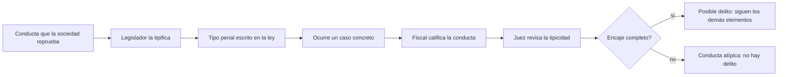

# 10 - Conductas, hechos y delitos

> Unidad 4 de *Introducción a la ciberseguridad* (Raptor Dev Services Academy, curso `cyber-intro`). Material recreado con palabras propias a partir del temario de un diplomado de ciberseguridad; las fuentes van al final en APA 7. Actualización al 2026 donde se indica.

## Por qué importa

En el trabajo diario de seguridad aparece una pregunta que casi nadie se hace a tiempo: lo que acaba de pasar, ¿es un delito o solo algo molesto? Un correo que engaña, una cuenta tomada, un video íntimo difundido, una base de datos copiada por un empleado con permisos. Unas conductas tienen castigo penal, otras se quedan en un reclamo civil o laboral, y otras, por graves que parezcan, no encajan en ninguna ley. Saber distinguirlas cambia lo que se hace en las primeras horas: a quién se avisa, qué evidencia se conserva y qué se le puede prometer a la víctima.

La única herramienta que separa una conducta delictiva de otra que no lo es son las leyes penales. Funcionan como un catálogo cerrado: si la conducta no está descrita ahí, no hay delito, aunque el daño sea real. En México ese catálogo no es uno solo: hay un Código Penal Federal y uno por cada entidad federativa, y cada uno describe y castiga a su manera. Esa fragmentación es parte del problema que esta nota explica.

La nota recorre los conceptos que un profesional técnico necesita para hablar con abogados y autoridades sin perderse: conducta, acto, hecho, omisión, tipo penal, tipificación y tipicidad, y después explica por qué al ciberdelito le cuesta tanto entrar en ese catálogo y en qué se distingue del delito de siempre. Continúa en [11-ciberdelitos-en-mexico.md](11-ciberdelitos-en-mexico.md) (qué está tipificado hoy) y en [12-investigar-el-ciberdelito.md](12-investigar-el-ciberdelito.md) (cómo se investiga).

## Conducta, acto y hecho

La conducta humana pasó de resolver la supervivencia a decidir con miras al beneficio propio y al de los demás. Cuando una decisión daña a otros, la sociedad necesita distinguirla, justificarla o sancionarla, y para el caso de los delitos lo hace con la ley penal.

Las tres palabras del título se usan como sinónimos en la conversación diaria, pero cada disciplina las entiende distinto:

| Disciplina | Qué entiende | En qué se fija |
|---|---|---|
| Psicología | Conducta: todo lo que una persona hace y que puede observarse o medirse, incluidos pensamientos y emociones, conscientes o no | Patrones y procesos mentales |
| Derecho | Acto: una acción concreta de una persona que produce consecuencias jurídicas; la ley decide si es lícita o ilícita | Responsabilidad y sanción |
| Ética | Conducta y acto, valorados por su moralidad | La intención, las consecuencias y la conformidad con normas morales |

Usar el término correcto no es purismo: en derecho, confundir una conducta con un acto puede llevar a atribuir responsabilidades o sanciones que no corresponden.

### La conducta que regula el derecho

La palabra viene del latín *conducta*, "conducida" o "guiada". El diccionario de la Real Academia la describe como la manera en que las personas se comportan en su vida y como la acción o conjunto de acciones con que un ser vivo responde a una situación. Dicho de otro modo, cubre prácticamente todo el comportamiento humano: desde que alguien decide de forma consciente qué hacer y qué no, está desplegando conductas.

Para el derecho penal interesa un subconjunto: la conducta por la que la ley hace responsable a quien la realiza de las consecuencias jurídicas que generó con su propia decisión (autodeterminación). Los juristas la llaman **conducta jurídicamente regulada**, y su sentido coincide con el del lenguaje común. Todas las leyes regulan conductas humanas en su campo; por eso una conducta importa tanto para el derecho: puede ser el inicio de una idea, de un trabajo, de una obra o de un delito. Cuando la ley penal le asigna una sanción a una conducta, la teoría general del delito la llama **conducta típica**. El Instituto de Investigaciones Jurídicas de la UNAM explica seis clases de conductas típicas en las lecciones de derecho penal de Díaz-Aranda (2014, pp. 46-52), lectura recomendada para profundizar.

Toda conducta nace de una decisión, sean cuales sean sus motivos. En la mayoría de los casos, quien comete un delito eligió libremente hacerlo y tenía plena capacidad mental; cuando no la tiene, la ley prevé excluyentes de responsabilidad específicas.

### El hecho jurídico

Un **hecho jurídico** es cualquier acontecimiento que produce efectos legales: crea, modifica o extingue derechos y obligaciones. Puede ser natural (un nacimiento, una muerte, un sismo) o humano (un accidente de tránsito). Albaladejo dedica a este concepto las páginas 361 a 364 de su estudio sobre el hecho jurídico. Distinguir conducta de hecho importa porque **ambos** pueden tener consecuencias legales, aunque en el segundo no haya intención.

## Acción, omisión y ausencia de conducta

Una idea equivocada muy extendida es que solo se castiga lo que alguien hace. El Código Penal Federal (CPF) define el delito desde su artículo 7o. e incluye expresamente la omisión:

> Artículo 7o.- Delito es el acto u omisión que sancionan las leyes penales.
> En los delitos de resultado material también será atribuible el resultado típico producido al que omita impedirlo, si éste tenía el deber jurídico de evitarlo. En estos casos se considerará que el resultado es consecuencia de una conducta omisiva, cuando se determine que el que omite impedirlo tenia el deber de actuar para ello, derivado de una ley, de un contrato o de su propio actuar precedente.

El temario distingue tres situaciones alrededor de la falta de conducta:

1. **Acto involuntario.** Lo que ocurre sin intervención de la voluntad no es conducta en sentido penal. El propio CPF lo recoge como primera causa de exclusión del delito.
2. **Sin vínculo entre lo objetivo y la voluntad.** Si no puede establecerse la relación entre el resultado y la voluntad de quien actuó, tampoco hay conducta reprochable.
3. **Comisión por omisión.** Aquí sí hay delito: la persona estaba obligada a actuar y no lo hizo. Es el caso de quien, teniendo el deber de evitar un resultado (por ley, por contrato o por haber creado el riesgo), lo deja ocurrir.

> Artículo 15.- El delito se excluye cuando:
> I.- El hecho se realice sin intervención de la voluntad del agente;

Llevado a la ciberseguridad: el administrador que por contrato debe aplicar un control y deliberadamente no lo aplica no está en la misma posición que quien simplemente no sabía que existía el riesgo. Lo primero puede ser una omisión con relevancia penal; lo segundo, en principio, no.

## Quién comete el delito

Las conductas delictivas siempre las despliegan personas, y en todo delito hay al menos dos papeles:

| Papel | Quién es |
|---|---|
| Sujeto activo | Quien comete el delito: en el ciberdelito, el atacante o probable responsable |
| Sujeto pasivo | Quien lo sufre: la víctima, que puede ser una persona, una empresa o un gobierno |

Pueden intervenir otros participantes, y la ley les asigna penas distintas según su grado de participación.

**Edad.** En México, una conducta puede tratarse como delito a partir de los 12 años. Las personas de entre 12 y menos de 18 años quedan sujetas a un sistema especializado, el de justicia penal para adolescentes, con sus propios tribunales y reglas; a partir de los 18 se aplica el sistema de adultos.

**Personas morales.** Una empresa también puede responder penalmente. El fundamento clásico está en el artículo 11 del CPF:

> Artículo 11.- Cuando algún miembro o representante de una persona jurídica, o de una sociedad, corporación o empresa de cualquiera clase, con excepción de las instituciones del Estado, cometa un delito con los medios que para tal objeto las mismas entidades le proporcionen, de modo que resulte cometido a nombre o bajo el amparo de la representación social o en beneficio de ella, el juez podrá, en los casos exclusivamente especificados por la ley, decretar en la sentencia la suspensión de la agrupación o su disolución, cuando lo estime necesario para la seguridad pública.

Las sanciones van desde multas hasta la disolución. Esto no significa que toda empresa responda por cualquier delito informático de sus empleados; pero si una organización existe para cometer estas conductas, o las comete de forma encubierta, la ley ofrece los elementos para fincarle responsabilidad.

> **Actualización al 2026:** desde 2014 el Código Nacional de Procedimientos Penales (art. 421) reconoce la responsabilidad penal autónoma de las personas jurídicas cuando el delito se comete a su nombre, en su beneficio o con sus medios y además hubo falta de debido control en la organización. El artículo 11 Bis del CPF (texto vigente, última reforma DOF 13-03-2026) enumera los delitos federales por los que se les pueden imponer consecuencias: incluye fraude, operaciones con recursos de procedencia ilícita y delitos contra derechos de autor, pero no los de acceso ilícito a sistemas (arts. 211 bis 1 a 7).

## Los elementos del delito y la conducta atípica

Para que una conducta sea delictiva no basta con que parezca mala. La teoría del delito pide que reúna varios elementos a la vez:

| Elemento | Pregunta que contesta |
|---|---|
| Tipicidad | ¿La conducta está descrita y prohibida con precisión en una ley penal? |
| Antijuridicidad | ¿Contraviene el orden jurídico, sin una causa que la justifique? |
| Culpabilidad | ¿Se le puede reprochar al autor? |
| Imputabilidad | ¿El autor tenía la edad y la capacidad mental para responder? |
| Punibilidad | ¿La ley le asigna una pena? |

Si falta cualquiera, la conducta no es delito. La que falla en el primer elemento, por irregular o inmoral que sea, es una **conducta atípica**. Reconocerla protege a las personas de ser castigadas por comportamientos objetables que la ley no sanciona, y obliga a buscar otras vías (civil, laboral, administrativa) cuando el daño existe.

## Tipificación, tipicidad y tipo penal

Estas tres palabras suenan parecido y nombran cosas distintas. Peña y Almanza (2010) las separan por quién interviene:

| Concepto | Qué es | Quién lo hace |
|---|---|---|
| Tipificación | Convertir en delito una norma de cultura y escribirlo en una ley penal | El legislador |
| Tipo penal | La descripción legal, en el texto de la ley, de la acción u omisión que constituye el delito | Queda en la ley |
| Tipicidad | El encaje del acto humano voluntario en esa descripción: si encaja por completo hay indicio de delito; si encaja a medias, no lo hay. El encaje tiene que ser jurídico, no social | El juez, durante el proceso |
| Calificación | Decidir con qué delito se acusa y si hay pruebas para llevar el caso a juicio | El fiscal (Ministerio Público) |

## Por qué cuesta tipificar el ciberdelito

En el terreno digital, cada uno de esos pasos se vuelve más lento y más difícil. La tecnología cambia más rápido que el proceso legislativo, y lo que se tipifica hoy puede quedar corto mañana. Mientras tanto, la gente percibe que la autoridad no hace nada. A eso se suman la velocidad y el anonimato con que se cometen estas conductas y la dificultad de rastrear al responsable, que hacen que la persecución termine muchas veces sin resultado visible.

### Los problemas técnicos

Quien aporta el conocimiento técnico a un caso penal enfrenta exigencias que van más allá de saber de seguridad:

- Pericia demostrable en seguridad de la información, de preferencia con certificaciones forenses e informáticas del área.
- Nociones del lenguaje jurídico penal, del sistema de justicia penal oral vigente y de argumentación, por si lo llaman a declarar en juicio.
- Dominio de la identificación técnica de un responsable usando solo evidencia informática, sin salirse de los límites legales, sabiendo que esa evidencia puede ser insuficiente, vieja, manipulada o ilícita.
- Dominio de los protocolos de procesamiento de evidencia digital, institucionales e internacionales.
- Manejo del vocabulario técnico y buena parte del jurídico; y, cuando una ley define un término, usar la definición legal, que es la que vale en el proceso.
- Conocimiento de las amenazas más recientes, para detectar si una conducta arrastra otras conductas relacionadas.
- Conocimiento de cómo son vulnerables el hogar, la empresa y el gobierno, para distinguir un ataque real de uno fabricado por el propio denunciante o por un tercero.
- Para probar técnicamente la conducta: saber lo técnico, entender lo jurídico, seguir el rastro del atacante y demostrar que el usuario señalado fue, con certeza, quien la realizó.

### Los problemas jurídicos

Del lado del derecho, los obstáculos son de otra naturaleza:

- Interpretar jurídicamente una conducta que es, ante todo, técnica, y traducirla a la autoridad con el vocabulario informático correcto.
- Conocer el protocolo de actuación frente a evidencia digital, la forma de ofrecerla como prueba en juicio oral, su valor probatorio y las condiciones para que sea lícita.
- Conocer la cadena de custodia de la evidencia digital y la responsabilidad de cada autoridad que interviene.
- Distinguir a los especialistas que pueden apoyar una investigación (ciberpolicías y ciberforenses).
- Saber si existe o no un tipo penal que sancione la conducta.
- Orientar a la víctima, antes de denunciar, sobre cómo cuidar la evidencia que hay en su teléfono, tableta o computadora.
- Conocer el sistema integral de justicia para adolescentes, si el probable responsable es menor de edad.
- Para probar jurídicamente la conducta: entender lo informático, dominar lo procesal, entender al perito, saber ofrecer una pericial informático forense y explicarse ante el juzgador, incluso en un amparo penal.

Y hay problemas estructurales que no dependen de nadie en lo individual: los legisladores no son expertos en derecho informático y no lo ven urgente; los expertos informáticos no legislan ni suelen ser invitados a asesorar; faltan definiciones homologadas para que expertos, abogados y autoridades hablen el mismo idioma; la actualización de la ley penal llega tarde; y cuando llega con prisa, a veces ni protege ni se entiende. Las escuelas de derecho del país, además, casi no tienen materias de derecho informático.

El temario ilustra la redacción apresurada con una fracción del Código Penal de Colima, en el texto que estaba vigente en 2017. Léanla e intenten decir con precisión qué conducta castiga:

> ARTÍCULO 201. Se considera fraude y se impondrá pena de cuatro a once años de prisión y multa por un importe al equivalente de cuatrocientas cincuenta a mil unidades de medida y actualización, en los siguientes casos: ... VII. Manipulación indebida informática. Al que por algún uso del medio informático, telemático o electrónico alcance un lucro indebido para sí o para otro valiéndose de alguna manipulación informática, instrucciones de código, predicción, intercepción de datos de envío, reinyecte datos, use la red de redes montando sitios espejos o de trampa captando información crucial para el empleo no autorizado de datos, suplante identidades, modifique indirectamente mediante programas automatizados, imagen, correo o vulnerabilidad del sistema operativo cualquier archivo principal, secundario y terciario del sistema operativo que afecte la confiabilidad, y variación de la navegación en la red o use artificio semejante para obtener lucro indebido. ...

Una enumeración así mezcla técnicas, medios y fines, y deja preguntas abiertas: ¿qué pasa si hubo manipulación pero no lucro?, ¿y si el lucro llegó después?

### Iniciativas que se quedaron a medias

El temario documenta que varias iniciativas para atender estos problemas quedaron en pausa por causas ajenas a su mérito: la austeridad y la reducción de presupuesto, la falta de credibilidad de las instituciones, los despidos masivos de docentes, la ausencia de presencia y guía del gobierno federal en el tema, y la pandemia. La magnitud del problema no se resuelve con un curso ni con una política pública de corto plazo; exige que litigantes, estudiantes, docentes y autoridades entiendan a fondo los retos, desde la identificación del hecho hasta la denuncia.

Un ejemplo de lo que viene: en una entrevista de UNAM Global titulada *El robot es inocente* (2018) se analiza cómo tendría que llevarse jurídicamente el caso de una persona atropellada por un vehículo autónomo, donde ni el "conductor" ni la máquina encajan bien en las figuras actuales.

## Razones que facilitan las conductas delictivas

El temario agrupa en varias razones lo que hace que el ciberdelito prospere:

| Razón | En qué consiste |
|---|---|
| Cambios sociales | Casi toda actividad pasa ya por la tecnología; cada relación o negocio nuevo pide reglas que antes no existían |
| Nuevos bienes jurídicos | Los entornos nuevos crean intereses que proteger (la identidad digital, la integridad de los datos) y la ley tiene que reconocerlos |
| Normatividad insuficiente | El desarrollo tecnológico rebasa a la actualización legal, que debe acelerar para cubrir lo que no regula |
| Territorialidad | La ley penal se aplica en un territorio, pero los datos y las conductas cruzan fronteras; sin acuerdos de cooperación entre países no hay investigación que prospere sin invadir la jurisdicción ajena |
| Capacitación insuficiente | Autoridades y usuarios ignoran algo tan común y riesgoso que la ignorancia misma se vuelve vulnerabilidad. La fórmula del temario es aprender, beneficiarse y crear conciencia (ABC) sin satanizar la tecnología |
| Falta de homologación | Cada código penal tiene sus propios tipos y penas; el delincuente identificado podría preferir el estado con la sanción más baja. Por eso la propuesta de un código penal único (Cámara de Diputados, 2019) no parece descabellada: varios códigos estatales regulan estas conductas mejor que el federal |
| Ausencia de enseñanza | Sin la materia en las escuelas de derecho no habrá abogados, jueces, legisladores, peritos, ciberpolicías ni docentes que sepan identificar o legislar estas conductas, ni una cultura de la legalidad |
| Peligros potenciales | La seguridad de la información nunca está del todo en manos del usuario; hay que conocer el propio nivel de exposición y subirlo con herramientas de software y hardware. El acceso a internet es un derecho, y con él la seguridad en la red |
| Falta de voluntad | Siempre se puede seguir aprendiendo, al propio ritmo y con la misma tecnología; sin la decisión personal de hacerlo, ningún curso sirve. La brecha generacional deja a muchas personas mayores en el mayor estado de indefensión, porque no saben qué puede pasarles ni qué las protege |
| Inseguridad informática | No va a desaparecer; está en cada clic. Igual que al salir a la calle, hay que tomar precauciones, y la responsabilidad es de todos, no solo del gobierno |

## Del delito tradicional al ciberdelito

Muchas conductas criminales digitales no son nuevas: son el fraude, la extorsión o el acoso de siempre, que ahora usan herramientas tecnológicas. Lo que sí cambia es la **visibilidad**. Un robo en la calle lo conoce el vecindario entero; un ciberdelito casi siempre lo conoce solo la víctima, porque el daño ocurre en un terreno íntimo: sus datos personales, su información financiera, sus conversaciones. A la víctima le cuesta reconocer públicamente que la atacaron, por vergüenza o por miedo al estigma, y esa falta de visibilidad hace que la prevención y la sanción parezcan menos urgentes de lo que son.

### Las condiciones en que ocurre

| # | Condición |
|---|---|
| 1 | Lo cometen personas físicas y también gobiernos |
| 2 | Siempre pasa por algún medio informático o tecnológico, sea software o hardware |
| 3 | Se apoya en herramientas psicológicas: la ingeniería social |
| 4 | Ocurre a distancia y puede consumarse en fracciones de segundo, sin presencia física |
| 5 | Se comete de forma anónima o con una identidad falsa |
| 6 | Por su especialización se equipara a los delitos de cuello blanco |
| 7 | Siempre es doloso: hay intención |
| 8 | Es rápido y relativamente fácil: basta un equipo y conexión a internet |
| 9 | Es ocupacional: muchas veces se comete desde el propio trabajo |
| 10 | Es de oportunidad: se aprovecha un momento para causar pérdidas económicas |

Por todas estas condiciones, comprobarlo técnica y jurídicamente es difícil. Kevin Mitnick lo resumía diciendo que las organizaciones invierten fortunas en cortafuegos y dispositivos de seguridad y aun así dejan sin cubrir el eslabón más débil: las personas que usan y administran los equipos.

### Casos extremos documentados (2018 y 2019)

El temario reúne cinco casos que muestran hasta dónde llega la creatividad criminal:

1. Un mercado ilegal que cobraba suscripciones para ver en vivo lo que captaban cámaras de seguridad vulneradas, como si fuera un servicio de streaming (Sierra, 2019).
2. La advertencia de Richard Stallman de que los teléfonos pueden espiar y transmitir conversaciones incluso cuando parecen apagados (López, 2019).
3. Un malware de laboratorio capaz de alterar estudios de imagen médica para que un paciente sano parezca tener cáncer, o al revés (Sabán, 2019).
4. El robo de la base de datos de un casino a través del termómetro conectado de un acuario (Harán, 2018).
5. Un grupo de investigadores que codificó un programa malicioso dentro de una cadena de ADN sintético (Supercurioso, s. f.).

Estas conductas son invasivas y peligrosas: comprometen la privacidad y pueden causar daños económicos y personales graves. Enfrentarlas exige leyes bien diseñadas y actualizadas, con definiciones claras y sanciones proporcionales, y una colaboración continua entre legisladores, expertos en tecnología y profesionales de la ciberseguridad.

## La conducta humana como elemento del delito

Para que una acción u omisión sea delito, el sujeto activo tiene que actuar de forma **voluntaria**: con control sobre lo que hace y conociendo sus consecuencias, incluida la posibilidad de estar cometiendo un delito. No basta el resultado; tiene que haber una decisión consciente detrás.

- En una acción: quien entra sin autorización a un sistema informático lo hace sabiendo que viola la ley.
- En una omisión: quien tiene la obligación legal de auxiliar a una persona en peligro y no lo hace, lo decide; no se trata de un descuido involuntario.

El canal *Litigante en curso* (2018) explica en video cómo la conducta voluntaria se relaciona con los demás elementos del tipo penal y qué ocurre cuando falta.

## Tormentas legales y un abordaje integral

Gómez Sancha (2018, p. 24) describe las tensiones entre el avance tecnológico y las estructuras jurídicas tradicionales en un país con alto desarrollo tecnológico: las figuras del derecho no alcanzan a describir lo que la tecnología ya permite hacer. La conclusión para quien se forma hoy es directa: abogados y técnicos necesitan empezar a capacitarse en el terreno del otro, porque derecho y tecnología ya son interdependientes.

Parada y Errecaborde (2018, pp. 22-25) proponen un abordaje integral del cibercrimen: la respuesta efectiva y jurídicamente sólida solo sale de combinar el conocimiento técnico con el jurídico. Ese trabajo conjunto resuelve más casos complejos y, de paso, fortalece al sistema de justicia, porque le da una base firme para perseguir y sancionar en el entorno digital.

> **Actualización al 2026:** el Código Penal Federal citado en esta nota corresponde al texto vigente con última reforma publicada en el DOF el 13 de marzo de 2026, y el Código Nacional de Procedimientos Penales al texto con última reforma del 28 de noviembre de 2025 (Cámara de Diputados). El texto de Colima se reproduce como ejemplo de 2017 y puede haber cambiado.

## Glosario

| Término | Definición |
|---|---|
| Conducta | Comportamiento humano que nace de una decisión; la que la ley regula es la conducta jurídicamente regulada |
| Acto | Acción concreta de una persona que produce consecuencias jurídicas |
| Hecho jurídico | Acontecimiento, natural o humano, que crea, modifica o extingue derechos y obligaciones |
| Delito | Acción u omisión que sancionan las leyes penales (CPF, art. 7o.) |
| Omisión | Dejar de hacer lo que se estaba obligado a hacer; en la comisión por omisión, el resultado se atribuye a quien tenía el deber de evitarlo |
| Conducta típica | Conducta a la que la ley penal le asigna una sanción |
| Conducta atípica | Conducta que, aunque sea objetable, no reúne los elementos del delito, empezando por la tipicidad |
| Tipificación | Acto del legislador que convierte una conducta en delito y la escribe en la ley penal |
| Tipo penal | Descripción legal de la acción u omisión que constituye un delito |
| Tipicidad | Encaje completo y jurídico de un acto voluntario en el tipo penal; lo revisa el juez |
| Sujeto activo | Quien comete el delito |
| Sujeto pasivo | Quien sufre el delito: persona, empresa o gobierno |
| Imputabilidad | Capacidad, por edad y salud mental, para responder penalmente |
| Persona moral | Empresa u organización con personalidad jurídica, que en México puede responder penalmente |
| Ingeniería social | Manipulación psicológica de las personas para obtener acceso o información |
| Dolo | Intención: actuar sabiendo lo que se hace y queriendo o aceptando el resultado |

## Referencias

- Albaladejo, M. (2012). *El hecho jurídico*. Universidad de Oviedo.
- Cámara de Diputados. (2019, 21 de mayo). *Proponen un Código Penal Único que ponga fin al caos jurídico* (Boletín 1677). http://www5.diputados.gob.mx/index.php/esl/Comunicacion/Boletines/2019/Mayo/21/1677-Proponen-un-Codigo-Penal-Unico-que-ponga-fin-al-caos-juridico
- Cámara de Diputados del H. Congreso de la Unión. (2026). *Código Penal Federal* (Última reforma DOF 13-03-2026). https://www.diputados.gob.mx/LeyesBiblio/pdf/CPF.pdf
- Cámara de Diputados del H. Congreso de la Unión. (2025). *Código Nacional de Procedimientos Penales* (Última reforma DOF 28-11-2025). https://www.diputados.gob.mx/LeyesBiblio/pdf/CNPP.pdf
- Cámara de Diputados del H. Congreso de la Unión. (2022). *Ley Nacional del Sistema Integral de Justicia Penal para Adolescentes* (Última reforma DOF 20-12-2022). https://www.diputados.gob.mx/LeyesBiblio/pdf/LNSIJPA.pdf
- ComputerHoy.com. (2019). *¿Qué es ingeniería social?* [Video]. YouTube. https://youtu.be/N6S0JUeBWFw
- Congreso del Estado de Colima. (2017). *Código Penal para el Estado de Colima*. https://cdhcolima.org.mx/wp-content/uploads/2017/01/C%C3%B3digo-Penal-para-el-Estado-de-Colima.pdf
- Díaz-Aranda, E. (2014). *Lecciones de derecho penal para el nuevo sistema de justicia en México*. UNAM, Instituto de Investigaciones Jurídicas. https://biblio.juridicas.unam.mx/bjv
- Gómez Sancha, S. (2018). Las tormentas legales en el nuevo escenario tecnológico. *Abogados. Revista del Consejo General de la Abogacía Española*. https://www.abogacia.es/
- Harán, M. (2018, 16 de abril). Robo de datos de un casino tras vulnerar el termómetro de un acuario. *WeLiveSecurity*. https://www.welivesecurity.com/la-es/2018/04/16/robo-datos-casino-vulnerar-termometro-acuario/
- Litigante en curso. (2018). *La conducta y su ausencia: ¿qué es?* [Video]. YouTube. https://youtu.be/QhiXEFsQhA8
- López, O. (2019, 22 de febrero). Richard Stallman: "Los móviles espían y transmiten nuestras conversaciones, incluso apagados". *El País*. https://elpais.com/retina/2019/02/22/tendencias/1550819915_405396.html
- Parada, R. A., & Errecaborde, J. D. (2018). Hacia un abordaje integral en materia de cibercrimen. *Revista Pensamiento Penal*. https://www.pensamientopenal.com.ar/
- Peña Gonzáles, O., & Almanza Altamirano, F. (2010). *Teoría del delito: Manual práctico para su aplicación en la teoría del caso*. Asociación Peruana de Ciencias Jurídicas y Conciliación. https://www.pensamientopenal.com.ar/doctrina/46022-teoria-del-delito-manual-practico-su-aplicacion-teoria-del-caso
- Pérez, J. (2019). Cómo una herramienta secreta creada por Estados Unidos se convierte en una destructiva arma "online". (Enlace original no disponible.)
- Real Academia Española. (s. f.). Conducta. En *Diccionario de la lengua española*. https://dle.rae.es/conducta
- Sabán, A. (2019). El malware para hospitales puede hacer creer a los médicos que pacientes sanos tienen cáncer (y viceversa). *Genbeta*. https://www.genbeta.com/actualidad/malware-para-hospitales-puede-hacer-creer-a-medicos-que-pacientes-sanos-tienen-cancer-viceversa
- Sierra, M. (2019). El "Netflix" del crimen: pagar por ver ilegalmente lo que graban cámaras de seguridad. *Vozpópuli*. https://www.vozpopuli.com/economia-y-finanzas/netflix-crimen-pagar-ilegalmente-graban-camaras-seguridad_0_1218179031.html
- Supercurioso. (s. f.). Biohackers lograron introducir un virus informático en una cadena de ADN. https://supercurioso.com/biohackers-virus-informatico-cadena-adn/
- UNAM Global. (2018). *El robot es inocente* [Video]. YouTube. https://youtu.be/usZ_0LjaAAc

---

*Rogelio Arriaga Gonzalez*
