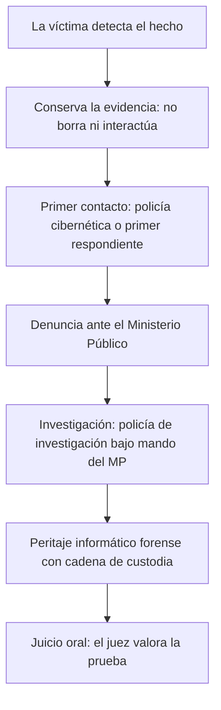

# 12 - Investigar el ciberdelito

> Unidad 4 de *Introducción a la ciberseguridad* (Raptor Dev Services Academy, curso `cyber-intro`). Material recreado con palabras propias a partir del temario de un diplomado de ciberseguridad; las fuentes van al final en APA 7. Actualización al 2026 donde se indica.

## Por qué importa

Que una conducta esté tipificada no sirve de mucho si nadie la denuncia, nadie la investiga y la evidencia no llega íntegra a un juez. Investigar un ciberdelito es examinar cómo una actividad ilícita se llevó a cabo con tecnología digital y qué efecto tuvo: ataques a sistemas, fraudes electrónicos, espionaje, apropiación de datos. Afecta a personas y organizaciones en todo el mundo, y como las técnicas cambian sin parar, la investigación necesita a la vez derecho, informática y criminología.

Para quien trabaja en seguridad, esta nota responde preguntas muy concretas: a quién se acude cuando algo pasa, qué hace cada autoridad, en qué se distingue un ciberpolicía de un perito forense, qué vuelve inútil una prueba digital y por qué, aun con una sentencia, la víctima puede sentir que no hubo justicia.

Antecedentes: [10-conductas-hechos-y-delitos.md](10-conductas-hechos-y-delitos.md) (los conceptos penales) y [11-ciberdelitos-en-mexico.md](11-ciberdelitos-en-mexico.md) (qué está tipificado).

## Primeros pasos

### Avisar a la autoridad

Ante cualquier hecho que pueda ser delito, el primer paso es el mismo, sea quien sea la víctima: notificar a la autoridad, normalmente a una o un policía. En el sistema de justicia penal vigente, quien llega primero es el **primer respondiente**: la policía de seguridad pública o ciudadana que se presenta en el lugar del hecho o donde se hallaron indicios. Es el primer contacto entre la sociedad y el sistema penal y el primer eslabón de la cadena de actuación: le toca cuidar el lugar y los indicios para que no se pierdan. El Consejo Nacional de Seguridad Pública publicó el *Protocolo Nacional de Actuación. Primer Respondiente* (2017), que conviene conocer porque cualquier persona puede verse en una situación que lo requiera.

Después interviene la **policía de investigación** (antes llamada ministerial), que trabaja bajo la conducción y el mando del Ministerio Público, como establece el Código Nacional de Procedimientos Penales (CNPP, 2014). Existe en el fuero federal y en cada una de las 32 entidades, ligada a su fiscalía. Además de investigar, puede trasladar a personas detenidas o presentadas, ya sea para resguardarlas o para cumplir una orden de presentación o aprehensión, y en todo caso debe informarles sus derechos leyendo la cartilla de derechos de las personas detenidas.

Para entender el sistema completo sin ser jurista, el temario recomienda el *ABC del nuevo sistema de justicia penal en México* (INACIPE, 2008), que lo explica con las preguntas que cualquier persona se haría y aplica a todos los delitos, no solo a los cibernéticos.

> **Actualización al 2026:** el CNPP vigente (última reforma DOF 28-11-2025) mantiene en su artículo 132 que la policía actúa bajo la conducción y el mando del Ministerio Público, y que entre sus obligaciones está recibir denuncias, incluso anónimas, e informarlas de inmediato.

### Qué hacer si le pasa a uno

Una presentación de 2024 sobre el marco jurídico del delito informático resume la reacción inmediata en cinco puntos, útiles para orientar a cualquier víctima:

1. No borrar nada: mensajes, correos, publicaciones, registros.
2. No interactuar con el atacante ni responder a sus provocaciones.
3. Avisar a los contactos, sobre todo si la cuenta fue tomada y puede usarse para engañarlos.
4. Tomar capturas de pantalla de toda la comunicación, con fecha y hora visibles.
5. Denunciar.

## Ciberpolicías y ciberforenses

### Por qué la información vale tanto

Las víctimas de ciberdelitos son muchas y de todos los niveles socioeconómicos. El temario cita una nota de 2020 según la cual los ciberdelitos llegaron a aumentar hasta 600 % en México durante la pandemia (Tiempo, 2020). Una razón de fondo para perseguirlos es económica: en el mercado negro, la información sustraída vale más que el equipo robado. Fotografías, documentos, datos bancarios, perfiles, contenido en la nube, accesos a correo y contraseñas se venden desde unos cuantos pesos, dólares o euros hasta varios miles, según su tipo y frescura (Vega, 2018; García, 2021).

### La policía cibernética

La ciberpolicía es la primera autoridad que conoce de un ciberdelito: antes incluso de la denuncia formal, orienta a la víctima sobre los primeros pasos y la acerca al sistema de justicia. Cada estado tiene un equipo especializado. El temario toma como ejemplo a la policía cibernética de la Secretaría de Seguridad Ciudadana de la Ciudad de México, cuyas líneas de acción son:

- Monitorear redes sociales y sitios web.
- Dar pláticas en escuelas para prevenir ciberdelitos y advertir de los peligros de internet.
- Construir una cultura de autocuidado y civismo digital.
- Preparar ciberalertas a partir de los reportes que recibe.
- Atender reportes por mal uso de internet, recibir información y agendar pláticas por varios medios de contacto.
- Atender a la ciudadanía las 24 horas, los 365 días del año.

Un dato del temario: el primer cuerpo de policía cibernética del país lo creó la policía federal en 2001, en la administración que comenzó en 2000.

**Homologación.** Durante años, cada entidad reguló por su cuenta las funciones y capacidades de su policía cibernética. Después se adoptó un **modelo homologado** que estandariza su operación y que se mantuvo a pesar del cambio de gobierno. Según González (2018), la estandarización mejoró la colaboración procedimental y jurídica y fortaleció la capacidad del Estado para prevenir y atender estos delitos; en ese año, 13 % de los cibernautas fue víctima de cibercrimen.

> **Actualización al 2026:** el temario fecha el modelo en 2018, pero el Consejo Nacional de Seguridad Pública lo aprobó el 20 de diciembre de 2016 (acuerdo 06/XLI/16) para implementarse desde 2017. Su versión vigente organiza el trabajo en siete procesos: prevención, ciberpatrullaje, atención ciudadana, investigación cibernética, forense digital, gestión de incidentes cibernéticos y seguridad de la información. Un informe de avance de enero de 2024 reporta que en 2023 catorce entidades (44 %) no asignaron recursos del fondo federal de seguridad a sus unidades cibernéticas (SESNSP, 2024).

**Perfil.** Como los ciberdelitos piden una respuesta especializada, el ciberpolicía necesita formación profesional en tecnología, idealmente por encima de la de quienes cometen los delitos. El temario enumera los requisitos de ingreso:

| Requisito | |
|---|---|
| Aprobar los exámenes de confianza del sistema de seguridad pública | Estar titulado |
| No tener antecedentes penales | Gozar de buena reputación |
| Presentar el servicio militar liberado | En algunos casos, un año de servicio de campo en el país para completar la formación práctica |

**Dos tipos de policía.** Conviene no confundirlos:

| | Ciberpolicía | Policía de investigación en unidades cibernéticas |
|---|---|---|
| Formación | Técnica, en tecnología y ciberseguridad | De investigación criminal; puede no tener formación tecnológica |
| Fortaleza | Manejar y analizar datos complejos de un cibercrimen | Conducir la investigación; sus habilidades definen el enfoque del caso |

Los dos tienen que trabajar juntos. El video *El ABC para ser ciberpolicía* (Vértigo TV, 2013) muestra cómo se integran los policías de investigación a estas unidades.

> **Actualización al 2026:** la Policía Federal desapareció en 2019 y su división científica, con la policía cibernética federal, pasó a la Guardia Nacional. Con la reforma constitucional publicada en el DOF el 30 de septiembre de 2024, la Guardia Nacional quedó adscrita a la Secretaría de la Defensa Nacional. En julio de 2025 se publicó una nueva Ley General del Sistema Nacional de Seguridad Pública, que abrogó la de 2009.

### Peritos y ciberforenses

Dentro de la investigación hay otro papel distinto al policial: el del perito. El temario distingue dos figuras:

| | Perito informático | Perito informático forense (ciberforense) |
|---|---|---|
| Dónde trabaja | Casos judiciales de distintas materias, generalmente fuera del orden penal | Solo casos donde se investigan delitos informáticos o ciberdelitos |
| Calidad | Profesional que ofrecen las partes | Servidor público adscrito a una fiscalía |
| Conocimiento | La misma pericia técnica | La misma pericia, aplicada a la investigación penal y con sus reglas |

En la práctica también se distingue el enfoque: el ciberforense investiga incidentes, analiza datos y detecta las brechas de seguridad; el perito forense se concentra en recolectar y preservar la prueba para que sea admitida en el proceso con su integridad intacta.

Su disciplina es la **informática forense**. Gervilla Rivas (2014) la describe como una ciencia reciente que asegura, identifica, preserva, analiza y presenta datos (la prueba digital) de manera que puedan ser aceptados en un proceso legal; sus herramientas permiten, en la medida de lo posible, reconstruir lo que pasó en el equipo, examinar lo recuperado y comprobar su autenticidad.

### La prueba ilícita

La evidencia más valiosa puede no servir de nada si se obtuvo por vías ilegales o violando un derecho fundamental, como la privacidad o la libertad de expresión. En ese caso la prueba es **ilícita**, y en lugar de ayudar a la investigación la estorba. La Suprema Corte lo resolvió así en 2011: las pruebas obtenidas, de forma directa o indirecta, violando derechos fundamentales no tienen ningún efecto en el proceso (SCJN, 2011). Para quien trabaja en seguridad, la lección es práctica: "investigar por cuenta propia" entrando a la cuenta del sospechoso puede destruir el caso.

### La cadena de custodia

El ciberforense debe seguir con rigor las metodologías de manejo de evidencia, y entre ellas la documentación administrativa y jurídica es tan importante como el análisis técnico. Su pieza central es la cadena de custodia, que el CNPP define así:

> Artículo 227. Cadena de custodia
> La cadena de custodia es el sistema de control y registro que se aplica al indicio, evidencia, objeto, instrumento o producto del hecho delictivo, desde su localización, descubrimiento o aportación, en el lugar de los hechos o del hallazgo, hasta que la autoridad competente ordene su conclusión.
> Con el fin de corroborar los elementos materiales probatorios y la evidencia física, la cadena de custodia se aplicará teniendo en cuenta los siguientes factores: identidad, estado original, condiciones de recolección, preservación, empaque y traslado; lugares y fechas de permanencia y los cambios que en cada custodia se hayan realizado; igualmente se registrará el nombre y la identificación de todas las personas que hayan estado en contacto con esos elementos.

> Artículo 228. Responsables de cadena de custodia
> La aplicación de la cadena de custodia es responsabilidad de quienes en cumplimiento de las funciones propias de su encargo o actividad, en los términos de ley, tengan contacto con los indicios, vestigios, evidencias, objetos, instrumentos o productos del hecho delictivo.

La pericia importa tanto porque la evidencia digital es **sensible y volátil**. Los datos se guardan como estados binarios que una variación o un corte de energía puede alterar o borrar para siempre; un dispositivo encendido cambia por el simple hecho de estar encendido. El ciberforense tiene que garantizar la integridad, la confiabilidad y la certeza científica de cada indicio.

| Factor de la cadena (CNPP, art. 227) | Cómo se ve con evidencia digital |
|---|---|
| Identidad | Qué dispositivo o archivo es: marca, modelo, número de serie, ruta |
| Estado original | Cómo se encontró: encendido o apagado, sesión abierta, pantalla |
| Recolección y preservación | Copia forense bit a bit y su huella criptográfica (hash) |
| Empaque y traslado | Bolsas antiestáticas, aislamiento de redes, sellos |
| Lugares, fechas y cambios | Dónde estuvo y qué se le hizo en cada custodia |
| Personas en contacto | Nombre e identificación de cada quien que lo manejó |

**Normas y deontología.** Como servidores públicos, los ciberforenses deben cumplir las normas administrativas y penales y los principios éticos de su profesión. El temario resume lo que necesitan:

- Formación jurídica: derecho informático, derecho procesal, argumentación jurídica y juicios orales.
- Formación profesional: certificaciones, especializaciones y cursos específicos de informática forense.
- Experiencia práctica: la que dan los cursos de formación en las fiscalías.

Aun así, la pericia técnica no decide sola un juicio. Pesan también los aspectos jurídicos y la valoración del juez. Lo que sí es cierto es que hoy la evidencia electrónica o digital es una de las pruebas más efectivas que existen.

## Jueces y norma jurídica

La humanidad está dividida en naciones, clases, religiones y profesiones, y cada grupo tiene su propia idea de lo justo; son tantas que no se puede hablar de una sola noción de justicia, uniforme y primaria (Bernal Moreno, 2005).

La relación entre los jueces y la norma es un tema central de la filosofía del derecho, porque la búsqueda de justicia es una aspiración humana constante y, para muchos autores, el derecho es su instrumento (Ruiz, 2009). Sin embargo, al final de un proceso penal la víctima a menudo siente que no se hizo justicia, aun cuando el responsable fue sancionado y el daño se pagó.

- **La reparación tiene límites.** El derecho prevé formas de resarcir según la gravedad y las circunstancias: sanciones económicas, mecanismos de perdón de la víctima. Ninguna devuelve a la víctima al estado en que estaba antes del delito.
- **La historia lo confirma.** La justicia retributiva, como la ley del talión, tampoco reparaba del todo. Las normas evolucionaron hacia la pacificación y el respeto de los derechos humanos de la Constitución y los tratados.
- **Justicia y derecho no son lo mismo.** La justicia es un ideal filosófico; el derecho es la aplicación exacta de las normas que el legislador dictó para el bien común. Se usan como sinónimos, pero la justicia que da el derecho no siempre es el resarcimiento absoluto que la víctima espera.
- **El juez está acotado.** Determina la responsabilidad y la pena con base en las pruebas y en lo que la ley permite; no puede ir más allá. A la sociedad le toca asumir su parte y exigir que los jueces apliquen la ley correctamente.
- **En lo digital, el daño persiste.** La información expuesta en internet casi nunca desaparece por completo, y eso hace aún más difícil que la víctima perciba justicia.

Abarzúa y Valenzuela (2014, pp. 54-55) profundizan en el derecho como forma de alcanzar la justicia, como lectura complementaria.

## La prueba de los ciberdelitos

### Naturaleza jurídica

Quevedo (2017, pp. 299-303) analiza cómo se clasifica y valora la evidencia digital dentro del marco jurídico: cómo deben recolectarse, preservarse y presentarse los datos y registros para cumplir los requisitos legales y ser aceptados en juicio, y qué problemas propios trae el ciberdelito a la administración de justicia, como la volatilidad de los datos y la necesidad de metodologías especializadas.

Un punto que vale la pena discutir es el nombre. **Prueba informática** y **prueba digital** no son exactamente lo mismo:

| | Prueba informática | Prueba digital |
|---|---|---|
| Origen | Sistemas y dispositivos de cómputo | Cualquier soporte digital, incluidos sistemas de telecomunicaciones y otros medios electrónicos |
| Ejemplo | Registros de un servidor, archivos de una computadora | Una grabación de una central telefónica, datos de un dispositivo electrónico que no es una computadora |

Unificar el término simplificaría la clasificación, pero mantener la distinción ayuda a que cada tipo de prueba se trate según su naturaleza.

### Evidencias digitales que son meros hechos jurídicos

Rosales de Salamanca (2016, pp. 29-31) trata las reglas para admitir evidencias digitales que no prueban un delito sino un simple hecho con efectos jurídicos (un contrato por correo, un mensaje que demuestra un acuerdo): qué estándares y procedimientos deben seguirse para que sean válidas y eficaces en el proceso. La conclusión del tema es la misma en lo penal y en lo no penal: la prueba digital vale si se maneja con protocolos rigurosos y una cadena de custodia sólida, si técnicos y juristas colaboran para interpretarla y presentarla bien, y si las estrategias de investigación y las normas se actualizan al ritmo de las técnicas delictivas.

## Por qué el ciberdelito se mide mal

La presentación de 2024 que acompaña a la unidad agrupa los problemas de la ciberdelincuencia y su medición: es difícil de entender, de identificar y de demostrar; faltan denuncias, instancias que las reciban y normas que las sustenten. Sus consecuencias se sienten en tres frentes:

| Sociales | Técnicas | Jurídicas |
|---|---|---|
| Sensación de inseguridad | Gasto en herramientas | Impunidad |
| Impunidad | Gasto en capacitación y especialistas | Lagunas legales |
| Falta de confianza | Contratación de servicios externos | Ausencia de seguridad jurídica |
| Ignorancia | Falsas alarmas | Falta de homologación legal |
| Más delitos y ciberdelitos | Estado permanente de prevención y miedo | Estado de indefensión |
| Molestia, desacuerdo y deseo de venganza | Más gasto en seguridad informática | Desconfianza total en la autoridad |

Por eso la cifra de víctimas que reportan las encuestas (por ejemplo, el MOCIBA del INEGI) siempre es mayor que la de denuncias: lo que no se denuncia no se investiga, y lo que no se investiga no entra en la estadística oficial.

## Glosario

| Término | Definición |
|---|---|
| Primer respondiente | Policía que llega primero al lugar del hecho; cuida el lugar y los indicios |
| Policía de investigación | Policía que investiga bajo la conducción y el mando del Ministerio Público |
| Ministerio Público | Autoridad que recibe denuncias, conduce la investigación y ejerce la acción penal |
| Ciberpolicía | Policía especializada en tecnología que atiende, previene e investiga ciberdelitos |
| Modelo homologado | Estándar nacional de operación de las unidades de policía cibernética estatales |
| Perito informático | Experto técnico que dictamina en juicios de distintas materias |
| Ciberforense | Perito informático forense: servidor público que investiga ciberdelitos y preserva la prueba |
| Informática forense | Disciplina que asegura, identifica, preserva, analiza y presenta datos como prueba en un proceso legal |
| Indicio digital | Dato, archivo o registro enviado, guardado o procesado en un dispositivo que puede servir para investigar |
| Cadena de custodia | Sistema de control y registro de un indicio desde que se localiza hasta que la autoridad ordena su conclusión (CNPP, art. 227) |
| Copia forense | Duplicado exacto, bit a bit, de un medio de almacenamiento, verificado con su huella criptográfica |
| Volatilidad | Facilidad con que la evidencia digital se altera o se pierde, por ejemplo por un corte de energía |
| Prueba ilícita | Prueba obtenida violando derechos fundamentales; no surte efecto alguno |
| Prueba informática | Prueba que proviene de sistemas y dispositivos de cómputo |
| Prueba digital | Prueba en cualquier soporte digital, incluidos medios que no son computadoras |
| Justicia y derecho | Ideal filosófico de lo justo, frente a la aplicación exacta de normas; no siempre coinciden |

## Referencias

- Abarzúa Navarrete, S. A., & Valenzuela Vargas, M. H. (2014). *El derecho como forma de alcanzar la justicia* [Memoria de licenciatura, Universidad de Chile]. Repositorio Académico de la Universidad de Chile. https://repositorio.uchile.cl/handle/2250/116688
- Bernal Moreno, J. K. (2005). La idea de justicia. *Revista del Posgrado en Derecho de la UNAM*, *1*(1). https://revistas-colaboracion.juridicas.unam.mx/index.php/rev-posgrado-derecho/article/view/17098
- Cámara de Diputados del H. Congreso de la Unión. (2025). *Código Nacional de Procedimientos Penales* (Última reforma DOF 28-11-2025). https://www.diputados.gob.mx/LeyesBiblio/pdf/CNPP.pdf
- Cámara de Diputados del H. Congreso de la Unión. (2025). *Ley General del Sistema Nacional de Seguridad Pública* (DOF 16-07-2025). https://www.diputados.gob.mx/LeyesBiblio/pdf/LGSNSP.pdf
- Cámara de Diputados del H. Congreso de la Unión. (2026). *Constitución Política de los Estados Unidos Mexicanos* (última reforma DOF 07-10-2026; reforma en materia de Guardia Nacional, DOF 30-09-2024). https://www.diputados.gob.mx/LeyesBiblio/pdf/CPEUM.pdf
- Consejo Nacional de Seguridad Pública. (2017). *Protocolo Nacional de Actuación. Primer Respondiente*. https://transparencia.info.jalisco.gob.mx/sites/default/files/Protocolo%20Nacional.pdf
- García, A. (2021, 7 de junio). Estos son los precios de la Dark Web en 2021 para tarjetas, cuentas y más. *ADSLZone*. https://web.archive.org/web/20250616033816/https://www.adslzone.net/noticias/internet/precios-dark-web-2021-tarjetas-cuentas/
- Gervilla Rivas, C. (2014). *Metodología para un análisis forense* [Trabajo final de máster, Universitat Oberta de Catalunya]. https://hdl.handle.net/10609/39681
- González, O. (2018). *Modelo homologado de unidades de policía cibernética* [Presentación]. Consejo Nacional de Seguridad Pública.
- INCIBE. (2015, 10 de diciembre). *Así trabaja el ciberdelincuente: ¿se lo vas a permitir?* [Video]. YouTube. https://www.youtube.com/watch?v=HJKkkaL6Trc
- Instituto Nacional de Ciencias Penales. (2008). *ABC del nuevo sistema de justicia penal en México*. https://web.archive.org/web/20230522083447/https://www.poderjudicialyucatan.gob.mx/pdf/refpenal/ABCReformaImpreso.pdf
- Instituto Nacional de Estadística y Geografía. (2026). *Módulo sobre Ciberacoso (MOCIBA) 2025* [Reporte de resultados 24/26]. https://www.inegi.org.mx/contenidos/saladeprensa/boletines/2026/mociba/MOCIBA2025_RR.pdf
- Procuraduría General de la República. (2013). *Cartilla. Derechos básicos del detenido*. https://www.gob.mx/cms/uploads/attachment/file/342687/Cartilla_Derechos_b_sicos_del_detenido.pdf
- Procuraduría General de la República. (2016). *Cartilla informativa sobre el nuevo sistema de justicia penal*. https://www.gob.mx/fgr
- Quevedo González, J. (2017). *Investigación y prueba del ciberdelito* [Tesis doctoral, Universitat de Barcelona]. Dipòsit Digital de la Universitat de Barcelona. https://hdl.handle.net/2445/128112
- Rosales de Salamanca Rodríguez, F. (2016). Validez y eficacia procesal de las evidencias digitales. En R. Oliva León & S. Valero Barceló (Coords.), *La prueba electrónica: Validez y eficacia procesal* (pp. 25 y ss.). Juristas con Futuro. https://files.griddo.ecija.com/ebook-sept16pruebaelectronicagran-final.pdf
- Ruiz. (2009). (Referencia incompleta en el material de origen; no fue posible identificar la obra.)
- Secretariado Ejecutivo del Sistema Nacional de Seguridad Pública. (2024). *Avances de la implementación: Modelo homologado de unidades de policía cibernética*. Gobierno de México. https://www.gob.mx/cms/uploads/attachment/file/891117/14_CIBERN_TICA.pdf
- Suprema Corte de Justicia de la Nación. (2011). *Prueba ilícita. Las pruebas obtenidas, directa o indirectamente, violando derechos fundamentales, no surten efecto alguno* (Tesis 1a. CLXII/2011, registro digital 161221). Semanario Judicial de la Federación. https://sjf2.scjn.gob.mx/detalle/tesis/161221
- Tiempo. (2020, 26 de octubre). Aumentan hasta un 600 % ciberdelitos en México durante pandemia. *Tiempo, la noticia digital*. https://www.tiempo.com.mx/noticia/aumentan_casos_de_ciberdelitos_en_mexico_durante_pandemia/
- Vega, M. (2018). Esto es lo que vale tu información en el mercado negro. *El Economista*. https://www.eleconomista.com.mx/
- Vértigo TV. (2013). *El ABC para ser ciberpolicía* [Video]. YouTube. https://youtu.be/dOiXXgESuNg

---

*Rogelio Arriaga Gonzalez*
