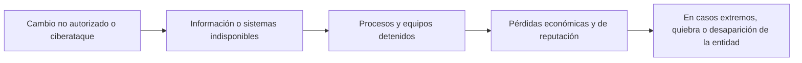

# 13 - Disponibilidad de la información: el desafío global

> Unidad 5 de *Introducción a la ciberseguridad* (Raptor Dev Services Academy, curso `cyber-intro`). Material recreado con palabras propias a partir del temario de un diplomado de ciberseguridad; las fuentes van al final en APA 7. Actualización al 2026 donde se indica.

## Por qué importa

Un sistema que guarda los datos con todo cuidado pero no los entrega cuando alguien los necesita sirve de poco. La disponibilidad es la propiedad que nadie nota mientras funciona: el cajero da efectivo, el portal de la escuela abre, la planta recibe la orden de producción. Cuando falla, en cambio, el daño se cuenta en horas sin operar, en clientes perdidos y, en el peor caso, en empresas que no se recuperan.

Esta nota abre la última unidad del curso, dedicada a los desafíos globales que traen las tecnologías de la información y la comunicación. De todos los retos que se podrían discutir (la brecha digital, la alfabetización, la inclusión, la educación a distancia) se elige la seguridad de la información porque atraviesa a los demás. La pandemia aceleró la conexión de millones de personas y organizaciones, y ni las leyes, ni las herramientas, ni la cooperación entre países han alcanzado a cerrar el hueco. Los tres temas de la unidad recorren, uno por uno, los tres pilares de esa seguridad: disponibilidad (esta nota), confidencialidad ([14](14-confidencialidad.md)) e integridad ([15](15-integridad.md)).

La idea de fondo es sencilla y conviene tenerla presente en toda la unidad: si una empresa grande, con presupuesto y personal especializado, no logra blindar por completo su información, el usuario doméstico o la pequeña organización están todavía más expuestos. Por eso la ciberseguridad deja de ser un asunto del área de sistemas y se vuelve de interés general.

## La disponibilidad dentro de la tríada

La seguridad de la información se suele explicar con tres propiedades que tienen el mismo peso: **confidencialidad**, **integridad** y **disponibilidad** (en inglés se resume como CIA). La norma ISO/IEC 27001 las toma como base de todo sistema de gestión de seguridad, y el Instituto Nacional de Ciberseguridad de España (INCIBE) las define en términos prácticos para cualquier empresa.

| Propiedad | Qué protege | Ejemplo de falla |
|---|---|---|
| Disponibilidad | Que la información y los sistemas se puedan usar en el momento en que se requieren | Un ransomware cifra los archivos; el sitio web o la intranet están caídos |
| Confidencialidad | Que solo la vean quienes tienen autorización | Se pierde una memoria USB sin cifrar con datos internos |
| Integridad | Que sea correcta y no la cambie nadie sin permiso | Alguien altera los precios de una tienda en línea |

Aplicada a la vida diaria, la disponibilidad significa poder consultar la información cuando la necesitamos, sobre todo cuando se trata, transmite, almacena o respalda a través de redes conectadas a internet. Cuanto más depende un proceso de esa conexión, más grave es perderla.

### Un problema de todos: el modelo de múltiples partes interesadas

La ciberseguridad toca intereses públicos, y por eso se discute bajo el llamado modelo *multi-stakeholder* o de múltiples partes interesadas. La premisa es que gobiernos, empresas, academia, organizaciones civiles y personas usuarias participan en el mismo sistema: todos reciben sus beneficios, todos están sujetos a sus reglas y todos cargan con sus riesgos. Las decisiones de cada uno afectan la eficacia de las defensas de los demás, así que la protección funciona solo cuando hay colaboración y compromiso compartido.

### Estudiar el pasado, el presente y el futuro

Como los factores externos que dañan la información son muchos y cambian rápido, la ciberseguridad se estudia de forma multifactorial y en tres tiempos:

- **Pasado:** los incidentes ya ocurridos dejan lecciones y patrones.
- **Presente:** se implementan soluciones y controles de protección.
- **Futuro:** se anticipan los riesgos que traerá cada innovación, para prevenir antes de que aparezcan. Este último tiempo es el más difícil y el más valioso, porque casi toda tecnología nueva acaba abriendo una puerta que nadie había previsto.

## Los temas que más pesan

Los asuntos más relevantes para la disponibilidad se ordenan según el impacto que una intrusión tendría sobre la población. El material los agrupa en tres categorías y agrega dos lecturas de contexto:

| Bloque | Tema | Pregunta que responde |
|---|---|---|
| A | La criticidad del cambio en la operatividad y la continuidad de TI | ¿Qué pasa cuando un cambio no previsto detiene la operación? |
| B | IoT y otras infraestructuras inteligentes | ¿Qué riesgos trae conectar todo a la red? |
| C | El pensamiento de las máquinas: aprendizaje profundo | ¿Qué cambia cuando las máquinas deciden solas? |
| D | Ciberseguridad en la tecnología operativa | ¿Qué tan expuesta está la infraestructura crítica? |
| E | La inteligencia artificial aplicada a la ciberseguridad | ¿La IA es arma o escudo? |

## A. La criticidad del cambio en la operatividad y la continuidad de TI

Para un negocio, que su infraestructura tecnológica siga funcionando es cuestión de supervivencia. Si un cambio que la dirección no autorizó, o un ataque, interrumpe la disponibilidad o la integridad de la información, el daño puede escalar de forma muy rápida:

### El caso NotPetya y Maersk

El 27 de junio de 2017 se propagó NotPetya, un código malicioso que se presentaba como ransomware pero que, en la práctica, destruía la información de los equipos que infectaba. Una de las víctimas más conocidas fue la naviera danesa Maersk, una de las mayores del mundo. Su presidente relató en el Foro Económico Mundial de Davos, en enero de 2018, la magnitud de la recuperación:

| Dato | Cifra |
|---|---|
| Servidores reinstalados | Alrededor de 4,000 |
| Computadoras personales reinstaladas | Alrededor de 45,000 |
| Aplicaciones reinstaladas | Alrededor de 2,500 |
| Tiempo de la reconstrucción | Unos diez días, entre finales de junio y principios de julio de 2017 |
| Costo estimado por la empresa | Entre 250 y 300 millones de dólares |
| Operación durante la crisis | Cerca de 80 % del volumen se procesó a mano |

El caso se cita como uno de los ejemplos más graves de indisponibilidad de información: no hubo robo de datos que vender, sino una empresa global que se quedó sin herramientas para trabajar.

### La disponibilidad en los procesos industriales

INCIBE subraya que en la industria la disponibilidad es todavía más delicada que en una oficina. Si se pierden las comunicaciones, o simplemente aumenta su retraso, el problema no se limita al dinero: los dispositivos pueden empezar a comportarse de forma anómala, y quienes los operan se enfrentan a situaciones que nunca habían visto, lo que complica volver a la normalidad. Un mensaje que llega tarde a una válvula o a un brazo robótico puede ser tan peligroso como uno que no llega.

### El reto es de dirección, no solo técnico

El desafío principal no está en una herramienta, sino en la capacidad de la organización para gestionar al mismo tiempo su operación y su seguridad. Esa capacidad depende de la visión estratégica y del nivel jerárquico de quienes dirigen. Los responsables de seguridad deben entender que los riesgos afectan tanto a la operación como a los controles, y que el objetivo es que los activos críticos funcionen a plena capacidad. En la práctica eso implica:

- Identificar qué procesos y activos son críticos y cuánto tiempo puede vivir la organización sin cada uno.
- Controlar los cambios: ninguna modificación a sistemas productivos sin autorización, prueba y forma de revertirla.
- Tener respaldos aislados y probados, porque un respaldo que nadie ha restaurado no garantiza nada.
- Adaptar las medidas de forma continua, a medida que cambian los riesgos.

## B. IoT y otras infraestructuras inteligentes

El internet de las cosas (IoT) acapara la atención porque está al alcance de cualquiera: bocinas, focos, cámaras, cerraduras y electrodomésticos conectados. Pero existen infraestructuras igual de sensibles que no llegan al gran público por su costo y su grado de especialización, como los sistemas avanzados de inteligencia artificial y las aplicaciones de procesamiento de datos. También requieren protección, aunque se hable menos de ellas.

El material propone cuatro casos para dimensionar el tema:

| Caso | Qué muestra |
|---|---|
| El impacto de la inteligencia artificial en las empresas | La IA ya forma parte de procesos de negocio que antes dependían de personas; si se cae o se manipula, el proceso entero se detiene |
| Tecnologías biométricas aplicadas a la ciberseguridad (guía de INCIBE para empresarios, 2016) | Huella, rostro, iris o voz como forma de autenticación: sus fundamentos, las técnicas fisiológicas, la comparación con otros métodos y sus vulnerabilidades |
| Las ciudades inteligentes también corren riesgos | Semáforos, alumbrado, agua y transporte gestionados por red: un ataque afecta servicios públicos completos |
| Dispositivos inteligentes poco conocidos | La lista de objetos conectados crece con productos que nadie pensaría proteger |

INCIBE-CERT resumió en 2017 los riesgos y retos de ciberseguridad y privacidad en IoT. Entre ellos destacan la falta de especialistas con experiencia en estos dispositivos y la necesidad de reforzar el control de acceso y el cifrado, de aplicar privacidad desde el diseño y de evitar que, cruzando datos aparentemente inocentes, se pueda inferir información sensible como la ubicación de una persona.

La lección general es que la ciberseguridad tiene que evolucionar al mismo ritmo que la tecnología que protege. Varios de estos temas no parecen tratar directamente de disponibilidad, pero están ligados a ella y a la privacidad: en el mejor escenario, el dueño de la información puede consultarla cuando quiere; en un escenario adverso, perder ese acceso se convierte en un problema grave. Una casa inteligente cuya cerradura depende de un servidor caído deja a su dueño en la calle.

## C. El pensamiento de las máquinas: aprendizaje profundo

### Antecedentes

La pregunta de si una máquina puede pensar es anterior a la computadora personal. A mediados del siglo XX, investigadores como **John McCarthy**, a quien se atribuye el término *inteligencia artificial*, y **Marvin Minsky**, cofundador del laboratorio de inteligencia artificial del MIT, imaginaron programar máquinas que emularan el razonamiento humano. Lo nuevo no es la idea, sino la ciberseguridad que ahora la acompaña.

El **aprendizaje automático** (*machine learning*) también tiene décadas. A finales de los años cincuenta, Arthur Samuel, en IBM, escribió un programa de damas que mejoraba su juego con la experiencia: fue uno de los primeros intentos de entrenar a una máquina con datos de partidas anteriores para que rindiera mejor. De ahí se llegó a lo que hoy se discute: máquinas cada vez más autónomas, con consecuencias directas en la vida cotidiana y en la seguridad de la información.

### Inteligencia artificial y aprendizaje automático

Salesforce Latinoamérica describe la inteligencia artificial como la rama de la informática que crea programas y mecanismos capaces de comportarse de una forma que consideraríamos inteligente. Su propósito es imitar la manera en que procesamos y razonamos, para que la máquina se adapte a situaciones y necesidades nuevas con más precisión y eficiencia.

Una segunda etapa de esta tecnología es que la máquina **tome decisiones por sí misma**. El aprendizaje automático busca reproducir, y mejorar, la capacidad humana de procesar datos para decidir mejor, lo que permite delegar tareas complejas y ajustarse a un entorno que cambia sin parar.

### Qué es el aprendizaje profundo

El aprendizaje profundo (*deep learning*) es una subcategoría avanzada del aprendizaje automático. Usa redes neuronales artificiales de muchas capas, inspiradas de forma libre en la estructura del cerebro, para aprender de grandes volúmenes de datos.

| Aspecto | Aprendizaje automático clásico | Aprendizaje profundo |
|---|---|---|
| Datos | Suele requerir datos preparados y estructurados | Maneja datos no estructurados (imágenes, audio, texto) y en enormes cantidades |
| Características | Una persona decide qué rasgos medir | El modelo descubre por sí mismo los rasgos relevantes a partir de los datos crudos |
| Arquitectura | Modelos relativamente simples | Capas jerárquicas: cada una extrae rasgos más abstractos que la anterior |
| Usos típicos | Clasificación y predicción con datos tabulares | Reconocimiento de imágenes, comprensión del lenguaje natural, análisis predictivo |

Dos familias de modelos explican buena parte de sus éxitos: las **redes neuronales convolucionales**, que identifican y clasifican objetos en imágenes y video, y los **transformers**, que permiten entender y generar texto coherente. Su desempeño mejora a medida que hay más datos y más capacidad de cómputo. Txema Rodríguez, en Xataka, ofrece una explicación accesible de estas claves y de los retos que plantean, como la precisión que exigen y el poder de procesamiento que consumen.

### La IA no es infalible

Que una tecnología sea impresionante no la vuelve segura. Los sistemas de IA procesan muchísimos datos y operan con autonomía, así que sus vulnerabilidades pueden venir de:

- **Fallas de diseño** del propio sistema.
- **Errores de software** en su implementación.
- **Ataques maliciosos** que aprovechan debilidades específicas, por ejemplo, alimentar al modelo con datos manipulados.
- **Patrones corrompidos:** si lo que el sistema aprendió se altera, sus decisiones autónomas se vuelven un riesgo adicional.

Un episodio muy difundido en 2017 ilustra el desconcierto que generan estas máquinas. El laboratorio de investigación en IA de Facebook entrenó dos agentes para negociar entre sí; como no se les exigió conservar el inglés, empezaron a intercambiar frases que las personas ya no entendían, y el experimento se detuvo. La prensa lo presentó como una IA que "inventó su propio idioma"; los investigadores lo explicaron como un ajuste que faltaba en el entrenamiento. En ambos casos, el punto para la ciberseguridad es el mismo: un sistema autónomo puede comportarse de una forma que sus creadores no previeron.

El ensayista Sydney J. Harris lo resumió con una advertencia que se cita con frecuencia: el riesgo de fondo no es que las computadoras razonen como personas, sino que las personas terminen razonando como computadoras.

## D. Ciberseguridad en la tecnología operativa

La **tecnología operativa** (OT) es el conjunto de sistemas que controlan procesos físicos: plantas eléctricas, redes de agua, manufactura, oleoductos. En 2019, Ponemon Institute, por encargo de Tenable, publicó *Cybersecurity in Operational Technology: 7 Insights You Need to Know*, basado en 701 profesionales de organizaciones de infraestructura crítica. Algunos hallazgos:

| Hallazgo (2019) | Cifra |
|---|---|
| Organizaciones cuyo entorno sufrió al menos un ciberataque con daños en los dos años previos | 90 % |
| Organizaciones que sufrieron dos o más ataques en ese periodo | 62 % |
| Quienes señalaron la falta de visibilidad de su superficie de ataque como causa central | 80 % |
| Quienes citaron la falta de personal como obstáculo principal | 61 % |

El entorno IoT, del que la OT forma parte cada vez más, está compuesto por una red enorme de dispositivos conectados que automatizan e intercambian datos en tiempo real. Esa interconexión trae riesgos claros: dispositivos repartidos por todas partes, muchas veces sin medidas de seguridad robustas, que pueden comprometer datos y sistemas críticos; y una recolección masiva de datos personales y operativos que pone en peligro la privacidad si no se protege bien.

## E. La inteligencia artificial aplicada a la ciberseguridad

La IA trae riesgos, pero también es una de las mejores herramientas de defensa. Javier Alonso Lecuit, en un análisis del Real Instituto Elcano (2019), describe ese doble uso:

| Uso defensivo | Uso ofensivo o riesgo |
|---|---|
| Analizar grandes volúmenes de datos para anticipar amenazas | Automatizar campañas de *phishing* personalizadas con ingeniería social |
| Detectar y neutralizar ataques con más rapidez | Automatizar la búsqueda de vulnerabilidades |
| Gestionar incidentes de forma más ágil y eficaz | Alterar algoritmos para dejar puertas traseras |
| Liberar al personal de tareas repetitivas | Vigilancia masiva que amenaza a la ciudadanía |

Bien gestionada, la IA permite a las organizaciones protegerse mejor, optimizar su operación y cumplir sus objetivos de seguridad con más eficiencia.

### El caso de las herramientas generativas

El aprendizaje en ciberseguridad nunca termina, porque cada herramienta nueva trae riesgos nuevos. Cuando ChatGPT se abrió al público a finales de 2022, desató una polémica considerable: junto a sus beneficios aparecieron preocupaciones por su uso indebido, por la confianza todavía en construcción hacia la herramienta y por riesgos que, en algunos contextos, podían superar las ventajas. La conclusión es aplicable a cualquier innovación: integrarla con cautela, informarse antes de adoptarla, gestionar sus riesgos y aprovechar sus ventajas de forma segura y ética.

Mal usadas, estas tecnologías pueden abrir vulnerabilidades de seguridad y causar daños éticos y sociales. Por eso organizaciones y personas deben evaluar y mitigar esos riesgos de forma proactiva, mientras siguen aprendiendo y adaptándose.

### Para seguir leyendo

Dos lecturas complementarias ayudan a ver hacia dónde va el problema. Un reportaje de IT Digital Security (2016) anticipaba que las amenazas serían cada vez más inteligentes, autónomas y difíciles de detectar, porque atacantes y herramientas se perfeccionan sin pausa. Y M. Moreno, en la revista CSO España (2019), sostiene que si estalla un conflicto bélico entre países, buena parte de él se librará en el ciberespacio: dejar sin servicio a un adversario, es decir, atacar su disponibilidad, se ha vuelto un objetivo militar.

## Lo que deja el tema

- Los cambios no autorizados, venga de donde vengan, pueden afectar información vital y con ella la vida cotidiana, el trabajo y el acceso a recursos básicos como el efectivo.
- La gestión de riesgos cibernéticos exige mirar hacia adelante, sobre todo en entornos IoT cada vez más accesibles.
- La inteligencia artificial debe usarse con ética y bajo supervisión humana, para que sus avances no perpetúen vulnerabilidades ni se vuelvan una amenaza al control humano.
- La educación en valores es la mejor vacuna contra dos extremos: quedar excluido por no adaptarse y demonizar tecnologías que, usadas con conciencia, traen beneficios enormes.

> **Actualización al 2026:** el NIST publicó el 26 de febrero de 2024 la versión 2.0 de su Cybersecurity Framework (CSWP 29), que suma la función *Gobernar* a las de identificar, proteger, detectar, responder y recuperar; la disponibilidad se trabaja sobre todo en estas dos últimas.

> **Actualización al 2026:** la Unión Europea endureció las obligaciones de continuidad y resiliencia con la Directiva NIS2 (UE) 2022/2555, cuyo plazo de transposición venció el 17 de octubre de 2024, y con el Reglamento de Ciberresiliencia (UE) 2024/2847 para productos con elementos digitales, incluidos los dispositivos IoT.

> **Actualización al 2026:** el Reglamento de Inteligencia Artificial de la Unión Europea (UE) 2024/1689 entró en vigor el 1 de agosto de 2024, con obligaciones escalonadas a partir de 2025; es el primer marco legal general sobre IA.

## Glosario

| Término | Definición |
|---|---|
| Disponibilidad | Propiedad de la información y de los sistemas de estar listos para usarse en el momento en que se requieren |
| Tríada CID | Confidencialidad, integridad y disponibilidad: los tres pilares de la seguridad de la información, con el mismo peso |
| Modelo de múltiples partes interesadas | Enfoque que reparte la responsabilidad de la ciberseguridad entre gobiernos, empresas, academia, sociedad civil y personas usuarias |
| Continuidad de TI | Capacidad de mantener o recuperar en un tiempo aceptable los servicios tecnológicos de los que depende el negocio |
| Control de cambios | Proceso que exige autorizar, probar y poder revertir toda modificación a un sistema productivo |
| NotPetya | Código malicioso de 2017 que se disfrazaba de ransomware pero destruía la información; causó pérdidas globales |
| IoT | Internet de las cosas: objetos físicos con sensores y conexión que intercambian datos por la red |
| Tecnología operativa (OT) | Sistemas que vigilan y controlan procesos físicos en industria e infraestructura |
| Biometría | Identificación de una persona por rasgos físicos o de comportamiento, como huella, rostro, iris o voz |
| Ciudad inteligente | Ciudad que gestiona servicios públicos con datos y dispositivos conectados |
| Inteligencia artificial | Rama de la informática que crea sistemas con comportamientos que consideramos inteligentes |
| Aprendizaje automático | Técnica de IA en la que el sistema mejora su desempeño a partir de datos y experiencia |
| Aprendizaje profundo | Subcategoría del aprendizaje automático basada en redes neuronales de muchas capas que aprenden rasgos de datos crudos |
| Red neuronal convolucional | Tipo de red profunda especializada en reconocer patrones en imágenes y video |
| Transformer | Arquitectura de red profunda que procesa secuencias de texto y es la base de los modelos de lenguaje actuales |
| Doble uso | Característica de una tecnología que sirve tanto para defender como para atacar |

## Referencias

- Instituto Nacional de Ciberseguridad. (2016). *Tecnologías biométricas aplicadas a la ciberseguridad: una guía de aproximación para el empresario*. INCIBE. Copia de consulta: https://www.aec.es/wp-media/uploads/DPD-00289.SEG-GUI-031-guia_tecnologias_biometricas_aplicadas_ciberseguridad_metad.pdf
- Instituto Nacional de Ciberseguridad. (2020). *¿Sabes proteger la información de tu empresa?* INCIBE. https://www.incibe.es/empresas/blog/sabes-proteger-informacion-tu-empresa
- Instituto Nacional de Ciberseguridad. (2024, 26 de marzo). *Biometría: amenazas, riesgos y vulnerabilidades*. INCIBE. https://www.incibe.es/empresas/blog/biometria-amenazas-riesgos-y-vulnerabilidades
- IT Digital Security. (2016). *Las ciberamenazas serán más inteligentes, autónomas y complejas de detectar que nunca*. IT Digital Media Group (enlace directo no localizado en 2026). https://www.itdigitalsecurity.es/
- Lecuit, J. A. (2019). *Implicaciones sobre el uso de la inteligencia artificial en el campo de la ciberseguridad* (ARI 50/2019). Real Instituto Elcano. https://www.realinstitutoelcano.org/analisis/implicaciones-sobre-el-uso-de-la-inteligencia-artificial-en-el-campo-de-la-ciberseguridad/
- Lewis, M., Yarats, D., Dauphin, Y. N., Parikh, D. y Batra, D. (2017). *Deal or no deal? End-to-end learning for negotiation dialogues*. arXiv. https://arxiv.org/abs/1706.05125
- Moreno, M. (2019). Ciberespacio: el campo de batalla del siglo XXI. *CSO España*, (39), 5-9. https://digital.computerworld.es/pubs/CSO39/index.html?page=5
- National Institute of Standards and Technology. (2024). *The NIST Cybersecurity Framework (CSF) 2.0* (NIST CSWP 29). https://doi.org/10.6028/NIST.CSWP.29
- Parlamento Europeo y Consejo de la Unión Europea. (2022). *Directiva (UE) 2022/2555 del Parlamento Europeo y del Consejo, relativa a las medidas destinadas a garantizar un elevado nivel común de ciberseguridad en toda la Unión (Directiva NIS 2)*. Diario Oficial de la Unión Europea. https://eur-lex.europa.eu/eli/dir/2022/2555/oj
- Parlamento Europeo y Consejo de la Unión Europea. (2024). *Reglamento (UE) 2024/1689 por el que se establecen normas armonizadas en materia de inteligencia artificial*. Diario Oficial de la Unión Europea. https://eur-lex.europa.eu/eli/reg/2024/1689/oj
- Parlamento Europeo y Consejo de la Unión Europea. (2024). *Reglamento (UE) 2024/2847 relativo a los requisitos horizontales de ciberseguridad para los productos con elementos digitales (Reglamento de Ciberresiliencia)*. Diario Oficial de la Unión Europea. https://eur-lex.europa.eu/eli/reg/2024/2847/oj
- Puente García, M. (2017, 22 de diciembre). *Riesgos y retos de ciberseguridad y privacidad en IoT*. INCIBE-CERT. https://www.incibe.es/incibe-cert/blog/riesgos-y-retos-ciberseguridad-y-privacidad-iot
- Rodríguez, T. (2020, 16 de octubre). *Machine learning y deep learning: cómo entender las claves del presente y futuro de la inteligencia artificial*. Xataka. https://www.xataka.com/robotica-e-ia/machine-learning-y-deep-learning-como-entender-las-claves-del-presente-y-futuro-de-la-inteligencia-artificial
- SecurityWeek. (2018, 26 de enero). *Maersk reinstalled 50,000 computers after NotPetya attack*. https://www.securityweek.com/maersk-reinstalled-50000-computers-after-notpetya-attack
- Tenable. (2019). *Nueve de cada diez profesionales de seguridad de infraestructura crítica dicen que sus entornos han sido dañados por un ciberataque en los últimos dos años* [Comunicado sobre el estudio de Ponemon Institute]. https://es-la.tenable.com/press-releases/nine-out-of-ten-critical-infrastructure-security-professionals-say-their-environments
- Tenable y Ponemon Institute. (2019). *Ciberseguridad en la tecnología operativa: 7 perspectivas que debe conocer*. Tenable. https://es-la.tenable.com/ponemon-report/cybersecurity-in-operational-technology

---

*Rogelio Arriaga Gonzalez*
