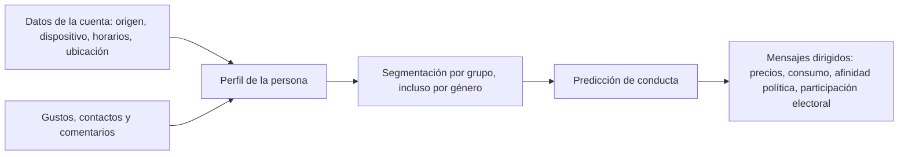

# 14 - Confidencialidad: elemento vital de la ciberseguridad

> Unidad 5 de *Introducción a la ciberseguridad* (Raptor Dev Services Academy, curso `cyber-intro`). Material recreado con palabras propias a partir del temario de un diplomado de ciberseguridad; las fuentes van al final en APA 7. Actualización al 2026 donde se indica.

## Por qué importa

La palabra *confidencialidad* suele evocar un deber ético: el médico que no comenta el expediente, el abogado que guarda el secreto profesional. En ciberseguridad se usa en un sentido más técnico: asegurar la información con todos los medios disponibles para que **nadie sin autorización legítima pueda acceder a ella**. No basta con la buena voluntad; hacen falta controles.

La confidencialidad es uno de los tres pilares de la seguridad de la información, junto con la integridad y la disponibilidad, y la norma ISO/IEC 27001 los trata con el mismo peso. Se estudian por separado solo por razones didácticas. Hay además un orden lógico: primero tiene que existir acceso a la información ([13](13-disponibilidad-de-la-informacion.md)); solo entonces tiene sentido preguntarse quién más puede verla. Sin disponibilidad no hay nada que mantener en reserva.

Esta nota recorre los frentes donde hoy se juega la confidencialidad: la identidad digital y lo que pasa con ella después de la muerte, la inteligencia artificial y las fuentes abiertas, los datos abiertos, las redes inalámbricas y las ciudades inteligentes. La integridad, último pilar, se trata en [15](15-integridad.md).

## La confidencialidad como pilar

INCIBE la define de forma práctica: la información debe estar al alcance únicamente del personal autorizado. Eso incluye a la gente de la propia organización que tiene permiso y excluye a cualquiera que no lo tenga, sea un empleado curioso o un delincuente. El ejemplo clásico de falla es una memoria USB con datos internos, sin cifrar, que se pierde o se roba.

### La información tiene precio

Un punto clave para entender por qué se ataca la confidencialidad es que los datos se venden. Persona, empresa o gobierno: toda información tiene un valor en el mercado negro. El índice de precios de la web oscura que publica Privacy Affairs da una idea de cuánto vale lo que se filtra:

| Producto ilícito (precios promedio de 2022, en dólares) | Precio |
|---|---|
| Datos de una tarjeta de crédito con saldo de hasta 5,000 | 120 |
| Credenciales de banca en línea de una cuenta con al menos 2,000 | 65 |
| Una cuenta de Facebook robada | 45 |
| Imagen escaneada de un pasaporte | Desde 100 |
| Pasaporte físico falsificado de un país europeo | Hasta 6,500 |

El mismo índice observó que muchos precios bajaron frente al año anterior porque la oferta creció: hay tantos datos robados en circulación que se abaratan. Para la víctima, en cambio, el daño no se abarata.

De ahí que proteger la confidencialidad sea mucho más que cumplir un principio ético. En una economía donde los datos son uno de los recursos más valiosos, resguardarlos es una necesidad estratégica para personas, empresas y gobiernos, y una forma directa de prevenir ataques.

## A. La intemporalidad de la identidad digital

### Identidad, reputación y prestigio

La identidad es el reconocimiento social que nos define y nos distingue de los demás. Ese reconocimiento no desaparece al entrar al ciberespacio: al contrario, ahí se vuelve visible para cualquiera y queda ligado a la reputación y al prestigio de cada usuario. En el ámbito digital, la identidad influye en una trayectoria laboral y en cualquier actividad que dependa de ser conocido y validado por otros. En los últimos años se le reconoce incluso como un derecho humano fundamental. En sentido estricto solo las personas tienen identidad, pero gestionarla y protegerla en línea es indispensable para que las interacciones digitales sigan siendo confiables.

### Por qué se dice que es intemporal

Lo que una persona publica, y lo que los servicios registran de ella, se acumula sin fecha de caducidad. Los riesgos aparecen cuando esos datos se generan y explotan de forma masiva y, sobre todo, cuando se asocian con la identidad física de alguien. Esa generación depende de dos fuentes:

1. **Lo que registran los servicios** que usamos: ubicación, dispositivo, horarios, búsquedas, compras.
2. **Lo que publicamos por voluntad propia**: fotos, opiniones, contactos, gustos.

Cada minuto se produce una cantidad enorme de esa información. La recomendación más simple, y la más ignorada, es reducir el uso de aplicaciones que no hacen falta: ninguna persona usuaria puede verificar qué tan bien guarda cada empresa sus datos, ni dentro de su organización ni cuando los comparte con terceros. La geolocalización es un buen ejemplo: es un dato muy revelador, y quien lo recaba asume responsabilidades jurídicas por tratarlo.

### Del dato a la predicción: el caso de Facebook

El vínculo entre el origen de los datos y la identidad de quien los generó es crítico. Con la información asociada a una cuenta de Facebook (lugar de origen, tipo de dispositivo, horarios de conexión, ubicación) combinada con los gustos, los contactos y los comentarios, era posible segmentar a la población, hacer predicciones y dirigir mensajes diseñados para influir en sus decisiones. Hubo quien pagó por obtener esas estadísticas dirigidas. El escándalo de Cambridge Analytica, conocido en 2018, mostró ese uso con fines políticos, y en 2019 la Comisión Federal de Comercio de Estados Unidos impuso a la empresa una sanción de 5,000 millones de dólares por fallas de privacidad.

La explotación de datos descubre patrones que revelan conductas y tendencias, y con ellos se toman decisiones que van desde ajustar el precio de un producto hasta intentar mover la preferencia política o la participación electoral de un grupo concreto. Es la identidad digital usada con fines predictivos.

### Contratos que no se negocian

Muchos sitios y aplicaciones imponen sus condiciones de manera unilateral: el usuario las acepta tal como están o no usa el servicio. Son contratos de adhesión, y la única alternativa real es no instalar la aplicación o dejar de usarla. Por eso conviene informarse en fuentes confiables sobre lo que se acepta y sobre el impacto de cómo se administra la propia identidad digital.

### La identidad que sobrevive a su dueño

Una identidad digital puede seguir activa, y causando daño, después de que su titular muere. Las lecturas del tema abordan la llamada *muerte digital*: qué ocurre con los perfiles, los correos, las fotos y las cuentas cuando nadie vuelve a entrar en ellos, y qué decisiones conviene tomar en vida. Aunque no es una obligación, es recomendable tratar la identidad digital como parte de la herencia y dejar formalizado su manejo.

El desafío de la confidencialidad está justamente en saber gestionar esa identidad y tomar decisiones informadas. El tema incomoda, pero es preferible enfrentarlo que permitir que otros usen la identidad de alguien sin su autorización. Lo correcto es decidir, de forma voluntaria y legal, quién se hará cargo de ese recurso, para proteger la reputación propia y evitar que el descuido afecte a familiares, amistades y empleadores.

## B. Inteligencia artificial: OSINT y patrones ocultos

### Buscar información siempre fue importante

La búsqueda de información ha sido clave para muchas disciplinas: una investigación criminal, una tesis, una auditoría. Para quien la necesita, siempre es urgente. Con la expansión de internet, encontrarla se volvió mucho más fácil, y con el auge de las redes sociales cambió su naturaleza: ahora la información está dispersa en muchos sitios y además puede asociarse a personas o grupos concretos, sin que exista una manera confiable de comprobar que es auténtica.

Ese contexto trae riesgos, incluidos los jurídicos. Un ejemplo cotidiano: si alguien incluye en un trabajo información ajena sin citar la fuente, la presenta como propia, y eso puede lesionar los derechos del autor original; según el caso, se configura una infracción en materia de derechos de autor e incluso un delito. Citar no es un trámite académico: es una forma de respetar la propiedad intelectual.

### Fuentes abiertas (OSINT)

| Concepto | En qué consiste | El desafío |
|---|---|---|
| OSINT (*open source intelligence*, inteligencia de fuentes abiertas) | Búsqueda estructurada de información en fuentes públicas: periódicos, blogs, videos, nombres de usuario e incluso copias de archivos que ya no existen en su sitio original (Martínez, 2014) | Lo público también puede usarse para perfilar o atacar a alguien |
| Páginas recopilatorias | Sitios que funcionan como marcos de trabajo y reúnen herramientas automatizadas de búsqueda; seguirán apareciendo más | Comprobar la veracidad y la autoría real de lo que reúnen |
| Búsquedas estructuradas en fuentes abiertas | Uso metódico y repetible de esas herramientas para responder una pregunta concreta | Que la información quede etiquetada como pública o privada y que las fuentes decidan con conciencia qué publican |

### La reputación digital

La reputación digital, o reputación en línea, pasa desapercibida hasta que se daña. Antes, averiguar los antecedentes de alguien era trabajo de un investigador privado; hoy basta con revisar sus perfiles en redes sociales o hacer unas cuantas búsquedas. Tres elementos determinan qué tanto la información en línea se asocia con una persona real y pueden convertir la reputación en un problema de confidencialidad:

1. **Precisión:** qué tan exactos son los datos que vinculan a la persona con información sensible.
2. **Visibilidad y accesibilidad:** qué tan fácil es encontrar esos datos y difundirlos sin restricción.
3. **Falta de control:** qué tan poco puede hacer la persona para corregir o retirar lo publicado.

En el futuro serán inevitables las búsquedas de reputación, que hoy se aplican sobre todo en recursos humanos. Servirán para verificar que una información es legítima, siempre que se hagan con objetividad y sobre datos estrictamente públicos.

### Patrones ocultos

Se espera que la inteligencia artificial, cada vez más barata, permita a cualquier usuario procesar volúmenes enormes de información y descubrir patrones que a simple vista no se ven: conexiones con grupos de personas, preferencias o modelos de negocio. El riesgo es doble. Por un lado, esos resultados pueden exponer a alguien. Por otro, pueden ser falsos: un sistema puede apoyarse en patrones invisibles para generar confusión y caos.

Por eso hace falta administrar la IA y regularla con claridad: qué usos se permiten, qué resultados se esperan, con qué base legal se maneja la información y con qué responsabilidad. La prioridad tiene que ser la integridad del proceso, por encima del interés comercial.

Larry Page, cofundador de Google, lo planteó en otros términos: ante un obstáculo se puede uno quedar mirando la barrera o bien saltar el muro y replantear el problema. La regulación de la IA pide lo segundo.

## C. Open data e infraestructura inalámbrica

### De los datos a la información

Un dato aislado no resuelve problemas, no optimiza procesos ni señala fallas. Adquiere valor cuando se procesa y se convierte en información; entonces sí sirve para mejorar sistemas, detectar errores y fortalecer los entornos de trabajo.

| Tipo de dato | Ejemplo | Quién puede usarlo |
|---|---|---|
| Privado | El número de ventas de cada producto en una gran cadena comercial | Solo la empresa y quien ella autorice |
| Público | Los indicadores demográficos de un país | Cualquiera puede consultarlos |
| Abierto (*open data*) | Un conjunto de datos publicado con licencia libre en un portal de gobierno | Cualquiera puede usarlo, reutilizarlo y redistribuirlo, con la única condición, a lo sumo, de citar el origen y compartirlo en los mismos términos |

La última definición sigue a la Open Knowledge Foundation, que mantiene la definición de referencia de lo que significa "abierto".

### El caso mexicano

El gobierno de México ha reunido durante años una gran cantidad de datos, en colaboración con empresas. Hasta 2018 se calculaba que había más de 25,000 bases de datos ofrecidas por más de 270 instituciones en el portal nacional de datos abiertos. Esa riqueza es también la medida del reto: proteger todo eso es enorme, y la exposición de algunas bases con datos personales de la ciudadanía mostró que hacen falta leyes específicas para investigar y sancionar el uso indebido.

El ejemplo más citado es el del padrón electoral. En 2016 se descubrió en un servidor de Amazon, accesible sin contraseña, una copia de la lista nominal con unos 93.4 millones de registros de electores. En marzo de 2018 el Instituto Nacional Electoral multó al partido Movimiento Ciudadano con alrededor de 34.1 millones de pesos por no resguardar esa información, y el Tribunal Electoral confirmó la sanción.

El desafío de fondo es que la regulación y la gestión del flujo de datos avancen al mismo paso, o incluso por delante, de la innovación que los explota. Si se rezagan, los datos abiertos pueden volverse una herramienta peligrosa contra la propia sociedad. Superarlo exige colaboración interdisciplinaria y una visión clara tanto de los datos que consumimos como de los que generamos, sin perder de vista las innovaciones, sus ecosistemas y los mecanismos para regularlos y protegerlos.

### Redes inalámbricas

La tecnología inalámbrica se consolidó a finales de los años noventa. En 1999, un grupo de empresas que incluía a Nokia y Symbol Technologies fundó una asociación sin fines de lucro para impulsar una nueva tecnología de redes inalámbricas, pensada para conectar dispositivos de forma estable sin cables. En el año 2000 adoptó el nombre Wi-Fi para su trabajo técnico y se convirtió en la actual Wi-Fi Alliance.

Según Marugán, el Wi-Fi tiene ventajas y desventajas claras:

| Ventajas | Desventajas |
|---|---|
| Movilidad para los usuarios | Menor velocidad que una red cableada |
| Instalación sencilla, sin tender cable | El aire, como medio de transmisión, sufre más interferencias que el cobre de una red Ethernet |
| | No se puede delimitar con precisión hasta dónde llega la señal, así que atacar es mucho más fácil: en una red con cable el intruso necesita acceso físico a un punto de conexión |

El gran reto de mediano plazo para la infraestructura inalámbrica es administrar y proteger el intercambio de datos. La tecnología multiplicó la facilidad para compartir información, pero también dejó a la vista sus debilidades.

Los protocolos de protección han ido mejorando (WEP, luego WPA y WPA2, y desde 2018 WPA3), pero ninguno ha sido perfecto. En 2019 los investigadores Mathy Vanhoef y Eyal Ronen publicaron *Dragonblood*, un conjunto de fallas en el saludo inicial de WPA3: ataques de canal lateral capaces de recuperar la contraseña y ataques que obligan a los equipos a negociar una versión más débil del protocolo. La Wi-Fi Alliance respondió que afectaban a pocas implementaciones tempranas y que podían corregirse con actualizaciones de software. El episodio, difundido entre otros por The Hacker News, confirma que incluso el estándar más reciente necesita revisión constante.

Para la persona usuaria la consecuencia es directa: conectarse a una red Wi-Fi gratuita y abierta expone el tráfico a quien comparta esa red. Si no queda más remedio, conviene evitar operaciones sensibles o protegerlas con una conexión cifrada.

## D. Privacidad global: muerte digital, Google y Facebook

Las grandes plataformas ya contemplan la herencia digital y permiten que una persona designada pueda gestionar las cuentas cuando su titular fallece:

| Plataforma | Mecanismo |
|---|---|
| Facebook | El titular nombra en vida un *contacto de legado* que puede administrar la cuenta conmemorativa, o pide que la cuenta se elimine al morir |
| Google | El *administrador de cuentas inactivas* permite decidir qué pasa con los datos si la cuenta deja de usarse durante cierto tiempo y a quién se le avisa o se le comparten |

En México es posible designar herederos de la vida digital mediante un **testamento** ante notario, siempre que la persona sea mayor de edad y cumpla los requisitos legales. En él se puede indicar quién administrará la identidad digital y el acceso a las cuentas, qué tipos de cuentas existen y cuáles son sus contraseñas. Como las contraseñas cambian y deben actualizarse, es mejor dejar también los métodos para recuperar cada cuenta.

La identidad digital puede sufrir daños graves aun después de la muerte de su titular, y ese daño alcanza a la familia, a los negocios, al lugar de trabajo y a cualquier entidad relacionada. Planear la herencia digital protege a la persona fallecida y a quienes se quedan.

## E. Open data: el motor de la ciudad inteligente y un reto para la ciberseguridad

Una de las principales empresas de seguridad informática, Panda Security, señala tres temas críticos de la agenda: los datos abiertos, las ciudades inteligentes y el IoT. Una ciudad se considera inteligente cuando sus habitantes se benefician de fuentes de datos abiertos convertidas en soluciones que les facilitan la vida; pero una ciudad que no es segura difícilmente puede llamarse inteligente.

| Tecnología | Beneficio | Riesgo para la confidencialidad |
|---|---|---|
| Datos abiertos | Transparencia y nuevos servicios construidos sobre información pública | Reidentificar personas o exponer datos sensibles al cruzar conjuntos |
| Ciudad inteligente | Mejores servicios urbanos: transporte, alumbrado, residuos, agua | Sistemas interconectados difíciles de asegurar y volúmenes enormes de datos que proteger |
| IoT | Automatización y datos en tiempo real | Cada dispositivo amplía la superficie de ataque |

En un mundo donde la vida diaria, la infraestructura e internet están cada vez más entrelazados, proteger la información es un reto urgente y permanente. Personas, empresas y gobiernos deben hacerlo de manera proactiva y constante, adaptándose a las tecnologías nuevas y a las formas de ataque que traen consigo.

## F. Búsqueda de patrones para mejorar servicios: el lado útil

La explotación de datos no es mala en sí. Esther Marina Ruiz Lobaina y Pedro Lázaro Romero Suárez (2017) aplicaron algoritmos estadísticos a la base de datos bibliográfica de una red de bibliotecas de ciencia y tecnología en Cuba, elegida por su tamaño y por la cantidad de consultas diarias. Con el programa WinIDAMS, análisis de conglomerados, diagramas de dispersión e histogramas, encontraron patrones ocultos en las búsquedas de los usuarios que sirven para fortalecer servicios como la diseminación selectiva de información y para proponer productos nuevos.

El ejemplo muestra el mismo mecanismo que en el caso de Facebook, con otro fin: los patrones pueden mejorar un servicio o manipular a una población. La diferencia está en la finalidad, en el consentimiento y en la protección de los datos de las personas.

## Lo que deja el tema

- La confidencialidad sigue siendo prioritaria a medida que la tecnología avanza, tanto en el entorno físico como en el digital.
- La identidad digital ya es parte de la vida de cada persona y conviene incluirla en sus decisiones legales y personales, incluida la herencia.
- La inteligencia artificial ofrece oportunidades enormes, pero recolectar y procesar datos con ella plantea dilemas éticos que necesitan regulación, para evitar la manipulación y la saturación de información.
- En redes Wi-Fi públicas y frente a los datos abiertos, el conocimiento de la persona usuaria es la primera defensa de su información.

> **Actualización al 2026:** México abrogó la ley de datos personales de 2010. El 20 de marzo de 2025 se publicó en el DOF una nueva Ley Federal de Protección de Datos Personales en Posesión de los Particulares (en vigor desde el día siguiente; su última reforma es del DOF 14 de noviembre de 2025).

> **Actualización al 2026:** el INAI se extinguió en 2025. Sus atribuciones en datos personales pasaron a la Secretaría Anticorrupción y Buen Gobierno, que es ahora la autoridad ante la que se presenta la solicitud de protección de datos cuando una empresa no atiende el ejercicio de los derechos ARCO (artículo 40 de la LFPDPPP). Los derechos ARCO se ejercen primero ante el propio responsable.

> **Actualización al 2026:** en Europa sigue vigente el Reglamento General de Protección de Datos (UE) 2016/679, y desde el 1 de agosto de 2024 está en vigor el Reglamento de Inteligencia Artificial (UE) 2024/1689, que prohíbe ciertas prácticas de IA y fija obligaciones de transparencia y gestión de riesgos.

## Glosario

| Término | Definición |
|---|---|
| Confidencialidad | Propiedad de la información de estar al alcance solo de las personas, entidades o sistemas autorizados |
| Identidad digital | Conjunto de datos, publicaciones y rastros que representan a una persona en internet y la vinculan con su identidad física |
| Identidad jurídica | Datos que permiten establecer legalmente que una persona es quien dice ser, como nombre, nacionalidad y filiación |
| Reputación digital | Estima que otros tienen de una persona o marca en internet; se forma también con lo que terceros publican y no está bajo control total del interesado |
| Muerte digital | Situación de las cuentas e identidad en línea de una persona después de su fallecimiento |
| Herencia digital | Disposición, en vida y por vía legal, de quién administrará las cuentas y la identidad digital al morir |
| Contrato de adhesión | Contrato cuyas cláusulas fija una sola parte; la otra solo puede aceptarlo completo o rechazarlo |
| OSINT | Inteligencia de fuentes abiertas: búsqueda estructurada de información en fuentes públicas |
| Patrón oculto | Relación entre datos que no se ve a simple vista y que se descubre con análisis estadístico o IA |
| Datos abiertos | Datos que cualquiera puede usar, reutilizar y redistribuir, a lo sumo con atribución y la obligación de compartirlos igual |
| Wi-Fi | Familia de estándares para redes de área local inalámbricas |
| WPA3 | Versión más reciente del protocolo de seguridad para redes Wi-Fi, presentada en 2018 |
| Ataque de degradación | Ataque que obliga a dos equipos a negociar una versión más débil de un protocolo |
| Ciudad inteligente | Ciudad que usa datos y dispositivos conectados para gestionar sus servicios públicos |
| Privacidad | Ámbito de la vida de una persona que tiene derecho a mantener reservado, incluidos sus datos digitales |

## Referencias

- Comisión Federal de Comercio de Estados Unidos. (2019, 24 de julio). *FTC imposes $5 billion penalty and sweeping new privacy restrictions on Facebook*. https://www.ftc.gov/news-events/news/press-releases/2019/07/ftc-imposes-5-billion-penalty-sweeping-new-privacy-restrictions-facebook
- Expansión Política. (2018, 29 de marzo). *El INE multa al PRI y a MC por permitir que se filtrara la lista de electores*. https://politica.expansion.mx/mexico/2018/03/29/el-ine-multa-al-pri-y-a-mc-por-permitir-que-se-filtrara-la-lista-de-electores
- Facebook. (s. f.). *Información sobre los contactos de legado en Facebook*. Servicio de ayuda de Facebook. https://www.facebook.com/help/1568013990080948
- Google. (s. f.). *Administrador de cuentas inactivas*. https://myaccount.google.com/inactive
- Gobierno de México. (s. f.). *Datos abiertos de México*. https://www.datos.gob.mx/
- Instituto Nacional de Ciberseguridad. (2020). *¿Sabes proteger la información de tu empresa?* INCIBE. https://www.incibe.es/empresas/blog/sabes-proteger-informacion-tu-empresa
- Khandelwal, S. (2019, 11 de abril). *Dragonblood: Researchers detail new ways to hack WPA3 WiFi passwords*. The Hacker News. https://thehackernews.com/2019/04/wpa3-hack-wifi-password.html
- Ley Federal de Protección de Datos Personales en Posesión de los Particulares. (2025). *Diario Oficial de la Federación*, 20 de marzo de 2025. Última reforma DOF 14-11-2025. Cámara de Diputados. https://www.diputados.gob.mx/LeyesBiblio/pdf/LFPDPPP.pdf
- Martínez, A. (2014, 28 de mayo). *OSINT - La información es poder*. INCIBE-CERT. https://www.incibe.es/incibe-cert/blog/osint-la-informacion-es-poder
- Open Knowledge Foundation. (s. f.). *The Open Definition*. https://opendefinition.org/
- Panda Security. (2017, 26 de enero). *Open Data: el motor de la Smart City y un reto para la ciberseguridad*. Panda Mediacenter. https://web.archive.org/web/20200427225647/https://www.pandasecurity.com/spain/mediacenter/noticias/open-data-ciberseguridad/
- Parlamento Europeo y Consejo de la Unión Europea. (2016). *Reglamento (UE) 2016/679 relativo a la protección de las personas físicas en lo que respecta al tratamiento de datos personales (Reglamento general de protección de datos)*. Diario Oficial de la Unión Europea. https://eur-lex.europa.eu/eli/reg/2016/679/oj
- Parlamento Europeo y Consejo de la Unión Europea. (2024). *Reglamento (UE) 2024/1689 por el que se establecen normas armonizadas en materia de inteligencia artificial*. Diario Oficial de la Unión Europea. https://eur-lex.europa.eu/eli/reg/2024/1689/oj
- Privacy Affairs. (2023). *Dark web price index 2022*. https://www.privacyaffairs.com/dark-web-price-index-2022/
- Ruiz Lobaina, E. M. y Romero Suárez, P. L. (2017). Búsqueda de patrones para mejorar productos y servicios en las bibliotecas. *Investigación Bibliotecológica: Archivonomía, Bibliotecología e Información*, 31(72), 209-225. https://ru.iibi.unam.mx/jspui/bitstream/IIBI_UNAM/A9/1/72ar9-sin.pdf
- Tribunal Electoral del Poder Judicial de la Federación. (2018). [Boletín sobre la confirmación de la multa a Movimiento Ciudadano por el resguardo del padrón electoral]. https://www.te.gob.mx/front3/bulletins/detail/3408/0
- Vanhoef, M. y Ronen, E. (2019). *Dragonblood: Analyzing the Dragonfly handshake of WPA3 and EAP-pwd*. https://papers.mathyvanhoef.com/dragonblood.pdf
- Wi-Fi Alliance. (s. f.). *History*. https://www.wi-fi.org/who-we-are/history

---

*Rogelio Arriaga Gonzalez*
