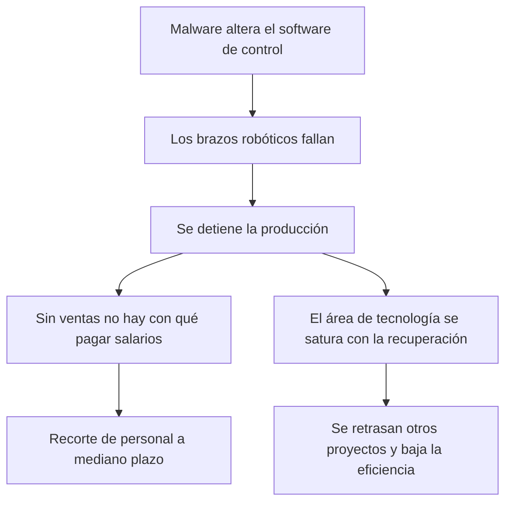
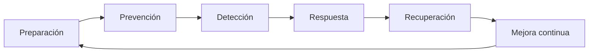

# 15 - Integridad: trascendencia y escenarios mediatos

> Unidad 5 de *Introducción a la ciberseguridad* (Raptor Dev Services Academy, curso `cyber-intro`). Material recreado con palabras propias a partir del temario de un diplomado de ciberseguridad; las fuentes van al final en APA 7. Actualización al 2026 donde se indica.

## Por qué importa

Una decisión es tan buena como la información en la que se apoya. Si alguien cambió un saldo, una cifra de inventario, un diagnóstico o una fecha, la decisión que se tome con ese dato será equivocada aunque todo lo demás funcione. Eso es lo que protege la **integridad**: que la información sea correcta, esté libre de errores y no haya sido modificada por nadie sin autorización.

La integridad completa la tríada de la seguridad de la información junto con la disponibilidad ([13](13-disponibilidad-de-la-informacion.md)) y la confidencialidad ([14](14-confidencialidad.md)). En un escenario *mediato*, es decir, el que ya se ve venir en el corto y mediano plazo, sigue siendo un desafío mayor, porque quien ataca busca precisamente romper alguno de los tres pilares, y la información se produce, se transmite, se almacena y se genera sin pausa. Cada uno de esos momentos es una oportunidad para alterarla.

En el terreno jurídico la integridad pesa todavía más. La evidencia digital que no puede demostrar que nadie la tocó desde que se obtuvo corre el riesgo de que un juez la deseche. Sin integridad, la información no es confiable, y lo que no es confiable no debería usarse.

## La integridad y las normas

INCIBE la define como la garantía de que la información es correcta, no tiene errores y no fue alterada, ni a propósito ni por equivocación humana. Su ejemplo de falla es sencillo: alguien cambia los precios de los artículos de una tienda en línea.

La integridad también sostiene la continuidad operativa: un proceso que trabaja con datos alterados produce resultados alterados, y la confianza en todo el procesamiento se pierde.

Existen muchas normas privadas que ayudan a proteger la información. La más conocida es la ISO/IEC 27001, que fija los requisitos de un sistema de gestión de seguridad de la información. Hay que tener claros sus alcances:

| Aspecto | Lo que hay que saber |
|---|---|
| Naturaleza | Es una norma voluntaria, no una ley: certificarse demuestra buenas prácticas, pero no equivale a cumplir las obligaciones legales de un país |
| Costo | La certificación es costosa y no es permanente: exige auditorías de seguimiento periódicas y una recertificación |
| Cifrado | Pide controles criptográficos para proteger la información, aunque en México no existe una norma nacional específica que regule el cifrado |
| Valor | Aporta método y orden a la protección de la información, y es un referente internacional |

> **Actualización al 2026:** la edición vigente es ISO/IEC 27001:2022, con la enmienda 1 de 2024 que pide valorar si el cambio climático afecta el contexto de la organización. Su catálogo de controles de apoyo, ISO/IEC 27002:2022, pasó de 114 a 93 controles agrupados en cuatro temas: organizacionales, de personas, físicos y tecnológicos.

## A. Cloud computing, data center y flujo transfronterizo de información

### La nube

Microsoft describe la computación en la nube como la entrega de servicios informáticos por internet: servidores, almacenamiento, bases de datos, redes, software, análisis e inteligencia. Promete innovar más rápido, disponer de recursos flexibles y aprovechar economías de escala. Por lo general se paga solo lo que se consume, lo que reduce costos de operación, hace más eficiente la infraestructura y permite crecer o reducirse según cambien las necesidades.

| Modelo de servicio | Qué renta el cliente |
|---|---|
| IaaS (infraestructura como servicio) | Servidores, máquinas virtuales, almacenamiento y red |
| PaaS (plataforma como servicio) | Un entorno listo para desarrollar, probar y desplegar aplicaciones sin administrar lo de abajo |
| Sin servidor (*serverless*) | Funciones que se ejecutan solo cuando ocurre un evento, sin administrar servidores |
| SaaS (software como servicio) | Aplicaciones completas por suscripción; el proveedor las aloja y mantiene |

| Modelo de implementación | Característica |
|---|---|
| Nube pública | Un tercero es dueño del hardware y del software y lo comparte entre muchos clientes |
| Nube privada | Los recursos son exclusivos de una organización, en su centro de datos o en el de un proveedor |
| Nube híbrida | Une pública y privada para mover datos y aplicaciones entre ellas |

Proteger información en la nube es más complejo que "guardarla en un lugar seguro", porque también entran en juego obligaciones legales. En México, el INAI publicó en 2018 la guía *Criterios mínimos sugeridos para la contratación de servicios de cómputo en la nube que impliquen el tratamiento de datos personales*. Su mensaje central es que proteger los datos personales que se suben a la nube, y cumplir la ley al hacerlo, es tan importante como la seguridad del propio servicio: quien contrata sigue siendo responsable de esos datos y debe revisar, antes de firmar, dónde se guardan, quién puede acceder, cómo se borran al terminar el contrato y qué pasa si hay una vulneración.

### Los centros de datos

Los centros de datos (*data centers*) son hoy una infraestructura indispensable y enfrentan múltiples retos en la gestión de la información. De ellos dependen casi todos los servicios digitales, y su importancia crece con la demanda de almacenamiento y procesamiento. Requieren niveles de seguridad muy altos, y quien contrata sus servicios necesita entender cómo funcionan para decidir con información.

### El flujo transfronterizo de datos

La información viaja entre países todo el tiempo, y ese flujo es indispensable para el crecimiento económico y las oportunidades de negocio. El problema es equilibrar dos objetivos que a veces chocan:

| Objetivo | Lo que exige |
|---|---|
| Que la información fluya | Transferencias ágiles entre fronteras, sin trabas innecesarias |
| Que la información esté protegida | Privacidad y seguridad de las personas, seguridad pública y seguridad nacional |

El reto se agrava porque muchas reglas sobre transferencia de datos se escribieron antes de que existieran el correo electrónico masivo, las redes sociales y las aplicaciones móviles.

Además, la mayoría de los usuarios no sabe bien qué permisos otorga a las aplicaciones que usa. La información pasa por la infraestructura de varias empresas antes de llegar a su destino, y ese viaje entre países ocurre casi siempre con el consentimiento, a veces distraído, del propio usuario.

Cuando se trata de información confidencial (datos personales, bancarios o contraseñas), la obligación de protegerla recae en las empresas que la manejan. El cifrado es la herramienta principal para hacerlo. No es infalible, porque existen formas ilícitas de burlarlo, pero mientras no aparezca algo mejor sigue siendo una de las mejores opciones. Las aplicaciones no cifran por sí solas toda la información, así que conviene que cada usuario cifre por su cuenta lo que más le importa. La Oficina de Seguridad del Internauta de España publicó una guía paso a paso, pensada para principiantes, sobre cómo cifrar y almacenar archivos de forma segura.

### Seguridad nacional

Microsoft reconoce que la seguridad del flujo transfronterizo de datos es crítica y que puede tener implicaciones para la seguridad nacional. En México, la Ley de Seguridad Nacional enumera en su artículo 5 los actos que se consideran amenazas para el país. Varios de ellos pueden cometerse o facilitarse con medios tecnológicos. Su texto vigente (última reforma DOF 14-11-2025) es el siguiente; la Cámara de Diputados publica la fracción XIII entre corchetes porque la Suprema Corte la declaró inválida:

> Artículo 5.- Para los efectos de la presente Ley, son amenazas a la Seguridad Nacional:
>
> I. Actos tendentes a consumar espionaje, sabotaje, terrorismo, rebelión, traición a la patria, genocidio, en contra de los Estados Unidos Mexicanos dentro del territorio nacional;
>
> II. Actos de interferencia extranjera en los asuntos nacionales que puedan implicar una afectación al Estado Mexicano;
>
> III. Actos que impidan a las autoridades actuar contra la delincuencia organizada;
>
> IV. Actos tendentes a quebrantar la unidad de las partes integrantes de la Federación, señaladas en el artículo 43 de la Constitución Política de los Estados Unidos Mexicanos;
>
> V. Actos tendentes a obstaculizar o bloquear operaciones militares o navales contra la delincuencia organizada;
>
> VI. Actos en contra de la seguridad de la aviación;
>
> VII. Actos que atenten en contra del personal diplomático;
>
> VIII. Todo acto tendente a consumar el tráfico ilegal de materiales nucleares, de armas químicas, biológicas y convencionales de destrucción masiva;
>
> IX. Actos ilícitos en contra de la navegación marítima;
>
> X. Todo acto de financiamiento de acciones y organizaciones terroristas;
>
> XI. Actos tendentes a obstaculizar o bloquear actividades de inteligencia o contrainteligencia;
>
> XII. Actos tendentes a destruir o inhabilitar la infraestructura de carácter estratégico o indispensable para la provisión de bienes o servicios públicos, y
>
> XIII. [Actos ilícitos en contra del fisco federal a los que hace referencia el artículo 167 del Código Nacional de Procedimientos Penales.]

La fracción XII es la que más se relaciona con la ciberseguridad: un ataque informático que deje fuera de servicio la red eléctrica, el agua o las telecomunicaciones encaja en ella. La conclusión es que proteger el flujo de datos importa no solo para la seguridad de la información en general, sino también para la del Estado.

> **Actualización al 2026:** en 2019 se agregó al artículo 5 una fracción XIII sobre actos ilícitos contra el fisco federal, pero la Suprema Corte la declaró inválida en la acción de inconstitucionalidad 130/2019 y su acumulada 136/2019 (efectos desde el 25 de noviembre de 2022). La ley se reformó por última vez el 14 de noviembre de 2025; conviene consultar el texto vigente en la Cámara de Diputados.

> **Actualización al 2026:** el INAI, autor de la guía de cómputo en la nube, se extinguió en 2025; sus funciones de protección de datos pasaron a la Secretaría Anticorrupción y Buen Gobierno, y la ley de datos personales para particulares es la nueva LFPDPPP publicada el 20 de marzo de 2025. La guía se conserva como referencia técnica.

## B. La ciberresiliencia de las infraestructuras cibernéticas

### El cambio como constante

A lo largo de la vida todo cambia, por planes propios o por imprevistos. El dicho popular de que lo único seguro es la muerte resume una actitud cultural: aceptar que el cambio es lo único constante. Aceptarlo, sin embargo, no lo vuelve fácil; adaptarse a lo nuevo exige un proceso de asimilación que cuesta. Con las infraestructuras cibernéticas pasa lo mismo, y de ahí surge el concepto de **ciberresiliencia**: la capacidad de una infraestructura digital de adaptarse y mantenerse firme frente a los cambios y los ataques.

### Un escenario hipotético

Imaginemos una planta automotriz cuyos brazos robóticos dejan de funcionar porque un código malicioso alteró el software que los controla. La producción se detiene. La dirección debe reconocer que el golpe no es solo técnico:

La primera afectada es la gente: si no hay producción, puede no haber con qué pagar la nómina. Y el área de tecnología carga con una sobrecarga que retrasa todo lo demás.

El caso no es ciencia ficción. En 2017, Kaspersky documentó investigaciones que mostraron lo fácil que es atacar robots industriales: se diseñan pensando en la seguridad física de quien trabaja junto a ellos, pero no en la ciberseguridad, y existen escáneres capaces de encontrarlos conectados a internet.

### Qué implica ser resiliente

Aplicar la resiliencia a equipos, dispositivos, procesos y sistemas significa que la operación diaria continúe como se espera, incluso en condiciones adversas. Eso requiere planes rigurosos de prevención y de recuperación, vigentes en todo momento, para reducir los daños y el costo de volver a la normalidad. Pero no basta con tener planes: deben estar actualizados, corresponder a la infraestructura real y ajustarse de forma continua a lo que cambia. Solo así fortalecen cada decisión sobre resiliencia, tanto en lo físico como en lo cibernético.

## C. Desafíos en el uso del cifrado

Se repite mucho que hay que cifrar todo, y es cierto que el cifrado es central para proteger la confidencialidad y la integridad. Lo que se dice menos es que implementarlo trae sus propios problemas, que pueden volverse serios si no se entienden:

| Desafío | Por qué importa |
|---|---|
| Gestión de llaves | Si se pierde la llave, se pierde la información; si se roba, el cifrado no sirve |
| Compatibilidad | Sistemas distintos pueden no entenderse entre sí o usar algoritmos que ya no son seguros |
| Ataques sofisticados | El cifrado mal implementado, o el algoritmo débil, puede romperse |
| Comprensión | Personas y organizaciones a menudo no conocen los matices del cifrado que usan |

La Internet Society explica en su informe de política pública sobre cifrado los tipos más comunes (simétrico, asimétrico, de extremo a extremo y de datos en reposo) y discute la propuesta recurrente de abrir "puertas traseras" para que las autoridades lean mensajes cifrados. Su postura es que debilitar el cifrado para todos crea más riesgos de los que resuelve, y que seguridad y privacidad no se oponen: pueden reforzarse mutuamente.

### Gestión de la seguridad y gestión de riesgos

| Gestión de la seguridad | Gestión de riesgos |
|---|---|
| Protege los activos con controles y políticas de seguridad | Mira todos los riesgos que puede enfrentar la organización |
| Responde a "cómo protejo esto" | Responde a "qué puede salir mal, qué tan probable es y cuánto costaría" |
| Se materializa en controles concretos | Se materializa en estrategias para evitar, reducir, transferir o aceptar cada riesgo |

Ambas son necesarias para administrar bien la protección de una organización.

### Seguridad en capas en un centro de datos

Un centro de datos bien protegido no confía en una sola barrera. La mejor práctica es combinar varios modelos de protección para que cada capa refuerce a las demás. Para cualquier centro de datos que ofrezca sus servicios al público, sea cual sea el cliente, las capas se agrupan en tres dimensiones:

| Capa | Ejemplos |
|---|---|
| Física | Control de acceso con biometría, vigilancia, energía y enfriamiento redundantes, protección contra incendios |
| Lógica | Firewalls, segmentación de red, control de accesos, monitoreo, respaldos, cifrado |
| Jurídica | Contratos con niveles de servicio y cláusulas de confidencialidad, cumplimiento de la ley de datos personales, avisos de privacidad |

El cifrado atraviesa las tres: protege los datos guardados, los que viajan y los que se entregan al cliente. Al diseñar la estrategia de seguridad de un centro de datos hay que pensar cómo trabajan juntas todas las capas para lograr una defensa integral.

## D. Dificultades de las investigaciones penales en cloud computing

Investigar un delito cometido en la nube es uno de los frentes menos explorados de la ciberseguridad. El **análisis forense en la nube** (*cloud forensics*) se ocupa de recolectar, preservar y analizar datos que viven en servicios de nube, y se topa con obstáculos propios. Ariel Podestá y su equipo de la Universidad FASTA, en Argentina, los analizaron en 2014:

| Obstáculo | Efecto en la investigación |
|---|---|
| Recursos distribuidos y elásticos | Los datos cambian de lugar y de tamaño; la evidencia puede desaparecer cuando el recurso se libera |
| Políticas distintas entre proveedores | Cada proveedor guarda, replica y borra a su manera |
| Datos dispersos en muchos servidores y jurisdicciones | Saber dónde está la evidencia, y qué ley aplica, se vuelve difícil |
| Falta de estandarización | No hay procesos comunes de gestión de datos entre proveedores |
| Acceso remoto complejo | El investigador no puede tomar el disco duro; depende del proveedor y de la cooperación internacional |
| Integridad y disponibilidad de la evidencia | Hay que demostrar que la evidencia no se alteró y que estuvo disponible durante la investigación |

Como las denuncias e investigaciones en la nube todavía son poco frecuentes, no existe una metodología consolidada para el análisis forense remoto. Enfrentar estos retos exige conocer bien las barreras y adoptar soluciones nuevas, y estar preparados para los obstáculos a medida que surjan.

> **Actualización al 2026:** la Asamblea General de la ONU adoptó el 24 de diciembre de 2024 la Convención de las Naciones Unidas contra la Ciberdelincuencia (resolución 79/243), primer tratado mundial en la materia, que incluye cooperación para obtener evidencia electrónica. Se abrió a firma en Hanói el 25 y 26 de octubre de 2025, donde la firmaron 71 Estados y la Unión Europea; entrará en vigor 90 días después de la cuadragésima ratificación. Según la Colección de Tratados de la ONU, al 10 de noviembre de 2026 sumaba 96 firmantes y 3 ratificaciones (Catar, Azerbaiyán y Vietnam), así que aún no está en vigor; México no aparece entre los firmantes.

## E. Retos de las organizaciones para ser ciberresilientes

La ciberresiliencia es la capacidad de una organización para **anticipar, resistir, adaptarse y recuperarse** frente a eventos adversos de ciberseguridad. Va más allá de impedir ataques: busca que la operación continúe y que la información siga protegida en un entorno que cambia y trae amenazas nuevas. Un estudio de Panda Security (2018) sobre los retos de las organizaciones para ser ciberresilientes y la práctica del sector coinciden en seis prácticas clave:

| Práctica | Qué incluye |
|---|---|
| 1. Preparación y planificación | Identificar vulnerabilidades y amenazas, escribir políticas sólidas, planear la respuesta, capacitar al personal y hacer simulacros |
| 2. Prevención | Tecnología de seguridad, gestión de accesos y buenas prácticas al desarrollar y configurar sistemas |
| 3. Detección | Monitoreo continuo, análisis de comportamiento y sistemas de detección de intrusos para descubrir pronto una amenaza |
| 4. Respuesta | Un plan de incidentes definido: coordinación entre equipos, comunicación con las partes interesadas y acciones para contener el daño |
| 5. Recuperación | Restaurar la operación y la información afectada, analizar el incidente y actualizar la estrategia con lo aprendido |
| 6. Adaptación y mejora continua | Ajustar las defensas con base en la experiencia para enfrentar amenazas nuevas |

Las amenazas son cada vez más sofisticadas y sus efectos sobre la operación y la reputación pueden ser graves. Con un enfoque de ciberresiliencia, la organización no solo intenta impedir el ataque, sino que se asegura de poder recuperarse y adaptarse cuando ocurre.

> **Actualización al 2026:** el NIST Cybersecurity Framework 2.0 (febrero de 2024) organiza este ciclo en seis funciones: gobernar, identificar, proteger, detectar, responder y recuperar. La función *Gobernar* es nueva y pone la estrategia de ciberseguridad bajo la responsabilidad de la alta dirección.

## F. Desafíos inimaginables

La tecnología sigue creando escenarios que desafían lo que entendíamos por seguridad y privacidad. Los mundos de realidad virtual, conocidos como *metaverso*, nacieron como espacios de juego y ya permiten asistir a conciertos, viajar de forma virtual, trabajar y estudiar.

En 2022, la prensa difundió el testimonio de una mujer cuyo avatar fue acosado sexualmente por varios avatares masculinos en una plataforma de realidad virtual de Meta, la empresa matriz de Facebook. Se presentó como el primer caso de su tipo: una agresión que antes solo se concebía en el mundo físico, ocurrida en un espacio virtual inmersivo. El caso abrió preguntas sin respuesta clara: qué norma aplica, quién responde, cómo se investiga y cómo se protege a las personas usuarias en estos entornos.

Las imágenes de cierre del tema recuerdan, con distintas voces, que la tecnología no sustituye al juicio humano: de poco sirve tener herramientas cada vez más potentes si no se acompañan de criterio para usarlas.

## Lo que deja el tema

- La integridad asegura que la información sea confiable y precisa, condición indispensable para decidir y para confiar en los sistemas.
- La nube sigue siendo un entorno complejo de proteger, y cuando se comete un delito ahí, investigarlo es todavía más difícil.
- Los centros de datos exigen seguridad física, lógica y jurídica, y usuarios que entiendan lo que contratan.
- El flujo transfronterizo de información es un reto permanente, agravado durante años por la falta de un tratado mundial de protección y colaboración jurídica.
- La ciberresiliencia es la herramienta para recuperarse de los incidentes; y como la ciberseguridad ya no es solo cosa de infraestructura crítica sino de la vida diaria, hay que integrarla al aprendizaje y a los hábitos de todos.

## Glosario

| Término | Definición |
|---|---|
| Integridad | Propiedad de la información de ser correcta, completa y no haber sido alterada sin autorización |
| Escenario mediato | Situación que se anticipa a corto o mediano plazo, distinta de la inmediata |
| Computación en la nube | Entrega de servicios de cómputo por internet con pago según el consumo |
| IaaS, PaaS y SaaS | Modelos de servicio en la nube: infraestructura, plataforma y software como servicio |
| Centro de datos | Instalación que concentra servidores, almacenamiento y red con condiciones controladas de energía, clima y seguridad |
| Flujo transfronterizo de datos | Transferencia de información entre países, a través de la infraestructura de varias empresas |
| Cifrado | Transformación de la información con un algoritmo y una llave para que solo quien tenga la llave pueda leerla |
| Gestión de llaves | Conjunto de prácticas para generar, guardar, rotar y revocar las llaves criptográficas |
| Seguridad en capas | Estrategia que combina controles físicos, lógicos y jurídicos para que cada uno refuerce a los demás |
| Gestión de riesgos | Proceso de identificar, evaluar y tratar los riesgos de una organización |
| Ciberresiliencia | Capacidad de anticipar, resistir, adaptarse y recuperarse de incidentes cibernéticos |
| Análisis forense en la nube | Recolección, preservación y análisis de evidencia digital almacenada en servicios de nube |
| Evidencia digital | Información en formato electrónico que puede servir como prueba en un proceso legal |
| Infraestructura estratégica | Instalaciones y sistemas indispensables para proveer bienes o servicios públicos |
| Metaverso | Entorno virtual inmersivo y persistente donde las personas interactúan mediante avatares |

## Referencias

- Instituto Nacional de Ciberseguridad. (2020). *¿Sabes proteger la información de tu empresa?* INCIBE. https://www.incibe.es/empresas/blog/sabes-proteger-informacion-tu-empresa
- Instituto Nacional de Transparencia, Acceso a la Información y Protección de Datos Personales. (2018). *Criterios mínimos sugeridos para la contratación de servicios de cómputo en la nube que impliquen el tratamiento de datos personales*. INAI. https://inicio.inai.org.mx/nuevo/ComputoEnLaNube.pdf
- International Organization for Standardization. (2022). *ISO/IEC 27001:2022. Information security, cybersecurity and privacy protection. Information security management systems. Requirements*. https://www.iso.org/standard/27001
- International Organization for Standardization. (2022). *ISO/IEC 27002:2022. Information security, cybersecurity and privacy protection. Information security controls*. https://www.iso.org/standard/75652.html
- Internet Society. (2022). *Cifrado* [Informe de política pública; publicado originalmente en 2016]. https://www.internetsociety.org/es/policybriefs/encryption/
- Kaspersky. (2017, 2 de agosto). *Hacking industrial robots*. Kaspersky Daily. https://www.kaspersky.com/blog/hacking-industrial-robots/17879/
- Ley de Seguridad Nacional. (2005). *Diario Oficial de la Federación*, 31 de enero de 2005. Última reforma DOF 14-11-2025. Cámara de Diputados. https://www.diputados.gob.mx/LeyesBiblio/pdf/LSN.pdf
- Ley Federal de Protección de Datos Personales en Posesión de los Particulares. (2025). *Diario Oficial de la Federación*, 20 de marzo de 2025. Última reforma DOF 14-11-2025. Cámara de Diputados. https://www.diputados.gob.mx/LeyesBiblio/pdf/LFPDPPP.pdf
- Luna, S. (2022, 6 de febrero). *El peligro del metaverso: violan en manada al avatar de una mujer*. COPE. https://www.cope.es/programas/fin-de-semana/noticias/metaverso-aun-tiene-mucho-que-mejorar-para-evitar-comportamientos-inadecuados-dentro-20220206_1771241
- Microsoft. (s. f.). *¿Qué es la informática en la nube?* Microsoft Azure. https://azure.microsoft.com/es-es/resources/cloud-computing-dictionary/what-is-cloud-computing
- National Institute of Standards and Technology. (2024). *The NIST Cybersecurity Framework (CSF) 2.0* (NIST CSWP 29). https://doi.org/10.6028/NIST.CSWP.29
- Oficina de Seguridad del Internauta. (2019, 29 de mayo). *Cifrado y almacenamiento seguro de ficheros paso a paso*. INCIBE. https://www.incibe.es/ciudadania/blog/cifrado-y-almacenamiento-seguro-de-ficheros-paso-paso
- Organización de las Naciones Unidas. (2026). *Estado de la Convención de las Naciones Unidas contra la Ciberdelincuencia* (capítulo XVIII-16). United Nations Treaty Collection. https://treaties.un.org/Pages/ViewDetails.aspx?src=TREATY&mtdsg_no=XVIII-16&chapter=18&clang=_en
- Organización de las Naciones Unidas, Oficina de Asuntos Jurídicos. (2025). *The United Nations Convention against Cybercrime opens for signature in Hanoi*. https://www.un.org/ola/en/node/1234
- Panda Security. (2018). *Retos de las organizaciones en su objetivo de ser ciberresilientes* (enlace directo no localizado en 2026). https://www.pandasecurity.com/es/mediacenter/
- Podestá, A., Castellone, M., Constanzo, B., Waimann, J. e Iturriaga, I. (2014). *Dificultades de investigaciones penales en cloud computing*. Universidad FASTA. https://repositorioslatinoamericanos.uchile.cl/handle/2250/6284342

---

*Rogelio Arriaga Gonzalez*
