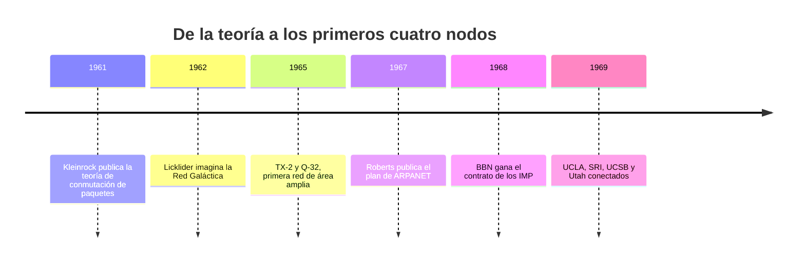

# 01 - TIC, internet y seguridad: de la sociedad del conocimiento a ARPANET

> Materia 2, unidad 1 (Ciberseguridad y actualidad), tema 1. Nota recreada a partir del material de la materia, con la historia de internet contrastada con su fuente primaria y cifras de México actualizadas al 2026.

## Por qué importa

La humanidad ha pasado por varias revoluciones que cambiaron su forma de producir y de convivir. Hoy estamos dejando atrás la sociedad de la información y del conocimiento para entrar en otra etapa, completamente influida por la vida digital. Para entender los riesgos de esa etapa (que es el tema de toda esta materia) hace falta un punto de partida histórico: de dónde salieron las tecnologías de la información y la comunicación (TIC), cómo nació internet y por qué la seguridad se volvió un asunto de todos.

El ciberespacio trasladó buena parte de nuestra identidad del mundo material al digital: ahí estudiamos, trabajamos, compramos, nos informamos y nos relacionamos. Por eso hace falta un código moral y ético para movernos en él, y conocimientos de ciberseguridad para no caer en las prácticas nocivas que surgen en cuestión de segundos. Usar internet todos los días no significa entenderlo: la mayoría de las personas lo usan sin conocer los procesos, inventos y decisiones que lo hicieron posible, y ese trasfondo explica muchas de sus fortalezas y de sus debilidades.

## La sociedad del conocimiento

Cuando se habla de TIC es inevitable hablar de la **sociedad del conocimiento**, el preámbulo de los cimientos tecnológicos que hoy usamos a diario.

La noción surgió en los años sesenta, cuando se estudiaba el comportamiento de las sociedades industriales y empezó a hablarse de una sociedad **postindustrial**, con una nueva capa de trabajadores que se movía hacia una economía basada en el saber. Peter Drucker la describió como una estructura económica y social en la que el conocimiento sustituye al trabajo, a las materias primas y al capital como la fuente principal de productividad, de crecimiento y también de desigualdad.

| Rasgo | Qué cambia |
|---|---|
| Economía | Se pasa de producir bienes a producir servicios, que requieren profesionales muy calificados. |
| Innovación | El conocimiento y la generación de ideas se vuelven la fuente principal de innovación y de nueva tecnología. |
| Educación | Las economías emergentes necesitan sistemas educativos de calidad, evaluados y acreditados, para dar el salto. |
| Valor | La UNESCO subraya que el conocimiento se vuelve parte del valor de un producto y un factor de producción más relevante que el trabajo industrial o manual. |

### La globalización

La globalización de la economía es el tránsito de una economía nacional a una regional y después mundial. Ese cambio generó procesos en muchas dimensiones a la vez, con efectos en las políticas comerciales y económicas y en los mercados de bienes y servicios:

- Las empresas multinacionales se expanden para aprovechar la integración de mercados.
- La producción y el intercambio se vuelven multinacionales.
- Las multinacionales compiten entre sí por los mercados.
- La innovación científica y tecnológica genera demandas nuevas a las que las organizaciones deben adaptarse.

En ese contexto, las transformaciones son constantes. Las universidades no son ajenas a ellas: se espera que hagan investigación pertinente y respondan con rapidez a las demandas sociales. El vínculo entre universidad, Estado y sector productivo debe fortalecerse para competir internacionalmente y para mejorar las condiciones de vida: combatir la pobreza extrema, el analfabetismo, la falta de salud y la inseguridad. Todo eso exige adaptarse a contextos y culturas nuevos y a la velocidad con la que hoy se intercambian recursos, que hace que el mundo se sienta cada vez más cercano.

## Las TIC: de herramienta a infraestructura

En este punto la tecnología deja de ser una novedad y se vuelve una herramienta adoptada y masificada. La inclusión de internet en el trabajo, en el estudio e incluso en el ocio cambió la forma de concebir la sociedad; internet llegó a considerarse un arma masiva al alcance de cualquiera.

Las TIC son el conjunto de tecnologías que permiten crear, almacenar, procesar y transmitir información: computadoras, teléfonos, redes, programas y servicios en línea. Su integración transformó cómo interactuamos, trabajamos y accedemos a la información, y con su uso creciente aparecieron también riesgos importantes para la seguridad.

> Actualización al 2026: según la Encuesta Nacional sobre Disponibilidad y Uso de Tecnologías de la Información en los Hogares (ENDUTIH) 2025 del INEGI, México llegó a **104.9 millones de usuarios de internet**, el **86.1 %** de la población de seis años y más. La diferencia entre zonas urbanas (88.9 %) y rurales (75.2 %) se redujo, pero sigue siendo grande, y la razón más citada por quienes no lo usan es que no saben cómo hacerlo. Desde la reforma constitucional de 2013, el artículo 6.º de la Constitución reconoce el derecho de acceso a las TIC y a la banda ancha.

## Qué es internet

Internet, tal como lo conocemos, es una infraestructura de información extendida por todo el mundo, el prototipo inicial de lo que se llamó la Infraestructura Nacional, Global o "Galáctica" de Información. Su historia es compleja y abarca muchos aspectos: tecnológicos, organizativos y comunitarios. Su influencia no se limita a las comunicaciones informáticas; alcanza a toda la sociedad, que usa cada vez más las herramientas en línea para el comercio electrónico, la obtención de información y la vida comunitaria.

Técnicamente, es una red de redes que se comunican con un mismo conjunto de protocolos, TCP/IP. Cada equipo conectado tiene una dirección IP y la información viaja dividida en **paquetes** que pueden tomar caminos distintos y se reensamblan en el destino. Esa idea, la conmutación de paquetes, es el centro de su historia.

## Breve historia de internet

### Las ideas (1961 a 1967)

- **1961.** Leonard Kleinrock, entonces en el MIT, publica el primer artículo sobre la teoría de conmutación de paquetes (julio de 1961) y en 1964 el primer libro sobre el tema. Convence a Lawrence Roberts de que es viable comunicarse con paquetes en lugar de con circuitos, un paso decisivo hacia las redes de computadoras.
- **1962.** J. C. R. Licklider, del MIT, escribe en agosto una serie de memorandos sobre la "Red Galáctica": un conjunto de computadoras interconectadas globalmente desde las cuales cualquiera podría acceder rápido a datos y programas desde cualquier sitio. En espíritu, era muy parecido a internet. Licklider fue el primer director del programa de investigación en computación de DARPA, que empezó en octubre de 1962, y convenció a sus sucesores (Ivan Sutherland, Bob Taylor y Lawrence Roberts) de la importancia de la idea.
- **1965.** Roberts, con Thomas Merrill, conecta la computadora TX-2 de Massachusetts con la Q-32 de California mediante una línea telefónica conmutada de baja velocidad: la primera red de área amplia del mundo, aunque pequeña. El experimento demostró que las computadoras de tiempo compartido podían trabajar juntas, ejecutar programas y recuperar datos en la máquina remota, pero también que la red telefónica de circuitos era inadecuada para eso. Quedó confirmada la idea de Kleinrock: hacían falta paquetes.
- **1966 y 1967.** Roberts entra a DARPA a finales de 1966 para desarrollar el concepto y publica en 1967 su plan para **ARPANET**. En la misma conferencia, Donald Davies y Roger Scantlebury, del National Physical Laboratory (NPL) del Reino Unido, presentan su propio trabajo sobre redes de paquetes, y le cuentan a Roberts del trabajo de Paul Baran y otros en la corporación RAND, que en 1964 había escrito sobre redes de conmutación de paquetes para comunicaciones de voz seguras en el ejército.

Los trabajos del MIT (1961 a 1967), de RAND (1962 a 1965) y del NPL (1964 a 1967) avanzaron en paralelo sin que sus autores conocieran el de los demás. De NPL se adoptó la palabra "paquete", y la velocidad de línea propuesta para ARPANET subió de 2.4 kbps a 50 kbps.

### La construcción de ARPANET (1968 y 1969)

- **Agosto de 1968.** Con la estructura y las especificaciones ya afinadas por Roberts y la comunidad financiada por DARPA, la agencia lanza una convocatoria para construir uno de los componentes clave: los conmutadores de paquetes, llamados **procesadores de mensajes de interfaz (IMP)**.
- **Diciembre de 1968.** La gana un grupo de Bolt Beranek and Newman (BBN) dirigido por Frank Heart. Mientras BBN construye los IMP, con Bob Kahn como pieza importante del diseño arquitectónico, Roberts trabaja con Howard Frank y su equipo de Network Analysis Corporation en la topología y la economía de la red, y el equipo de Kleinrock en UCLA prepara el sistema de medición.
- **Septiembre de 1969.** Por su trabajo pionero en teoría, análisis, diseño y medición, el Network Measurement Center de Kleinrock en UCLA es elegido como el **primer nodo**: BBN instala ahí el primer IMP y se conecta la primera computadora anfitriona.
- **El segundo nodo** es el Stanford Research Institute (SRI), donde trabajaba el proyecto de Doug Engelbart "Aumento del intelecto humano", que incluía NLS, un antecedente del hipertexto. El SRI alojaba además el Network Information Center, dirigido por Elizabeth (Jake) Feinler, que mantenía las tablas de nombres de las computadoras y el directorio de los documentos técnicos de la red (los RFC).
- **Un mes después**, ya con el SRI conectado, se envía el primer mensaje entre computadoras, del laboratorio de Kleinrock al SRI.
- **Antes de terminar 1969** se suman la Universidad de California en Santa Bárbara, donde Glen Culler y Burton Fried investigaban cómo mostrar funciones matemáticas en pantallas de almacenamiento, y la Universidad de Utah, que trabajaba en métodos de gráficos por computadora. Cuatro nodos: la red había nacido.

### De ARPANET a internet

> Actualización al 2026: el material de la materia llega hasta los cuatro nodos de 1969. Lo que sigue completa la historia con la misma fuente primaria, la historia de internet escrita por sus propios protagonistas para la Internet Society.

- **1972, la arquitectura abierta.** Bob Kahn propone que redes distintas, cada una con su propio diseño, puedan interconectarse sin cambiar por dentro. La idea nació en el programa de **radio por paquetes** de DARPA, que necesitaba unir una red inalámbrica con ARPANET. Ese mismo año ARPANET se demuestra en público y aparece el correo electrónico, que se vuelve su aplicación más usada.
- **1973 a 1978, TCP/IP.** Kahn y Vinton Cerf diseñan el protocolo que hará posible la arquitectura abierta; con los años se divide en TCP (control de la transmisión) e IP (direccionamiento y envío de paquetes).
- **1 de enero de 1983.** ARPANET abandona su protocolo anterior y adopta TCP/IP. Es la fecha que muchos consideran el nacimiento de internet.
- **De 1989 en adelante.** Tim Berners-Lee crea en el CERN la World Wide Web, el sistema de páginas enlazadas que hizo que internet llegara al público general en los años noventa.

## Seguridad: la pieza que llegó tarde

ARPANET se diseñó para que un grupo pequeño de investigadores que se conocían y confiaban entre sí compartiera recursos. La seguridad no era una prioridad: lo importante era que los paquetes llegaran. Cuando la red se abrió al mundo, ese diseño basado en la confianza se volvió una debilidad, y la evolución constante de los sistemas físicos y lógicos fue trasladando al plano digital preocupaciones que antes eran del mundo físico. La protección de los usuarios en ese plano es lo que hoy llamamos **ciberseguridad**.

Una definición de referencia, la de la Unión Internacional de Telecomunicaciones (UIT), la describe como el conjunto de herramientas, políticas, conceptos y salvaguardas de seguridad, directrices, métodos de gestión de riesgos, acciones, formación, buenas prácticas, seguros y tecnologías que sirven para proteger los activos de las organizaciones y de los usuarios en el ciberentorno. Sus objetivos se resumen en la **tríada CID**:

| Principio | Qué garantiza | Cómo se protege |
|---|---|---|
| Confidencialidad | Que solo las personas autorizadas accedan a la información | Control de acceso, autenticación, cifrado |
| Integridad | Que la información sea exacta y confiable y no se altere sin autorización durante su ciclo de vida | Permisos, firmas, sumas de verificación, registros |
| Disponibilidad | Que la información y los sistemas estén accesibles cuando las personas autorizadas los necesitan | Mantenimiento, actualizaciones, respaldos, planes de recuperación ante desastres |

### Derechos y deberes digitales

Los derechos digitales surgieron como una extensión de los derechos tradicionales al entorno virtual: privacidad, libertad de expresión, acceso a la información y protección de datos personales. Pero esa protección no exime a nadie de sus obligaciones en el ciberespacio. El equilibrio entre derechos y deberes es lo que sostiene una convivencia sana en la red.

El poder de la tecnología es enorme y puede volverse peligroso si se usa mal. Quienes trabajan en el sector tienen una responsabilidad particular: entender las implicaciones de lo que construyen, actuar con ética y formarse de manera continua.

## Para cerrar

La tecnología cambió todos los ámbitos de la vida, y mantenerse al día es indispensable porque esos cambios redefinen tanto el trabajo profesional como la vida cotidiana. Conocer la historia de internet ayuda a entender por qué funciona como funciona, y por qué su seguridad tuvo que agregarse después. Las TIC y la red ofrecen oportunidades sin precedentes, pero también riesgos que pueden comprometer la información y los sistemas; la ciberseguridad es el pilar que permite aprovecharlas de forma segura y responsable.

## Glosario

| Término | Definición |
|---------|-----------|
| TIC | Tecnologías de la información y la comunicación: herramientas para crear, almacenar, procesar y transmitir información. |
| Sociedad del conocimiento | Organización económica y social en la que el conocimiento es el principal factor de productividad y crecimiento. |
| Algoritmo | Conjunto de reglas bien definidas para resolver un problema; un programa es un algoritmo escrito en un lenguaje de programación. |
| ARPANET | Red de la agencia de proyectos de investigación avanzada del Departamento de Defensa de Estados Unidos, precursora de internet, puesta en marcha en 1969. |
| Conmutación de paquetes | Método que divide la información en paquetes que viajan de forma independiente y se reensamblan en el destino. |
| IMP | Procesador de mensajes de interfaz: el conmutador de paquetes de ARPANET. |
| TCP/IP | Conjunto de protocolos que define cómo se direccionan, envían y reciben los datos en internet; viene integrado en todos los sistemas operativos actuales. |
| Dirección IP | Número que identifica a un dispositivo en una red. En IPv4 son cuatro números separados por puntos; IPv6 usa direcciones mucho más largas. |
| Red | Dos o más computadoras conectadas para compartir recursos e información. |
| Ciberentorno | Espacio virtual creado por medios digitales, en el que interactúan personas, sistemas y datos. |
| Ciberseguridad | Conjunto de herramientas, políticas, prácticas y tecnologías para proteger los activos de organizaciones y usuarios en el ciberentorno. |
| Tríada CID | Confidencialidad, integridad y disponibilidad: los tres objetivos de la seguridad de la información. |
| RFC | Documentos técnicos (*Request for Comments*) en los que se publican los estándares de internet. |

## Referencias

- Cámara de Diputados del H. Congreso de la Unión. (2026). *Constitución Política de los Estados Unidos Mexicanos* (última reforma DOF 07-10-2026). https://www.diputados.gob.mx/LeyesBiblio/pdf/CPEUM.pdf
- Code.org. (2016, 27 de junio). *What is the internet?* [Video]. YouTube. https://youtu.be/Dxcc6ycZ73M
- Drucker, P. F. (1994, noviembre). The age of social transformation. *The Atlantic Monthly*. https://www.theatlantic.com/past/docs/politics/ecbig/soctrans.htm
- Instituto Nacional de Estadística y Geografía. (2026). *Encuesta Nacional sobre Disponibilidad y Uso de Tecnologías de la Información en los Hogares (ENDUTIH) 2025* [Reporte de resultados, 16 de junio de 2026]. https://www.inegi.org.mx/contenidos/saladeprensa/boletines/2026/endutih/ENDUTIH_25_RR.pdf
- Kimation Studio. (2014, 2 de noviembre). *Historia de internet (ilustrado)* [Video]. YouTube. https://youtu.be/BWb6ri3ePew
- Leiner, B. M., Cerf, V. G., Clark, D. D., Kahn, R. E., Kleinrock, L., Lynch, D. C., Postel, J., Roberts, L. G. y Wolff, S. (1997). *A brief history of the internet*. Internet Society. https://www.internetsociety.org/internet/history-internet/brief-history-internet/
- NAOV. (2017, 19 de mayo). *La historia del internet* [Video]. YouTube. https://youtu.be/D9i1ZknIkZk
- UNESCO. (2005). *Hacia las sociedades del conocimiento: Informe mundial de la UNESCO*. Ediciones UNESCO. https://unesdoc.unesco.org/ark:/48223/pf0000141908
- Unión Internacional de Telecomunicaciones. (2008). *Recomendación UIT-T X.1205: Aspectos generales de la ciberseguridad*. https://www.itu.int/rec/T-REC-X.1205-200804-I/es

---

*Rogelio Arriaga Gonzalez*
