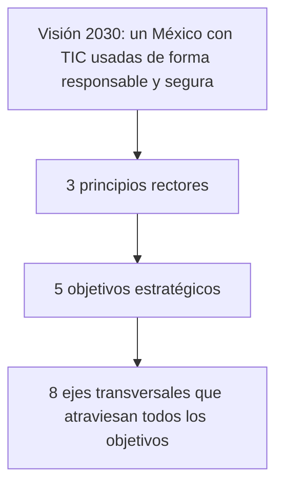

# 03 - Actualidad de la ciberseguridad en México: la Estrategia Nacional y lo que vino después

> Materia 2, unidad 1 (Ciberseguridad y actualidad), tema 3. Nota recreada a partir del material de la materia, que describe el marco vigente hasta 2018. La estrategia se contrastó con el documento oficial y el estado institucional se actualiza al 2026.

## Por qué importa

El campo de batalla cambió: buena parte de los conflictos, los delitos y la defensa de un país ocurren ahora en el mundo digital. México no es la excepción. La dependencia creciente de las TIC y el aumento de los ciberataques obligan a proteger sectores clave (la economía, la salud y la infraestructura crítica, que tiene que seguir operando ante desastres naturales y digitales) y a hacerlo con un marco que todavía está en construcción.

Conocer ese marco, sus avances y sus huecos es indispensable para cualquiera que trabaje en tecnología en el país: define a quién se reporta un incidente, qué conductas son delito, qué obligaciones tienen las instituciones y qué tan preparado está el país para lo que viene.

## El punto de partida: un país muy atacado y con un marco disperso

Hay dos diagnósticos que el material del curso subraya:

1. **México está entre los países más atacados del continente.** Muchas de esas agresiones son masivas y automatizadas, y las víctimas ni siquiera se enteran de inmediato.
2. **La legislación va detrás de la tecnología.** Frente a Europa, que tiene un marco legal más desarrollado y uniforme, en México persiste un desfase en la regulación de las conductas digitales: hay normas recientes, pero no una homologación federal que cubra todas las acciones que afectan a usuarios, gobiernos y empresas. Cada entidad tipifica a su manera, y lo que es delito en un estado puede no serlo en otro.

En términos económicos, el cibercrimen representa una carga importante. Un informe de la Organización de los Estados Americanos (OEA) y Symantec de 2014, citado en la propia Estrategia Nacional de Ciberseguridad, estimó que le costaba al Estado y a la iniciativa privada **entre 3,000 y 5,000 millones de dólares al año**.

> Actualización al 2026: según los reportes de FortiGuard Labs (Fortinet) difundidos en 2024, México recibió unos **31,000 millones de intentos de ciberataque** solo en el primer semestre de ese año, alrededor del 55 % de todos los registrados en América Latina. Son intentos automatizados, no ataques exitosos, pero confirman que el país sigue en los primeros lugares de la región.

## La Estrategia Nacional de Ciberseguridad (ENCS)

### Cómo nació

El avance más significativo del periodo fue la creación de la **Estrategia Nacional de Ciberseguridad**, presentada el **13 de noviembre de 2017**. No fue un documento hecho solo desde el gobierno: durante 2017 se organizaron diálogos, mesas de trabajo y eventos con la sociedad civil, la academia, el sector privado y las autoridades, con el apoyo de la OEA. De ese proceso salió la primera estrategia nacional en la materia, un hito para el país.

La ENCS expresa la visión del Estado mexicano sobre la ciberseguridad. Reconoce a las TIC como un factor clave del desarrollo político, social y económico; admite el aumento de los ciberdelitos y la necesidad de una **cultura general de ciberseguridad** para enfrentar amenazas cada vez más sofisticadas; y señala que el tema es complejo por la naturaleza global del ciberespacio y por la convivencia de marcos jurídicos de distintos países.

### Su objetivo

El documento trae dos redacciones de su objetivo general. En el resumen habla de **identificar y establecer las acciones en materia de ciberseguridad**; en la sección formal, de **fortalecerlas**. En ambos casos se trata de acciones aplicables a los ámbitos social, económico y político, que permitan a la población y a las organizaciones públicas y privadas usar y aprovechar las TIC de manera responsable para el desarrollo sostenible del país. Tiene además una visión hacia 2030.

### Su estructura

| Principios rectores | Objetivos estratégicos | Ejes transversales |
|---|---|---|
| Perspectiva de derechos humanos | Sociedad y derechos | Cultura de ciberseguridad |
| Enfoque basado en gestión de riesgos | Economía e innovación | Desarrollo de capacidades |
| Colaboración multidisciplinaria y de múltiples actores | Instituciones públicas | Coordinación y colaboración |
| | Seguridad pública | Investigación, desarrollo e innovación en TIC |
| | Seguridad nacional | Estándares y criterios técnicos |
| | | Infraestructuras críticas |
| | | Marco jurídico y autorregulación |
| | | Medición y seguimiento |

Leída como profesional, la estructura dice mucho: los **objetivos** son los ámbitos que hay que proteger (las personas, la economía, el gobierno, la seguridad), y los **ejes** son las capacidades que hacen falta en todos ellos (cultura, talento, coordinación, normas, protección de la infraestructura crítica y medición). Es un esquema razonable; su debilidad fue la ejecución.

### Lo que quedó pendiente

La ENCS fue un primer paso, pero el propio material reconoce que necesitaba revisarse y actualizarse para seguir el ritmo de las amenazas. No se convirtió en ley, no tenía presupuesto propio y no se actualizó durante el sexenio 2018 a 2024. Varias iniciativas de ley de ciberseguridad se presentaron en el Congreso en esos años sin llegar a aprobarse.

## Quién hace qué en México

Las instituciones cambiaron mucho desde que se escribió el material. El cuadro resume la situación al 2026:

| Función | Antes (2017 a 2018) | Hoy (2026) |
|---|---|---|
| Policía y respuesta a incidentes | División Científica de la Policía Federal, con su policía cibernética y el CERT-MX | La Ley de la Guardia Nacional de 2019 ordenó extinguir la Policía Federal; en 2020 sus divisiones pasaron a la Guardia Nacional, cuya Dirección General Científica aloja el CERT-MX. Desde la ley de 2025, la Guardia Nacional depende de la Secretaría de la Defensa Nacional y tiene entre sus atribuciones el monitoreo de la red pública de internet. |
| Policías locales | Unidades cibernéticas en algunas entidades | Policías cibernéticas estatales, como la de la Ciudad de México, que reciben denuncias y orientan a víctimas. |
| Política digital del gobierno | Coordinación de Estrategia Digital Nacional | Agencia de Transformación Digital y Telecomunicaciones (ATDT), con rango de Secretaría de Estado desde noviembre de 2024; define los protocolos de seguridad de la información de la Administración Pública Federal. |
| Protección de datos personales | Instituto Nacional de Transparencia, Acceso a la Información y Protección de Datos Personales (INAI) | El INAI desapareció con la reforma de simplificación orgánica (2024). Desde la nueva Ley Federal de Protección de Datos Personales en Posesión de los Particulares (marzo de 2025), la autoridad en el sector privado es la Secretaría Anticorrupción y Buen Gobierno. |
| Usuarios de servicios financieros | Condusef | Condusef, sin cambios. |
| Academia | UNAM-CERT y otros equipos universitarios | Siguen activos como referencia técnica y de concientización. |

> Actualización al 2026: en diciembre de 2025 la ATDT presentó un Plan Nacional de Ciberseguridad y publicó en el Diario Oficial de la Federación (17 de diciembre de 2025) la **Política General de Ciberseguridad para la Administración Pública Federal**, obligatoria para las dependencias federales: cada una debe designar a un titular institucional en materia de ciberseguridad, y la ATDT emite los lineamientos y audita su cumplimiento. Al cierre de esta nota, México **sigue sin una ley federal de ciberseguridad** aprobada.

## Incidentes que marcaron al país

- **2016, el padrón electoral expuesto.** Una copia de la lista nominal del Instituto Nacional Electoral, con datos de más de 90 millones de ciudadanos, apareció en un servidor de nube sin contraseña. Mostró que una mala configuración puede ser tan grave como un ataque.
- **2018, el SPEI.** Ataques a varios participantes del sistema de pagos del Banco de México permitieron sustraer unos 300 millones de pesos y obligaron a endurecer la seguridad de toda la banca (ver nota [10 - Carding](10-carding.md)).
- **2018, el proceso electoral.** Durante el último debate presidencial, en junio, un sitio de campaña de la coalición opositora cayó por un ataque de denegación de servicio distribuido; la autoría nunca se probó, y especialistas señalaron también fallas de capacidad del propio sitio. El Instituto Nacional Electoral reportó ataques constantes de bots contra su infraestructura, y la desinformación circuló con fuerza en redes sociales.
- **2019, Pemex.** Un ataque de ransomware afectó los sistemas administrativos de la petrolera estatal, con una exigencia de rescate en bitcoins.
- **2022, la filtración de la Sedena.** Un colectivo de hacktivistas extrajo y publicó varios terabytes de correos de la Secretaría de la Defensa Nacional, uno de los mayores casos de filtración de un gobierno en la región.

### Las redes sociales como vector

El entorno de las redes sociales es un imán para los ciberdelincuentes porque ahí está la gente. Según la ENDUTIH 2024 del INEGI, las personas usuarias de internet en México se conectan sobre todo para **comunicarse (93.0 %)** y para **acceder a redes sociales (90.4 %)**, y el 90.6 % de quienes tienen un teléfono inteligente usa aplicaciones de mensajería instantánea. Las redes y la mensajería son el principal canal de comunicación de los mexicanos, y por lo mismo el principal canal de engaño, extorsión y desinformación. Hace falta reforzar tanto las medidas preventivas como las reactivas.

## Para cerrar

México necesita actualizarse en lo técnico, lo legal y lo social para enfrentar los riesgos actuales. La ENCS de 2017 fue un hito, pero se quedó sin actualización durante años; las instituciones se reorganizaron, y apenas en 2025 apareció una política obligatoria para el gobierno federal. Todos los gobiernos deberían tener una agenda de ciberseguridad centrada en la prevención y en la protección de la ciudadanía. Y para cada persona la lección es directa: entender los riesgos es la mejor manera de no volverse parte de la estadística.

## Glosario

| Término | Definición |
|---------|-----------|
| ENCS | Estrategia Nacional de Ciberseguridad de México, presentada en noviembre de 2017. |
| Objetivo estratégico | Ámbito que una estrategia se propone proteger o mejorar, como la sociedad o la economía. |
| Eje transversal | Capacidad o línea de acción que se aplica a todos los objetivos a la vez. |
| Principio rector | Criterio que orienta todas las decisiones de una estrategia. |
| Infraestructura crítica | Instalaciones, redes y servicios cuya interrupción afectaría gravemente la salud, la seguridad o la economía. |
| CERT | Equipo de respuesta a emergencias informáticas: recibe reportes, analiza incidentes y coordina la respuesta. |
| Policía cibernética | Unidad policial especializada en delitos cometidos por medios electrónicos. |
| ATDT | Agencia de Transformación Digital y Telecomunicaciones, responsable de la política digital y de la seguridad de la información del gobierno federal. |
| Hacktivismo | Uso de ataques informáticos con fines políticos o sociales. |
| Gestión de riesgos | Proceso para identificar, evaluar y tratar los riesgos según su probabilidad e impacto. |
| Cultura de ciberseguridad | Conjunto de hábitos, valores y conocimientos que llevan a una sociedad a proteger su información. |

## Referencias

- Agencia de Transformación Digital y Telecomunicaciones. (2025, 17 de diciembre). Acuerdo por el que se emite la Política General de Ciberseguridad para la Administración Pública Federal. *Diario Oficial de la Federación*. https://dof.gob.mx/nota_detalle.php?codigo=5776454&fecha=17/12/2025
- Cámara de Diputados del H. Congreso de la Unión. (2025). *Ley de la Guardia Nacional* (DOF, 16 de julio de 2025). https://www.diputados.gob.mx/LeyesBiblio/pdf/LGN.pdf
- Cámara de Diputados del H. Congreso de la Unión. (2025). *Ley Federal de Protección de Datos Personales en Posesión de los Particulares*. https://www.diputados.gob.mx/LeyesBiblio/pdf/LFPDPPP.pdf
- Cámara de Diputados del H. Congreso de la Unión. (2026). *Ley Orgánica de la Administración Pública Federal*. https://www.diputados.gob.mx/LeyesBiblio/pdf/LOAPF.pdf
- Gobierno de la República. (2017). *Estrategia Nacional de Ciberseguridad*. https://www.gob.mx/cms/uploads/attachment/file/271884/Estrategia_Nacional_Ciberseguridad.pdf
- Instituto Nacional de Estadística y Geografía. (2025). *Encuesta Nacional sobre Disponibilidad y Uso de Tecnologías de la Información en los Hogares (ENDUTIH) 2024*. https://www.inegi.org.mx/contenidos/saladeprensa/boletines/2025/endutih/ENDUTIH_24_RR.pdf
- IT Sitio. (2024). *Fortinet reporta que México sufrió 31 mil millones de intentos de ciberataques durante la primera mitad del 2024*. https://www.itsitio.com/mx/seguridad/fortinet-reporta-que-mexico-sufrio-31-mil-millones-de-intentos-de-ciberataques-durante-la-primera-mitad-del-2024/
- Organización de los Estados Americanos y Symantec. (2014). *Tendencias de seguridad cibernética en América Latina y el Caribe*. https://www.oas.org/cyber/Documents/2014%20-%20Tendencias%20de%20Seguridad%20Cibern%C3%A9tica%20en%20Am%C3%A9rica%20Latina%20y%20el%20Caribe.pdf
- Secretaría de Seguridad y Protección Ciudadana. (2020, 4 de mayo). Acuerdo por el que se transfieren los recursos de la Policía Federal a la Guardia Nacional. *Diario Oficial de la Federación*. https://dof.gob.mx/nota_detalle.php?codigo=5592731&fecha=04/05/2020
- Townsend, K. (2018, 18 de junio). *Cyber attack aims to manipulate Mexican election*. SecurityWeek. https://www.securityweek.com/cyber-attack-aims-manipulate-mexican-election

---

*Rogelio Arriaga Gonzalez*
