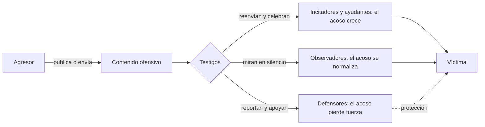

# 04 - Cyberbullying: el acoso entre pares que no se apaga

> Materia 2, unidad 2 (Cyberbullying, cyberstalking y sexting), tema 1. Nota recreada a partir del material de la materia, con cifras de México actualizadas al 2026.

## Por qué importa

Hace veinte años, quien sufría acoso en la escuela tenía un refugio: la puerta de su casa. Hoy el teléfono cruza esa puerta. Las redes sociales, la mensajería y los videojuegos en línea permiten que una burla se repita a cualquier hora, que la vea medio salón en minutos y que quede guardada para siempre. El acoso entre pares por medios digitales se volvió uno de los riesgos más frecuentes para niñas, niños y adolescentes, y uno de los más subestimados por los adultos que los rodean.

Para quien trabaja en ciberseguridad el tema no es ajeno. La identidad digital de una persona (su perfil, sus fotos, sus contactos, sus gustos) es justamente lo que el agresor usa como munición, y las cuentas comprometidas o suplantadas son herramientas frecuentes de este acoso. Entender cómo opera, quién participa y qué daño deja es la base para prevenirlo, para detectarlo a tiempo y para acompañar a quien lo vive.

## Del mensaje al mensaje de odio

La forma de comunicarnos cambió por completo en pocas décadas. Mandar un mensaje es instantáneo y casi gratuito, la conexión está disponible todo el día y la expresión ya no es solo texto: incluye emoticonos, stickers, memes, audios, fotos y video. Esa misma facilidad tiene un lado oscuro. Cuando el contenido deja de ser una conversación y se convierte en burla cruel, rumor falso, ofensa o montaje humillante, internet funciona como un amplificador de la violencia.

La frontera entre la sátira y el escarnio se cruza con facilidad, sobre todo entre jóvenes que crecieron con la tecnología como algo natural pero que nadie formó para medir el alcance de lo que publican. De ahí la responsabilidad de quienes sí conocen el funcionamiento de las plataformas: educar, prevenir y no normalizar.

## Qué es el cyberbullying

El término combina *cyber* (lo relativo a los medios digitales) y *bullying* (el acoso físico o psicológico sostenido entre compañeros). En español se le llama también ciberacoso entre iguales o ciberabuso.

Es una forma de hostigamiento que se ejerce a través de plataformas digitales (redes sociales, correo, mensajería instantánea, foros, videojuegos en línea) con la intención de intimidar, amenazar, ofender, calumniar, humillar o vejar a otra persona, de manera **repetida y deliberada**. Tres rasgos lo definen:

| Rasgo | Qué significa |
|---|---|
| Entre iguales | Agresor y víctima suelen ser pares, casi siempre menores de edad y de edades parecidas. |
| Sin contenido sexual | Si la agresión se vuelve sexual, o si quien la ejerce es un adulto contra un menor, ya no se trata de cyberbullying: puede ser grooming, sextorsión u otra conducta más grave. |
| Por medios digitales | La agresión ocurre o se difunde a través de tecnología, aunque el conflicto pueda haber empezado en el salón o en el patio. |

La distinción con el grooming es importante: el cyberbullying ocurre entre pares; cuando un adulto se involucra con fines sexuales, el caso escala a un delito de otra naturaleza, que se estudia en la unidad 3.

### Por qué es más dañino que el acoso tradicional

| Característica | Acoso en persona | Cyberbullying |
|---|---|---|
| Horario | Termina al salir de la escuela | Sigue las 24 horas, todos los días |
| Audiencia | Quienes estaban presentes | Cualquiera con acceso al grupo, perfil o enlace, incluso personas desconocidas |
| Permanencia | Queda en la memoria de los testigos | Queda en capturas, reenvíos y copias que la víctima no controla |
| Identidad del agresor | Conocida | Puede ocultarse tras perfiles falsos o anónimos |
| Velocidad | Lenta, de boca en boca | Un reenvío llega a cientos de personas en minutos |
| Percepción del daño | El agresor ve la reacción de la víctima | La pantalla le quita al agresor la referencia del dolor que causa |

El anonimato y el carácter público de muchas agresiones vuelven el problema más difícil de manejar: la víctima no siempre sabe quién la ataca, y aunque se borre la publicación original, las copias siguen circulando.

## Por qué es un riesgo de ciberseguridad

El cyberbullying es de las prácticas más extendidas del entorno digital y de las que más preocupan a quienes protegen a menores en línea. Hay tres razones:

1. **La identidad digital es la materia prima.** Cuando alguien abre un perfil y empieza a usar redes, su identidad se llena de datos personales, fotos, videos, preferencias y rutinas. Esa exposición es lo que el agresor usa para burlarse, para suplantar o para difundir. Los menores, que suelen compartir mucho y medir poco, quedan especialmente expuestos.
2. **La velocidad de difusión.** Internet permite manipular un contenido (recortarlo, sacarlo de contexto, editarlo) y distribuirlo de forma masiva en instantes. El daño se produce antes de que un adulto se entere.
3. **Las consecuencias salen de la pantalla.** En personas con poca resiliencia emocional, una campaña de acoso puede detonar depresión, autolesiones e incluso suicidio. Hay casos documentados en distintos países en los que la víctima transmitió en vivo su desenlace. Lo que empieza como un problema digital termina en el mundo físico.

## Quién participa

Para que exista cyberbullying se necesitan, como mínimo, tres papeles. Cada uno puede ser ocupado por una persona o por varias.

| Papel | Descripción |
|---|---|
| Víctima | Quien recibe las burlas, ofensas, humillaciones o el hostigamiento. Puede ser una sola persona o un grupo. |
| Agresor o victimario | Quien realiza las conductas contra la víctima. También puede ser un grupo. |
| Testigos | Quienes presencian la agresión. Son el elemento que convierte una agresión en acoso: sin público que la mire, la comparta o la celebre, la conducta pierde buena parte de su fuerza. |

Los testigos no son un bloque homogéneo. Según cómo participen, se distinguen cuatro tipos:

| Tipo de testigo | Qué hace |
|---|---|
| Defensor | Sale en apoyo de la víctima: responde con argumentos, desmiente, reporta el contenido o acompaña. |
| Incitador | Alimenta la conversación con comentarios, reacciones y reenvíos que mantienen viva la agresión. |
| Ayudante | Respalda directamente al agresor; se vuelve promotor del ataque y partícipe activo. |
| Observador | Mira lo que pasa sin intervenir en ningún sentido. |

La prevención apunta sobre todo a los testigos: convertir observadores en defensores es la intervención que más cambia el resultado.

## Cómo se manifiesta

Las formas más comunes, de la más directa a la más elaborada:

- Mandar mensajes o correos crueles para amenazar o humillar a quien los recibe.
- Subir o reenviar fotos, videos o datos vergonzosos de alguien a un perfil, página, blog o chat grupal.
- Crear perfiles falsos a nombre de la víctima para publicar cosas desagradables como si fueran suyas.
- Entrar sin permiso a su correo o a sus redes para escribir en su nombre.
- Conseguir imágenes comprometedoras o íntimas de otra persona para chantajearla (si hay contenido sexual, el caso ya se acerca a la sextorsión).
- Hacer fotomontajes con la imagen de la víctima y distribuirlos por redes o por celular.
- Publicar datos personales de la víctima para que más gente se sume al acoso.
- Excluir de forma deliberada a alguien de los grupos o espacios digitales donde convive su círculo.

Varias de estas conductas, como entrar a cuentas ajenas o suplantar identidad, también son incidentes de seguridad informática en sentido estricto.

## Consecuencias psicológicas

El daño no se queda en la víctima: los tres papeles cargan con efectos.

| Víctima | Agresor | Espectador |
|---|---|---|
| Autoestima baja y una imagen negativa de sí misma | Aprende que la violencia es una vía válida para obtener lo que quiere | Normaliza la violencia como parte del día a día |
| Bajo rendimiento escolar | Problemas con la autoridad y las normas | Deja de intervenir por miedo o por evitar problemas, e ignora lo que ve |
| Posible depresión | Riesgo de desarrollar conductas delictivas | |
| Ansiedad ante la posibilidad de que la agresión se repita | Riesgo de consumo de alcohol y drogas | |
| Ideación suicida en los casos graves | | |

Estas huellas pueden durar años y, en muchos casos, son irreversibles. Por eso la intervención temprana y el apoyo profesional a la víctima marcan la diferencia.

## Cifras en México

> Actualización al 2026: el material original no traía cifras nacionales. El dato de referencia en México es el Módulo sobre Ciberacoso (MOCIBA) del INEGI, que mide la experiencia de ciberacoso en la población usuaria de internet de 12 años y más; su edición más reciente, la de 2025, se publicó en julio de 2026.

Según el MOCIBA 2025, el **20.4 %** de las personas de 12 años y más que usaron internet vivió alguna situación de ciberacoso en los doce meses previos, unos **19.4 millones** de personas: 10.8 millones de mujeres (21.5 % de las usuarias) y 8.6 millones de hombres (19.2 % de los usuarios). Un año antes, el MOCIBA 2024 había registrado 21.0 % y 18.9 millones. El módulo mide el ciberacoso en general, no solo el que ocurre entre pares, pero da la escala del problema: alrededor de una de cada cinco personas conectadas lo vive cada año.

## Prevención

### Para madres, padres y personas cuidadoras

1. **Usen la tecnología como la usa su hijo o hija.** Conocer las apps, los juegos y las comunidades donde convive ayuda a entender sus actividades, a sus contactos y los riesgos a los que se expone.
2. **Hablen de cuidados concretos.** Datos personales, contraseñas, fotos y videos se mantienen en privado; lo que se publica deja de ser propio.
3. **Enseñen a desconfiar.** Mensajes, enlaces o archivos de personas desconocidas o de poca confianza no se abren.
4. **Pongan atención a la cámara.** Que no se active frente a desconocidos; el control parental puede ayudar a supervisar la navegación, sobre todo en edades tempranas.
5. **Acuerden reglas de uso:** horarios y lugares para conectarse, qué hacer ante un mensaje sospechoso y con qué criterio se acepta a un contacto nuevo.
6. **Cuiden la comunicación.** Lo más importante es que el menor sienta que puede contar, sin miedo a un castigo, que algo lo asustó o lo amenazó en internet.

Lo que **no** es prevención: dejar que use cualquier aplicación sin ningún acompañamiento ni supervisión, o quitarle el teléfono como castigo cuando cuenta que lo están acosando (eso le enseña a callar la próxima vez).

### Para escuelas y organizaciones

- Políticas de convivencia digital escritas y conocidas por todos, con un canal claro para reportar.
- Formación en ciudadanía digital desde los primeros grados: respeto en línea, privacidad y qué hacer como testigo.
- Protocolos de respuesta que incluyan apoyo psicológico a la víctima y medidas formativas, no solo sanciones, para quien agrede.

### Si eres la víctima o un testigo

- No respondas a la provocación: la reacción es lo que el agresor busca.
- Guarda evidencia: capturas de pantalla con fecha, enlaces, nombres de perfil.
- Bloquea y reporta en la plataforma; casi todas tienen un mecanismo de denuncia por acoso.
- Cuéntalo a un adulto de confianza o a la escuela.
- Si hay amenazas, difusión de imágenes íntimas o extorsión, el caso ya es delito: se denuncia ante la policía cibernética o la fiscalía local.
- Como testigo: no reenvíes, no reacciones, reporta y acompaña a quien está siendo atacado.

## El marco legal en México

No existe en el Código Penal Federal un delito llamado "cyberbullying". Las conductas que lo componen se persiguen por otras vías, según su gravedad: amenazas, extorsión, suplantación de identidad (tipificada en varios códigos estatales) o, cuando hay contenido íntimo, la violación a la intimidad sexual que incorporó la reforma conocida como Ley Olimpia (artículos 199 Octies a 199 Decies del Código Penal Federal, 2021). La Ley General de Acceso de las Mujeres a una Vida Libre de Violencias reconoce además la violencia digital (artículo 20 Quáter), y varias entidades tipifican el acoso escolar en sus leyes de educación o de convivencia. Cuando agresor y víctima son menores, el caso se canaliza por el sistema integral de justicia para adolescentes y por las procuradurías de protección de niñas, niños y adolescentes.

## Para cerrar

El cyberbullying muestra cómo los defectos del mundo físico se trasladan al digital y se agrandan. No participar en la burla, no reenviar y no normalizar la crueldad es una decisión individual que cambia el ambiente de toda una comunidad. Y como profesionales, el reto es doble: conocer la mecánica técnica (perfiles falsos, cuentas comprometidas, difusión masiva) y la dimensión humana del daño.

## Glosario

| Término | Definición |
|---------|-----------|
| Cyberbullying | Acoso repetido y deliberado entre pares, casi siempre menores, ejercido por medios digitales y sin contenido sexual. |
| Bullying | Acoso físico o psicológico que una persona sufre de manera continuada por parte de sus compañeros. |
| Testigo | Quien presencia el acoso; su reacción decide si la agresión crece o se apaga. |
| Testigo defensor | Testigo que apoya a la víctima con argumentos, reportes o acompañamiento. |
| Testigo incitador | Testigo que alimenta la conversación y mantiene viva la agresión. |
| Testigo ayudante | Testigo que respalda al agresor y se vuelve partícipe activo. |
| Observador | Testigo que mira sin intervenir. |
| Identidad digital | Conjunto de datos, contenidos y rastros que una persona deja en internet y que la representan ante otros. |
| Suplantación de identidad | Hacerse pasar por otra persona, por ejemplo con un perfil falso o con su cuenta robada. |
| Violencia digital | Acto que, mediante tecnologías de la información, expone, distribuye o difunde contenido que daña la intimidad, la dignidad o la seguridad de una persona. |
| Ciudadanía digital | Conjunto de conocimientos y hábitos para participar en línea de forma segura, respetuosa y responsable. |

## Referencias

- Argentina Cibersegura. (s. f.). *¿Qué es el ciberbullying?* [Infografía]. https://www.argentinacibersegura.org/admin/resources/files/consejos/68/3-Ciberbullying-Alta__4_.pdf
- Cámara de Diputados del H. Congreso de la Unión. (2026). *Código Penal Federal* (última reforma publicada en el DOF el 13 de marzo de 2026). https://www.diputados.gob.mx/LeyesBiblio/pdf/CPF.pdf
- Cámara de Diputados del H. Congreso de la Unión. (2026). *Ley General de Acceso de las Mujeres a una Vida Libre de Violencias*. https://www.diputados.gob.mx/LeyesBiblio/pdf/LGAMVLV.pdf
- Instituto Nacional de Estadística y Geografía. (2026). *Módulo sobre Ciberacoso (MOCIBA) 2025: Presentación de resultados*. https://www.inegi.org.mx/contenidos/programas/mociba/2025/doc/mociba2025_resultados.pdf
- Rodríguez, L. (2020). *El ciberbullying como desencadenante de depresión en adolescentes*. Facultad de Psicología, Universidad de la República. https://sifp.psico.edu.uy/el-ciberbullying-como-desencadenante-de-depresi%C3%B3n-en-adolescentes
- UNICEF. (s. f.). *Ciberacoso: qué es y cómo detenerlo*. https://www.unicef.org/es/end-violence/ciberacoso-que-es-y-como-detenerlo

---

*Rogelio Arriaga Gonzalez*
