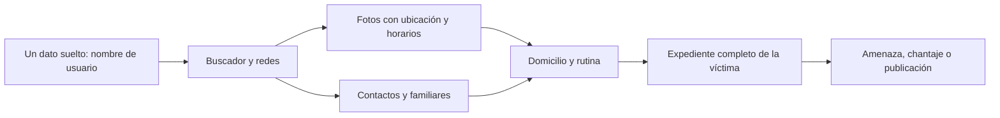

# 05 - Cyberstalking y doxing: cuando alguien te sigue la pista

> Materia 2, unidad 2 (Cyberbullying, cyberstalking y sexting), tema 2. Nota recreada a partir del material de la materia, con actualizaciones al 2026 sobre rastreadores y stalkerware.

## Por qué importa

Vivimos conectados todo el tiempo y desde cualquier lugar. Un buscador responde en segundos lo que antes tomaba días de investigación, y las redes sociales guardan, publicación tras publicación, dónde estuvimos, con quién, qué nos gusta y a qué hora salimos de casa. Esa facilidad para encontrar información es una de las grandes ventajas de internet, y también la puerta de entrada a una forma de acoso que no necesita contacto físico para dar miedo: el cyberstalking.

El cyberstalking consiste en vigilar, investigar y perseguir a una persona usando medios digitales, de forma obsesiva y repetida. A diferencia de otros riesgos que estudiamos en la materia, aquí el atacante no busca dinero ni datos bancarios: busca **control** sobre la víctima. Y casi todo lo que necesita lo encuentra en lo que la propia víctima, sus amigos o su familia publicaron.

## Cyberbullying y cyberstalking no son lo mismo

Los dos términos se confunden porque los dos son formas de acoso en línea, pero se refieren a fenómenos distintos y requieren respuestas distintas.

| Aspecto | Cyberbullying | Cyberstalking |
|---|---|---|
| Quiénes participan | Pares, casi siempre menores de edad | Cualquier persona, de cualquier edad; no se limita a iguales |
| Objetivo del agresor | Humillar, menospreciar, excluir | Vigilar, intimidar y controlar |
| Conductas típicas | Insultos y comentarios despectivos, rumores y calumnias, exclusión social, presión del grupo | Seguimiento constante, recopilación de datos personales, amenazas, acusaciones falsas, daño a la información o a los equipos de la víctima |
| Relación con la víctima | Compañeros de escuela o de grupo | Con frecuencia alguien conocido: expareja, examigo, compañero de trabajo |
| Escalada | Puede llegar a la violencia física | Puede escalar a amenazas directas, robo de identidad y acoso en persona |

Distinguirlos importa en la práctica: las estrategias de prevención y de respuesta son diferentes. En el cyberbullying la clave está en el grupo y en los testigos; en el cyberstalking, en cortar el flujo de información hacia el acosador y en documentar para denunciar.

## Qué es el cyberstalking

Dos definiciones de referencia ayudan a delimitarlo:

- El **Ministerio de Tecnologías de la Información y las Comunicaciones de Colombia (MinTIC)** lo describe como el acoso o la persecución mediante internet u otros dispositivos electrónicos, que puede incluir la investigación constante de información sobre la víctima, amenazas y daños a su información o a su equipo.
- **Norton** lo trata como un delito grave que consiste en usar medios electrónicos de manera repetida para hostigar, intimidar o asustar a alguien, y que puede incluir acusaciones falsas, monitoreo de la actividad de la víctima y manipulación de sus datos.

De ambas se desprende un patrón: conducta **obsesiva y repetitiva**, dirigida a **una persona concreta**, que usa **tecnologías de la información** como herramienta. Sus características típicas son:

- Seguimiento continuo de la víctima y búsqueda sistemática de información personal.
- Publicación de amenazas, acusaciones falsas o contenido difamatorio.
- Robo de identidad y daños a la información o a los dispositivos de la víctima.
- Un perfil de agresor que suele ser conocido: exparejas o antiguas amistades movidas por el odio, la venganza, la obsesión o el deseo de control, que aprovechan la distancia y el anonimato de la red para actuar sin consecuencias inmediatas.

Las víctimas más frecuentes son las mujeres, las niñas y los niños, y las personas de grupos minoritarios, que además suelen enfrentar más obstáculos al denunciar.

### Por dónde llega

Los acosadores usan cualquier canal que les permita insistir o vigilar: correo electrónico, mensajería instantánea, llamadas, redes sociales, comentarios en publicaciones, cuentas falsas para seguir a la víctima después de que los bloqueó, y aplicaciones o dispositivos de rastreo.

> Actualización al 2026: dos herramientas que el material original no mencionaba se volvieron centrales en los casos de acecho. El **stalkerware**, aplicaciones de monitoreo instaladas a escondidas en el teléfono de la víctima que reportan su ubicación, mensajes y llamadas; y los **rastreadores Bluetooth** de objetos perdidos, escondidos en bolsas o autos. Desde 2024, Android e iOS avisan cuando un rastreador desconocido viaja con la persona, gracias a una especificación conjunta de Apple y Google.

## Doxing: la técnica para armar el expediente

Dentro del cyberstalking destaca el **doxing** (de *docs*, documentos): investigar, reunir y publicar información privada o identificable de una persona sin su consentimiento, casi siempre con mala intención. Es un proceso que combina muchas técnicas de búsqueda para obtener un retrato cada vez más exacto de alguien a partir de fuentes de internet.

Las fuentes que se cruzan son, en su mayoría, públicas o semipúblicas:

| Fuente | Qué revela |
|---|---|
| Redes sociales propias y de familiares o amistades | Rostro, lugares frecuentes, horarios, escuela o trabajo, círculo cercano |
| Fotos publicadas | Fachadas, placas, uniformes, vistas desde una ventana; los metadatos de la imagen pueden incluir coordenadas |
| Buscadores y archivos de páginas | Publicaciones antiguas, foros, perfiles olvidados |
| Registros públicos y filtraciones de datos | Domicilios, teléfonos, correos, contraseñas reutilizadas |
| Publicaciones automáticas | Ubicación en tiempo real, rutas de ejercicio, registros de lugares |

Cada dato aislado parece inofensivo; juntos dibujan dónde vive una persona y cuándo está sola. Por eso la defensa no consiste solo en proteger un perfil, sino en reducir el rastro completo.

## Problemas que provoca

El acoso en línea trae consecuencias en varios planos:

| Plano | Consecuencias |
|---|---|
| Psicológico y emocional | Ansiedad, depresión, estrés postraumático y, en casos extremos, ideación suicida. La autoestima cae mientras crecen el miedo y la paranoia. |
| Privacidad y seguridad | El acosador recopila y usa datos sin autorización para intimidar, chantajear o dañar la reputación; la víctima vive con una sensación permanente de vulnerabilidad. |
| Reputación | Rumores, difamaciones y contenido humillante pueden destruir la imagen personal y profesional, y llevar al aislamiento. |
| Legal | Las leyes avanzan, pero el carácter transnacional de internet complica identificar y perseguir al responsable. |
| Comunidad | El acoso crea un clima de miedo y desconfianza que afecta a todo el espacio digital compartido. |
| Económico | Las organizaciones pagan medidas de seguridad, atención de incidentes y daño reputacional cuando el acoso alcanza a su personal. |
| Detección | El anonimato dificulta saber quién está detrás, y las plataformas cambian más rápido que las estrategias de prevención. |
| Atención | Muchas víctimas no reciben apoyo suficiente de su entorno ni de las autoridades, por falta de recursos y de capacitación, lo que prolonga el daño. |

## Cómo protegerse

### Antes: reducir lo que se puede encontrar

1. **Filtros de privacidad en todo.** Revisar la configuración de cada red social, servicio de correo y aplicación para que la información personal solo la vean las personas autorizadas. Incluye listas de amigos, fotos antiguas y quién puede etiquetarte.
2. **Ubicación apagada por defecto.** Desactivar la localización en el teléfono y en las apps cuando no se necesita, y no publicar en tiempo real dónde estás; mejor hacerlo después de irte.
3. **Nada de publicaciones automáticas.** Evitar que las apps de ejercicio, música o lugares publiquen por su cuenta: esa automatización revela rutinas que un atacante puede usar.
4. **Contraseñas robustas y únicas, con segundo factor.** Una contraseña distinta por cuenta, guardada en un gestor, y verificación en dos pasos donde exista. El acosador suele ser alguien cercano que conoce fechas, nombres y respuestas a preguntas de seguridad.
5. **Revisar quién más tiene acceso.** Sesiones abiertas en otros dispositivos, aplicaciones conectadas a tus cuentas, ubicación compartida con familiares o exparejas, y la nube familiar.
6. **Buscarte a ti mismo.** Hacer de vez en cuando una búsqueda de tu nombre, usuario y teléfono para saber qué encontraría otra persona.

### Durante: si ya está ocurriendo

1. **Documentar y conservar todo:** capturas de pantalla con fecha, correos, mensajes, enlaces, números. Esa evidencia sostiene cualquier denuncia o acción legal.
2. **Denunciar y reportar** a las plataformas y a las autoridades. La denuncia ayuda a frenar el acoso y abre la investigación.
3. **Endurecer la privacidad** al máximo, apagar la localización y dejar de compartir información innecesaria.
4. **Revisar el teléfono** en busca de stalkerware: consumo de batería o datos inexplicable, aplicaciones desconocidas con permisos de accesibilidad o de administrador. Si se sospecha, conviene pedir ayuda especializada antes de borrar nada, porque desinstalar puede alertar al agresor y destruir evidencia.
5. **Buscar apoyo:** personas de confianza, organizaciones especializadas y, si hay riesgo físico, un plan de seguridad.

## El marco legal

En México no hay un delito federal con el nombre de cyberstalking. Las conductas se persiguen como amenazas, acoso u hostigamiento (según el código de cada entidad), suplantación de identidad o, si hay contenido íntimo, violación a la intimidad sexual (Código Penal Federal, artículos 199 Octies a 199 Decies). La Ley General de Acceso de las Mujeres a una Vida Libre de Violencias reconoce la violencia digital y permite pedir medidas de protección para que se retire el contenido.

Otros países lo tipifican de manera expresa. En Estados Unidos, el título 18 del Código, sección 2261A, sanciona el acecho que usa servicios de comunicación electrónica para causar miedo o angustia. En España, el artículo 172 ter del Código Penal sanciona el acoso insistente y reiterado, incluido el que se hace por medios de comunicación, desde 2015.

## Para cerrar

La curiosidad humana cruza con facilidad la frontera de la privacidad, y en el entorno digital esa frontera casi no tiene guardias. Proteger la información propia (y enseñar a los menores a proteger la suya) es la primera línea de defensa: lo que no se publica no se puede usar en tu contra. Y cuando el acoso ya empezó, la evidencia y la denuncia son las herramientas que funcionan.

## Glosario

| Término | Definición |
|---------|-----------|
| Cyberstalking | Acecho o persecución obsesiva y repetida de una persona por medios digitales, con fines de vigilancia, intimidación o control. |
| Doxing | Investigar y publicar sin consentimiento información privada o identificable de una persona, normalmente para dañarla. |
| Stalkerware | Aplicación de monitoreo instalada a escondidas en el dispositivo de alguien para espiar su ubicación, mensajes o llamadas. |
| Rastreador Bluetooth | Dispositivo pequeño para localizar objetos que puede usarse para seguir a una persona sin que lo sepa. |
| Metadatos | Datos sobre un archivo, como la fecha, el dispositivo o las coordenadas donde se tomó una foto. |
| Huella digital | Rastro de información que una persona deja al usar internet, de forma activa o pasiva. |
| OSINT | Inteligencia de fuentes abiertas: obtener información a partir de fuentes públicas; útil para defensa e investigación, peligrosa en manos de un acosador. |
| Verificación en dos pasos | Mecanismo que pide un segundo factor, además de la contraseña, para entrar a una cuenta. |
| Plan de seguridad | Conjunto de medidas que una víctima prepara con apoyo para reducir el riesgo físico y digital mientras dura el acoso. |
| Medida de protección | Orden de una autoridad para proteger a la víctima, por ejemplo, retirar contenido o prohibir el contacto. |

## Referencias

- Apple y Google. (2024, 13 de mayo). *Apple and Google deliver support for unwanted tracking alerts in iOS and Android* [Comunicado]. Apple Newsroom. https://www.apple.com/newsroom/2024/05/apple-and-google-deliver-support-for-unwanted-tracking-alerts-in-ios-and-android/
- CBS 17. (2019, 29 de abril). *Cyberstalking: What are the laws?* [Video]. YouTube. https://youtu.be/S_o3yn79h4E
- Coalition Against Stalkerware. (s. f.). *Learn about stalkerware*. https://stopstalkerware.org/
- El País. (2018, 1 de octubre). *Testimonio de una mujer víctima de ciberacoso* [Video]. YouTube. https://youtu.be/vJcsG0SsfPQ
- FOX 4 News. (2017, 21 de marzo). *Cyberstalking investigation* [Video]. YouTube. https://youtu.be/5KUoCYlEsDY
- Jefatura del Estado. (1995). *Ley Orgánica 10/1995, de 23 de noviembre, del Código Penal* (art. 172 ter). Boletín Oficial del Estado. https://www.boe.es/buscar/act.php?id=BOE-A-1995-25444
- Legal Information Institute. (s. f.). *18 U.S. Code § 2261A: Stalking*. Cornell Law School. https://www.law.cornell.edu/uscode/text/18/2261A
- Ministerio de Tecnologías de la Información y las Comunicaciones de Colombia. (2022). *Cyberstalking*. MinTIC. https://www.mintic.gov.co/portal/inicio/Glosario/C/5513:Cyberstalking
- PIX11 News. (2009, 27 de febrero). *Protect yourself: Fighting back against cyberstalkers* [Video]. YouTube. https://youtu.be/-TTJU_Ax-aA
- Stouffer, C. (2025, 29 de diciembre). *What is cyberstalking? Key signs and ways to stay safe*. Norton. https://us.norton.com/blog/digital-life/what-is-cyberstalking
- Westin, K. (2015, 7 de agosto). *Confessions of a professional cyber stalker* [Video de conferencia, DEF CON 23]. TIB AV-Portal. https://av.tib.eu/media/36385

---

*Rogelio Arriaga Gonzalez*
