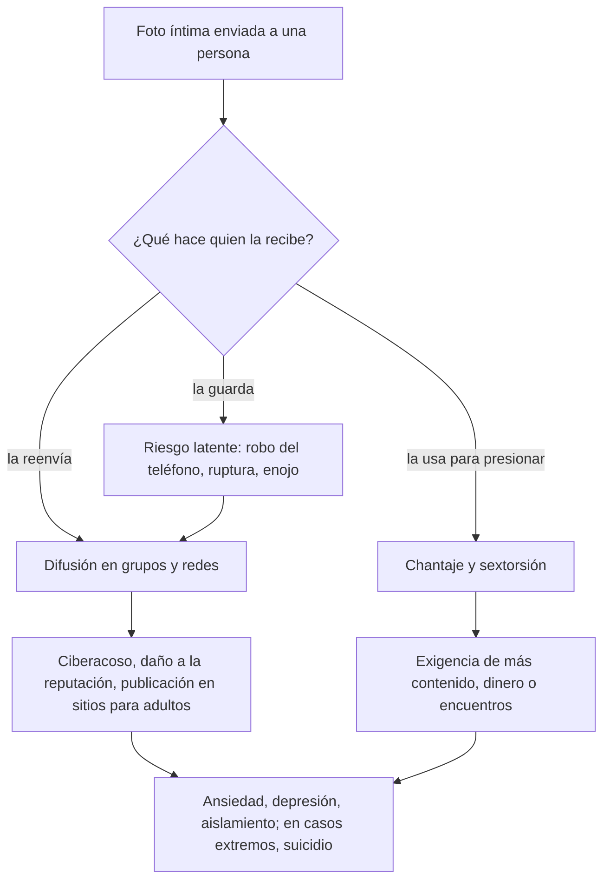

# 06 - Sexting: el contenido íntimo que deja de ser tuyo

> Materia 2, unidad 2 (Cyberbullying, cyberstalking y sexting), tema 3. Nota recreada a partir del material de la materia, con el marco legal mexicano y casos actualizados al 2026.

## Por qué importa

Niñas, niños y adolescentes son el sector más atacado en la red: les falta información, les sobra confianza y todavía no miden las consecuencias de lo que comparten. Pero el riesgo no siempre viene de un delincuente adulto. Entre iguales también ocurren conductas con daños muy reales, y una de las más comunes es el sexting.

Basta un teléfono con cámara y una conexión para que una imagen íntima salga del control de quien la tomó. Una vez enviada, nadie puede garantizar dónde termina: puede reenviarse, publicarse, venderse o usarse para chantajear. Por eso el sexting se considera la antesala de varios delitos tipificados, y por eso quien trabaja en ciberseguridad tiene que saber explicarlo sin moralina y con precisión técnica y legal.

## Qué es el sexting

La palabra combina *sex* y *texting* (mandar mensajes). Se refiere a **enviar, recibir o compartir contenido de carácter sexual** (fotos, videos, audios o textos) por medio de dispositivos electrónicos, sobre todo el teléfono móvil. Es frecuente entre adolescentes y adultos jóvenes, casi siempre dentro de una relación de pareja o de coqueteo.

El término se popularizó a mediados de la década de 2000; el material del curso ubica su aparición en 2005, cuando una revista dominical australiana lo usó por primera vez en la prensa. Desde entonces el fenómeno no ha hecho más que crecer con cada aplicación de mensajería nueva.

La iniciativa **is4k** (Internet Segura for Kids, del Instituto Nacional de Ciberseguridad de España) lo plantea de una manera útil: el sexting, aunque cada vez más común, no es en sí mismo un problema de seguridad, sino una **práctica de riesgo**, especialmente cuando participan menores. El peligro no está en la foto, sino en lo que otros pueden hacer con ella después de recibirla.

### Sus rasgos

| Rasgo | Qué significa |
|---|---|
| Voluntariedad | Quien aparece en el contenido lo produce de forma consciente y es quien lo envía por primera vez. |
| Carácter sexual | El contenido tiene una connotación sexual clara: desnudez total o parcial, poses o actos sexuales, descripciones explícitas. |
| Uso de tecnología | Se hace con el teléfono, pero también con la cámara de una tableta o de una computadora. Si ocurre en vivo, durante una videollamada o un chat con cámara, se le llama **sexcasting**. |

### Formas en que se presenta

- Mensajes de texto con contenido sexual explícito o erótico, que describen actos o fantasías.
- Fotografías de la persona desnuda o semidesnuda, en un contexto de intimidad o de coqueteo.
- Videos personales con actos sexuales o conductas provocativas.
- Notas de voz con descripciones o sonidos sexuales.

El canal más usado son las aplicaciones de mensajería (WhatsApp, Snapchat, los mensajes directos de Instagram, Telegram), donde el contenido se comparte de forma privada. En redes sociales abiertas es menos frecuente por razones obvias de privacidad.

### Cuando el envío no es voluntario

El contenido íntimo también puede salir sin que su protagonista lo decida: cuando alguien roba o encuentra un teléfono perdido y reenvía lo que hay en la galería, cuando alguien usa el dispositivo sin permiso, o cuando una persona es grabada sin saberlo. En sentido estricto eso ya no es sexting (falta la voluntariedad), pero los riesgos de la difusión son los mismos, y legalmente suele ser más grave para quien difunde.

## Los riesgos

La reflexión de partida es simple: **el control sobre un archivo se pierde en el momento en que se envía.** Los datos viajan en segundos, se copian sin dejar rastro visible y no siempre sabemos quién está del otro lado de la pantalla. Si interactuamos con alguien desconocido, desconocemos por completo sus intenciones.

Para los menores en particular:

- **Pérdida de privacidad y daño a la reputación.** La divulgación a personas no autorizadas afecta su imagen pública y les provoca humillación y una fuerte sensación de traición.
- **Daño psicológico.** Ansiedad, depresión, aislamiento, y el miedo constante a que el contenido vuelva a aparecer.
- **Ciberacoso, extorsión y chantaje.** La imagen se convierte en un arma para exigir más contenido, dinero o un encuentro.
- **Exposición a depredadores.** Un contenido íntimo puede revelar detalles de dónde vive o estudia la víctima (uniformes, fachadas, objetos), lo que ayuda a que un agresor la elija y la localice.

Las encuestas citadas en el material coinciden en algo inquietante: adolescentes y jóvenes conocen los peligros del sexting y aun así lo siguen practicando. Las campañas de concientización no bastan por sí solas; hace falta hablar de consentimiento, de presión de pareja y de qué hacer cuando algo sale mal.

### El caso de Amanda Todd

El ejemplo extremo más citado es el de Amanda Todd, adolescente canadiense. Un desconocido la convenció de mostrarse frente a la cámara, guardó la imagen y la usó durante años para acosarla y extorsionarla, enviándola a sus compañeros de escuela cada vez que se cambiaba de ciudad. Amanda publicó un video en el que contaba su historia con tarjetas escritas a mano y se quitó la vida en octubre de 2012.

> Actualización al 2026: en octubre de 2022, un tribunal de Canadá condenó al responsable, un hombre de nacionalidad neerlandesa, a 13 años de prisión por extorsión, acoso criminal y delitos relacionados con material de abuso sexual infantil. Como cumplía otra condena en los Países Bajos, un juez de ese país convirtió en diciembre de 2023 la pena canadiense a seis años, y la Suprema Corte neerlandesa lo confirmó en enero de 2025. El caso muestra la dimensión transnacional del problema: el agresor operaba desde otro país y la justicia tuvo que coordinarse entre dos.

## Del sexting al grooming

El sexting entre iguales y el grooming son fenómenos distintos, pero se conectan. El **grooming** es el acercamiento de un adulto a un menor, casi siempre fingiendo ser otro menor, para ganarse su confianza y obtener contenido sexual o un encuentro. Las guías del Ministerio de Industria, Energía y Turismo de España y del antiguo Inteco (hoy INCIBE) lo describen como la construcción deliberada de una relación y de un control emocional sobre la niña o el niño, con el fin de preparar el abuso sexual, que puede ir del acoso en línea hasta la agresión física.

El patrón que describen esas guías tiene varias etapas:

1. **Contacto y acercamiento.** El adulto contacta al menor por mensajería, chat o redes, casi siempre haciéndose pasar por alguien de su edad, con un físico atractivo y gustos parecidos. Puede enviar fotos de otro niño obtenidas en internet para sostener el engaño.
2. **Confianza y confesiones.** Profundiza en la amistad, en la vida, gustos y costumbres del menor, hasta que el menor le cuenta cosas personales e íntimas.
3. **Componente sexual.** Introduce poco a poco términos sexuales y pide fotos, videos o que encienda la cámara y pose desnudo total o parcialmente; puede proponerle sexo virtual.
4. **Ciberacoso y chantaje.** Con el material en su poder, amenaza con difundirlo a las redes o a los contactos del menor si no cumple sus exigencias: más fotos, actos sexuales o un encuentro en persona.

La presión del chantaje es lo que vuelve tan peligroso este punto: el menor siente que solo puede obedecer. El tema se desarrolla completo en la nota [07 - Grooming](07-grooming.md).

## El marco legal

Según el papel de cada persona y su edad, una misma imagen puede configurar delitos distintos: exhibicionismo ante menores, producción y distribución de material de abuso sexual infantil, y violaciones a la intimidad y al honor.

En México:

- **Violación a la intimidad sexual.** Desde la reforma conocida popularmente como Ley Olimpia (DOF, 1 de junio de 2021), el Código Penal Federal sanciona en los artículos 199 Octies a 199 Decies a quien divulgue, comparta, distribuya o publique imágenes, audios o videos de contenido íntimo sexual de una persona mayor de edad sin su consentimiento, o los obtenga mediante engaño. La pena es de tres a seis años de prisión y de 500 a 1,000 UMA de multa, y aumenta hasta en una mitad en los supuestos agravados, por ejemplo cuando quien difunde tenía una relación de pareja con la víctima.
- **Pedirle contenido sexual a un menor.** El artículo 199 Septies (2018) castiga con cuatro a ocho años de prisión a quien contacte por medios electrónicos a una persona menor de 18 años y le pida imágenes, audio o video de contenido sexual, o un encuentro sexual.
- **Personas menores de 18 años.** Cualquier contenido sexual de un menor se trata como pornografía infantil (material de abuso sexual infantil): producirlo, poseerlo con fines de distribución, ofrecerlo o difundirlo se persigue con penas severas: el artículo 202 del Código Penal Federal fija de siete a doce años de prisión para la pornografía de personas menores de 18 años, aunque lo haya enviado el propio menor. Es la delgada línea que vuelve tan riesgosa esta práctica entre adolescentes.
- **Violencia digital.** La Ley General de Acceso de las Mujeres a una Vida Libre de Violencias la reconoce y permite que el ministerio público o la autoridad judicial ordenen a plataformas y proveedores retirar el contenido.

Fuera de México, organizaciones como PantallasAmigas y empresas de seguridad como Kaspersky coinciden en tratar el sexting como una práctica de riesgo con consecuencias legales, de privacidad y de ciberacoso que no deben subestimarse.

## Qué hacer

### Para prevenir

- Pensarlo dos veces: lo que se envía puede llegar a cualquiera, incluso años después.
- Nadie tiene derecho a presionar para recibir contenido íntimo; pedirlo con insistencia ya es una señal de alerta.
- Si de todos modos se envía, nunca mostrar el rostro, tatuajes, uniformes o lugares reconocibles.
- Proteger el teléfono con bloqueo y no sincronizar la galería íntima con nubes compartidas.
- Para madres, padres y docentes: hablar del tema antes de que ocurra, explicar el riesgo legal y emocional, y dejar claro que si algo sale mal pueden pedir ayuda sin ser castigados.

### Si el contenido ya se difundió

1. **No pagar ni enviar más contenido** a quien chantajea: la exigencia nunca termina ahí.
2. **Guardar evidencia** (capturas, perfiles, enlaces, fechas) antes de bloquear.
3. **Reportar a la plataforma.** Las grandes redes tienen procesos prioritarios para contenido íntimo no consentido. Para menores existe *Take It Down*, del Centro Nacional para Niños Desaparecidos y Explotados de Estados Unidos (NCMEC), que permite marcar una imagen con una huella digital para que las plataformas participantes la bloqueen sin que nadie tenga que verla.
4. **Denunciar** ante la fiscalía o la policía cibernética de la entidad. En México, quien difunde contenido íntimo sin consentimiento comete delito.
5. **Buscar acompañamiento** psicológico y de una persona de confianza.

## Para cerrar

Aunque el sexting se perciba como algo aceptado en ciertos contextos, sus implicaciones legales y de seguridad son amplias, y su frontera con el material de abuso sexual infantil es muy delgada cuando participan menores. La identidad digital y la privacidad se pierden en el momento del envío. La tarea profesional es informar y advertir a las nuevas generaciones con datos y sin alarmismo: una intervención a tiempo y una buena orientación pueden evitar consecuencias graves y, en algunos casos, salvar vidas.

## Glosario

| Término | Definición |
|---------|-----------|
| Sexting | Envío, recepción o intercambio de contenido de carácter sexual por dispositivos electrónicos. |
| Sexcasting | Sexting en vivo, por videollamada o chat con cámara. |
| Sextorsión | Chantaje con una imagen o video íntimo de la víctima para obtener más contenido, dinero o favores sexuales. |
| Grooming | Estrategia de un adulto para ganarse la confianza de un menor por medios digitales con fines sexuales. |
| Material de abuso sexual infantil | Cualquier representación sexual de una persona menor de edad; el término sustituye a "pornografía infantil" en el lenguaje de protección de la infancia. |
| Violación a la intimidad sexual | Delito de difundir o compartir contenido íntimo sexual de otra persona sin su consentimiento. |
| Ley Olimpia | Conjunto de reformas mexicanas que reconocen la violencia digital y sancionan la difusión de contenido íntimo sin consentimiento. |
| Huella hash | Identificador calculado a partir de un archivo que permite reconocer copias de una imagen sin tener que verla. |
| Consentimiento | Acuerdo libre, informado y revocable; recibir una imagen no da permiso para compartirla. |
| Práctica de riesgo | Conducta que no es en sí un delito ni un ataque, pero que expone a la persona a daños probables. |

## Referencias

- Cámara de Diputados del H. Congreso de la Unión. (2026). *Código Penal Federal* (última reforma publicada en el DOF el 13 de marzo de 2026). https://www.diputados.gob.mx/LeyesBiblio/pdf/CPF.pdf
- Cámara de Diputados del H. Congreso de la Unión. (2026). *Ley General de Acceso de las Mujeres a una Vida Libre de Violencias*. https://www.diputados.gob.mx/LeyesBiblio/pdf/LGAMVLV.pdf
- CBC News. (2023, 21 de diciembre). *Dutch man who sexually extorted B.C. teen Amanda Todd given 6-year sentence in Netherlands*. https://www.cbc.ca/news/canada/british-columbia/netherlands-coban-todd-sentence-1.7066190
- Flores Fernández, J. (2011, febrero). *Sexting, una práctica de riesgo*. PantallasAmigas. https://www.pantallasamigas.net/sexting-una-practica-de-riesgo/
- Grant, J. (2022, 14 de octubre). *Aydin Coban sentenced to 13 years for sexual extortion of Amanda Todd*. CBC News. https://www.cbc.ca/news/canada/british-columbia/aydin-coban-sentencing-october-14-1.6616874
- Instituto Nacional de Ciberseguridad. (s. f.). *¿Qué sabes del sexting? ¡Ponte a prueba!* [Ficha didáctica]. Internet Segura for Kids (is4k). https://www.incibe.es/sites/default/files/contenidos/materiales/Campanas/sexting/is4k_que-sabes-del-sexting.pdf
- National Center for Missing & Exploited Children. (s. f.). *Take It Down*. https://takeitdown.ncmec.org/
- Secretaría de Gobernación. (2021, 1 de junio). *Decreto por el que se adicionan diversas disposiciones a la Ley General de Acceso de las Mujeres a una Vida Libre de Violencias y se reforman y adicionan diversas disposiciones al Código Penal Federal*. Diario Oficial de la Federación. https://dof.gob.mx/nota_detalle.php?codigo=5619905&fecha=01/06/2021

---

*Rogelio Arriaga Gonzalez*
