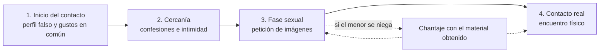

# 07 - Grooming: el adulto que se disfraza de amigo

> Materia 2, unidad 3 (Grooming, phishing y pharming), tema 1. Nota recreada a partir del material de la materia, con el marco legal nacional e internacional revisado al 2026.

## Por qué importa

Navegar es hoy una actividad cotidiana para niñas, niños y adolescentes, y con ella llega el contacto con desconocidos. En la unidad anterior vimos riesgos entre iguales; el grooming es distinto y más grave: un **adulto** usa la tecnología para acercarse a un menor, ganarse su confianza y prepararlo para el abuso sexual. Lo que empieza en un chat puede terminar en explotación, secuestro o trata.

Es un riesgo de ciberseguridad en sentido pleno. El agresor usa ingeniería social, perfiles falsos, recopilación de información de fuentes abiertas y extorsión con material digital, las mismas técnicas que un atacante usa contra una empresa, pero contra la persona más vulnerable de una familia. Conocer su mecánica es la única forma de reconocerlo a tiempo.

## Qué es el grooming

El grooming es un **tipo de acoso** ejercido por una persona mayor de edad que, por distintos medios, entabla contacto con un menor (casi siempre por redes sociales, chats o videojuegos), se gana su confianza y la usa para pedirle información personal, fotos íntimas o desnudos, y en muchos casos para concertar un encuentro en persona. Ese encuentro puede derivar en violación, secuestro y otros delitos: el grooming es la antesala de la trata de menores.

La Oficina de las Naciones Unidas contra la Droga y el Delito (UNODC), en su guía de seguridad para el público, lo define como el conjunto de estrategias que un adulto despliega para ganarse la confianza de una niña, niño o adolescente mediante las tecnologías de la información y la comunicación, con el propósito de abusar de él o explotarlo sexualmente. Lo típico es que el adulto cree un perfil falso en una red social, foro o sala de chat, se haga pasar por alguien joven y construya una relación de amistad y confianza con la intención de acosarlo.

### La diferencia con el cyberbullying

| | Cyberbullying | Grooming |
|---|---|---|
| Quién agrede | Un par: alguien de la misma edad o parecida | Un adulto |
| Contra quién | Otro menor | Un menor |
| Finalidad | Humillar, excluir, hostigar | Abusar o explotar sexualmente |
| Contenido sexual | No lo hay; si aparece, el caso cambia de naturaleza | Es el objetivo |

En las dos, la conducta se comete en la red pero sus consecuencias son físicas y reales. Son ejemplos de cómo los delitos de siempre se adaptan al entorno tecnológico.

### De dónde viene el término

Las conductas de preparación del abuso (acercarse al niño, darle atención y regalos, aislarlo de su familia) existían mucho antes de internet; la investigación criminológica las describió desde finales de los años ochenta. Kenneth Lanning, investigador del FBI, fue de los primeros en describir a principios de la década de 2000 cómo esos mismos pasos se trasladaban a internet: seducción gradual mediante atención, afecto, amabilidad y regalos. El Reino Unido fue pionero en tipificarlo: la Sexual Offences Act 2003, en su sección 15, sanciona al adulto que se reúne o viaja para reunirse con un menor de 16 años después de haberse comunicado con él para prepararlo (hasta diez años de prisión), y desde abril de 2017 la sección 15A sanciona además la comunicación sexual de un mayor de 18 años con un menor de 16.

## Cómo opera el agresor

### Preparación: el perfil y la información

Una vez creado el perfil falso que finge ser de un menor, el adulto pasa a la fase de seducción. Usa técnicas de ingeniería social para que el niño le cuente sobre sus intereses, pasatiempos, música, libros, escuela y familia, y completa el cuadro por vías indirectas: las redes donde participa el menor, los amigos que tienen contacto con él en línea, su centro escolar, su colonia. En este punto todavía no se puede hablar de un delito, pero esos comportamientos son **actos preparatorios** de uno futuro.

El anonimato y la facilidad de acceso de la tecnología permiten algo que en el mundo físico sería imposible: que un mismo agresor se acerque **a muchos niños a la vez**, lo que multiplica los casos. Además, los depredadores frecuentan a propósito los sitios que visitan los niños y pueden buscar víctimas por ubicación o por intereses. Si ya están en contacto con uno, van juntando pistas de lo que menciona: el nombre de sus padres, la escuela a la que va, qué tan lejos vive de una tienda o de un parque.

### Acercamiento y dominio

El acercamiento puede usar seducción o chantaje, en conversaciones informales por chats, redes sociales, juegos en línea o cualquier medio remoto. Incluye manipular los temas de conversación, intercambiar archivos, juegos, textos y películas, hasta llegar al envío de diálogos eróticos o imágenes pornográficas. La situación puede degenerar en un **dominio psicológico** que lleva al menor a hacer lo que el adulto quiere: mostrarse frente a la cámara, enviar fotos o videos, y finalmente aceptar un encuentro que termina en abuso sexual o violación.

Aunque en ese proceso todavía no haya producción ni difusión de pornografía, corrupción de menores ni violación, el grooming está directamente relacionado con todos esos delitos.

### El patrón de conducta

Los depredadores siguen un patrón reconocible. Para lograr el contacto, suelen:

- Aprovechar el deseo adolescente de romance, aventura e información sobre sexualidad.
- Crear confianza y complicidad escuchando sus problemas e inseguridades y mostrándose comprensivos.
- Validar todo lo que el menor siente y decide.
- Explotar su curiosidad sexual natural.
- Bajar sus inhibiciones metiendo el tema sexual poco a poco en la conversación o mostrándole pornografía.
- Halagarlo en exceso, mandarle regalos e invertir tiempo, dinero y energía en prepararlo.
- Construir una relación en línea romántica y controladora, de la que el menor se vuelve dependiente.
- Separarlo de sus padres y amigos.
- Prometerle una vida emocionante y sin presiones, hecha a la medida de lo que desea.
- Amenazarlo, a menudo usando las propias imágenes del menor, para asegurar su silencio.

### Las cuatro etapas

El modus operandi se resume en cuatro etapas, en este orden:

| Etapa | Qué ocurre |
|---|---|
| 1. Inicio del contacto | Amistad construida a partir de los gustos de la víctima. El agresor diseña una estrategia de acercamiento y acecho para que el menor se sienta en confianza, converse y revele datos sobre sí, su familia y su entorno. |
| 2. Cercanía o relación estrecha | La información se vuelve confesión. El menor cuenta hábitos, gustos y detalles cada vez más íntimos de su vida. |
| 3. Fase sexual | El agresor pide fotos, videos y otro material de carácter sexual. |
| 4. Contacto real | El delincuente busca un encuentro físico (un parque, un centro comercial) que puede terminar en secuestro y violación. |

Otras descripciones del mismo proceso usan cinco pasos (aproximación, confianza, dependencia emocional, introducción de lo sexual, encuentro u obtención de contenido explícito), pero la secuencia es la misma: la confianza siempre va antes de lo sexual, y el chantaje cierra la salida.

## Lo que dicen las cifras

El material del curso reúne varios datos de investigaciones sobre abuso sexual en línea. Se rastrearon a su fuente original y dos de ellos se precisan:

- **Reportes de grooming en Canadá.** Un estudio de Quayle y Newman (2016) analizó **264 reportes** de grooming hechos a la línea canadiense Cybertip.ca entre 2007 y 2011. En los 166 que traían el texto de las conversaciones, el agresor pidió imágenes sexuales en el **93.4 %**; en el **35.5 %** envió imágenes sexuales de sí mismo o pidió interactuar por cámara web; y en el **24.1 %** amenazó al menor con difundir imágenes ya existentes o con otro daño. El menor llegó a enviar imágenes en el **18.7 %** de los reportes.
- **El uso de la red social de la víctima.** Mitchell, Finkelhor, Jones y Wolak (2010), con datos de arrestos de 2006 en Estados Unidos, estudiaron los casos en los que el agresor usó la red social de la víctima para informarse sobre ella: en el **82 %** de esos casos la usó para conocer sus gustos y en el **65 %** para obtener datos de su casa o su escuela.
- **Archivos de desconocidos.** El material cita además una encuesta de 2012 en el Reino Unido según la cual el **42 %** de los niños de 11 a 16 años recibió por correo archivos adjuntos de personas desconocidas; no se localizó su fuente primaria.

> Actualización al 2026: el material atribuía el 82 % y el 65 % a "los delitos sexuales en línea contra menores" en general, cuando corresponden solo al subgrupo de casos en que se usó la red social de la víctima. También decía que en el 30 % de los casos el menor envió imágenes; el estudio original reporta 18.7 %.

Y la escala del problema no deja de crecer: según UNICEF, cada día más de **175,000 niñas y niños** se conectan a internet por primera vez, uno cada medio segundo.

## El impacto en la víctima

El proceso puede ser rápido, pero el daño es de largo plazo. Además de sentirse violentado y traicionado, un niño que fue preparado por un agresor puede sentirse responsable o merecedor del abuso, lo que lleva a la culpa y a una autoestima muy baja. Las consecuencias más documentadas son ansiedad, depresión, trastorno de estrés postraumático, vergüenza, dificultades para formar relaciones sanas, caída del rendimiento escolar y, en los casos extremos, conductas autodestructivas. La recuperación requiere atención profesional.

### Un caso documentado

Fundaciones dedicadas a la prevención difunden el caso de una adolescente mexicana (conocida con un nombre ficticio) que conoció a un chico por internet. Después de varias conversaciones en redes, él la invitó a salir; ella se resistió, pero él insistió hasta ganarse su confianza. Cuando aceptó verlo, fue secuestrada, maltratada y obligada a prostituirse hasta que la rescataron. Hoy cuenta su historia en foros para prevenir a otras adolescentes que creen poder encontrar amistad o al novio ideal en internet.

## Del grooming a la explotación sexual

El grooming es el camino previo a la trata y a la explotación sexual infantil, una forma de abuso en la que el agresor usa su poder (físico, económico o emocional), o una identidad falsa, para abusar sexual o emocionalmente de un niño o joven. Es una amenaza real para menores de todas las edades y orígenes, y adopta varias formas:

| Forma | Cómo ocurre |
|---|---|
| Relación inapropiada | Una persona ejerce poder o control sobre un joven, a menudo con una gran diferencia de edad. La víctima cree estar en una relación amorosa o de amistad, hasta que el agresor usa ese poder para coaccionarla e intimidarla y prolongar el abuso. |
| "Novio" o invitación | Alguien se presenta como la pareja ideal, prepara a la víctima para una relación sexual y luego la obliga a tener relaciones con él, sus amigos o socios, a cambio de estatus, dinero u otro beneficio. |
| Explotación organizada y trata | La forma más sofisticada. Las víctimas pasan por redes que las mueven entre pueblos y ciudades, a veces a gran distancia, donde son obligadas a la actividad sexual. En México se han documentado redes de trata de este tipo, varias de ellas investigadas en el sur de Tlaxcala. |
| Matrimonio forzado | Un menor es casado sin su consentimiento, por arreglo de su familia; es una forma de explotación sexual y un delito. |

La explotación sexual afecta a niñas y niños de cualquier edad, origen, nivel socioeconómico, género u orientación. Los agresores pueden ser hombres, mujeres u otros jóvenes. Los menores más vulnerables, aislados o con alguna discapacidad tienen una probabilidad mucho mayor de ser víctimas y están sobrerrepresentados en los casos.

## Señales de alerta

Algunos indicios de que un menor podría estar siendo preparado o explotado:

- Falta a clases o a casa con frecuencia, o pasa noches fuera.
- Cambia de conducta: se vuelve agresivo y conflictivo, o callado y retraído.
- Tiene regalos o posesiones que no puede explicar: ropa, joyas, un teléfono nuevo, dinero.
- Usa más el teléfono, y a escondidas.
- Parece estar bajo efectos de alcohol o drogas.
- Lo recogen o lo dejan en autos de adultos desconocidos.
- Tiene un "novio" o "amigo" mucho mayor, o de pronto muchos amigos nuevos.
- Pasa demasiado tiempo en línea y es cada vez más reservado sobre lo que hace.
- Se involucra de repente en conductas delictivas.
- Presenta problemas de salud sexual.

Las conversaciones iniciales pueden parecer inocentes, pero casi siempre contienen algún grado de engaño. El proceso puede tomar días o meses.

## Prevención

### Recomendaciones de la UNODC para niñas, niños y adolescentes

- No compartir ni publicar información o imágenes comprometedoras en chats o redes.
- No encender la cámara al chatear con desconocidos.
- Configurar la privacidad de las redes y evitar perfiles públicos.
- Si alguien te está haciendo grooming, contárselo a tus padres, a un maestro o a un adulto de confianza.
- Guardar las pruebas: no borrar conversaciones y tomar capturas de pantalla del comportamiento del acosador.

### Recomendaciones del FBI para madres y padres

El FBI, en su guía para familias y en su programa educativo Safe Online Surfing, explica cómo reconocer si un niño está en riesgo y qué hacer si se sospecha que ya fue contactado. Entre sus consejos para mejorar la comunicación:

- Hablar abiertamente con los hijos sobre la explotación sexual y los peligros en línea.
- Pasar tiempo con ellos en internet y pedirles que les enseñen sus sitios favoritos.
- Tener la computadora en un espacio común de la casa y no en la recámara: a un agresor le cuesta mucho más comunicarse con un niño cuando otros miembros de la familia pueden ver la pantalla. (Hoy, con teléfonos y tabletas, el equivalente es acordar espacios y horarios de uso compartidos.)

### La dimensión emocional

Los agresores aprovechan carencias afectivas, problemas de autoestima y conflictos familiares o escolares. Por eso la mejor prevención no es solo técnica: es un vínculo de confianza en el que el menor se sienta escuchado y comprendido, sus emociones sean validadas y sepa que puede contar lo que le pasa sin ser castigado. A eso se suman la netiqueta, el control parental adecuado a la edad y la educación digital para reconocer conductas peligrosas.

## El marco legal

### En México

- **Código Penal Federal, artículo 199 Septies.** Desde junio de 2018 sanciona con cuatro a ocho años de prisión y de 400 a 1,000 días multa a quien, por cualquier medio electrónico, contacte a una persona menor de 18 años y le pida imágenes, audio o video de actividades sexuales explícitas o de contenido erótico, o un encuentro sexual. Es, en la práctica, el tipo federal del grooming.
- El mismo código sanciona la pornografía de personas menores de 18 años (artículo 202, de siete a doce años) y la corrupción de menores, y desde 2021 la violación a la intimidad sexual (artículos 199 Octies a 199 Decies).
- **San Luis Potosí** es el ejemplo estatal de referencia: el artículo 178 Bis de su código penal trata como abuso sexual equiparado que alguien, por medios electrónicos, contacte o induzca a un menor de 18 años a realizar actos de exhibicionismo o de naturaleza sexual con fines lascivos, con la pena del abuso sexual agravada cuando la víctima es menor. Otras entidades tienen figuras parecidas.

> Actualización al 2026: el material original citaba como vigentes los artículos 259 Ter (acoso sexual) y 259 Quáter (ciberacoso sexual a menores, de dos a seis años de prisión) del Código Penal Federal. Esos artículos venían en una minuta que la Cámara de Diputados aprobó en diciembre de 2016, pero nunca se publicaron como ley: en el código vigente no existen. La conducta quedó cubierta en 2018 por el artículo 199 Septies.
- En el ámbito federal, cuando el grooming deriva en abuso o estupro (relaciones sexuales con un menor obtenidas mediante seducción o engaño), se persigue por esos delitos; y cuando hay captación con fines de explotación, por la Ley General para Prevenir, Sancionar y Erradicar los Delitos en Materia de Trata de Personas.

### En el ámbito internacional

- **Convención de las Naciones Unidas contra la Delincuencia Organizada Transnacional (Palermo, 2000).** Abarca muchos delitos informáticos cuando son transnacionales, involucran a un grupo delictivo organizado y buscan un beneficio material. El término "beneficio" se interpreta en sentido amplio e incluye la gratificación sexual, como el intercambio de material entre miembros de redes de abuso, el intercambio de niños entre redes de pedófilos o los costos compartidos entre sus integrantes.
- **Protocolo para prevenir, reprimir y sancionar la trata de personas, especialmente mujeres y niños**, que complementa esa convención y se aplica al uso de la tecnología para explotar a menores. Como el crimen organizado y la corrupción suelen ir juntos, la Convención contra la Corrupción también puede servir para desarticular redes de explotación infantil en línea.
- **Convención sobre los Derechos del Niño (1989)** y su **Protocolo Facultativo relativo a la venta de niños, la prostitución infantil y la utilización de niños en la pornografía (2000)**. La Convención no menciona el abuso en línea de forma expresa, pero el Protocolo da a los Estados la base para actuar en el interés superior de la infancia.

> Actualización al 2026: la Asamblea General de las Naciones Unidas adoptó en diciembre de 2024 la Convención de las Naciones Unidas contra la Ciberdelincuencia, abierta a firma en Hanói en octubre de 2025. Es el primer tratado universal sobre delitos informáticos e incluye la obligación de tipificar el material de abuso sexual infantil y la solicitación o grooming de menores con fines sexuales.

## Para cerrar

El grooming es de las conductas digitales con consecuencias más tangibles en el mundo real. Su peor amenaza es la incertidumbre sobre quién está realmente del otro lado de la pantalla: cualquier persona puede presentarse como otra. Educar a los menores sobre el contacto con desconocidos, construir confianza en casa y en la escuela, y saber reconocer las señales son las defensas que funcionan. Y recordar siempre que lo que ocurre en internet tiene repercusiones en el mundo físico.

## Glosario

| Término | Definición |
|---------|-----------|
| Grooming | Estrategia de un adulto para ganarse la confianza de un menor por medios digitales con el fin de abusar de él o explotarlo sexualmente. |
| Groomer | Adulto que realiza el grooming. |
| Perfil falso | Cuenta creada con una identidad inventada o robada para engañar a otros. |
| Ingeniería social | Manipulación psicológica para que una persona revele información o haga algo que no haría. |
| Actos preparatorios | Conductas previas a un delito que todavía no lo consuman, como recopilar datos del menor. |
| Sextorsión | Chantaje con material íntimo para obtener más contenido, dinero o un encuentro. |
| Explotación sexual infantil | Abuso en el que el agresor usa su poder o un engaño para obtener actividad sexual de un menor, a menudo a cambio de algo. |
| Trata de personas | Captación, traslado o retención de personas mediante engaño, fuerza o abuso de poder con fines de explotación. |
| Estupro | Delito de tener relaciones sexuales con un adolescente obteniendo su consentimiento mediante engaño o seducción. |
| Netiqueta | Normas de comportamiento respetuoso y seguro en internet. |
| Control parental | Herramientas para limitar y supervisar el uso de dispositivos y servicios por parte de menores. |

## Referencias

- Cámara de Diputados del H. Congreso de la Unión. (2016, 14 de diciembre). *Minuta proyecto de decreto por el que se reforman y adicionan diversas disposiciones del Código Penal Federal* (CD-LXIII-II-1P-129). Gaceta del Senado. https://infosen.senado.gob.mx/sgsp/gaceta/63/2/2017-02-02-1/assets/documentos/2_Minuta_Art.211-259y210_CPF.pdf
- Cámara de Diputados del H. Congreso de la Unión. (2024). *Ley General para Prevenir, Sancionar y Erradicar los Delitos en Materia de Trata de Personas*. https://www.diputados.gob.mx/LeyesBiblio/pdf/LGPSEDMTP.pdf
- Cámara de Diputados del H. Congreso de la Unión. (2026). *Código Penal Federal* (última reforma publicada en el DOF el 13 de marzo de 2026). https://www.diputados.gob.mx/LeyesBiblio/pdf/CPF.pdf
- Congreso del Estado de San Luis Potosí. (s. f.). *Código Penal del Estado de San Luis Potosí* (art. 178 Bis). https://congresosanluis.gob.mx/
- En línea Prod. (2017, 7 de diciembre). *Cortometraje "Rechazar solicitud": grooming* [Video]. YouTube. https://youtu.be/o2ftdZBAaDk
- Federal Bureau of Investigation. (s. f.). *Safe Online Surfing (SOS) program*. https://www.fbi.gov/how-we-can-help-you/outreach/safe-online-surfing-sos-program
- Fondo de las Naciones Unidas para la Infancia. (2017). *Estado mundial de la infancia 2017: Niños en un mundo digital*. https://www.unicef.org/media/48591/file/SOWC_2017_SP.pdf
- Fondo de las Naciones Unidas para la Infancia. (2018, 6 de febrero). *Los más de 175.000 niños que se conectan en línea por primera vez todos los días disfrutan de grandes oportunidades, pero confrontan también graves riesgos* [Comunicado de prensa]. https://www.unicef.org/es/comunicados-prensa/los-m%C3%A1s-de-175000-ni%C3%B1os-que-se-conectan-en-l%C3%ADnea-por-primera-vez-todos-los-d%C3%ADas
- IPMARK. (2018, 6 de febrero). *Movistar y "Love Story": campaña de concientización contra el grooming* [Video]. YouTube. https://youtu.be/Ier51W5ZJT0
- Lanning, K. V. (2010). *Child molesters: A behavioral analysis* (5.ª ed.). National Center for Missing & Exploited Children. https://www.missingkids.org/content/dam/missingkids/pdfs/publications/nc70.pdf
- López, G. (2017, 15 de junio). *Grooming en México* [Video]. YouTube. https://youtu.be/lXJu_215XuM
- Magic Markers. (2017, 22 de mayo). *¿Qué es el grooming?* [Video]. YouTube. https://youtu.be/OdixH25nCHk
- Mitchell, K. J., Finkelhor, D., Jones, L. M. y Wolak, J. (2010). Use of social networking sites in online sex crimes against minors: An examination of national incidence and means of utilization. *Journal of Adolescent Health*, *47*(2), 183-190. https://doi.org/10.1016/j.jadohealth.2010.01.007
- Naciones Unidas. (1989). *Convención sobre los Derechos del Niño*. Colección de Tratados de las Naciones Unidas. https://treaties.un.org/Pages/ViewDetails.aspx?src=TREATY&mtdsg_no=IV-11&chapter=4&clang=_en
- Naciones Unidas. (2000). *Protocolo facultativo de la Convención sobre los Derechos del Niño relativo a la venta de niños, la prostitución infantil y la utilización de niños en la pornografía*. Colección de Tratados de las Naciones Unidas. https://treaties.un.org/Pages/ViewDetails.aspx?src=TREATY&mtdsg_no=IV-11-c&chapter=4&clang=_en
- Naciones Unidas. (2024). *Convención de las Naciones Unidas contra la Ciberdelincuencia*. Oficina de las Naciones Unidas contra la Droga y el Delito. https://www.unodc.org/unodc/en/cybercrime/convention/home.html
- Oficina de las Naciones Unidas contra la Droga y el Delito. (2004). *Convención de las Naciones Unidas contra la Delincuencia Organizada Transnacional y sus Protocolos*. https://www.unodc.org/documents/treaties/UNTOC/Publications/TOC%20Convention/TOCebook-s.pdf
- Oficina de las Naciones Unidas contra la Droga y el Delito. (2015). *Mini guía de seguridad informática: ¡Todo lo que tienes que saber!* https://www.unodc.org/documents/organized-crime/cybercrime/Cybercrime_Safety_Guide_Spanish.pdf
- Quayle, E. y Newman, E. (2016). An exploratory study of public reports to investigate patterns and themes of requests for sexual images of minors online. *Crime Science*, *5*, artículo 2. https://doi.org/10.1186/s40163-016-0050-0
- Save the Children México. (2015, 30 de junio). *¡El grooming o ciberacoso en México ya es delito!* [Video]. YouTube. https://youtu.be/OCPqDVcUgIA
- UK Parliament. (2003). *Sexual Offences Act 2003*, secciones 15 y 15A. legislation.gov.uk. https://www.legislation.gov.uk/ukpga/2003/42/section/15

---

*Rogelio Arriaga Gonzalez*
