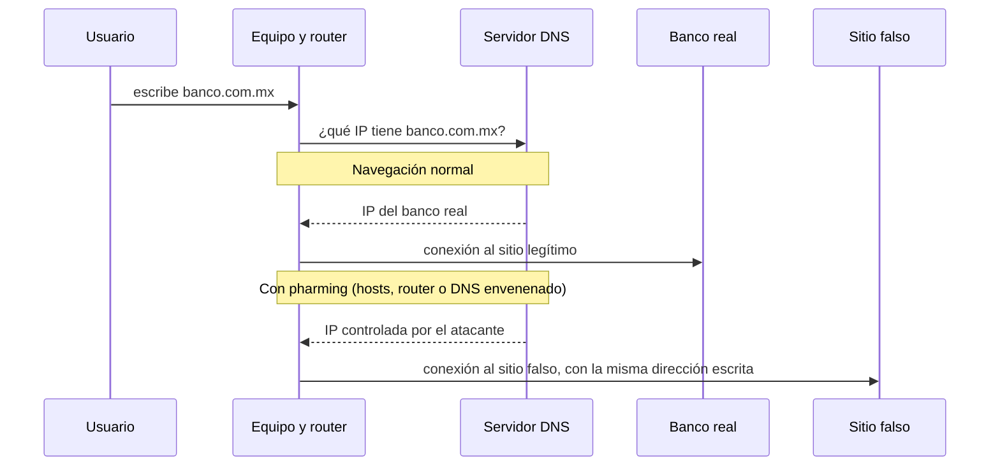

# 09 - Pharming: cuando la dirección correcta te lleva al sitio equivocado

> Materia 2, unidad 3 (Grooming, phishing y pharming), tema 3. Nota recreada a partir del material de la materia, con casos y defensas actualizados al 2026.

## Por qué importa

El consejo clásico contra el phishing es "no hagas clic en enlaces: escribe tú la dirección del banco". El pharming es justamente el ataque que vuelve inútil ese consejo. La víctima teclea bien la dirección, o usa su marcador de siempre, y aun así llega a un sitio falso idéntico al real. No hubo correo sospechoso ni error humano: alguien manipuló el mecanismo que traduce los nombres de los sitios en direcciones de red.

Por su nivel técnico, el pharming se menciona menos que el phishing, pero es más peligroso: puede afectar a miles de usuarios a la vez sin que ninguno haga nada fuera de lo normal. Entenderlo exige entender cómo funciona la navegación, y por eso es un buen tema para pasar de la conciencia de usuario a la mirada técnica.

## Qué es el pharming

El pharming es un ataque en el que se **redirige el tráfico** que iba hacia un sitio legítimo hacia un sitio fraudulento, sin que el usuario lo note. Se logra con código malicioso instalado en el equipo de la víctima o en un servidor, o manipulando la infraestructura de nombres de dominio. El objetivo es el mismo que en el phishing: capturar credenciales, datos bancarios e información personal, o instalar malware.

La palabra combina *phishing* y *farming* (cultivar): en lugar de pescar víctimas una por una, el atacante "siembra" la redirección y cosecha a todos los que pasan por ahí. Es una forma evolucionada del phishing porque **no necesita señuelo**.

### Phishing y pharming, lado a lado

| Aspecto | Phishing | Pharming |
|---|---|---|
| Qué necesita | Que la víctima caiga en un engaño (abra el enlace, crea el mensaje) | Nada de la víctima: basta con que navegue normalmente |
| Vector | Correo, SMS, mensajería, llamadas, enlaces | Archivo hosts alterado, servidor DNS envenenado, router comprometido, malware |
| Alcance | Una campaña llega a quienes reciben el mensaje | Un servidor DNS envenenado afecta a todos los que lo usan |
| Nivel técnico | Bajo a medio | Alto |
| ¿Sirve escribir la dirección a mano? | Sí, evita el enlace falso | No, la redirección ocurre después de escribirla |

## Cómo funciona la navegación (y dónde se rompe)

Cuando escribimos el nombre de un sitio, la computadora no sabe a dónde ir: necesita la dirección IP del servidor. La traducción la hace el **sistema de nombres de dominio (DNS)**, una especie de directorio mundial que asigna a cada dirección IP un nombre fácil de recordar. El equipo consulta primero su propio archivo local de nombres (el archivo *hosts*) y su memoria temporal; si ahí no está la respuesta, pregunta al servidor DNS configurado, normalmente el del proveedor de internet o el del router.

El pharming explota exactamente ese paso: si el atacante altera la respuesta, el navegador se conecta, con toda normalidad, a la IP equivocada.

## Las formas del ataque

| Tipo | Qué se altera | Alcance |
|---|---|---|
| Pharming local | Un virus o troyano, llegado en un adjunto o una descarga, modifica el archivo *hosts* del equipo y cambia la IP asociada a ciertos dominios. | Solo el equipo infectado. |
| Envenenamiento de caché DNS | El atacante logra que un servidor DNS guarde una respuesta falsa para un dominio; todos los que consultan ese servidor reciben la IP del sitio falso. | Potencialmente miles de usuarios a la vez. |
| Drive-by pharming | El ataque va contra el router o el firewall doméstico: aprovecha que muchos conservan la contraseña de administración de fábrica y cambia el servidor DNS configurado por uno del atacante. | Todos los dispositivos de esa red. |
| Intermediario en la red (MITM) | En una red compartida, el atacante intercepta las consultas y responde antes que el servidor legítimo. | Quienes estén en la misma red, típicamente una Wi-Fi abierta. |

El caso del servidor envenenado es el más inquietante: **el usuario puede tener una computadora completamente limpia y aun así ser víctima**. Teclear la dirección o usar un marcador de confianza no sirve, porque la redirección ocurre después de que el equipo pide la conexión.

En las variantes que usan malware, la redirección suele llegar acompañada de software que se descarga solo y trabaja en segundo plano: abre una puerta trasera para que el atacante tome control del dispositivo, y con frecuencia incluye **spyware** que espía y recopila datos.

### Casos que marcaron el tema

> Actualización al 2026: el material original no traía casos. Dos episodios ilustran bien el riesgo.

- **Enero de 2008, el primer drive-by pharming en la vida real, contra un banco mexicano.** Symantec documentó una campaña que enviaba correos haciéndose pasar por una tarjeta electrónica de un sitio mexicano de felicitaciones. Al abrirlos, el código cambiaba la configuración DNS de routers DSL de la marca 2Wire, muy usados en el país, que conservaban la contraseña de fábrica. Desde ese momento, quien intentaba entrar al sitio del banco desde esa red llegaba a una copia falsa. El ataque había sido descrito en teoría apenas un año antes por investigadores de Symantec y de la Escuela de Informática de la Universidad de Indiana.
- **Julio de 2008, la vulnerabilidad de Kaminsky.** El investigador Dan Kaminsky demostró una forma de envenenar la caché de casi cualquier servidor DNS en segundos (CVE-2008-1447). Su descubrimiento obligó a una actualización coordinada de los principales programas de DNS en todo el mundo y aceleró la adopción de DNSSEC.

## Las consecuencias

- Robo de credenciales, datos de tarjetas e información personal, y con ellos fraude y usurpación de identidad.
- Pérdidas financieras importantes para las víctimas y para las empresas suplantadas.
- Daño a la reputación de la marca cuyo sitio fue imitado, aunque no haya tenido la culpa.
- Costos de recuperación elevados: restaurar servicios, investigar, notificar y reforzar la seguridad.
- Exposición a otros ataques, porque el sitio falso puede instalar malware adicional.
- Investigaciones difíciles: el ataque se camufla en la infraestructura y deja pocos rastros visibles.

## Señales de que pudiste ser víctima

- Aparecen cargos que no reconoces en tu tarjeta de crédito o débito.
- Te piden confirmar un cambio de contraseña que no solicitaste.
- En tus redes o en tu mensajería hay publicaciones o mensajes que no enviaste.
- Aparecen en tus dispositivos aplicaciones que no instalaste.
- Un sitio conocido se ve ligeramente distinto, pide datos que nunca pedía o el navegador muestra advertencias de certificado.

## Cómo protegerse

### Usuarios

1. **Antimalware y antivirus confiables**, actualizados, para impedir que se modifique el archivo *hosts*.
2. **Mantener el sistema operativo y las aplicaciones al día.** Parchear con regularidad cierra las vulnerabilidades que usa el malware de redirección.
3. **No ejecutar archivos autoejecutables** de origen desconocido ni abrir enlaces de correos no solicitados.
4. **Revisar el candado y el certificado** antes de dar datos: al hacer clic en el candado, el certificado debe ser válido y estar emitido para el dominio exacto. Una advertencia de certificado en el sitio de tu banco es motivo para detenerte, no para hacer clic en "continuar".
5. **Revisar la dirección y su ortografía** en la barra del navegador.
6. **Evitar las redes Wi-Fi abiertas** para operaciones sensibles; si no hay opción, usar los datos del teléfono o una VPN confiable.
7. **Usar un proveedor de internet confiable** y servidores DNS de buena reputación; los navegadores modernos permiten activar DNS cifrado (DNS sobre HTTPS) con un proveedor seguro.
8. **Proteger el router:** cambiar la contraseña de administración de fábrica, actualizar su firmware y desactivar la administración remota si no se usa.
9. **Estar alerta** a cambios de apariencia o peticiones inusuales, y seguir aprendiendo sobre amenazas nuevas.

### Organizaciones y operadores

- Firmar las zonas con **DNSSEC**, que permite verificar que una respuesta DNS no fue alterada. Ojo con su alcance: frena el envenenamiento de caché, pero si el router de la víctima ya apunta a un resolvedor del atacante y el equipo no valida las firmas por su cuenta, no la protege.
- Publicar **HSTS** en los sitios propios, para que el navegador se niegue a conectar sin un certificado válido.
- Vigilar el registro de dominios parecidos al propio y la emisión de certificados a su nombre.
- Mantener actualizados y bien configurados los servidores DNS, y monitorear cambios en sus registros.

## Para cerrar

El nivel técnico de un ataque puede facilitarle mucho el trabajo al delincuente: la redirección automatizada engaña sin pedirle nada a la víctima. Como profesionales, la lección es doble: evitar autoejecutables y redes públicas sin protección, y entender que la seguridad de la navegación depende de una cadena (equipo, router, DNS, certificado) en la que cualquier eslabón débil basta para desviar el tráfico.

## Glosario

| Término | Definición |
|---------|-----------|
| Pharming | Ataque que redirige el tráfico de un sitio legítimo hacia uno falso sin que el usuario lo note. |
| DNS | Sistema de nombres de dominio: traduce nombres como un sitio web a direcciones IP. |
| Archivo hosts | Archivo local del sistema que asocia nombres de dominio con direcciones IP y se consulta antes que el DNS. |
| Envenenamiento de caché DNS | Inserción de respuestas falsas en la memoria de un servidor DNS para desviar a sus usuarios. |
| Drive-by pharming | Variante que cambia el servidor DNS configurado en un router doméstico, casi siempre aprovechando contraseñas de fábrica. |
| Redireccionamiento web | Mecanismo que hace que un dominio o una dirección apunte a otra. |
| MITM | Ataque de intermediario: el atacante se interpone entre dos partes para leer o alterar lo que se envían. |
| Spyware | Software espía que recopila datos de un dispositivo sin consentimiento. |
| DNSSEC | Extensiones de seguridad del DNS que firman las respuestas para poder comprobar su autenticidad. |
| HSTS | Cabecera que obliga al navegador a usar solo HTTPS con certificado válido en un sitio. |
| Navegador | Programa para acceder a sitios web y visualizarlos. |
| Certificado digital | Documento electrónico que vincula un dominio con una llave criptográfica y permite cifrar la conexión. |

## Referencias

- Arends, R., Austein, R., Larson, M., Massey, D. y Rose, S. (2005). *DNS security introduction and requirements* (RFC 4033). Internet Engineering Task Force. https://www.rfc-editor.org/rfc/rfc4033
- Banco General. (2014, 8 de septiembre). *¿Qué es el pharming?* [Video]. YouTube. https://youtu.be/k3b5xzB3dds
- CyberProtex. (2016, 27 de octubre). *Types of attacks: Pharming, phishing, and man in the middle* [Video]. YouTube. https://youtu.be/I-VV4BKwLbE
- DEFCONConference. (2017, 13 de octubre). *DEF CON 25: Jim Nitterauer, DNS: Devious name services destroying privacy and anonymity without consent* [Video]. YouTube. https://youtu.be/gnUZddaPvUA
- Dougherty, C. R. (2008, 8 de julio). *Multiple DNS implementations vulnerable to cache poisoning* (VU#800113). CERT Coordination Center. https://www.kb.cert.org/vuls/id/800113
- E-Crime Wales. (2015, 22 de marzo). *Business crime: Phishing and pharming* [Video]. YouTube. https://youtu.be/_3hK0PuSkhw
- Kaspersky. (s. f.). *¿Qué es el pharming y cómo protegerse?* https://latam.kaspersky.com/resource-center/definitions/pharming
- Messmer, E. (2008, 22 de enero). First case of "drive-by pharming" identified in the wild. *Network World*. https://www.networkworld.com/article/809822/lan-wan-first-case-of-drive-by-pharming-identified-in-the-wild.html
- Stamm, S., Ramzan, Z. y Jakobsson, M. (2007). Drive-by pharming. En *Information and Communications Security* (LNCS 4861, pp. 495-506). Springer. https://doi.org/10.1007/978-3-540-77048-0_38
- TBN Israel. (2022, 3 de febrero). *Israel's cyber security: The invisible war* [Video]. YouTube. https://youtu.be/3t-wIXhh72Y

---

*Rogelio Arriaga Gonzalez*
