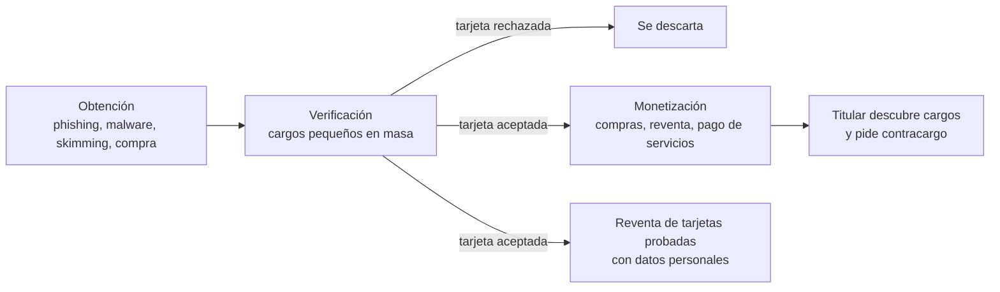

# 10 - Carding: el fraude silencioso con tarjetas

> Materia 2, unidad 4 (Carding, juice jacking y cryptojacking), tema 1. Nota recreada a partir del material de la materia, con estándares y datos actualizados al 2026.

## Por qué importa

El comercio electrónico y la banca en línea dominan hoy buena parte de las transacciones, y el efectivo pierde terreno cada año. Las tarjetas de crédito y débito se volvieron indispensables, y con ellas se volvieron un blanco: los delincuentes persiguen sus datos porque se convierten en dinero muy rápido. Los cargos no reconocidos son una de las quejas más frecuentes de los usuarios de servicios financieros.

El carding es particularmente insidioso porque es **silencioso**: no hay un correo extraño ni una pantalla de rescate, solo cargos que aparecen en el estado de cuenta, a veces semanas después. El sector financiero es de los más atacados por su rentabilidad, y entender cómo funciona este fraude ayuda tanto al usuario que revisa sus movimientos como al desarrollador que construye una tienda en línea o un sistema de pagos.

## Qué es el carding

Dos maneras complementarias de definirlo:

- El **uso ilícito de tarjetas de crédito o débito por personas no autorizadas**, conocidas como *carders*. Obtienen sin permiso la información de las tarjetas y la usan para comprar productos o pagar servicios. Abarca toda la cadena: desde obtener los datos hasta las transacciones que perjudican al titular y a la institución financiera.
- Una **forma automatizada de fraude**: los delincuentes prueban listas enormes de datos de tarjetas (robadas o generadas) contra el sistema de cobro de alguna tienda en línea para descubrir cuáles funcionan. Los datos se roban de distintos canales de pago y aplicaciones, o se compran en mercados ilegales.

Para el carder, el objetivo es obtener bienes o servicios "gratis". Los primeros intentos pueden fallar, pero en cuanto una tarjeta pasa, las ganancias crecen rápido. Es un delito en México y en la mayoría de los países.

## De dónde salen los datos

| Fuente | Cómo ocurre |
|---|---|
| Phishing | Sitios o mensajes falsos donde la víctima captura los datos de su tarjeta (ver nota 08). |
| Malware y RAT | Troyanos de acceso remoto que capturan lo que se teclea o lo que se guarda en el navegador. |
| Estafas | Ofertas falsas, tiendas fantasma, llamadas que piden "confirmar" la tarjeta. |
| Skimming | Lectores ocultos en cajeros o terminales que copian la banda magnética y, con una cámara, el NIP. |
| Robo en comercios | Código malicioso inyectado en la página de pago de una tienda legítima que copia cada tarjeta capturada, o bases de datos de clientes filtradas. |
| Mercados ilegales | Listas de tarjetas a la venta en foros de la darknet, en la red Tor y hasta en sitios de pegado de texto como Pastebin. |
| Generación | Los *bineros* generan números a partir del BIN de un banco, que luego hay que validar contra un sistema de cobro. |

### La anatomía de una tarjeta

Una tarjeta tiene un formato estándar: el número al frente (casi siempre de 16 dígitos), una fecha de vencimiento y un código de verificación (CVV o CVV2), por lo general de tres dígitos. Los primeros dígitos del número forman el **BIN** (*Bank Identification Number*), que identifica a la red y al banco emisor; el último es un dígito verificador calculado con una fórmula pública. Por eso es posible generar números con formato válido: lo que el carder no sabe es si corresponden a una cuenta activa, y para eso necesita probarlos.

> Actualización al 2026: el glosario original definía el BIN como "los 16 dígitos" de la tarjeta. En realidad el BIN, llamado también IIN, son solo los primeros dígitos: tradicionalmente seis y, desde la revisión de 2017 de la norma ISO/IEC 7812-1, ocho. Las redes de pago adoptaron el BIN de ocho dígitos hacia 2022, y desde junio de ese año el consejo de PCI acepta que se muestren los primeros ocho dígitos de una tarjeta enmascarada.

## Cómo opera un carder

El carder quiere hacerse pasar por el titular legítimo. Para eso intenta imitar su ubicación, su navegador y sus hábitos, o al menos ocultar los propios para que no lo rastreen. Conocer sus herramientas sirve sobre todo para entender qué buscan detectar los sistemas antifraude.

| Herramienta | Para qué la usa el carder | Qué mira el antifraude |
|---|---|---|
| Computadora | Las operaciones desde teléfono le resultan menos controlables | Huella del dispositivo y del navegador |
| Proxy SOCKS | Intercambiar paquetes a través de un servidor intermedio y mostrar la IP del proxy en lugar de la suya | Reputación de la IP y coherencia con el domicilio del titular |
| Cambiador de MAC | Cambiar la dirección física de la tarjeta de red | Patrones de muchos intentos desde equipos "nuevos" |
| Limpiador | Borrar historial, cookies y archivos temporales | Ausencia sospechosa de historial |
| Máquinas virtuales | Correr sistemas operativos desechables sobre el propio | Indicadores de virtualización |
| Escritorio remoto (RDP) | Conectarse a una computadora ubicada en la zona del titular para que la compra parezca local | Desfases entre zona horaria, idioma y ubicación |
| VPN | Ocultar la IP; le sirve menos porque las IP de VPN conocidas se marcan | Listas de IP de VPN y centros de datos |

### El ciclo del fraude

Al ejecutar el ataque, los delincuentes no saben cuáles datos sirven hasta que los prueban. Las tarjetas que permitieron transacciones exitosas, junto con la información personal que las acompaña, se venden más caras en el mercado negro. Las pruebas suelen hacerse de noche, para que pasen desapercibidas, y el resultado para el consumidor puede ser un deterioro de su crédito o penalizaciones. Para los comercios afectados, las pérdidas pueden ser grandes, porque en muchos casos absorben el costo de las transacciones fraudulentas y de los contracargos.

En la red existen incluso **escuelas y comunidades** que enseñan y facilitan el carding, comparten tutoriales y venden bases de datos robadas, y no solo en la web profunda: también en la web superficial.

## El caso México: el ataque al SPEI de 2018

El material del curso estudia en este tema el ataque más grande contra el sistema financiero mexicano, aunque técnicamente no fue carding sino un fraude contra la infraestructura de transferencias:

- El **9 de enero de 2018**, atacantes intentaron desviar unos **110 millones de dólares** del Banco Nacional de Comercio Exterior (Bancomext) a través de su conexión a la red internacional SWIFT; el banco detectó el ataque y lo frustró. Empresas de seguridad lo atribuyeron después al grupo APT38, vinculado a Corea del Norte.
- Entre el **17 de abril y el 8 de mayo de 2018**, cinco participantes conectados al **Sistema de Pagos Electrónicos Interbancarios (SPEI)** fueron vulnerados. El Banco de México estimó lo sustraído en unos **300 millones de pesos**; la prensa llegó a hablar de hasta 400 millones, unos 15 a 20 millones de dólares de entonces. En octubre de 2018 hubo un ataque más, de unos 60 millones de pesos en 160 operaciones.

> Actualización al 2026: el material original hablaba de un intento de "110 millones de pesos" en enero de 2018. Según la prensa financiera de la época, fueron 110 millones de dólares y el canal fue SWIFT, no el SPEI. La cifra de 300 a 400 millones de pesos tampoco es oficial en su tope: el Banco de México reportó alrededor de 300 millones.
- **El método:** aprovechar vulnerabilidades en los sistemas propios de cada banco para conectarse al SPEI (servidores internos expuestos a internet, empleados engañados con phishing), redes sin controles de acceso robustos ni segmentación, y fallas en la validación de cuentas. Los atacantes generaban órdenes de transferencia desde cuentas inexistentes hacia cuentas reales que controlaban; el dinero se movía rápido, en muchas operaciones pequeñas, y se retiraba en efectivo en ventanillas y cajeros.
- **La alerta:** según el material del curso, las autoridades se dieron cuenta cuando cajeros de Guanajuato empezaron a entregar efectivo de forma anómala; ese detalle no aparece en los documentos oficiales del Banco de México.
- **La respuesta:** el Banco de México publicó en agosto de 2018 un reporte de análisis forense en versión pública y endureció los requisitos de seguridad para los participantes del SPEI. La prensa informó en 2019 que la investigación de la Fiscalía General de la República apuntaba a un grupo identificado como "Bandidos Revolution Team", imputado por fraude informático; la falta de una figura legal específica para la ciberdelincuencia organizada complicaba la acusación.

La lección para cualquier sistema: el punto débil no fue el SPEI en sí, sino las conexiones de los participantes, y la defensa exige segmentar redes, validar cada operación y vigilar patrones anómalos.

## El marco legal en México

- La **Condusef** atiende las reclamaciones por cargos no reconocidos, porque se trata de un problema con servicios financieros, y publica guías de prevención como *Carding y bineros otra forma de hackeo*.
- El **Código Penal Federal** sanciona el acceso ilícito a sistemas y equipos de informática (artículos 211 bis 1 a 211 bis 7, con penas mayores cuando se trata del sistema financiero) y el fraude.
- La **Ley de Instituciones de Crédito** sanciona expresamente a quien use, produzca o comercie tarjetas falsificadas o alteradas, o datos de tarjetas obtenidos sin autorización.
- Para perseguir con eficacia, las autoridades deben adecuar el tipo de fraude y actualizarse ante cada modalidad nueva.

En la industria, el estándar **PCI DSS** obliga a quien almacena, procesa o transmite datos de tarjetas a protegerlos.

> Actualización al 2026: la versión vigente del estándar es PCI DSS 4.0.1 (junio de 2024). Sus requisitos con fecha futura son obligatorios desde el 31 de marzo de 2025, entre ellos controlar los scripts de las páginas de pago para frenar el robo de tarjetas en el navegador.

## Cómo prevenirlo

### Usuarios

- **No dar los datos de la tarjeta** por teléfono, correo o mensaje; el banco nunca los pide así.
- **No dejar a la vista** el número ni el código de seguridad, ni mandar fotos de la tarjeta.
- **Llevar un control de los gastos** y revisar el estado de cuenta con frecuencia, sobre todo si se compra en línea.
- **Tener la banca en línea activa**, con notificaciones de cada cargo, para detectar un movimiento extraño de inmediato. Las apps bancarias suelen incluir autenticación de dos factores.
- **Usar tarjeta digital** para compras en internet, de preferencia con código de seguridad dinámico, y no guardar la tarjeta en sitios que no se usan.
- **Fijar límites** de compra en línea y apagar la tarjeta desde la app cuando no se usa.
- **Revisar el cajero o la terminal** antes de usarla: piezas sueltas, cámaras, teclados que no encajan.
- **Usar redes seguras** para pagar; nunca una Wi-Fi pública.
- **Si eres víctima:** bloquea la tarjeta en la app o llamando al banco, presenta la aclaración y denuncia; si el banco no resuelve, acude a la Condusef.

### Comercios y desarrolladores

- Nunca guardar el CVV, y delegar la captura de tarjetas a un proveedor certificado (tokenización).
- Exigir autenticación adicional (3-D Secure) en operaciones de riesgo.
- Limitar la velocidad de intentos de pago por cliente, IP y tarjeta para frenar las pruebas masivas.
- Monitorear y fijar los scripts que corren en la página de pago.

## Para cerrar

El carding existe desde hace años y sigue siendo rentable, pero es prevenible con buenos hábitos: vigilar las cuentas, compartir lo mínimo, usar las herramientas de la banca digital y denunciar a tiempo. Del lado técnico, quien construye sistemas de pago tiene la responsabilidad de no guardar lo que no necesita y de hacer caro el ensayo y error del que vive el carder.

## Glosario

| Término | Definición |
|---------|-----------|
| Carding | Uso fraudulento de datos de tarjetas de crédito o débito ajenas para comprar o pagar servicios. |
| Carder | Persona que se dedica al carding. |
| CC | Abreviatura de *credit card*; en la jerga del carding, una tarjeta con sus datos completos. |
| BIN o IIN | Primeros dígitos del número de tarjeta, que identifican a la red y al banco emisor (seis u ocho). |
| Binero | Persona que genera números de tarjeta a partir de un BIN. |
| CVV o CVV2 | Código de verificación de la tarjeta, impreso en ella y que no debe almacenarse. |
| NIP | Número de identificación personal de la tarjeta. |
| SOCKS | Protocolo para enviar tráfico a través de un servidor intermediario. |
| Skimmer | Dispositivo oculto en un cajero o terminal que copia los datos de la tarjeta. |
| Contracargo | Devolución de un cargo que el titular desconoce, que suele absorber el comercio. |
| 3-D Secure | Protocolo que agrega una verificación del titular en las compras en línea. |
| Tokenización | Sustitución del número de tarjeta por un identificador sin valor fuera del sistema que lo emitió. |
| SPEI | Sistema de Pagos Electrónicos Interbancarios, operado por el Banco de México. |

## Referencias

- ADN 40. (2019, 24 de junio). *Carding, nueva forma de fraude cibernético* [Video]. YouTube. https://youtu.be/pl237r3PB3s
- Banco de México. (2018, 22 de mayo). *Puntos importantes sobre la situación actual del SPEI*. https://www.banxico.org.mx/spei/d/%7BB806F1E8-686D-B9F1-0452-EC375543C801%7D.pdf
- Banco de México. (2018, 29 de agosto). *Reporte de análisis forenses: Versión pública*. https://www.banxico.org.mx/spei/d/%7B4A977A24-0889-3F24-A717-DF9DBBA118C1%7D.pdf
- Cámara de Diputados del H. Congreso de la Unión. (2025). *Ley de Instituciones de Crédito*. https://www.diputados.gob.mx/LeyesBiblio/pdf/LIC.pdf
- Cámara de Diputados del H. Congreso de la Unión. (2026). *Código Penal Federal* (última reforma publicada en el DOF el 13 de marzo de 2026). https://www.diputados.gob.mx/LeyesBiblio/pdf/CPF.pdf
- Comisión Nacional para la Protección y Defensa de los Usuarios de Servicios Financieros. (2019, 26 de julio). ¡Cuidado! fraudes al por mayor. *Proteja su Dinero*. https://revista.condusef.gob.mx/usuario-inteligente/que-hay-de-nuevo/2019/07/cuidado-fraudes-al-por-mayor/
- Comisión Nacional para la Protección y Defensa de los Usuarios de Servicios Financieros. (2019, 3 de junio). Carding y bineros otra forma de hackeo. *Proteja su Dinero*. https://revista.condusef.gob.mx/usuario-inteligente/que-hay-de-nuevo/2019/06/carding-y-bineros-otra-forma-de-hackeo/
- HackWise. (2022, 10 de junio). *Así clonan tus tarjetas de crédito y débito (cazando skimmers)* [Video]. YouTube. https://youtu.be/dnd4fYeZu58
- Infobae. (2019). *Carding, el nuevo fraude a través de tarjetas bancarias y cómo prevenirlo*. https://www.infobae.com/
- International Organization for Standardization. (2017). *ISO/IEC 7812-1:2017 Identification cards: Identification of issuers, Part 1: Numbering system*. https://www.iso.org/standard/70484.html
- Malone, A. (2024, 11 de junio). Just published: PCI DSS v4.0.1. *PCI Perspectives*. PCI Security Standards Council. https://blog.pcisecuritystandards.org/just-published-pci-dss-v4-0-1
- PCI Security Standards Council. (2022). *FAQ 1091: What are acceptable formats for truncation of primary account numbers?* https://www.pcisecuritystandards.org/faqs/1091

---

*Rogelio Arriaga Gonzalez*
