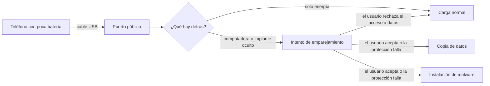

# 11 - Juice jacking: el peligro de cargar el teléfono en cualquier puerto

> Materia 2, unidad 4 (Carding, juice jacking y cryptojacking), tema 2. Nota recreada a partir del material de la materia, con los avisos oficiales y la investigación publicada hasta 2026.

## Por qué importa

El USB (*Universal Serial Bus*) se volvió el estándar mundial para conectar y cargar casi cualquier aparato. Esa universalidad es una comodidad enorme: en aeropuertos, centrales de autobuses, hoteles, cafeterías y oficinas hay puertos para recargar el teléfono cuando la batería se agota y no traemos cargador ni batería externa. Y es justo cuando estamos desesperados por un poco de carga que menos pensamos en lo que hay detrás de ese puerto.

El juice jacking (algo así como "secuestro del jugo", de la energía) es el ataque que aprovecha esa situación: un puerto de carga público modificado para robar datos del dispositivo o instalarle malware mientras se carga. No es la amenaza más frecuente de esta materia, pero ilustra un principio que vale para toda la seguridad: **cualquier conexión que mueve energía también puede mover datos, a menos que alguien se asegure de lo contrario**.

## Qué es el juice jacking

Es un ataque que explota las conexiones USB de carga en lugares públicos para comprometer dispositivos electrónicos. Ocurre cuando una persona conecta su teléfono, tableta o laptop a un puerto o un cable que fue alterado para hacer algo más que cargar: copiar datos de forma encubierta, instalar código malicioso o ambas cosas.

El término se difundió en 2011 a partir de un artículo del periodista de seguridad Brian Krebs sobre un quiosco de carga montado como demostración por el grupo Wall of Sheep en la conferencia DEF CON 19: el quiosco avisaba en pantalla a quienes conectaban su teléfono que no debieron confiar en él.

## Cómo funciona

La clave está en el diseño de los teléfonos inteligentes: usan **el mismo puerto y el mismo cable para la energía y para los datos**. Da igual la marca o el sistema operativo: el cable que carga es el mismo que sirve para pasar fotos a la computadora. Eso abre la oportunidad.

1. **El puerto o el cable están alterados.** Detrás del panel del quiosco puede haber una computadora oculta, o un pequeño dispositivo de intercepción, que intenta emparejarse con el teléfono en cuanto se conecta.
2. **Robo de datos.** Si el emparejamiento se logra, quedan expuestos fotos, contactos, notas, música, documentos e incluso archivos de caché.
3. **Inyección de malware.** El ataque se agrava si el puerto instala código malicioso en el teléfono. Ese código puede permitir el espionaje, la captura de credenciales y el acceso remoto, e incluso mantener el dispositivo ligado a la máquina del atacante hasta que el usuario lo formatee y lo regrese a la configuración de fábrica.

Existen variantes de la misma idea: cables que por fuera son idénticos a uno normal pero llevan un implante dentro, y demostraciones de *video jacking*, en las que el puerto captura lo que se ve en la pantalla del teléfono mientras carga.

## Análisis de riesgo

Desde la seguridad de la información, el juice jacking toca varias áreas a la vez: el diseño de seguridad del dispositivo, la conciencia del usuario, los ataques al diseño o al código del sistema y la ingeniería social (el atacante aprovecha la urgencia de cargar).

- **El vector:** el puerto USB del teléfono.
- **La exposición:** depende de cuánto sabe el usuario de este ataque y de cuánto le dura la batería. Quien viaja mucho y depende del teléfono para el correo y la agenda está más expuesto de lo que imagina.
- **El impacto:** para una persona, robo de identidad y pérdidas económicas; para una empresa, filtración de datos corporativos desde el teléfono de un directivo y daño a su reputación.

Conviene mantener la proporción: no hay que asumir que todos los quioscos de un aeropuerto son maliciosos, y los casos documentados en la vida real son escasos. Pero la amenaza existe, la defensa es barata y la precaución siempre es recomendable.

> Actualización al 2026: en abril de 2023 la oficina del FBI en Denver y la Comisión Federal de Comunicaciones (FCC) de Estados Unidos recomendaron públicamente evitar las estaciones de carga gratuitas. Por otro lado, iOS y Android llevan años pidiendo permiso antes de permitir el intercambio de datos por USB; sin embargo, en 2025 investigadores de la Universidad Tecnológica de Graz presentaron en el simposio USENIX Security *ChoiceJacking*, una familia de ataques en los que un cargador malicioso logra aprobar por sí mismo ese aviso. Google lo corrigió en el boletín de seguridad de Android de noviembre de 2024 y Apple en iOS 18.4 (marzo de 2025), lo que refuerza el consejo de mantener el sistema actualizado.

## Cómo protegerse

1. **Mantén tus dispositivos cargados.** La regla más básica: si vas a estar fuera mucho tiempo, sal con la batería llena y carga cuando no estés usando el teléfono.
2. **Usa tu propio cargador o una batería externa.** Si necesitas cargar en público, conecta tu cargador a un **contacto de corriente**, no a un puerto USB: así la conexión entre el teléfono y el cargador es solo de energía, en un sentido.
3. **Evita las centrales USB públicas** y nunca uses un cable que encuentres conectado en un quiosco.
4. **Usa un cable de solo carga.** Hay dos tipos de cables USB: los de solo carga y los de datos y carga, y por fuera no se distinguen. En el USB clásico, un cable de solo carga lleva únicamente los conductores de energía y tierra, mientras que uno de datos agrega los dos conductores de datos; sin esos hilos, no hay por dónde robar información. Conviene marcarlos para no confundirlos.
5. **Usa un bloqueador de datos USB.** El llamado coloquialmente "condón USB" (*USB data blocker*) es un adaptador pequeño que se coloca en la punta del cable y corta electrónicamente las líneas de datos, dejando pasar solo la energía. Convierte cualquier cable en uno de solo carga y se consigue en tiendas en línea por poco dinero.
6. **Usa las funciones de seguridad del teléfono.** Cuando conectas el teléfono, el sistema pregunta si quieres permitir la transferencia de datos o "confiar en esta computadora". En un quiosco o en una computadora ajena, la respuesta es **no** o "solo cargar". Mantén el teléfono bloqueado mientras carga.
7. **Desactiva lo que comparte archivos** (depuración USB, transferencia automática, accesos de desarrollador) si no lo necesitas.
8. **Actualiza el sistema operativo.** Las correcciones contra ataques por USB llegan con las actualizaciones.

Un matiz sobre los cables: el material original afirmaba que un cable de solo carga carga más rápido. No siempre es así: varios protocolos de carga rápida negocian la potencia usando las líneas de datos o una línea de control, de modo que un cable o un bloqueador sin ellas puede cargar **más lento**. Lo que sí garantizan es que no hay intercambio de datos.

## Para cerrar

El juice jacking aprovecha las estaciones de carga públicas para infectar dispositivos o extraer datos sin autorización. La primera medida es simple: cargar siempre con el cable y el cargador propios. Si no queda otra opción, un bloqueador de datos protege el dispositivo; y desactivar la compartición de archivos minimiza el riesgo. Ningún dispositivo es completamente seguro en un lugar público, y por eso estas prácticas preventivas importan.

## Glosario

| Término | Definición |
|---------|-----------|
| Juice jacking | Ataque que usa un puerto o cable de carga USB alterado para robar datos o instalar malware en el dispositivo conectado. |
| USB | Bus Serie Universal: estándar de conexión que transporta energía y datos por el mismo conector. |
| Cable de solo carga | Cable USB que lleva únicamente los conductores de energía, sin líneas de datos. |
| Bloqueador de datos USB | Adaptador que corta las líneas de datos y deja pasar solo la energía; conocido como "condón USB". |
| Emparejamiento | Establecimiento de una relación de confianza entre el teléfono y otro equipo para intercambiar datos. |
| ChoiceJacking | Familia de ataques de 2025 en la que un cargador malicioso aprueba por sí mismo el permiso de transferencia de datos. |
| Video jacking | Variante que captura lo que muestra la pantalla del dispositivo mientras está conectado. |
| Batería externa | Batería portátil para cargar dispositivos sin depender de puertos públicos. |
| Depuración USB | Modo para desarrolladores que da amplio control del dispositivo por cable; debe estar apagado en uso normal. |
| Vector de ataque | Camino por el que un atacante llega a un sistema; aquí, el puerto USB. |

## Referencias

- Apple. (2025). *About the security content of iOS 18.4 and iPadOS 18.4*. https://support.apple.com/en-us/122371
- CBS New York. (2018, 23 de agosto). *Eye on cyber: Juice jacking* [Video]. YouTube. https://youtu.be/gey9lt2lTtc
- CBS News. (2023, 12 de abril). *FBI warns against "juice jacking": What is it?* https://www.cbsnews.com/news/fbi-warns-against-juice-jacking-what-is-it/
- Draschbacher, F., Maar, L., Oberhuber, M. y Mangard, S. (2025). ChoiceJacking: Compromising mobile devices through malicious chargers like a decade ago. En *34th USENIX Security Symposium* (pp. 4363-4379). USENIX Association. https://www.usenix.org/conference/usenixsecurity25/presentation/draschbacher
- Federal Communications Commission. (2023). *"Juice jacking": The dangers of public USB charging stations*. https://www.fcc.gov/juice-jacking-tips-to-avoid-it
- Gadget John. (2016, 9 de septiembre). *PortaPow USB fast charge data block adapter: Disables computer sync, it just charges* [Video]. YouTube. https://youtu.be/o1HG7JxNU6A
- Google. (2024). *Android security bulletin: November 2024*. https://source.android.com/docs/security/bulletin/2024-11-01
- Krebs, B. (2011, 17 de agosto). *Beware of juice-jacking*. Krebs on Security. https://krebsonsecurity.com/2011/08/beware-of-juice-jacking/

---

*Rogelio Arriaga Gonzalez*
