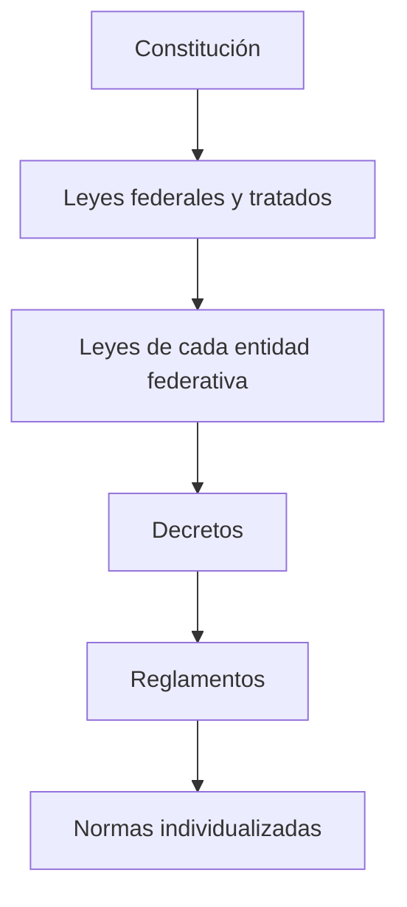

# 01 - Derecho positivo mexicano

> Lectura del curso [Informática forense](../../cursos/digital-forensics/README.md), unidad 1, tema 1.

## Por qué importa

Un perito en informática forense puede dominar todas las herramientas de adquisición y aun así entregar un trabajo inútil. Si no sabe qué le permite la ley, qué le prohíbe y ante quién responde, lo más probable es que contamine indicios, se exceda en lo que revisa o deje huecos que la defensa aprovechará en el juicio. La técnica sin sustento legal produce errores de percepción: el especialista cree que está ayudando y en realidad está debilitando la investigación.

Quien solicita un dictamen (un área jurídica, un agente del Ministerio Público o un juez) confía en que el experto conoce su materia y también el terreno legal donde trabaja. Esta nota resume cómo está ordenado el derecho mexicano, quién crea las leyes, qué es un delito, cómo se reparten las competencias entre la Federación y los estados, y qué reglas constitucionales tocan directamente el trabajo con evidencia digital. Es la base para leer después el [Código Penal Federal](09-codigo-penal-federal.md), los [fundamentos legales de la investigación](11-fundamentos-legales-investigacion.md) y la [cadena de custodia](12-etica-cadena-custodia.md).

## Las normas cambian porque la sociedad cambia

El derecho no es fijo. Se ajusta a factores económicos, políticos y tecnológicos, y las TIC han acelerado ese ajuste. Las redes sociales trajeron conductas que antes no existían a esa escala, como el acoso entre adolescentes por medios digitales (ciberacoso), que en México y en otros países ha tenido consecuencias tan graves como el suicidio de jóvenes. Cada problema nuevo empuja reformas nuevas.

Por eso el investigador de conductas cometidas con TIC tiene que seguir de cerca lo que se publica en el **Diario Oficial de la Federación (DOF)**. El DOF es el órgano donde se dan a conocer las leyes, reglamentos, acuerdos, circulares y demás actos de los poderes federales; una norma obliga a partir de su publicación y de lo que digan sus artículos transitorios. Trabajar con una versión vieja de un código es una forma silenciosa de equivocarse.

## Qué es el derecho positivo

Se llama **derecho positivo** al conjunto de normas jurídicas que regulan la conducta externa de las personas y que están vigentes en un lugar y en un momento determinados. Dos ideas lo definen: son normas escritas por una autoridad con facultades para hacerlo, y su validez depende de que sigan vigentes.

Un buen ejemplo de cómo se mueve el derecho positivo es el **Código Nacional de Procedimientos Penales (CNPP)**. Se publicó en el DOF el 5 de marzo de 2014, entró en vigor de manera gradual y, a partir del 18 de junio de 2016, rige en todo el país. Desde esa fecha sustituyó al Código Federal de Procedimientos Penales y a los códigos de procedimientos de cada estado, y quedó implantado en todo México el sistema penal acusatorio, conocido popularmente como juicios orales.

Actualización al 2026: el Código Federal de Procedimientos Penales está abrogado por el decreto del CNPP (DOF 05-03-2014); la Cámara de Diputados lo conserva en su sección de leyes abrogadas solo como referencia histórica. Cualquier documento técnico que hoy funde una diligencia en el código federal anterior está citando una norma que ya no existe.

## La jerarquía del orden jurídico

La **Constitución Política de los Estados Unidos Mexicanos**, publicada el 5 de febrero de 1917, fija los principios fundamentales del país en lo político, lo social y lo económico, y reconoce los derechos humanos. Ninguna ley de menor rango puede contradecirla. La regla está en el título séptimo, "Prevenciones Generales":

Constitución Política de los Estados Unidos Mexicanos, artículo 133 (texto vigente, última reforma DOF 07-10-2026):

> Artículo 133. Esta Constitución, las leyes del Congreso de la Unión que emanen de ella y todos los tratados que estén de acuerdo con la misma, celebrados y que se celebren por el Presidente de la República, con aprobación del Senado, serán la Ley Suprema de toda la Unión. Los jueces de cada entidad federativa se arreglarán a dicha Constitución, leyes y tratados, a pesar de las disposiciones en contrario que pueda haber en las Constituciones o leyes de las entidades federativas.

A partir de esa cúspide, el material del curso ordena las normas así:

| Nivel | Norma | Alcance |
|---|---|---|
| 1 | Constitución Política de los Estados Unidos Mexicanos | Todo el país; nada puede contradecirla |
| 2 | Leyes federales y tratados internacionales | Todo el territorio nacional |
| 3 | Leyes ordinarias de cada entidad federativa | Solo el estado que las expidió |
| 4 | Decretos | Actos concretos del Legislativo o del Ejecutivo |
| 5 | Reglamentos | Detallan cómo se aplica una ley |
| 6 | Normas jurídicas individualizadas | Un caso concreto: una sentencia, un contrato, una resolución |

Para el perito, esta escalera tiene una consecuencia práctica: cuando un reglamento interno de una empresa, una política de seguridad o un acuerdo de una fiscalía choca con un derecho reconocido en la Constitución, gana la Constitución. Un procedimiento técnico impecable que viola un derecho fundamental produce una prueba que no sirve.

## Quién hace las leyes

La pregunta lógica después de la jerarquía es quién tiene la facultad de proponer nuevas normas. La Constitución la reparte entre cuatro actores:

Constitución Política de los Estados Unidos Mexicanos, artículo 71, fracciones I a IV (texto vigente):

> Artículo 71. El derecho de iniciar leyes o decretos compete:
>
> I. Al Presidente de la República;
>
> II. A los Diputados y Senadores al Congreso de la Unión;
>
> III. A las Legislaturas de los Estados y de la Ciudad de México; y
>
> IV. A los ciudadanos en un número equivalente, por lo menos, al cero punto trece por ciento de la lista nominal de electores, en los términos que señalen las leyes.

Iniciar una ley no es aprobarla: la iniciativa sigue el trámite que fija la Ley del Congreso y la discuten las dos cámaras. Lo relevante para este curso es que las reformas en materia de delitos informáticos pueden nacer de cualquiera de esos cuatro actores, incluida la ciudadanía organizada.

## El delito

El Código Penal Federal define el delito en una línea:

Código Penal Federal, artículo 7o., primer párrafo (texto vigente, última reforma DOF 13-03-2026):

> Artículo 7o.- Delito es el acto u omisión que sancionan las leyes penales.

El mismo artículo aclara que también responde quien omite impedir un resultado cuando tenía el deber jurídico de evitarlo, y clasifica el delito en instantáneo, permanente o continuo, y continuado. Esa clasificación importa en TIC: un acceso no autorizado puede consumarse en un instante, mientras que mantener un programa espía en un equipo es una conducta que se prolonga en el tiempo.

¿Para qué sirve sancionar? El material del curso identifica tres finalidades de la pena:

1. Detener a la persona responsable para que no siga cometiendo la conducta.
2. Reparar el daño a víctimas y ofendidos y reincorporar a quien delinquió a la vida en sociedad.
3. Fomentar el respeto a la ley y desalentar que la conducta se repita.

En el fondo, una conducta se convierte en delito cuando la sociedad decide que daña valores que merecen protección especial porque sostienen la convivencia: la vida, la libertad, la integridad física y sexual, el patrimonio. A esos valores la doctrina los llama bienes jurídicos.

Las TIC no inventan bienes jurídicos nuevos tanto como abren caminos nuevos para dañarlos. Dos ejemplos del material:

- **Falsificación de documentos que termina en robo de identidad.** Un perfil falso en una red social, armado con datos y fotografías de otra persona, sirve para engañar a terceros, pedir dinero o dañar la reputación de la víctima.
- **Acoso por medios digitales.** El hostigamiento se ejerce por redes sociales, correo electrónico o mensajería instantánea, y el agresor puede actuar a distancia y a cualquier hora.

Estos casos muestran por qué el marco normativo tiene que revisarse de forma constante: la conducta dañina es antigua, pero el medio cambia más rápido que la ley.

## Fuero federal y fuero común

La procuración de justicia en México se organiza con dos criterios de competencia. Los **delitos del fuero federal** son los que señalan las leyes federales y los persigue la Federación; los **delitos del fuero común** son los que tipifica cada estado en su propio código penal y los persiguen las fiscalías locales.

| Aspecto | Fuero federal | Fuero común |
|---|---|---|
| Ley que define la conducta | Código Penal Federal y leyes federales especiales | Código penal de cada entidad federativa |
| Quién investiga | Ministerio Público de la Federación (Fiscalía General de la República) | Fiscalía o procuraduría de cada estado |
| Ejemplos en TIC | Acceso ilícito a sistemas del Estado o del sistema financiero, delitos contra la seguridad nacional | Fraude común, amenazas, acoso, delitos contra la intimidad, según cada código local |

### La Federación

La Constitución organiza a la administración pública federal y la manera en que el Ejecutivo representa a la Federación:

Constitución Política de los Estados Unidos Mexicanos, artículo 90 (texto vigente):

> Artículo 90. La Administración Pública Federal será centralizada y paraestatal conforme a la Ley Orgánica que expida el Congreso, que distribuirá los negocios del orden administrativo de la Federación que estarán a cargo de las Secretarías de Estado y definirá las bases generales de creación de las entidades paraestatales y la intervención del Ejecutivo Federal en su operación.
>
> La (sic DOF 02-08-2007) leyes determinarán las relaciones entre las entidades paraestatales y el Ejecutivo Federal, o entre éstas y las Secretarías de Estado.
>
> La función de Consejero Jurídico del Gobierno estará a cargo de la dependencia del Ejecutivo Federal que, para tal efecto, establezca la ley.
>
> El Ejecutivo Federal representará a la Federación en los asuntos en que ésta sea parte, por conducto de la dependencia que tenga a su cargo la función de Consejero Jurídico del Gobierno o de las Secretarías de Estado, en los términos que establezca la ley.

En cuanto a la persecución de los delitos federales, la regla está en el apartado A del artículo 102:

Constitución Política de los Estados Unidos Mexicanos, artículo 102, apartado A, primer párrafo y párrafo sobre la persecución de delitos federales (texto vigente):

> A. El Ministerio Público de la Federación se organizará en una Fiscalía General de la República como órgano público autónomo, dotado de personalidad jurídica y patrimonio propio.
>
> Corresponde al Ministerio Público de la Federación la persecución, ante los tribunales, de todos los delitos del orden federal; y, por lo mismo, solicitará las medidas cautelares contra los imputados; buscará y presentará las pruebas que acrediten la participación de éstos en hechos que las leyes señalen como delito; procurará que los juicios federales en materia penal se sigan con toda regularidad para que la impartición de justicia sea pronta y expedita; pedirá la aplicación de las penas, e intervendrá en todos los asuntos que la ley determine.

Actualización al 2026: la antigua Procuraduría General de la República (PGR) dejó de existir; desde diciembre de 2018 su lugar lo ocupa la **Fiscalía General de la República (FGR)**, un órgano autónomo que hoy se rige por la Ley de la Fiscalía General de la República (DOF 20-05-2021). Muchos protocolos y acuerdos que se siguen citando en materia de cadena de custodia fueron emitidos por la PGR y conviene leerlos sabiendo eso.

El catálogo de conductas que la sociedad castiga a nivel federal está en el Código Penal Federal, y los códigos estatales suelen alinearse con él en lo esencial. En este curso se estudian sobre todo los tipos del código federal, con una distinción que vale la pena tener presente desde ahora: no es lo mismo la **técnica** que usa alguien para cometer un delito con una computadora (el método) que el **tipo penal** que esa conducta actualiza (la descripción legal). Un mismo programa malicioso puede servir para un fraude, para una extorsión o para un acceso ilícito.

### Las entidades federativas

Los delitos del fuero común se sancionan con la legislación de cada estado. La Constitución fija las reglas de convivencia entre los estados y con la Federación:

Constitución Política de los Estados Unidos Mexicanos, artículos 120 y 121, fracciones I a V (texto vigente):

> Artículo 120. Los titulares de los poderes ejecutivos de las entidades federativas están obligados a publicar y hacer cumplir las leyes federales.
>
> Artículo 121. En cada entidad federativa se dará entera fe y crédito de los actos públicos, registros y procedimientos judiciales de todas las otras. El Congreso de la Unión, por medio de leyes generales, prescribirá la manera de probar dichos actos, registros y procedimientos, y el efecto de ellos, sujetándose a las bases siguientes:
>
> I. Las leyes de una entidad federativa sólo tendrán efecto en su propio territorio y, por consiguiente, no podrán ser obligatorias fuera de él.
>
> II. Los bienes muebles e inmuebles se regirán por la ley del lugar de su ubicación.
>
> III. Las sentencias pronunciadas por los tribunales de una entidad federativa sobre derechos reales o bienes inmuebles ubicados en otra entidad federativa, sólo tendrán fuerza ejecutoria en ésta, cuando así lo dispongan sus propias leyes.
>
> Las sentencias sobre derechos personales sólo serán ejecutadas en otra entidad federativa, cuando la persona condenada se haya sometido expresamente o por razón de domicilio, a la justicia que las pronunció, y siempre que haya sido citada personalmente para ocurrir al juicio.
>
> IV. Los actos del estado civil ajustados a las leyes de una entidad federativa, tendrán validez en las otras.
>
> V. Los títulos profesionales expedidos por las autoridades de una entidad federativa con sujeción a sus leyes, serán respetados en las otras.

Nota de vigencia: algunas fuentes todavía transcriben el artículo 120 como "Los gobernadores de los Estados están obligados...". Esa redacción cambió con la reforma de 2016 que creó a la Ciudad de México como entidad federativa; el texto citado arriba es el vigente.

La fracción I tiene un efecto directo en los delitos informáticos: una conducta puede estar tipificada en un estado y no en otro, porque la ley de cada entidad solo rige dentro de su territorio. Si la víctima está en un estado, el servidor en otro y quien ataca en un tercero, decidir qué ley aplica y quién investiga es parte del problema.

### La Ciudad de México

La Constitución da a la capital un régimen propio:

Constitución Política de los Estados Unidos Mexicanos, artículo 122, primer párrafo (texto vigente):

> Artículo 122. La Ciudad de México es una entidad federativa que goza de autonomía en todo lo concerniente a su régimen interior y a su organización política y administrativa.

El mismo artículo fija las bases de su gobierno, que la Constitución Política de la Ciudad de México debe respetar:

- Gobierno republicano, representativo, democrático y laico, dividido en Legislativo, Ejecutivo y Judicial. Dos poderes no pueden juntarse en una persona o corporación, ni el Legislativo depositarse en un solo individuo.
- La constitución local fija las garantías de los derechos humanos en su ámbito, conforme al artículo 1o. federal.
- El Legislativo reside en la Legislatura de la Ciudad de México, electa por voto universal, libre, secreto y directo, por mayoría relativa y representación proporcional, para periodos de tres años.
- Ningún partido puede tener una proporción de diputaciones que supere en más de ocho puntos su porcentaje de votación, salvo cuando ese exceso venga de triunfos en distritos uninominales; tampoco puede quedar más de ocho puntos por debajo de su votación.
- La Legislatura aprueba las reformas a la constitución local con el voto de dos terceras partes de los diputados presentes, y la constitución local garantiza el acceso de todos los grupos parlamentarios a los órganos de gobierno del congreso.

Actualización al 2026: el material original decía que las diputaciones locales podían reelegirse hasta por cuatro periodos consecutivos. La reforma constitucional en materia de no reelección y nepotismo electoral (DOF 01-04-2025) cambió el artículo 122: la constitución local deberá prohibir la reelección inmediata y quien tenga cierto parentesco o vínculo con la persona que ocupa la diputación no podrá competir por ella. Según sus transitorios, ambas prohibiciones se aplican a partir de los procesos electorales de 2030.

## Reglas constitucionales que tocan la evidencia digital

La jerarquía, el delito y la competencia son el mapa general. Hay además cuatro reglas que el perito en TIC encuentra en casi cualquier caso, y que se estudian a fondo en la [unidad 4](11-fundamentos-legales-investigacion.md):

**Los derechos humanos como punto de partida.** El artículo 1o. reconoce los derechos de la Constitución y de los tratados, y obliga a interpretarlos a favor de la protección más amplia de las personas. Una diligencia técnica que los atropella es atacable.

Constitución Política de los Estados Unidos Mexicanos, artículo 1o., primer párrafo (texto vigente):

> Artículo 1o. En los Estados Unidos Mexicanos todas las personas gozarán de los derechos humanos reconocidos en esta Constitución y en los tratados internacionales de los que el Estado Mexicano sea parte, así como de las garantías para su protección, cuyo ejercicio no podrá restringirse ni suspenderse, salvo en los casos y bajo las condiciones que esta Constitución establece.

**La inviolabilidad de las comunicaciones privadas.** Un perito no puede abrir correos, chats o llamadas de un tercero solo porque técnicamente tiene acceso.

Constitución Política de los Estados Unidos Mexicanos, artículo 16, párrafos sobre comunicaciones privadas (texto vigente):

> Las comunicaciones privadas son inviolables. La ley sancionará penalmente cualquier acto que atente contra la libertad y privacía de las mismas, excepto cuando sean aportadas de forma voluntaria por alguno de los particulares que participen en ellas. El juez valorará el alcance de éstas, siempre y cuando contengan información relacionada con la comisión de un delito. En ningún caso se admitirán comunicaciones que violen el deber de confidencialidad que establezca la ley.
>
> Exclusivamente la autoridad judicial federal, a petición de la autoridad federal que faculte la ley o del titular del Ministerio Público de la entidad federativa correspondiente, podrá autorizar la intervención de cualquier comunicación privada. Para ello, la autoridad competente deberá fundar y motivar las causas legales de la solicitud, expresando además, el tipo de intervención, los sujetos de la misma y su duración. La autoridad judicial federal no podrá otorgar estas autorizaciones cuando se trate de materias de carácter electoral, fiscal, mercantil, civil, laboral o administrativo, ni en el caso de las comunicaciones del detenido con su defensor.

**La nulidad de la prueba ilícita.** Lo que se obtiene violando derechos fundamentales no vale en juicio, por buena que sea la técnica.

Constitución Política de los Estados Unidos Mexicanos, artículo 20, apartado A, fracción IX (texto vigente, reformada DOF 15-09-2024):

> IX. Cualquier prueba obtenida con violación de derechos fundamentales será nula;

**Quién investiga.** El perito trabaja bajo la conducción del Ministerio Público, no por su cuenta.

Constitución Política de los Estados Unidos Mexicanos, artículo 21, primer párrafo (texto vigente, reformado DOF 30-09-2024 y 31-12-2024):

> Artículo 21. La investigación de los delitos corresponde al Ministerio Público, a la secretaría del ramo de seguridad pública del Ejecutivo Federal, a la Guardia Nacional y a las policías, en el ámbito de su competencia, las cuales actuarán bajo la conducción y mando de aquél en el ejercicio de esta función.

Actualización al 2026: las reformas de 2024 a este párrafo incorporaron de forma expresa a la secretaría de seguridad pública federal y a la Guardia Nacional entre las instituciones que investigan. La Policía Federal, que existía cuando se escribió buena parte de la bibliografía de esta materia, se extinguió en 2019; la Guardia Nacional se rige hoy por la Ley de la Guardia Nacional publicada en el DOF el 16 de julio de 2025.

## Alcances, límites y retos

Con este mapa a la vista se entienden los problemas que enfrentan quienes investigan delitos con TIC en México:

- **El conocimiento legal no es opcional.** El perito que solo domina la herramienta no sabe distinguir lo que puede revisar de lo que necesita una orden judicial, ni qué registros debe dejar para que su trabajo resista el juicio.
- **La competencia se complica con la red.** Víctima, infraestructura y agresor rara vez están en el mismo estado, y a veces ni siquiera en el mismo país; la fracción I del artículo 121 limita cada ley a su territorio.
- **Las leyes van detrás de la tecnología.** Las reformas llegan años después de que aparece la conducta, y mientras tanto el investigador trabaja con tipos penales que no la describen con precisión.
- **La vigencia se mueve.** Códigos abrogados, instituciones que se transforman y artículos reformados obligan a verificar el texto vigente antes de citarlo en un dictamen.

La propuesta de fondo del tema es sencilla: el éxito de una investigación forense depende tanto del rigor técnico como de entender los alcances y los límites que fija el derecho positivo. Solo así cada etapa del proceso resiste el escrutinio, la evidencia conserva su validez y el dictamen se vuelve confiable para quien tiene que decidir.

## Glosario

| Término | Definición |
|---------|-----------|
| Derecho positivo | Conjunto de normas escritas por una autoridad facultada que rigen en un lugar y un tiempo determinados |
| Diario Oficial de la Federación | Publicación del gobierno federal donde se dan a conocer leyes, reglamentos, acuerdos y decretos; a partir de ahí obligan |
| Supremacía constitucional | Principio por el que ninguna norma inferior puede contradecir a la Constitución (artículo 133) |
| Iniciativa de ley | Propuesta formal para crear o reformar una ley; la pueden presentar los cuatro actores del artículo 71 |
| Delito | Acto u omisión que sancionan las leyes penales (artículo 7o. del Código Penal Federal) |
| Bien jurídico | Valor social que la ley penal protege, como la vida, la libertad o el patrimonio |
| Tipo penal | Descripción legal de la conducta que se castiga; distinta del método técnico usado para cometerla |
| Fuero federal | Competencia de la Federación para perseguir los delitos previstos en leyes federales |
| Fuero común | Competencia de cada entidad federativa para perseguir los delitos de su propio código penal |
| Ministerio Público | Institución que conduce la investigación de los delitos y ejerce la acción penal ante los tribunales |
| Fiscalía General de la República | Órgano autónomo que, desde 2018, ocupa el lugar de la antigua PGR como Ministerio Público de la Federación |
| Sistema penal acusatorio | Modelo de proceso penal oral y público que rige en todo el país desde el 18 de junio de 2016 |
| Prueba ilícita | Prueba obtenida violando derechos fundamentales; la Constitución la declara nula |
| Abrogación | Pérdida total de vigencia de una ley porque otra la sustituye |

## Referencias

- Cámara de Diputados del H. Congreso de la Unión. (2026). *Constitución Política de los Estados Unidos Mexicanos* [Última reforma DOF 07-10-2026]. Diario Oficial de la Federación. https://www.diputados.gob.mx/LeyesBiblio/pdf/CPEUM.pdf
- Cámara de Diputados del H. Congreso de la Unión. (2026). *Código Penal Federal* [Última reforma DOF 13-03-2026]. Diario Oficial de la Federación. https://www.diputados.gob.mx/LeyesBiblio/pdf/CPF.pdf
- Cámara de Diputados del H. Congreso de la Unión. (2025). *Código Nacional de Procedimientos Penales* [Última reforma DOF 28-11-2025]. Diario Oficial de la Federación. https://www.diputados.gob.mx/LeyesBiblio/pdf/CNPP.pdf
- Cámara de Diputados del H. Congreso de la Unión. (2016). *Código Federal de Procedimientos Penales* [Abrogado por decreto DOF 05-03-2014; última reforma DOF 17-06-2016]. Diario Oficial de la Federación. https://www.diputados.gob.mx/LeyesBiblio/abro/cfpp/CFPP_abro.pdf
- Cámara de Diputados del H. Congreso de la Unión. (2025). *Ley de la Fiscalía General de la República* [Última reforma DOF 14-11-2025]. Diario Oficial de la Federación. https://www.diputados.gob.mx/LeyesBiblio/pdf/LFGR.pdf
- Cámara de Diputados del H. Congreso de la Unión. (2025). *Ley de la Guardia Nacional* [Nueva ley DOF 16-07-2025]. Diario Oficial de la Federación. https://www.diputados.gob.mx/LeyesBiblio/pdf/LGN.pdf
- Lira Arteaga, O. M. (2018). *Cibercriminalidad: fundamentos de investigación en México*. Ubijus. Edición anterior: Instituto Nacional de Ciencias Penales, 2010, ISBN 978-607-7882-13-8, https://www.marcialpons.es/libros/cibercriminalidad/9786077882138/

---

*Rogelio Arriaga Gonzalez*
