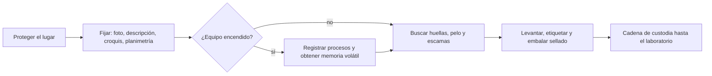

# 02 - Criminalística orientada a las TIC

> Lectura del curso [Informática forense](../../cursos/digital-forensics/README.md), unidad 1, tema 2.

## Por qué importa

La informática forense no nació de cero: es una rama de la criminalística, la disciplina que desde hace más de un siglo estudia los rastros que deja un delito para reconstruirlo y señalar a sus autores. Sus principios (el intercambio de Locard, la regla de no tocar nada antes de fijarlo, la cadena de custodia) valen igual para un casquillo que para un disco duro. Lo que cambia es el tiempo: un cadáver espera a que llegue el perito; la memoria de una computadora encendida no, y un teléfono conectado puede borrarse a distancia mientras los investigadores atienden otra cosa.

Esta nota recorre de dónde viene la criminalística, cómo se define, cuáles son sus principios y cómo se aplican a un lugar de los hechos donde hay equipos de cómputo y comunicaciones: protección, fijación, búsqueda de huellas físicas que liguen al equipo con una persona, levantamiento, embalaje y el sustento que da el Código Nacional de Procedimientos Penales (CNPP) a cada paso.

## Origen de la criminalística

Durante siglos, los juicios se resolvieron sin un método para tratar las pruebas materiales. En el siglo XVII empezó a aparecer el médico como auxiliar de los tribunales, y con él los primeros intentos de investigar un delito de manera ordenada y documentada. El nombre de la disciplina llegó mucho después.

| Año | Hecho |
|---|---|
| Siglo XVII | El médico empieza a intervenir en los procesos judiciales: primeros esbozos de una investigación metódica |
| 1892 | Hans Gross, juez de instrucción en Estiria y profesor de derecho penal en Graz, usa por primera vez el término "criminalística" |
| 1892 | Francis Galton, explorador y científico británico (primo de Charles Darwin), publica *Finger Prints*: las huellas dactilares no cambian a lo largo de la vida y sirven para identificar personas |
| 1894 | Juan Vucetich, policía de la provincia de Buenos Aires, simplifica la clasificación dactilar con cuatro tipos básicos: arcos, presillas internas, presillas externas y verticilos |
| 1901 | Karl Landsteiner describe los grupos sanguíneos A, B y O; sus discípulos Alfredo de Castello y Adriano Sturli identifican después el grupo AB |
| 1910 | Edmond Locard funda en Francia un laboratorio de policía dedicado a la investigación forense y formula su principio de intercambio |
| 1915 | Leone Lattes desarrolla un método para determinar el grupo sanguíneo de manchas secas halladas en la escena |
| 1932 | El FBI crea su laboratorio forense para apoyar a agentes de campo y a otras autoridades |

Gross escribió su manual del juez, fruto de veinte años de experiencia, para suplir lo que los jueces de instrucción no sabían de técnica: interrogatorio, planos y diagramas, lectura de escritos y rastreo de cómo se comunicaban los involucrados. Su temario anticipó muchas especialidades periciales actuales (antropometría, argot criminal, contabilidad, criptografía, dibujo forense, documentoscopía, explosivos, fotografía, grafología, accidentes ferroviarios, hematología, incendios, medicina legal y química legal) e incluyó las cualidades éticas, físicas y culturales de un buen juez. La criptografía y las comunicaciones ya estaban ahí desde el principio.

### La criminalística en México

En México la disciplina se consolidó entre finales del siglo XIX y la primera mitad del XX, en un periodo de cambios políticos y sociales:

| Año | Hecho |
|---|---|
| 1926 | Benjamín Martínez y Carlos Roumagnac fundan el Gabinete de Identificación y el Laboratorio de Investigación Criminalística en la Jefatura del Distrito Federal |
| 1941 | Alfonso Quiroz Cuarón, figura central de la criminalística mexicana, crea la Sección de Investigadores Especiales del Banco de México |
| 1942 | Se dispone que la Procuraduría General de la República cuente con un Laboratorio Científico de Investigaciones |
| 1964 | La Facultad de Medicina empieza a impartir cursos de medicina forense, impulsados por Quiroz Cuarón |
| 1971 | Rafael Moreno González inicia la profesionalización de los investigadores criminalistas, con énfasis en una actitud objetiva, inquisitiva y crítica |
| 1975 | Se constituye la Academia Mexicana de Criminalística |
| 2011 | Se inauguran nuevas instalaciones de la Dirección General de Coordinación de Servicios Periciales de la PGR |
| 2012 | Abre el Centro Médico Forense Federal, que permite a la institución identificar y preservar cadáveres en instalaciones propias |

Con el tiempo, la Coordinación General de Servicios Periciales de la Agencia de Investigación Criminal se volvió referencia nacional en métodos forenses y en bases de datos de identificación (armas, proyectiles, voz, perfiles genéticos).

Actualización al 2026: la PGR se transformó en la Fiscalía General de la República (FGR) en diciembre de 2018. La Ley de la Fiscalía General de la República (DOF 20-05-2021) mantiene a la Agencia de Investigación Criminal (artículo 14) y una unidad administrativa de servicios periciales (artículo 44), de modo que las funciones descritas siguen existiendo bajo la nueva institución.

## Qué es la criminalística

Las definiciones varían según el autor y la época, pero coinciden en el centro: la criminalística aplica métodos y técnicas de distintas especialidades para ayudar a esclarecer hechos delictivos y dar a la autoridad elementos para identificar a los responsables. Tres autores mexicanos la definen así, en esencia:

| Autor | Idea central |
|---|---|
| Alfonso Quiroz Cuarón | Disciplina auxiliar del derecho penal que descubre y verifica científicamente el delito y al delincuente |
| Rafael Moreno González | Aplicación de los conocimientos de las ciencias naturales al examen del material sensible ligado a un presunto delito, para saber si existió, reconstruirlo o precisar quién intervino |
| Juventino Montiel Sosa | Ciencia natural y penal que estudia indicios materiales para verificar hechos presuntamente delictivos, identificar a sus autores y aportar pruebas a los órganos de justicia |

En México el Ministerio Público conduce la investigación con la policía y peritos de varias especialidades. El material plantea que, al ritmo del cambio tecnológico, podría surgir una figura que reúna el saber jurídico del Ministerio Público y el técnico del investigador.

### Objetivos generales

Siguiendo a Montiel Sosa, la criminalística persigue cinco objetivos:

1. Demostrar técnica y científicamente que ocurrió un hecho posiblemente delictivo, a partir de localizar, identificar y estudiar los indicios para saber de dónde vienen, qué son y cómo se produjeron.
2. Reconstruir la mecánica del hecho: qué instrumentos se usaron, qué conductas implicó su uso y qué maniobras fueron necesarias para llevarlo a cabo.
3. Aportar indicios y coordinar técnicas para identificar a la víctima, si la hay.
4. Aportar indicios y coordinar técnicas para identificar a los presuntos autores o coautores.
5. Entregar pruebas materiales y periciales, con estudios técnicos y científicos, que establezcan el grado de participación de cada persona involucrada.

### Objeto de estudio

Para Moreno González, el objeto de estudio son los **indicios**: la evidencia física (material sensible) relacionada con los hechos. En TIC eso plantea dos retos propios:

- **Cantidad y variedad.** Aparecen dispositivos nuevos de procesamiento y comunicación todo el tiempo, y el almacenamiento se miniaturiza: memorias en cámaras, teléfonos, tabletas, relojes. El perito tiene que reconocer como indicio algo que quizá no parece una computadora.
- **Tiempo y acceso remoto.** Entre que se descubre el hecho y llega el perito pueden pasar horas. Mientras tanto, cualquier persona con acceso por red cableada o inalámbrica puede alterar o borrar información sin estar presente. Por eso la intervención inmediata del especialista es decisiva para llegar a la verdad histórica de los hechos.

## El cuidado de los indicios y su valor en juicio

Gross daba un consejo que sigue vigente: si se quiere que la inspección sirva, todos los objetos del lugar, importantes o no, deben quedarse donde están y como están hasta que los peritos los fijen e identifiquen. El CNPP convierte esa prudencia en obligación:

Código Nacional de Procedimientos Penales, artículo 229 (texto vigente, última reforma DOF 28-11-2025):

> Artículo 229. Aseguramiento de bienes, instrumentos, objetos o productos del delito
>
> Los instrumentos, objetos o productos del delito, así como los bienes en que existan huellas o pudieran tener relación con éste, siempre que guarden relación directa con el lugar de los hechos o del hallazgo, serán asegurados durante el desarrollo de la investigación, a fin de que no se alteren, destruyan o desaparezcan. Para tales efectos se establecerán controles específicos para su resguardo, que atenderán como mínimo a la naturaleza del bien y a la peligrosidad de su conservación.

Nota de vigencia: versiones antiguas de este artículo remitían a "los criterios que para tal efecto emita el Procurador"; el texto vigente ya no lo hace.

El valor que se dé después a ese material lo decide el juez con libertad, pero de forma lógica y razonada, mirando el conjunto de las pruebas (artículo 265 del CNPP). La regla general de la prueba es esta:

Código Nacional de Procedimientos Penales, artículo 259 (texto vigente):

> Artículo 259. Generalidades
>
> Cualquier hecho puede ser probado por cualquier medio, siempre y cuando sea lícito.
>
> Las pruebas serán valoradas por el Órgano jurisdiccional de manera libre y lógica.
>
> Los antecedentes de la investigación recabados con anterioridad al juicio carecen de valor probatorio para fundar la sentencia definitiva, salvo las excepciones expresas previstas por este Código y en la legislación aplicable.
>
> Para efectos del dictado de la sentencia definitiva, sólo serán valoradas aquellas pruebas que hayan sido desahogadas en la audiencia de juicio, salvo las excepciones previstas en este Código.

Nota de vigencia: el material del curso atribuía este texto al artículo 359; en el código vigente es el 259 (el 359, reformado en 2016, regula la valoración en el juicio).

La regla de cierre es la del tribunal de enjuiciamiento:

Código Nacional de Procedimientos Penales, artículo 402, párrafos primero y tercero (texto vigente):

> Artículo 402. Convicción del Tribunal de enjuiciamiento
>
> El Tribunal de enjuiciamiento apreciará la prueba según su libre convicción extraída de la totalidad del debate, de manera libre y lógica; sólo serán valorables y sometidos a la crítica racional, los medios de prueba obtenidos lícitamente e incorporados al debate conforme a las disposiciones de este Código.
>
> Nadie podrá ser condenado, sino cuando el Tribunal que lo juzgue adquiera la convicción más allá de toda duda razonable, de que el acusado es responsable de la comisión del hecho por el que siguió el juicio. La duda siempre favorece al acusado.

Para el perito, la consecuencia es directa: en un juicio oral a la defensa le basta sembrar una duda razonable, y la manera más fácil es mostrar que la evidencia digital se manejó sin método (un equipo apagado sin registrar su estado, una copia sin hash, un embalaje sin sello). Entonces se pierde todo lo invertido en probar el delito, por contundente que fuera el contenido.

## Método

Hablar de criminalística aplicada a las TIC es hablar de dos tipos de evidencia al mismo tiempo: la **digital** (archivos, registros, datos en memoria) y la **física** (el equipo o dispositivo que la contiene). No basta con preservar los archivos; hay que preservar también el aparato, porque otras especialidades periciales lo van a necesitar y porque es lo que permite ligar al sospechoso con la información.

La criminalística oscila entre ciencia especulativa y aplicada: comprueba hipótesis. Por **inducción** (el método de las ciencias naturales) observa fenómenos y llega a principios generales; por **deducción** aplica esos principios a un caso concreto, y a esa parte se le llama criminalística aplicada. La [nota 03](03-metodologia-investigacion.md) desarrolla ambos métodos.

## Los cuatro principios aplicados a las TIC

Los principios que validan el método criminalístico se trasladan al mundo digital así:

| Principio | Idea clásica | Cómo se aplica en TIC |
|---|---|---|
| Intercambio (Locard) | Quien comete un delito deja algo en el lugar y se lleva algo de él | Toda transacción electrónica queda registrada en algún equipo que la hizo posible: conmutadores, enrutadores, servidores, móviles, computadoras. El reto es que esos registros (bitácoras o *logs*) existan, estén bien configurados y se conserven el tiempo suficiente |
| Correspondencia de características | Se comparan a detalle dos muestras para saber si tienen el mismo origen | Los archivos conservan rasgos que, a veces, permiten rastrear su origen y sus cambios. Su "huella" se obtiene con una función hash, que sirve como elemento de cotejo |
| Reconstrucción de fenómenos o hechos | Con los indicios se reconstruye cómo ocurrió el hecho | Si cada transacción deja rastro de su procesamiento, toda transacción es rastreable cuando se investiga con método |
| Probabilidad | Se estima qué tan probable es una coincidencia | El ejemplo del material son las direcciones IPv4: hay 4,294,967,296 posibles (2 elevado a 32), así que es poco probable que la misma dirección se asigne a la misma computadora varias veces en un periodo y en condiciones determinados |

Actualización al 2026: hoy muchos proveedores comparten una IPv4 pública entre cientos de clientes con traducción de direcciones a gran escala (CGNAT, bloque reservado por el RFC 6598). Una IP sin puerto de origen y hora exacta con zona horaria rara vez identifica a un solo equipo. El principio sigue valiendo; lo que cambió son los datos necesarios para aplicarlo.

## Protección del lugar de los hechos

En algunos puntos la ley y la metodología criminalística se escriben juntas. El CNPP obliga a preservar lo que se encuentra, incluso cuando aparece por sorpresa:

Código Nacional de Procedimientos Penales, artículo 289 (texto vigente):

> Artículo 289. Descubrimiento de un delito diverso
>
> Si al practicarse un cateo resultare el descubrimiento de un delito distinto del que lo haya motivado, se formará un inventario de aquello que se recoja relacionado con el nuevo delito, observándose en este caso lo relativo a la cadena de custodia y se hará constar esta circunstancia en el registro para dar inicio a una nueva investigación.

El artículo 197 añade que, aun con el proceso suspendido, el Ministerio Público debe evitar que se pierdan o se vuelvan inútiles los registros y medios de prueba.

Sobre esa base descansa la **regla de oro** de la criminalística: no se toca ni se mueve nada hasta que esté identificado, medido y fotografiado. En TIC la regla pesa todavía más. Cuando una computadora o un sistema de comunicaciones está encendido, sus procesos y transacciones viven en la memoria principal (RAM); si alguien, por inexperiencia, lo desconecta o lo apaga antes de obtener esa información volátil, se pierden indicios que podían definir el rumbo del caso.

Ningún caso es igual a otro, así que las decisiones sobre qué hacer con cada equipo deben tomarlas peritos de la especialidad. Su objetivo, ya en el laboratorio, es poder contestar las **siete preguntas de oro** de la criminalística: ¿qué?, ¿quién?, ¿cómo?, ¿cuándo?, ¿dónde?, ¿por qué? y ¿con qué?

Para no contaminar el lugar mientras llega la autoridad, el material propone estos criterios:

1. Quien tenga noticia del hecho (un particular o un representante de la autoridad) mantiene el área sin cambios hasta que llegue la autoridad competente, local o federal.
2. Si el hecho ocurrió en una habitación o un inmueble, se revisan sus accesos, se cierran y se vigilan sin interrupción para que nadie más entre.
3. Si ocurrió al aire libre, se delimita con cinta el área de estudio (el material sugiere unos 40 metros cuadrados).
4. Se controla de forma estricta quién entra y quién sale, y se identifica a cada persona presente.
5. Nadie toca paredes, muebles ni objetos dentro del perímetro sin guantes.
6. Se prohíbe mover o cambiar de posición cualquier indicio.
7. Se documentan con cuidado los pasillos, cuartos y accesos dentro del perímetro, para no confundir con indicios las marcas que dejan los propios investigadores (pisadas, huellas, rayones).
8. Una vez protegido el lugar, autoridades y peritos proceden a fijarlo.

En TIC, "accesos" incluye más que puertas y ventanas: los nodos de red, las líneas telefónicas, las redes inalámbricas y las conexiones bluetooth también son entradas y salidas del lugar de los hechos.

## Fijación del lugar de los hechos

Asegurado el sitio y garantizada la seguridad del personal, la **fijación** es el primer paso antes de decidir qué se asegura, se embala o se traslada al laboratorio. El orden importa: embalar y trasladar alteran el lugar de manera irreversible si antes no se registró cómo estaba. La fijación se hace con cuatro técnicas:

1. Fotografía.
2. Descripción escrita.
3. Croquis.
4. Planimetría (medidas a escala y ubicación en planos).

Ayudan las cámaras, las grabadoras o un teléfono con georreferencia; sin ellos, la metodología tradicional basta.

### Fotografía

Es lo primero que se hace una vez que el lugar es seguro, en coordinación entre peritos y Ministerio Público. La serie fotográfica se compone de cuatro tipos de toma: **vistas generales, vistas medias, acercamientos y grandes acercamientos**. Las imágenes nunca se retocan ni se alteran.

Para TIC, y siguiendo las recomendaciones de Moreno González, la serie debe cubrir:

1. Las áreas exteriores que rodean el lugar, si tienen relevancia.
2. Las vías de acceso reales o posibles, incluidos nodos de red, conexiones telefónicas y señales de redes inalámbricas o bluetooth (un teléfono celular basta para detectarlas).
3. El equipo o los equipos donde se sospecha que empezó el incidente.
4. Cada indicio o grupo de indicios relacionado con el incidente.
5. Los equipos encendidos, sin apagarlos: se fijan los procesos y aplicaciones activos al momento de la diligencia, se obtiene la memoria volátil y, si hace falta, la imagen forense del disco.
6. Todas las conexiones de cada equipo, para saber con qué medios de comunicación cuenta.
7. Los detalles pequeños que podrían ligar al autor con el equipo, como huellas.

Cuando una fotografía digital va a presentarse como prueba, conviene calcular su valor hash en cuanto se toma: así se puede demostrar después que el archivo no cambió.

### Descripción escrita

La descripción da sentido a las fotografías: va de lo general a lo particular, con método y precisión. Sin grabadora la hacen dos personas (una narra, otra transcribe); con audio y video basta una. En TIC el lugar puede ser el centro de cómputo de un banco o de una televisora, y el cuerpo del delito puede estar en un solo dispositivo o repartido en todos; cualquier detalle bien descrito puede ser decisivo. Aquí colaboran criminalística, fotografía y TIC.

### Croquis

El croquis obliga a recorrer todo el lugar sin saltarse indicios. Debe incluir medidas precisas, la posición de la cámara en cada toma, la escala utilizada y la orientación con los puntos cardinales. Se recomienda agregar notas al pie, nombre de quien lo hizo, fecha, hora y firma. En TIC hay que marcar también lo que no parece informático: cámaras digitales, agendas electrónicas, memorias del tamaño de un chicle, conexiones telefónicas y de red, impresoras, teléfonos, faxes, incluso plumas con memoria; es decir, todos los periféricos, además de la ubicación de cada equipo de cómputo y de telecomunicaciones.

## Huellas: ligar el equipo con una persona

Encontrar archivos suele ser lo fácil; lo difícil es demostrar quién estaba frente al teclado. Los indicios físicos ligan el dispositivo donde empezó el incidente con la persona que lo operó. Se buscan alrededor del equipo y dentro de él, porque hay quien abre el gabinete para sacar o cambiar un disco y desviar la investigación. Interceptar o cortar comunicaciones exige manipular el equipo, así que cables, teclados, ratones, monitores y gabinetes se tocan lo mínimo, siempre con guantes, y sin que los polvos reveladores dañen la electrónica.

### Huellas dactilares

Una huella dactilar es la marca que dejan las crestas papilares de la yema de los dedos al tocar una superficie; el dibujo que forman se llama dactilograma. Es individual y por eso sirve para identificar personas. Para analizarlas y compararlas se clasifican en cuatro patrones principales:

| Patrón | Cómo se reconoce |
|---|---|
| Arco | Las crestas cruzan el dedo de lado a lado formando una ondulación, sin regresar sobre sí mismas |
| Presilla interna | Las crestas entran, dan vuelta en forma de asa y regresan hacia el lado del pulgar |
| Presilla externa | Igual que la anterior, pero el asa se abre hacia el lado del meñique |
| Verticilo | Las crestas forman círculos o espirales alrededor de un centro |

Además del patrón, cada huella tiene **minucias** (del latín *minutiae*, "puntos característicos"). El material ilustra siete: islote, bifurcación, punto, cortada, horquilla, empalme y encierro. Combinadas, forman entre 60 y 120 rasgos individuales en un dedo (por ejemplo, diez horquillas, doce empalmes o quince islotes).

El software biométrico ubica cada minucia en coordenadas (x, y) y las une con rectas: el conjunto de vectores, con sus ángulos, es único, y la verificación compara vectores, no imágenes. El **Sistema Automatizado de Identificación de Huellas Dactilares (AFIS)** contrasta así una huella tomada en persona, un fragmento levantado en el lugar o una tarjeta decadactilar contra su base de datos; el material le atribuye 99.9 % de confiabilidad.

### Pelo

Quien pasa días frente a su equipo planeando un delito deja pelo en las ranuras de teclados y periféricos, y la genética forense puede identificarlo. No toda muestra sirve, pero ninguna se descarta de entrada.

El pelo es queratina que nace de la epidermis, con una raíz que termina en el bulbo, implantado en la dermis. Tiene tres capas: **cutícula** (envoltura), **corteza** (queratina y melanina; la mayor parte) y **médula** (centro continuo, discontinuo, ausente o de doble canal). La punta no tiene células con núcleo; la raíz sí. Según su fase, **anágena** (crecimiento), **catágena** (transición) o **telógena** (final, sin actividad), sirve más o menos: los anágenos son los mejores para ADN nuclear, y los telógenos solo para ADN mitocondrial.

### Escamas de piel

La piel suelta escamas por roce o por renovación natural. Abundan en el piso y, en TIC, debajo de las teclas y en el polvo acumulado en los ventiladores que enfrían el procesador. Se recolectan con aspiradoras de mano usadas con cuidado. Existen muchos otros indicios (fluidos, sustancias, manchas), pero estos son los que, según la experiencia del autor del material, más ayudan a vincular un equipo con su usuario.

## Levantamiento y embalaje

El inventario y la cadena de custodia que exige el artículo 289 del CNPP obligan a quien procesa la evidencia a trabajar con orden: nada se debe dañar, alterar ni destruir durante la fijación, el etiquetado, la preservación o el traslado. Una de las claves es que el embalaje quede **sellado** y que los sellos aparezcan en las fotografías antes de entregarlo a la autoridad. Así, si alguien lo abre después, se puede demostrar en qué estado empezó la custodia, quién lo trasladó y qué se hizo con él. El fundamento es la definición legal de la cadena de custodia:

Código Nacional de Procedimientos Penales, artículo 227 (texto vigente):

> Artículo 227. Cadena de custodia
>
> La cadena de custodia es el sistema de control y registro que se aplica al indicio, evidencia, objeto, instrumento o producto del hecho delictivo, desde su localización, descubrimiento o aportación, en el lugar de los hechos o del hallazgo, hasta que la autoridad competente ordene su conclusión.
>
> Con el fin de corroborar los elementos materiales probatorios y la evidencia física, la cadena de custodia se aplicará teniendo en cuenta los siguientes factores: identidad, estado original, condiciones de recolección, preservación, empaque y traslado; lugares y fechas de permanencia y los cambios que en cada custodia se hayan realizado; igualmente se registrará el nombre y la identificación de todas las personas que hayan estado en contacto con esos elementos.

Con equipos de cómputo, comunicación y almacenamiento, antes de embalar hay que considerar si el dispositivo está encendido o apagado, si un teléfono puede todavía enviar o recibir comunicaciones, si tiene contraseña y si le queda batería. Con archivos, la función hash es lo que demuestra de manera objetiva que el indicio no se alteró.

El material ilustra dos casos:

- **Una computadora portátil** envuelta en material acolchado que la protege de golpes, con su etiqueta de identificación a la vista sobre el embalaje.
- **Un teléfono celular encendido** envuelto en papel aluminio antes de meterlo al sobre, mientras el perito, con guantes, llena la etiqueta. El aluminio funciona como jaula de Faraday: corta la señal para que nadie pueda borrar el equipo a distancia ni le lleguen comunicaciones nuevas que sobrescriban datos.

La ley también prevé qué pasa si un indicio se altera durante la custodia:

Código Nacional de Procedimientos Penales, artículo 228 (texto vigente):

> Artículo 228. Responsables de cadena de custodia
>
> La aplicación de la cadena de custodia es responsabilidad de quienes en cumplimiento de las funciones propias de su encargo o actividad, en los términos de ley, tengan contacto con los indicios, vestigios, evidencias, objetos, instrumentos o productos del hecho delictivo.
>
> Cuando durante el procedimiento de cadena de custodia los indicios, huellas o vestigios del hecho delictivo, así como los instrumentos, objetos o productos del delito se alteren, no perderán su valor probatorio, a menos que la autoridad competente verifique que han sido modificados de tal forma que hayan perdido su eficacia para acreditar el hecho o circunstancia de que se trate. Los indicios, huellas o vestigios del hecho delictivo, así como los instrumentos, objetos o productos del delito deberán concatenarse con otros medios probatorios para tal fin. Lo anterior, con independencia de la responsabilidad en que pudieran incurrir los servidores públicos por la inobservancia de este procedimiento.

Antes de mover o desconectar cualquier equipo encendido, se pide la opinión del perito en informática, telecomunicaciones o electrónica. Si las últimas acciones del delincuente siguen ejecutándose en la RAM de una de las máquinas y alguien la desconecta antes de preservar esa memoria, se pierden para siempre los rastros de cómo empezó el incidente. La investigación puede seguir por otras líneas, pero costará mucho más tiempo y esfuerzo llegar a la verdad histórica y a los responsables.

### Recomendaciones de levantamiento

Moreno González (2003), en su *Compendio de criminalística*, señala que la técnica depende de la naturaleza, cantidad, variedad y estado de los indicios. Sus recomendaciones, adaptadas a TIC:

1. Levantar todo: es preferible pecar de exceso que de defecto.
2. Manipular cada indicio solo lo indispensable.
3. No contaminarlo con los instrumentos usados para levantarlo.
4. Levantar cada indicio por separado, sin mezclarlos.
5. Marcarlo (etiquetarlo), de ser posible en una zona que no vaya a estudiarse después.
6. Embalarlo por separado, protegido y sellado, anotando de dónde se levantó y quién lo embaló.

Y algunas precauciones propias de la electrónica:

- El contacto de la piel puede producir una descarga electrostática que dañe un componente para siempre; por eso se usan guantes de látex y pulseras antiestáticas, y el levantamiento lo hacen especialistas.
- Los equipos sufren con el polvo, la humedad, el calor o el frío extremos, los golpes y las variaciones eléctricas. Se sellan, se forran con material protector, se marca en la etiqueta qué lado va hacia arriba y se evita exponerlos a cambios bruscos de temperatura durante el traslado.
- Los discos ópticos y las memorias no se toman con la mano directamente ni se escribe sobre su superficie; se sellan y etiquetan igual que el resto.

Estas reglas se apoyan en el Acuerdo A/009/15 de la entonces PGR sobre cadena de custodia (DOF 12-02-2015) y en la *Guía técnica de cadena de custodia de evidencia digital* (2018) de la Unidad de Investigaciones Cibernéticas y Operaciones Tecnológicas de la Agencia de Investigación Criminal, que se estudia en la [nota 15](15-identificacion-fijacion-preservacion.md).

## Técnicas criminalísticas orientadas a TIC

Las técnicas criminalísticas son comprobaciones basadas en el método científico que cada especialidad pericial aporta a la investigación. El problema es que, en todo el mundo, la criminalística se ha concentrado en cadáveres, armas de fuego, sustancias prohibidas y fluidos biológicos, y casi no hay literatura criminalística que trate la evidencia digital con la misma profundidad.

La diferencia de fondo es el tiempo. En la criminalística clásica, un lugar bien preservado detiene el reloj: los indicios esperan, salvo su degradación natural. Con computadoras y teléfonos no: mientras se atiende un cadáver o se levantan casquillos, alguien puede estar borrando a distancia los dispositivos. Y hoy en esos equipos vive todo: la vida social de la víctima y la vida delictiva del agresor.

Por eso el material propone desarrollar técnicas específicas, que se estudian a lo largo del curso:

1. Identificación, fijación y preservación de los equipos que almacenan, procesan o transmiten evidencia digital.
2. Duplicación de la evidencia contenida en dispositivos de almacenamiento masivo.
3. Recuperación de evidencia digital.
4. Comprobación de que la evidencia digital no se alteró.
5. Análisis e identificación de sistemas informáticos.
6. Análisis e identificación de sistemas de telecomunicaciones.
7. Identificación, fijación y preservación de archivos electrónicos.

Sobre la duplicación, una distinción útil: la **adquisición física** copia el medio completo bit por bit, con espacio libre y archivos borrados; la **lógica** copia solo lo seleccionado. En ambas se compara el hash del original y de la copia (hoy SHA-256; MD5 y SHA-1 tienen colisiones conocidas y solo sirven como complemento).

## Glosario

| Término | Definición |
|---------|-----------|
| Criminalística | Disciplina que aplica métodos científicos al estudio de los indicios para demostrar un hecho delictivo y relacionarlo con sus autores |
| Indicio | Rastro, objeto o dato que puede estar relacionado con un hecho delictivo y que, procesado correctamente, puede convertirse en prueba |
| Evidencia digital | Información almacenada o transmitida en forma binaria que puede usarse como prueba |
| Principio de intercambio | Idea de Locard: todo contacto deja rastro; en TIC, toda transacción queda registrada en algún equipo |
| Función hash | Algoritmo que produce un valor de longitud fija a partir de un archivo; si el archivo cambia, el valor cambia |
| Regla de oro | No tocar ni mover nada hasta que esté identificado, medido y fotografiado |
| Fijación | Registro del estado del lugar y de los indicios mediante fotografía, descripción, croquis y planimetría |
| Planimetría | Representación a escala del lugar de los hechos con la ubicación precisa de cada indicio |
| Minucia | Punto característico de una huella dactilar (bifurcación, islote, horquilla, entre otros) |
| AFIS | Sistema automatizado que compara huellas dactilares contra una base de datos mediante sus minucias |
| Memoria volátil | Información que solo existe mientras el equipo está encendido, como la contenida en la RAM |
| Embalaje | Envoltura que protege, identifica y sella un indicio para su traslado y resguardo |
| Jaula de Faraday | Envoltura conductora que bloquea las señales de radio; aísla a un teléfono de la red |
| Cadena de custodia | Sistema de control y registro de un indicio desde que se localiza hasta que la autoridad ordena concluirlo |
| Duda razonable | Incertidumbre fundada sobre la culpabilidad que obliga al tribunal a absolver |

## Referencias

- Cámara de Diputados del H. Congreso de la Unión. (2025). *Código Nacional de Procedimientos Penales* [Última reforma DOF 28-11-2025]. Diario Oficial de la Federación. https://www.diputados.gob.mx/LeyesBiblio/pdf/CNPP.pdf
- Cámara de Diputados del H. Congreso de la Unión. (2025). *Ley de la Fiscalía General de la República* [Última reforma DOF 14-11-2025]. Diario Oficial de la Federación. https://www.diputados.gob.mx/LeyesBiblio/pdf/LFGR.pdf
- Galton, F. (1892). *Finger prints*. Macmillan. https://galton.org/books/finger-prints/
- Locard, E. (1923). *Manuel de technique policière (enquête criminelle)*. Payot. https://catalogue.bnf.fr/ark:/12148/cb308262663
- Montiel Sosa, J. (2007). *Criminalística*. Limusa. https://limusa.com.mx/producto/criminalistica-1-2a-ed/
- Moreno González, L. R. (2001). *Antología de la investigación criminalística*. Instituto Nacional de Ciencias Penales.
- Moreno González, L. R. (2003). *Compendio de criminalística* (4.ª ed.). Porrúa.
- Moreno González, L. R. (2006). *Manual de introducción a la criminalística* (12.ª ed.). Porrúa.
- Procuraduría General de la República. (2015, 12 de febrero). *Acuerdo A/009/15 por el que se establecen las directrices que deberán observar los servidores públicos que intervengan en materia de cadena de custodia*. Diario Oficial de la Federación. https://dof.gob.mx/nota_detalle.php?codigo=5381699&fecha=12/02/2015
- Unidad de Investigaciones Cibernéticas y Operaciones Tecnológicas. (2018). *Guía técnica de cadena de custodia de evidencia digital*. Agencia de Investigación Criminal, Procuraduría General de la República. https://www.gob.mx/fgr (documento institucional sin dirección pública estable verificada; se cita la sede oficial de la institución sucesora).
- Weil, J., Kuarsingh, V., Donley, C., Liljenstolpe, C. y Azinger, M. (2012). *IANA-reserved IPv4 prefix for shared address space* (RFC 6598). Internet Engineering Task Force. https://www.rfc-editor.org/rfc/rfc6598

---

*Rogelio Arriaga Gonzalez*
