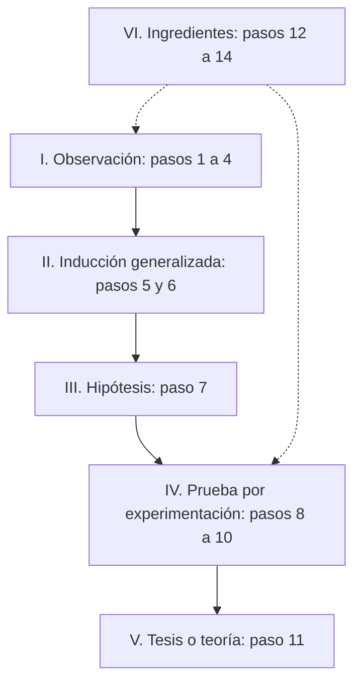

# 03 - Metodología de la investigación

> Lectura del curso [Informática forense](../../cursos/digital-forensics/README.md), unidad 1, tema 3.

## Por qué importa

Un dictamen pericial no es una opinión informada: es el resultado de aplicar un método que otra persona podría repetir y llegar al mismo lugar. Esa es la diferencia entre el trabajo de un perito y un informe policial. Si el método no se ve en el documento, el juez no tiene cómo valorar las conclusiones y la defensa tiene por dónde atacarlas.

En informática forense la metodología se nota en dos lados. En el trabajo técnico, porque cada paso (identificar, adquirir con copias forenses, analizar, documentar y conservar la cadena de custodia) tiene que hacerse en orden y quedar registrado. Y en el informe, porque debe explicar con claridad qué se hizo, con qué herramientas y qué se encontró, para que la autoridad pueda usarlo como dato de prueba. Esta nota repasa qué es el método científico, qué métodos acepta la comunidad científica, cómo se ordenan sus etapas en el modelo MC-14 y en el de Arias Galicia, y cómo se plantea bien un problema pericial.

## El método científico

No hay una definición única y sencilla del método científico, pero sí una idea compartida: es la forma sistemática de obtener conocimiento y comprobarlo. La palabra "método" viene del griego y significa, literalmente, el camino que lleva a algo; en este caso, el camino hacia el conocimiento.

En la práctica es una serie de procedimientos pensados para resolver un problema concreto o contestar una pregunta de investigación, de manera que cualquiera que repita los pasos en condiciones parecidas obtenga resultados parecidos. Su propósito es que el conocimiento descanse en fundamentos objetivos y dependa lo menos posible de quien observa.

Dos pilares lo sostienen:

| Pilar | Qué exige | Qué significa para el perito |
|---|---|---|
| Reproducibilidad | Que el experimento pueda repetirse en cualquier lugar y por cualquier persona | Otro perito, con la misma evidencia y las mismas herramientas, debe llegar al mismo resultado; por eso se trabaja sobre copias verificadas con hash y se documenta cada paso |
| Falsabilidad | Que toda afirmación científica pueda ponerse a prueba con un experimento cuyo resultado, si no es el esperado, la refute | Una conclusión pericial debe poder contrastarse; "el archivo lo creó el usuario X" se sostiene si los metadatos, los registros y las huellas lo soportan, y cae si alguno lo contradice |

Todavía hay diferencias entre autores sobre cómo clasificar los métodos. Aun así, al perito le conviene una guía que ordene su pensamiento frente a un planteamiento y le permita emitir una opinión técnica contundente. Los que siguen son los aceptados por la comunidad científica.

## Clasificación de los métodos

### Método empírico-analítico

Produce un conocimiento que se corrige a sí mismo y avanza; sirve tanto para las ciencias naturales como para las sociales y es el método general de las ciencias descriptivas. Se apoya en la lógica empírica: descompone un fenómeno en sus elementos y los revisa uno por uno. Dentro de él hay métodos específicos con técnicas propias, todos con aplicación posible en la investigación forense en TIC:

| Método | En qué consiste |
|---|---|
| Experimental | Sigue la lógica del experimento. Agrupa el método hipotético-deductivo, el de la observación científica (propio de las ciencias descriptivas) y el de la medición, del que se desprende todo el trabajo empírico y estadístico |
| Fenomenológico | Acumula conocimiento, pero se corrige menos que el experimental |
| Histórico | Estudia las etapas de un objeto en orden cronológico: para entender cómo evolucionó un fenómeno hay que reconstruir su historia, sus etapas principales y las conexiones internas entre ellas |
| Sistémico | Modela el objeto identificando sus componentes y las relaciones entre ellos, que determinan su estructura y su dinámica |
| Sintético | Une hechos que parecían aislados en una explicación que los integra; aparece sobre todo al formular la hipótesis, cuando el investigador imagina una explicación tentativa que después pondrá a prueba |
| Lógico | Rama más clásica y menos fiable por sí sola; al unirse con el método empírico dio origen al hipotético-deductivo, uno de los más confiables hoy |

Un ejemplo de método sistémico en TIC: ante una intrusión en una red, el perito modela los componentes (servidores, cortafuegos, cuentas, aplicaciones) y sus relaciones (quién confía en quién, qué puertos se comunican) para entender por dónde pudo moverse el atacante.

### Método lógico deductivo

Aplica principios ya descubiertos a casos particulares mediante una cadena de juicios. Su técnica característica es la **extrapolación**: llevar lo que se sabe a un caso que no se ha observado. Tiene dos variantes:

- **Deducción directa o de conclusión inmediata.** El juicio sale de una sola premisa, sin pasos intermedios.
- **Deducción indirecta o de conclusión mediata.** Usa silogismos: una premisa mayor con una proposición universal, una premisa menor con una proposición particular, y una conclusión que resulta de compararlas.

Un silogismo forense sencillo: todo archivo cuyo hash coincide con el de un archivo conocido es idéntico a él (premisa mayor); el hash de este archivo coincide con el del material ilícito catalogado (premisa menor); por lo tanto, este archivo es ese material (conclusión).

### Método lógico inductivo

Va de los casos particulares a conocimientos generales. Su técnica característica es la **interpolación**. Se divide en:

- **Inducción completa.** La conclusión sale de estudiar todos los elementos del objeto. Solo es posible cuando se sabe exactamente cuántos son y que lo concluido vale para cada uno.
- **Inducción incompleta.** Los elementos no pueden contarse ni estudiarse todos, así que se toma una muestra representativa y se generaliza. Comprende dos formas:
  - **Por simple enumeración o conclusión probable.** Se usa cuando los elementos son muchísimos o infinitos: si una característica se repite en una serie de casos homogéneos y ninguno la contradice, se infiere que es general. Su fuerza depende de cuántos casos se revisen, y sus conclusiones son posibilidades, no demostraciones: basta un caso contrario para refutarlas.
  - **Inducción científica.** Estudia las características y conexiones del objeto, incluidas las relaciones de causa y efecto; está muy cerca del método empírico.

En informática forense la inducción incompleta es cotidiana: nadie lee los millones de archivos de un disco. Se filtran, se muestrean y se generaliza con cuidado, sabiendo que un solo hallazgo contrario obliga a revisar la conclusión.

### Analogía

Consiste en inferir que, si dos objetos se parecen en algunas características, probablemente se parezcan también en las demás. Es útil para plantear hipótesis (por ejemplo, comparar un programa malicioso nuevo con una familia conocida), pero no basta para concluir: la semejanza se tiene que comprobar.

## Las etapas del método científico: el modelo MC-14

Conocer las etapas del método científico ayuda a entender de dónde sale la estructura del dictamen pericial, el documento donde el experto responde al planteamiento de la autoridad, y por qué es tan distinto de un informe policial.

El método puede organizarse en una fórmula de catorce pasos conocida como **MC-14** (en inglés, SM-14), propuesta por Norman W. Edmund. Los pasos se dividen en principales y en "ingredientes" de apoyo, y los principales se agrupan en estadios según el objetivo de cada uno. El orden no es rígido: en la práctica se puede ir y volver entre pasos.

| Estadio | Paso | Qué se hace |
|---|---|---|
| I. Observación | 1. Observación curiosa | Arranca el proceso inductivo. Los problemas e ideas nuevas casi siempre empiezan con lo que perciben los sentidos, ampliados con instrumentos, y con la imaginación y la introspección |
| | 2. Definición del problema | Se enuncia el problema, de preferencia como pregunta, y desde ahí se intenta acotarlo |
| | 3. Objetivos y planificación | Se escribe qué se quiere lograr al resolverlo |
| | 4. Búsqueda, exploración y recopilación de evidencias | El corazón de la solución: se buscan pistas y fuentes desde todos los ángulos, se reúnen las pruebas útiles y se arma una lista de posibles soluciones. Exige orden y poner por escrito lo que se piensa |
| II. Inducción generalizada | 5. Generación creativa y alternativas lógicas | Se reorganiza la información hasta que aparece una idea coherente, ya sea por ensayo y error, por un camino analítico y gradual o por intuición. La creatividad suele consistir en combinar dos ideas existentes para producir una nueva |
| | 6. Evaluación de las evidencias o pruebas | Se verifica lo recopilado y se hace preexperimentación, sin adelantar todavía la solución. Por ejemplo, antes de cambiar la pintura del ala de un avión se prueba en maquetas cómo afecta la rugosidad. Se comparan varias soluciones candidatas y se leen las fuentes con pensamiento crítico |
| III. Hipótesis | 7. Hipótesis, conjeturas y suposiciones | Después de descartar en el paso 6 las soluciones débiles, la más fuerte se convierte en la hipótesis: la respuesta propuesta a la definición más reciente del problema |
| IV. Prueba de hipótesis por experimentación | 8. Experimentación y cuestionamiento | La hipótesis se somete a pruebas proporcionales a la importancia del problema. Comprobar si la gente separa su basura no exige el mismo rigor que comprobar que un ala resiste la presión del aire; en todos los casos, al menos, hay que verificar las predicciones |
| | 9. Conclusiones | Si la hipótesis falla en parte, se ajusta y se vuelve a probar; si falla del todo, se cambia de camino. Equivocarse es normal. Si resiste las pruebas importantes, hay conclusión y puede darse a conocer |
| | 10. Prórroga de juicios de valor | Se sostiene la conclusión mientras no se demuestre falsa, con mente abierta y a la vez escéptica, listo para reajustarla ante pruebas nuevas convincentes |
| V. Tesis o teoría científica | 11. Desarrollo de la teoría y revisión por pares | La etapa de ganar aceptación: revisar el plan y los objetivos, presentar bien la hipótesis y recoger opiniones, dar crédito al equipo y a las fuentes, advertir posibles efectos sociales y ambientales, y anticipar objeciones |
| VI. Ingredientes | 12. Métodos creativos, lógicos, no lógicos y técnicos | Identificar las tácticas, técnicas, criterios y estrategias que dan mejores resultados que la improvisación |
| | 13. Objetivos del método | Refinar, ampliar y aplicar el conocimiento, buscando una verdad que quizá nunca se determine con total precisión |
| | 14. Aptitudes y habilidades cognitivas | No se habla de actitud sino de aptitud: capacidades innatas y aprendidas que la persona dedicada a la ciencia necesita desarrollar |

**Hasta dónde llega el dictamen.** El dictamen pericial recorre el método solo hasta el paso 9, la realización de conclusiones. La razón es lógica: responde a un planteamiento concreto de una autoridad, no propone una teoría que la comunidad científica deba aprobar, así que no pasa por la revisión por pares ni por la ganancia de aceptación.

## El modelo de Arias Galicia

Del MC-14 se desprenden muchas aplicaciones. El modelo de Fernando Arias Galicia es un buen ejemplo práctico, porque se parece mucho a los rubros que después dan forma al [dictamen pericial](16-dictamen-pericial.md). Lo componen seis etapas, cada una con su pregunta guía:

| Etapa | Nombre | Pregunta guía |
|---|---|---|
| 1 | Planteamiento del problema | ¿Qué se necesita saber? |
| 2 | Planeación | ¿Qué recursos se requieren? ¿Qué actividades hay que desarrollar? |
| 3 | Recopilación de información | ¿Cómo se obtienen los datos? ¿Con qué se obtienen? |
| 4 | Procesamiento de datos | ¿Cómo se ordenan y depuran los datos obtenidos? |
| 5 | Explicación e interpretación | ¿Qué significan los resultados frente al problema? |
| 6 | Comunicación de resultados y solución del problema | ¿Cómo se entrega la respuesta a quien la pidió? |

(La figura original numera como "cuarta" las tres últimas etapas; aquí se numeran del 1 al 6.)

## El planteamiento del problema

Todo el procedimiento pericial cobra sentido a partir del planteamiento del problema, y es justo ahí donde más se falla en los casos de computadoras y teléfonos. El error típico es pedir "extraer e imprimir toda la información" del dispositivo. El material del curso registra casos de dictámenes de **500 mil hojas** que, con todo respeto para la autoridad, difícilmente alguien leyó completos.

La alternativa es aprovechar lo que el perito sí sabe hacer: búsquedas muy específicas de números de tarjeta de crédito, frases o palabras clave, imágenes y otros patrones. Si la autoridad sabe más o menos qué busca, cientos de miles de resultados se reducen a unos pocos documentos relevantes.

Esas búsquedas pueden hacerse incluso en vivo, durante la intervención en el lugar de los hechos, sin esperar a tener la imagen forense completa del disco, que según el material puede tardar de 6 a 12 horas dependiendo de su tamaño. (Nota de vigencia: ese tiempo es la cifra que da el material; hoy depende sobre todo de la capacidad del medio, de su interfaz y de si se puede retirar el disco o hay que adquirir a través del equipo, así que conviene medirlo en cada caso y registrarlo en la bitácora.)

Para precisar la naturaleza y las dimensiones del problema, el material sugiere recorrer estos pasos:

| Paso | Qué se hace |
|---|---|
| I | Reunir los hechos relacionados con el problema: ¿qué está pasando o qué pasó? |
| II | Determinar la importancia de cada hecho |
| III | Buscar las relaciones entre los hechos que apuntan a su causa |
| IV | Proponer explicaciones de esa causa y valorar su peso en el problema |
| V | Encontrar, entre las explicaciones, las relaciones que den una visión amplia de la solución |
| VI | Relacionar los hechos con las explicaciones |
| VII | Analizar los supuestos en que se apoya todo lo anterior, para formular la **pregunta general**, que contiene la esencia del problema |
| VIII | Formular las **preguntas específicas**, que interrogan aspectos concretos |

Un ejemplo: si el caso es un fraude financiero, la pregunta general orienta a recuperar sobre todo documentos y registros de bases de datos, números de cuentas bancarias o de tarjetas. Las preguntas específicas bajan al detalle: fechas de creación y modificación, usuario que creó cada documento, y otras semejantes.

### El verdadero problema: ligar el equipo con la persona

El material insiste en algo que conviene repetir: encontrar los archivos, aunque se hayan borrado, casi nunca es lo difícil. Lo difícil es **ligar el equipo con quien cometió el delito**. Por eso importan las técnicas criminalísticas de la [nota 02](02-criminalistica-tic.md). Según la gravedad del caso, hará falta saber si las huellas del sospechoso están en el equipo, o si hay cámaras de video, controles de acceso, relojes checadores o registros biométricos que lo sitúen frente a la computadora en el momento del hecho. La integración de todos esos datos es lo que permite afirmar, con fundamento, si el sospechoso es responsable o no.

## Del método al informe

La metodología no termina en el laboratorio. El informe técnico debe dejar ver el proceso seguido, las técnicas aplicadas y los hallazgos, con claridad y rigor, para que la autoridad pueda presentarlos como datos de prueba. Un esquema mínimo que resume el tema:

1. **Identificación** de la evidencia digital relevante, a partir de un planteamiento del problema bien hecho.
2. **Adquisición** con copias forenses que preserven la integridad del original, verificadas con hash.
3. **Análisis** con técnicas especializadas y orientado por las preguntas específicas.
4. **Documentación** en un informe que cualquiera pueda seguir y repetir.
5. **Cadena de custodia** sin interrupciones durante todo el proceso.

Identificación meticulosa, adquisición cuidadosa, análisis exhaustivo y documentación clara: con eso los resultados son confiables, la evidencia es admisible y la informática forense cumple su papel en la administración de justicia y en la protección de los derechos de las personas.

## Glosario

| Término | Definición |
|---------|-----------|
| Método científico | Forma sistemática de obtener y comprobar conocimiento, con resultados que otros pueden repetir |
| Reproducibilidad | Capacidad de repetir un procedimiento y obtener el mismo resultado, sin importar quién ni dónde |
| Falsabilidad | Posibilidad de que una afirmación sea refutada por una prueba cuyo resultado no coincida con lo predicho |
| Inducción | Razonamiento que va de casos particulares a conclusiones generales |
| Deducción | Razonamiento que aplica principios generales a un caso concreto |
| Silogismo | Razonamiento con premisa mayor universal, premisa menor particular y conclusión |
| Extrapolación | Llevar lo conocido a casos fuera del rango observado; técnica del método deductivo |
| Interpolación | Estimar lo que hay entre casos conocidos; técnica del método inductivo |
| Analogía | Inferir semejanzas no observadas a partir de semejanzas observadas entre dos objetos |
| Hipótesis | Explicación tentativa de un problema que se somete a prueba |
| MC-14 | Fórmula de catorce pasos del método científico, agrupados en seis estadios |
| Planteamiento del problema | Definición precisa de lo que la autoridad necesita saber; da sentido a todo el peritaje |
| Pregunta general | Pregunta que contiene la esencia del problema pericial |
| Preguntas específicas | Preguntas que interrogan aspectos concretos del problema, como fechas o autoría de un archivo |
| Dictamen pericial | Documento en el que el perito responde con método al planteamiento de la autoridad |

## Referencias

- Arias Galicia, F. (2001). *Introducción a la metodología de investigación en ciencias de la administración y del comportamiento*. Trillas. https://search.worldcat.org/search?q=Arias+Galicia+Introducci%C3%B3n+a+la+metodolog%C3%ADa+de+investigaci%C3%B3n
- Edmund, N. W. (2005). *End the biggest educational and intellectual blunder in history*. Scientific Method Publishing. https://www.scientificmethod.com/
- Lira Arteaga, O. M. (2018). *Cibercriminalidad: fundamentos de investigación en México*. Ubijus. Edición anterior: Instituto Nacional de Ciencias Penales, 2010, ISBN 978-607-7882-13-8, https://www.marcialpons.es/libros/cibercriminalidad/9786077882138/

---

*Rogelio Arriaga Gonzalez*
