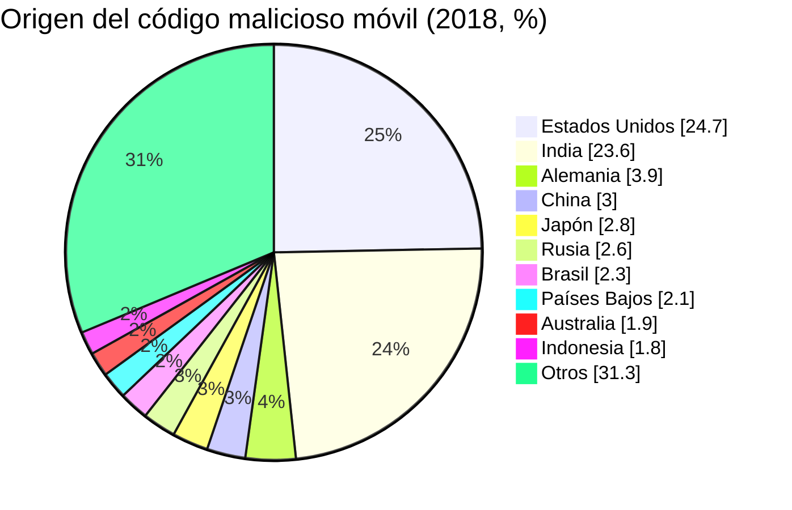

# 06 - Cibercrimen en el mundo

> Lectura del curso [Informática forense](../../cursos/digital-forensics/README.md), unidad 2, tema 2.

## Por qué importa

El delito informático no respeta fronteras: el correo que engaña a un empleado en Monterrey pudo redactarse en otro continente, pasar por servidores de un tercer país y cobrarse en criptomonedas. Para investigar un caso local hay que saber qué está pasando en el mundo, porque las técnicas llegan aquí meses después de aparecer en otro lado, y porque las estadísticas internacionales dicen dónde mirar primero: qué tipo de archivo adjunto, qué categoría de sitio web, qué familia de troyano.

Esta nota recorre la "sintomatología" del cibercrimen global a partir del último gran informe anual de Symantec (*Internet Security Threat Report*, volumen 24, publicado el 19 de febrero de 2019 con datos de 2018), y la contrasta con datos recientes. La relación de estas tendencias con México es el tema de la [nota 07](07-cibercrimen-en-mexico.md).

## Por qué el cibercrimen es un problema global

La expansión de las TIC trajo oportunidades y, con ellas, una delincuencia cada vez más sofisticada que afecta por igual a personas, empresas y Estados: robo de datos, fraude en línea y ataques complejos contra infraestructura crítica. Dos frentes concentran hoy la atención de los delincuentes:

- **El internet de las cosas (IoT).** Cámaras, televisores, relojes y sensores conectados que casi nadie actualiza.
- **Los dispositivos móviles.** Mejoran la productividad y la vida social, pero mucha gente comparte en ellos datos personales sin precaución, y esa información termina en manos de quien sabe aprovecharla.

Entender cómo se manifiestan esas debilidades y cómo las explotan los delincuentes es el punto de partida para prevenir y para investigar. La respuesta, concluye el tema, tiene que ser tan flexible como el fenómeno: tecnología de seguridad, educación continua en buenas prácticas y colaboración entre gobiernos, organizaciones y usuarios.

## El correo electrónico, puerta de entrada favorita

Lo que mostró el informe para 2018:

- Los empleados de **organizaciones pequeñas** tenían más probabilidad de recibir amenazas por correo (spam, phishing y correo con código malicioso) que los de empresas grandes.
- El **spam** siguió subiendo, como cada año desde 2015, hasta el **55 %** de los correos.
- La tasa de correo con código malicioso se mantuvo estable, y la de **phishing bajó** por cuarto año seguido: de 1 en 2,995 correos en 2017 a 1 en 3,207 en 2018.
- Los atacantes usaron **menos enlaces** y más **archivos adjuntos** como vector principal: la proporción de correos maliciosos con URL subió a 12.3 % en 2017 y bajó a 7.8 % en 2018.
- Los usuarios de **Microsoft Office** fueron los más expuestos, porque los documentos con macros eran el anzuelo más común.

### Países con más correo malicioso

Proporción de correos maliciosos por país en 2018 (uno de cada N correos; un número menor es peor). Primeros lugares y algunos de referencia:

| Lugar | País | Uno de cada |
|---|---|---|
| 1 | Arabia Saudita | 118 |
| 2 | Israel | 122 |
| 3 | Austria | 128 |
| 4 | Sudáfrica | 131 |
| 5 | Serbia | 137 |
| 6 | Grecia | 142 |
| 7 | Omán | 160 |
| 8 | Taiwán | 163 |
| 9 | Sri Lanka | 169 |
| 10 | Emiratos Árabes Unidos y Tailandia (empate) | 183 |
| ... | Reino Unido | 255 |
| ... | China | 309 |
| ... | Colombia | 328 |
| ... | Alemania | 352 |
| ... | Filipinas y Bélgica | 406 |

La revista de la unidad reproduce los 31 primeros lugares de esa tabla. En el informe original, México aparece más abajo, con 1 de cada 850 correos.

### Correos maliciosos que usan enlaces

La segunda tabla del tema mide otra cosa: de los correos maliciosos de cada país, qué porcentaje trae un enlace (el resto usa adjuntos). Aquí México sí destaca, en **segundo lugar mundial**:

| País | % de correos maliciosos con URL |
|---|---|
| Brasil | 35.7 |
| México | 29.7 |
| Noruega | 12.8 |
| Suecia | 12.4 |
| Canadá | 11.5 |
| Nueva Zelanda | 11.3 |
| Colombia | 11.0 |
| Australia | 10.9 |
| Francia | 10.5 |
| Finlandia | 9.7 |
| ... | ... |
| Polonia | 2.8 |
| Israel (último lugar) | 1.9 |

Lectura para el investigador: en Brasil y México el engaño por enlace era unas cuatro veces más común que el promedio mundial de 7.8 %, así que las páginas falsas de bancos y tiendas debían estar en la lista de primeras hipótesis.

## Código malicioso: lo que dominó en 2018

### Troyanos financieros y descargadores

- **Emotet** creció con fuerza: pasó del 4 % de los troyanos financieros en 2017 al **16 %** en 2018. También se usó para distribuir **Qakbot**, séptimo de la lista con 1.8 % de las detecciones. Los dos se propagan solos por la red, lo que complica mucho la contención en una organización.
- Los **scripts maliciosos de PowerShell** aumentaron **1,000 %**. El patrón típico: una macro de Office invoca PowerShell, que a su vez descarga la carga maliciosa.
- Los descargadores basados en **macros de Office** fueron la mayoría; los de VBS y JavaScript (VBS.Downloader, JS.Downloader) perdieron terreno.

### Las diez amenazas más bloqueadas

| Amenaza | Ataques bloqueados | % |
|---|---|---|
| Heur.AdvML.C | 43,999,373 | 52.1 |
| Heur.AdvML.B | 8,373,445 | 9.9 |
| BloodHound.SymVT.FP | 3,193,779 | 3.8 |
| JS.Webcoinminer | 2,380,725 | 2.8 |
| Heur.AdvML.S.N | 2,300,919 | 2.7 |
| W97M.Downloader | 1,233,551 | 1.5 |
| Packed.Dromedan!lnk | 1,215,196 | 1.4 |
| Hacktool | 846,292 | 1.0 |
| Hacktool.Kms | 763,557 | 0.9 |
| Trojan.Mdropper | 679,248 | 0.8 |

Los nombres "Heur.AdvML" son detecciones por aprendizaje automático, no familias concretas: más de la mitad de lo bloqueado se reconoció por comportamiento y no por firma. El tema incluye además una gráfica mensual de las diez variantes principales (entre ellas XM.Mailcab@mm, W32.Ramnit, Trojan.Kotver, W32.Almanahe.B, W32.Sality.AE y dos mineros de criptomonedas), con picos que superaban los 30 millones de detecciones al mes.

### Windows frente a Mac

| Año | Windows (bloqueos) | % | Mac (bloqueos) | % |
|---|---|---|---|---|
| 2016 | 161,708,289 | 98.5 | 2,445,414 | 1.5 |
| 2017 | 165,639,264 | 97.6 | 4,011,252 | 2.4 |
| 2018 | 144,338,341 | 97.2 | 4,206,986 | 2.8 |

Windows concentra casi todo, pero la participación de Mac crece cada año. Las variantes dirigidas a Mac pasaron de 772,018 en 2016 a 1,390,261 en 2017 (80.1 % más) y a 1,398,419 en 2018 (0.6 % más). Las más frecuentes en Mac:

| Amenaza en Mac | Bloqueos | % |
|---|---|---|
| OSX.Malcol | 338,806 | 18.3 |
| W97M.Downloader | 262,704 | 14.2 |
| OSX.Malcol.2 | 205,378 | 11.1 |
| Heur.AdvML.B | 166,572 | 9.0 |
| JS.Webcoinminer | 122,870 | 6.6 |
| Trojan.Mdropper | 77,800 | 4.2 |
| OSX.Shlayer | 59,197 | 3.2 |
| OSX.AMCleaner!g1 | 49,517 | 2.7 |
| JS.Downloader | 40,543 | 2.2 |
| Wasm.Webcoinminer | 40,166 | 2.2 |

Un dato útil para quien analiza un equipo Apple: un documento de Word con macros (W97M) aparece en segundo lugar. La amenaza no siempre es "de Mac"; a veces es un archivo de Office que viaja entre plataformas.

## Minería no autorizada (*cryptojacking*)

El *cryptojacking* consiste en usar, sin permiso, la capacidad de cómputo de la víctima para generar criptomonedas. Fue la historia del último trimestre de 2017 y siguió dominando en 2018:

- El punto máximo se dio entre diciembre de 2017 y febrero de 2018, con unos **8 millones** de eventos bloqueados al mes.
- En 2018 se bloquearon casi **69 millones** de eventos, más de cuatro veces los poco más de 16 millones de 2017.
- Aun así, la actividad cayó 52 % entre enero y diciembre de 2018, al ritmo de la baja de las criptomonedas, aunque en diciembre todavía se bloquearon más de 3.5 millones de eventos.
- Algunos delincuentes saltaron a otras formas de ganar dinero, como el *formjacking*; otros apuntaron a empresas con **WannaMine** (MSH.Bluwimps), que se movía por la red con el *exploit* EternalBlue, el mismo que hizo famoso a WannaCry, y dejaba equipos inservibles por el uso de CPU.

## Ransomware

- Por primera vez desde 2013, el total de infecciones bajó, más de **20 %** en 2018.
- Pero en **empresas subió 12 %**: el secuestro de datos seguía siendo un problema serio para las organizaciones.
- Surgieron menos familias nuevas, señal de que para el delincuente común dejaba de ser tan atractivo como antes.

Países más afectados por ransomware en 2018:

| Lugar | País | % |
|---|---|---|
| 1 | China | 16.9 |
| 2 | India | 14.3 |
| 3 | Estados Unidos | 13.0 |
| 4 | Brasil | 5.0 |
| 5 | Portugal | 3.9 |
| 6 | **México** | **3.5** |
| 7 | Indonesia | 2.6 |
| 8 | Japón | 2.1 |
| 9 | Sudáfrica | 2.1 |
| 10 | Chile | 1.8 |

México ocupaba el **sexto lugar** mundial.

## Dispositivos móviles

- El total de infecciones móviles bajó en 2018, pero el **ransomware móvil subió 30 %** respecto de 2017. Estados Unidos concentró el 63 % de esas infecciones, seguido de China (13 %) y Alemania (10 %).
- En las organizaciones, **1 de cada 36** dispositivos se consideró de alto riesgo: equipos con *root* o *jailbreak*, o con alta certeza de tener código malicioso instalado.

Categorías de aplicaciones donde se encontraron más apps maliciosas:

| Categoría | % |
|---|---|
| Herramientas | 39.1 |
| Estilo de vida | 14.9 |
| Entretenimiento | 7.3 |
| Social y comunicación | 6.2 |
| Música y audio | 4.3 |
| Juegos de ingenio | 4.2 |
| Foto y video | 4.2 |
| Juegos de acción | 4.1 |
| Libros y referencia | 3.2 |
| Educación | 2.6 |

Tipos de amenaza móvil más comunes: Malapp (29.7 %), Fakeapp (9.1 %), MalDownloader (8.9 %), FakeInst (6.6 %), MobileSpy (6.3 %), HiddenAds (4.7 %), Premiumtext (4.4 %), otra variante de espionaje (2.8 %), HiddenApp (2.5 %) y Opfake (2.0 %).

Origen del código malicioso móvil por país:

El tema muestra además dos gráficas mensuales: los ataques móviles bloqueados por mes y los ataques de ransomware móvil por día, que en algunos momentos de 2018 rondaron los 400 diarios.

## La web

- En 2018, **1 de cada 10 URL** analizadas fue maliciosa, contra 1 de cada 16 en 2017.
- Aunque bajó el uso de *exploit kits*, los ataques web contra equipos finales subieron **56 %**.
- En el año se bloquearon **348,136,985** ataques web, un promedio de **953,800 diarios**; en diciembre se superó 1.3 millones de ataques únicos por día. El pico de diciembre coincide con la temporada de más compras en línea.

### Formjacking

El *formjacking* es la inserción de JavaScript malicioso en las páginas de pago de tiendas en línea para copiar los datos de la tarjeta mientras el cliente los escribe. Fue una de las grandes tendencias de 2018:

- un promedio de **4,800 sitios** comprometidos cada mes;
- más de **3.7 millones** de intentos bloqueados en equipos finales durante el año;
- en el último trimestre el ataque creció un tercio, con 1.36 millones de intentos bloqueados solo en ese periodo.

### Qué tipo de sitios se comprometen

| Categoría | 2017 (%) | 2018 (%) | Diferencia (puntos) |
|---|---|---|---|
| DNS dinámico | 15.7 | 16.6 | 0.8 |
| Apuestas | 7.9 | 16.3 | 8.4 |
| Hospedaje | 8.2 | 8.7 | 0.5 |
| Tecnología | 13.6 | 8.1 | -5.5 |
| Compras | 4.6 | 8.1 | 3.6 |
| Negocios | 9.0 | 7.2 | -1.7 |
| Pornografía | 3.2 | 5.2 | 2.1 |
| Salud | 5.7 | 4.5 | -1.2 |
| Educación | 3.7 | 3.9 | 0.2 |
| Redes de distribución de contenido | 2.1 | 2.6 | 0.6 |

Los servicios de DNS dinámico encabezan la lista, seguidos de apuestas y hospedaje: los tres sirven para levantar y mover infraestructura rápido y a bajo costo.

### Páginas de phishing

| Año | % de todas las URL | Proporción | % de las URL maliciosas | Proporción | Cambio (%) | Cambio (puntos) |
|---|---|---|---|---|---|---|
| 2017 | 0.4 | 1 en 235 | 6.6 | 1 en 15 | | |
| 2018 | 0.6 | 1 en 170 | 5.9 | 1 en 17 | 38.1 | 0.2 |

Las páginas de phishing aumentaron 38.1 % entre un año y otro, aunque su peso dentro del total de URL maliciosas bajó un poco.

## Lo que ha cambiado desde entonces

> **Actualización al 2026.** Las cifras de esta nota son de 2018. El volumen 24 del *Internet Security Threat Report* se consulta hoy en el sitio de documentación de Broadcom, que adquirió el negocio empresarial de Symantec en 2019. Para cifras actuales conviene usar fuentes oficiales: el Centro de Denuncias de Delitos en Internet del FBI recibió en 2025 1,008,597 denuncias y registró pérdidas por 20,877 millones de dólares, con el fraude de inversión (8,648 millones) y el compromiso de correo de negocios (3,046 millones) entre las categorías más costosas (IC3, 2026). La UIT estima unos 6,300 millones de personas conectadas en 2026, 76 % de la población mundial (UIT, 2026).

Las conclusiones de la unidad resumen la magnitud: con más de 5 mil millones de usuarios en el mundo, aunque solo una fracción mínima tuviera intención delictiva serían decenas de millones de posibles atacantes; los ataques contra el internet de las cosas crecen de forma exponencial; el teléfono es ya el blanco principal, y los países desarrollados siguen siendo a la vez la principal fuente y el principal destino de los ataques.

## Glosario

| Término | Definición |
|---------|-----------|
| Sintomatología | Conjunto de señales y tendencias que permiten reconocer cómo opera el cibercrimen en un periodo |
| Spam | Correo masivo no solicitado; vehículo frecuente de fraude y código malicioso |
| Phishing | Engaño que imita a una entidad legítima para obtener datos de la víctima |
| Vector de infección | Camino por el que el código malicioso llega al equipo: enlace, adjunto, descarga, dispositivo |
| Macro | Pequeño programa dentro de un documento de Office; usado para descargar código malicioso |
| PowerShell | Intérprete de comandos de Windows; los atacantes lo usan para descargar y ejecutar cargas sin dejar archivos evidentes |
| Troyano financiero | Código malicioso especializado en robar credenciales y dinero de la banca en línea |
| Cryptojacking | Uso no autorizado del procesador de la víctima para minar criptomonedas |
| Formjacking | Código JavaScript insertado en una página de pago para copiar los datos de tarjeta |
| Ransomware | Código que cifra los datos de la víctima y exige un pago para devolverlos |
| Root o jailbreak | Eliminación de las restricciones de fábrica de un teléfono; aumenta su exposición |
| DNS dinámico | Servicio que asocia un nombre de dominio a direcciones IP cambiantes; útil para infraestructura efímera |
| Detección heurística | Identificación de una amenaza por su comportamiento y no por una firma conocida |

## Referencias

- Federal Bureau of Investigation, Internet Crime Complaint Center. (2026). *2025 IC3 annual report*. https://www.ic3.gov/AnnualReport/Reports/2025_IC3Report.pdf
- Symantec. (2019). *Internet security threat report* (vol. 24). https://docs.broadcom.com/doc/istr-24-2019-en
- Unión Internacional de Telecomunicaciones. (2026, 3 de noviembre). *Ya hay 6 300 millones de personas conectadas, pero las brechas digitales siguen existiendo* [comunicado]. https://www.itu.int/es/mediacentre/Pages/PR-2026-11-03-Facts-and-Figures.aspx
- Lira Arteaga, O. M. (2018). *Cibercriminalidad: fundamentos de investigación en México*. Ubijus. Edición anterior: Instituto Nacional de Ciencias Penales, 2010, ISBN 978-607-7882-13-8, https://www.marcialpons.es/libros/cibercriminalidad/9786077882138/

---

*Rogelio Arriaga Gonzalez*
