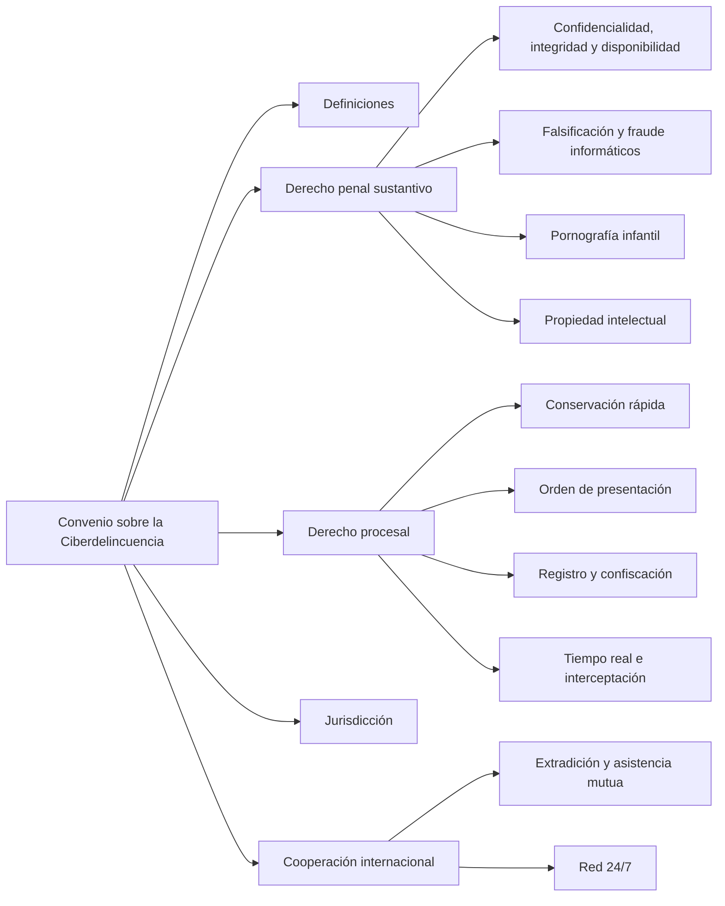

# 08 - Legislación internacional: el Convenio de Budapest

> Lectura del curso [Informática forense](../../cursos/digital-forensics/README.md), unidad 3, tema 1.

## Por qué importa

Un delito informático rara vez respeta fronteras. La víctima está en Monterrey, el servidor que alojó la página falsa está en otro continente, el correo que sirvió de anzuelo salió de un proveedor extranjero y el dinero terminó en una cuenta de un tercer país. Si cada Estado define las conductas a su manera y cada uno guarda los datos de conexión el tiempo que quiere, el rastro se rompe en la primera frontera.

El **Convenio sobre la Ciberdelincuencia**, firmado en Budapest el 23 de noviembre de 2001 bajo el impulso del Consejo de Europa, fue el primer tratado internacional que atacó ese problema de frente. Hizo tres cosas: dio definiciones comunes, propuso un catálogo mínimo de conductas que cada país debe castigar y creó herramientas procesales y de cooperación para que la evidencia digital no se pierda mientras viaja un oficio de un país a otro.

Para el perito mexicano el Convenio sirve como **regla de comparación**: permite ver qué tiene nuestro derecho, qué le falta y por qué una investigación se cae cuando el proveedor de internet ya borró los datos que permitían ubicar la computadora del atacante. El detalle de los tipos penales mexicanos está en la [nota 09](09-codigo-penal-federal.md) y el de las leyes que obligan a los concesionarios a colaborar, en la [nota 10](10-leyes-complementarias.md).

## El Consejo de Europa

El Consejo de Europa nació el **5 de mayo de 1949**. No es un órgano de la Unión Europea: es una organización intergubernamental más amplia cuyo propósito es construir en Europa un espacio democrático y jurídico común, articulado alrededor del Convenio Europeo de Derechos Humanos y de otros instrumentos de protección de las personas. Sus fines se pueden resumir en cuatro:

| Fin | En qué consiste |
|---|---|
| Derechos y Estado de derecho | Defender los derechos humanos, la democracia pluralista y la primacía del derecho |
| Identidad cultural | Fomentar la conciencia de una identidad europea común sin perder su diversidad |
| Problemas comunes | Buscar respuestas compartidas a la discriminación de minorías, la xenofobia, la intolerancia, la bioética y la clonación, el terrorismo, la trata, la delincuencia organizada, la corrupción, la ciberdelincuencia y la violencia contra la niñez |
| Estabilidad democrática | Acompañar a los países en sus reformas políticas, legislativas y constitucionales |

El Convenio de Budapest tiene su antecedente en el **plan de acción de la Cumbre de Estrasburgo de jefes de Estado y de gobierno (10 y 11 de octubre de 1997)**, que pidió respuestas comunes al desarrollo de las tecnologías de la información a partir de los valores del Consejo. El propio preámbulo del Convenio la llama "Segunda Cumbre"; el material del curso la numeraba de otra forma, pero la fecha y el lugar coinciden.

Aunque nació en Europa, el Convenio está **abierto a Estados que no son miembros del Consejo**. Entre los primeros en adherirse fuera de Europa estuvieron Canadá, Japón, Sudáfrica, Australia, Mauricio, Estados Unidos, Panamá, Argentina y República Dominicana. El material del curso reportaba, en su momento, 61 firmas y 36 ratificaciones, y mencionaba entre los primeros ratificantes a Albania, Croacia, Estonia, Hungría, Lituania, Rumania, Eslovenia y Macedonia del Norte.

El 28 de enero de 2003 se abrió a firma un **Protocolo adicional** para tipificar los actos de racismo y xenofobia cometidos por medio de sistemas informáticos. Es el complemento natural del título sobre delitos de contenido.

Actualización al 2026: el registro oficial de Partes lo lleva la Oficina de Tratados del Consejo de Europa; al preparar esta nota su sitio rechazó las consultas automatizadas, así que no se pudo abrir la lista de firmas. La ficha informativa del propio Consejo de Europa fechada en julio de 2026 cuenta 82 Estados Parte (dato tomado del índice del buscador sobre ese documento oficial, que también rechaza la descarga automatizada); las cifras del material se conservan con su año. En mayo de 2022 se abrió a firma un **Segundo Protocolo adicional** (STCE n.º 224), dedicado a reforzar la cooperación y la revelación de pruebas electrónicas entre Partes y con proveedores.

Actualización al 2026 (México): una consulta al buscador del Diario Oficial de la Federación (10 de noviembre de 2026) no arrojó ningún decreto de aprobación del Senado ni decreto promulgatorio del Convenio sobre la Ciberdelincuencia. Sin esos dos actos, un tratado no se incorpora al derecho mexicano. Un documento del Consejo de Europa sobre la adhesión de México describe la ruta que falta (invitación del Comité de Ministros, aprobación del Senado conforme al artículo 76, fracción I, de la Constitución, publicación del decreto en el DOF y depósito del instrumento) y dice que México no prevé formular reservas; en 2021 el Senado exhortó al Ejecutivo a iniciar esos trabajos. Algunas fuentes secundarias ya listan a México entre las Partes: antes de afirmarlo en un dictamen o en un aula, hay que confirmarlo en la Oficina de Tratados del Consejo de Europa y en el DOF.

Actualización al 2026 (Naciones Unidas): la Asamblea General adoptó la **Convención de las Naciones Unidas contra la Ciberdelincuencia** el 24 de diciembre de 2024 (resolución 79/243). Se abrió a firma en Hanói, Vietnam, el 25 de octubre de 2025, queda abierta en Nueva York hasta el 31 de diciembre de 2026 y entrará en vigor 90 días después del cuadragésimo instrumento de ratificación. Según la Colección de Tratados de la ONU, al 10 de noviembre de 2026 tenía 96 firmantes y 3 Estados Parte; México no aparecía en la lista de firmantes.

## Las definiciones: el aporte más útil

Lo primero que hace el Convenio es fijar vocabulario, para que un fiscal entienda exactamente lo que le pide el de otro país.

Convenio sobre la Ciberdelincuencia, artículo 1 (texto en español publicado en el BOE):

> Artículo 1. Definiciones.
> A los efectos del presente Convenio:
> a) Por «sistema informático» se entenderá todo dispositivo aislado o conjunto de dispositivos interconectados o relacionados entre sí, siempre que uno o varios de ellos permitan el tratamiento automatizado de datos en ejecución de un programa;
> b) por «datos informáticos» se entenderá cualquier representación de hechos, información o conceptos de una forma que permita el tratamiento informático, incluido un programa diseñado para que un sistema informático ejecute una función;
> c) por «proveedor de servicios» se entenderá:
> i) Toda entidad pública o privada que ofrezca a los usuarios de sus servicios la posibilidad de comunicar por medio de un sistema informático, y
> ii) cualquier otra entidad que procese o almacene datos informáticos para dicho servicio de comunicación o para los usuarios de ese servicio;
> d) por «datos sobre el tráfico» se entenderá cualesquiera datos informáticos relativos a una comunicación por medio de un sistema informático, generados por un sistema informático como elemento de la cadena de comunicación, que indiquen el origen, destino, ruta, hora, fecha, tamaño y duración de la comunicación o el tipo de servicio subyacente.

Dos detalles importan en la práctica forense. El primero: "proveedor de servicios" no se limita a la empresa que da acceso a internet; incluye a quien procesa o almacena datos para ese servicio, como un servicio de correo o de almacenamiento en la nube. El segundo: los **datos sobre el tráfico** describen la comunicación (de dónde a dónde, cuándo, cuánto duró, por qué servicio) pero **no su contenido**. Esa diferencia es el eje de todo el debate sobre conservación de datos que se verá más abajo.

El Convenio es un **modelo**. Se puede discrepar de algunos artículos, pero como punto de referencia permite comparar lo que tiene un país, detectar los huecos y proponer reformas que den a la procuración de justicia herramientas reales.

## La estructura del Convenio

El material presentaba la estructura del Convenio como un cuadro sinóptico. Aquí va reorganizada por capítulos, con los artículos de cada parte:

| Capítulo | Contenido | Artículos |
|---|---|---|
| I. Terminología | Sistema informático, datos informáticos, proveedor de servicios, datos sobre el tráfico | 1 |
| II, sección 1. Derecho penal sustantivo | Delitos contra la confidencialidad, integridad y disponibilidad; delitos informáticos; delitos de contenido; propiedad intelectual; tentativa, complicidad, personas jurídicas y sanciones | 2 a 13 |
| II, sección 2. Derecho procesal | Condiciones y salvaguardas; conservación rápida de datos almacenados y de tráfico; orden de presentación; registro y confiscación; obtención en tiempo real de datos de tráfico; interceptación de contenido | 14 a 21 |
| II, sección 3. Jurisdicción | Cuándo un Estado puede perseguir el delito (territorio, buques, aeronaves, nacionales) | 22 |
| III. Cooperación internacional | Principios generales, extradición, asistencia mutua, información espontánea, solicitudes sin tratado aplicable, confidencialidad | 23 a 28 |
| III, disposiciones especiales | Conservación y revelación rápidas a petición de otra Parte, acceso a datos almacenados, acceso transfronterizo, tiempo real e interceptación en asistencia mutua | 29 a 34 |
| III, red 24/7 | Punto de contacto permanente en cada Parte | 35 |
| IV. Cláusulas finales | Firma, adhesión, reservas, declaraciones, enmiendas, controversias | 36 a 48 |

## Los delitos que cada Parte debe tipificar

El Convenio no castiga a nadie directamente: obliga a cada Parte a crear en su derecho interno los tipos penales correspondientes. Por eso cada artículo empieza con la misma fórmula: la Parte adoptará las medidas legislativas necesarias para tipificar como delito tal conducta, cometida de forma **deliberada e ilegítima**.

| Título | Delito | Artículo | Lo esencial |
|---|---|---|---|
| 1. Confidencialidad, integridad y disponibilidad | Acceso ilícito | 2 | Entrar sin derecho a todo o parte de un sistema; se puede exigir que se violen medidas de seguridad |
| | Interceptación ilícita | 3 | Captar por medios técnicos transmisiones no públicas de datos, incluidas emisiones electromagnéticas |
| | Interferencia en los datos | 4 | Dañar, borrar, deteriorar, alterar o suprimir datos |
| | Interferencia en el sistema | 5 | Obstaculizar gravemente el funcionamiento de un sistema (el terreno de la denegación de servicio) |
| | Abuso de los dispositivos | 6 | Producir, vender, distribuir o poseer programas o contraseñas pensados para cometer los delitos anteriores |
| 2. Delitos informáticos | Falsificación informática | 7 | Manipular datos para que se tengan por auténticos |
| | Fraude informático | 8 | Causar un perjuicio patrimonial manipulando datos o sistemas para obtener un beneficio económico |
| 3. Contenido | Pornografía infantil | 9 | Producir, ofrecer, difundir, adquirir o poseer ese material por medio de sistemas informáticos |
| 4. Propiedad intelectual | Infracciones de propiedad intelectual y derechos afines | 10 | Cometidas deliberadamente, a escala comercial y por medio de un sistema informático |
| 5. Otras formas de responsabilidad | Tentativa y complicidad; responsabilidad de personas jurídicas; sanciones | 11 a 13 | Las empresas también responden cuando un directivo comete el delito en su beneficio |

El artículo 6 trae una salvedad que interesa a cualquier profesional de seguridad: no hay delito cuando las herramientas se producen o se usan para **pruebas autorizadas o para proteger un sistema**. La misma herramienta de auditoría puede ser lícita o delictiva según la autorización y el propósito.

Convenio sobre la Ciberdelincuencia, artículos 2 y 8 (texto en español publicado en el BOE):

> Artículo 2. Acceso ilícito.
> Cada Parte adoptará las medidas legislativas y de otro tipo que resulten necesarias para tipificar como delito en su derecho interno el acceso deliberado e ilegítimo a la totalidad o a una parte de un sistema informático. Cualquier Parte podrá exigir que el delito se cometa infringiendo medidas de seguridad, con la intención de obtener datos informáticos o con otra intención delictiva, o en relación con un sistema informático que esté conectado a otro sistema informático.

> Artículo 8. Fraude informático.
> Cada Parte adoptará las medidas legislativas y de otro tipo que resulten necesarias para tipificar como delito en su derecho interno los actos deliberados e ilegítimos que causen un perjuicio patrimonial a otra persona mediante:
> a) Cualquier introducción, alteración, borrado o supresión de datos informáticos;
> b) cualquier interferencia en el funcionamiento de un sistema informático, con la intención fraudulenta o delictiva de obtener ilegítimamente un beneficio económico para uno mismo o para otra persona.

## Las herramientas procesales

La parte procesal es la que más le importa al investigador, porque define qué puede pedir la autoridad y en qué plazo. El Convenio exige que todas estas facultades respeten salvaguardas: supervisión judicial o independiente, motivación, proporcionalidad y límites de alcance y duración (artículo 15).

| Medida | Artículo | Para qué sirve |
|---|---|---|
| Conservación rápida de datos almacenados | 16 | Congelar datos que pueden perderse, hasta 90 días renovables, mientras se tramita la orden para obtenerlos |
| Conservación y revelación parcial de datos de tráfico | 17 | Conservar el tráfico aunque hayan intervenido varios proveedores y revelar lo suficiente para saber por dónde pasó la comunicación |
| Orden de presentación | 18 | Exigir a una persona datos que tenga bajo su control, y a un proveedor los datos de sus abonados |
| Registro y confiscación | 19 | Registrar sistemas y medios de almacenamiento y asegurar los datos, incluso copiándolos |
| Obtención en tiempo real de datos de tráfico | 20 | Recoger el tráfico mientras ocurre la comunicación |
| Interceptación de datos sobre el contenido | 21 | Captar el contenido, reservada a delitos graves que defina cada Parte |

Convenio sobre la Ciberdelincuencia, artículo 16, apartados 1 y 2 (texto en español publicado en el BOE):

> 1. Cada Parte adoptará las medidas legislativas y de otro tipo que resulten necesarias para permitir a sus autoridades competentes ordenar o imponer de otra manera la conservación rápida de determinados datos electrónicos, incluidos los datos sobre el tráfico, almacenados por medio de un sistema informático, en particular cuando existan razones para creer que los datos informáticos resultan especialmente susceptibles de pérdida o de modificación.
> 2. Cuando una Parte aplique lo dispuesto en el anterior apartado 1 por medio de una orden impartida a una persona para conservar determinados datos almacenados que se encuentren en posesión o bajo el control de dicha persona, la Parte adoptará las medidas legislativas y de otro tipo que resulten necesarias para obligar a esa persona a conservar y a proteger la integridad de dichos datos durante el tiempo necesario, hasta un máximo de noventa días, de manera que las autoridades competentes puedan conseguir su revelación. Las Partes podrán prever que tales órdenes sean renovables.

## Cooperación internacional y la red 24/7

Para el autor del material del curso, lo más valioso del Convenio es la **cooperación internacional plena**. Cuando la investigación cruza fronteras, el canal diplomático tradicional para pedir datos de conexión podía tardar hasta seis meses; con una víctima de secuestro, tortura o abuso, ese plazo elimina cualquier posibilidad de encontrarla con vida. El Convenio responde con dos piezas: la conservación rápida a petición de otra Parte (artículos 29 y 30), que congela los datos mientras llega la solicitud formal, y una red de contacto que no duerme.

Convenio sobre la Ciberdelincuencia, artículo 35, apartado 1 (texto en español publicado en el BOE):

> 1. Cada Parte designará un punto de contacto disponible las veinticuatro horas del día, siete días a la semana, con objeto de garantizar la prestación de ayuda inmediata para los fines de las investigaciones o procedimientos relacionados con delitos vinculados a sistemas y datos informáticos, o para la obtención de pruebas electrónicas de un delito. Dicha asistencia incluirá los actos tendentes a facilitar las siguientes medidas o su adopción directa, cuando lo permitan la legislación y la práctica internas:
> a) El asesoramiento técnico;
> b) la conservación de datos en aplicación de los artículos 29 y 30;
> c) la obtención de pruebas, el suministro de información jurídica y la localización de sospechosos.

## El problema mexicano: conexión no es contenido

El modelo del Convenio deja ver la desventaja más seria de México: la **conservación inmediata de datos informáticos**. El Código Nacional de Procedimientos Penales sí permite pedirla, pero solo a partir de que la autoridad conoce el hecho.

Código Nacional de Procedimientos Penales, artículo 303, último párrafo (texto vigente, última reforma DOF 28-11-2025):

> Asimismo el Procurador, o el servidor público en quien se delegue la facultad podrá requerir a los sujetos obligados que establece la Ley Federal de Telecomunicaciones y Radiodifusión, la conservación inmediata de datos contenidos en redes, sistemas o equipos de informática, hasta por un tiempo máximo de noventa días, lo cual deberá realizarse de forma inmediata. La solicitud y entrega de los datos contenidos en redes, sistemas o equipos de informática se llevará a cabo de conformidad por lo previsto por este artículo. Lo anterior sin menoscabo de las obligaciones previstas en materia de conservación de información para las concesionarias y autorizados de telecomunicaciones en términos del artículo 190, fracción II de la Ley Federal de Telecomunicaciones y Radiodifusión.

Actualización al 2026: el artículo 303 sigue citando la Ley Federal de Telecomunicaciones y Radiodifusión y su artículo 190, pero esa ley fue abrogada por la Ley en Materia de Telecomunicaciones y Radiodifusión (DOF 16-07-2025). La obligación equivalente está hoy en el artículo 183, fracción II, de la nueva ley; el detalle está en la [nota 10](10-leyes-complementarias.md).

El argumento del autor es práctico. En México la denuncia llega días, semanas o meses después del hecho, y para entonces la orden de conservación ya no encuentra nada. Según su experiencia de campo, algunos proveedores nacionales de acceso a internet guardaban la información de conexión apenas unas **10 horas**, otros hasta **seis meses**, mientras que los grandes servicios de correo extranjeros la conservaban al menos **tres meses** y cooperaban con rapidez porque entienden que una demora puede costar una vida. En Estados Unidos, decía, la información se guardaba por lo menos 90 días. Son datos de la práctica del autor, sin fecha ni fuente estadística, y así deben leerse.

Los delincuentes, conscientes de esa limitación, eligen los proveedores que no conservan datos. Para el autor, el proveedor que lo tolera por razones económicas acaba siendo cómplice de quien extorsiona o abusa usando su red.

La confusión de fondo, sostiene, es no distinguir dos tipos de información:

| Información de conexión | Información de contenido |
|---|---|
| Dirección IP, fecha, hora, duración, servicio usado | Lo que se dijo, escribió o envió |
| Permite a la autoridad ubicar el equipo desde el que se actuó | Es y debe seguir siendo confidencial |
| Es lo que la ley debería obligar a conservar | Solo se obtiene con autorización judicial (artículo 16 constitucional) |

Mezclar las dos produce debates interminables sobre derechos humanos y datos personales que, en su opinión, se resolverían si la obligación se limitara a la conexión.

## La Directiva europea 2006/24/CE

Para mostrar que la conservación de datos de conexión se puede legislar, el material revisaba la **Directiva 2006/24/CE** del Parlamento Europeo y del Consejo, publicada en el Diario Oficial de la Unión Europea el **15 de marzo de 2006**. Su propósito era armonizar las obligaciones de los proveedores de comunicaciones electrónicas de acceso público y de redes públicas, para que ciertos datos estuvieran disponibles en la investigación, detección y enjuiciamiento de **delitos graves**, según los definiera cada Estado miembro.

Su alcance: datos de **tráfico y de localización** de personas físicas y jurídicas, más los necesarios para identificar al abonado o usuario registrado. Quedaba fuera, de manera expresa, el **contenido** de las comunicaciones, incluida la información consultada en la red.

Definía, entre otros términos:

- **Datos**: los de tráfico y localización y los relacionados que permiten identificar al abonado.
- **Usuario**: cualquier persona física o jurídica que usa un servicio de comunicaciones electrónicas de acceso público, aunque no esté abonada a él.
- **Servicio telefónico**: llamadas (voz, buzón, conferencia, datos), servicios suplementarios como el desvío, y mensajería y multimedia.
- **Identificador de usuario**: código único asignado al abonarse o registrarse en un servicio de acceso o de comunicaciones por internet.
- **Identificador de celda**: la celda desde la que se origina o termina una llamada móvil.

La obligación alcanzaba también las **llamadas infructuosas** (marcadas y contestadas sin éxito), pero no las llamadas que nunca se conectaron. El acceso a lo conservado quedaba reservado a autoridades nacionales competentes, en casos concretos y conforme a la ley de cada país.

Las categorías que había que conservar, ordenadas por la pregunta que contestan:

| Pregunta | Telefonía fija y móvil | Internet (acceso, correo y telefonía por internet) |
|---|---|---|
| ¿De dónde salió? | Número que llama; nombre y dirección del abonado | Identificador de usuario; número asignado a comunicaciones que entran a la red telefónica; abonado al que se asignó la IP, el identificador o el número |
| ¿A dónde fue? | Números marcados y, si hubo desvío, a dónde se transfirió; abonados de destino | Identificador o número del destinatario; nombre, dirección e identificador del destinatario |
| ¿Cuándo y cuánto duró? | Fecha y hora de inicio y fin | Conexión y desconexión al acceso, con huso horario, IP dinámica o estática e identificador; conexión y desconexión del correo o la telefonía por internet |
| ¿Qué servicio? | Servicio telefónico usado | Servicio de internet usado |
| ¿Con qué equipo? | Números de origen y destino; en móvil, IMSI e IMEI de quien llama y de quien recibe; en prepago anónimo, fecha, hora y celda de la primera activación | Número de origen si fue por marcación; línea DSL u otro punto terminal del autor |
| ¿Dónde estaba el móvil? | Identificador de celda al iniciar la comunicación y los datos para ubicar geográficamente esa celda | No aplica |

Y la regla de cierre: no podía conservarse ningún dato que revelara el contenido de la comunicación. El material subrayaba que la directiva separa con claridad lo que se guarda en telefonía de lo que se guarda en internet; la legislación mexicana de telecomunicaciones contempla casi todo lo de telefonía, pero prácticamente nada de lo de internet.

Una precisión necesaria: el material afirmaba que los países miembros conservaban los datos de tráfico por un máximo de tres meses. La directiva en realidad fijaba plazos de **seis meses a dos años**; los 90 días corresponden a la conservación rápida a petición, del artículo 16 del Convenio, que es una figura distinta.

Actualización al 2026: el Tribunal de Justicia de la Unión Europea **declaró inválida la Directiva 2006/24/CE** en la sentencia de 8 de abril de 2014 (asuntos acumulados C-293/12 y C-594/12, *Digital Rights Ireland*), por considerar que la conservación generalizada de datos de todos los usuarios afectaba de forma desproporcionada la vida privada y la protección de datos. Hoy se estudia como modelo técnico de qué datos responden qué preguntas, no como norma vigente; cada Estado europeo regula la conservación en su derecho interno dentro de los límites que fijó esa jurisprudencia.

## La ley española de la sociedad de la información

La presentación de la unidad mencionaba también el esfuerzo español por regular el uso de la red. Se trata de la **Ley 34/2002, de 11 de julio, de servicios de la sociedad de la información y de comercio electrónico** (LSSI). Su objeto es el régimen jurídico de los servicios de la sociedad de la información y de la contratación electrónica: obligaciones de los prestadores, incluidos los intermediarios que transmiten contenidos, comunicaciones comerciales por vía electrónica, información previa y posterior a los contratos electrónicos, su validez y el régimen sancionador.

Al investigador le interesan el deber de colaboración de los intermediarios (artículo 11) y la responsabilidad de los prestadores (artículos 13 y siguientes). Su artículo 12 obligaba a retener datos de tráfico, pero fue derogado por la Ley 25/2007, de 18 de octubre, que trasladó al derecho español la directiva de conservación de datos.

## ¿Qué es internet para la ley mexicana?

El último punto del tema es una crítica. El autor sostiene que en México no se entiende, desde el punto de vista técnico y legislativo, qué es internet, y que eso explica por qué la ley regula con detalle la telefonía y casi nada la conexión a internet. Las descripciones que circulan suelen venir de fuentes externas y no reflejan cómo opera la red en el país.

Su propuesta: internet debería concebirse como **parte integral de la Red Pública de Telecomunicaciones**, que hoy ofrece y explota servicios digitales (telefonía, televisión y datos, incluido el acceso a internet) y ya no las señales analógicas de la telefonía tradicional. Mientras la definición legal sea imprecisa, ingenieros y abogados hablarán de cosas distintas, y la investigación de conductas que usan internet como medio tendrá huecos.

La definición legal vigente, que la nueva ley conservó prácticamente igual a la de 2014, es esta.

Ley en Materia de Telecomunicaciones y Radiodifusión, artículo 3, fracción XXXIX (nueva ley DOF 16-07-2025):

> XXXIX. Internet: Conjunto descentralizado de redes de telecomunicaciones en todo el mundo, interconectadas entre sí, que proporciona diversos servicios de comunicación y que utiliza protocolos y direccionamiento coordinados internacionalmente para el enrutamiento y procesamiento de los paquetes de datos de cada uno de los servicios. Estos protocolos y direccionamiento garantizan que las redes físicas que en conjunto componen Internet funcionen como una red lógica única;

## El Convenio frente al derecho mexicano

La comparación que propone la unidad se puede resumir así. Es un análisis de esta nota, hecho con el texto vigente de cada ley; las equivalencias son aproximadas, porque un tipo penal mexicano rara vez cubre exactamente lo mismo que el artículo del Convenio.

| Convenio | Derecho mexicano | Observación |
|---|---|---|
| Art. 2, acceso ilícito | CPF, arts. 211 bis 1 a 211 bis 7 | Exige que el sistema esté protegido por un mecanismo de seguridad |
| Art. 3, interceptación ilícita | CPF, arts. 167 fr. VI y 177 | El 177 castiga intervenir comunicaciones privadas sin mandato judicial |
| Art. 4, interferencia en datos | CPF, arts. 211 bis 1 a 211 bis 5 (modificar, destruir o provocar pérdida) | Mismo requisito de mecanismo de seguridad |
| Art. 5, interferencia en el sistema | CPF, art. 140 (sabotaje) y art. 167 fr. VI | La denegación de servicio se encuadra como sabotaje cuando afecta servicios públicos o funciones del Estado |
| Art. 6, abuso de dispositivos | Parcial: Ley de Instituciones de Crédito, art. 112 Bis fr. VI; CPF, art. 424 bis fr. II | No hay un tipo general sobre herramientas de ataque |
| Art. 7, falsificación informática | CPF, arts. 243 a 245 (falsificación de documentos) | No hay tipo específico para datos |
| Art. 8, fraude informático | CPF, art. 386; Ley de Instituciones de Crédito, arts. 112 Quáter y 113 Bis | El fraude genérico se aplica al phishing |
| Art. 9, pornografía infantil | CPF, arts. 202 y 202 bis | Cubre producción, distribución y almacenamiento |
| Art. 10, propiedad intelectual | CPF, art. 424 bis; Ley Federal del Derecho de Autor | |
| Art. 16, conservación rápida | CNPP, art. 303 (hasta 90 días) | Solo a partir de que la autoridad conoce el hecho |
| Art. 18, orden de presentación | LMTR, art. 182 | Mandamiento escrito, fundado y motivado |
| Art. 20, tiempo real | CNPP, art. 303; LMTR, art. 183 fr. I | Pensado para localización de equipos móviles |
| Art. 21, contenido | Constitución, art. 16; CNPP, arts. 291 a 302 | Solo con autorización de juez federal |
| Art. 35, red 24/7 | LMTR, art. 183 fr. IV (área de los concesionarios disponible todo el año) | No es un punto de contacto internacional |

## Glosario

| Término | Definición |
|---------|-----------|
| Convenio de Budapest | Tratado del Consejo de Europa de 2001 sobre ciberdelincuencia, abierto también a Estados no europeos |
| Consejo de Europa | Organización intergubernamental fundada en 1949, distinta de la Unión Europea, que promueve derechos humanos y Estado de derecho |
| Parte | Estado que ratificó un tratado o se adhirió a él y por lo tanto queda obligado |
| Adhesión | Forma en que un Estado que no negoció un tratado se incorpora a él |
| Sistema informático | Dispositivo o conjunto de dispositivos que tratan datos de forma automatizada al ejecutar un programa |
| Proveedor de servicios | Entidad que permite comunicarse por un sistema informático o que procesa o almacena datos para ese servicio |
| Datos sobre el tráfico | Datos que describen una comunicación (origen, destino, ruta, hora, tamaño, duración, servicio) sin revelar su contenido |
| Datos de contenido | Lo que efectivamente se comunicó; su obtención exige autorización judicial |
| Conservación rápida | Orden para congelar datos que podrían perderse mientras se tramita su entrega formal |
| Red 24/7 | Red de puntos de contacto que cada Parte mantiene disponibles a toda hora para asistencia inmediata |
| Asistencia mutua | Cooperación entre Estados para obtener pruebas o ejecutar medidas en otro territorio |
| Identificador de celda | Dato que indica la antena de telefonía móvil desde la que inició o terminó una comunicación |
| IMSI e IMEI | Identificadores internacionales del abonado móvil (tarjeta) y del equipo móvil (aparato) |
| Directiva 2006/24/CE | Norma europea de conservación de datos de tráfico y localización, declarada inválida en 2014 |

## Referencias

- Consejo de Europa. (2001). *Convenio sobre la Ciberdelincuencia* (Serie de Tratados Europeos n.º 185). https://rm.coe.int/1680081561
- Consejo de Europa. (2026, julio). *El Convenio de Budapest sobre la Ciberdelincuencia: beneficios e impacto en la práctica* [Ficha informativa]. https://rm.coe.int/cyber-buda-benefits-1-julio-2026-es/48802c5c23
- Consejo de Europa. (s. f.). [Procedimiento de adhesión de México al Convenio sobre la Ciberdelincuencia] [Documento sin título]. https://rm.coe.int/1680303edd
- Jefatura del Estado. (2010). Instrumento de Ratificación del Convenio sobre la Ciberdelincuencia, hecho en Budapest el 23 de noviembre de 2001. *Boletín Oficial del Estado*, 226. https://www.boe.es/buscar/doc.php?id=BOE-A-2010-14221
- Parlamento Europeo y Consejo de la Unión Europea. (2006). Directiva 2006/24/CE sobre la conservación de datos generados o tratados en relación con la prestación de servicios de comunicaciones electrónicas de acceso público o de redes públicas de comunicaciones. *Diario Oficial de la Unión Europea*, L 105, 54-63. https://eur-lex.europa.eu/legal-content/ES/TXT/?uri=CELEX:32006L0024
- Tribunal de Justicia de la Unión Europea. (2014). *Digital Rights Ireland Ltd y otros* (asuntos acumulados C-293/12 y C-594/12), sentencia de 8 de abril de 2014. https://eur-lex.europa.eu/legal-content/ES/TXT/?uri=CELEX:62012CJ0293
- Jefatura del Estado. (2002). Ley 34/2002, de 11 de julio, de servicios de la sociedad de la información y de comercio electrónico. *Boletín Oficial del Estado*, 166. https://www.boe.es/buscar/act.php?id=BOE-A-2002-13758
- Jefatura del Estado. (2007). Ley 25/2007, de 18 de octubre, de conservación de datos relativos a las comunicaciones electrónicas y a las redes públicas de comunicaciones. *Boletín Oficial del Estado*, 251. https://www.boe.es/buscar/act.php?id=BOE-A-2007-18243
- Asamblea General de las Naciones Unidas. (2024). *Convención de las Naciones Unidas contra la Ciberdelincuencia* (resolución 79/243). Oficina de las Naciones Unidas contra la Droga y el Delito. https://www.unodc.org/unodc/es/cybercrime/convention/text/convention-full-text.html
- Naciones Unidas. (2026). *Estado de la Convención de las Naciones Unidas contra la Ciberdelincuencia* (capítulo XVIII-16). United Nations Treaty Collection. https://treaties.un.org/Pages/ViewDetails.aspx?src=IND&mtdsg_no=XVIII-16&chapter=18&clang=_en
- Cámara de Diputados del H. Congreso de la Unión. (2025). *Código Nacional de Procedimientos Penales* [Última reforma DOF 28-11-2025]. Diario Oficial de la Federación. https://www.diputados.gob.mx/LeyesBiblio/pdf/CNPP.pdf
- Cámara de Diputados del H. Congreso de la Unión. (2025). *Ley en Materia de Telecomunicaciones y Radiodifusión* [Nueva ley DOF 16-07-2025]. Diario Oficial de la Federación. https://www.diputados.gob.mx/LeyesBiblio/pdf/LMTR.pdf
- Cámara de Diputados del H. Congreso de la Unión. (2026). *Código Penal Federal* [Última reforma DOF 13-03-2026]. Diario Oficial de la Federación. https://www.diputados.gob.mx/LeyesBiblio/pdf/CPF.pdf
- Lira Arteaga, O. M. (2018). *Cibercriminalidad: fundamentos de investigación en México*. Ubijus. Edición anterior: Instituto Nacional de Ciencias Penales, 2010, ISBN 978-607-7882-13-8, https://www.marcialpons.es/libros/cibercriminalidad/9786077882138/
- Lira Arteaga, O. M. [Frecuencia CAD]. (2019). *Entrevista ciberdelitos* [Video]. Facebook. https://www.facebook.com/100001650633958/posts/2362383260493339

---

*Rogelio Arriaga Gonzalez*
