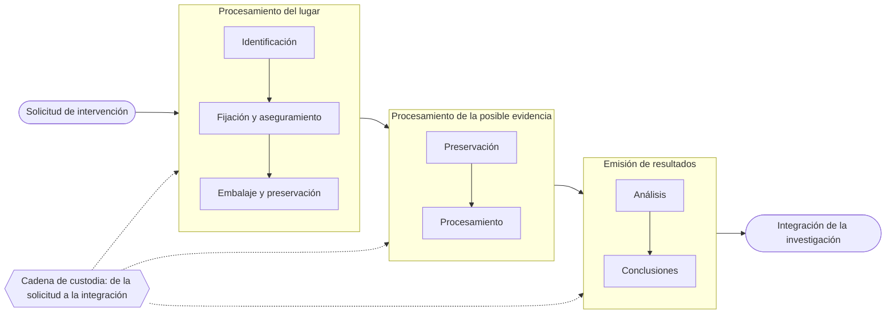

# 14 - Procedimientos de investigación en informática forense

> Lectura del curso [Informática forense](../../cursos/digital-forensics/README.md), unidad 5, tema 1.

## Por qué importa

Una investigación forense en tecnologías de la información no se gana con la herramienta más cara: se gana con el método. El mismo disco duro puede sostener una sentencia o terminar descartado por el juez según cómo se trató desde el primer minuto. Si alguien apaga el equipo antes de tiempo, la memoria se pierde; si alguien abre un documento "para ver qué es", cambia sus fechas; si nadie anotó la hora, nadie podrá correlacionar los registros. Lo que hace el perito en el lugar de los hechos, y cómo lo documenta, es lo que después le da al dictamen su sustento técnico y científico ante la autoridad que debe sancionar, sea en lo administrativo, en lo penal o en lo judicial.

Esta nota recorre el procedimiento de punta a punta: qué pasos se repiten en todo caso, cómo se separa el trabajo de campo del trabajo de laboratorio, qué se prepara antes de la diligencia, cómo se buscan los indicios y, con más detalle, qué se hace frente a una computadora encendida, que es el escenario más delicado. La [nota 15](15-identificacion-fijacion-preservacion.md) sigue con la fijación, el embalaje y los casos particulares (correo, páginas web, teléfonos, fraudes), y la [nota 16](16-dictamen-pericial.md) con el documento final.

## Seis procedimientos que se repiten en todo caso

Cada caso es distinto, pero casi todos pasan por las mismas seis actividades. El orden importa: ninguna se puede hacer bien si la anterior se hizo mal.

| Procedimiento | En qué consiste | Qué lo arruina |
|---|---|---|
| Preservación | Impedir que los datos cambien mientras se recolectan: copia exacta del medio y bloqueo de escritura sobre el original | Encender, apagar o explorar el equipo "a mano" |
| Adquisición | Capturar los datos con técnicas que conserven su integridad: clonado de discos, imagen de la memoria | Usar una copia lógica en lugar de una imagen bit a bit |
| Análisis | Examinar lo adquirido para encontrar lo relevante: archivos borrados, metadatos, reconstrucción de la secuencia de hechos | Trabajar sobre el original y no sobre una copia de trabajo |
| Documentación | Registro de cada paso, incluida la cadena de custodia, para que otro pueda repetirlo y verificarlo | Notas incompletas, horas sin anotar, firmas faltantes |
| Informe pericial | Las conclusiones escritas de forma que la autoridad las entienda y pueda actuar con ellas | Jerga técnica sin explicar, conclusiones vagas |
| Testimonio en juicio | El perito explica en audiencia cómo trabajó y responde preguntas de las partes | No poder justificar una decisión que tomó en campo |

## Dos escenarios: el lugar de los hechos y el laboratorio

Toda intervención pericial en TIC se reparte entre dos ambientes:

1. **Trabajo de campo**: la investigación en el lugar donde ocurrieron los hechos o donde están los equipos.
2. **Trabajo de laboratorio**: el estudio en un ambiente controlado, con tiempo, herramientas completas y sin la presión de la diligencia.

Las etapas pueden hacerse todas en el lugar o dividirse entre ambos sitios; lo decide el caso y lo que pida la autoridad. El flujo completo, con la cadena de custodia acompañando cada paso desde la solicitud hasta que los resultados se integran a la investigación, se ve así:

## Por qué el perito en TIC necesita la criminalística

En muchas especialidades periciales el trabajo es acotado: el químico identifica una sustancia y su cantidad, el balístico determina el origen y la trayectoria de un proyectil. En otras, como incendios y explosivos, delitos ambientales o TIC, el entorno de los indicios cambia las líneas de investigación, y la criminalística tradicional se queda corta frente a la técnica que exige el caso.

Basta pensar en el entorno típico de una empresa. Un indicio puede estar en cualquiera de estos puntos, y cada uno guarda registros distintos:

- Los equipos de los usuarios y los servidores de la red interna.
- Las sucursales y los socios de negocio conectados a esa red.
- Las terminales punto de venta.
- La salida a Internet y los clientes que llegan por ella.
- Las comunicaciones móviles y los dispositivos de mano.

Por eso el experto en informática forense debe dominar también las técnicas de la criminalística: solo así puede reconstruir la verdad histórica de los hechos e identificar, aislar y analizar los indicios que dejó el suceso. La base de esa disciplina está en la [nota 02](02-criminalistica-tic.md).

## Las cinco etapas en el lugar de los hechos

| Etapa | Qué se busca |
|---|---|
| 1. Antes de la diligencia ministerial | Entender el problema, preparar el equipo humano y técnico, reunir información del sitio |
| 2. Fijación del lugar | Dejar constancia del estado en que se encontró todo, antes de tocar nada |
| 3. Búsqueda de indicios y registro de conjeturas | Localizar los equipos relevantes y formular hipótesis de lo que pudo ocurrir |
| 4. Embalaje de lo que puede ser evidencia | Proteger, sellar y etiquetar cada elemento recolectado |
| 5. Formato de cadena de custodia | Registrar quién tuvo cada indicio, cuándo, dónde y para qué |

## Etapa 1: antes de entrar al lugar

Parece un trámite y es el punto donde más investigaciones se pierden. Al arrancar el caso, el exceso de confianza o la distracción del agente de la autoridad y de los peritos se traduce en errores que no tienen arreglo: en el peor caso hunden la investigación, y en el mejor la retrasan.

### Quién dirige y quién responde

La responsabilidad legal de conducir la investigación es del Ministerio Público:

Código Nacional de Procedimientos Penales, artículo 127 (texto vigente, última reforma DOF 28-11-2025):

> **Artículo 127. Competencia del Ministerio Público**
> Compete al Ministerio Público conducir la investigación, coordinar a las Policías y a los servicios periciales durante la investigación, resolver sobre el ejercicio de la acción penal en la forma establecida por la ley y, en su caso, ordenar las diligencias pertinentes y útiles para demostrar, o no, la existencia del delito y la responsabilidad de quien lo cometió o participó en su comisión.

Eso no libera al perito. La especialidad es compleja para la mayoría de los fiscales, defensores y despachos, así que el experto en TIC comparte, en lo ético, la responsabilidad del resultado. La autoridad y los peritos tienen que trabajar como un solo equipo, sin prejuicios sobre la disciplina del otro: el abogado aclara lo legal, el perito aclara lo técnico, y esa comunicación humilde es el cimiento de una reconstrucción sólida.

La solicitud de intervención puede venir de distintas autoridades (agentes del Ministerio Público, jueces federales o de distrito, entre otras). En una empresa privada, quien la emite suele ser el jefe directo.

### Lo mínimo que debe traer la solicitud

El trabajo del perito empieza cuando recibe la petición formal. Para que pueda entenderla y coordinarse con quien la emitió, la solicitud debe incluir:

| Dato | Para qué sirve |
|---|---|
| Juzgado, fiscalía, mesa o autoridad que la emite | Saber a quién se responde |
| Lugar de origen | Ubicar la jurisdicción |
| Fecha y hora de emisión | Medir plazos |
| Número de oficio | Identificar la petición |
| Número de expediente (hoy carpeta de investigación; antes averiguación previa o acta circunstanciada) | Ligar el trabajo al asunto |
| Especialidad requerida (informática, electrónica o telecomunicaciones) | Asignar al perito correcto |
| Planteamiento del problema | Saber exactamente qué se debe investigar o realizar |
| Teléfono de la autoridad | Resolver dudas a tiempo |
| Firma de la autoridad | Darle validez |
| Elementos a estudiar, si los hay | Expediente o dispositivos anexos |

Con el planteamiento entendido, se prepara de forma metódica todo lo necesario para la diligencia, porque en el sitio pueden aparecer equipos, dispositivos y sistemas de todo tipo.

### Quién va a la diligencia

Donde la red de voz y datos es extensa conviene que intervengan al menos **dos peritos en TIC**: uno para reconocer la infraestructura (red, sistemas de comunicación) y otro para identificar y fijar los indicios sin alterarlos ni perderlos. En el ámbito oficial se recomienda sumar un **perito en fotografía forense** y un **perito en criminalística**, que con el agente del Ministerio Público forman el equipo de investigación. Las imágenes del lugar sirven después para relacionar hasta el detalle más pequeño, y el criminalista ubica entradas, salidas y el entorno.

### Las diez preguntas antes de tocar nada

Lo ideal es contar con las políticas de seguridad escritas de la organización. Como casi nunca existen, se recomienda recabar estos datos testimoniales y dejarlos registrados:

1. Fecha y hora de la diligencia.
2. Domicilio del lugar.
3. Nombre y cargo de quien administra los recursos informáticos.
4. Recursos en TIC del sitio: número de equipos, aplicaciones, configuraciones de seguridad y bases de datos.
5. Accesos físicos a esos recursos.
6. Infraestructura de comunicaciones: telecomunicaciones, red y la tecnología que usa.
7. Si hay control de acceso por usuario y contraseña, y qué perfiles existen (administradores o limitados).
8. Rango de direcciones IP y su inventario.
9. Bitácoras que están activas.
10. Proveedores de servicios de comunicaciones.

El deber de registrar cada actuación tiene fundamento expreso:

Código Nacional de Procedimientos Penales, artículo 217 (texto vigente):

> **Artículo 217. Registro de los actos de investigación**
> El Ministerio Público y la Policía deberán dejar registro de todas las actuaciones que se realicen durante la investigación de los delitos, utilizando al efecto cualquier medio que permita garantizar que la información recabada sea completa, íntegra y exacta, así como el acceso a la misma por parte de los sujetos que de acuerdo con la ley tuvieren derecho a exigirlo.
>
> Cada acto de investigación se registrará por separado, y será firmado por quienes hayan intervenido. Si no quisieren o no pudieren firmar, se imprimirá su huella digital. En caso de que esto no sea posible o la persona se niegue a imprimir su huella, se hará constar el motivo.
>
> El registro de cada actuación deberá contener por lo menos la indicación de la fecha, hora y lugar en que se haya efectuado, identificación de los servidores públicos y demás personas que hayan intervenido y una breve descripción de la actuación y, en su caso, de sus resultados.

## Etapas 2 y 3: fijar, buscar y formular hipótesis

Con el problema claro y los escenarios definidos entre peritos y Ministerio Público (el capítulo de actos de investigación del CNPP, a partir del artículo 217, es el marco), la secuencia recomendada es:

1. El criminalista, el fotógrafo y el perito en TIC fijan el lugar.
2. Si hay personas operando los equipos, se les pide que no se levanten y que retiren las manos del teclado y del escritorio, dejándolas sobre las piernas.
3. Se localizan e identifican los equipos que se van a estudiar.
4. Se anota el estado de cada uno: encendido o apagado.
5. Lo que está apagado se embala y etiqueta pieza por pieza para llevarlo al laboratorio.
6. Si hace falta, y con autorización del Ministerio Público, se recogen también los dispositivos de comunicación (teléfonos, agendas electrónicas) y de almacenamiento (memorias USB, discos ópticos, tarjetas SIM, entre otros).

Para generar conjeturas conviene preguntarse, como mínimo, si el caso encaja en alguno de estos ocho escenarios, porque cada uno abre líneas de investigación distintas:

| Escenario | Pregunta guía |
|---|---|
| Acceso no autorizado | ¿Quién entró, desde dónde y con qué credenciales? |
| Falla por código malicioso | ¿Qué programa la provocó y cómo llegó? |
| Correo electrónico | ¿Quién lo envió, desde qué equipo y cuándo? |
| Intervención de sistemas de comunicación | ¿Qué dispositivo se usó para interceptar? |
| Denegación de servicio | ¿De dónde vino el tráfico y qué servicio cayó? |
| Falla por error humano | ¿Fue un descuido o se disfraza de descuido? |
| Sabotaje | ¿Quién tenía acceso y motivo? |
| Identificación de dispositivos electrónicos | ¿Qué es este aparato y qué guarda? |

Un consejo práctico del material: llevar una grabadora o, mejor, una cámara de video para dictar en el momento observaciones e ideas sobre el suceso. Lo que se piensa en el sitio se olvida en el traslado, y esas notas ayudan a definir las líneas de investigación.

## El equipo encendido: el punto de partida

Una computadora encendida es el escenario más rico y el más frágil. En la memoria RAM viven datos que tal vez nunca llegaron al disco: procesos en ejecución, conexiones de red abiertas, sesiones iniciadas, contraseñas temporales o código malicioso que solo existe en memoria. Si el equipo se apaga por accidente o por un corte de energía, eso se pierde para siempre. Por eso el procedimiento empieza por lo más volátil, criterio que también recoge la guía de buenas prácticas RFC 3227 de la IETF con su "orden de volatilidad".

Leer la memoria no toca el contenido del disco. Aun así, si las circunstancias obligan a sacar algún archivo, el investigador debe llevar su propio medio externo (memoria USB, disco externo, disco óptico) preparado y limpio.

### Reglas de conducta frente a la pantalla

- **Todo en presencia de la autoridad.** El Ministerio Público, el juez o la autoridad competente presencia cada paso, y nada se hace sin su autorización.
- **Primero observar.** Con autorización, se verifica si el equipo está ejecutando algún proceso o tiene una conexión externa activa.
- **Fotografiar, no capturar.** Las imágenes de la pantalla se toman con cámara y no con la función de captura del sistema, para no escribir datos innecesarios en la memoria que se quiere preservar.
- **Qué se fija y se preserva:** procesos activos, carga del procesador, actividad de red, dispositivos de conexión cableados e inalámbricos, usuarios y perfiles.
- **El reloj manda.** Se anotan la hora exacta de inicio y fin del análisis y de cada imagen obtenida, y el desfase entre la hora del sistema y la hora real.
- **Que opere el personal del lugar.** Se recomienda que quien maneje el teclado sea alguien de la organización, siguiendo las instrucciones precisas del perito; así nadie puede acusar al equipo investigador de haber dañado el equipo o alterado sus datos.
- **Cada pantalla, documentada.** Lo que aparezca por indicación del perito se fotografía y se describe.
- **Después de lo volátil, lo físico.** Se revisa y documenta por fuera si el equipo está conectado a una red o tiene dispositivos en sus puertos.

### Decisiones que el investigador toma en el sitio

| Decisión | Consideración |
|---|---|
| Con qué herramienta obtener la memoria | El material menciona FTK Imager Lite, IEF Triage, EnCase Imager y Live Detector, entre otras; la elección es del investigador |
| Previsualizar las unidades | Mirar el contenido sin montarlo en escritura |
| Extraer solo algunos archivos | Cuando no se necesita ni se puede llevar todo |
| Hacer imagen forense del disco | Reservar entre 5 y 10 horas, según el tamaño y el método de extracción |
| Tomar una o dos muestras de la memoria | Dos tomas permiten detectar si un tercero intervino antes o durante la diligencia, al comparar ambas |

Las herramientas cambian todo el tiempo; por eso el procedimiento describe pasos y no marcas. Si la memoria del equipo es grande (16 GB o más), hay que llevar espacio suficiente en el medio destino para no quedarse a medias.

### Los ocho pasos con el equipo encendido

1. Identificar la fecha y hora del sistema y calcular su desfase respecto de la hora real.
2. Obtener la memoria RAM con la herramienta elegida, guardarla en el medio externo y calcular su hash.
3. Identificar y fijar los procesos y, si el caso lo amerita, preservar archivos recientes y documentos abiertos.
4. Previsualizar las unidades de almacenamiento.
5. Si se puede, tomar una segunda muestra de la memoria.
6. Si corresponde, obtener la imagen forense de las unidades conectadas al equipo.
7. Anotar la fecha y hora en que terminó la obtención de datos volátiles.
8. Identificar y fijar las conexiones y los dispositivos externos.

### Herramientas de arranque en vivo

Los discos de arranque forenses (el material usa como ejemplo Helix Live CD) reúnen en un menú lo necesario para esta etapa: ver el sistema, generar una imagen forense (en formato `.dd` o con FTK Imager), documentar, explorar carpetas, buscar imágenes y tomar notas. De un vistazo muestran datos del sistema como responsable, organización, perfil, si el usuario tiene privilegios de administrador, nombre del equipo, dirección IP y física (MAC), dominio, número de unidades y su capacidad. Si hacen falta más datos de red, el comando `ipconfig /all` en Windows los da completos.

Otras utilidades de ese tipo de paquete:

- Un explorador de archivos que calcula el **hash** de lo que se va a extraer, para demostrar después que no cambió.
- Un visor de imágenes para localizar fotografías cuando urge.
- Un bloc de notas cuyo contenido pasa al informe de actividades: datos del sistema, acciones, hora de inicio y fin y observaciones del investigador.
- Un inventario de software instalado, útil en casos de propiedad intelectual. Va **después** de recolectar lo volátil, nunca antes.

El análisis fino (revisión de archivos, recuperación de bitácoras) consume tiempo y se deja para el laboratorio, no para la presión de la diligencia.

### Cerrar la intervención

Para que los resultados se sostengan, el cierre sigue cuatro pasos, cada uno con autorización del Ministerio Público o de la autoridad competente:

1. Desconectar el equipo **desde el cable de alimentación**, no apagarlo desde el sistema operativo: el apagado ordinario ejecuta rutinas que escriben en el disco y pueden borrar rastros.
2. Documentar la desconexión de todos los cables.
3. Embalar y etiquetar, y fotografiar el embalaje antes de entregarlo.
4. Llenar los formatos de cadena de custodia.

Cuando el equipo no se puede llevar al laboratorio, la imagen forense del disco, la carpeta o el archivo se obtiene en el lugar, con la autoridad dando fe del procedimiento; desde ese momento la imagen se trata como si fuera el original. Los equipos apagados, los servidores y los casos con cifrado se resuelven con el árbol de decisiones de la [nota 15](15-identificacion-fijacion-preservacion.md).

Actualización al 2026: el capítulo del libro fundamenta la inspección, el cateo y el embalaje en los artículos 208, 63 y 182 del Código Federal de Procedimientos Penales. Ese código quedó abrogado por el Código Nacional de Procedimientos Penales (DOF 05-03-2014), que rige en todo el país desde el 18 de junio de 2016; hoy los fundamentos son los artículos 267 (inspección), 282 (cateo), 227 y 228 (cadena de custodia) del CNPP, citados en la [nota 15](15-identificacion-fijacion-preservacion.md).

## Lo que cuesta un error de método

Las faltas de procedimiento no se notan en el sitio; se notan en la audiencia:

| Error | Consecuencia |
|---|---|
| Saltarse la autorización o no anotar quién la dio | La defensa impugna la legalidad de la prueba |
| Apagar desde el sistema operativo o cerrar ventanas | Se pierde memoria y se alteran fechas de archivos |
| Imagen sin hash, o hash sin registrar | No se puede demostrar que la copia es idéntica |
| Mezclar periféricos sin etiqueta | Nadie puede decir después qué disco venía de qué equipo |
| Cadena de custodia con huecos | Se alega que la evidencia fue sembrada o manipulada |

El resultado puede ir desde repetir procedimientos (si aún es posible) hasta que el juez excluya la prueba, aunque fuera decisiva, y que quede sin sanción alguien que podía ser responsable. Para el perito, un procedimiento cuestionado pesa en todos sus casos siguientes.

## Hábitos del buen perito

- Llevar registro de la versión de cada herramienta forense y probar su confiabilidad internamente antes de usarla en un caso.
- Cuidar su propia seguridad digital: un perito con equipos comprometidos pone en duda todo lo que procesa.
- Antes de dejar el lugar, redactar un informe preliminar breve (hora de desconexión, embalaje, testigos presentes) que se integra al expediente.
- Recordar que el caso no termina con el dictamen: si la autoridad ordena devolver o destruir los dispositivos, esa salida también se documenta en la cadena de custodia.
- Revisar cada caso al cerrarlo para afinar el método, actualizar herramientas y formar al resto del equipo.

## Glosario

| Término | Definición |
|---------|-----------|
| Trabajo de campo | Parte de la intervención pericial que ocurre en el lugar de los hechos, bajo la presión de la diligencia |
| Trabajo de laboratorio | Estudio de los indicios en un ambiente controlado, con tiempo y herramientas completas |
| Solicitud de intervención | Documento formal de la autoridad que pide al perito investigar un planteamiento concreto |
| Planteamiento del problema | La pregunta exacta que la autoridad quiere que el perito responda |
| Datos volátiles | Información que desaparece al apagar el equipo o con el paso del tiempo, como el contenido de la RAM |
| Memoria principal | La memoria RAM, donde el sistema mantiene lo que está en uso en ese momento |
| Desfase horario | Diferencia entre la hora que marca el sistema estudiado y la hora real; se anota para correlacionar eventos |
| Conjetura | Hipótesis de trabajo sobre lo que pudo ocurrir, que orienta la búsqueda de indicios |
| Previsualización | Revisión del contenido de una unidad sin escribir en ella |
| Imagen forense | Copia bit a bit de un medio, incluido el espacio sin asignar, verificada con hash |
| Hash | Valor calculado sobre los datos que cambia por completo si cambia un solo bit; prueba la integridad |
| Disco de arranque forense | Sistema que arranca desde un medio externo y permite examinar un equipo sin iniciar su sistema operativo |
| Orden de volatilidad | Criterio de recolectar primero lo que se pierde más rápido |

## Referencias

- Brezinski, D. y Killalea, T. (2002). *Guidelines for evidence collection and archiving* (RFC 3227; BCP 55). Internet Engineering Task Force. https://www.rfc-editor.org/rfc/rfc3227
- Cámara de Diputados del H. Congreso de la Unión. (2025). *Código Nacional de Procedimientos Penales* [Última reforma DOF 28-11-2025]. Diario Oficial de la Federación. https://www.diputados.gob.mx/LeyesBiblio/pdf/CNPP.pdf
- Cámara de Diputados del H. Congreso de la Unión. (2016). *Código Federal de Procedimientos Penales* [Abrogado por el CNPP; última reforma DOF 17-06-2016]. Diario Oficial de la Federación. https://www.diputados.gob.mx/LeyesBiblio/abro/cfpp/CFPP_abro.pdf
- DFIRScience. (2017, 30 de enero). *Processing and analysis of disk images with Autopsy 4 default modules* [Video]. YouTube. https://www.youtube.com/watch?v=FJqoUakfmdo
- Lira Arteaga, O. M. (2018). *Cibercriminalidad: fundamentos de investigación en México* (cap. V, "Procedimientos de investigación", pp. 540-554). Ubijus. Edición anterior: Instituto Nacional de Ciencias Penales, 2010, ISBN 978-607-7882-13-8, https://www.marcialpons.es/libros/cibercriminalidad/9786077882138/
- National Institute of Justice. (2004). *Forensic examination of digital evidence: A guide for law enforcement* (NCJ 199408). U.S. Department of Justice. https://www.ojp.gov/pdffiles1/nij/199408.pdf

---

*Rogelio Arriaga Gonzalez*
