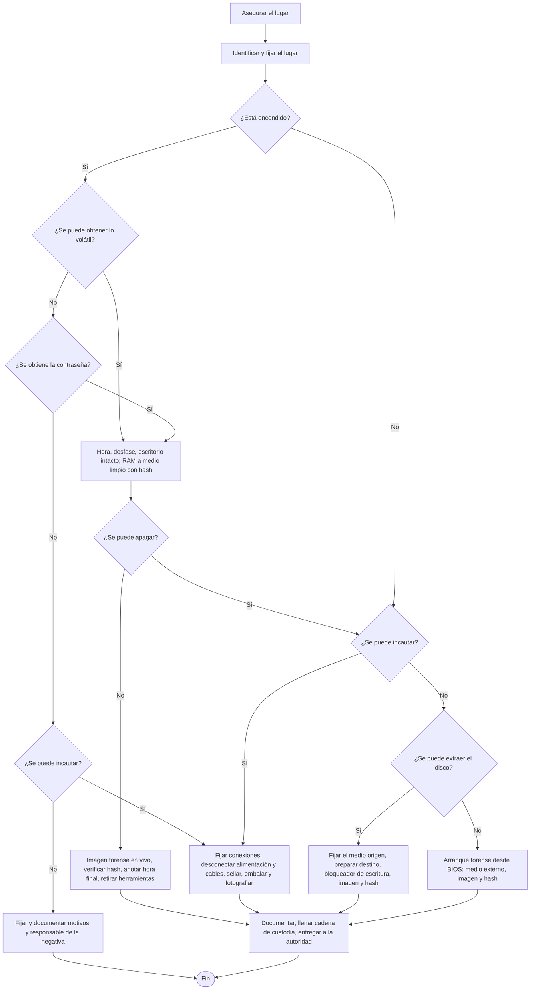

# 15 - Identificación, fijación y preservación de evidencia digital

> Lectura del curso [Informática forense](../../cursos/digital-forensics/README.md), unidad 5, tema 2.

## Por qué importa

La [nota 14](14-procedimientos-investigacion-forense.md) dejó al perito frente a una computadora encendida. El caso real trae más: equipos apagados que no se pueden llevar, servidores que no se pueden detener, discos cifrados, teléfonos con borrado remoto, páginas que desaparecen en una tarde y correos cuyo remitente está a dos proveedores de distancia. Para cada uno hay un procedimiento que identifica, fija y preserva sin alterar.

Detrás están dos principios éticos: integridad (nada se altera) y transparencia (cada paso queda escrito y es rastreable). Su teoría, y la de la cadena de custodia, está en la [nota 12](12-etica-cadena-custodia.md).

## Dos caminos para llegar al equipo: inspección y cateo

Al perito le interesan los rasgos externos del equipo y, sobre todo, qué almacenamiento tiene conectado por dentro y por fuera. En una diligencia ministerial eso se aborda por dos vías.

**Inspección.** No obliga a asegurar nada. Su valor está en identificar los equipos y los discos que contienen para que, si luego llega una orden de cateo y se aseguran, se pueda demostrar que son los mismos. Si el perito ve un gabinete con archivos que pueden ser objeto de delito, registra el gabinete y los discos que hay dentro; si al asegurarlo faltan discos o aparecen otros, la manipulación queda probada.

Código Nacional de Procedimientos Penales, artículo 267 (texto vigente, última reforma DOF 28-11-2025):

> **Artículo 267. Inspección**
> La inspección es un acto de investigación sobre el estado que guardan lugares, objetos, instrumentos o productos del delito.
>
> Será materia de la inspección todo aquello que pueda ser directamente apreciado por los sentidos. Si se considera necesario, la Policía se hará asistir de peritos.
>
> [...]

**Cateo.** Si el lugar es un domicilio o una propiedad privada, entrar a buscar exige orden judicial.

Código Nacional de Procedimientos Penales, artículo 282, primer párrafo (texto vigente):

> **Artículo 282. Solicitud de orden de cateo**
> Cuando en la investigación el Ministerio Público estime necesaria la práctica de un cateo, en razón de que el lugar a inspeccionar es un domicilio o una propiedad privada, solicitará por cualquier medio la autorización judicial para practicar el acto de investigación correspondiente. En la solicitud, que contará con un registro, se expresará el lugar que ha de inspeccionarse, la persona o personas que han de aprehenderse y los objetos que se buscan, señalando los motivos e indicios que sustentan la necesidad de la orden, así como los servidores públicos que podrán practicar o intervenir en dicho acto de investigación.

Actualización al 2026: la revista atribuye al artículo 282 del CNPP una redacción ("bastará la existencia de indicios o de datos que hagan presumir...") que viene del artículo 63 del Código Federal de Procedimientos Penales, ya abrogado. El texto vigente es el de arriba, y el artículo 252, fracción II, del CNPP confirma que todo cateo necesita autorización previa del juez de control.

## El árbol de decisiones frente a una computadora

No hay una herramienta prescrita: las herramientas cambian, y la decisión de cuál usar es del investigador. Lo que sí está fijo es la secuencia de preguntas. El material la presenta como un diagrama de flujo para equipos de cómputo en el lugar de los hechos, que aquí se recrea:

Lo que contiene cada bloque:

| Bloque | Pasos |
|---|---|
| Encendido, con acceso a lo volátil | Hora del equipo y su desfase; fijar escritorio, íconos y documentos sin cerrar lo abierto ni abrir lo cerrado; herramienta forense en disco o USB; RAM a un medio limpio y su hash |
| No se puede apagar | Imagen forense en vivo a un medio preparado, verificarla, anotar la hora final y retirar las herramientas |
| Se puede incautar | Fijar conexiones; desconectar primero la alimentación y luego lo demás; sellar, embalar y fotografiar |
| Apagado, sin incautación, disco extraíble | Fijar conexiones; desconectar cables; revisar si hay discos en las lectoras ópticas; registrar las especificaciones del medio; proteger el original con bloqueador de escritura; adquirir la imagen y verificarla |
| Apagado, sin incautación, disco no extraíble | Igual, pero dejando la alimentación conectada; entrar a la configuración del BIOS, identificar el orden de arranque, ponerlo para arrancar desde lector o USB, insertar el medio forense, apagar, encender desde ese medio, adquirir la imagen y verificarla |
| Cierre de cualquier ruta | Documentar lo hecho, llenar los formatos de cadena de custodia y entregar todo a la autoridad para el laboratorio |

Dos excepciones del diagrama que conviene memorizar: **un servidor encendido no se apaga**, y **un equipo encendido con cifrado tampoco**. En ambos la copia forense se hace en vivo, porque apagar significaría detener un servicio crítico o perder para siempre el acceso a datos que solo están descifrados mientras el equipo corre.

## Cuando el equipo está apagado

Hay dos posibilidades. La sencilla, aunque no siempre posible, es que la autoridad ordene asegurar los equipos: se fijan, se embalan y se aplica la cadena de custodia. La otra exige identificar qué equipos interesan antes de asegurarlos, con un examen forense según procedimientos internacionales (el material sigue la guía del National Institute of Justice de Estados Unidos, *Forensic Examination of Digital Evidence*) o con un disco de arranque en vivo (el material menciona DEFT, CAINE y LinEn). La idea es **no iniciar el sistema operativo del equipo**, sino uno propio cargado en memoria, para ver lo general de cada unidad (sistema de archivos, tipos de archivo, capacidad) sin corromper nada.

Todo ocurre ante el agente del Ministerio Público, cada pantalla se fotografía, y si se usan métodos convencionales se anota la hora de inicio y fin para cada equipo. Los equipos sospechosos se embalan y entran a la cadena de custodia.

## Fijar y embalar

Todo exceso de cuidado aquí se cobra después, en el laboratorio, con hallazgos que sostienen el dictamen. La obligación de proteger los indicios recae también en la policía:

Código Nacional de Procedimientos Penales, artículo 132, fracción VIII (texto vigente):

> VIII. Preservar el lugar de los hechos o del hallazgo y en general, realizar todos los actos necesarios para garantizar la integridad de los indicios. En su caso deberá dar aviso a la Policía con capacidades para procesar la escena del hecho y al Ministerio Público conforme a las disposiciones previstas en este Código y en la legislación aplicable;

Reglas del embalaje:

- Cada equipo embalado se identifica, se etiqueta y se sella con la firma de los responsables: perito, agente del Ministerio Público y agente de la policía de investigación.
- Se fotografía ya embalado y antes de salir hacia el laboratorio, para que cualquier alteración de etiquetas, sellos o material protector sea evidente al llegar.
- De ser posible, las etiquetas van foliadas y la relación de folios se anota en el formato de cadena de custodia.
- Para discos y componentes electrónicos se usan bolsas antiestáticas, que los protegen de golpes y descargas.

Actualización al 2026: el "agente federal de investigación" que menciona el material pertenecía a la extinta Agencia Federal de Investigación; hoy esa función la tiene la Policía Federal Ministerial de la Fiscalía General de la República (ley publicada en el DOF el 20-05-2021).

## Aplicar la cadena de custodia

La cadena de custodia se funda en los artículos 227 y 228 del CNPP, cuyo texto y principios están en la [nota 12](12-etica-cadena-custodia.md). En la práctica, el formato se llena **por duplicado**: al entregar el equipo embalado a quien lo resguardará (el Ministerio Público o la policía de investigación), esa persona firma de recibido en la copia que conserva el perito.

## La guía técnica de cadena de custodia digital

En junio de 2018 la Unidad de Investigaciones Cibernéticas y Operaciones Tecnológicas de la Agencia de Investigación Criminal (entonces PGR, hoy FGR) publicó una guía para indicios digitales, apoyada en la Constitución, el CNPP, el Código Penal Federal, la Ley General del Sistema Nacional de Seguridad Pública (hoy sustituida por una ley nueva del mismo nombre, DOF 16-07-2025), la Convención de Palermo, el Protocolo Nacional de Actuación del Primer Respondiente y la Guía Nacional de Cadena de Custodia. Busca que cualquier servidor público, en los tres órdenes de gobierno, maneje igual el indicio digital y garantice su **mismidad**: que sea el mismo, sin alteración, del hallazgo al juicio. Reparte papeles entre primer respondiente, policía, policía de investigación, perito, personal de traslado, encargado de la bodega de indicios y Ministerio Público, y define cuatro etapas:

| Etapa | Lo esencial |
|---|---|
| 1. Procesamiento | Preservar el lugar; ubicar fuentes de datos (equipos, servidores, memorias, teléfonos, relojes, Internet de las cosas y registros de terceros como el ISP); planear la extracción priorizando valor probable, volatilidad y esfuerzo; extraer de preferencia en el propio equipo; verificar integridad; embalar cada indicio aparte con sello, etiqueta y firma, tras un inventario completo |
| 2. Traslado | Llevar los indicios con su registro a donde ordene el Ministerio Público o el juez |
| 3. Análisis | Copia maestra y copia de trabajo (solo se usa la segunda; al final ambas son indicios); bloqueador de escritura; hash del original antes, de las copias después y del original otra vez al terminar |
| 4. Almacenamiento | Bodega con registro de entradas; salidas solo temporales (pedidas al Ministerio Público) o definitivas (ordenadas por la autoridad) |

La guía prohíbe la **copia lógica** (solo carpetas y archivos del espacio asignado: pierde borrados y residuos y puede cambiar fechas) y exige la **imagen bit a bit**, que copia también el espacio no asignado. La imagen puede ir en crudo (`.dd`) o en formatos como E01 de EnCase, que suma una verificación por bloque (CRC) y el hash del contenido completo. Admite SHA-256, SHA-1 o MD5 (un MD5 son 32 caracteres hexadecimales; un SHA-256, 64). Actualización al 2026: MD5 y SHA-1 ya no se consideran resistentes a colisiones (RFC 6151 lo documenta para MD5), así que se recomienda SHA-256.

También advierte que las **marcas de tiempo** engañan (al copiar un archivo cambia su fecha de creación, el reloj puede estar mal, un atacante puede alterarlas), que la extensión de un archivo no prueba su tipo (se identifica por el encabezado) y que hay que buscar cifrado y esteganografía. Su formato de registro tiene siete secciones: identidad de cada indicio, documentación (escrita, fotográfica, croquis), recolección, embalaje, servidores públicos con firma, traslado y continuidad, donde cada cambio de manos anota fecha, hora, quién entrega, quién recibe, propósito y lugar de permanencia.

## El laboratorio: alcance y tiempos

El laboratorio debe declarar qué estudios puede hacer y en cuánto tiempo, según su personal, sus cargas de trabajo y su equipo. Lo más caro no siempre es lo mejor, pero con herramientas rudimentarias todo tarda más. Y cuanto más preciso sea el planteamiento de la autoridad, más rápido sale el dictamen: pedir "toda la información" de un disco de 1 TB implica entre 6 y 12 horas solo de procesar la imagen, antes de filtrar; pedir los archivos de audio de un caso de derechos de autor reduce la búsqueda a un tipo de archivo.

Cuando hay una persona detenida el reloj aprieta: la Constitución da al Ministerio Público 48 horas para ponerla a disposición del juez o liberarla (96 en delincuencia organizada, artículo 16) y al juez 72 horas para resolver su vinculación a proceso (artículo 19). Por eso conviene dominar la extracción manual y tener al menos una herramienta forense multifunción que entregue resultados en horas, no en semanas.

## Rastreo de páginas y servidores en Internet

La conclusión de la unidad lo resume: hay **métodos pasivos y activos**.

**Pasivo** (sin tocar el sitio): consultar el registro del dominio en los centros de información de red (NIC) o con Whois para obtener fecha de alta, contactos administrativos y ubicación física del servidor; buscar versiones guardadas de páginas que ya no existen; usar la búsqueda avanzada, incluso por código fuente. Ninguno de estos pasos fuerza el sitio.

Actualización al 2026: el material propone el operador `cache:` de Google para ver páginas retiradas. Google lo dejó de ofrecer en 2024 junto con sus enlaces a caché; hoy esa búsqueda se hace en archivos web como la Wayback Machine del Internet Archive.

**Activo** (con contacto con el sitio):

1. **Capturas de pantalla**: lo menos invasivo, aunque lento. Urge hacerlas, porque una página se da de baja y reaparece con otro dominio en minutos.
2. **Descarga completa del sitio**, con herramientas como Wget (Linux y Windows), cuando se teme que el contenido se borre. Como se extrae todo lo que hay en el servidor, se hace con autorización y cuidando no cruzar la línea que permita a la defensa alegar una intervención de comunicaciones no autorizada.
3. **Ruta hacia el servidor**, con `tracert` (`traceroute` en Linux) o herramientas gráficas como VisualRoute.

Todo lo anterior va del equipo del perito hacia el sitio. Lo difícil es el camino inverso, del destino al origen, como en un fraude bancario: ahí lo que importa es la bitácora de conexión y la hora exacta de la operación.

## Correo electrónico

Un correo tiene dos partes: **cabeceras** y cuerpo. La información para rastrearlo está en las cabeceras. Si el problema es una cuenta a la que no se tiene acceso, entra la Constitución:

Constitución Política de los Estados Unidos Mexicanos, artículo 16, párrafo sobre la intervención de comunicaciones (texto vigente, última reforma DOF 07-10-2026):

> Exclusivamente la autoridad judicial federal, a petición de la autoridad federal que faculte la ley o del titular del Ministerio Público de la entidad federativa correspondiente, podrá autorizar la intervención de cualquier comunicación privada. [...]

El mismo artículo declara inviolables las comunicaciones privadas, salvo que las aporte voluntariamente alguien que participó en ellas; el marco constitucional de la investigación se revisa en la [nota 11](11-fundamentos-legales-investigacion.md).

El rastreo sigue cuatro saltos:

1. Las **cabeceras** del mensaje recibido.
2. El **proveedor de correo** desde el que salió.
3. La **bitácora de conexión del proveedor de Internet** (ISP) que dio la dirección IP.
4. La **máquina de origen**.

Los grandes servicios de correo web no exponen en las cabeceras la IP del ISP del remitente; entonces se pide primero el historial de la cuenta al proveedor de correo y, con eso, la información al ISP para llegar al lugar físico. El dato que abre todas las puertas es la **fecha y hora exactas** del envío, que permite saber quién usaba esa IP en ese momento. Los adjuntos se describen en las propias cabeceras y se analizan como cualquier evidencia digital. Si el destinatario usa un cliente como Outlook configurado para descargar, los mensajes pueden estar en su computadora y no en el servidor.

## Programas y bases de datos: plagio, destrucción o alteración

El planteamiento se arma con cuatro preguntas: qué tipo de aplicación es y para qué se usa; si el original y el supuesto duplicado sirven para lo mismo; cuándo se modificó; y cuándo se creó. Conviene contar con la documentación del desarrollo (análisis, diseño, programación, implantación y mantenimiento). Comparar líneas de código solo tiene sentido si ambos programas están en el mismo lenguaje. En bases de datos, la comparación se centra en el **modelo entidad relación** y las reglas de negocio: una interfaz copiada se maquilla con otros colores y otro orden, pero es muy difícil que dos estructuras de tablas, nombres y restricciones coincidan por casualidad.

## Telecomunicaciones

El uso de las redes de telecomunicaciones está regulado, pero el perito además debe poder analizar los dispositivos usados para interceptar una comunicación, cuya configuración varía mucho; ahí cuenta su experiencia.

Actualización al 2026: el material cita la Ley Federal de Telecomunicaciones de 1995 y varios reglamentos. Esa ley la sustituyó la Ley Federal de Telecomunicaciones y Radiodifusión (2014), y esta a su vez fue abrogada por la Ley en Materia de Telecomunicaciones y Radiodifusión (DOF 16-07-2025), que también extinguió al Instituto Federal de Telecomunicaciones y creó la Comisión Reguladora de Telecomunicaciones. El detalle está en la [nota 10](10-leyes-complementarias.md).

## Teléfonos celulares

Un teléfono es a la vez computadora, agenda, cámara y buzón, y extraer su contenido se equipara a intervenir comunicaciones:

Código Nacional de Procedimientos Penales, artículo 291, párrafo cuarto (texto vigente, adicionado DOF 17-06-2016):

> También se requerirá autorización judicial en los casos de extracción de información, la cual consiste en la obtención de comunicaciones privadas, datos de identificación de las comunicaciones; así como la información, documentos, archivos de texto, audio, imagen o video contenidos en cualquier dispositivo, accesorio, aparato electrónico, equipo informático, aparato de almacenamiento y todo aquello que pueda contener información, incluyendo la almacenada en las plataformas o centros de datos remotos vinculados con éstos.

Actualización al 2026: el material fecha este requisito en noviembre de 2012, como criterio judicial; desde 2016 está escrito en el CNPP (este artículo y el 252, fracción III).

Antes de tocarlo conviene que un perito en dactiloscopia, junto con el de telecomunicaciones, levante las huellas de la carcasa: los polvos reveladores conducen electricidad y pueden dañar el aparato. Como base técnica, un **sistema celular** divide el territorio en células atendidas cada una por una estación base de radio de cobertura limitada, enlazada por microondas a las centrales.

| Etapa | Qué se hace |
|---|---|
| 1. Aislamiento | Impedir que reciba o envíe nada, incluida una orden remota de borrado: cuatro capas de papel aluminio y caja de Faraday; sin equipo, un sótano o un sitio entre muros |
| 2. Fijación | Marca, modelo, número de serie, estado físico y memorias; siempre con guantes y sin quitar la batería antes de extraer |
| 3. Identificación | Conseguir el manual técnico del modelo: almacenamiento, funciones, tecnologías |
| 4. Extracción | Con herramienta especializada o, si el modelo no está soportado, a mano siguiendo el manual: número propio, llamadas, mensajes, audio, video, borrados y, en los inteligentes, correo, redes sociales, chats y navegación |
| 5. Embalaje | Embalar y etiquetar el dispositivo ya extraído |
| 6. Dictamen | Plasmar extracción, análisis y sistematización en el dictamen |

El reporte que genera la herramienta (el material muestra uno de Cellebrite UFED de 2013) forma parte de la evidencia: horas de inicio y fin, modelo del teléfono, serie de la unidad extractora, tipo de extracción (lógica o física), versiones del software, identificadores del equipo y de la SIM (identificador de Android, ICCID, IMSI), el PIN o patrón de desbloqueo si se obtuvo, y el hash SHA-256 de la imagen marcado como verificado.

Para inteligencia policial, el teléfono sirve en dos frentes: el **lenguaje** (mensajes en clave que parecen incoherencias y son patrones de una banda) y las **redes de contacto** (cruzar números entrantes y salientes hasta aislar células completas).

## Fraudes financieros por Internet

Toda transacción electrónica registra la IP de origen y de destino, la fecha y hora exactas, las cuentas y el medio (banca en línea, token, cajero). Con eso el perito rastrea el equipo y el Ministerio Público el dinero. No hace falta conocer toda la seguridad del banco, pero sí el contrato del servicio y el manual de cómo se conectan sus equipos. El planteamiento tiene dos preguntas: por qué medio se hizo la operación y desde qué equipo. La segunda sale de las bitácoras de conexión: si se operó desde la red interna del banco, sus políticas de usuarios, horarios y perfiles llevan a la persona; si fue por Internet, hay que pasar por el ISP.

El material funda la intervención del perito en los artículos 112 Bis y 113 Bis de la Ley de Instituciones de Crédito. Actualización al 2026: la fracción del 112 Bis que asocia a medios electrónicos es anterior a la reforma de 2008; hoy el 112 Bis trata de tarjetas e instrumentos de pago, y el acceso indebido a equipos y medios electrónicos del sistema bancario está tipificado en el artículo 112 Quáter (prisión de tres a nueve años).

La regulación de la CNBV obliga a los bancos a guardar bitácoras de su banca electrónica (la compilación indica que el artículo 316 Bis 15 fue adicionado por resolución publicada en el DOF el 27-01-2010), y la regla sigue vigente:

Disposiciones de carácter general aplicables a las instituciones de crédito (Circular Única de Bancos), artículo 316 Bis 15 (compilación con modificaciones hasta el 6 de noviembre de 2026):

> **Artículo 316 Bis 15.-** Las Instituciones deberán generar registros, bitácoras, huellas de auditoría de las operaciones y servicios bancarios realizados a través de Medios Electrónicos [...]
>
> d) En el caso de Banca por Internet, deberán registrarse las direcciones de los protocolos de Internet o similares, y para los servicios de Banca Electrónica en los que se utilicen Teléfonos Móviles o fijos, deberá registrarse el número de la línea del teléfono en el caso de que esté disponible.
>
> Las bitácoras, incluyendo las grabaciones de llamadas de Banca Telefónica Voz a Voz, deberán ser almacenadas de forma segura por un periodo mínimo de ciento ochenta días naturales y contemplar mecanismos para evitar su alteración, así como mantener procedimientos de control interno para su acceso y disponibilidad.
>
> [...] La información a que se refiere el presente Artículo deberá ser proporcionada a los Usuarios que así lo requieran expresamente a la Institución mediante sus canales de atención al cliente, en un plazo que no exceda de diez días hábiles, siempre que se trate de operaciones realizadas en las propias cuentas de los Usuarios durante los ciento ochenta días naturales previos al requerimiento de la información de que se trate. [...]

Es decir, el propio usuario defraudado puede pedir a su banco las bitácoras de sus operaciones de los últimos 180 días, con la IP desde la que se operó.

Del lado del ISP, el material advertía que ninguna ley fijaba cuánto guardar los datos de conexión y que los proveedores los conservaban menos de tres meses. Actualización al 2026: la conservación es obligatoria desde 2014 (artículo 190 de la LFTR) y hoy la regula el artículo 183, fracción II, de la ley de 2025:

Ley en Materia de Telecomunicaciones y Radiodifusión, artículo 183, fracción II (fragmento, texto vigente DOF 16-07-2025):

> Para tales efectos, el concesionario y en su caso, el autorizado deberá conservar los datos referidos en el párrafo anterior durante los primeros doce meses en sistemas que permitan su consulta y entrega en tiempo real a las autoridades competentes, a través de medios electrónicos. Concluido el plazo referido, el concesionario y, en su caso, el autorizado deberá conservar dichos datos por doce meses adicionales en sistemas de almacenamiento electrónico, en cuyo caso, la entrega de la información a las autoridades competentes se realizará dentro de las cuarenta y ocho horas siguientes, contadas a partir de la notificación de la solicitud.

Aun así, el tiempo sigue en contra: cuanto más pasa entre el fraude y la investigación, más difícil es llegar al equipo de origen.

## Glosario

| Término | Definición |
|---------|-----------|
| Inspección | Acto de investigación que registra el estado de lugares y objetos tal como se perciben con los sentidos |
| Cateo | Entrada a un domicilio o propiedad privada para buscar personas u objetos; exige orden del juez de control |
| Bloqueador de escritura | Dispositivo o programa que deja leer un medio pero impide escribir en él |
| Copia de trabajo | Duplicado de la copia maestra sobre el que se hace el análisis |
| Imagen en vivo | Imagen forense tomada con el equipo encendido, cuando apagarlo destruiría datos o un servicio |
| E01 | Formato de imagen forense de EnCase que agrega controles por bloque (CRC) y un hash del contenido completo |
| Mismidad | Cualidad del indicio de ser el mismo que se recolectó, sin sustitución ni alteración |
| Rastreo pasivo | Obtención de datos de un sitio web sin tener contacto con él (Whois, archivos web, buscadores) |
| Rastreo activo | Obtención de datos con contacto directo con el sitio (capturas, descarga, traza de ruta) |
| Cabeceras de correo | Parte del mensaje que registra remitente, servidores por los que pasó, fechas y adjuntos |
| Caja de Faraday | Recinto que bloquea señales de radio para aislar un teléfono de la red |
| Bitácora de conexión | Registro de quién usó una dirección IP o un servicio y en qué momento |

## Referencias

- Cámara de Diputados del H. Congreso de la Unión. (2025). *Código Nacional de Procedimientos Penales* [Última reforma DOF 28-11-2025]. Diario Oficial de la Federación. https://www.diputados.gob.mx/LeyesBiblio/pdf/CNPP.pdf
- Cámara de Diputados del H. Congreso de la Unión. (2026). *Constitución Política de los Estados Unidos Mexicanos* [Última reforma DOF 07-10-2026]. Diario Oficial de la Federación. https://www.diputados.gob.mx/LeyesBiblio/pdf/CPEUM.pdf
- Cámara de Diputados del H. Congreso de la Unión. (2025). *Ley de Instituciones de Crédito* [Última reforma DOF 14-11-2025]. Diario Oficial de la Federación. https://www.diputados.gob.mx/LeyesBiblio/pdf/LIC.pdf
- Cámara de Diputados del H. Congreso de la Unión. (2025). *Ley en Materia de Telecomunicaciones y Radiodifusión* [Nueva ley DOF 16-07-2025]. Diario Oficial de la Federación. https://www.diputados.gob.mx/LeyesBiblio/pdf/LMTR.pdf
- Cámara de Diputados del H. Congreso de la Unión. (2025). *Ley Federal de Telecomunicaciones y Radiodifusión* [Abrogada DOF 16-07-2025]. Diario Oficial de la Federación. https://www.diputados.gob.mx/LeyesBiblio/abro/lftr/LFTR_abro.pdf
- Cámara de Diputados del H. Congreso de la Unión. (2025). *Ley de la Fiscalía General de la República* [Última reforma DOF 14-11-2025]. Diario Oficial de la Federación. https://www.diputados.gob.mx/LeyesBiblio/pdf/LFGR.pdf
- Cámara de Diputados del H. Congreso de la Unión. (2025). *Ley General del Sistema Nacional de Seguridad Pública* [Nueva ley DOF 16-07-2025]. Diario Oficial de la Federación. https://www.diputados.gob.mx/LeyesBiblio/pdf/LGSNSP.pdf
- Comisión Nacional Bancaria y de Valores. (2026). *Disposiciones de carácter general aplicables a las instituciones de crédito* [Compilación con modificaciones hasta el 6 de noviembre de 2026]. https://www.cnbv.gob.mx/Normatividad/Disposiciones%20de%20car%C3%A1cter%20general%20aplicables%20a%20las%20instituciones%20de%20cr%C3%A9dito.pdf
- GreyTech [antes ITBSHELP]. (2018, 27 de septiembre). *How to make forensic image of a iPhone using Cellebrite UFED* [Video]. YouTube. https://www.youtube.com/watch?v=od0EjETlqjE
- Google. (2024, 24 de septiembre). *Removing the cache: search operator documentation*. Google Search Central. https://developers.google.com/search/updates
- Internet Archive. (s. f.). *Wayback Machine*. https://web.archive.org/
- Lira Arteaga, O. M. (2018). *Cibercriminalidad: fundamentos de investigación en México*. Ubijus. Edición anterior: Instituto Nacional de Ciencias Penales, 2010, ISBN 978-607-7882-13-8, https://www.marcialpons.es/libros/cibercriminalidad/9786077882138/
- National Institute of Justice. (2004). *Forensic examination of digital evidence: A guide for law enforcement* (NCJ 199408). U.S. Department of Justice. https://www.ojp.gov/pdffiles1/nij/199408.pdf
- Turner, S. y Chen, L. (2011). *Updated security considerations for the MD5 message-digest and the HMAC-MD5 algorithms* (RFC 6151). Internet Engineering Task Force. https://www.rfc-editor.org/rfc/rfc6151
- Unidad de Investigaciones Cibernéticas y Operaciones Tecnológicas. (2018). *Guía técnica de cadena de custodia de evidencia digital*. Agencia de Investigación Criminal, Procuraduría General de la República. https://www.gob.mx/fgr (documento institucional sin edición pública en línea localizada; se cita la sede oficial de la Fiscalía General de la República, institución sucesora).

---

*Rogelio Arriaga Gonzalez*
