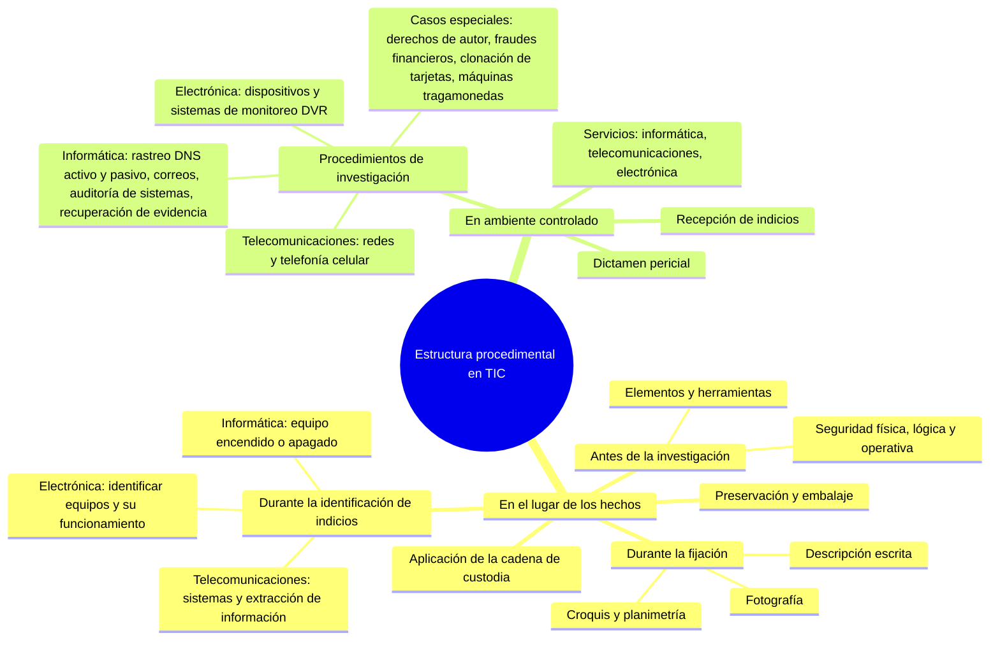

# 16 - El dictamen pericial en informática forense

> Lectura del curso [Informática forense](../../cursos/digital-forensics/README.md), unidad 5, tema 3.

## Por qué importa

Todo lo que el perito hizo en el lugar de los hechos y en el laboratorio llega a la autoridad en un solo documento. Si ese documento es confuso, el mejor análisis del mundo no sirve: el agente del Ministerio Público no sabrá qué acusar y el juez no sabrá qué valorar. Si es claro, ordenado y verificable, se convierte en el sustento técnico y científico para identificar y sancionar a los responsables de un incidente donde las TIC se usaron como fin o como medio.

El dictamen cierra el ciclo que empezó con la solicitud de intervención ([nota 14](14-procedimientos-investigacion-forense.md)) y siguió con la fijación y preservación de la evidencia ([nota 15](15-identificacion-fijacion-preservacion.md)). Esta nota explica qué es, qué rubros lleva, qué dice la ley sobre el perito y cómo se ve uno real, desglosado paso a paso.

## Qué es y qué lo hace valioso

Un dictamen pericial es el informe en el que un experto en una materia, el perito, analiza y aclara los aspectos técnicos de un caso para que jueces, fiscales, abogados y demás partes puedan decidir. Existe porque hay hechos que no se entienden con conocimiento común: en informática forense, los registros de actividad de una computadora, los datos recuperados de un disco o el origen de una comunicación electrónica.

Sus cualidades exigidas son tres: **claridad**, **precisión** y **objetividad**. De ellas dependen que sea admisible y que sea útil. Su valor no está en la forma, sino en el contenido que fundamenta el análisis de la posible evidencia, que puede ser tan complejo como lo pidan el número y la naturaleza de los indicios. Lo que nunca puede ser complejo son las conclusiones: claras, concisas y contundentes, y siempre en respuesta al planteamiento que hizo la autoridad.

Detrás de un buen dictamen hay tres compromisos:

- **Método científico** aplicado con rigor, de modo que otro perito pueda repetir el estudio.
- **Ética**: el perito informa lo que encontró, no lo que la parte que lo propuso quisiera oír.
- **Legalidad**: el estudio respeta el marco vigente, o la defensa lo derribará.

## Lo que dice la ley sobre el peritaje

En el sistema acusatorio, el dictamen escrito no basta: el perito tiene que sostenerlo en audiencia.

Código Nacional de Procedimientos Penales, artículos 272 y 273 (texto vigente, última reforma DOF 28-11-2025):

> **Artículo 272. Peritajes**
> Durante la investigación, el Ministerio Público o la Policía con conocimiento de éste, podrá disponer la práctica de los peritajes que sean necesarios para la investigación del hecho. El dictamen escrito no exime al perito del deber de concurrir a declarar en la audiencia de juicio.
>
> **Artículo 273. Acceso a los indicios**
> Los peritos que elaboren los dictámenes tendrán en todo momento acceso a los indicios sobre los que versarán los mismos, o a los que se hará referencia en el interrogatorio.

Cuando el análisis consume o altera el objeto y no se podrá repetir, la defensa tiene derecho a estar presente:

Código Nacional de Procedimientos Penales, artículo 274, primer párrafo:

> **Artículo 274. Peritaje irreproducible**
> Cuando se realice un peritaje sobre objetos que se consuman al ser analizados, no se permitirá que se verifique el primer análisis sino sobre la cantidad estrictamente necesaria para ello, a no ser que su existencia sea escasa y los peritos no puedan emitir su opinión sin consumirla por completo. Éste último supuesto o cualquier otro semejante que impida que con posterioridad se practique un peritaje independiente, deberá ser notificado por el Ministerio Público al Defensor del imputado, si éste ya se hubiere designado o al Defensor público, para que si lo estima necesario, los peritos de ambas partes, y de manera conjunta practiquen el examen, o bien, para que el perito de la defensa acuda a presenciar la realización de peritaje.

En informática este supuesto aparece, por ejemplo, con la memoria de un equipo encendido o con una adquisición que solo se puede hacer una vez: avisar a la defensa evita que el resultado se impugne después.

Ya en juicio, la prueba pericial y quién puede rendirla:

Código Nacional de Procedimientos Penales, artículos 368 y 369, primer párrafo:

> **Artículo 368. Prueba pericial**
> Podrá ofrecerse la prueba pericial cuando, para el examen de personas, hechos, objetos o circunstancias relevantes para el proceso, fuere necesario o conveniente poseer conocimientos especiales en alguna ciencia, arte, técnica u oficio.
>
> **Artículo 369. Título oficial**
> Los peritos deberán poseer título oficial en la materia relativa al punto sobre el cual dictaminarán y no tener impedimentos para el ejercicio profesional, siempre que la ciencia, el arte, la técnica o el oficio sobre la que verse la pericia en cuestión esté reglamentada; en caso contrario, deberá designarse a una persona de idoneidad manifiesta y que preferentemente pertenezca a un gremio o agrupación relativa a la actividad sobre la que verse la pericia.

Y en el interrogatorio, el perito puede ser puesto a prueba con hipótesis:

Código Nacional de Procedimientos Penales, artículo 372, tercer párrafo (fragmento):

> [...] al perito se le podrán formular preguntas con el fin de proponerle hipótesis sobre la materia del dictamen pericial, a las que el perito deberá responder atendiéndose a la ciencia, la profesión y los hechos hipotéticos propuestos.

La consecuencia práctica: cada decisión técnica que el dictamen registra (qué herramienta, por qué ese hash, por qué esa ventana de tiempo) es una pregunta que el perito tendrá que contestar de viva voz, en un contrainterrogatorio.

## Los rubros del dictamen

Para que la autoridad pueda dar sentido y uso a los resultados, el dictamen se ordena y se estandariza. El material recomienda tomar como modelo el manual de procedimientos de los servicios periciales, con estos rubros:

| Rubro | Qué contiene |
|---|---|
| Fecha de emisión | Cuándo se firma el dictamen |
| Solicitante | Nombre de quien pidió el peritaje |
| Planteamiento del problema y antecedentes | Lo que pidió la autoridad, transcrito tal cual y entre corchetes, para que no haya duda de qué se respondió |
| Observación del lugar | En investigaciones de campo, el relato y las imágenes de lo hecho antes de la diligencia y durante la búsqueda de indicios: domicilio, responsables o resguardantes de los equipos y criterio de recolección |
| Análisis y consideraciones técnicas | El detalle del estudio: evidencias, manuales, herramientas y procedimientos, con secuencias de fotografías o pantallas que demuestren sin lugar a duda cómo se trabajó |
| Bibliografía | Libros y sitios consultados |
| Glosario | Los términos técnicos que no se pudieron evitar, explicados |
| Conclusiones | La opinión técnica que responde a cada planteamiento, apoyada en el análisis, en redacción clara y contundente |
| Firma | De los peritos que hicieron el estudio |

Sobre las conclusiones el material insiste: lenguaje lo más sencillo posible. Las leerá primero el agente del Ministerio Público y después el juez, y ambos deben entenderlas rápido para calificar la conducta y aplicar la ley.

## Tres documentos según quién lee

La guía técnica de cadena de custodia digital de 2018 ([nota 15](15-identificacion-fijacion-preservacion.md)) distingue tres productos de la fase de análisis:

| Documento | Lector | Contenido |
|---|---|---|
| Informe técnico | Otros especialistas | Técnicas, secuencia de obtención de datos, software y hardware usados y cómo se manipularon; puede acompañarse de copias de los datos |
| Informe ejecutivo | Directivos y personas sin formación técnica | Lo que pasó en lenguaje llano, con una representación visual sencilla del ataque y qué hacer para que no se repita |
| Dictamen | La autoridad | La secuencia del estudio, los métodos y medios empleados y las conclusiones |

Según la guía, todo dictamen debe incluir al menos: la descripción de lo estudiado, la relación detallada de los análisis, los medios científicos o técnicos usados junto con la verificación de que eran válidos, y las conclusiones. Y añade una regla de honestidad: si la información es incompleta, puede no haber una explicación definitiva; si un hecho admite dos o más explicaciones, todas se consideran, y el perito intenta probar o descartar cada una con método.

## Un dictamen real, desglosado

El material incluye un dictamen en informática de una fiscalía federal, de 2013, con los datos personales tachados. Se reconstruye aquí su estructura, con los datos de identificación sustituidos por descripciones genéricas.

**El encargo.** El agente del Ministerio Público pide peritos en informática y telecomunicaciones para extraer los videos de un grabador digital de video (DVR) de cuatro cámaras, correspondientes a un día concreto, pasarlos a DVD y entregar también el programa para reproducirlos en una PC. El planteamiento aparece transcrito entre comillas, palabra por palabra.

**El método.** El perito declara que usará el método descriptivo y analítico: primero describe lo que recibe; luego busca y extrae lo solicitado.

**La recepción.** Anota el oficio de petición y el registro de cadena de custodia de procesamiento con el que llegó el indicio. Recibe un paquete cerrado y lo fotografía por ambos lados antes de abrirlo. Dentro está el DVR: lo describe por color, marca, modelo y número de serie, con fotografías de la placa. Al retirar la tapa encuentra un disco duro de 1 TB y registra su marca, número de parte, serie y capacidad.

**Observaciones del lugar.** Como el estudio se hizo en el laboratorio, el rubro se limita a indicar las instalaciones de servicios periciales donde se trabajó.

**Consideraciones técnicas.** Aquí está el método en acción:

1. Declara el equipo de trabajo: una estación forense con Windows 7 de 64 bits y EnCase en su versión de entonces.
2. Duplica el disco del DVR con un duplicador forense de hardware sobre un disco de 2 TB, "para no trabajar directamente con la evidencia".
3. Descarga del sitio del fabricante el manual del DVR y su reproductor de video, y anota las direcciones de descarga.
4. Monta el **duplicado** en el DVR y lo enciende con su propio adaptador. Al revisar la hora configurada detecta que el aparato va **1 hora y 44 minutos atrasado** respecto de la hora local, y lo informa expresamente al Ministerio Público.
5. Por ese desfase, en lugar de buscar el día exacto, define una ventana más amplia: desde las 22:00 del día anterior hasta las 02:00 del día siguiente.
6. Entra al menú del DVR con el usuario y la clave que vienen en el manual y busca por cámara. El aparato responde "Fallido" en sus búsquedas.
7. Cambia de estrategia: conecta el duplicado a la estación forense **a través de un bloqueador de escritura** y lo abre en EnCase, que muestra cuatro particiones.
8. Localiza los archivos de video de la ventana y los presenta en una tabla por cámara, con inicio y fin de cada grabación y nombre de archivo: en total, varias decenas de archivos de video entre las cuatro cámaras.
9. Respalda los videos en cuatro DVD-R, uno por cámara, rotulados con el número de expediente y una leyenda, y agrega por cámara un reporte con el **hash MD5 de cada archivo**. El manual y el reproductor van en un CD-R aparte.
10. Embala los discos en un sobre cerrado y lo entrega, con el dictamen y los elementos de estudio embalados, junto con los registros de cadena de custodia de procesamiento y de entrega al Ministerio Público.

Una nota final aclara que el duplicado se eliminó al terminar, y que si se requiere otro análisis hay que remitir de nuevo los elementos.

**Conclusión.** Es una sola, y es directa: en el disco del DVR se localizaron los videos listados en la tabla de las consideraciones técnicas, respaldados en los DVD descritos, con sus reportes de hash, y el manual y el reproductor en el CD. Firma el perito, con visto bueno de su superior, y se enlistan los anexos.

### Qué protege cada práctica del ejemplo

| Práctica | Qué protege |
|---|---|
| Fotografiar el paquete antes de abrirlo | Que nadie alegue que llegó abierto o distinto |
| Trabajar sobre un duplicado | Que el original quede intacto para cualquier peritaje posterior |
| Informar el desfase del reloj | Que los horarios de los videos se interpreten bien y la búsqueda no deje fuera grabaciones |
| Usar bloqueador de escritura | Que el análisis no modifique ni el duplicado |
| Cambiar de herramienta cuando la primera falla | Que el resultado no dependa del aparato investigado |
| Calcular un hash por archivo | Que cualquiera pueda verificar que los videos entregados son los extraídos |
| Entregar el reproductor y el manual | Que la autoridad pueda ver la evidencia sin depender del perito |
| Cerrar con su cadena de custodia | Que la trazabilidad no se rompa en la entrega |

Actualización al 2026: el ejemplo usa términos y herramientas de su época. La "averiguación previa" (A.P.) hoy es la carpeta de investigación del sistema acusatorio; el "México, D. F." es Ciudad de México desde la reforma constitucional de 2016; las versiones de EnCase, Windows y el reproductor son de 2013. Y el hash elegido hoy sería SHA-256, porque MD5 ya no se considera resistente a colisiones (ver la [nota 15](15-identificacion-fijacion-preservacion.md)).

## La intervención pericial completa, en un cuadro

El material cierra con una síntesis de la intervención del perito, ubicada en las etapas 2 (intervención pericial) y 3 (dictamen pericial) del proceso que empieza con la intervención del Ministerio Público. Recreada como mapa:

## Escribir para quien decide

Algunas reglas para que el dictamen cumpla su función:

- **Responder lo que se preguntó.** Cada conclusión corresponde a un planteamiento; si algo no se pudo determinar, se dice y se explica por qué.
- **Lenguaje llano en las conclusiones**, y el detalle técnico en las consideraciones. Lo que no se pueda evitar, al glosario.
- **Mostrar, no solo afirmar.** Fotografías, capturas, tablas y valores hash en el cuerpo o en anexos.
- **Fechas y horas siempre con su referencia**: hora del equipo, hora real y desfase.
- **Herramientas con versión**, para que otro perito pueda reproducir el estudio.
- **Nada de opiniones fuera de la materia.** El perito en informática dictamina sobre lo técnico; la calificación jurídica es de la autoridad.

## Reflexión de cierre

El material termina con una llamada que vale para todo el módulo. Quienes investigan delitos con TIC deben dejar de lado el egoísmo y la envidia profesional: cualquiera puede ser víctima, y no hay que esperar a serlo para actuar. Muchas conductas se facilitan por falta de conciencia en el uso de la tecnología, y la delincuencia aprovecha además los vacíos legales, en México y en el mundo. Hace falta pedir ayuda y hacer preguntas sin pena, porque callar puede costar caro, incluso en casos de explotación y abuso de menores.

Se necesitan acuerdos de cooperación entre instituciones nacionales e internacionales y canales que den acceso rápido a la información que cruza fronteras, para no duplicar esfuerzos. Estos delitos casi no se ven: los datos se copian o se alteran mientras uno sigue con su día, y su costo económico y social es mundial. Las plataformas sociales y de mensajería que tanto ayudan también las explotan quienes dañan vidas y patrimonios. Hay escepticismo sobre si políticos, abogados e ingenieros pueden trabajar juntos para corregirlo; el dictamen bien hecho es la parte que le toca al perito para demostrar que sí.

## Glosario

| Término | Definición |
|---------|-----------|
| Dictamen pericial | Documento técnico y científico en el que el perito responde, con método y evidencia, al planteamiento de la autoridad |
| Perito | Persona con conocimientos especiales en una ciencia, arte, técnica u oficio, designada para dictaminar |
| Planteamiento del problema | Pregunta concreta de la autoridad que el dictamen debe contestar; se transcribe tal cual |
| Consideraciones técnicas | Rubro que describe el análisis, las herramientas, los procedimientos y su evidencia gráfica |
| Conclusión | Opinión técnica final que responde a cada planteamiento, en lenguaje claro |
| Informe técnico | Documento detallado dirigido a especialistas, con técnicas, secuencias y herramientas |
| Informe ejecutivo | Resumen en lenguaje llano para lectores no técnicos |
| Peritaje irreproducible | Estudio que consume o altera el objeto y no se puede repetir; exige avisar a la defensa |
| Prueba pericial | Medio de prueba que se ofrece en juicio cuando hacen falta conocimientos especiales |
| Contrainterrogatorio | Preguntas de la parte contraria al perito en la audiencia, para poner a prueba su dictamen |
| Grabador digital de video (DVR) | Equipo que guarda en disco las grabaciones de cámaras de vigilancia |
| Duplicado forense | Copia exacta de un medio que se usa para analizar sin tocar el original |

## Referencias

- Cámara de Diputados del H. Congreso de la Unión. (2025). *Código Nacional de Procedimientos Penales* [Última reforma DOF 28-11-2025]. Diario Oficial de la Federación. https://www.diputados.gob.mx/LeyesBiblio/pdf/CNPP.pdf
- Cámara de Diputados del H. Congreso de la Unión. (2026). *Constitución Política de los Estados Unidos Mexicanos* [Última reforma DOF 07-10-2026]. Diario Oficial de la Federación. https://www.diputados.gob.mx/LeyesBiblio/pdf/CPEUM.pdf
- Lira Arteaga, O. M. (2018). *Cibercriminalidad: fundamentos de investigación en México*. Ubijus. Edición anterior: Instituto Nacional de Ciencias Penales, 2010, ISBN 978-607-7882-13-8, https://www.marcialpons.es/libros/cibercriminalidad/9786077882138/
- National Institute of Justice. (2004). *Forensic examination of digital evidence: A guide for law enforcement* (NCJ 199408). U.S. Department of Justice. https://www.ojp.gov/pdffiles1/nij/199408.pdf
- Turner, S. y Chen, L. (2011). *Updated security considerations for the MD5 message-digest and the HMAC-MD5 algorithms* (RFC 6151). Internet Engineering Task Force. https://www.rfc-editor.org/rfc/rfc6151
- Unidad de Investigaciones Cibernéticas y Operaciones Tecnológicas. (2018). *Guía técnica de cadena de custodia de evidencia digital*. Agencia de Investigación Criminal, Procuraduría General de la República. Documento institucional; no se localizó una edición pública en línea.

---

*Rogelio Arriaga Gonzalez*
