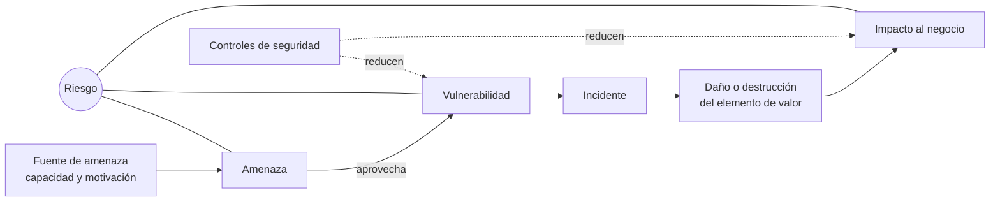

# 01 - Principios y conceptos fundamentales de la seguridad de la información

> Unidad 1, tema 1 de la materia *Seguridad de la información*. Definiciones de la familia ISO/IEC 27000 y de los autores que la critican, puestas a trabajar sobre casos. Revisado a noviembre de 2026.

## Por qué importa

Antes de comprar un firewall, de escribir una política o de contratar una auditoría, alguien tiene que contestar tres preguntas: qué vale la pena proteger, contra qué y cuánto cuesta no hacerlo. Las tres se responden con un puñado de conceptos (activo, vulnerabilidad, amenaza, incidente, impacto, control y riesgo) que casi todo el mundo usa y casi nadie distingue con precisión. Confundir una amenaza con su fuente, o una vulnerabilidad con un incidente, produce análisis de riesgo que miden la cosa equivocada y presupuestos que se gastan donde no hacía falta.

Esta nota fija ese vocabulario. Todo lo que sigue en la materia (normas, sistemas de gestión, controles físicos y lógicos, continuidad) se construye encima de él.

## La información siempre ha sido poder

El abuso y el cuidado de la información son mucho más viejos que internet. Quien controla lo que otros saben, o sabe lo que otros quieren ocultar, gana influencia. Algunos ejemplos que sirven de ancla:

- **El oráculo de Delfos.** Las sacerdotisas del templo de Apolo no adivinaban de la nada: se apoyaban en una red de informantes humanos que les traían noticias de toda Grecia. Era una operación de inteligencia con fachada religiosa.
- **La policía secreta del Porfiriato.** El gobierno de Porfirio Díaz sostuvo buena parte de su control político en la vigilancia de opositores y en el manejo de lo que se sabía de ellos.
- **El Telegrama Zimmermann (1917).** El ministro alemán de Asuntos Exteriores envió un mensaje cifrado a su embajador en México para proponer una alianza contra Estados Unidos. La inteligencia británica lo interceptó y lo descifró, y su publicación contribuyó a que Estados Unidos entrara en la Primera Guerra Mundial. Es uno de los fracasos de "seguridad de la información" más citados: el cifrado existía, pero no resistió al adversario.

La lección es la misma en los tres casos: el valor de la información depende del bando en el que estés, y los medios para obtenerla o protegerla siempre han sido parte del juego del poder.

### De conectar universidades a gestionar riesgos

A finales de la década de 1980, dos instituciones académicas mexicanas fueron las primeras del país en conectarse a la red que después sería internet. Era una red lenta, con pocos servicios y conocida solo por investigadores; lo importante no era la velocidad de los paquetes, sino que permitía **intercambiar información** con colegas de otros países con una agilidad que antes no existía.

Desde entonces la disciplina creció en complejidad. En sus inicios, "hacer seguridad" era administrar herramientas en el perímetro de la red. Hoy abarca además:

- planeación estratégica y gobierno;
- cumplimiento de leyes y normas, auditorías y análisis de brechas;
- filtrado de contenidos y análisis del comportamiento de los usuarios con técnicas de ciencia de datos;
- canales protegidos, como las redes privadas virtuales, para compartir datos solo con quien está autorizado.

Tanta variedad tiene que organizarse en un **sistema** donde cada pieza sirva a un objetivo común. Existen muchas propuestas para hacerlo, de distintos niveles y a veces incompatibles entre sí; la materia recorre las más difundidas y termina en planes de seguridad que respondan a lo que esperan las partes interesadas.

## Dato, información y activo

**Dato** es la materia prima: un valor aislado (una fecha, una cifra, un nombre) que todavía no dice nada por sí mismo. **Información** es un conjunto de datos organizados que, dentro de un contexto, adquieren un significado particular y aumentan el conocimiento de quien los recibe. "4,500" es un dato; "el saldo de la cuenta de nómina de la persona X es de 4,500 pesos" es información, y ya merece protección.

La pregunta que ordena toda la disciplina es **¿qué es lo que realmente queremos proteger?** Lo que consideramos lo bastante importante como para invertir esfuerzo en cuidarlo es un **elemento de valor**, y en el lenguaje de las normas se llama **activo**. En seguridad de la información, el primer activo es la información misma, pero no el único:

| Tipo de activo | Ejemplos |
|---|---|
| La información | Expedientes, bases de datos, contratos, secretos industriales |
| Dónde reside | Servidores, laptops, teléfonos, discos de respaldo, papel archivado |
| Por dónde viaja | Red interna, enlaces a internet, correo, mensajería |
| Quién la produce y quién la recibe | Las fuentes y los destinatarios autorizados: personas, sistemas, socios |

Un activo no vale lo mismo para todos. Antes de cualquier definición formal conviene responder, desde la perspectiva del negocio o del área concreta, qué perdería la organización si ese activo dejara de estar disponible, se alterara o se filtrara.

## Qué es seguridad de la información

No hay una sola definición. Los autores, los marcos y los manuales de buenas prácticas usan el término con matices distintos, y vale la pena comparar varias fuentes para construir una definición propia e informada.

- **Harkins (2016)** la plantea como una función que *protege para habilitar*: su razón de ser no es decir "no", sino permitir que la organización opere y crezca con un nivel de riesgo que pueda sostener. Es una visión centrada en el riesgo y en el negocio.
- **Lundgren y Möller (2019)** critican la definición clásica basada en tres propiedades. Sostienen que es a la vez demasiado amplia y demasiado estrecha, porque deja fuera los aspectos humanos, organizacionales y éticos, y proponen entenderla como garantizar el *acceso apropiado* a la información.

La definición de referencia, la de la familia ISO/IEC 27000, dice en esencia que la seguridad de la información consiste en **conservar la confidencialidad, la integridad y la disponibilidad** de la información. A esas tres propiedades se les llama la **tríada** (o CIA, por sus siglas en inglés).

| Propiedad | Qué garantiza | Cómo se rompe (ejemplo) |
|---|---|---|
| Confidencialidad | Que la información no se ponga al alcance ni se revele a personas, entidades o procesos sin autorización | La lista de precios de un portal interno aparece publicada en un sitio extranjero |
| Integridad | Que la información sea exacta y esté completa | Alguien sustituye el contenido de una página web pública por una imagen ajena |
| Disponibilidad | Que quien está autorizado pueda acceder a la información y usarla cuando la necesita | Un ataque de denegación de servicio deja fuera de línea la banca en línea |

La misma norma reconoce que pueden considerarse otras propiedades:

- **Autenticidad:** que una entidad sea quien dice ser y que la información provenga de quien dice provenir.
- **No repudio:** poder demostrar que un hecho ocurrió y quién lo originó, de modo que el autor no pueda negarlo después.
- **Responsabilidad (rendición de cuentas):** que las acciones puedan atribuirse a quien las ejecutó.
- **Confiabilidad:** que el comportamiento y los resultados sean consistentes con lo que se espera.

## Vulnerabilidad, amenaza y fuente de amenaza

Todo activo tiene debilidades. **Vulnerabilidad** es una debilidad de un activo, o de un grupo de activos, que una amenaza puede aprovechar (Calder y Watkins, 2019). La familia ISO amplía la idea: la debilidad puede estar en el activo o en el **control** que lo protege. Un servidor sin parches es vulnerable; un procedimiento de respaldo que nadie prueba también lo es.

**Amenaza** es la causa potencial de un incidente no deseado que puede terminar en daño para un sistema o una organización. Es un concepto complejo y a veces polémico, porque suele confundirse con quien la ejecuta. Por eso conviene separar:

- **Amenaza:** lo que podría ocurrir (robo de credenciales, incendio, borrado accidental, denegación de servicio).
- **Fuente de amenaza:** el origen (un grupo criminal, un empleado descontento, un sismo, un error humano). Siempre existe una fuente, y para valorarla se consideran dos aspectos: su **capacidad** (los recursos y conocimientos que tiene) y su **motivación** (qué la impulsa a actuar).

Confundir los dos conceptos produce análisis de riesgo inservibles: "hackers" no es una amenaza, es una fuente; la amenaza es lo que esos atacantes podrían hacer contra un activo concreto.

### Los activos no son solo de las organizaciones

La bibliografía suele hablarle a las empresas, pero los activos y las fuentes de amenaza también toman formas personales. En redes sociales, el activo es la identidad, la reputación, la ubicación o la rutina de una persona, y las fuentes de amenaza van desde un acosador hasta una red de fraude que arma perfiles a partir de lo que publicamos. Al enfocarnos en los sistemas de una organización corremos el riesgo de olvidar los elementos de valor que tenemos más cerca.

## Incidente e impacto

Cuando una amenaza aprovecha una vulnerabilidad ocurre un **incidente de seguridad**. ISO lo describe como uno o varios eventos de seguridad, no deseados o inesperados, con una probabilidad significativa de comprometer las operaciones del negocio y de amenazar la seguridad de la información.

Esa definición es útil, pero limitada: está escrita desde la operación del negocio y no cubre bien los daños a personas o a la reputación que no se traducen en una operación detenida. Conviene contrastarla con las definiciones de la bibliografía de respuesta a incidentes y de ciberseguridad, y construir una propia que refleje lo que se quiere proteger.

El **impacto al negocio** de un incidente no tiene una medida universal, y no hay consenso entre normas, manuales y autores sobre cómo describirlo. Depende, entre otras cosas, de la naturaleza de la organización:

- En 2008, la página de internet del Senado de la República fue alterada por atacantes y el daño permaneció visible durante un tiempo (Zárate, 2008). Para una institución legislativa, el golpe es sobre todo de **imagen y credibilidad**.
- El mismo tipo de intrusión en una entidad financiera tendría un impacto principalmente **económico**: fraudes, multas, clientes que se van.

El mismo incidente técnico puede valer muy poco o muchísimo según quién lo sufra. Por eso el impacto se define con criterios propios de cada organización (ver la nota [03](03-sgsi-iso-27001.md)).

## Control de seguridad y riesgo

Para ISO, un **control** es una medida que modifica el riesgo. La definición es muy general, y sus notas la aterrizan:

1. Un control incluye cualquier proceso, política, dispositivo, práctica u otra acción que modifique el riesgo: desde una política documentada y un procedimiento hasta un equipo de red, una costumbre del personal o la actitud de la organización frente a la inseguridad.
2. Un control no siempre logra el efecto que se espera de él.

La segunda nota es la más importante. Los activos tienen vulnerabilidades conocidas y desconocidas, y los controles, cuya misión es bajar el riesgo de esos activos, tienen también las suyas. De ahí una consecuencia que no admite excepciones: **el riesgo nunca es cero**. Siempre queda una probabilidad latente de que ocurra un incidente.

### ¿Cuánto invertir?

La pregunta recurrente en cualquier organización es cuánto hay que invertir (o gastar) en proteger los activos de información. Para contestarla, varios autores proponen ver la seguridad de la información como un **proceso de gestión de riesgos**: identificar los riesgos, evaluarlos, decidir qué nivel es aceptable e implantar las salvaguardas adecuadas para mantenerse en ese nivel. Como ningún entorno es totalmente seguro, las estrategias posibles son cinco:

| Estrategia | Qué significa | Ejemplo |
|---|---|---|
| Transferir | Pasar las consecuencias económicas a otro ente | Contratar un seguro de ciberriesgos |
| Aceptar | Asumir el riesgo de forma consciente y documentada | Un equipo de pruebas sin datos reales queda sin cifrado de disco |
| Evitar | Eliminar la actividad que origina el riesgo | Dejar de guardar números de tarjeta que no se necesitan |
| Compartir | Repartir el riesgo con una o más entidades | Operar un centro de datos alterno en consorcio con otra empresa |
| Mitigar | Aplicar controles hasta equilibrar el nivel de riesgo aceptable con los objetivos del negocio | Autenticación multifactor y parches mensuales |

La gestión del riesgo ofrece más caminos que la sola mitigación, y elegir bien entre ellos es lo que convierte la seguridad en una inversión y no en un gasto sin fondo (tema de la nota [04](04-gasto-o-inversion.md)).

> Actualización al 2026: las definiciones de esta nota provienen de ISO/IEC 27000 en sus ediciones de 2014 y 2018. En julio de 2026 se publicó la sexta edición, ISO/IEC 27000:2026, que reemplaza a la de 2018 y ya no es un documento de vocabulario: presenta los conceptos y principios del SGSI y la relación entre las normas de la familia, y solo define los términos que usa. Los conceptos (tríada, amenaza, vulnerabilidad, control, riesgo) se mantienen.

## Glosario

| Término | Definición |
|---|---|
| Dato | Valor aislado, materia prima que todavía no comunica nada por sí solo |
| Información | Datos organizados que en un contexto adquieren significado y aumentan el conocimiento de quien los recibe |
| Activo | Cualquier elemento de valor que la organización o la persona decide proteger |
| Seguridad de la información | Conservación de la confidencialidad, integridad y disponibilidad de la información, y de propiedades como autenticidad y no repudio cuando aplican |
| Confidencialidad | Propiedad de que la información solo la conozcan personas, entidades o procesos autorizados |
| Integridad | Propiedad de que la información sea exacta y esté completa |
| Disponibilidad | Propiedad de que la información pueda usarse cuando la necesita quien está autorizado |
| No repudio | Capacidad de demostrar quién originó un hecho, de modo que no pueda negarlo |
| Vulnerabilidad | Debilidad de un activo o de un control que una amenaza puede aprovechar |
| Amenaza | Causa potencial de un incidente no deseado que puede dañar a un sistema o a una organización |
| Fuente de amenaza | Origen de una amenaza; se valora por su capacidad y su motivación |
| Incidente de seguridad | Evento o serie de eventos no deseados que comprometen la operación o la seguridad de la información |
| Impacto al negocio | Consecuencia de un incidente medida con los criterios propios de la organización |
| Control | Medida que modifica el riesgo; puede ser un proceso, una política, un dispositivo o una práctica |
| Mitigación | Estrategia de tratamiento que aplica controles para llevar el riesgo a un nivel aceptable |

## Referencias

- Ángel Ángel, J. de J., y Morales-Luna, G. (2008). Breve descripción de la criptografía en la Revolución Mexicana. *Revista Digital Universitaria, 9*(3). https://www.revista.unam.mx/vol.9/num3/art18/art18.pdf
- Calder, A., y Watkins, S. (2019). *IT governance: An international guide to data security and ISO 27001/ISO 27002* (7.ª ed.). Kogan Page. https://www.koganpage.com/risk-compliance/it-governance-9780749495954
- Harkins, M. W. (2016). *Managing risk and information security: Protect to enable* (2.ª ed.). Apress. https://link.springer.com/book/10.1007/978-1-4842-1455-8
- International Organization for Standardization e International Electrotechnical Commission. (2018). *ISO/IEC 27000:2018 Information technology. Security techniques. Information security management systems. Overview and vocabulary*. ISO. https://www.iso.org/standard/73906.html
- International Organization for Standardization e International Electrotechnical Commission. (2026). *ISO/IEC 27000:2026 Information security, cybersecurity and privacy protection. Information security management systems. Overview*. ISO. https://www.iso.org/standard/27000
- Lundgren, B., y Möller, N. (2019). Defining information security. *Science and Engineering Ethics, 25*(2), 419-441. https://doi.org/10.1007/s11948-017-9992-1
- Méndez, T. [Mendez Thomas]. (2014, 16 de mayo). *El peligro de las redes sociales* [Video]. YouTube. https://youtu.be/IalqkfFiI20
- National Security Agency. (s. f.). *World War I: Zimmermann telegram*. National Cryptologic Museum. https://www.nsa.gov/History/National-Cryptologic-Museum/Exhibits-Artifacts/Exhibit-View/Article/2719151/world-war-1-zimmermann-telegram/
- What You Need To Know. (2013, 16 de diciembre). *Information security* [Video]. YouTube. https://youtu.be/eUxUUarTRW4
- Zárate, A. (2008, 9 de mayo). Mantienen hackeo de la página de internet del Senado. *El Universal*. https://archivo.eluniversal.com.mx/notas/505494.html

---

*Rogelio Arriaga Gonzalez*
