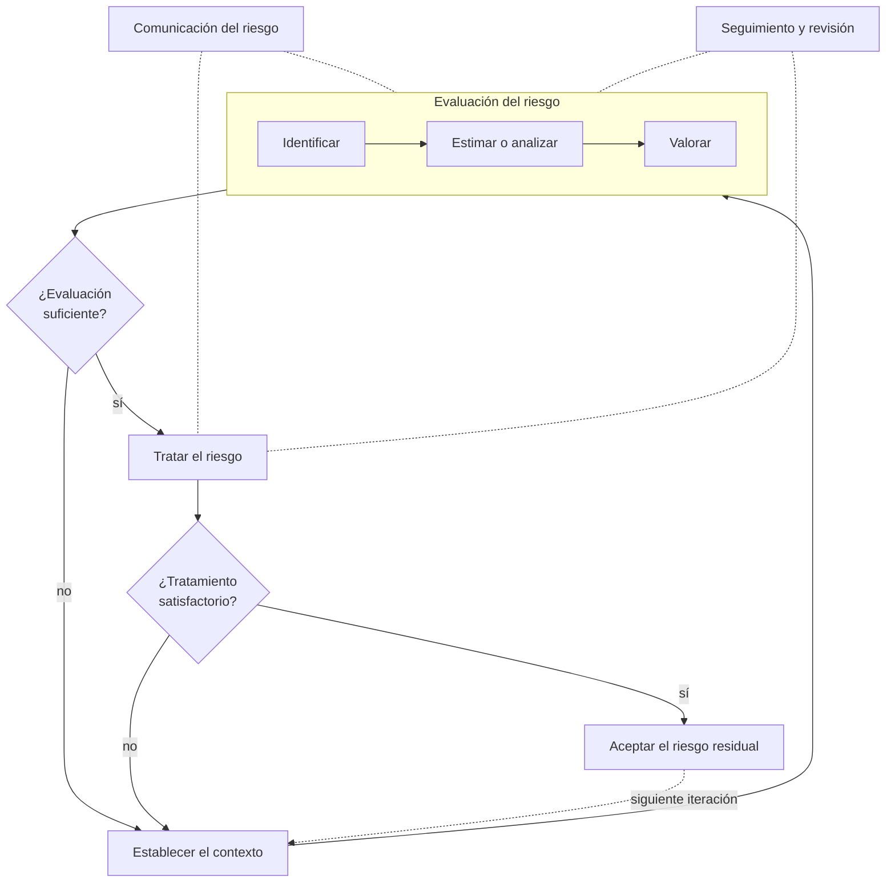

# 03 - El SGSI desde la óptica de ISO/IEC 27001

> Unidad 1, tema 3 de la materia *Seguridad de la información*. Cómo se establece un sistema de gestión de seguridad de la información y cómo se evalúa el riesgo según ISO/IEC 27001 e ISO/IEC 27005, con los cambios de las ediciones de 2022. Revisado a noviembre de 2026.

## Por qué importa

El NIST entrega un procedimiento; la ISO entrega un **marco** (ver la nota [02](02-normas-internacionales.md)). La diferencia es de fondo: ISO generaliza sus conceptos a propósito para que sirvan lo mismo a un hospital que a una fábrica o a una dependencia de gobierno, y deja a criterio de quien implementa los detalles concretos. Eso la hace aplicable a organizaciones de cualquier tipo y tamaño, pero también la vuelve abstracta: quien no entiende su lógica termina llenando formatos sin gestionar ningún riesgo.

Esta nota recorre esa lógica en dos piezas: el ciclo que mantiene vivo al SGSI y el proceso de gestión de riesgos que lo alimenta.

## El ciclo de mejora continua

ISO/IEC 27001 se apoya en el ciclo de mejora continua, también llamado **círculo de Deming** o **PDCA** (*Plan, Do, Check, Act*): planear, hacer, verificar y actuar. El SGSI y el proceso de gestión de riesgos recorren el mismo ciclo, cada uno con sus actividades:

| Fase | En el SGSI | En la gestión del riesgo |
|---|---|---|
| Planear | Establecer el sistema | Establecer el contexto, evaluar el riesgo, preparar el plan de tratamiento y aceptar los riesgos que quedan |
| Hacer | Implantar y operar | Ejecutar el plan de tratamiento |
| Verificar | Vigilar y revisar | Dar seguimiento y revisar los riesgos de forma continua |
| Actuar | Mantener y mejorar | Mantener y mejorar el propio proceso de gestión de riesgos |

## Planear: establecer el SGSI

Las versiones originales de la norma describían con detalle los pasos para establecer el sistema. Siguen siendo la mejor lista de verificación para arrancar un proyecto:

1. **Definir el alcance** según las características del negocio: organización, ubicaciones, activos y tecnología.
2. **Definir la política del SGSI** y obtener su aprobación por parte de la dirección.
3. **Definir el enfoque para evaluar el riesgo**: elegir una metodología de valoración y fijar los criterios y niveles de aceptación.
4. **Identificar los riesgos**: los activos y sus propietarios, las amenazas, las vulnerabilidades y los impactos.
5. **Analizar y evaluar los riesgos**: valorar el impacto de una falla de seguridad y la probabilidad de que ocurra, estimar el nivel de riesgo y decidir, con los criterios ya fijados, cuáles se aceptan y cuáles requieren tratamiento.
6. **Identificar y evaluar las opciones de tratamiento.**
7. **Seleccionar objetivos de control y controles** para tratar los riesgos.
8. **Obtener la aprobación de la dirección sobre el riesgo residual**, es decir, el que queda después del tratamiento.
9. **Obtener la autorización de la dirección** para implantar y operar el SGSI.
10. **Preparar la declaración de aplicabilidad**, el documento que dice qué controles se aplican, cuáles no y por qué (se estudia a fondo en la nota [11](11-implementar-el-sgsi.md)).

Dos ideas atraviesan la lista: la dirección aprueba en tres momentos distintos (política, riesgo residual e implantación), y nada se elige sin pasar antes por la evaluación de riesgos.

## La política de seguridad

La política es la declaración de intenciones y de rumbo de la organización en materia de seguridad, tal como la expresa formalmente su alta dirección. De ella cuelgan políticas más concretas. Una de las primeras que conviene tener es la **política de uso aceptable**:

- informa al personal qué puede y qué no puede hacer con los activos de la empresa (equipo, correo, internet, información);
- la firman todas las personas que trabajan en la organización;
- la firma también el propietario o director del negocio, con lo que queda claro que la regla aplica de arriba abajo.

Una política que no conocen los empleados no protege nada. Por eso las políticas institucionales se difunden a todo el personal, no solo a los directivos o al área de sistemas.

## Evaluar el riesgo

La **evaluación de riesgos** (*risk assessment*) es el proceso de identificar los activos y sus vulnerabilidades, reconocer las amenazas y estimar el impacto que tendría que esas amenazas se materializaran.

Su producto principal son los **objetivos de control**: el conjunto de requisitos de seguridad y control del negocio, ordenados por prioridad, que determinan qué estrategias de gestión se eligen para construir una arquitectura o plan de seguridad. Un objetivo de control describe lo que se quiere lograr al implantar los controles, no el control en sí. "Que solo el personal de nómina consulte los salarios" es un objetivo; "autenticación con dos factores en el sistema de nómina" es un control.

## ISO/IEC 27005: la gestión del riesgo

La norma de guía para gestionar el riesgo de seguridad de la información es ISO/IEC 27005. Sus rasgos generales:

- se aplica a cualquier tipo de organización;
- no impone una metodología concreta: describe un proceso y deja que cada quien elija cómo ejecutarlo;
- el proceso se puede aplicar a la organización completa, a una parte de ella, a un solo sistema de información o a un aspecto de control, como la planeación de la continuidad del negocio.

En la edición con la que se estudió originalmente este tema (2008), el proceso se dividía en seis cláusulas:

| Cláusula (ed. 2008) | Actividad |
|---|---|
| 7 | Establecimiento del contexto |
| 8 | Evaluación de riesgos |
| 9 | Tratamiento del riesgo |
| 10 | Aceptación del riesgo |
| 11 | Comunicación del riesgo |
| 12 | Seguimiento y revisión |

El flujo tiene dos puntos de decisión. Después de evaluar se pregunta si la evaluación es suficiente; si no, se regresa a ajustar el contexto. Después de tratar se pregunta si el tratamiento es satisfactorio; si no, se vuelve a evaluar. La comunicación y el seguimiento corren en paralelo durante todo el proceso.

> Actualización al 2026: ISO/IEC 27005 está vigente en su cuarta edición, de octubre de 2022. Se reorganizó para seguir la estructura de ISO/IEC 27001:2022 y alinearse con ISO 31000:2018; pasó de doce cláusulas y seis anexos a diez cláusulas y un anexo. Describe el proceso como establecimiento del contexto, identificación, análisis, valoración y tratamiento del riesgo, agrega criterios que indican cuándo iniciar o repetir cada actividad y admite dos enfoques para identificar riesgos: por **eventos** (escenarios estratégicos) y por **activos**. Los conceptos de esta nota siguen valiendo; cambia la numeración.

## Establecer el contexto

Lo primero es decidir **para qué** se gestiona el riesgo, porque el mismo proceso sirve para objetivos distintos: implantar un SGSI, cumplir una regulación, preparar un plan de continuidad del negocio, preparar un plan de respuesta a incidentes o planear un proyecto.

De esta etapa salen tres entregables:

### Criterios básicos

**Criterios de evaluación del riesgo.** Lo que se toma en cuenta para decidir qué tan grave es un riesgo:

- el valor estratégico de los procesos de información del negocio;
- la criticidad de los activos involucrados;
- los requisitos legales y regulatorios;
- las obligaciones contractuales;
- lo que esperan las partes interesadas (*stakeholders*).

**Criterios de impacto.** Se expresan como grado de daño o de costo que un incidente causaría a la organización, considerando:

- el valor del activo afectado;
- la pérdida de confidencialidad, integridad o disponibilidad;
- las operaciones internas y externas que se verían afectadas;
- la pérdida de negocio y de valor financiero;
- el rezago frente a la competencia;
- la interrupción de planes estratégicos;
- el daño a la reputación;
- los incumplimientos legales y contractuales.

**Criterios de aceptación del riesgo.** Dependen de las políticas, del entorno de la organización y de sus objetivos de negocio. Pueden tener varios umbrales con niveles de riesgo distintos, expresarse como la relación entre el beneficio esperado y el riesgo estimado, y variar según la clase de riesgo.

Además hay que prever recursos para preparar el plan de tratamiento, definir e implantar políticas y procedimientos, vigilar los controles y vigilar el propio proceso de gestión de riesgos.

### Alcance y límites

Para fijar el alcance hay que conocer el entorno del negocio: objetivos estratégicos y políticas, procesos, funciones y estructura, requisitos legales y regulatorios, la política institucional de seguridad, los activos de información, la ubicación geográfica y las expectativas de las partes interesadas. Toda exclusión debe justificarse. En el fondo, el alcance obedece a decisiones estratégicas de la organización.

### Organización para gestionar el riesgo

Se definen roles y responsabilidades para: desarrollar el proceso, identificar y analizar a las partes interesadas, repartir responsabilidades entre partes internas y externas, fijar cómo se escalan las decisiones y especificar qué registros se conservan.

## La evaluación paso a paso

La evaluación de riesgos recibe los criterios, el alcance y los límites; identifica, cuantifica, describe y prioriza los riesgos frente a los criterios y objetivos de la organización, y entrega una **lista de riesgos evaluados y priorizados**. Se compone de dos procesos:

- **Análisis del riesgo**, que a su vez incluye la **identificación** y la **estimación**.
- **Valoración del riesgo** (*risk evaluation*).

### Identificar

El objetivo es determinar qué podría causar una pérdida potencial y entender cómo, dónde y por qué podría ocurrir. Son cinco actividades; el orden puede cambiar según la metodología, y lo que producen alimenta la estimación.

| Actividad | Recibe | Hace | Entrega |
|---|---|---|---|
| Identificar activos | Alcance, límites, procesos, ubicaciones | Inventaria lo que tiene valor y asigna a cada activo un propietario responsable | Activos a gestionar y procesos de negocio relacionados, con su importancia |
| Identificar amenazas | Revisión de incidentes, opinión de propietarios y usuarios, catálogos de amenazas, fuentes internas y externas | Identifica amenazas y sus fuentes | Lista de amenazas con su tipo y su fuente |
| Identificar controles existentes | Documentación de procesos y controles | Revisa controles actuales y planeados y comprueba que funcionen | Lista de controles, su estado de implantación y su uso |
| Identificar vulnerabilidades | Activos, amenazas y controles ya identificados | Busca debilidades explotables | Lista de vulnerabilidades ligadas a activos, amenazas y controles |
| Identificar consecuencias | Activos, procesos, amenazas y vulnerabilidades | Describe qué pasa si se pierde confidencialidad, integridad o disponibilidad | Escenarios de incidente con sus consecuencias para activos y procesos |

Detalles que la guía de implantación remarca:

- **Activos.** Un activo es cualquier cosa con valor para la organización y que por eso requiere protección. Cada uno necesita un propietario.
- **Amenazas.** Pueden ser naturales o humanas, accidentales o deliberadas, internas o externas. Una misma amenaza puede afectar a varios activos.
- **Controles existentes.** Al revisarlos se verifica que funcionen: un control que no opera bien es en sí una vulnerabilidad. Un control puede resultar ineficaz, insuficiente o injustificado.
- **Vulnerabilidades.** Se buscan en la organización, los procesos y procedimientos, las rutinas de administración, el personal, el entorno físico, la configuración de los sistemas, el hardware, el software y el equipo de comunicaciones, y en las entidades externas. Una vulnerabilidad sin amenaza asociada no se descarta: se reconoce y se vigila, porque la amenaza puede aparecer después.
- **Consecuencias.** Pueden ser pérdida de eficacia, operación en condiciones adversas o daño a la reputación, y pueden ser temporales o permanentes. Un **escenario de incidente** es la descripción de una amenaza que explota cierta vulnerabilidad. En términos operativos, las consecuencias se miden en tiempo de reparación, horas de trabajo perdidas, oportunidades perdidas, salud y seguridad de las personas, costo de reparar el daño y daño a la imagen.

### Estimar

La estimación puede ser **cualitativa** o **cuantitativa**:

| | Cualitativa | Cuantitativa |
|---|---|---|
| Cómo mide | Escala de atributos (bajo, medio, alto) para consecuencias y probabilidad | Escalas numéricas para consecuencias y probabilidad |
| Ventaja | Fácil de entender y rápida; buena como primera aproximación | Resultados comparables y defendibles en dinero |
| Riesgo | Aumenta la subjetividad | La calidad depende de los datos y del método |

Se estima en tres pasos:

1. **Evaluar las consecuencias.** Recibe los escenarios relevantes (amenazas, vulnerabilidades, activos y consecuencias) y entrega las consecuencias evaluadas en términos de los activos y de los criterios de impacto. Se puede apoyar en un análisis de impacto al negocio (BIA) y en bases de datos de referencia, y expresar en dinero, en términos técnicos, humanos o en cualquier criterio relevante para la organización, siempre que sirva para decidir.
2. **Evaluar la probabilidad del incidente.** Considera qué tan seguido se presenta la amenaza y qué tan fácil es explotar la vulnerabilidad, con base en la experiencia y las estadísticas, en si el incidente sería deliberado o accidental, y en los controles existentes. Entrega la probabilidad de cada escenario.
3. **Estimar el nivel de riesgo.** Combina consecuencias y probabilidad para todos los escenarios relevantes y entrega una lista de riesgos con su nivel asignado.

### Valorar

La **valoración del riesgo** compara cada nivel estimado con los criterios de evaluación y de aceptación. Entrega la lista de riesgos priorizados y la relación con los escenarios de incidente que los originan. Es la lista con la que se decide qué tratar primero.

## Tratar el riesgo

Las opciones de tratamiento son las de la nota [01](01-principios-y-conceptos.md): **transferir, aceptar, evitar, compartir** o **mitigar**, que es aplicar controles hasta equilibrar el nivel de seguridad con los objetivos del negocio. Lo que quede después del tratamiento es el **riesgo residual**, y lo aprueba la dirección.

### De dónde salen los controles

Los controles se toman del catálogo de ISO/IEC 27002. En su edición original estaban agrupados en dominios: evaluación y tratamiento del riesgo, política de seguridad, organización de la seguridad, gestión de activos, seguridad de los recursos humanos, seguridad física, gestión de comunicaciones y operaciones, control de acceso, adquisición, desarrollo y mantenimiento de sistemas, gestión de incidentes, continuidad del negocio y cumplimiento.

> Actualización al 2026: ISO/IEC 27002:2022 sustituyó a la edición de 2013. Ya no agrupa los controles en catorce dominios sino en cuatro **temas**: organizacionales (37 controles), de personas (8), físicos (14) y tecnológicos (34), para un total de 93. Añadió once controles nuevos, entre ellos inteligencia de amenazas, seguridad de servicios en la nube, preparación de las TIC para la continuidad, seguimiento de la seguridad física, gestión de la configuración, borrado de información, enmascaramiento de datos, prevención de fuga de datos, actividades de monitoreo, filtrado web y codificación segura. El Anexo A de ISO/IEC 27001:2022 reproduce esa misma lista.

## ISO/IEC 27001 hoy

Un SGSI basado en ISO/IEC 27001 es un enfoque sistemático para gestionar la seguridad de la información. La norma especifica los requisitos para establecer, implantar, mantener y mejorar el sistema, y persigue los tres objetivos de la tríada: que la información solo la conozcan quienes están autorizados, que sea exacta y completa junto con sus métodos de procesamiento, y que esté disponible para los usuarios autorizados cuando la necesiten.

La edición 2022 comparte la estructura de alto nivel de todas las normas ISO de sistemas de gestión, lo que facilita integrarla con ISO 9001 o ISO 22301:

| Cláusula | Tema | Qué pide |
|---|---|---|
| 4 | Contexto de la organización | Entender la organización y su entorno, las necesidades de las partes interesadas, y fijar el alcance del SGSI |
| 5 | Liderazgo | Compromiso de la dirección, política de seguridad, roles, responsabilidades y autoridades |
| 6 | Planificación | Acciones ante riesgos y oportunidades, objetivos de seguridad y cómo lograrlos, planificación de los cambios |
| 7 | Soporte | Recursos, competencia, toma de conciencia, comunicación e información documentada |
| 8 | Operación | Planificación y control operacional, evaluación y tratamiento del riesgo |
| 9 | Evaluación del desempeño | Seguimiento, medición, análisis y evaluación; auditoría interna; revisión por la dirección |
| 10 | Mejora | No conformidades, acciones correctivas y mejora continua |

Beneficios que suelen citarse al implantarla:

- **Protección de la información** sensible y valiosa.
- **Cumplimiento** de leyes y regulaciones aplicables.
- **Reputación:** más confianza de clientes y partes interesadas.
- **Reducción de costos** asociados a incidentes.
- **Cultura de mejora continua** en la gestión de la seguridad.

> Actualización al 2026: la enmienda ISO/IEC 27001:2022/Amd 1:2024 añadió a la cláusula 4.1 que la organización determine si el cambio climático es un tema relevante, y a la 4.2 una nota sobre requisitos climáticos de las partes interesadas. El periodo de transición desde la edición 2013 terminó el 31 de octubre de 2025: los certificados contra la edición anterior ya no son válidos.

## Glosario

| Término | Definición |
|---|---|
| PDCA | Ciclo de mejora continua de planear, hacer, verificar y actuar; también llamado círculo de Deming |
| Alcance del SGSI | Ámbito de aplicación del sistema: procesos, ubicaciones, activos y tecnología que cubre |
| Política de seguridad | Intenciones y rumbo de la organización en seguridad, expresados formalmente por la alta dirección |
| Política de uso aceptable | Documento firmado por todo el personal que dice qué se puede y qué no se puede hacer con los activos |
| Parte interesada | Persona u organización que puede afectar, verse afectada o sentirse afectada por una decisión o actividad |
| Objetivo de control | Declaración de lo que se quiere lograr al implantar un conjunto de controles |
| Criterios de aceptación | Umbrales con los que la organización decide qué riesgo tolera sin tratarlo |
| Escenario de incidente | Descripción de una amenaza que explota cierta vulnerabilidad sobre uno o más activos |
| Análisis del riesgo | Identificación y estimación de los riesgos; sirve para entender su naturaleza y su nivel |
| Valoración del riesgo | Comparación de los niveles estimados con los criterios para priorizar |
| Riesgo residual | Riesgo que queda después del tratamiento |
| Declaración de aplicabilidad | Documento que lista los controles aplicados y excluidos, con su justificación |
| BIA | Análisis de impacto al negocio: mide el efecto de interrumpir funciones o procesos |
| Información documentada | Información que la norma exige controlar y conservar como evidencia del SGSI |

## Referencias

- Cybersecurity. (2018-). *Cybersecurity* [Revista de acceso abierto]. SpringerOpen. https://cybersecurity.springeropen.com/
- Global Standards. (2017). *ISO 27001: Seguridad de la información* [Video]. YouTube. https://youtu.be/WJm1qHHuMr0
- International Organization for Standardization. (2018). *ISO 31000:2018 Risk management. Guidelines*. ISO. https://www.iso.org/standard/65694.html
- International Organization for Standardization e International Electrotechnical Commission. (2008). *ISO/IEC 27005:2008 Information technology. Security techniques. Information security risk management*. ISO. https://www.iso.org/standard/42107.html
- International Organization for Standardization e International Electrotechnical Commission. (2022a). *ISO/IEC 27001:2022 Information security, cybersecurity and privacy protection. Information security management systems. Requirements*. ISO. https://www.iso.org/standard/27001
- International Organization for Standardization e International Electrotechnical Commission. (2022b). *ISO/IEC 27002:2022 Information security, cybersecurity and privacy protection. Information security controls*. ISO. https://www.iso.org/standard/75652.html
- International Organization for Standardization e International Electrotechnical Commission. (2022c). *ISO/IEC 27005:2022 Information security, cybersecurity and privacy protection. Guidance on managing information security risks*. ISO. https://www.iso.org/standard/80585.html
- International Organization for Standardization e International Electrotechnical Commission. (2024). *ISO/IEC 27001:2022/Amd 1:2024 Climate action changes*. ISO. https://www.iso.org/standard/27001
- Zhu, X., y Zhu, Y. (2019). Extension of ISO/IEC 27001 to mobile devices security management. En X. Yun et al. (Eds.), *Cyber security. CNCERT 2018* (Communications in Computer and Information Science, vol. 970). Springer. https://doi.org/10.1007/978-981-13-6621-5

---

*Rogelio Arriaga Gonzalez*
