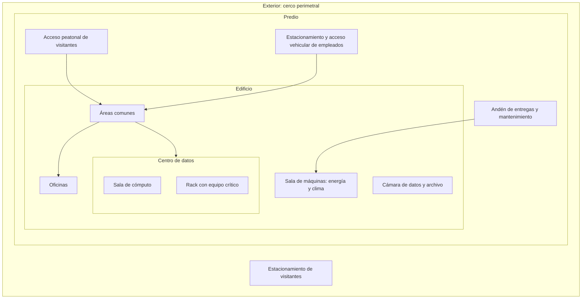

# 08 - Aseguramiento físico y administrativo de las infraestructuras de procesamiento de datos

> Unidad 3, tema 2 de la materia *Seguridad de la información*. Defensa en profundidad, zonas seguras, posturas de seguridad, controles físicos y ambientales según ISO/IEC 27001 y el manual del NIST, y la identificación de infraestructuras críticas. Revisado a noviembre de 2026.

## Por qué importa

Hay muchas formas de comprometer un sistema de información, y no todas pasan por la red. Quien entra a la sala de servidores puede arrancar el equipo con otro sistema operativo y saltarse cualquier contraseña; un incendio o una fuga de agua destruyen datos y equipo sin que nadie "ataque" nada. La seguridad física suele quedar en segundo plano porque tiene un lado técnico y otro administrativo, y ninguno de los dos es del todo del área de sistemas. Esta nota trata los controles que protegen los elementos físicos que albergan la información, para reducir tanto la probabilidad como el impacto de que una amenaza explote una vulnerabilidad.

## Defensa en profundidad

Una metodología para asegurar los datos es la **defensa en profundidad**: los datos son el elemento central que se resguarda, y alrededor de ellos se colocan capas sucesivas de protección. Si una capa falla, la siguiente sigue en pie.

| Capa (de afuera hacia adentro) | Qué protege | Ejemplos de controles |
|---|---|---|
| Políticas y procedimientos | Toda la organización | Política de seguridad, clasificación de la información, capacitación |
| Física | Edificios, salas y equipo | Cercas, guardias, control de acceso, videovigilancia |
| Perímetro | La frontera entre la red interna y el exterior | Firewall, filtrado de correo, VPN |
| Red interna | El tráfico dentro de la organización | Segmentación, detección de intrusos |
| Dispositivo | Servidores, computadoras y teléfonos | Parches, antimalware, cifrado de disco |
| Aplicación | Los programas que procesan la información | Desarrollo seguro, autenticación, validación de entradas |
| Datos | La información misma | Cifrado, control de acceso, respaldos |

Este tema cubre las dos primeras capas; las demás, la nota [09](09-seguridad-logica-y-ciclo-de-vida-de-los-datos.md).

## Áreas seguras en ISO/IEC 27001

En un SGSI, proteger el ambiente físico es esencial para resguardar los activos. La edición 2013 de ISO/IEC 27001 dedicaba a esto el dominio **A.11, Seguridad física y del entorno**, con dos objetivos de control:

- **Áreas seguras:** perímetro de seguridad física, controles de entrada, seguridad de oficinas, despachos e instalaciones, protección contra amenazas externas y ambientales, trabajo en áreas seguras y **áreas de carga y descarga**.
- **Seguridad del equipo:** ubicación y protección del equipo, servicios de suministro (energía, agua, aire acondicionado), seguridad del cableado, mantenimiento, retiro de activos, equipo fuera de las instalaciones, eliminación o reutilización segura, equipo desatendido y política de escritorio y pantalla limpios.

> Actualización al 2026: en ISO/IEC 27001:2022 y 27002:2022 estos controles forman el tema **físico**, con 14 controles numerados del 7.1 al 7.14: perímetros, entrada física, oficinas y salas, **monitoreo de la seguridad física** (control nuevo), amenazas físicas y ambientales, trabajo en áreas seguras, escritorio y pantalla limpios, ubicación y protección del equipo, activos fuera de las instalaciones, medios de almacenamiento, servicios de suministro, cableado, mantenimiento y eliminación o reutilización segura del equipo.

Dos conceptos clave:

- **Zona segura:** el lugar donde se procesa información y se llevan a cabo los procesos críticos. Necesita un resguardo especial.
- **Zona de carga y descarga:** el punto de transición donde se entregan, reciben o liberan mercancías y activos. Hay que vigilarla para que no entre ni salga nada que no esté previsto.

Estos controles no solo dicen cómo debe operar la seguridad en las áreas de procesamiento y transferencia de información: también orientan la **clasificación de las zonas** y los procedimientos que debe seguir el personal interno y externo.

## Clasificar las zonas

Los controles físicos empiezan por clasificar las zonas para luego fijar las políticas y los procedimientos de cada una. Un diagrama de clasificación típico dibuja anillos concéntricos, de lo público a lo más restringido:

Cada anillo tiene su propio control de entrada, y nadie debería poder llegar al rack sin pasar por todos los anteriores. El andén de entregas conecta directo con la sala de máquinas, de modo que proveedores y transportistas no atraviesan las oficinas.

## La política de operación

Con las zonas clasificadas, sigue una **política** clara: el conjunto de reglas que se respetan para mantener la seguridad, ajustadas a los objetivos de la organización. Para escribirla hay que contestar, en este orden:

1. ¿Qué personas pueden entrar a qué áreas?
2. ¿Qué motivo tienen para estar en cada área?
3. ¿Lo justifica su necesidad de conocer y la confidencialidad de lo que hay ahí?

La respuesta depende de la postura que adopte la organización frente al acceso. Hay cuatro enfoques clásicos:

| Postura | Regla | Cuándo tiene sentido |
|---|---|---|
| Paranoica | Nada está permitido (por ejemplo, sin acceso a internet) | Redes aisladas de defensa o de control industrial muy sensible |
| Prudente | Lo que no está expresamente permitido está prohibido | La recomendable para la mayoría de las zonas seguras |
| Permisiva | Lo que no está expresamente prohibido está permitido | Áreas públicas o de bajo riesgo |
| Promiscua | Todo está permitido | En la práctica, ausencia de política |

## Controles técnicos

Definidos los controles administrativos (políticas, procedimientos y clasificación de zonas), se implantan **controles técnicos** que ayuden a cumplirlos. Algunos no usan tecnología; otros sí.

| Control | Para qué sirve | Observaciones |
|---|---|---|
| Cercas y bardas | Delimitar el perímetro | Es la forma más común de seguridad perimetral |
| Iluminación | Disuadir y permitir la vigilancia nocturna | Barata y eficaz como disuasivo |
| Cerraduras con llave | Controlar el acceso a puertas y gabinetes | Es el control de acceso físico más común y barato; su debilidad es la gestión de llaves |
| Guardias de seguridad | Verificar identidad, vigilar, reaccionar | Dan un filtro más fino que una puerta con tarjeta |
| Perros de guardia | Disuadir y detectar intrusos | Útiles en perímetros extensos |
| Listas de control de acceso | Registrar quién puede entrar y quién entró | Base de cualquier auditoría física |
| Credenciales y tarjetas | Identificar y autorizar la entrada | Hay que controlar su emisión y su baja |
| Esclusas de control (*mantraps*) | Un espacio con dos puertas que no abren a la vez | Evitan que alguien entre pegado a una persona autorizada |
| Videovigilancia (CCTV) | Monitorear áreas seguras y conservar evidencia | Sirve como detectivo y como disuasivo |
| Biometría y reconocimiento facial | Autenticar por rasgos físicos | Más difícil de prestar o robar que una tarjeta |

También hay que resguardar el **ambiente de operación** de los centros de datos: energía eléctrica, humedad y temperatura. A eso se le llama **controles ambientales**: medidas que gestionan los riesgos del entorno físico que podrían dañar el equipo y los medios donde vive la información.

## El manual del NIST: seguridad física y ambiental

El capítulo 15 del manual de seguridad informática del NIST (SP 800-12) llama seguridad física y ambiental a las medidas que protegen los sistemas, los edificios y la infraestructura de soporte contra las amenazas de su entorno físico. Abarca tres áreas: la **instalación** (el edificio, la estructura o el vehículo que aloja el sistema), la **ubicación geográfica** (que determina amenazas naturales como sismos e inundaciones, y humanas como robos o disturbios) y las **instalaciones de soporte** (electricidad, calefacción y aire acondicionado, agua, drenaje, telecomunicaciones).

Las pérdidas que buscan evitar estos controles son cinco: interrupción del servicio, daño físico al hardware o a los datos, divulgación no autorizada, pérdida del control sobre la integridad del sistema (quien llega al equipo puede reiniciarlo y saltarse los controles lógicos) y robo.

El capítulo organiza los controles en siete áreas:

1. **Control de acceso físico.** Restringir la entrada y salida de personas, equipo y medios en áreas como oficinas, centros de datos o la sala donde está un servidor. Hay que cubrir también el cableado, la acometida eléctrica, el aire acondicionado, las líneas de telefonía y datos y los medios de respaldo. Su eficacia se revisa en horario laboral y fuera de él, y se buscan entradas subrepticias: un muro que no llega al techo verdadero, una combinación observable, una tarjeta olvidada en un escritorio. Una tensión que no se puede ignorar: la **seguridad de las personas** pide salidas fáciles en una emergencia, y la seguridad física quiere controlar las entradas. Casi siempre se equilibran, por ejemplo con puertas de emergencia con alarma y retardo de unos segundos. En general, la vida humana va primero.
2. **Seguridad contra incendios.** El fuego puede destruir equipo y datos, poner en riesgo vidas, y el humo, los gases corrosivos y la humedad dañan sistemas en todo el edificio. Los factores de riesgo son las fuentes de ignición (fallas eléctricas, colillas, materiales que arden solos, calefactores mal usados, incendios provocados), el combustible disponible (la carga de fuego), el mantenimiento del edificio, su tipo de ocupación, la detección y la extinción. Los rociadores automáticos bien mantenidos son muy eficaces; el agua que dañan la causa el fuego que los activa, no el rociador. Los sistemas a base de halón se abandonaron por dañar la capa de ozono: el Protocolo de Montreal terminó su producción en 1994.
3. **Falla de los servicios de soporte.** Un aire acondicionado que falla interrumpe el servicio y puede dañar el equipo. Para cada elemento se estima el tiempo medio entre fallas (MTBF) y el tiempo medio de reparación (MTTR); el riesgo se reduce con equipos más confiables, refacciones en sitio, personal capacitado y unidades redundantes.
4. **Colapso estructural.** Por sismo, nieve, explosión o un incendio que debilita la estructura. Aun sin derrumbe, las autoridades pueden prohibir la entrada al edificio.
5. **Fugas de agua.** Los planos hidráulicos permiten ubicar tuberías que pasan cerca del equipo. Reubicarlas rara vez se justifica, pero sí hay que conocer dónde están las válvulas de cierre y qué hacer en caso de falla.
6. **Intercepción de datos.** Por tres vías: observación directa de pantallas, intervención de las líneas de transmisión e intercepción electromagnética. Contra la última existe el blindaje conocido como TEMPEST; las redes inalámbricas, que radian a propósito, aumentan el riesgo.
7. **Sistemas móviles y portátiles.** Comparten los riesgos del vehículo o del lugar donde se usan, y tienen más riesgo de robo, daño u olvido. Conviene guardarlos bajo llave, cifrar sus datos o usar medios removibles.

¿Cómo se justifica un control físico? El manual da cuatro razones: lo exige la ley (como las puertas de emergencia con barra antipánico); su costo es insignificante y su beneficio importante (mantener cerrada con llave una puerta de poco tránsito); atiende una exposición potencialmente fatal a un costo razonable (los respaldos); o un análisis detallado muestra que la reducción de pérdidas esperadas supera claramente su costo. El último caso no admite reglas sencillas: elegir entre un sistema de energía ininterrumpible (UPS), una planta generadora o ambos depende de la carga, de los minutos de autonomía y de qué tan urgente es lo que corre en el sistema.

Por último, la seguridad física no vive aislada. Sostiene el **control de acceso lógico** (que se vuelve inútil si alguien llega al hardware), la **planeación de contingencias** (muchas contingencias son fallas de controles físicos) y la **identificación y autenticación** (las mismas credenciales sirven para la puerta y para el sistema).

> Actualización al 2026: el capítulo citado pertenece a la edición de 1995 del manual. La *SP 800-12 Rev. 1, An Introduction to Information Security* (junio de 2017) la sustituyó, y los controles físicos detallados hoy se toman de la familia PE (protección física y ambiental) de la SP 800-53 Rev. 5. Los conceptos siguen vigentes.

## Resiliencia e infraestructura crítica

Otro factor clave de la seguridad física es la **resiliencia**: la capacidad de recuperarse de un evento adverso para seguir operando. Se alinea con la protección de la infraestructura crítica, que en el ámbito nacional se define a partir de los servicios que el Estado presta a la ciudadanía y cuya falla podría afectar su soberanía.

La agencia europea de ciberseguridad propuso en 2014 una metodología para identificar los **activos y servicios de la infraestructura crítica de información**. La lógica es de arriba abajo:

1. Identificar los **sectores críticos** del país (energía, transporte, finanzas, salud, agua, telecomunicaciones).
2. Dentro de ellos, identificar los **servicios críticos**, usando criterios de impacto: cuántas personas se verían afectadas, cuál sería el daño económico y social, y en cuánto tiempo.
3. Identificar los **activos de información** de los que dependen esos servicios, y las dependencias entre operadores y sectores.

Estudiar cómo valora un país sus infraestructuras críticas ayuda a entender cómo hacerlo en una empresa: sustituyendo "sectores" por áreas de negocio y "servicios críticos" por procesos críticos. La protección de la infraestructura crítica abarca no solo los elementos físicos sino los servicios que se prestan para mantener la información.

> Actualización al 2026: la agencia europea se llama desde 2019 **Agencia de la Unión Europea para la Ciberseguridad** (ENISA). En la Unión Europea, la Directiva NIS de 2016 fue sustituida por la Directiva (UE) 2022/2555 (NIS2), y la resiliencia física de las entidades críticas se regula por la Directiva (UE) 2022/2557.

## Glosario

| Término | Definición |
|---|---|
| Defensa en profundidad | Estrategia que protege los datos con varias capas de controles sucesivos |
| Zona segura | Área donde se procesa información y ocurren los procesos críticos |
| Zona de carga y descarga | Punto donde se entregan, reciben o liberan mercancías y activos de información |
| Perímetro de seguridad | Frontera física que separa una zona de las que la rodean |
| Postura prudente | Regla que prohíbe todo lo que no está expresamente permitido |
| Esclusa de control | Espacio con dos puertas que no se abren al mismo tiempo, para impedir que alguien entre sin autorización |
| CCTV | Circuito cerrado de televisión usado para monitorear áreas seguras |
| Controles ambientales | Medidas que gestionan temperatura, humedad, energía y otros factores del entorno físico |
| UPS | Sistema de energía ininterrumpible que sostiene la carga cuando falla la red eléctrica |
| MTBF | Tiempo medio entre fallas de un componente |
| MTTR | Tiempo medio de reparación de un componente |
| TEMPEST | Técnicas de blindaje contra la intercepción de emisiones electromagnéticas |
| Resiliencia | Capacidad de recuperarse de un evento adverso y seguir operando |
| Infraestructura crítica | Sistemas y redes cuya falla causaría daños graves a la seguridad, la economía o el bienestar |

## Referencias

- Agencia de la Unión Europea para la Ciberseguridad. (2014). *Methodologies for the identification of critical information infrastructure assets and services*. ENISA. https://www.enisa.europa.eu/publications/methodologies-for-the-identification-of-ciis
- CompTIA. (2023). *CompTIA Security+ (SY0-701) certification*. https://www.comptia.org/certifications/security
- Hutter, D. (2016). *Physical security and why it is important*. SANS Institute. https://www.sans.org/white-papers/37120/
- International Organization for Standardization e International Electrotechnical Commission. (2022). *ISO/IEC 27002:2022 Information security, cybersecurity and privacy protection. Information security controls*. ISO. https://www.iso.org/standard/75652.html
- Joint Task Force. (2020). *Security and privacy controls for information systems and organizations* (NIST Special Publication 800-53 Rev. 5). National Institute of Standards and Technology. https://csrc.nist.gov/pubs/sp/800/53/r5/upd1/final
- Livogroup. (2011). *Introduction to physical security* [Video]. YouTube. https://youtu.be/vdbySQaWdSQ
- National Institute of Standards and Technology. (1995). *An introduction to computer security: The NIST handbook* (NIST Special Publication 800-12), capítulo 15. https://csrc.nist.gov/pubs/sp/800/12/final
- Nieles, M., Dempsey, K., y Pillitteri, V. Y. (2017). *An introduction to information security* (NIST Special Publication 800-12 Rev. 1). National Institute of Standards and Technology. https://csrc.nist.gov/pubs/sp/800/12/r1/final
- Parlamento Europeo y Consejo de la Unión Europea. (2022a). Directiva (UE) 2022/2555 relativa a las medidas destinadas a garantizar un elevado nivel común de ciberseguridad en toda la Unión. *Diario Oficial de la Unión Europea*, L 333. https://eur-lex.europa.eu/eli/dir/2022/2555/oj
- Parlamento Europeo y Consejo de la Unión Europea. (2022b). Directiva (UE) 2022/2557 relativa a la resiliencia de las entidades críticas. *Diario Oficial de la Unión Europea*, L 333. https://eur-lex.europa.eu/eli/dir/2022/2557/oj
- Professor Messer. (2018). *Physical security controls: CompTIA Security+ SY0-501 3.9* [Video]. YouTube. https://youtu.be/gKo7aRU59HU

---

*Rogelio Arriaga Gonzalez*
