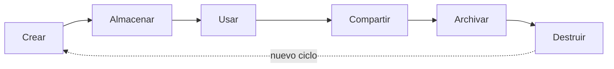

# 09 - Seguridad lógica y aseguramiento del ciclo de vida de los datos

> Unidad 3, tema 3 de la materia *Seguridad de la información*. Dominios de la seguridad lógica, roles y responsabilidades, la cadena de intrusión, el ciclo de vida de los datos con sus controles, prácticas de prevención para equipos, dispositivos e identidad, y los controles del CIS. Revisado a noviembre de 2026.

## Por qué importa

Las capas internas de la defensa en profundidad (red, dispositivo, aplicación y datos; ver la nota [08](08-seguridad-fisica.md)) se protegen con controles tecnológicos. Es lo que hoy se llama ciberseguridad o seguridad del ciberespacio; elegir una palabra u otra depende de dónde se trace la frontera entre el espacio físico y el ciberentorno. Esta nota recorre esos controles desde tres ángulos: **quién** es responsable de qué, **cómo** atacan los adversarios y **qué** hay que proteger en cada fase de la vida de un dato. Cierra con prácticas concretas para equipos, teléfonos e identidad, y con un marco de controles priorizados.

## Los dominios de la seguridad lógica

La protección de un sistema cibernético se puede dividir en cinco dominios, según el tipo de amenaza que atiende:

| Dominio | Protege contra |
|---|---|
| Operaciones | La alteración intencional de procedimientos o flujos de trabajo para producir resultados que no quieren sus dueños, diseñadores o usuarios |
| Nacional o pública | Amenazas que nacen en el ciberespacio y alcanzan activos físicos o cibernéticos con un fin político, militar o estratégico: servicios públicos, sistema financiero, comunicaciones, infraestructura industrial |
| Información | El robo, borrado o alteración de datos almacenados o transmitidos |
| Comunicaciones | Amenazas a la infraestructura técnica que cambien su comportamiento para hacer cosas que nadie previó |
| Físico | Amenazas físicas que afectan al sistema: acceso a los servidores, hardware malicioso conectado a la red, coerción a los usuarios o a sus familias |

### Una pirámide de necesidades

En la discusión europea sobre ciberseguridad se usa una pirámide que ordena las necesidades de protección de la base a la cima, como la de Maslow:

| Nivel | Necesidad | Contenido |
|---|---|---|
| 5 (cima) | Protección de la democracia y los derechos humanos | Ética, democracia y derechos humanos en el ciberespacio; valores fundamentales de la Unión |
| 4 | Protección de la estabilidad global | Normas internacionales, diplomacia y defensa en el ciberespacio, guerra cibernética |
| 3 | Protección del mercado digital | Ciberataques, ciberdelincuencia, espionaje y sabotaje |
| 2 | Protección de activos críticos | Reglas para operadores de servicios esenciales y proveedores de servicios digitales |
| 1 (base) | Protección de seguridad básica | Higiene cibernética: la seguridad de los usuarios de internet |

Sin la base (usuarios con prácticas de higiene digital) no se sostienen los niveles superiores.

## Responsabilidades y roles

Las funciones de seguridad se reparten en dos niveles. Las clasificaciones de habilidades profesionales, como SFIA, las describen así:

**Nivel estratégico**

| Subcategoría | Rol | Responsabilidad |
|---|---|---|
| Estrategia de información | Seguridad de la información | Elegir, diseñar, justificar, implantar y operar controles y estrategias para mantener la seguridad de los sistemas de información y su cumplimiento legal y normativo |
| | Aseguramiento de la información | Proteger la integridad, disponibilidad, autenticidad, no repudio y confidencialidad de los datos en reposo y en tránsito, y gestionar el riesgo de forma práctica y rentable para dar confianza a las partes interesadas |
| Estrategia y planeación técnica | Gestión de la continuidad | Planear y apoyar la continuidad del servicio junto con la función que planea la continuidad del negocio; identificar los sistemas que soportan procesos críticos y evaluar sus riesgos |
| Estrategia y planeación empresarial | Gestión del riesgo del negocio | Aplicar en toda la organización procesos para gestionar los riesgos que amenazan el éxito o la integridad del negocio, incluidos los que vienen de las TI, de la falta de energía o de desechar mal materiales, equipo o datos |

**Nivel táctico y operativo**

| Subcategoría | Rol | Responsabilidad |
|---|---|---|
| Desarrollo de sistemas | Ingeniería de seguridad | Asegurar todas las fases del ciclo de vida del desarrollo: análisis de riesgo, requisitos de seguridad, diseño de la arquitectura, verificación, validación y caso de seguridad |
| Operación del servicio | Administración de la seguridad | Autorizar y vigilar el acceso a instalaciones e infraestructura de TI, investigar accesos no autorizados y cuidar el cumplimiento legal |
| | Pruebas de penetración | Diseñar y ejecutar pruebas que demuestren cómo un adversario podría romper los objetivos de seguridad |
| Calidad y conformidad | Evaluación de la seguridad | Evaluar el software relacionado con la seguridad contra normas y niveles de integridad requeridos |
| | Análisis forense | Recolectar, procesar, preservar, analizar y presentar evidencia, incluida la informática, para corregir vulnerabilidades o apoyar investigaciones penales, de fraude o de cumplimiento |

**Roles frente a la política de seguridad**

| Rol | Responsabilidad |
|---|---|
| Alta dirección (*senior manager*) | Última responsable de la seguridad; valida las políticas y ejerce la debida diligencia y el debido cuidado |
| Profesional de seguridad | Sigue las directrices de la alta dirección; redacta y aplica las políticas |
| Dueño del dato | Clasifica la información para que se le dé la protección que necesita |
| Custodio del dato | Implanta las protecciones que pide la política y los mecanismos que preservan la tríada |
| Usuario | Cualquiera con acceso al sistema; debe entender la política y ajustarse a ella |
| Auditor | Verifica que la política esté implantada y que las soluciones sean adecuadas |

## Cómo ataca un adversario: la cadena de intrusión

La **cadena de intrusión** (*kill chain*) describe un ataque como una secuencia de fases. Vista desde la defensa, sirve para algo muy práctico: si se rompe cualquier eslabón, el ataque no llega a su objetivo. El modelo clásico, propuesto por investigadores de Lockheed Martin en 2011, tiene siete fases:

| Fase | Qué hace el atacante | Cómo se le corta el paso |
|---|---|---|
| 1. Reconocimiento | Investiga, identifica y elige el objetivo | Reducir la información pública, vigilar sondeos |
| 2. Armamento | Prepara el código malicioso y el ataque, por ejemplo un documento con un exploit | Inteligencia de amenazas |
| 3. Entrega | Envía el paquete: correo con adjunto, sitio web, memoria USB | Filtrado de correo y web, bloqueo de medios |
| 4. Explotación | Aprovecha una vulnerabilidad y ejecuta código en el sistema de la víctima | Parches, endurecimiento, protección de memoria |
| 5. Instalación | Deja una puerta trasera para tener acceso persistente | Control de aplicaciones, detección en el equipo |
| 6. Comando y control | Un servidor externo se comunica con el equipo comprometido y da acceso "con las manos en el teclado" | Filtrado de salida, detección de tráfico anómalo |
| 7. Acciones sobre el objetivo | Ejecuta lo que buscaba: exfiltrar o destruir datos, o saltar a otro objetivo | Prevención de fuga de datos, segmentación, respuesta a incidentes |

### La cadena unificada

La cadena clásica describe bien la entrada pero poco lo que pasa después. La **cadena de intrusión unificada** (*Unified Kill Chain*), propuesta por Paul Pols en 2017, integra la cadena clásica con la matriz MITRE ATT&CK y describe 18 fases en tres ciclos:

| Ciclo | Objetivo | Fases |
|---|---|---|
| Entrada (*In*) | Ganar un punto de apoyo inicial | Reconocimiento, armamento, entrega, ingeniería social, explotación, persistencia, evasión de defensas, comando y control |
| A través (*Through*) | Propagarse por la red interna | Pivoteo, descubrimiento, escalamiento de privilegios, ejecución, acceso a credenciales, movimiento lateral |
| Salida (*Out*) | Actuar sobre los activos críticos | Recolección, exfiltración, manipulación del objetivo (llamada impacto en versiones posteriores), objetivos |

## El ciclo de vida de los datos

El tratamiento de los datos tiene un ciclo de vida. Segmentarlo en fases permite poner en cada una el control adecuado:

| Fase | En qué consiste |
|---|---|
| Crear | Generar o capturar datos que antes no existían en la organización |
| Almacenar | Guardarlos en repositorios adecuados, como bases de datos; organizar, acceder y controlar los datos es indispensable para operar |
| Usar | Tratarlos para las finalidades por las que se recabaron o crearon |
| Compartir | Moverlos según las necesidades del negocio, dentro de la organización o hacia afuera |
| Archivar | Conservarlos a largo plazo, con poca actividad |
| Destruir | Eliminarlos cuando cumplieron su objetivo, cuidando el método y la posibilidad de recuperarlos |

Cada fase coincide con uno o más **estados** del dato: en tránsito, en uso o en reposo. Cruzarlos da un mapa de controles:

| Fase | En tránsito | En uso | En reposo |
|---|---|---|---|
| Crear | Desarrollo seguro, validación del lado del servidor | Desarrollo de sistemas | |
| Almacenar | | Discos con cifrado propio (SED) | Cifrado, enmascaramiento, ofuscación, anonimización, tokenización |
| Usar | Prevención de fuga de datos (DLP) | Gestión de derechos sobre la información (IRM/DRM) | |
| Compartir | TLS, VPN, proxy | IRM/DRM | |
| Archivar | | | Cifrado |
| Destruir | | Borrar memorias caché | Borrado criptográfico (*crypto-shredding*): destruir la llave vuelve ilegibles los datos |

## Cómo proteger los datos: cuatro pasos

1. **Conocer.** Hacer el inventario de la información y saber dónde se encuentra.
2. **Evaluar.** Depurar y corregir el inventario; revisar si las acciones con que se usa y administra la información son apropiadas.
3. **Organizar.** Clasificar la información en categorías y entender cómo fluye, para poder vigilarla.
4. **Asegurar.** Aplicar a cada categoría los controles que le corresponden y vigilar su uso de forma continua.

## Prevención en computadoras

Prácticas que aplican tanto en casa como en la oficina:

- Guardar en la computadora la menor cantidad posible de información personal.
- Después de presentar impuestos o generar un documento legal en línea, conservar una copia **cifrada** en otro medio.
- Crear una cuenta y una contraseña distinta para cada usuario del mismo equipo, para limitar el acceso a las áreas sensibles.
- No sacar el equipo a lugares públicos, vacaciones o viajes si no es necesario; si se lleva, no perderlo de vista ni dejarlo en el automóvil.
- Antes de desechar o vender un equipo, borrar de forma segura todo su contenido confidencial.
- No prestar la computadora personal.
- Si un equipo guarda información personal y financiera, evitar usar ese mismo equipo para navegar por internet.
- Instalar antimalware y mantenerlo actualizado; usar un firewall personal; aplicar los parches del sistema operativo en cuanto estén disponibles.
- Cifrar los archivos confidenciales, para que sigan protegidos aunque roben el equipo.
- Reconocer y borrar sin abrir el correo no deseado.
- Abrir cuentas en línea con cuidado: muchas cuentas con la misma contraseña multiplican el riesgo de robo de identidad.
- Para la banca en línea y el pago de servicios, usar siempre equipos de confianza.
- Apagar el equipo antes de trasladarlo por la vía pública.

### Herramientas de ejemplo

| Necesidad | Herramientas que se citaban | Nota de vigencia |
|---|---|---|
| Borrado seguro | Eraser (gratuita), Blancco (de pago) | Vigentes |
| Suite de protección (antimalware, cifrado de disco, firewall, protección contra exploits y ransomware) | Sophos | Vigente |
| Gestor de contraseñas | KeePass (gratuito), Keeper (de pago) | Vigentes |
| Evaluación de parches y configuraciones de Windows | Microsoft Baseline Security Analyzer (MBSA) | Microsoft dejó de desarrollarlo; hoy se usan Windows Update, Intune o escáneres de vulnerabilidades |
| Análisis de vulnerabilidades de red | SAINT | Comercial; alternativas abiertas como OpenVAS |
| Navegación con protección de privacidad | Brave | Vigente |
| Cifrado de archivos en la nube | Boxcryptor | Fue adquirido por Dropbox en 2022 y dejó de ofrecerse a usuarios nuevos; alternativas como Cryptomator |
| Respaldos | Duplicati | Vigente |
| Compresión con cifrado | WinRAR | Vigente; también 7-Zip |

## Prevención en dispositivos móviles

- No guardar datos confidenciales en el dispositivo si no es indispensable.
- Marcar o etiquetar el equipo, registrarlo con el fabricante y anotar su número de serie en un lugar seguro.
- Usar un cable de seguridad cuando sea posible y un estuche discreto, sin marca.
- Desconfiar de situaciones y lugares inusuales.
- Guardar los archivos en medios removibles protegidos con contraseña y cifrado; los discos con cifrado propio (SED) son una buena opción.
- Cifrar el dispositivo, bloquearlo con contraseña o biometría e instalar un software de localización.
- Apagar las conexiones de red que no se usen y evitar las redes públicas.
- Tener un plan para el robo o la pérdida: a quién avisar, cómo borrar a distancia, qué contraseñas cambiar.

Para las organizaciones existen soluciones de **administración de dispositivos móviles** (MDM), que permiten inventariar, configurar, localizar y borrar a distancia los equipos: la administración de dispositivos de Google Workspace (antes G Suite), Microsoft Intune (que sustituyó a la administración de dispositivos de Office 365) o las suites de fabricantes como Sophos, además de las guías de seguridad que publican Android y Apple para iOS.

## Protección de la identidad

La **identidad** es el conjunto de características físicas y de comportamiento por las que una persona o entidad se reconoce de forma única. Se protege para evitar que alguien la use en actividades que afecten su patrimonio o su reputación. Todo fraude busca dañar alguna de esas esferas: la personal, la jurídica, la económica, la social o la reputacional.

Preguntas para hacer un inventario de la propia identidad:

- ¿Qué información personal tengo y dónde está cada pieza?
- ¿Necesito realmente cada componente (credenciales, tarjetas, documentos)? ¿Necesito traer el original conmigo?
- ¿A qué categoría pertenece y cómo vigilo su uso y su exactitud?
- ¿Con quién la he compartido? ¿La uso con precaución?

Y antes de entregar datos a cualquiera:

- ¿Por qué necesitan mi información y cómo la van a usar?
- ¿Con quién la compartirán y por qué?
- ¿Dónde la guardarán y cómo la protegerán?
- ¿Qué pasa si me niego a darla? ¿Qué ley me obliga a compartirla?

### En casa

- No dejar sin supervisión a personas ajenas; vigilar sus movimientos durante la visita, en persona o con equipo de video.
- Retirar documentos y objetos de valor de escritorios, cajones y lugares a la vista; cerrar puertas, ventanas, armarios y cajones al salir.
- Guardar los documentos confidenciales en una caja fuerte resistente al fuego y al agua.
- Recoger el correo en cuanto llega.
- Destruir los documentos que ya no se necesitan; nunca tirar a la basura componentes de identidad como tarjetas vencidas o estados de cuenta.

### Al contratar personal para la casa o la oficina

| Verificación | Qué revela |
|---|---|
| Antecedentes laborales | Historial de empleos, periodos sin trabajo, reclamaciones o sanciones con empleadores anteriores |
| Educación | Grados, fechas de titulación, certificaciones |
| Referencias | Conversaciones con familiares, socios o vecinos, con autorización de la persona |
| Domicilio | Historial de direcciones y teléfonos |
| Historial crediticio | Quiebras y pagos atrasados |
| Antecedentes penales | Juicios, sentencias y condenas |

Estas verificaciones tratan datos personales y deben hacerse con el consentimiento de la persona y dentro de lo que permite la ley de protección de datos.

### La basura

- Sacarla en el último momento posible antes de que pase el camión, y mantener los contenedores asegurados hasta entonces.
- No mezclar documentos importantes con el papel para reciclar: es justo donde un ladrón de identidad espera encontrarlos. Destruirlos antes.

### En el automóvil

- No dejar objetos de valor por mucho tiempo; retirar los artículos personales si el auto quedará solo un periodo largo.
- Estacionarse en lugares privados, vigilados, bien iluminados y concurridos; evitar los estacionamientos de largo plazo, como los de aeropuerto.

### En lugares públicos

- Llevar solo lo indispensable; las llaves de repuesto se quedan en casa.
- En gimnasios o vestidores, elegir un casillero en una zona central y un candado fuerte y pesado.
- No confiar ciegamente en quien viste playera de "personal" o "seguridad": podría intentar entrar a áreas restringidas o manipular equipo.

### En redes sociales e internet

- Dejar pública solo la información mínima y configurar las opciones de privacidad del proveedor.
- Revisar con frecuencia a los contactos y no aceptar invitaciones de desconocidos.
- Evitar entrar a las redes desde dispositivos ajenos.
- Vigilar de forma constante el estado de la propia identidad.

## Un marco de controles priorizados: CIS Controls

Los controles para los ambientes tecnológicos pueden tener bases, metodologías y marcos distintos. Los **CIS Controls**, del Center for Internet Security, tienen una ventaja: son un conjunto priorizado de acciones, sin marca comercial, alineado con estándares de mercado y que funciona como modelo de madurez. La versión 7.1 (2019) tenía 20 controles en tres grupos:

| Grupo | Controles |
|---|---|
| Básicos (1 a 6) | Inventario de hardware, inventario de software, gestión continua de vulnerabilidades, uso controlado de privilegios administrativos, configuración segura, mantenimiento y análisis de bitácoras |
| Fundamentales (7 a 16) | Protección de correo y navegador, defensas contra malware, limitación de puertos, recuperación de datos, configuración segura de equipos de red, defensa perimetral, protección de datos, acceso según necesidad de conocer, control de acceso inalámbrico, monitoreo de cuentas |
| Organizacionales (17 a 20) | Concientización y capacitación, seguridad del software de aplicación, respuesta a incidentes, pruebas de penetración y ejercicios de equipo rojo |

La 7.1 introdujo además los **grupos de implementación** (IG1, IG2 e IG3), que indican qué controles aplicar según los recursos y el riesgo de la organización.

> Actualización al 2026: la versión vigente es **CIS Controls v8.1** (junio de 2024). Se reorganizó en 18 controles y 153 salvaguardas, agrupados por actividad y no por quién administra el equipo: inventario de activos empresariales, inventario de software, protección de datos, configuración segura, gestión de cuentas, gestión del control de acceso, gestión continua de vulnerabilidades, gestión de bitácoras de auditoría, protección de correo y navegador, defensas contra malware, recuperación de datos, gestión de la infraestructura de red, monitoreo y defensa de la red, concientización y habilidades, gestión de proveedores de servicios, seguridad del software de aplicación, gestión de la respuesta a incidentes y pruebas de penetración. IG1 es la higiene cibernética mínima que toda organización debería cumplir.

La seguridad del entorno tecnológico tiene muchas aristas: depende de las tecnologías que se usen y de la legislación bajo la que se opere. La normatividad establece reglas claras de operación que deben respetar los controles y los sistemas.

## Glosario

| Término | Definición |
|---|---|
| Seguridad lógica | Protección de redes, sistemas, aplicaciones y datos con controles tecnológicos |
| Higiene cibernética | Prácticas básicas de seguridad que todo usuario y organización debería seguir |
| Dueño del dato | Persona que clasifica la información y decide qué protección necesita |
| Custodio del dato | Persona o área que implanta los controles que pide la política sobre los datos |
| Cadena de intrusión | Modelo que describe un ataque como una secuencia de fases que la defensa puede interrumpir |
| Comando y control | Canal por el que el atacante dirige a distancia un equipo comprometido |
| Movimiento lateral | Desplazamiento del atacante de un equipo a otro dentro de la red |
| Ciclo de vida de los datos | Fases por las que pasa un dato: crear, almacenar, usar, compartir, archivar y destruir |
| DLP | Prevención de fuga de datos: controles que detectan y bloquean la salida no autorizada de información |
| Tokenización | Sustitución de un dato sensible por un valor sin significado que solo el sistema puede revertir |
| Borrado criptográfico | Destrucción de las llaves de cifrado para que los datos cifrados queden ilegibles |
| MDM | Administración de dispositivos móviles: inventario, configuración y borrado remoto de equipos |
| Identidad | Conjunto de rasgos por los que una persona o entidad se reconoce de forma única |
| CIS Controls | Conjunto priorizado de controles de ciberseguridad del Center for Internet Security |

## Referencias

- Center for Internet Security. (2019). *CIS Controls* (versión 7.1). CIS. https://www.cisecurity.org/controls/cis-controls-list
- Center for Internet Security. (2024). *CIS Critical Security Controls* (versión 8.1). CIS. https://www.cisecurity.org/controls/v8-1
- Hutchins, E. M., Cloppert, M. J., y Amin, R. M. (2011). *Intelligence-driven computer network defense informed by analysis of adversary campaigns and intrusion kill chains*. Lockheed Martin. https://www.lockheedmartin.com/en-us/capabilities/cyber/cyber-kill-chain.html
- MITRE Corporation. (s. f.). *MITRE ATT&CK*. https://attack.mitre.org/
- National Institute of Standards and Technology. (2018). *Framework for improving critical infrastructure cybersecurity* (versión 1.1). https://doi.org/10.6028/NIST.CSWP.04162018
- National Institute of Standards and Technology. (2024). *The NIST Cybersecurity Framework (CSF) 2.0*. https://doi.org/10.6028/NIST.CSWP.29
- Pols, P. (2017). *The Unified Kill Chain*. https://www.unifiedkillchain.com/
- SFIA Foundation. (2021). *SFIA 8: The global skills and competency framework for a digital world*. https://sfia-online.org/

---

*Rogelio Arriaga Gonzalez*
