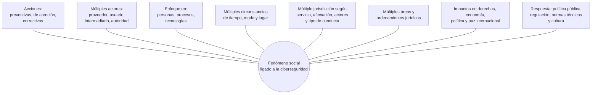

# 01 - Justificación del derecho y la ciberseguridad

> Materia 5 (Legislación nacional e internacional en ciberseguridad), unidad 1 (Derecho y ciberseguridad), tema 1. Nota recreada a partir del material de la materia y actualizada al 10 de noviembre de 2026.

## Por qué importa

Casi todo lo que hace hoy una persona o una organización pasa por un sistema de información: cobrar, comprar, estudiar, atender a un paciente, presentar una declaración de impuestos o platicar con la familia. Esa dependencia convirtió a la información y a la infraestructura que la mueve en activos de enorme valor, y por eso mismo en objetivos. Cuando un ataque o un descuido interno rompe las defensas, el daño no se queda en la máquina: alcanza el patrimonio de una empresa, la dignidad de una persona, la estabilidad de un país y, en casos extremos, la paz entre naciones.

El derecho no puede quedarse mirando. Esta nota explica por qué tiene sentido hablar de un **derecho de la ciberseguridad** (en inglés, *cybersecurity law*), qué fenómenos lo justifican y por qué no cabe en las casillas tradicionales de las ramas jurídicas. Es la puerta de entrada a toda la materia: las notas siguientes desarrollan cada pieza (política pública, normas técnicas, leyes penales y de datos, regulación de otros países).

## La materia en una página

Internet también tiene reglas de convivencia, y conviene conocerlas antes de necesitarlas. La ciberseguridad, entendida como una evolución de la seguridad de la información, trabaja sobre tres frentes al mismo tiempo:

| Frente | Qué abarca |
|---|---|
| Personas | Quien usa, administra, diseña o ataca los sistemas; su formación y sus hábitos |
| Procesos | Políticas, procedimientos, controles, responsabilidades y respuesta a incidentes |
| Tecnologías | Hardware, software, redes y servicios donde viven los datos |

Y en tres momentos: **antes** de un ataque (prevenir), **durante** (contener y atender) y **después** (corregir, recuperar y deslindar responsabilidades). Dos ideas atraviesan todo el curso: la prevención vale más que la reacción, y la ciberseguridad no es una tarea extraordinaria sino parte de la operación diaria de cualquier organización.

Para enfrentar el cibercrimen y las demás conductas que dañan la información, los Estados y la comunidad internacional han producido medidas de carácter normativo que pueden agruparse en cuatro familias:

| Familia | Ejemplos |
|---|---|
| Instrumentos internacionales | Tratados, convenios, acuerdos de cooperación |
| Política pública | Estrategias, planes y agendas nacionales de ciberseguridad |
| Legislación nacional | Leyes sobre datos personales, telecomunicaciones, infraestructura TIC y delitos informáticos |
| Normas técnicas | Estándares internacionales (ISO, NIST) y normas nacionales (NOM, NMX) |

Al conjunto de estas medidas, y a la forma en que coordinan a los distintos actores, se le puede llamar derecho de la ciberseguridad. No es todavía una etiqueta consagrada por organismos internacionales ni por la doctrina: es una propuesta de trabajo que ordena un campo disperso.

El recorrido de la materia sirve para tres cosas concretas:

- Ubicar los principales ordenamientos, nacionales e internacionales, que condicionan cómo una persona o una organización protege datos, información y tecnología.
- Reconocer el marco jurídico que rige actos tan comunes como usar un teléfono inteligente, navegar, trabajar con herramientas digitales, jugar en línea o publicar en redes sociales.
- Identificar los tipos penales en los que las TIC aparecen como medio para cometer el delito o como el blanco mismo del ataque.

Las cinco unidades son: derecho y ciberseguridad; ámbito internacional y estrategias; normas, estándares y mejores prácticas; leyes federales mexicanas; y regulación internacional (Unión Europea, Estados Unidos y Latinoamérica). Al terminar se espera que el estudiante dimensione el impacto de las amenazas sobre derechos y libertades, conozca los espacios e instrumentos internacionales, entienda cómo nacen y se aplican las normas técnicas, relacione las leyes federales mexicanas con la articulación de autoridades, empresas, academia y sociedad, y sepa qué medidas de privacidad, protección de datos y prevención del delito conviene adoptar en una organización o en su vida personal.

## Vocabulario de partida

La Estrategia Nacional de Ciberseguridad de México (2017) fijó un glosario que sigue siendo útil para hablar con precisión. Estos son los términos que la unidad toma como base, explicados con palabras propias:

| Término | Qué significa en la práctica |
|---|---|
| Seguridad de la información | Mantener la confidencialidad, la integridad y la disponibilidad de la información, y además su autenticidad, su auditabilidad, su protección contra duplicados, el no repudio y la legalidad de su tratamiento |
| Ciberseguridad | Políticas, controles, procedimientos, gestión de riesgos y normas que protegen a la sociedad, al gobierno, a la economía y a la seguridad nacional en el ciberespacio y en las redes públicas de telecomunicaciones |
| Auditabilidad | Que cada evento relevante de un sistema quede registrado para poder revisarlo después |
| Autenticidad | Certeza sobre el origen de la información y sobre quién la emite, para impedir que alguien se haga pasar por otro, y validez de su contenido en tiempo y forma |
| No repudio | Que quien envió o recibió algo no pueda negar después, frente a terceros, que lo hizo |
| Protección a la duplicación | Que una operación ocurra una sola vez (salvo que se pida otra cosa) y que nadie pueda grabarla para reproducirla y simular peticiones repetidas del emisor original |
| Legalidad | Que el tratamiento de la información respete el marco jurídico que obliga a la institución |

Para entender por qué el derecho se ocupa de todo esto hace falta un paso previo: dimensionar cuánto valen los datos.

## El valor de los datos en la sociedad digital

Internet se volvió una herramienta capaz de transformar economías, culturas y formas de hacer política. En la conversación diaria circulan frases como "los datos son el nuevo petróleo", "nos hackearon" o "internet es tierra de nadie". Ninguna es ajena al derecho, aunque en buena parte de Latinoamérica la reflexión jurídica sobre ciberseguridad apenas empieza a tomar forma.

El viejo lema de que saber es poder adquiere otro sentido cuando el conocimiento se extrae de datos muy finos. Hay dos grandes fuentes:

- **Abiertas**: lo que cualquiera publica y cualquiera puede leer o ver en redes sociales, buscadores y sitios públicos.
- **Propias o privadas**: lo que se genera dentro de las organizaciones y no sale de ellas.

Cada persona deja un rastro digital sin proponérselo: el teléfono registra ubicaciones y contactos, la tarjeta de crédito deja huella de cada compra, las cámaras urbanas de videovigilancia capturan su paso por la calle. Esos datos y metadatos los producen individuos, empresas de todos los giros y entes públicos de los tres órdenes de gobierno, de los tres poderes y de los órganos autónomos.

### Quién genera los datos y quién los explota

| Categoría | Qué incluye |
|---|---|
| Datos de individuos | Lo que se genera por el solo hecho de usar un dispositivo o actuar en medios digitales: nombres y teléfonos de familiares, amigos y contactos de trabajo, información patrimonial, fotografías, gustos, miedos, rasgos físicos y de conducta. En malas manos pueden servir para dañar la integridad, el patrimonio, la familia o incluso la vida |
| Datos de organizaciones privadas | (a) lo que el cliente publica abiertamente, sobre todo en redes sociales; (b) lo que el cliente produce al usar un servicio pero solo trata el proveedor, según su aviso de privacidad y la ley aplicable |
| Datos de organizaciones públicas | (a) la gestión interna de recursos humanos, financieros y materiales; (b) la información ligada a su función institucional; (c) los datos de ciudadanos, proveedores, beneficiarios de programas y personas que hacen un trámite |

En la gestión pública suelen intervenir terceros, públicos o privados, que por contrato o por mandato legal actúan como intermediarios o corresponsables del tratamiento. La cadena de responsabilidad, por tanto, rara vez tiene un solo eslabón.

### Lo que comparten ambos sectores

1. Los datos son un activo valioso y, por eso, un blanco.
2. Existe un marco jurídico con principios, derechos y deberes, entre ellos el deber de proteger la información y respetar la privacidad.
3. Las personas titulares tienen derechos sobre el tratamiento de sus datos: acceso, rectificación, cancelación y oposición (ARCO). Algunos marcos agregan portabilidad y limitación del tratamiento. El responsable debe garantizar que esos derechos se puedan ejercer, y su incumplimiento puede reclamarse ante la autoridad competente.
4. Tratar datos indebidamente tiene consecuencias administrativas, civiles o penales.

**Actualización al 2026:** el material original señalaba al INAI como autoridad ante la cual se defendían estos derechos. La reforma constitucional en materia de simplificación orgánica (DOF 20-12-2024) extinguió al INAI, y la nueva Ley Federal de Protección de Datos Personales en Posesión de los Particulares (DOF 20-03-2025) asignó la vigilancia y las sanciones del sector privado a la Secretaría Anticorrupción y Buen Gobierno (arts. 2, fracción XV, y 59). En el sector público, la nueva Ley General de Protección de Datos Personales en Posesión de Sujetos Obligados reparte esa función entre la misma Secretaría y las autoridades garantes de cada poder y órgano autónomo.

**Actualización al 2026:** sobre el acrónimo "ARCO POL" que circula en la literatura: en México, la ley de particulares de 2025 reconoce solo los cuatro derechos ARCO; la portabilidad sí aparece en la ley general para el sector público, que le dedica un capítulo. La "limitación del tratamiento" es una figura del reglamento europeo (RGPD), no de la ley mexicana.

La base constitucional de esos derechos está en el artículo 16 de la Constitución Política de los Estados Unidos Mexicanos (texto vigente, última reforma DOF 07-10-2026), segundo párrafo:

> Toda persona tiene derecho a la protección de sus datos personales, al acceso, rectificación y cancelación de los mismos, así como a manifestar su oposición, en los términos que fije la ley, la cual establecerá los supuestos de excepción a los principios que rijan el tratamiento de datos, por razones de seguridad nacional, disposiciones de orden público, seguridad y salud públicas o para proteger los derechos de terceros.

## De dónde vienen los daños

Las afectaciones a la información pueden traducirse en pérdidas patrimoniales, interrupción de operaciones, golpes a la reputación o lesiones a la dignidad de las personas. Su origen puede ser externo o interno, y se clasifica así:

| Origen | Ejemplos |
|---|---|
| Antropogénico (atribuible a personas) | Atacantes y delincuentes informáticos; errores por ignorancia o distracción; efectos colaterales de actos de autoridad o del cumplimiento de obligaciones legales |
| Natural | Tormentas, sismos, inundaciones que destruyen equipos o datos; aquí entran la resiliencia y los planes de recuperación ante desastres |

Visto desde las "fuentes reales" del derecho (los hechos sociales que empujan a crear normas), el punto de partida es claro: hay personas que, con dolo o por culpa, afectan la **confidencialidad, la integridad y la disponibilidad** de la información o la infraestructura de otros, y con ello lesionan derechos, patrimonio o reputación. Antes de que los juristas reaccionaran, las áreas de negocio y de sistemas ya habían desarrollado medidas técnicas, administrativas, físicas y de procedimiento para proteger la información y sostener los objetivos de cada organización. El derecho llega después a ordenar, exigir y sancionar.

## ¿Cuándo existe una rama del derecho?

La enseñanza clásica divide el derecho en dos grandes bloques:

| Derecho público | Derecho privado |
|---|---|
| Constitucional | Civil |
| Administrativo | Mercantil o de sociedades |
| Penal | |
| Internacional público | |

Esa división sirvió durante mucho tiempo, pero la globalización y el ciberespacio la desbordaron. Un mismo incidente puede involucrar un contrato de servicios en la nube regido por leyes de otro país, una obligación administrativa de notificar a la autoridad, un posible delito y una violación a derechos humanos. Partirlo en casillas no ayuda a resolverlo.

Por eso la propuesta de esta unidad toma prestada la idea de **modernidad líquida** del sociólogo Zygmunt Bauman: en una sociedad donde las estructuras sólidas se disuelven y cambian de forma con rapidez, el derecho que regula los fenómenos digitales también tiene que ser "líquido". No significa que la tecnología redefina el derecho, sino que obliga a mirarlo completo. La lectura recomendada parte de los principios generales y de los preceptos constitucionales (empezando por los derechos humanos), usa las leyes secundarias como guía y renuncia a la frontera rígida entre materias para atender la pluralidad de actores, jurisdicciones y ordenamientos que intervienen. El fin sigue siendo la justicia para las partes y un Estado de derecho respetuoso de los derechos humanos.

La justificación de un "derecho de la ciberseguridad" es, entonces, didáctica y pragmática: agrupar bajo un mismo nombre lo que hace falta estudiar para proteger datos e información con acciones preventivas, de atención y correctivas sobre procesos, tecnologías y personas, con el fin de ampliar el ejercicio de derechos y lograr una sociedad más segura, confiable y resiliente.

## Qué es el derecho de la ciberseguridad

Con esos elementos se puede proponer una definición de trabajo:

> **Definición de trabajo (propia):** conjunto de políticas públicas, regulación, normas técnicas, acciones culturales y mecanismos de colaboración entre gobierno, empresas, academia, comunidad técnica y sociedad, que tiene como base la seguridad de la información (confidencialidad, integridad y disponibilidad) y como propósito fortalecer los derechos y libertades de las personas tanto en el espacio físico como en el ciberespacio, bajo un modelo de gobernanza de múltiples partes interesadas que contribuya al desarrollo sostenible y a una convivencia más segura, confiable y resiliente.

Dicho de otro modo, es la rama que combina los aspectos jurídicos de la seguridad de la información (ampliada hoy por la ciberseguridad) con las normas, instituciones, estándares y políticas que buscan construir una sociedad confiable que respete derechos en la vida física y en la digital.

### Por qué hace falta: las circunstancias que lo justifican

- Internet es una red global, abierta y descentralizada donde conviven personas de todo el mundo.
- Hay cada vez más usuarios y dispositivos produciendo datos; formar una cultura de uso responsable es un reto enorme.
- Crecen sin parar el volumen de datos y la capacidad para procesarlos y almacenarlos.
- La vida digital involucra una cadena de actores públicos y privados, y en el centro están las personas y sus derechos.
- Proveedores, usuarios y cláusulas contractuales de distintas nacionalidades (se pague o no por el servicio) hacen que varias jurisdicciones coexistan de hecho.
- A lo largo del ciclo de vida de la información, la interacción digital complica las medidas preventivas, de atención y correctivas sobre personas, procesos y tecnologías.
- Atender un incidente exige colaboración entre actores públicos y privados y entre profesionales de varias disciplinas para deslindar responsabilidades civiles, administrativas o penales.
- Los Estados resguardan información muy sensible: el derecho de la ciberseguridad, nacional e internacional, es también una herramienta para prevenir la ciberguerra y el ciberterrorismo.

### La complejidad del fenómeno

El siguiente diagrama, recreado a partir de la revista de la unidad, resume por qué el derecho tiene que entrar con una mirada abierta y flexible:

## Las preguntas de Kosseff

El jurista estadounidense Jeff Kosseff, autor de uno de los manuales de referencia sobre la materia, sostiene que para entender qué es el derecho de la ciberseguridad hay que responder primero unas preguntas básicas sobre la seguridad en el ciberespacio:

1. ¿Qué estamos protegiendo?
2. ¿Quién y desde dónde hace el trabajo de dar seguridad?
3. ¿Cómo y dónde estamos seguros?
4. ¿Por qué queremos estar seguros?

En su artículo de 2018 propone entender el derecho de la ciberseguridad como el marco que promueve la confidencialidad, la integridad y la disponibilidad de la información, los sistemas y las redes, públicos y privados, mediante reglas e incentivos que miran hacia adelante y no solo castigan después del incidente. Sus fines son proteger los derechos individuales y la privacidad, los intereses económicos y la seguridad nacional. Kosseff analiza la ley estadounidense que promovió el intercambio de información sobre amenazas (Cybersecurity Act de 2015) a la luz del ataque a Sony Pictures de 2014, y concluye que la legislación de su país carecía de una visión unificada: muchas leyes atendían una porción pequeña del problema. Esa revisión es una buena base para pensar cómo regular en México, donde las empresas digitales también concentran un enorme valor.

Responder las cuatro preguntas (qué, quién, cómo y por qué) es la manera más rápida de valorar la ciberseguridad como objeto del derecho y no solo como asunto técnico.

## Los seis aspectos que comprende

El campo puede mapearse en seis aspectos, que la nota 02 desarrolla uno por uno:

1. Las políticas públicas y la institucionalidad.
2. La presencia de la ciberseguridad y sus aspectos jurídicos en el orden nacional e internacional.
3. Las normas técnicas y estándares internacionales sobre tecnologías y tratamiento de datos.
4. La ciberseguridad como complemento del derecho a la vida privada y a la protección de datos personales.
5. La relación con el derecho penal (cibercrimen y delitos informáticos) y con la investigación y procuración de justicia (evidencia digital).
6. La cultura de ciberseguridad: divulgación, prevención, autoprotección y uso responsable.

Todos ellos convergen en una dimensión de gran peso: los derechos de las personas, el patrimonio, la economía, la reputación, la estabilidad nacional y la paz internacional.

## Prevenir es tarea de todos

La protección de datos sostiene el funcionamiento de la economía digital, el comercio electrónico y el gobierno digital, y el valor de esos activos aumenta a medida que se aprovechan para hacer negocios. Por eso se justifica crear mecanismos jurídicos e institucionales que vigilen el tratamiento. Pero la ley no basta: las amenazas, ataques y vulnerabilidades se atienden con la participación de la alta dirección y de cualquier persona que tenga alguna actividad en la organización. La mejor defensa sigue siendo la prevención, empezando por la navegación segura y el cuidado de la intimidad propia en las redes.

## Glosario

| Término | Definición |
|---------|-----------|
| Derecho de la ciberseguridad | Conjunto de políticas, regulación, normas técnicas, cultura y colaboración entre actores que protege derechos dentro y fuera del ciberespacio a partir de la seguridad de la información |
| Seguridad de la información | Preservación de la confidencialidad, integridad y disponibilidad de la información, más propiedades como autenticidad y no repudio |
| Ciberseguridad | Políticas, controles, procedimientos y normas que protegen a la sociedad, la economía, el gobierno y la seguridad nacional en el ciberespacio |
| Triada CID | Confidencialidad, integridad y disponibilidad: los tres atributos básicos que se busca proteger |
| Auditabilidad | Posibilidad de registrar los eventos de un sistema para revisarlos después |
| No repudio | Garantía de que quien envió o recibió información no pueda negarlo ante terceros |
| Rastro digital | Huella de datos y metadatos que deja una persona al usar dispositivos y servicios |
| Derechos ARCO | Acceso, rectificación, cancelación y oposición al tratamiento de los datos personales |
| Factor antropogénico | Causa de una afectación atribuible a personas: ataque, error, descuido o acto de autoridad |
| Fuentes reales del derecho | Hechos sociales que motivan la creación de normas jurídicas |
| Derecho líquido | Lectura flexible del derecho, inspirada en Bauman, que no separa rígidamente sus ramas ante fenómenos digitales |
| Gobernanza de múltiples partes interesadas | Modelo en que gobierno, empresas, academia, comunidad técnica y sociedad deciden y actúan en conjunto |
| Resiliencia | Capacidad de resistir un incidente y recuperar la operación |

## Referencias

- Aprendemos Juntos. (2020). *La mejor ciberseguridad es la prevención. Silvia Barrera, experta en ciberseguridad* [Video]. BBVA. https://www.youtube.com/@aprendemosjuntos
- Bauman, Z. (2000). *Liquid modernity*. Polity Press. https://www.politybooks.com/bookdetail?book_slug=liquid-modernity--9780745624099
- Cámara de Diputados del H. Congreso de la Unión. (2026). *Constitución Política de los Estados Unidos Mexicanos* (última reforma DOF 07-10-2026). https://www.diputados.gob.mx/LeyesBiblio/pdf/CPEUM.pdf
- Cámara de Diputados del H. Congreso de la Unión. (2025). *Ley Federal de Protección de Datos Personales en Posesión de los Particulares* (DOF 20-03-2025, última reforma 14-11-2025). https://www.diputados.gob.mx/LeyesBiblio/pdf/LFPDPPP.pdf
- Cámara de Diputados del H. Congreso de la Unión. (2025). *Ley General de Protección de Datos Personales en Posesión de Sujetos Obligados* (DOF 20-03-2025, última reforma 14-11-2025). https://www.diputados.gob.mx/LeyesBiblio/pdf/LGPDPPSO.pdf
- Gobierno de la República. (2017). *Estrategia Nacional de Ciberseguridad*. https://www.gob.mx/cms/uploads/attachment/file/271884/Estrategia_Nacional_Ciberseguridad.pdf
- Kosseff, J. (2018). Defining cybersecurity law. *Iowa Law Review, 103*(3), 985. https://ilr.law.uiowa.edu/print/volume-103-issue-3/defining-cybersecurity-law/
- Kosseff, J. (2022). *Cybersecurity law* (3.ª ed.). Wiley. https://www.wiley.com/en-us/search?pq=kosseff%20cybersecurity%20law

---

*Rogelio Arriaga Gonzalez*
