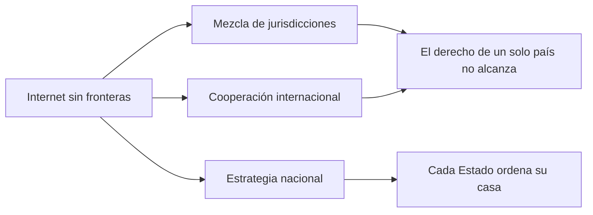

# 04 - Escenario internacional de la ciberseguridad

> Materia 5 (Legislación nacional e internacional en ciberseguridad), unidad 2 (Ámbito internacional y estrategia de ciberseguridad), tema 1. Nota recreada a partir del material de la materia y actualizada al 10 de noviembre de 2026.

## Por qué importa

Un servidor en Monterrey puede guardar los datos de clientes de Madrid, recibir un ataque lanzado desde una red de equipos secuestrados en tres continentes y pagar un rescate en una criptomoneda que nadie regula igual. Cada pieza de ese caso cae en una jurisdicción distinta. Por eso la ciberseguridad no se entiende solo con la ley de un país: hay que conocer qué organismos discuten el tema, qué instrumentos obligan a México y cuáles solo orientan, y cómo se mide la preparación de un Estado frente a los demás.

Esta nota abre la unidad 2. Al terminarla podrás ubicar a los actores internacionales y su alcance, distinguir los instrumentos vinculantes de los orientativos y responder la pregunta práctica que deja la unidad: **¿hay hoy algún tratado de ciberseguridad o de ciberdelito que obligue jurídicamente a México?** Las dos notas siguientes tratan las estrategias nacionales en general ([05](05-estrategias-ciberseguridad.md)) y la mexicana en particular ([06](06-estrategia-nacional-mexico.md)).

## Lo que pide la unidad

La unidad tiene tres propósitos, uno por tema:

1. Reconocer el panorama internacional: quiénes actúan (organismos multilaterales, sector privado, gobiernos) y qué puede hacer cada uno.
2. Revisar los instrumentos internacionales, tanto los que generan obligaciones como los que solo dan pautas, y las posiciones de algunos países o bloques, para saber si alguno es jurídicamente exigible a México.
3. Entender para qué sirve una estrategia nacional de ciberseguridad, con ejemplos de otros países y el caso mexicano, y qué papel le toca al derecho.

## Internet no respeta fronteras: tres consecuencias

La red cruza territorios sin pedir permiso, y eso tiene efectos jurídicos inmediatos. El material de apertura de la unidad los agrupa en tres:

| Consecuencia | Qué implica |
|---|---|
| Choque de culturas jurídicas y jurisdicciones | Cada país tipifica, investiga y sanciona a su manera. Cuando en un ataque intervienen personas, servidores y víctimas de varios Estados, aplicar una sola norma se vuelve difícil. |
| Necesidad de cooperar | Ningún país resuelve solo un incidente transfronterizo. Hacen falta acuerdos entre Estados y con organismos internacionales para pedir pruebas, extraditar o compartir alertas. |
| Estrategias nacionales | Cada Estado necesita un plan propio que reparta responsabilidades dentro de su administración, forme grupos por sector y diagnostique los problemas económicos, culturales, institucionales y jurídicos. |

## Más personas conectadas, más incentivos para delinquir

La globalización multiplicó los temas que los Estados tratan entre sí y los foros donde lo hacen. A la vez, empresas y personas comunes empezaron a relacionarse a diario con gente de otros continentes, casi siempre a través de internet. Hoy una compra, un contrato de servicios en la nube o una suscripción enlaza dos o más jurisdicciones sin que el usuario lo note.

Ese crecimiento en usuarios, dispositivos y datos despertó intereses económicos, políticos y sociales legítimos, pero también atrajo a quienes buscan dañar: atacantes solitarios, grupos organizados y, en algunos casos, actores ligados a Estados. Lo que antes requería presencia física ahora se intenta a distancia, con menos riesgo para el agresor.

### Seguridad nacional frente a ciberdelito contra particulares

No todos los ataques pesan igual. La gravedad depende de qué se ataca, cuánto daño se causa y qué tan críticos son los datos o la infraestructura afectada.

| Dimensión | Ataque contra la seguridad nacional | Ciberdelito contra un particular |
|---|---|---|
| Blanco típico | Infraestructuras críticas, servicios estratégicos, sistemas del Estado | Una persona, una empresa o una institución concreta |
| Quién responde | Instancias de seguridad nacional, defensa, CSIRT nacionales | Ministerio público, policía cibernética, el propio afectado |
| Efecto | Puede comprometer la soberanía, la estabilidad o servicios esenciales | Daño patrimonial, reputacional o a derechos de la víctima |
| Advertencia | No siempre se sabe al principio de qué tipo es | Aunque no toque al Estado, puede quebrar a una empresa o arruinar a una persona |

El entorno digital internacional cambió la forma en que se comete el delito en cuatro aspectos: las **formas** (nuevas técnicas como el secuestro de datos o la suplantación), los **medios o canales** (correo, redes sociales, mensajería, dispositivos conectados), los **objetivos** (datos, dinero, información estratégica, reputación) y los **destinatarios** (cualquiera conectado, sin importar dónde viva).

## Lo que dicen las cifras, con su año

Las cifras de esta sección son las que usó el material, verificadas contra su fuente; varias tienen ya casi una década, así que sirven como orden de magnitud y no como fotografía actual.

| Fuente | Dato | Año del dato |
|---|---|---|
| Foro Económico Mundial, *The Global Risks Report 2018* | Entre los diez riesgos globales más probables, los **ciberataques** ocuparon el 3.er lugar y el **fraude o robo de datos** el 4.º. Por impacto, los ciberataques quedaron en el 6.º lugar. | 2018 |
| CSIS con McAfee, *Economic Impact of Cybercrime: No Slowing Down* | El cibercrimen costó al mundo alrededor de **600 mil millones de dólares** al año, cerca del 1 % del PIB global, frente a unos 445 mil millones en el estudio de 2014. | Publicado en febrero de 2018 |
| OEA, *Tendencias de seguridad cibernética en América Latina y el Caribe* (citado por la estrategia mexicana) | El costo del delito informático en México se estimó en unos **3,000 millones de dólares**. | 2014 |

**Actualización al 2026:** el material afirmaba que el informe del WEF de 2018 colocó al "cibercrimen" y al "robo de datos" en los lugares 4 y 5. Al revisar el informe original, la lista por probabilidad es: 1) fenómenos meteorológicos extremos, 2) desastres naturales, 3) ciberataques, 4) fraude o robo de datos y 5) fracaso de la mitigación del cambio climático. Se corrige aquí el orden.

Para qué sirven estas cifras: comprender el panorama permite estimar con más objetividad el riesgo al que están expuestas una organización o una persona, y justificar ante quien decide por qué invertir en prevención y por qué conocer el marco normativo.

## Medir para mejorar: índices internacionales

Una frase repetida en la gestión pública dice que lo que no se mide no se puede mejorar. Los índices de ciberseguridad tienen esa función, con una advertencia: cada país tiene particularidades que dificultan compararlo y darle seguimiento. Aun así, aportan tres cosas útiles:

- Marcan rutas de acción para diseñar o actualizar estrategias.
- Ofrecen un punto de comparación por país, región y continente.
- Funcionan como incentivo político: en América Latina, quedar en un lugar bajo de un índice suele mover a las autoridades a actuar.

### Índice Global de Ciberseguridad de la UIT

La Unión Internacional de Telecomunicaciones publica el Índice Global de Ciberseguridad (GCI, por sus siglas en inglés). Evalúa el compromiso de cada país con la ciberseguridad mediante un cuestionario organizado en cinco pilares:

| Pilar | Qué revisa |
|---|---|
| Legal | Leyes sobre ciberdelito, protección de datos y ciberseguridad |
| Técnico | CSIRT, capacidades de respuesta, estándares |
| Organizacional | Estrategia nacional, agencias responsables, métricas |
| Desarrollo de capacidades | Formación, campañas, investigación e industria |
| Cooperación | Acuerdos bilaterales y multilaterales, asociaciones público privadas |

El material pedía leer la edición 2018 (publicada en 2019). La estrategia mexicana de 2017 citaba la edición de ese año, en la que México aparecía, junto con otros 76 países, en etapa de "maduración", mientras que solo 21 países se consideraban "líderes".

**Actualización al 2026:** la edición más reciente publicada es la quinta (2024). La UIT trabaja ya en la sexta: el cuestionario se actualizó con su grupo de expertos en junio de 2026 y aún no inicia la recolección de datos.

### El Modelo de Madurez de Capacidad (CMM)

El Banco Interamericano de Desarrollo (BID) y la Organización de los Estados Americanos (OEA), con el Centro Global de Capacidad en Ciberseguridad de la Universidad de Oxford, publicaron en 2016 el informe *Ciberseguridad: ¿estamos preparados en América Latina y el Caribe?* Su primera parte reúne ensayos de especialistas sobre tendencias en la región; la segunda califica la "madurez cibernética" de cada país con el **Modelo de Madurez de Capacidad de Seguridad Cibernética (CMM)**.

El CMM combina tres elementos: **cinco dimensiones**, **cinco niveles de madurez** y, en la versión usada en 2016, **49 indicadores**.

| Dimensiones del CMM | Niveles de madurez |
|---|---|
| Política y estrategia de ciberseguridad | Inicial |
| Cultura cibernética y sociedad | Formativo |
| Educación, capacitación y habilidades | Establecido |
| Marcos legales y regulatorios | Estratégico |
| Estándares, organizaciones y tecnologías | Dinámico |

En aquel informe México salió con un nivel de implementación escaso en política y estrategia, y en tecnologías, según lo resume la propia estrategia nacional mexicana. El informe tuvo una segunda edición en 2020 con el mismo modelo.

## La seguridad pública y la privada se piensan juntas

El texto de Gorgonio Martínez Atienza, *Políticas de seguridad pública y privada*, revisa la seguridad desde los dos frentes. Sus ideas centrales para esta unidad:

- Un Estado necesita estrategias de seguridad para defender la seguridad nacional, proteger a la población y sus derechos y libertades, y sostener el desarrollo económico.
- La seguridad, ya sea nacional, pública o ciudadana, debe analizarse de manera integral, incluido el ciberespacio.
- Los riesgos se previenen mejor cuando la sociedad entera participa. Si la autoridad quiere actuar en seguridad cibernética, necesita al sector privado, a la academia y a la ciudadanía.

## Mapa de actores internacionales

No existe un foro único dedicado solo a la ciberseguridad. El tema aparece repartido en organismos con mandatos distintos, y por eso conviene seguirlos a todos.

| Actor | Qué hace en ciberseguridad |
|---|---|
| ONU, Asamblea General | Desde 2004 ha convocado grupos de expertos gubernamentales (GGE) sobre el uso de las TIC en el contexto de la seguridad internacional; sus informes de 2013, 2015 y 2021 proponen normas voluntarias de conducta estatal y medidas de confianza. México participó en el GGE. Le siguió un grupo de trabajo de composición abierta (OEWG) |
| ONU, UNODC y Comisión de Prevención del Delito y Justicia Penal | Estudios sobre ciberdelito, asistencia técnica y la negociación de la convención contra la ciberdelincuencia |
| Cumbre Mundial sobre la Sociedad de la Información | Fases de 2003 y 2005, con revisión en 2015: visión de una sociedad de la información centrada en las personas |
| Foro para la Gobernanza de Internet (IGF) | Foros de mejores prácticas en ciberseguridad desde 2014; México fue sede en 2016 |
| UIT | El Índice Global de Ciberseguridad y la guía para elaborar estrategias nacionales |
| OCDE | En la reunión ministerial de economía digital de 2016, México y otros 40 países se comprometieron a reducir barreras al comercio electrónico, impulsar estándares que hagan internet interoperable y seguro, y diseñar estrategias de privacidad |
| OEA, programa del CICTE | Plataforma hemisférica de cooperación y asistencia técnica; promueve que cada país tenga su CSIRT y un grupo de trabajo sobre medidas de fomento de la confianza en el ciberespacio |
| BID | Diagnósticos regionales con el CMM y financiamiento de capacidades |
| Banco Mundial | Coautor de la guía de estrategias nacionales y apoyo a capacidades |
| Foro Económico Mundial | Informes de riesgos globales y trabajos sobre resiliencia cibernética |
| ICANN | Grupo de trabajo de seguridad pública dentro de su comité asesor gubernamental |
| Consejo de Europa | Custodio del Convenio de Budapest y del Convenio 108 |
| Regionales latinoamericanos | La agenda digital eLAC de la CEPAL (objetivos sobre seguridad, privacidad y combate al ciberdelito) y la agenda digital de la Alianza del Pacífico (2016) |

**Actualización al 2026:** el OEWG creado por la resolución 75/240 de la Asamblea General tuvo un mandato de 2021 a 2025; su undécima y última sesión sustantiva fue del 7 al 11 de julio de 2025.

## Instrumentos: los que obligan y los que orientan

Para el derecho importa una distinción básica. Un **instrumento vinculante** (tratado, convenio, protocolo) obliga al Estado que lo ratifica o se adhiere; en México, una vez aprobado por el Senado y promulgado, forma parte del orden jurídico nacional. Un **instrumento orientativo** (recomendación, informe, manual, norma voluntaria) influye en la conducta de los Estados, pero su incumplimiento no genera responsabilidad jurídica directa.

### Convenio sobre la Ciberdelincuencia (Budapest, 2001)

Es el tratado del Consejo de Europa que busca armonizar las leyes penales de los países, dotar a las autoridades de herramientas procesales para obtener pruebas electrónicas y facilitar la cooperación internacional. Se firmó en Budapest el 23 de noviembre de 2001 y está abierto a países que no pertenecen al Consejo de Europa. Las partes se obligan a:

- Tipificar el acceso ilícito, la interceptación ilícita, los ataques a la integridad de datos y de sistemas, el abuso de dispositivos, la falsificación y el fraude informáticos, la pornografía infantil por medios informáticos y las infracciones a la propiedad intelectual cometidas por medios electrónicos.
- Adoptar reglas procesales para conservar con rapidez datos almacenados, ordenar su entrega, interceptarlos cuando proceda, fijar la jurisdicción y cooperar en extradición y asistencia jurídica mutua.

Tiene dos protocolos: el Primero (2003), sobre actos de racismo y xenofobia cometidos por sistemas informáticos, y el **Segundo Protocolo Adicional** (abierto a firma en mayo de 2022), que agiliza la cooperación y la entrega de pruebas electrónicas, incluso con proveedores de servicio de otros países.

**Actualización al 2026:** según el Consejo de Europa, el Convenio llegó a 84 Partes el 14 de octubre de 2026, cuando se adhirió Kazajistán; otros dos Estados lo firmaron sin ratificarlo y 11 están invitados a adherirse. México no es Parte: figura entre los Estados invitados a adherirse, y el Consejo de Europa le brinda asistencia técnica para avanzar hacia la adhesión. El Segundo Protocolo Adicional todavía no está en vigor: necesita cinco ratificaciones y al 10 de noviembre de 2026 sumaba cuatro (Serbia, Japón, Hungría y Costa Rica) y 52 firmas. El material ya lo describía como observador con la adhesión "en análisis"; seis años después, la decisión sigue pendiente.

### Convenio 108 sobre protección de datos (1981)

El Convenio para la protección de las personas con respecto al tratamiento automatizado de datos de carácter personal, también del Consejo de Europa, es el primer tratado vinculante sobre protección de datos. Su Protocolo Adicional de 2001 añade autoridades de control y reglas para flujos transfronterizos de datos.

Este sí obliga a México: los decretos promulgatorios del Convenio y de su Protocolo Adicional se publicaron en el Diario Oficial de la Federación el 28 de septiembre de 2018. Su relación con la ley mexicana de datos se estudia en la unidad 4 ([nota 12](12-proteccion-datos-personales.md)).

**Actualización al 2026:** el Convenio se modernizó con un protocolo de enmienda abierto a firma el 10 de octubre de 2018 (STCE n.º 223), conocido como Convenio 108+. Todavía no está en vigor: necesita 38 ratificaciones y al 10 de noviembre de 2026 sumaba 34, la última de Moldavia (15 de mayo de 2026). México no lo ha firmado ni ratificado, así que para México sigue rigiendo el texto de 1981 con su Protocolo Adicional.

### Convención de las Naciones Unidas contra la Ciberdelincuencia

**Actualización al 2026:** cuando se escribió el material, la conclusión de la unidad era que no existía ningún convenio de la ONU dedicado al tema. Eso cambió. La Asamblea General adoptó la Convención el 24 de diciembre de 2024 (resolución 79/243). Su nombre completo menciona el fortalecimiento de la cooperación internacional para combatir ciertos delitos cometidos mediante sistemas de TIC y el intercambio de pruebas electrónicas de delitos graves. Se abrió a firma en Hanói, Vietnam, el 25 y 26 de octubre de 2025, y queda abierta en la sede de la ONU en Nueva York hasta el 31 de diciembre de 2026.

Al consultar la Colección de Tratados de la ONU el 10 de noviembre de 2026:

| Dato | Valor |
|---|---|
| Firmantes | 96 (incluida la Unión Europea) |
| Partes (ratificaciones) | 3: Catar, Azerbaiyán y Vietnam |
| Entrada en vigor | Aún no: requiere 40 ratificaciones, y entra en vigor 90 días después de la cuadragésima |
| México | No aparece entre los firmantes |
| Latinoamérica | Firmaron, entre otros, Brasil, Chile, Colombia, Costa Rica, Ecuador, Perú, Uruguay y Panamá |

Organizaciones de derechos digitales han criticado la Convención por el riesgo de que se use para perseguir conductas legítimas y por sus salvaguardas de derechos humanos. Es un debate que conviene seguir.

### Instrumentos orientativos más citados

| Instrumento | Año | Naturaleza |
|---|---|---|
| Informes del GGE de la ONU (normas voluntarias de comportamiento responsable de los Estados) | 2013, 2015, 2021 | Recomendaciones aprobadas por la Asamblea General |
| *Manual de Tallin* sobre el derecho internacional aplicable a la ciberguerra, preparado por expertos convocados por el Centro de Excelencia de Ciberdefensa Cooperativa de la OTAN | 2013; versión 2.0 en 2017 | Opinión académica, sin fuerza obligatoria |
| Declaración ministerial de la OCDE sobre economía digital | 2016 | Compromiso político |
| Medidas de fomento de la confianza de la OEA | Desde 2017 | Compromisos voluntarios regionales |

### Cláusulas en tratados comerciales

Algunos tratados comerciales que México sí ha ratificado contienen deberes de cooperación en ciberseguridad. El capítulo de comercio digital del T-MEC prevé colaborar frente a amenazas, desarrollar capacidades y compartir información con un enfoque basado en riesgos, y el protocolo adicional al acuerdo marco de la Alianza del Pacífico permite a los Estados tomar medidas para proteger la confidencialidad de los mensajes y la privacidad de los usuarios. Son obligaciones de cooperación, no un régimen penal.

## Entonces, ¿qué obliga a México?

| Pregunta | Respuesta a noviembre de 2026 |
|---|---|
| ¿Hay un tratado de ciberdelito vigente para México? | No. No es Parte de Budapest y no ha firmado la Convención de la ONU, que además no está en vigor |
| ¿Hay algún tratado vinculante relacionado? | Sí: el Convenio 108 y su Protocolo Adicional (protección de datos), y las cláusulas de cooperación de tratados comerciales como el T-MEC |
| ¿Cómo coopera entonces en casos de ciberdelito? | Con tratados bilaterales de asistencia jurídica mutua y extradición, y con canales policiales como Interpol, que son más lentos para pruebas electrónicas |

La ausencia de un tratado de ciberdelito no deja a México sin herramientas, pero lo pone en desventaja: sin las reglas procesales comunes, pedir a otro país que conserve o entregue datos es lento, y para entonces la evidencia digital puede haber desaparecido.

## Ideas para cerrar el tema

- El ciberespacio plantea retos para todos los sectores. El aumento del cibercrimen, el valor de los datos y la cantidad de dispositivos hicieron indispensable que gobierno, sociedad civil, empresas, academia y comunidad técnica construyan juntos políticas digitales y estrategias de ciberseguridad.
- La ciberseguridad no es solo tecnología: abarca procesos y personas. Por eso la cultura, la prevención y la concientización pesan tanto como las herramientas.
- El entorno digital es global y diario. Un Estado tiene que estar presente en los foros internacionales, adoptar posturas abiertas a la realidad de la sociedad digital y defender que el derecho internacional y los derechos humanos aplican también en línea.
- No hay un organismo único para la ciberseguridad; hay que seguir varios foros multilaterales y espacios de expertos a la vez.
- Las evaluaciones internacionales del riesgo cibernético de un país influyen en la inversión extranjera que recibe. La seguridad digital tiene, así, efectos económicos, políticos y sociales, y México debe tratarla con una visión global y de todos los sectores.

## Glosario

| Término | Definición |
|---------|-----------|
| Jurisdicción | Ámbito territorial y material en el que una autoridad puede aplicar su derecho; en internet suelen concurrir varias a la vez |
| Instrumento vinculante | Tratado, convenio o protocolo que obliga al Estado que lo ratifica o se adhiere |
| Instrumento orientativo | Recomendación, informe o manual que guía la conducta sin crear obligaciones exigibles |
| Adhesión | Forma en que un Estado que no negoció un tratado pasa a ser Parte de él |
| Convenio de Budapest | Tratado del Consejo de Europa de 2001 que armoniza delitos informáticos, reglas procesales y cooperación internacional |
| Segundo Protocolo Adicional | Protocolo de 2022 al Convenio de Budapest para agilizar la cooperación y la obtención de pruebas electrónicas |
| Convenio 108 | Tratado del Consejo de Europa de 1981 sobre tratamiento automatizado de datos personales, vigente para México desde 2018 |
| Convención de la ONU contra la Ciberdelincuencia | Tratado adoptado en 2024 y abierto a firma en Hanói en 2025; a noviembre de 2026 no está en vigor |
| GGE | Grupo de expertos gubernamentales de la ONU sobre las TIC y la seguridad internacional |
| OEWG | Grupo de trabajo de composición abierta de la ONU sobre seguridad en el uso de las TIC, con mandato 2021 a 2025 |
| Índice Global de Ciberseguridad | Medición de la UIT del compromiso de los países con la ciberseguridad en cinco pilares |
| CMM | Modelo de Madurez de Capacidad de Seguridad Cibernética de la Universidad de Oxford, con cinco dimensiones y cinco niveles |
| Manual de Tallin | Estudio de expertos sobre cómo aplica el derecho internacional a las operaciones cibernéticas; no es vinculante |
| Medidas de fomento de la confianza | Acuerdos voluntarios entre Estados para reducir malentendidos y escaladas por incidentes cibernéticos |

## Referencias

- Alianza del Pacífico. (2016). *Hoja de ruta del Subgrupo de Agenda Digital*. https://alianzapacifico.net/wp-content/uploads/Hoja-de-Ruta-SGAD2016-2017.pdf
- Asamblea General de las Naciones Unidas. (2024). *Convención de las Naciones Unidas contra la Ciberdelincuencia* (A/RES/79/243). Colección de Tratados de las Naciones Unidas. https://treaties.un.org/Pages/ViewDetails.aspx?src=TREATY&mtdsg_no=XVIII-16&chapter=18&clang=_en
- Banco Interamericano de Desarrollo y Organización de los Estados Americanos. (2016). *Ciberseguridad: ¿estamos preparados en América Latina y el Caribe?* BID. https://publications.iadb.org/es/ciberseguridad-estamos-preparados-en-america-latina-y-el-caribe
- Comisión Económica para América Latina y el Caribe. (2015). *Agenda digital para América Latina y el Caribe (eLAC2018)*. https://hdl.handle.net/11362/38886
- Consejo de Europa. (2001). *Convenio sobre la Ciberdelincuencia* (STE n.º 185). https://www.coe.int/en/web/cybercrime/the-budapest-convention
- Consejo de Europa. (2026a). *Costa Rica becomes the fourth state to ratify the Second Additional Protocol to the Convention on Cybercrime*. https://www.coe.int/en/web/cybercrime/news/-/asset_publisher/S73WWxscOuZ5/content/costa-rica-becomes-the-fourth-state-to-ratify-the-second-additional-protocol-to-the-convention-on-cybercrime
- Consejo de Europa. (2026b, 14 de octubre). *Kazakhstan becomes the 84th Party to the Convention on Cybercrime* [Noticia del Comité del Convenio sobre la Ciberdelincuencia]. https://www.coe.int/en/web/cybercrime/t-cy-news
- Consejo de Europa. (2026c). *Parties and observers to the Convention on Cybercrime*. https://www.coe.int/en/web/cybercrime/parties-observers
- Consejo de Europa. (2026d). *Republic of Moldova becomes the 34th state to ratify the Convention 108+*. https://www.coe.int/en/web/data-protection/-/republic-of-moldova-becomes-the-34th-state-to-ratify-the-convention-108-
- Diario Oficial de la Federación. (2018, 28 de septiembre). *Decreto Promulgatorio del Convenio para la Protección de las Personas con respecto al Tratamiento Automatizado de Datos de Carácter Personal*. https://dof.gob.mx/nota_detalle.php?codigo=5539473&fecha=28/09/2018
- Global Cyber Security Capacity Centre. (s. f.). *The Cybersecurity Capacity Maturity Model for Nations (CMM)*. Universidad de Oxford. https://www.gcscc.ox.ac.uk/the-cmm
- Lewis, J. A. (2018). *Economic impact of cybercrime: No slowing down*. Center for Strategic and International Studies y McAfee. https://www.csis.org/analysis/economic-impact-cybercrime
- Martínez Atienza, G. (s. f.). *Políticas de seguridad pública y privada*. Consultado en la colección e-Libro.
- NATO Cooperative Cyber Defence Centre of Excellence. (2017). *Tallinn Manual 2.0 on the International Law Applicable to Cyber Operations*. https://ccdcoe.org/research/tallinn-manual/
- Oficina de Asuntos de Desarme de las Naciones Unidas. (s. f.). *Open-ended Working Group on security of and in the use of information and communications technologies 2021-2025*. https://meetings.unoda.org/open-ended-working-group-on-information-and-communication-technologies-2021
- Unión Internacional de Telecomunicaciones. (2019). *Global Cybersecurity Index 2018*. https://www.itu.int/pub/D-STR-GCI.01-2018
- Unión Internacional de Telecomunicaciones. (2024). *Global Cybersecurity Index 2024*. https://www.itu.int/epublications/publication/global-cybersecurity-index-2024
- World Economic Forum. (2018). *The Global Risks Report 2018* (13.ª ed.). https://www3.weforum.org/docs/WEF_GRR18_Report.pdf

---

*Rogelio Arriaga Gonzalez*
