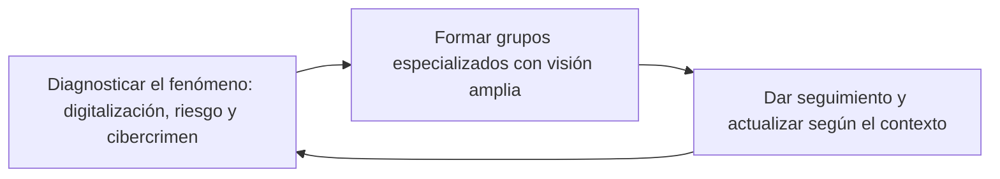

# 05 - Estrategias nacionales de ciberseguridad

> Materia 5 (Legislación nacional e internacional en ciberseguridad), unidad 2 (Ámbito internacional y estrategia de ciberseguridad), tema 2. Nota recreada a partir del material de la materia y actualizada al 10 de noviembre de 2026.

## Por qué importa

Una ley dice qué está prohibido y quién sanciona. Una estrategia nacional de ciberseguridad dice algo distinto: hacia dónde quiere ir un país, quién coordina, con qué recursos y en qué orden. Sin ese plan, cada dependencia compra sus propias herramientas, cada empresa se defiende como puede y nadie sabe a quién avisar cuando cae un servicio esencial.

Para quien diseña o administra sistemas, la estrategia de su país no es un documento lejano. De ella salen las políticas obligatorias para el gobierno, los requisitos que después se piden a proveedores, los CSIRT a los que se reporta un incidente y las prioridades de formación. Esta nota explica para qué sirve una estrategia, cómo se construye según la guía internacional más usada, cómo está armada la de España de 2019 y qué propone la agenda global de desarrollo de capacidades. La estrategia mexicana se estudia en la [nota 06](06-estrategia-nacional-mexico.md).

## No existe la seguridad absoluta

El punto de partida es incómodo pero honesto: ninguna medida elimina el riesgo. Cada persona y cada dispositivo que se conecta genera más datos y abre más puertas, de modo que la exposición crece con la digitalización misma.

Los países adoptaron con entusiasmo la promesa de la ciencia y la tecnología. Las agendas y estrategias digitales buscan conectar a la población para que participe en los beneficios de la sociedad de la información, y en muchos lugares lo han logrado. Del otro lado quedan dos problemas que la digitalización trajo consigo:

- La falta de una cultura de uso responsable de la tecnología.
- Las vulnerabilidades de organizaciones públicas y privadas que digitalizaron sus procesos sin asegurarlos.

La estrategia de ciberseguridad es la respuesta de política pública a ese segundo lado de la moneda.

## Para qué hace un Estado una estrategia

El propósito principal es proteger a la población, su patrimonio y la seguridad nacional. Pero una estrategia suele perseguir también otros fines:

| Propósito adicional | Por qué importa |
|---|---|
| Atraer inversión extranjera | Un país con reglas claras y capacidad de respuesta inspira más confianza a quien invierte |
| Estimular la innovación nacional y proteger la propiedad intelectual | La industria local de ciberseguridad crece si hay demanda y reglas estables |
| Garantizar derechos dentro y fuera del ciberespacio | Para personas físicas y morales, en línea y fuera de línea |
| Combatir el cibercrimen | Con capacidades de investigación, persecución y cooperación |

No hay un modelo único. Cada país adapta enfoques y principios a su realidad. Lo que sí se repite es la necesidad de que gobierno y sociedad trabajen juntos en tres momentos:

1. **Diagnosticar** la digitalización, el riesgo cibernético y el cibercrimen del país.
2. **Formar grupos especializados** capaces de construir una estrategia integral, que vean el desafío completo y colaboren para mitigar o gestionar el riesgo.
3. **Dar seguimiento y actualizar** de forma constante, según cambie el contexto.

## La guía internacional para elaborar una estrategia

La referencia más usada es la *Guía para la elaboración de una estrategia nacional de ciberseguridad*, preparada por la Unión Internacional de Telecomunicaciones (UIT) junto con el Banco Mundial, la Secretaría de la Commonwealth, la Organización de Telecomunicaciones de la Commonwealth y el Centro de Excelencia de Ciberdefensa Cooperativa de la OTAN, entre otros socios. Está dirigida a líderes y autoridades nacionales: ofrece un marco flexible para evaluar la postura del país y acompaña todo el ciclo de vida de la estrategia, desde que nace hasta que se revisa. El material pedía leer la primera edición, de 2018 (páginas 9 a 34); en 2021 salió una segunda edición.

La conclusión del material sobre esta guía sigue vigente: elaborar una estrategia es muy exigente, requiere cooperación entre sectores y trabajo de varias disciplinas, debe involucrar a los distintos órdenes de gobierno y poderes, y hasta las acciones pequeñas de seguridad individual repercuten en la seguridad nacional.

**Actualización al 2026:** en diciembre de 2025 se publicó la tercera edición de la guía (*NCS Guide 2025*), elaborada por más de treinta organizaciones (entre ellas la UIT, el Banco Mundial, el BID, la OEA, el Consejo de Europa, el GFCE, la UNODC y el Foro Económico Mundial, con ENISA como observadora). Su estructura actual es la siguiente.

### Ciclo de vida en seis fases

| Fase | Qué se hace |
|---|---|
| I. Inicio | Se designa una autoridad líder, se definen roles, tiempos y actores, y se decide si la estrategia será para todo el país o solo para el gobierno y los activos críticos |
| II. Inventario y análisis | Se evalúan la postura nacional y el panorama de riesgos, con gobierno, sector privado y sociedad civil |
| III. Financiamiento y recursos sostenibles | Se integra la ciberseguridad al presupuesto nacional, se convierten las acciones en proyectos con fondos y se priorizan |
| IV. Elaboración | Se redacta el texto con consultas públicas y grupos de trabajo: visión, alcance, objetivos y prioridades |
| V. Implementación | Se ejecuta el plan de acción con responsables y recursos |
| VI. Monitoreo y evaluación | Se mide el avance y se prepara la siguiente versión |

La fase de financiamiento es la novedad más clara frente a las ediciones anteriores: la guía advierte que, sin recursos predecibles y de largo plazo, una estrategia bien escrita se queda en aspiración.

### Diez principios transversales

1. Visión.
2. Enfoque integral y prioridades a la medida del país.
3. Inclusión de todos los actores.
4. Prosperidad económica y social.
5. Derechos humanos fundamentales.
6. Gestión de riesgos y resiliencia.
7. Conjunto adecuado de instrumentos de política.
8. Liderazgo claro, roles definidos y recursos asignados.
9. Entorno de confianza.
10. Prospectiva tecnológica y capacidad de adaptación.

### Siete áreas de buenas prácticas

| Área | Ejemplos de lo que debe resolver |
|---|---|
| 1. Gobernanza | Apoyo del más alto nivel, autoridad nacional competente, coordinación y presupuesto |
| 2. Infraestructura crítica, infraestructura crítica de información y servicios esenciales | Cómo se identifican, qué requisitos cumplen sus operadores y quién responde |
| 3. Gestión de riesgos | Evaluación nacional de riesgos, metodología común, seguridad desde el diseño en compras |
| 4. Respuesta a incidentes | CSIRT, planes de contingencia, intercambio de información y ejercicios |
| 5. Capacidades y concientización | Formación, fuerza laboral, campañas, grupos vulnerables e investigación |
| 6. Legislación y regulación | Marco jurídico de ciberseguridad y de ciberdelito |
| 7. Cooperación internacional | Participación en foros, acuerdos y asistencia mutua |

## Las estrategias europeas

El material destaca que las estrategias de la comunidad europea son valiosas por tres razones: permiten intercambiar información entre países, fortalecen capacidades al crear estructuras institucionales para ejecutarlas y elevan la madurez del ecosistema digital global, porque cada país que mejora su estrategia ofrece a otros un modelo.

La Unión Europea tiene su propia estrategia de ciberseguridad (la primera es de 2013 y la vigente, de diciembre de 2020) y, además, cada Estado miembro tiene la suya. El detalle de la regulación europea se estudia en la [nota 13](13-union-europea.md). Aquí se toma como ejemplo nacional la estrategia de España.

## La Estrategia Nacional de Ciberseguridad de España (2019)

El Consejo de Seguridad Nacional la aprobó el 12 de abril de 2019 y se publicó en el Boletín Oficial del Estado mediante la Orden PCI/487/2019, del 26 de abril. Sustituyó a la primera estrategia española, de 2013, y desarrolla el ámbito de la ciberseguridad de la Estrategia de Seguridad Nacional de 2017. El material pedía leer sus páginas 39 a 41 (visión, objetivos y principios).

### Estructura

| Capítulo | Contenido |
|---|---|
| 1 | El ciberespacio como espacio común global |
| 2 | Amenazas y desafíos en el ciberespacio |
| 3 | Propósito, principios rectores y objetivos |
| 4 | Líneas de acción y medidas |
| 5 | La ciberseguridad dentro del Sistema de Seguridad Nacional |

### Principios rectores

Retoma los cuatro principios de la seguridad nacional española:

| Principio | Idea central |
|---|---|
| Unidad de acción | Ante un incidente, el Estado responde de forma coordinada y no como piezas sueltas |
| Anticipación | Las actuaciones preventivas tienen prioridad sobre las reactivas; se necesitan organismos especializados que alerten a tiempo |
| Eficiencia | Los recursos son limitados y deben optimizarse, compartiendo capacidades entre organismos |
| Resiliencia | Los sistemas deben resistir, recuperarse y seguir prestando servicio después de un ataque |

### Objetivo general y objetivos específicos

El objetivo general se redactó de forma más incluyente y menos técnica que en 2013: que España garantice un uso seguro y fiable del ciberespacio, proteja los derechos y libertades de la ciudadanía y promueva el progreso socioeconómico. De él se desprenden cinco objetivos:

| Objetivo | Tema |
|---|---|
| I | Seguridad y resiliencia de las redes y sistemas del sector público y de los servicios esenciales |
| II | Uso seguro y fiable del ciberespacio frente a su uso ilícito o malicioso (persecución del cibercrimen) |
| III | Protección del ecosistema empresarial, social y de la ciudadanía |
| IV | Cultura y compromiso con la ciberseguridad, y potenciación de capacidades humanas y tecnológicas |
| V | Seguridad del ciberespacio en el ámbito internacional |

### Siete líneas de acción

1. Reforzar las capacidades frente a amenazas que vienen del ciberespacio (detección, análisis, ciberdefensa y ciberinteligencia).
2. Garantizar la seguridad y resiliencia de los activos estratégicos del país.
3. Reforzar la investigación y persecución de la cibercriminalidad.
4. Impulsar la ciberseguridad de ciudadanos y empresas.
5. Potenciar la industria española de ciberseguridad y la generación y retención de talento.
6. Contribuir a la seguridad del ciberespacio internacional, con un ciberespacio abierto, plural, seguro y confiable.
7. Desarrollar una cultura de ciberseguridad.

### Gobernanza

La estrategia integra la ciberseguridad al Sistema de Seguridad Nacional con seis componentes: el Consejo de Seguridad Nacional, el Comité de Situación para crisis, el **Consejo Nacional de Ciberseguridad**, la Comisión Permanente de Ciberseguridad, el **Foro Nacional de Ciberseguridad** (espacio nuevo de colaboración público privada) y las autoridades competentes con sus CSIRT de referencia.

### Por qué la estudia esta unidad

El material la pone como ejemplo por cuatro rasgos: incorporó buenas prácticas internacionales, sumó componentes y actores nuevos, promueve el respeto a los derechos humanos y la cultura de ciberseguridad, y tiene una estructura sencilla que facilita su implementación. Esos mismos rasgos son los que se piden comparar con la estrategia mexicana en la tarea de la unidad.

**Actualización al 2026:** en octubre de 2025 el Gobierno de España anunció la revisión de su Estrategia Nacional de Ciberseguridad junto con la creación de un Centro Nacional de Ciberseguridad adscrito a la Presidencia. Al cierre de esta nota no se localizó en el BOE una estrategia nueva publicada, por lo que la de 2019 se toma como la vigente.

## La agenda global para el desarrollo de capacidades

El Foro Global de Experiencia Cibernética (GFCE, por sus siglas en inglés) nació en 2015, en la Conferencia Global sobre el Ciberespacio de La Haya, como plataforma para que gobiernos, organizaciones internacionales, empresas, comunidad técnica, sociedad civil y academia coordinen proyectos de desarrollo de capacidades cibernéticas. En la conferencia de Nueva Delhi de 2017, el comunicado de Delhi adoptó la *Global Agenda for Cyber Capacity Building*, que el material pedía leer en sus páginas 5 a 7.

La agenda ordena la cooperación en cinco temas:

| Tema | Alcance |
|---|---|
| Política y estrategia de ciberseguridad | Estrategias nacionales, evaluación de madurez, normas internacionales |
| Gestión de incidentes y protección de infraestructura crítica de información | CSIRT, respuesta y protección de servicios esenciales |
| Cibercrimen | Legislación, capacidades de investigación y cooperación judicial |
| Cultura y habilidades de ciberseguridad | Concientización y formación de la fuerza laboral |
| Estándares de ciberseguridad | Adopción de normas técnicas y buenas prácticas |

Su valor está en el enfoque: el desarrollo de capacidades sirve para fortalecer otras agendas públicas, y la colaboración funciona cuando los actores aportan perspectivas distintas y se comprometen a compartir información, esfuerzos y buenas prácticas.

## Ideas para cerrar el tema

- Una estrategia nacional de ciberseguridad es un documento de planeación para todo el país, no solo para un orden de gobierno. Debe incluir a los distintos poderes y órdenes, y vincularse con los demás sectores para llegar a todas las actividades económicas, a todos los segmentos de población y a todos los niveles educativos.
- Tiene que engarzarse con los demás programas sectoriales y especiales que nacen del plan nacional de desarrollo; solo así la ciberseguridad se vuelve transversal.
- El nivel de detalle depende de los objetivos y de la preparación cibernética de cada país. Las guías ayudan, pero hay que bajarlas al contexto nacional y a los recursos disponibles, con actores articulados y objetivos claros, medibles y alcanzables.
- No es una fórmula rígida: expresa una visión, objetivos de alto nivel, principios y prioridades.
- Cada vez que un país crea o actualiza su estrategia, los demás aprenden de ella. Ese intercambio indirecto eleva la madurez regional e internacional.

## Glosario

| Término | Definición |
|---------|-----------|
| Estrategia nacional de ciberseguridad | Documento de planeación que fija la visión, los objetivos, los principios, los responsables y las prioridades de un país en ciberseguridad |
| Ciclo de vida de la estrategia | Secuencia de fases desde el inicio hasta la evaluación y la siguiente versión |
| Autoridad líder | Entidad designada por el Ejecutivo para coordinar la elaboración de la estrategia |
| Plan de acción | Documento que traduce la estrategia en proyectos con responsables, plazos y presupuesto |
| Principio rector | Criterio que guía todas las acciones de la estrategia, como los derechos humanos o la gestión de riesgos |
| Resiliencia | Capacidad de resistir un incidente, recuperarse y seguir operando |
| Infraestructura crítica de información | Sistemas y redes cuya afectación comprometería servicios esenciales o la seguridad nacional |
| Servicio esencial | Servicio indispensable para la sociedad o la economía, como energía, agua, salud o finanzas |
| CSIRT | Equipo de respuesta a incidentes de seguridad informática; coordina la atención de incidentes de un sector o país |
| Desarrollo de capacidades | Fortalecimiento de instituciones, personas y tecnología para gestionar riesgos cibernéticos |
| GFCE | Foro Global de Experiencia Cibernética, plataforma de cooperación en desarrollo de capacidades creada en 2015 |
| Colaboración público privada | Trabajo conjunto entre autoridades y empresas para compartir información y responder a amenazas |

## Referencias

- Comisión Europea. (s. f.). *The EU's Cybersecurity Strategy*. https://digital-strategy.ec.europa.eu/en/policies/cybersecurity-strategy
- Global Forum on Cyber Expertise. (2017, 24 de noviembre). *Delhi Communiqué on a GFCE Global Agenda for Cyber Capacity Building*. https://web.archive.org/web/20260222075248/https://thegfce.org/wp-content/uploads/2020/04/DelhiCommunique.pdf
- NCS Guide. (2025). *Guide to Developing a National Cybersecurity Strategy* (3.ª ed.). Unión Internacional de Telecomunicaciones y socios. https://ncsguide.org/ncs-guide-2025/
- Presidencia del Gobierno de España. (2019). Orden PCI/487/2019, de 26 de abril, por la que se publica la Estrategia Nacional de Ciberseguridad 2019, aprobada por el Consejo de Seguridad Nacional. *Boletín Oficial del Estado*, 103, 43437-43455. https://www.boe.es/boe/dias/2019/04/30/pdfs/BOE-A-2019-6347.pdf
- Unión Internacional de Telecomunicaciones, Banco Mundial, Secretaría de la Commonwealth, Organización de Telecomunicaciones de la Commonwealth y Centro de Excelencia de Ciberdefensa Cooperativa de la OTAN. (2018). *Guía para la elaboración de una estrategia nacional de ciberseguridad: participación estratégica en la ciberseguridad*. UIT. https://ncsguide.org/archives/

---

*Rogelio Arriaga Gonzalez*
