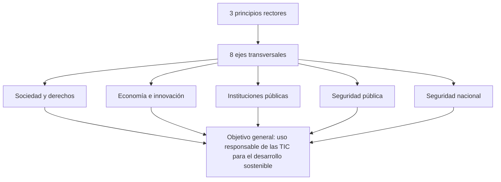

# 06 - La Estrategia Nacional de Ciberseguridad de México

> Materia 5 (Legislación nacional e internacional en ciberseguridad), unidad 2 (Ámbito internacional y estrategia de ciberseguridad), tema 3. Nota recreada a partir del material de la materia y actualizada al 10 de noviembre de 2026.

## Por qué importa

México publicó su primera Estrategia Nacional de Ciberseguridad (ENCS) en 2017. Fue un documento construido con cientos de participantes, bien estructurado y alineado con las guías internacionales, pero sin presupuesto propio, sin una ley que lo respaldara y sin un responsable que sobreviviera al cambio de gobierno. Ocho años después, el país estrenó otro instrumento, el Plan Nacional de Ciberseguridad 2025-2030, y una política obligatoria para la administración federal.

Entender esa trayectoria sirve para dos cosas. Primero, para saber qué reglas aplican hoy a quien desarrolla o administra sistemas del gobierno federal. Segundo, para reconocer qué hace que una estrategia funcione: la conclusión del material sobre la ENCS (liderazgo, carácter vinculante y presupuesto) se volvió la mejor explicación de por qué no se actualizó.

## El antecedente: la Estrategia Digital Nacional de 2013

La Estrategia Digital Nacional (EDN) fue el plan oficial del gobierno federal para adoptar y aprovechar las tecnologías de la información y la comunicación en todo el país. Se presentó en noviembre de 2013 y se aplicó entre 2014 y 2018, dentro del Plan Nacional de Desarrollo 2013-2018 y del Programa para un Gobierno Cercano y Moderno. Sus líneas incluían gobierno digital, datos abiertos, inclusión y habilidades digitales, salud y educación apoyadas en TIC y servicios financieros digitales.

La lideró la **Coordinación de Estrategia Digital Nacional (CEDN)**, creada dentro de la Oficina de la Presidencia, con facultades para diseñar, implementar y dar seguimiento a la EDN junto con las dependencias federales, el sector privado, la academia y la sociedad. Esa forma de trabajar entre sectores en temas de política digital preparó el terreno para el proceso colaborativo que después dio origen a la ENCS.

### La digitalización y su lado oscuro

La mayor conexión trajo beneficios concretos: más personas en línea, mejores servicios públicos y privados, crecimiento económico y ejercicio más amplio de derechos como la libertad de expresión, el acceso a la información, la asociación, la libertad de prensa, la transparencia y la rendición de cuentas.

Al mismo tiempo se multiplicaron los canales para que la delincuencia use la información, internet y otras tecnologías contra la seguridad de la información y, por esa vía, contra los derechos y el patrimonio de las personas. Muchas de esas conductas todavía no estaban tipificadas; se les llama delitos electrónicos o cibernéticos y pueden usar la tecnología como medio para cometerlos o como el blanco mismo del ataque.

## El proceso para construir la ENCS

Entre marzo y octubre de 2017, el gobierno federal convocó foros y talleres bajo el nombre "Hacia una Estrategia Nacional de Ciberseguridad". Participaron sociedad civil, empresas, academia, comunidad técnica e instituciones de distintos poderes y órdenes de gobierno. De esas mesas salieron coincidencias claras sobre lo que la estrategia debía atender:

- Articular acciones útiles para personas, empresas e instituciones públicas.
- Hacer de la colaboración entre sectores la pieza central para desarrollar, seguir y evaluar la estrategia.
- Medir los riesgos, construir un diagnóstico nacional y reunir evidencia para decidir mejor.
- Reconocer la dimensión global del problema y usar la diplomacia para acordar respuestas.
- Formar capital humano especializado.
- Promover el uso responsable de las TIC con concientización, educación y formación.

El material incluía el video oficial de presentación, en el que varios actores relatan su experiencia. La idea que deja es sencilla: escuchar a especialistas de distintas áreas mejora el diagnóstico, las acciones y, después, la cooperación para implementarlas y evaluarlas.

### Lecciones del proceso

1. Conviene integrar un comité de expertos de varios sectores y disciplinas.
2. Hace falta un liderazgo del más alto nivel dentro del Ejecutivo.
3. Se necesita un marco institucional vinculante, con atribuciones claras y presupuesto anual propio para diseñar, coordinar, evaluar y actualizar la estrategia.

El documento *Memoria y recomendaciones: Estrategia Nacional de Ciberseguridad*, elaborado por la CEDN en 2018, recoge cómo participaron los actores, qué documentos se generaron y cómo se conciliaron las propuestas. Su recomendación central para la siguiente etapa: no perder a los aliados ni el trabajo acumulado en foros, mesas y documentos, porque fue un esfuerzo de cientos de personas.

## Qué dice la ENCS

### Visión y objetivo general

La visión fijada fue que, hacia 2030, México sea una nación resiliente ante los riesgos del ciberespacio, que aproveche las TIC con responsabilidad para el desarrollo sostenible en un entorno confiable.

El objetivo general es identificar y establecer acciones de ciberseguridad en los ámbitos social, económico y político para que la población y las organizaciones públicas y privadas usen las TIC de forma responsable en favor del desarrollo sostenible del país.

### Estructura

Los ejes son interdependientes y cada uno contribuye a los cinco objetivos; todas sus acciones se desarrollan sobre los tres principios.

### Tres principios rectores

| Principio | En qué consiste |
|---|---|
| Perspectiva de derechos humanos | Toda acción de ciberseguridad debe promover y respetar derechos como la libertad de expresión, el acceso a la información, la vida privada, la protección de datos, la salud, la educación y el trabajo |
| Enfoque basado en gestión de riesgos | Manejar la incertidumbre con medidas preventivas y correctivas que reduzcan el impacto de amenazas cambiantes |
| Colaboración multidisciplinaria y de múltiples actores | Participación abierta y transparente de todos los sectores, con un enfoque de gobernanza de internet |

### Cinco objetivos estratégicos

| Objetivo | Qué busca |
|---|---|
| 1. Sociedad y derechos | Que la población actúe en el ciberespacio de forma responsable, libre y confiable, con respeto a sus derechos |
| 2. Economía e innovación | Proteger a los sectores productivos, impulsar la innovación tecnológica y la industria nacional de ciberseguridad |
| 3. Instituciones públicas | Proteger la información y los sistemas del gobierno para que funcione bien y no interrumpa trámites ni servicios |
| 4. Seguridad pública | Aumentar la capacidad de prevenir e investigar delitos en el ciberespacio que dañan a personas y su patrimonio |
| 5. Seguridad nacional | Prevenir riesgos y amenazas que puedan afectar la independencia, la integridad y la soberanía del país |

### Ocho ejes transversales

| Eje | Contenido principal |
|---|---|
| 1. Cultura de ciberseguridad | Concientización, educación y formación, con énfasis en niñas, niños y adolescentes |
| 2. Desarrollo de capacidades | Capital humano especializado (técnicos, líderes, investigadores, fiscales y jueces), organización y tecnología para gestionar incidentes |
| 3. Coordinación y colaboración | Cooperación internacional, mecanismos nacionales y un modelo de gobernanza para compartir información |
| 4. Investigación, desarrollo e innovación en TIC | Ecosistema de innovación, investigación científica y mercado nacional de ciberseguridad |
| 5. Estándares y criterios técnicos | Normas, metodologías y marcos de referencia, y adopción de mejores prácticas internacionales |
| 6. Infraestructuras críticas | Reducir riesgos y elevar la resiliencia en el marco de la Ley de Seguridad Nacional |
| 7. Marco jurídico y autorregulación | Adecuar la ley, dar certeza a los intermediarios de internet, formar a los operadores jurídicos y armonizar los códigos penales |
| 8. Medición y seguimiento | Diagnóstico nacional, estadísticas centralizadas e indicadores para la mejora continua |

El eje 7 es el que toca directamente al derecho. Entre las acciones de marco jurídico se planteó avanzar hacia la adhesión al Convenio de Budapest. El material advertía que esa adhesión debía concretarse e incluso ir más allá del texto del convenio, que ya se veía rezagado frente al cibercrimen actual. A noviembre de 2026 México sigue sin ser Parte (ver [nota 04](04-escenario-internacional.md)).

### El diagnóstico que la sustentó, con su año

| Dato | Fuente citada por la ENCS | Año |
|---|---|---|
| El cibercrimen costaba a México entre 3,000 y 5,000 millones de dólares al año | OEA, tendencias de seguridad cibernética | 2014 |
| Los internautas pasaron de 40 a 65.5 millones | Asociación de Internet MX | 2012 a 2016 |
| Los incidentes detectados por la Policía Federal se triplicaron, de cerca de 20 mil a más de 60 mil | Policía Federal, División Científica | 2013 a 2016 |
| El fraude cibernético pasó del 7 % al 42 % de las reclamaciones por posible fraude | CONDUSEF | Primer trimestre de 2011 a primer trimestre de 2017 |

### Gobernanza

La coordinación quedó, en una primera etapa, en la **Subcomisión de Ciberseguridad** de la Comisión Intersecretarial para el Desarrollo del Gobierno Electrónico (CIDGE), creada por acuerdo unánime el 11 de octubre de 2017. La presidía la Secretaría de Gobernación por medio de la División Científica de la Policía Federal, y la integraban unidades de la Oficina de la Presidencia, la Función Pública y las áreas de TIC de varias secretarías y de la entonces Procuraduría General de la República, con invitados permanentes como la Defensa, la Marina, el SAT, la CNBV, la PROFECO y la CONDUSEF.

Sus tareas: aprobar y difundir la estrategia, coordinar su implementación en la administración federal, impulsar la colaboración entre instituciones y con los demás actores. Para el objetivo de seguridad nacional, la Subcomisión se enlazaba con el Consejo de Seguridad Nacional a través de su Comité Especializado en Seguridad de la Información.

## Qué debe tener una estrategia para funcionar

El material resume en cuatro requisitos lo que una estrategia nacional necesita, a partir de la experiencia mexicana:

1. **Diagnóstico.** Una aproximación honesta al estado de las cosas: la digitalización y su lado negativo (abusos, ataques, cibercrimen y falta de cultura de ciberseguridad), porque el valor de la información pública y privada no deja de crecer.
2. **Liderazgo interno.** Un grupo dentro del Ejecutivo federal que defina papeles y áreas de responsabilidad y sostenga el trabajo en el tiempo.
3. **Ruta de colaboración.** Las acciones y ejercicios de cooperación con sociedad civil, sector privado, academia y comunidad técnica.
4. **Líneas de acción, metas e indicadores.** Una fase de implementación medible, con información pública que permita mejorar y actualizar la estrategia ante nuevas circunstancias.

A eso se suma una condición que el material subraya: mientras más institucional y vinculante sea la estrategia, es decir, obligatoria para los entes públicos según sus atribuciones, y mientras tenga un presupuesto asignado por el Congreso, más estable y útil será para toda la sociedad.

## Qué pasó después

**Actualización al 2026:** la ENCS de 2017 no se actualizó, y las iniciativas legislativas de 2025 ya la describen como un documento que perdió vigencia. Se diseñó como un "documento vivo", pero no contó con presupuesto propio ni con un responsable estable: la Policía Federal, cuya División Científica presidía la Subcomisión, fue sustituida por la Guardia Nacional a partir de 2019. Lo que siguió fue esto:

| Fecha | Hecho |
|---|---|
| 6 de septiembre de 2021 | Se publica en el DOF la Estrategia Digital Nacional 2021-2024, obligatoria para la administración federal. Prioriza el software libre, los estándares abiertos, la autonomía tecnológica y la seguridad de la información, y prevé un protocolo homologado de gestión de incidentes |
| 28 de noviembre de 2024 | Una reforma a la Ley Orgánica de la Administración Pública Federal crea la Agencia de Transformación Digital y Telecomunicaciones (ATDT), que recibe los recursos de la CEDN e inicia funciones el 1 de enero de 2025 |
| Diciembre de 2025 | La ATDT presenta el Plan Nacional de Ciberseguridad 2025-2030 |
| 17 de diciembre de 2025 | Se publica en el DOF el acuerdo por el que se emite la Política General de Ciberseguridad para la Administración Pública Federal |
| 2023 y 2026 | Se presentan iniciativas de ley federal y de ley general de ciberseguridad; ninguna ha sido aprobada a noviembre de 2026 |

La facultad de la ATDT en seguridad de la información quedó en el artículo 42 Ter de la Ley Orgánica de la Administración Pública Federal (última reforma DOF 07-05-2026):

> **Artículo 42 Ter.-** A la Agencia de Transformación Digital y Telecomunicaciones le corresponde el despacho de los siguientes asuntos:
>
> [...]
>
> VI. Definir los protocolos de seguridad de la información y comunicaciones de la Administración Pública Federal;

### El Plan Nacional de Ciberseguridad 2025-2030

Según lo difundido al presentarlo, el plan busca proteger los activos digitales del país y los datos de la ciudadanía, llevar a la administración federal hacia un ecosistema seguro y posicionar a México como referente regional en gobernanza de ciberseguridad. Identifica tres frentes de amenaza prioritarios (cibercrimen organizado, tensiones geopolíticas y riesgos de la inteligencia artificial) y avanza por fases anuales de madurez, de "Fundamento" en 2025 a "Transformación" en 2030. Entre sus proyectos están un centro nacional de operaciones de ciberseguridad, un CSIRT para la administración federal y un campo de entrenamiento (cyber range) para capacitar a servidores públicos. Las críticas iniciales apuntaron a lo mismo que debilitó a la ENCS: presupuesto no exclusivo y falta de sanciones y de obligatoriedad fuera del gobierno.

### La Política General de Ciberseguridad para la APF

A diferencia del plan, esta política sí es obligatoria para las dependencias y entidades federales (con excepción de la Defensa, la Marina y el Centro Nacional de Inteligencia en sus funciones de seguridad nacional). Sus piezas principales:

- Arquitectura de **Confianza Cero**: todo acceso a sistemas del gobierno se verifica de forma continua.
- Un **CSIRT Nacional-APF** al que se reportan los incidentes críticos en un plazo máximo de **24 horas**, y un centro de operaciones federado que vigila todo el día.
- Un **responsable institucional de ciberseguridad** en cada institución, que elabora y ejecuta un **plan institucional** anual.
- Ciberseguridad desde el diseño en los proyectos tecnológicos, cláusulas de auditoría y requisitos mínimos en contratos de software y nube, y un modelo de madurez de cinco niveles.

### ENCS 2017 frente al marco de 2025

| Aspecto | ENCS 2017 | Plan 2025-2030 y Política APF 2025 |
|---|---|---|
| Responsable | Subcomisión de la CIDGE, presidida por la Policía Federal | ATDT, dependencia con atribución legal expresa |
| Fuerza jurídica | Documento de política sin obligatoriedad | La Política APF es un acuerdo publicado en el DOF, obligatorio para la administración federal |
| Alcance | Todo el Estado mexicano y todos los sectores | El plan es nacional; la política obliga solo al gobierno federal |
| Respuesta a incidentes | Planteada como capacidad a desarrollar | CSIRT Nacional-APF y aviso en 24 horas |
| Presupuesto | Sin asignación propia | Dentro del presupuesto general de la ATDT, sin partida exclusiva |
| Ley de ciberseguridad | No existía | Sigue sin existir |

## Ideas para cerrar el tema

- En México, como en otros países de la región, los logros de la estrategia se vieron limitados por falta de liderazgo institucional y de presupuesto. Persiste la dificultad de entender lo digital como algo presente en seguridad, educación, trabajo, economía, salud, combate a la corrupción, justicia y protección civil.
- El material urgía a actualizar la ENCS porque el cibercrimen crece cada día. La actualización no llegó; llegó otro instrumento, siete años después.
- Cualquier estrategia debe adaptarse al contexto nacional y articularse con los demás programas para que la ciberseguridad sea transversal.
- Hacen falta más programas de estudio en ciberseguridad. La tecnología debe avanzar de la mano de instituciones fuertes, teoría jurídica y regulación actualizada.

## Glosario

| Término | Definición |
|---------|-----------|
| ENCS | Estrategia Nacional de Ciberseguridad de México, presentada en 2017 |
| EDN | Estrategia Digital Nacional, plan del gobierno federal para la adopción de las TIC (2013 y 2021-2024) |
| CEDN | Coordinación de Estrategia Digital Nacional, unidad de la Oficina de la Presidencia sustituida por la ATDT |
| ATDT | Agencia de Transformación Digital y Telecomunicaciones, dependencia federal que opera desde el 1 de enero de 2025 |
| CIDGE | Comisión Intersecretarial para el Desarrollo del Gobierno Electrónico, creada en 2005 |
| Subcomisión de Ciberseguridad | Órgano de la CIDGE creado en 2017 para coordinar la ENCS |
| Objetivo estratégico | Cada uno de los cinco entornos que la ENCS se propuso proteger |
| Eje transversal | Línea de trabajo que contribuye a todos los objetivos estratégicos a la vez |
| Plan Nacional de Ciberseguridad 2025-2030 | Instrumento presentado por la ATDT en diciembre de 2025 con fases anuales de madurez |
| Política General de Ciberseguridad para la APF | Acuerdo publicado en el DOF el 17 de diciembre de 2025, obligatorio para la administración federal |
| Confianza Cero | Modelo de seguridad que no concede confianza por estar dentro de la red y verifica cada acceso |
| CSIRT Nacional-APF | Equipo de respuesta a incidentes de la administración federal al que se reportan los incidentes críticos |
| Responsable institucional de ciberseguridad | Persona designada en cada institución federal para elaborar y ejecutar su plan anual de ciberseguridad |
| Documento vivo | Instrumento pensado para actualizarse conforme cambian las condiciones |

## Referencias

- Agencia de Transformación Digital y Telecomunicaciones. (2025). *Plan Nacional de Ciberseguridad 2025-2030*. Gobierno de México. https://www.portal.atdt.gob.mx/wp-content/uploads/2026/01/Plan_Nacional_de_Ciberseguridad-2.pdf
- Agencia de Transformación Digital y Telecomunicaciones. (2025, 17 de diciembre). Acuerdo por el que se emite la Política General de Ciberseguridad para la Administración Pública Federal. *Diario Oficial de la Federación*. https://dof.gob.mx/nota_detalle.php?codigo=5776454&fecha=17/12/2025
- Cámara de Diputados del H. Congreso de la Unión. (2026). *Ley Orgánica de la Administración Pública Federal* (última reforma publicada DOF 07-05-2026). https://www.diputados.gob.mx/LeyesBiblio/pdf/LOAPF.pdf
- Coordinación de Estrategia Digital Nacional. (2018). *Memoria y recomendaciones: Estrategia Nacional de Ciberseguridad*. Presidencia de la República. https://www.gob.mx/cms/uploads/attachment/file/411729/Memoria_y_Recomendaciones_ENCS.pdf
- Coordinación de Estrategia Digital Nacional. (2021, 6 de septiembre). Acuerdo por el que se expide la Estrategia Digital Nacional 2021-2024. *Diario Oficial de la Federación*. https://dof.gob.mx/nota_detalle.php?codigo=5628886&fecha=06/09/2021
- Gobierno de la República. (2013). *Estrategia Digital Nacional*. https://www.gob.mx/cms/uploads/attachment/file/17083/Estrategia_Digital_Nacional.pdf
- Gobierno de la República. (2017). *Estrategia Nacional de Ciberseguridad*. https://www.gob.mx/cms/uploads/attachment/file/271884/Estrategia_Nacional_Ciberseguridad.pdf

---

*Rogelio Arriaga Gonzalez*
