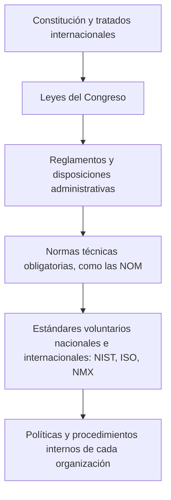
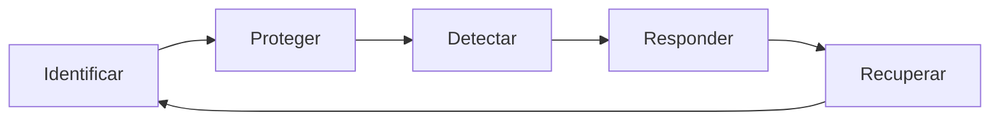

# 07 - NIST: estándares y marco de ciberseguridad

> Materia 5 (Legislación nacional e internacional en ciberseguridad), unidad 3 (Normas, estándares y mejores prácticas), tema 1. Nota recreada a partir del material de la materia y actualizada al 10 de noviembre de 2026.

## Por qué importa

Una ley puede ordenar que una empresa "proteja razonablemente" los datos que trata, pero casi nunca dice cómo. Ese hueco lo llenan las normas técnicas: documentos que bajan el deber jurídico a controles concretos, medibles y auditables. Quien estudia derecho de la ciberseguridad necesita saber de dónde salen esos controles, quién los escribe y qué fuerza tienen, porque en un litigio, en una auditoría o en un contrato con un proveedor extranjero la pregunta que decide el caso suele ser la misma: ¿la organización siguió un estándar reconocido o improvisó?

El Instituto Nacional de Estándares y Tecnología de Estados Unidos (NIST, por sus siglas en inglés) es la fuente más citada en el mundo para responder esa pregunta. Sus publicaciones nacieron para el gobierno federal estadounidense, pero hoy las usan bancos mexicanos, hospitales europeos y empresas de software de cualquier tamaño. Esta nota explica qué es el NIST, cómo se relaciona con la ley federal que lo hizo indispensable (FISMA), qué contienen sus guías principales de la serie SP 800 y cómo funciona su Marco de Ciberseguridad, que en 2024 cambió de versión.

## Dónde encaja esta unidad: de la ley al control técnico

Antes de hablar de normas conviene recordar el orden en que se acomodan los distintos tipos de reglas. En cualquier sistema jurídico hay una jerarquía: arriba la constitución y los tratados, después las leyes que expide el poder legislativo, luego los reglamentos y disposiciones administrativas, y al final los documentos técnicos que concretan cómo se cumple lo anterior. Esa escala existe dentro de cada país y se repite por niveles de gobierno (federal, estatal y municipal).

La ciberseguridad depende de esa última capa más que otras materias. El legislador fija obligaciones generales (proteger datos, notificar incidentes, conservar evidencia) y deja a las normas técnicas y a los estándares internacionales la tarea de decir qué controles bastan. Por eso esta unidad estudia tres fuentes técnicas: el NIST, la Organización Internacional de Normalización (ISO) y las Normas Oficiales Mexicanas (NOM).

Los estándares internacionales tienen un valor especial porque sirven de punto de encuentro entre lo técnico y lo jurídico. Un perito que maneja evidencia digital, una empresa que trata datos personales y un área de sistemas que protege a sus usuarios pueden hablar el mismo idioma si todos se refieren a un procedimiento estandarizado. Cuando un juez pregunta si la cadena de custodia fue correcta o si una medida de seguridad era razonable, la respuesta se apoya en esos documentos.

## Qué es el NIST

El NIST es una agencia del Departamento de Comercio de Estados Unidos. Se fundó en 1901, con otro nombre, como uno de los primeros laboratorios federales de ciencias físicas del país. El Congreso lo creó para resolver un problema económico: la industria estadounidense de aquel momento tenía una infraestructura de medición rezagada frente a la del Reino Unido, Alemania y otras potencias, y sin mediciones confiables no había forma de competir en manufactura.

Más de un siglo después su campo es enorme. Mediciones y estándares del NIST están detrás de la red eléctrica inteligente, de los relojes atómicos que sincronizan las telecomunicaciones, de nanomateriales avanzados y de la fabricación de chips. En lo que toca a esta materia, conviene subrayar tres rasgos:

| Rasgo | Qué significa en la práctica |
|---|---|
| Es una agencia **no reguladora** | No impone sanciones ni expide normas obligatorias por sí misma. Publica guías, métricas y estándares. |
| Trabaja para la **competitividad** | Su misión es impulsar la innovación y la competitividad industrial de Estados Unidos mediante ciencia de la medición, estándares y tecnología. |
| Es el **brazo técnico de FISMA** | La ley federal de seguridad de la información le encarga escribir los estándares y guías que deben seguir las agencias del gobierno federal. |

La combinación de los dos últimos puntos explica su peso. Una guía del NIST no obliga a una empresa privada, pero sí a las agencias federales, y quien quiera venderle software o servicios al gobierno estadounidense termina adoptándola. De ahí se extendió a toda la industria.

## FISMA: la ley que vuelve obligatorias las guías del NIST para el gobierno federal

La *Federal Information Security Management Act* se aprobó en 2002 como parte de la ley de gobierno electrónico de Estados Unidos. Exigió a cada agencia federal un programa de seguridad de la información con políticas, evaluación de riesgos, controles, capacitación y reportes, y encargó al NIST los estándares técnicos para cumplirla.

**Actualización al 2026:** la ley de 2002 fue sustituida por la *Federal Information Security Modernization Act of 2014*, que conserva las siglas FISMA, actualiza la ley original y da al Departamento de Seguridad Nacional (hoy a través de la agencia CISA) funciones operativas de supervisión. Por eso los documentos recientes hablan de *Modernization Act*, mientras que los anteriores a 2014 dicen *Management Act*.

En la práctica, las guías del NIST cumplen tres funciones para las agencias:

1. Traducen la ley a controles verificables.
2. Ayudan a cumplir al mismo tiempo otras regulaciones sectoriales, porque muchas guías se escribieron precisamente para eso.
3. Simplifican la implementación, ya que ofrecen un procedimiento probado en lugar de que cada agencia invente el suyo.

### Nueve pasos para cumplir FISMA

El material de la materia resume el cumplimiento de FISMA en nueve pasos. En la tabla se recrean con una columna que los relaciona con el Marco de Gestión de Riesgos (RMF) que el NIST publica en la SP 800-37.

| Paso | En qué consiste | Fase del RMF con la que se relaciona |
|---|---|---|
| 1 | Clasificar los datos y la información que deben protegerse, según su sensibilidad e impacto | Categorizar |
| 2 | Fijar una línea base con los controles mínimos que esa información necesita | Seleccionar |
| 3 | Evaluar los riesgos para ajustar esa línea base a la realidad del sistema | Seleccionar |
| 4 | Dejar por escrito la línea base en un plan de seguridad del sistema | Seleccionar |
| 5 | Poner en marcha los controles en los sistemas de información | Implementar |
| 6 | Medir si los controles funcionan una vez implementados | Evaluar |
| 7 | Determinar el riesgo para toda la agencia a partir de esa evaluación | Autorizar |
| 8 | Autorizar formalmente que el sistema opere y procese información | Autorizar |
| 9 | Vigilar los controles de forma continua | Monitorear |

El punto jurídico es el paso 8. En el modelo federal estadounidense un funcionario con nombre y cargo acepta el riesgo residual y firma la autorización para operar. La responsabilidad deja de ser difusa: alguien respondió por esa decisión.

## La serie SP 800: las guías más usadas

Las *Special Publications* de la serie 800 son el corazón técnico del NIST en seguridad informática. El material destaca tres de ellas:

| Publicación | Título y tema | Para qué sirve |
|---|---|---|
| **SP 800-53** | Controles de seguridad y privacidad para sistemas de información y organizaciones | Es el catálogo de controles que deben aplicar los sistemas de información federales. La Revisión 5 (2020) agrupa los controles en 20 familias e integra la privacidad al mismo catálogo. |
| **SP 800-37** | Marco de Gestión de Riesgos (RMF) para sistemas de información y organizaciones | Describe el ciclo de vida de la seguridad de un sistema: preparar, categorizar, seleccionar, implementar, evaluar, autorizar y monitorear. Con el monitoreo continuo de los controles de la SP 800-53 permite pasar a una autorización casi en tiempo real en lugar de una revisión cada varios años. |
| **SP 800-137** | Monitoreo continuo de la seguridad de la información (ISCM) | Da orientación para vigilar y reportar el estado de seguridad en toda la organización, de preferencia con herramientas automatizadas. Tiene un complemento, la SP 800-137A, para evaluar esos programas de monitoreo. |

**Actualización al 2026:** la SP 800-53 Revisión 5 sigue vigente y recibió el 27 de agosto de 2025 la versión de mantenimiento 5.2.0, publicada en respuesta a la Orden Ejecutiva 14306. Esa entrega se concentra en la seguridad y confiabilidad de las actualizaciones y parches de software. La SP 800-37 vigente es la Revisión 2 (diciembre de 2018) y la SP 800-137 sigue siendo la de septiembre de 2011.

### Monitoreo continuo: de qué se trata

El mercado ofrece productos y servicios que automatizan el monitoreo que pide la SP 800-137 y ayudan a las agencias a ordenar su trabajo en tres momentos:

1. Identificar los activos cibernéticos y ordenarlos por prioridad.
2. Definir los umbrales de riesgo a partir de los cuales hay que actuar.
3. Decidir cada cuánto se vigila cada control y reportar el resultado a los funcionarios que autorizan la operación.

A esto se suma una recomendación general de las guías: hacer el inventario de activos con un **enfoque basado en valor**. No todo merece el mismo esfuerzo; primero se localiza la información más sensible (la que, si se pierde o se filtra, causa el mayor daño) y alrededor de ella se concentran las defensas.

## El Marco de Ciberseguridad del NIST (CSF)

El ejemplo más conocido de un estándar del NIST que rebasó al gobierno federal es su Marco de Ciberseguridad (*Cybersecurity Framework*, CSF). Su primera versión salió en 2014 por encargo presidencial, pensada para la infraestructura crítica; la versión 1.1 apareció en abril de 2018. Se diseñó para que empresas de cualquier tamaño evaluaran su postura de seguridad y la mejoraran con un proceso repetible y alineado con buenas prácticas.

El marco no es una lista de verificación cerrada. Es un lenguaje común organizado por funciones, categorías y subcategorías, que se cruza con referencias informativas (controles de la SP 800-53, de ISO/IEC 27001 y de otros catálogos). Así una empresa puede describir dónde está (perfil actual), a dónde quiere llegar (perfil objetivo) y qué le falta.

### Las cinco funciones de la versión 1.1

El material las presenta como cinco pasos para asegurar estándares de seguridad, y el glosario de la unidad las define con ejemplos de una organización pequeña. Recreadas:

| Función | Qué busca | Ejemplos de acciones |
|---|---|---|
| Identificar | Saber qué se tiene y qué hay que proteger | Inventario de equipos, programas y datos; mapa de quién (empleados, proveedores) toca información sensible y con qué responsabilidad |
| Proteger | Poner barreras antes del incidente | Control de quién entra a la red y usa los equipos, software de seguridad, cifrado, capacitación de quienes usan los sistemas |
| Detectar | Enterarse a tiempo cuando algo pasa | Monitoreo de la red, revisión de bitácoras, investigación de cualquier actividad anormal |
| Responder | Contener y comunicar | Plan de respuesta a incidentes, aviso a clientes y empleados cuyos datos estén en riesgo, actualización de la política de seguridad con lo aprendido |
| Recuperar | Volver a operar | Restaurar equipos y partes de la red afectadas, recuperar datos de respaldos y regresar a la operación normal lo antes posible |

**Actualización al 2026:** el 26 de febrero de 2024 el NIST publicó el **CSF 2.0**, que sustituye a la versión 1.1. Los cambios principales son tres. Primero, agrega una sexta función, **Gobernar**, que se coloca al centro de las otras cinco y trata la estrategia, los roles y responsabilidades, la política y la gestión de riesgos de la cadena de suministro (que antes vivía dentro de Identificar). Segundo, deja de presentarse como un marco para infraestructura crítica y se dirige expresamente a organizaciones de cualquier sector y tamaño. Tercero, reorganiza el núcleo en 22 categorías y 106 subcategorías, acompañadas de guías rápidas, perfiles comunitarios y una herramienta de consulta en línea. En la tabla de arriba, por tanto, faltaría una fila previa a todas: Gobernar.

| Función CSF 2.0 | Abreviatura |
|---|---|
| Gobernar | GV |
| Identificar | ID |
| Proteger | PR |
| Detectar | DE |
| Responder | RS |
| Recuperar | RC |

### Lecciones prácticas del tema

Las conclusiones de la unidad para este tema se pueden convertir en una lista de arranque para cualquier organización:

- Todo empieza por identificar los dispositivos físicos y los sistemas. Sin inventario no hay forma de aplicar ningún estándar.
- Hay que definir por escrito qué hace cada empleado, cada proveedor y cada persona con acceso a información sensible, y qué responde cada quien.
- Hace falta una política formal para borrar de forma segura archivos electrónicos y para dar de baja equipos que ya no se usan; un disco duro desechado sin borrar es una filtración esperando ocurrir.
- Ante un incidente grave, mantener informados a empleados y clientes sobre la respuesta y la recuperación forma parte del plan, no es un detalle de relaciones públicas.

## Cumplir NIST no es lo mismo que estar seguro

El material insiste en una advertencia que vale para cualquier estándar. Seguir las guías del NIST garantiza una base sólida y ordenada de controles y facilita demostrar diligencia ante un regulador o un tribunal, pero no elimina el riesgo. Siempre queda un riesgo residual: un atacante con recursos, un error humano, una vulnerabilidad desconocida. El cumplimiento es un piso, no un techo.

También hay que tener presente que los programas del NIST buscan algo más amplio que la protección inmediata: estándares que atiendan la interoperabilidad entre sistemas, la usabilidad para las personas y la privacidad, y que impulsen tecnologías y metodologías nuevas para los retos actuales y futuros. Para empresas y gobiernos, contar con un parámetro de referencia de este tipo fortalece la gestión de la información y del resto de los activos digitales, sobre todo cuando el marco jurídico nacional no detalla cómo cumplir.

## NIST desde México

Ninguna guía del NIST es obligatoria en México por sí misma. Su fuerza llega por otros caminos:

- **Contratos.** Un cliente estadounidense o una casa matriz puede exigir por contrato que su proveedor mexicano se alinee al CSF o a la SP 800-53.
- **Supervisión sectorial.** Reguladores financieros y de telecomunicaciones suelen aceptar el CSF como evidencia de un programa de seguridad bien estructurado.
- **Diligencia debida.** Ante una brecha, demostrar que se siguió un marco reconocido ayuda a acreditar que las medidas de seguridad eran razonables, que es lo que exigen las leyes de protección de datos.

Por eso conviene conocer el CSF aunque la organización termine certificándose en ISO/IEC 27001, que es el tema de la siguiente nota: los dos se complementan y el propio NIST publica las equivalencias entre ambos.

## Glosario

| Término | Definición |
|---------|-----------|
| NIST | Instituto Nacional de Estándares y Tecnología de Estados Unidos; agencia no reguladora del Departamento de Comercio que publica estándares, guías y métricas |
| FISMA | Ley federal estadounidense de seguridad de la información (2002, modernizada en 2014) que obliga a las agencias federales a tener un programa de seguridad basado en los estándares del NIST |
| SP 800 | Serie de publicaciones especiales del NIST dedicadas a la seguridad informática |
| SP 800-53 | Catálogo de controles de seguridad y privacidad para sistemas de información y organizaciones |
| RMF | Marco de Gestión de Riesgos de la SP 800-37: preparar, categorizar, seleccionar, implementar, evaluar, autorizar y monitorear |
| ISCM | Monitoreo continuo de la seguridad de la información, descrito en la SP 800-137 |
| Línea base de controles | Conjunto mínimo de controles que corresponde a un sistema según su nivel de impacto |
| Autorización para operar | Decisión formal de un funcionario responsable que acepta el riesgo residual de un sistema |
| CSF | Marco de Ciberseguridad del NIST, organizado en funciones, categorías y subcategorías |
| Gobernar | Función agregada en el CSF 2.0 que cubre estrategia, roles, políticas y riesgos de la cadena de suministro |
| Perfil | Descripción del estado actual u objetivo de una organización frente a las categorías del CSF |
| Riesgo residual | Riesgo que permanece después de aplicar los controles |
| Enfoque basado en valor | Priorizar la protección de los activos cuya pérdida causaría mayor daño |

## Referencias

- Aurigemma, S. (s. f.). *NIST Cyber Security Framework* [Video]. YouTube. https://www.youtube.com/watch?v=10TVBSrEpcw
- Cybersecurity and Infrastructure Security Agency. (s. f.). *Federal Information Security Modernization Act*. https://www.cisa.gov/topics/cyber-threats-and-advisories/federal-information-security-modernization-act
- Dempsey, K., Chawla, N. S., Johnson, A., Johnston, R., Jones, A. C., Orebaugh, A., Scholl, M. y Stine, K. (2011). *Information security continuous monitoring (ISCM) for federal information systems and organizations* (NIST Special Publication 800-137). National Institute of Standards and Technology. https://csrc.nist.gov/pubs/sp/800/137/final
- Joint Task Force. (2018). *Risk management framework for information systems and organizations: A system life cycle approach for security and privacy* (NIST Special Publication 800-37, Rev. 2). National Institute of Standards and Technology. https://csrc.nist.gov/pubs/sp/800/37/r2/final
- Joint Task Force. (2020). *Security and privacy controls for information systems and organizations* (NIST Special Publication 800-53, Rev. 5). National Institute of Standards and Technology. https://csrc.nist.gov/pubs/sp/800/53/r5/upd1/final
- National Institute of Standards and Technology. (s. f.-a). *About NIST*. https://www.nist.gov/about-nist
- National Institute of Standards and Technology. (s. f.-b). *Cybersecurity Framework*. https://www.nist.gov/cyberframework
- National Institute of Standards and Technology. (s. f.-c). *FISMA implementation project*. https://csrc.nist.gov/projects/fisma-implementation-project
- National Institute of Standards and Technology. (s. f.-d). *NIST illustrated* [Video]. YouTube. https://www.youtube.com/watch?v=2j9BGVKbzS4
- National Institute of Standards and Technology. (s. f.-e). *The Cybersecurity Framework* [Video]. YouTube. https://www.youtube.com/watch?v=J9ToNuwmyF0
- National Institute of Standards and Technology. (2018). *Framework for improving critical infrastructure cybersecurity* (Versión 1.1). https://nvlpubs.nist.gov/nistpubs/CSWP/NIST.CSWP.04162018.pdf
- National Institute of Standards and Technology. (2024a). *The NIST Cybersecurity Framework (CSF) 2.0* (NIST CSWP 29). https://nvlpubs.nist.gov/nistpubs/CSWP/NIST.CSWP.29.pdf
- National Institute of Standards and Technology. (2024b, 26 de febrero). *NIST releases version 2.0 of landmark Cybersecurity Framework*. https://www.nist.gov/news-events/news/2024/02/nist-releases-version-20-landmark-cybersecurity-framework
- National Institute of Standards and Technology. (2025, 27 de agosto). *NIST releases revision to SP 800-53 controls*. https://csrc.nist.gov/news/2025/nist-releases-revision-to-sp-800-53-controls
- RSA Conference. (s. f.). *Virtual session: NIST Cybersecurity Framework explained* [Video]. YouTube. https://www.youtube.com/watch?v=nFUyCrSnR68

---

*Rogelio Arriaga Gonzalez*
