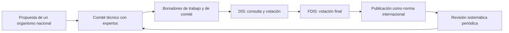

# 08 - ISO y la familia ISO/IEC 27000

> Materia 5 (Legislación nacional e internacional en ciberseguridad), unidad 3 (Normas, estándares y mejores prácticas), tema 2. Nota recreada a partir del material de la materia y actualizada al 10 de noviembre de 2026.

## Por qué importa

Cuando una empresa mexicana presume que está "certificada en ISO 27001", está diciendo algo con consecuencias jurídicas: que un tercero independiente revisó su sistema de gestión de seguridad de la información contra un documento internacional y concluyó que cumple. Esa afirmación aparece en licitaciones, en contratos con bancos, en respuestas a reguladores y en juicios por filtraciones de datos. Si la certificación es falsa o está vencida, la empresa puede incurrir en incumplimiento contractual o en publicidad engañosa.

La Organización Internacional de Normalización (ISO) produce los documentos técnicos más usados del mundo para gestionar la seguridad de la información, el riesgo y los servicios de tecnología. En México no son obligatorios por sí mismos, pero sirven de modelo a normas nacionales (la siguiente nota lo muestra con la NMX-I-27032-NYCE-2018) y funcionan como prueba de diligencia. Esta nota explica qué es ISO, cómo nace una norma, cuáles son las más usadas en tecnología y qué contiene la familia ISO/IEC 27000.

## Un nombre que no es sigla

ISO no abrevia nada. Viene del griego *isos*, que significa igual, la misma raíz de palabras como isométrico (de iguales medidas) o isonomía (igualdad ante la ley). La organización eligió un nombre corto y fijo para no tener una sigla distinta en cada idioma: en inglés sería IOS, en francés OIN, en español OIN también. Con ISO, el nombre es el mismo en Ginebra, en Tokio y en la Ciudad de México.

La idea de "igual" no es casual. Una norma internacional busca justamente que productos, procesos y servicios de distintos países se puedan comparar con la misma vara.

## Qué es ISO

ISO es una federación mundial de organismos nacionales de normalización. Es una organización no gubernamental: sus miembros no son los Estados, sino el organismo de normalización de cada país, uno por país. Su sede y su secretaría central están en Ginebra, Suiza, y su máximo órgano de decisión es una Asamblea General formada por representantes de los miembros y por funcionarios electos.

Sus miembros colaboran para:

- Desarrollar y promover estándares internacionales de tecnología.
- Armonizar procesos de pruebas científicas.
- Fijar referencias sobre condiciones de trabajo.
- Atender problemas sociales y ambientales, entre muchos otros temas.

El modelo económico también importa para el derecho: ISO y sus miembros **venden** los documentos que contienen las normas. A diferencia de una ley, que se publica gratis en el diario oficial, una norma ISO tiene derechos de autor y se adquiere. Por eso, cuando una ley o una norma oficial remite a un estándar internacional, surge la discusión de si el ciudadano puede conocer gratuitamente aquello que lo obliga.

**Actualización al 2026:** el material hablaba de organismos de más de 164 países. Hoy ISO reúne alrededor de 170 organismos nacionales y su propia página de miembros habla de una red de 177. Los miembros se dividen en tres categorías: miembros plenos (votan y adoptan normas en su país), miembros correspondientes (participan con observación, sin adoptar ni vender normas) y miembros suscriptores (solo se mantienen informados).

### ISO, IEC y el comité conjunto JTC 1

En tecnologías de la información ISO no trabaja sola. La Comisión Electrotécnica Internacional (IEC), que normaliza todo lo eléctrico y electrónico, comparte con ISO un comité técnico conjunto, el **ISO/IEC JTC 1**, creado para tener un solo punto formal de normalización de las tecnologías de la información. Por eso las normas de seguridad llevan el prefijo doble ISO/IEC. Dentro del JTC 1, el subcomité SC 27 se encarga de seguridad de la información, ciberseguridad y protección de la privacidad; otros subcomités atienden la nube (SC 38), el internet de las cosas (SC 41) o la inteligencia artificial (SC 42).

## Cómo nace una norma ISO

El material describe el proceso en tres momentos, que aquí se completan con las etapas formales que usa ISO:

1. **La necesidad.** Una asociación de industria, un grupo de consumidores u otro interesado pide una norma a través de su organismo nacional.
2. **El comité.** ISO convoca a expertos en la materia y a partes interesadas de la industria, que integran un comité técnico. El comité trabaja borradores en dos rondas y somete el segundo a una votación formal; ese segundo borrador se conoce como **FDIS** (*Final Draft International Standard*, borrador final de norma internacional).
3. **La publicación.** Si el FDIS se aprueba y la secretaría central lo certifica, ISO lo publica como norma internacional oficial.

Una vez publicada, la norma no queda congelada: ISO la somete a revisión sistemática para confirmarla, corregirla o sustituirla. Esa es la razón de que una norma se cite siempre con su año. Decir "ISO 27001" sin año puede referirse a documentos de 2005, 2013 o 2022, que son distintos.

## Las normas ISO más usadas en tecnología

El material selecciona seis normas populares para las tecnologías de la información. La tabla conserva lo que dice cada una y agrega su situación actual.

| Norma | Para qué sirve | Situación al 2026 |
|---|---|---|
| Interconexión de sistemas abiertos (OSI) | Modelo de referencia universal de siete capas para los protocolos de comunicación. Lo impulsaron fabricantes de computadoras y proveedores de telecomunicaciones a principios de los ochenta, e ISO lo adoptó como norma. | Se publicó como ISO 7498 en 1984; la edición conocida es ISO/IEC 7498-1:1994. Sigue siendo la referencia didáctica para explicar redes. |
| ISO/IEC 27001 | Requisitos para establecer, implementar, mantener y mejorar un sistema de gestión de seguridad de la información (SGSI). El material la describía como un proceso de seis pasos para crear políticas y procesos de seguridad. | Vigente la edición 2022 (con una enmienda de 2024 sobre cambio climático). Su estructura ya no se cuenta en "seis pasos": sigue los capítulos comunes de los sistemas de gestión (contexto, liderazgo, planificación, apoyo, operación, evaluación del desempeño y mejora) y un anexo con 93 controles. |
| ISO/IEC 17799 | Código de buenas prácticas con más de 100 controles sobre continuidad del negocio, control de acceso, gestión de activos y otros dominios. | En 2007 cambió de número y pasó a llamarse ISO/IEC 27002. La edición vigente, 27002:2022, organiza 93 controles en cuatro temas: organizacionales, de personas, físicos y tecnológicos. |
| ISO/IEC 20000 | Especificación técnica que recoge las mejores prácticas de gestión de servicios de TI. | La parte de requisitos es ISO/IEC 20000-1:2018, vigente con su enmienda 1:2024 sobre cambio climático. |
| ISO 31000 | Estandariza la definición de riesgo y sus términos, con directrices de gestión de riesgos útiles para cualquier persona, empresa o dependencia. | Vigente la edición ISO 31000:2018; ISO ya trabaja en su tercera edición, que todavía es un proyecto. Es la base conceptual que retoman las normas de riesgo de seguridad. |
| ISO/IEC 12207 | Proceso uniforme de gestión del ciclo de vida para todo el software. | Hoy es una norma triple, ISO/IEC/IEEE 12207. La edición de 2017 fue sustituida por la de 2026, que el IEEE publicó el 15 de abril de 2026. |

**Actualización al 2026:** ISO/IEC 17799 ya no existe con ese número desde 2007, y la 27002 que la sustituyó pasó de 114 controles en 14 dominios (edición 2013) a 93 controles en 4 temas (edición 2022). ISO/IEC 27001 vigente es la de 2022. En noviembre de 2026 se confirmó el estado de las demás: ISO/IEC 20000-1:2018 sigue vigente con su enmienda de 2024 sobre cambio climático; ISO 31000:2018 sigue vigente mientras se prepara su tercera edición, y la norma del ciclo de vida del software tiene una edición nueva, la de 2026, que sustituye a la de 2017.

## El atractivo del ciberdelito

El número 132 de *ISOfocus*, la revista de ISO, dedicado a los "secretos cibernéticos" (enero y febrero de 2019), explica por qué el ciberdelito resulta tan tentador para quien lo comete. Resumido en tres razones:

| Razón | Qué significa |
|---|---|
| Una red enorme de interacciones | Cada dispositivo, cuenta y proveedor conectado es una puerta posible, y los objetivos nuevos (móviles, objetos conectados) se suman a diario. |
| Castigos relativamente leves | Comparado con delitos físicos de daño equivalente, las penas son menores y la probabilidad de ser atrapado es baja. |
| Reglas desiguales para el lavado de dinero | Cada país trata distinto el blanqueo de capitales, y eso permite mover ganancias que pueden ser gigantescas. |

La misma revista recogía la estimación de la industria de que las pérdidas anuales por ciberdelito podrían alcanzar dos billones de dólares en 2019. La respuesta que propone ISO no es tecnológica sino de gestión: prepararse, anticipar vulnerabilidades y construir resiliencia en la forma en que los sistemas interactúan con el resto de la organización. Ahí entra la familia ISO/IEC 27000.

## La familia ISO/IEC 27000

ISO/IEC 27001 es la norma insignia de la familia. Su primera edición como norma ISO salió en 2005, a partir de un estándar británico, y desde entonces la familia creció hasta reunir varias decenas de documentos (en 2019 ya eran más de 40). El trabajo lo coordina el comité conjunto JTC 1 y, dentro de él, el subcomité SC 27. Algunas piezas que conviene ubicar:

| Norma | Tema | Para qué la usa un abogado o un auditor |
|---|---|---|
| ISO/IEC 27000 | Panorama de la familia y conceptos del SGSI | Ubicar qué norma de la familia trata cada tema antes de citarla en un contrato o en un dictamen |
| ISO/IEC 27001 | Requisitos del SGSI, certificable | Exigir a un proveedor una certificación verificable |
| ISO/IEC 27002 | Guía de controles | Detallar las medidas de seguridad de un contrato o de una política interna |
| ISO/IEC 27005 | Gestión de riesgos de seguridad de la información (vigente la edición 2022) | Documentar por qué se eligieron ciertas medidas y no otras |
| ISO/IEC 27017 | Controles para servicios en la nube | Negociar con proveedores de nube quién es responsable de cada control |
| ISO/IEC 27018 | Protección de datos personales en nubes públicas | Revisar si un proveedor de nube trata datos personales como encargado responsable |
| ISO/IEC 27042 | Análisis e interpretación de evidencia digital | Valorar si un peritaje informático siguió un método aceptado |
| ISO/IEC 27043 | Principios y procesos para investigar incidentes | Ordenar una investigación interna que pueda terminar en un juicio |

La utilidad jurídica de estas normas va más allá de la prevención. ISO/IEC 27043 ofrece directrices para muchos tipos de investigación: accesos no autorizados, corrupción de datos, fallas de sistemas, violaciones de la seguridad en empresas y otras investigaciones digitales. Con ellas, la familia no solo ayuda a gestionar la seguridad, también a identificar a los responsables de un ataque y a llevarlos ante la justicia con evidencia bien tratada.

La revista de 2019 anunciaba además un proyecto del SC 27, entonces llamado ISO/IEC 27552, para extender la 27001 a la gestión de la privacidad. **Actualización al 2026:** ese proyecto se publicó en agosto de 2019 como ISO/IEC 27701, una extensión de las normas 27001 y 27002 para la gestión de la privacidad. El 14 de octubre de 2025 salió su segunda edición, ISO/IEC 27701:2025, que ya no es una extensión: es una norma de requisitos propia para un sistema de gestión de la privacidad de la información, que muchas empresas usan para demostrar cumplimiento con leyes de protección de datos. También cambió la norma que encabeza la familia: en julio de 2026 se publicó la sexta edición, ISO/IEC 27000:2026, que sustituye a la de 2018 y ya no es un documento de vocabulario; presenta los conceptos del SGSI y la relación entre las normas de la familia.

## ISO/IEC 27032: ciberseguridad

La norma que más interesa a esta materia es ISO/IEC 27032. Su edición de 2012 entendía la ciberseguridad como la preservación de la confidencialidad, la integridad y la disponibilidad de la información en el ciberespacio, y al ciberespacio como el entorno donde interactúan personas, software y servicios tecnológicos de todo el mundo. Su propósito era subrayar el papel de cada tipo de seguridad en ese entorno:

- La seguridad de la información.
- La seguridad de las redes y de internet.
- La protección de la infraestructura crítica de información (CIIP).

Como estándar internacional, ofrecía un marco para que las partes interesadas en el ciberespacio establecieran confianza, colaboraran, intercambiaran información y contaran con orientación técnica para integrar sus sistemas. Entre los beneficios de implementarla, el material enumera seis, que se pueden leer como argumentos para convencer a una dirección general:

| Beneficio | Lectura práctica |
|---|---|
| Proteger los datos y la privacidad frente a amenazas cibernéticas | Menos incidentes y menos exposición a sanciones de protección de datos |
| Fortalecer las capacidades para crear y sostener un programa de ciberseguridad | El programa deja de depender de una sola persona |
| Desarrollar mejores prácticas para gestionar las políticas de ciberseguridad | Políticas escritas, revisadas y aplicadas |
| Mejorar el sistema de seguridad y la continuidad del negocio | La operación aguanta un incidente |
| Generar confianza en clientes, socios y reguladores | Argumento comercial y de cumplimiento |
| Responder y recuperarse más rápido ante un incidente | Menor tiempo de interrupción y menor daño |

**Actualización al 2026:** la edición de 2012 fue retirada. En 2023 ISO publicó la segunda edición, ISO/IEC 27032:2023, con un título nuevo (*Cybersecurity. Guidelines for Internet security*), una estructura distinta, un enfoque más claro en la seguridad de internet y un anexo que relaciona sus controles con los de ISO/IEC 27002. La norma mexicana NMX-I-27032-NYCE-2018, que se estudia en la nota 09, es idéntica a la edición de 2012, no a la de 2023.

## Para qué sirven las normas ISO

Las conclusiones de este tema se pueden ordenar por quién se beneficia:

- **El lenguaje común.** La armonización es especialmente necesaria en la terminología, donde aun con el esfuerzo de instituciones, terminólogos y traductores aparecen confusiones. ISO homologa los términos y con ello reduce malentendidos en contratos, auditorías y peritajes.
- **Las personas consumidoras.** Las normas garantizan calidad y seguridad de productos y servicios que cruzan fronteras.
- **Las empresas.** Les ayudan a reducir costos, ordenar sus sistemas y mejorar procedimientos que ya tenían.
- **Los gobiernos.** Pueden apoyar políticas públicas en la opinión de expertos que ya trabajaron en una norma, y facilitan el comercio internacional porque los productos certificados se aceptan en más mercados.

En el terreno digital la normalización tiene una ventaja adicional: garantiza que sistemas y dispositivos de fabricantes distintos puedan funcionar juntos (interoperabilidad y compatibilidad) y ofrece un marco de referencia común para la seguridad, la calidad y la eficiencia en el intercambio de información. Eso es lo que permite adoptar tecnologías emergentes sin reinventar las reglas cada vez, y gestionar riesgos y datos personales con criterios que entiende cualquier auditor del mundo.

Implementar normas ISO es un buen punto de partida para el cumplimiento normativo y para el buen funcionamiento de la empresa. No sustituye a la ley, pero da a la organización herramientas para crecer con orden y demostrar que actuó con diligencia.

## ISO frente al NIST

Las dos fuentes se complementan más de lo que compiten:

| Aspecto | ISO/IEC 27001 | Marco de Ciberseguridad del NIST |
|---|---|---|
| Origen | Organización internacional, consenso de organismos nacionales | Agencia federal de Estados Unidos |
| Forma | Requisitos de un sistema de gestión | Lenguaje de resultados por funciones |
| Certificación | Sí, por organismos acreditados | No hay certificación oficial |
| Acceso | Documento de pago | Documento gratuito |
| Uso típico | Demostrar a terceros que hay un SGSI | Medir madurez y planear mejoras |

Muchas organizaciones usan el marco del NIST para diagnosticar y planear, y la 27001 para certificar.

## Glosario

| Término | Definición |
|---------|-----------|
| ISO | Organización Internacional de Normalización; federación no gubernamental de organismos nacionales de normalización, con sede en Ginebra |
| IEC | Comisión Electrotécnica Internacional; normaliza tecnologías eléctricas y electrónicas y comparte con ISO el comité JTC 1 |
| ISO/IEC JTC 1 | Comité técnico conjunto de ISO e IEC para las tecnologías de la información |
| SC 27 | Subcomité del JTC 1 responsable de seguridad de la información, ciberseguridad y privacidad |
| FDIS | Borrador final de norma internacional que se somete a la votación definitiva |
| SGSI | Sistema de gestión de seguridad de la información, objeto de ISO/IEC 27001 |
| Control | Medida que modifica un riesgo, como una política, un procedimiento o una herramienta técnica |
| Certificación | Declaración de un organismo acreditado de que una organización cumple una norma |
| Modelo OSI | Modelo de referencia de siete capas para describir la comunicación entre sistemas |
| CIIP | Protección de la infraestructura crítica de información |
| Evidencia digital | Información en formato electrónico que puede servir de prueba en una investigación o un juicio |
| Interoperabilidad | Capacidad de sistemas de distintos fabricantes para funcionar juntos e intercambiar información |
| Revisión sistemática | Proceso periódico en el que ISO decide si una norma se confirma, se corrige o se sustituye |

## Referencias

- Gasiorowski-Denis, E. (Ed.). (2019). *ISOfocus*, (132). Organización Internacional de Normalización. https://www.iso.org/isofocus
- Institute of Electrical and Electronics Engineers. (2026). *IEEE/ISO/IEC 12207-2026 ISO/IEC/IEEE International Standard: Systems and software engineering: Software life cycle processes*. https://standards.ieee.org/ieee/12207/11416/
- International Organization for Standardization. (s. f.-a). *ISO Cyber Risk Solutions* [Video]. YouTube. https://www.youtube.com/watch?v=nRJ8M6SC8Rg
- International Organization for Standardization. (s. f.-b). *Members*. https://www.iso.org/members.html
- International Organization for Standardization. (2018). *ISO 31000:2018 Risk management: Guidelines*. https://www.iso.org/standard/65694.html
- International Organization for Standardization e International Electrotechnical Commission. (1994). *ISO/IEC 7498-1:1994 Information technology: Open Systems Interconnection: Basic reference model*. https://www.iso.org/standard/20269.html
- International Organization for Standardization e International Electrotechnical Commission. (2018). *ISO/IEC 20000-1:2018 Information technology: Service management: Part 1*. https://www.iso.org/standard/70636.html
- International Organization for Standardization e International Electrotechnical Commission. (2022a). *ISO/IEC 27001:2022 Information security, cybersecurity and privacy protection: Information security management systems: Requirements*. https://www.iso.org/standard/27001
- International Organization for Standardization e International Electrotechnical Commission. (2022b). *ISO/IEC 27002:2022 Information security, cybersecurity and privacy protection: Information security controls*. https://www.iso.org/standard/75652.html
- International Organization for Standardization e International Electrotechnical Commission. (2022c). *ISO/IEC 27005:2022 Information security, cybersecurity and privacy protection: Guidance on managing information security risks*. https://www.iso.org/standard/80585.html
- International Organization for Standardization e International Electrotechnical Commission. (2023). *ISO/IEC 27032:2023 Cybersecurity: Guidelines for Internet security*. https://www.iso.org/standard/76070.html
- International Organization for Standardization e International Electrotechnical Commission. (2024). *ISO/IEC 20000-1:2018/Amd 1:2024 Information technology: Service management: Part 1: Service management system requirements: Amendment 1: Climate action changes*. https://webstore.iec.ch/en/publication/92576
- International Organization for Standardization e International Electrotechnical Commission. (2025). *ISO/IEC 27701:2025 Information security, cybersecurity and privacy protection: Privacy information management systems: Requirements and guidance*. https://webstore.iec.ch/en/publication/110123
- International Organization for Standardization e International Electrotechnical Commission. (2026). *ISO/IEC 27000:2026 Information security, cybersecurity and privacy protection: Information security management systems: Overview*. https://www.iso.org/standard/27000
- International Organization for Standardization, International Electrotechnical Commission e Institute of Electrical and Electronics Engineers. (2017). *ISO/IEC/IEEE 12207:2017 Systems and software engineering: Software life cycle processes*. https://www.iso.org/standard/63712.html
- IT Governance Ltd. (s. f.). *What is ISO 27001? A brief summary of the standard* [Video]. YouTube. https://www.youtube.com/watch?v=io6w3Yw4q9w
- JTC 1. (s. f.). *ISO/IEC JTC 1 Information technology*. https://jtc1info.org/
- Líder del Emprendimiento. (s. f.). *¿Qué es ISO y cuáles son sus normas?* [Video]. YouTube. https://www.youtube.com/watch?v=_4kjTWQhh8Y
- PECB. (s. f.). *Improve cybersecurity posture by using ISO/IEC 27032* [Video]. YouTube. https://www.youtube.com/watch?v=NX5RMGOcyBM
- PROCEM Consultores. (s. f.). *¿Qué son las normas ISO?* [Video]. YouTube. https://www.youtube.com/watch?v=QrWsBj6ARG0

---

*Rogelio Arriaga Gonzalez*
