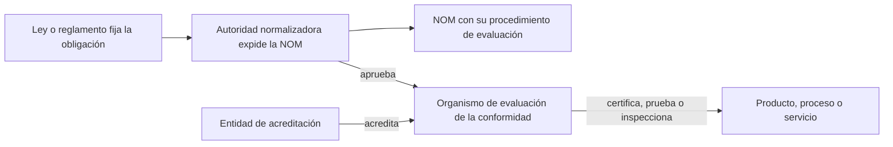

# 09 - Normas Oficiales Mexicanas y ciberseguridad

> Materia 5 (Legislación nacional e internacional en ciberseguridad), unidad 3 (Normas, estándares y mejores prácticas), tema 3. Nota recreada a partir del material de la materia y actualizada al 10 de noviembre de 2026.

## Por qué importa

Cada día usamos productos que alguien revisó antes de que llegaran a la tienda: el cargador del teléfono, la etiqueta del jugo, el refrigerador que promete cierto consumo de energía, el propio teléfono que se conecta a la red celular. En México esa revisión tiene un nombre: Norma Oficial Mexicana (NOM). Las NOM son la forma en que el gobierno baja a especificaciones técnicas los deberes que fijan las leyes, y son obligatorias para comercializar bienes y servicios en el país.

Para la ciberseguridad el tema tiene dos caras. Por un lado, México todavía no tiene una ley general de ciberseguridad, y las normas técnicas (obligatorias o voluntarias) son de los pocos instrumentos que ya concretan medidas de seguridad. Por otro, las NOM tienen una naturaleza jurídica discutida que conviene entender antes de proponerlas como solución a todo. Esta nota explica qué son las NOM y las normas voluntarias, cómo cambió su ley en 2020, qué hizo el regulador de telecomunicaciones en materia de ciberseguridad y qué dice la norma mexicana NMX-I-27032-NYCE-2018, que adapta al país el estándar internacional de ciberseguridad.

## Qué es una NOM

Las NOM son disposiciones generales de carácter técnico que expiden dependencias de la administración pública federal. Fijan reglas, especificaciones, directrices y características que deben cumplir un producto, un proceso o un servicio. La variedad es enorme: hay NOM sobre cuarentenas para frenar plagas del algodón, sobre el etiquetado de perfumes y cosméticos, sobre la eficiencia energética de los refrigeradores y hasta sobre el derecho de paso entre concesionarios de ferrocarriles.

Su razón de ser es práctica. La Constitución encarga al presidente de la República proveer en la esfera administrativa a la exacta observancia de las leyes, pero nadie puede hacerlo en persona para cada detalle técnico, y esos detalles cambian con rapidez. Ni el Congreso ni el Ejecutivo pueden reaccionar a tiempo si para cada ajuste técnico hay que reformar una ley o un reglamento. Las NOM resuelven esa tensión: la ley y el reglamento fijan la obligación, y la NOM dice con precisión cómo se cumple.

### NOM y normas voluntarias

Hasta 2020 la ley distinguía dos tipos de documentos técnicos. Las **NOM**, obligatorias, y las **normas mexicanas (NMX)**, voluntarias, elaboradas por organismos nacionales de normalización o por la Secretaría de Economía para un uso común y repetido. Una NMX solo se volvía obligatoria si una NOM la incorporaba como parte de su procedimiento.

Un rasgo compartido por ambas es la participación: antes de expedirse se someten a consulta de los particulares del sector regulado o de quienes resultarían afectados.

**Actualización al 2026:** la Ley Federal sobre Metrología y Normalización de 1992, que el material toma como fundamento, fue abrogada. La sustituyó la **Ley de Infraestructura de la Calidad**, publicada en el Diario Oficial de la Federación (DOF) el 1 de julio de 2020 y en vigor 60 días después. La nueva ley conserva las NOM, pero ya no habla de normas mexicanas: llama **Estándares** a los documentos voluntarios. Las normas que ya existían siguen identificándose con su clave NMX en el Catálogo Mexicano de Normas. La ley se mantiene como texto vigente sin reformas, y su reglamento llegó seis años después: se publicó en el DOF el 4 de septiembre de 2026, entró en vigor el día hábil siguiente y abrogó el reglamento de 1999 de la ley anterior. Ese reglamento canceló los proyectos de normas mexicanas en trámite, mantiene vigentes las NMX ya expedidas hasta que la Secretaría de Economía publique su cancelación o exista un estándar que las sustituya, y da a los organismos 36 meses para emitir esos estándares.

Su objeto, según el artículo 1 de la Ley de Infraestructura de la Calidad (DOF 1-07-2020):

> Artículo 1. La presente Ley es de orden público e interés social y sus disposiciones son de observancia general y obligatoria en todo el territorio nacional, sin perjuicio de lo dispuesto en los tratados internacionales de los que los Estados Unidos Mexicanos sean parte. Esta Ley tiene por objeto fijar y desarrollar las bases de la política industrial en el ámbito del Sistema Nacional de Infraestructura de la Calidad, a través de las actividades de normalización, estandarización, acreditación, Evaluación de la Conformidad y metrología, promoviendo el desarrollo económico y la calidad en la producción de bienes y servicios, a fin de ampliar la capacidad productiva y el mejoramiento continuo en las cadenas de valor, fomentar el comercio internacional y proteger los objetivos legítimos de interés público previstos en este ordenamiento.

Las dos definiciones que importan, del artículo 4 de la misma ley:

> X. Estándar: al documento técnico que prevé un uso común y repetido de reglas, especificaciones, atributos o métodos de prueba aplicables a un bien, producto, proceso o servicio, así como aquéllas relativas a terminología, simbología, embalaje, marcado, etiquetado o concordaciones.

> XVI. Norma Oficial Mexicana: a la regulación técnica de observancia obligatoria expedida por las Autoridades Normalizadoras competentes cuyo fin esencial es el fomento de la calidad para el desarrollo económico y la protección de los objetivos legítimos de interés público previstos en este ordenamiento, mediante el establecimiento de reglas, denominación, especificaciones o características aplicables a un bien, producto, proceso o servicio, así como aquéllas relativas a terminología, marcado o etiquetado y de información. Las Normas Oficiales Mexicanas se considerarán como Reglamentos Técnicos o Medidas Sanitarias o Fitosanitarias, según encuadren en las definiciones correspondientes previstas en los tratados internacionales de los que el Estado Mexicano es Parte.

En palabras simples: la NOM es la regla técnica que un producto, proceso o servicio tiene que cumplir para venderse en México, y es obligatoria; el estándar (antes NMX) es una referencia técnica que se sigue por decisión propia.

El artículo 10 de la ley enumera los "objetivos legítimos de interés público" que justifican una NOM. Entre ellos aparecen la seguridad nacional y la protección del derecho a la información, dos puertas por las que una NOM de ciberseguridad podría entrar sin forzar la ley. Así inicia ese artículo:

> Artículo 10. Las Normas Oficiales Mexicanas tienen como finalidad atender las causas de los problemas identificados por las Autoridades Normalizadoras que afecten o que pongan en riesgo los objetivos legítimos de interés público.

## Naturaleza jurídica: un acto administrativo que funciona como ley

Las NOM son una figura peculiar. Desde el punto de vista formal son actos administrativos, porque las emite una dependencia del Ejecutivo y no el Congreso. Desde el punto de vista material se comportan como normas generales: son abstractas, se aplican a todos los que caen en su supuesto y obligan. Por eso hay quien sostiene que en realidad son reglamentos o incluso leyes disfrazadas, y que delegar en una dependencia la facultad de dictarlas viola la división de poderes.

La Suprema Corte de Justicia de la Nación ha sostenido criterios en sentido contrario: una NOM que la dependencia expide dentro de su competencia y de lo que su ley habilitante le autoriza no contraviene por sí sola los principios de legalidad, reserva de ley y subordinación jerárquica, ni implica una delegación indebida de la facultad de legislar; el límite es que no rebase lo que la ley dispone.

Eso no deja a las NOM fuera del control judicial. Pueden impugnarse por dos vías:

| Vía | Qué se reclama |
|---|---|
| Vicios de procedimiento | Que no se respetó el proceso de creación: consulta pública, justificación, publicación en el DOF |
| Inconstitucionalidad material | Que el contenido excede su objeto, por ejemplo cuando la NOM crea obligaciones nuevas, restringe derechos o fija sanciones por su cuenta |

El principio de reserva de ley es la clave: una NOM no puede limitar derechos ni establecer sanciones por sí misma. Solo puede precisar obligaciones que ya están en una ley o en un reglamento.

### El riesgo de abusar de las NOM

Las NOM son útiles y, en muchos campos, indispensables. Pero su multiplicación desordenada tiene un costo: la certeza jurídica, uno de los fines más importantes del Estado. Cuando en una materia hay decenas de NOM, el ciudadano se pierde. Además existe la tentación, para el Ejecutivo, de usar la vía de la NOM para evitar el procedimiento más lento de expedir o reformar un reglamento. Esa salida no cura nada: si la NOM regula lo que debía regular un reglamento o una ley, sigue siendo inconstitucional por delegación indebida.

## Cómo se hace y qué contiene una NOM

### Quién la expide

Cada secretaría emite las NOM de los productos, procesos o servicios que le toca regular según su competencia. Por eso la clave de una NOM suele terminar con las siglas de la dependencia que la expidió. El material menciona algunas:

| Sigla en la clave | Dependencia | Nota de vigencia |
|---|---|---|
| SCFI | Antigua Secretaría de Comercio y Fomento Industrial | Hoy Secretaría de Economía; la sigla se conserva en muchas normas |
| SE | Secretaría de Economía | Vigente |
| SEGOB | Secretaría de Gobernación | Vigente |
| STPS | Secretaría del Trabajo y Previsión Social | Vigente |
| SAGARPA | Antigua secretaría de agricultura, ganadería, desarrollo rural, pesca y alimentación | Hoy Secretaría de Agricultura y Desarrollo Rural |
| SEMARNAT | Secretaría de Medio Ambiente y Recursos Naturales | Vigente |

No existe un compendio único de todas las NOM; se consultan por dependencia o por materia, y hoy también en la plataforma electrónica de la Secretaría de Economía.

### Qué debe contener

Una NOM publicada en el DOF incluye, en términos generales:

1. Su clave y su finalidad.
2. El producto, proceso, método o servicio que regula.
3. Las especificaciones y características que deben cumplirse.
4. Los métodos de prueba o de muestreo.
5. La información que debe aparecer en el producto, su envase o su etiqueta.
6. Las dependencias que vigilarán su cumplimiento.
7. Cualquier otra precisión que ayude a entender su alcance.

Con la ley de 2020 se agregó una exigencia importante: cada NOM debe traer su propio procedimiento de evaluación de la conformidad, proporcional al riesgo que pretende controlar (artículo 30).

### Cuánto dura

El material señala que las NOM y NMX tenían una vigencia de cinco años y que, alrededor de un año antes de vencer, se anunciaba en el DOF si entraban a revisión para sustituirse, cancelarse o confirmarse. La ley actual mantiene el ciclo quinquenal como revisión sistemática obligatoria:

> Artículo 32. Las Normas Oficiales Mexicanas deberán ser revisadas al menos cada cinco años posteriores a su publicación en el Diario Oficial de la Federación o de aquélla de su última modificación, a través de un proceso de revisión sistemática que se ajuste a lo previsto en el Reglamento de esta Ley, debiendo notificar el informe al Secretariado Ejecutivo de la Comisión con los resultados de la revisión, dentro de los sesenta días posteriores a la terminación del período quinquenal correspondiente.

### Evaluación de la conformidad y acreditación

Que exista una NOM no basta: alguien tiene que comprobar que se cumple. La evaluación de la conformidad es el proceso técnico (muestreo, pruebas, inspección, certificación) que demuestra que un producto o servicio se ajusta a la NOM, a un estándar o a una norma internacional. La hacen organismos de certificación, laboratorios de prueba y de calibración y unidades de inspección.

Antes de 2020 la Secretaría de Economía acreditaba y aprobaba a esos organismos. Con la Ley de Infraestructura de la Calidad el esquema se separa en dos actos: una **entidad de acreditación** autorizada por la Secretaría reconoce la competencia técnica del organismo, y después la **autoridad normalizadora** que expidió la NOM lo aprueba para evaluar esa norma en particular.

## Por qué hacen falta normas de ciberseguridad en México

El material da varias razones para crear NOM de ciberseguridad, que se resumen así:

- La economía mexicana es cada vez más digital y, con ello, más expuesta a ataques.
- Las normas protegen datos personales y empresariales y hacen más confiables los sistemas digitales.
- Generan confianza entre usuarios y empresas, condición para que la economía digital crezca.
- Dan un marco uniforme en lugar de que cada sector improvise.
- Facilitan identificar y mitigar vulnerabilidades con criterios comunes.
- Alinean al país con los estándares internacionales y mejoran la cooperación global contra el cibercrimen.

Las conclusiones del tema agregan una mirada más amplia. Las NOM dan un punto de confianza en los dispositivos y herramientas de todos los días, ofrecen formas de operar que ya se probaron y permiten que un producto, proceso, sistema o persona cumpla requisitos específicos con un sello reconocido. Las herramientas de evaluación (pruebas de laboratorio, inspecciones y certificaciones) comprueban ese cumplimiento. Y hay una relación directa entre el desarrollo económico y social de un país y la solidez de su sistema de normalización, que a su vez depende de la cultura y la educación de su población.

## El Plan de Acciones en materia de Ciberseguridad del IFT (2018)

El ejemplo mexicano más claro de un regulador que se planteó normas técnicas de ciberseguridad fue el del Instituto Federal de Telecomunicaciones (IFT). En noviembre de 2018 publicó la tercera versión de su Plan de Acciones en materia de Ciberseguridad, preparado por varias de sus unidades técnicas y jurídicas, con un enfoque de gestión de riesgos y la meta de crear condiciones para aumentar la confianza en el entorno digital.

### Justificación y antecedentes

El plan parte de que el riesgo cibernético es sistémico y de que la resiliencia es un bien público: cada organización que se protege contribuye a la seguridad de todo el ecosistema. Se apoyó en datos de entonces: una encuesta de delitos económicos de 2018 ubicaba a México como el segundo país más atacado de América Latina, después de Brasil, con 56 % de empresas que reportaban haber sufrido ciberataques y 49 % concentradas en evaluar vulnerabilidades; un reporte regional estimaba en unos 3,000 millones de dólares el costo del delito cibernético en la región.

Como antecedentes, el plan recogía la Estrategia Nacional de Ciberseguridad de 2017 (con sus objetivos y ejes transversales, que se estudian en la nota 06), compromisos internacionales como el Protocolo Adicional del Acuerdo Marco de la Alianza del Pacífico y el capítulo digital del tratado comercial con Estados Unidos y Canadá, y recomendaciones de la Organización de los Estados Americanos para incentivar la inversión en seguridad y fijar estándares mínimos para productos conectados.

También enumeraba acciones previas del IFT: su participación en la construcción de la estrategia nacional, un taller con expertos europeos en 2017, estudios sobre la seguridad de equipos móviles y del internet de las cosas, la disposición técnica que exige un IMEI único y válido para homologar teléfonos (lo que permite bloquearlos si se roban), lineamientos sobre puntos de intercambio de tráfico de internet, el impulso a IPv6 y campañas de información para niñas, niños y micro, pequeñas y medianas empresas.

### Objetivos y acciones

| Objetivos estratégicos institucionales | Acciones transversales |
|---|---|
| 1. Seguridad en dispositivos e infraestructura | I. Investigación, desarrollo e innovación |
| 2. Seguridad en redes | II. Desarrollo de capacidades |
| 3. Colaboración en materia de seguridad y justicia | III. Coordinación y colaboración |
| 4. Cultura de ciberseguridad | IV. Medición y seguimiento |
| 5. Colaboración en la implementación de la Estrategia Nacional de Ciberseguridad | |

Lo más cercano a una norma técnica estaba en los dos primeros objetivos: un marco regulatorio o de referencia de seguridad, con enfoque de riesgos y seguridad desde el diseño, para equipos móviles, dispositivos IoT e infraestructura de red; un laboratorio de pruebas de ciberseguridad; y un esquema de certificación para productos IoT dentro del procedimiento de evaluación de la conformidad. El plan advertía que ese marco debía ser ágil, flexible y armónico con las prácticas internacionales para no convertirse en un obstáculo técnico al comercio.

### Su fundamento competencial

El IFT justificaba sus facultades en el artículo 28 de la Constitución, que entonces lo definía como órgano autónomo encargado del desarrollo eficiente de las telecomunicaciones, y en la Ley Federal de Telecomunicaciones y Radiodifusión: emitir disposiciones técnicas, operar laboratorios de prueba, homologar equipos y fijar lineamientos para los proveedores de acceso a internet. Reconocía también los límites: la importación y comercialización de productos corresponde a la Secretaría de Economía mediante NOM, y la protección de datos personales correspondía entonces al órgano garante de transparencia.

**Actualización al 2026:** ese andamiaje desapareció. La reforma constitucional de diciembre de 2024 eliminó al IFT como órgano autónomo; la Ley Federal de Telecomunicaciones y Radiodifusión fue abrogada por la **Ley en Materia de Telecomunicaciones y Radiodifusión** (DOF 16-07-2025), y el IFT se extinguió en octubre de 2025, cuando quedó integrado el pleno de la **Comisión Reguladora de Telecomunicaciones (CRT)**. La CRT depende de la Agencia de Transformación Digital y Telecomunicaciones y, a diferencia del IFT, puede emitir directamente NOM para equipos que se conectan a las redes. El plan de 2018 queda como antecedente y referencia, no como política vigente. Dice la ley nueva:

> Artículo 7. La Comisión es un órgano administrativo desconcentrado de la Agencia, con independencia técnica, operativa y de gestión, que actuará con imparcialidad para dictar resoluciones, cuyo objeto es garantizar el desarrollo eficiente de las telecomunicaciones y la radiodifusión, en los términos que fija la Constitución, la presente Ley y demás disposiciones jurídicas aplicables.

Y en su artículo 8, tercer párrafo (Ley en Materia de Telecomunicaciones y Radiodifusión, DOF 16-07-2025):

> La Comisión emitirá Normas Oficiales Mexicanas y lineamientos técnicos relativos a la infraestructura y los equipos que se conecten a las redes de telecomunicaciones, así como en materia de homologación, evaluación de la conformidad y desbloqueo de equipos.

## La norma mexicana NMX-I-27032-NYCE-2018

La pieza técnica más directa de ciberseguridad en el sistema mexicano de normalización es una norma voluntaria: la **NMX-I-27032-NYCE-2018, Tecnologías de la información. Técnicas de seguridad. Lineamientos para la ciberseguridad**.

| Dato | Valor |
|---|---|
| Organismo que la elaboró | Normalización y Certificación NYCE, S.C. |
| Publicación de su declaratoria en el DOF | 26 de junio de 2018 |
| Entrada en vigor | 25 de agosto de 2018, 60 días después |
| Concordancia internacional | Idéntica a ISO/IEC 27032:2012 |
| Estado en el Catálogo Mexicano de Normas | Vigente |
| Carácter | Voluntario (estándar), salvo que una NOM o un contrato la vuelvan exigible |

### Objetivo y alcance

Su objetivo es ofrecer una guía para mejorar el estado de la ciberseguridad en el país, con principios y prácticas que refuercen la protección de la información, de las redes, de internet y de la infraestructura crítica. Su alcance cubre:

- Una visión general de la ciberseguridad y de cómo se relaciona con otras formas de seguridad.
- La identificación de las partes interesadas del ciberespacio y de su papel.
- Orientación para resolver problemas comunes de ciberseguridad.
- Un marco de colaboración entre actores del ciberespacio para compartir información y coordinarse.

### Su relación con las tecnologías de la información, las técnicas de seguridad y los lineamientos

| Eje | Cómo lo trata la norma |
|---|---|
| Tecnologías de la información | Se aplica a sistemas, plataformas digitales, redes y datos; alinea la ciberseguridad con la gestión moderna de la información |
| Técnicas de seguridad | Integra seguridad de la información (confidencialidad, integridad, disponibilidad), seguridad de redes, seguridad en internet y protección de la infraestructura crítica |
| Lineamientos para la ciberseguridad | Propone controles y prácticas para cada parte interesada y mecanismos para coordinar la respuesta entre organizaciones |

Para México su valor es doble: da a empresas e instituciones una base técnica reconocida internacionalmente y sienta un antecedente para futuras normas obligatorias. Junto con ella, NYCE publicó el mismo día otras normas de la serie 27000, como la NMX-I-27033-2-NYCE-2018 sobre seguridad de redes.

### Frente a ISO/IEC 27001 y al marco del NIST

La retroalimentación que acompañó al reto de esta unidad propone una comparación útil:

| Comparación | Diferencia | Por qué se complementan |
|---|---|---|
| NMX-I-27032 frente a ISO/IEC 27001 | La 27001 organiza la protección de los activos internos mediante un sistema de gestión; la NMX mira los riesgos que nacen de la interconexión en línea, como ataques a redes compartidas o amenazas contra aplicaciones web | Juntas cubren amenazas de dentro y de fuera de la organización |
| NMX-I-27032 frente al marco del NIST | El marco del NIST privilegia la flexibilidad y un lenguaje general de resultados; la NMX da lineamientos más específicos para el ciberespacio, está en el contexto normativo mexicano y pone el acento en la colaboración entre partes interesadas | El NIST ayuda a medir madurez; la NMX ayuda a coordinarse con el resto del ecosistema |

**Actualización al 2026:** la norma internacional de la que la NMX es copia idéntica fue sustituida. ISO publicó en 2023 la segunda edición, ISO/IEC 27032:2023, centrada en la seguridad de internet (nota 08). La NMX sigue vigente en el catálogo, pero refleja la edición de 2012; lo razonable es esperar una revisión para alinearla con la nueva versión, y mientras tanto usar ambas con conciencia de esa diferencia.

## Glosario

| Término | Definición |
|---------|-----------|
| NOM | Norma Oficial Mexicana: regulación técnica obligatoria expedida por una autoridad normalizadora |
| NMX | Norma mexicana voluntaria; con la ley de 2020 se le llama estándar, aunque conserva su clave en el catálogo |
| Estándar | Documento técnico de uso común y repetido que se adopta voluntariamente |
| Autoridad normalizadora | Dependencia o entidad federal con facultades expresas para expedir NOM |
| Objetivo legítimo de interés público | Fin que justifica una NOM, como la salud, la seguridad nacional o el derecho a la información |
| Reserva de ley | Principio por el que solo una ley puede limitar derechos o fijar sanciones |
| Evaluación de la conformidad | Proceso técnico que demuestra que un bien o servicio cumple una NOM o un estándar |
| Acreditación | Reconocimiento de la competencia técnica de un organismo para evaluar la conformidad |
| Homologación | Reconocimiento oficial de que un equipo de telecomunicaciones cumple las especificaciones para conectarse a las redes |
| Revisión quinquenal | Revisión sistemática que toda NOM debe tener al menos cada cinco años |
| CRT | Comisión Reguladora de Telecomunicaciones, órgano desconcentrado que sustituyó al IFT en 2025 |
| NYCE | Organismo nacional de normalización y certificación que elaboró la NMX-I-27032 |
| Concordancia idéntica | Adopción de una norma internacional sin cambios técnicos |

## Referencias

- Cámara de Diputados del H. Congreso de la Unión. (1992). *Ley Federal sobre Metrología y Normalización* [abrogada]. https://www.diputados.gob.mx/LeyesBiblio/abro/lfmn.htm
- Cámara de Diputados del H. Congreso de la Unión. (2020). *Ley de Infraestructura de la Calidad*. Diario Oficial de la Federación, 1 de julio de 2020. https://www.diputados.gob.mx/LeyesBiblio/ref/lical.htm
- Cámara de Diputados del H. Congreso de la Unión. (2025). *Ley en Materia de Telecomunicaciones y Radiodifusión*. Diario Oficial de la Federación, 16 de julio de 2025. https://www.diputados.gob.mx/LeyesBiblio/pdf/LMTR.pdf
- Cámara de Diputados del H. Congreso de la Unión. (2026). *Constitución Política de los Estados Unidos Mexicanos* (última reforma DOF 07-10-2026). https://www.diputados.gob.mx/LeyesBiblio/pdf/CPEUM.pdf
- García Mantecón, A. (2019, 3 de julio). *Qué son las Normas Oficiales Mexicanas (NOM) y la Norma Mexicana (NMX)*. Contador MX. https://contadormx.com/2019/07/03/que-son-las-normas-oficiales-mexicanas-nom-y-la-norma-mexicana-nmx/
- Instituto Federal de Telecomunicaciones. (2018). *Plan de acciones en materia de ciberseguridad* (versión 3). https://www.ift.org.mx/sites/default/files/contenidogeneral/transparencia/upr-planaccionesciberseguridad.pdf
- International Organization for Standardization e International Electrotechnical Commission. (2023). *ISO/IEC 27032:2023 Cybersecurity: Guidelines for Internet security*. https://www.iso.org/standard/76070.html
- National Institute of Standards and Technology. (2024). *The NIST Cybersecurity Framework (CSF) 2.0* (NIST CSWP 29). https://nvlpubs.nist.gov/nistpubs/CSWP/NIST.CSWP.29.pdf
- Presidencia de la República. (2026, 4 de septiembre). Decreto por el que se expide el Reglamento de la Ley de Infraestructura de la Calidad. *Diario Oficial de la Federación*. https://www.diputados.gob.mx/LeyesBiblio/regley/Reg_LICal.pdf
- Secretaría de Economía. (s. f.-a). *NMX-I-27032-NYCE-2018 Tecnologías de la información. Técnicas de seguridad. Lineamientos para la ciberseguridad* [Ficha del Catálogo Mexicano de Normas]. https://platiica.economia.gob.mx/normalizacion/?p=47042
- Secretaría de Economía. (s. f.-b). *NMX-I-27033-2-NYCE-2018* [Ficha del Catálogo Mexicano de Normas]. https://platiica.economia.gob.mx/normalizacion/?p=47044
- Suprema Corte de Justicia de la Nación. (s. f.). *Semanario Judicial de la Federación* [Base de datos de tesis y jurisprudencia]. https://sjf2.scjn.gob.mx/

---

*Rogelio Arriaga Gonzalez*
