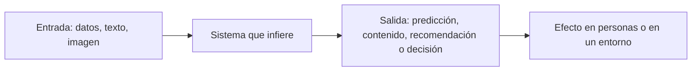
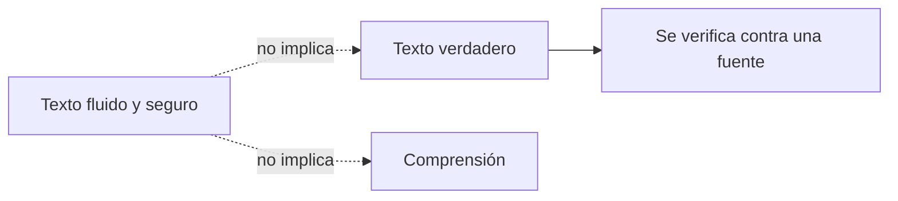
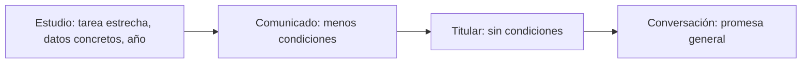

<!-- _class: lead -->

# M1 - Qué es, y qué no es, la IA

### IA, ética y criterio profesional

**Rogelio Arriaga - Raptor Dev Services**

<!--
Módulo de 90 minutos, abierto a cualquier carrera: sin código y sin matemáticas. Hilo conductor: de lo que
dice la prensa a lo que se puede comprobar. Se trabaja con casos que tienen fuente primaria (una sentencia,
un estudio, un reglamento) y con una lista de preguntas que sirve para leer cualquier titular.
Preparar: la hoja de la actividad (practica.md) impresa o abierta, con los diez titulares ilustrativos.
-->

---

## La frase de hoy

> Entre lo que se dice de la IA y lo que la IA hace hay una distancia. Este módulo enseña a medirla.

No se trata de estar a favor o en contra. Se trata de saber qué se está afirmando, quién lo afirma y con qué evidencia.

---

## Objetivo del módulo

Al terminar podrás:

- Explicar con tus palabras qué es un sistema de IA y qué dice la ley europea al respecto.
- Distinguir una capacidad medida de una promesa de marketing.
- Explicar por qué un texto fluido no es un texto verdadero, con un caso real que llegó a un tribunal.
- Aplicar cinco preguntas a un titular y clasificarlo como hecho, exageración o falso, con argumento.

<!--
Mensaje clave: la IA no es magia ni amenaza abstracta. Es software que se mide, y toda medición tiene un
lugar, unos datos y una tarea. Quien aprende a preguntar eso ya lee mejor un titular.
-->

---

## Agenda

| Bloque | Qué vemos | Min |
|---|---|---|
| 1 | De dónde viene la IA y qué dice la ley que es | 20 |
| 2 | Qué hace bien un modelo, y dónde se midió | 25 |
| 3 | Dónde se rompe: lo plausible no es lo verdadero | 25 |
| 4 | Actividad: diez titulares | 15 |
| 5 | Cierre, tarea y quiz | 5 |

---

## El problema de partida

Leemos cada semana frases como estas:

- "La IA ya entiende lo que lee."
- "Un chatbot aprobó un examen."
- "La IA va a reemplazar a los abogados."

Cada una mezcla tres cosas: un hecho que a veces es cierto, una interpretación y una promesa. Para separarlas necesitamos primero un vocabulario común.

---

<!-- _class: lead -->

# Tema 1
## De dónde viene y qué es

---

## Un nombre con fecha

- El término "inteligencia artificial" aparece en la propuesta para un taller de verano en el Dartmouth College, fechada el **31 de agosto de 1955** y firmada por John McCarthy, Marvin Minsky, Nathaniel Rochester y Claude Shannon.
- El taller se planeó para el verano de **1956**: dos meses y diez personas.
- Su conjetura de partida: cualquier aspecto del aprendizaje o de otro rasgo de la inteligencia puede describirse con tanta precisión que una máquina puede simularlo.

Fuente: McCarthy, Minsky, Rochester y Shannon (1955), reeditada en *AI Magazine* 27(4), 2006, pp. 12-14.

---

## Una conjetura no es un resultado

La propuesta de 1955 es una **hipótesis de trabajo**, escrita antes de que existiera el campo. Se puede leer como programa de investigación, no como prueba de que la máquina simule todo.

- Quien cita Dartmouth como "la prueba de que la IA piensa" se equivoca de documento.
- Quien lo cita como "el origen del nombre" sí lo usa bien.

<!--
Pregunta al grupo: ¿qué diferencia hay entre "se puede describir con precisión" y "ya se describió"? Esa
diferencia es la que separa una promesa de un resultado durante todo el módulo.
-->

---

## Un programa de 1966 que conversaba

- **ELIZA**, de Joseph Weizenbaum, se describe en *Communications of the ACM* 9(1), enero de 1966, pp. 36-45.
- Funcionaba con reglas: buscaba palabras clave en lo que escribía la persona y armaba una respuesta con plantillas.
- Su guion más conocido, DOCTOR, imitaba el estilo de un terapeuta que devuelve preguntas.

Una conversación que suena natural **no** requiere, por sí misma, comprender. Esa es la primera lección del módulo y es de hace sesenta años.

Fuente: Weizenbaum (1966), DOI 10.1145/365153.365168.

---

## Qué dice la ley que es un sistema de IA

El Reglamento (UE) 2024/1689, artículo 3, punto 1, define "sistema de IA" como un sistema basado en una máquina que:

- está diseñado para funcionar con distintos **niveles de autonomía**;
- puede mostrar **capacidad de adaptación** tras el despliegue;
- para objetivos explícitos o implícitos, **infiere** de la información de entrada cómo generar resultados de salida: predicciones, contenidos, recomendaciones o decisiones;
- y esos resultados pueden **influir en entornos** físicos o virtuales.

Fuente: texto consolidado del Reglamento (UE) 2024/1689, versión del 27 de julio de 2026.

---

## La definición, en un esquema

Lo importante para el curso está en los extremos: **de dónde vienen los datos** (entrada) y **qué pasa con las personas** (efecto). En medio hay matemáticas; en los extremos hay decisiones humanas.

---

## "Infiere" quiere decir que no sigue una regla escrita

| Software de reglas | Sistema que infiere |
|---|---|
| Alguien escribe la regla: "si el saldo es menor a X, rechaza" | El sistema obtiene la regla a partir de ejemplos |
| Se puede leer la regla | La "regla" son miles o millones de valores numéricos |
| Falla donde la regla no previó | Falla donde los ejemplos no representaban |

La definición legal gira en torno a esa palabra, "infiere". Cuando no está claro si algo cuenta como IA, la pregunta práctica es: ¿alguien escribió la regla, o salió de los datos?

<!--
No hace falta que el grupo conozca el aprendizaje automático. Basta con la idea de que los ejemplos, no las
reglas, determinan el comportamiento. Eso explica casi todo lo que sigue sobre sesgo y explicación.
-->

---

## Error típico 1: hablar de la IA como si fuera una persona

- "La IA decidió", "la IA quiere", "la IA miente".
- Quita de la escena a quienes eligieron los datos, la tarea y el umbral.
- El Reglamento nombra a esas personas: el **proveedor** (quien desarrolla y comercializa) y el **responsable del despliegue** (quien lo usa bajo su autoridad), artículo 3, puntos 3 y 4.

Regla práctica del curso: cada vez que leas "la IA hizo", sustituye por "alguien configuró un sistema que...". Si la frase se vuelve rara, probablemente estaba ocultando a un responsable.

---

<!-- _class: lead -->

# Tema 2
## Qué hace bien un modelo, y dónde se midió

---

## Lo que sí hace bien

Un sistema entrenado con muchos ejemplos puede ser muy bueno en una tarea **acotada y repetitiva**:

- clasificar imágenes de un tipo de objeto;
- transcribir voz en un idioma bien representado en sus datos;
- proponer la siguiente palabra o una respuesta plausible a una pregunta;
- encontrar patrones en datos que una persona tardaría mucho en recorrer.

Nadie lo discute. La pregunta honesta es otra: **¿con qué datos, en qué condiciones y contra qué se midió?**

---

## Medir también es una decisión

El marco de gestión de riesgos de IA del NIST (AI RMF 1.0, enero de 2023) pide que un sistema sea **válido y fiable**:

- **Validación:** confirmar, con evidencia objetiva, que se cumplen los requisitos de un uso específico.
- Un sistema inexacto, poco fiable o mal generalizado a datos y situaciones distintas de los de su entrenamiento **aumenta** los riesgos y baja la confianza.

La palabra clave es *uso específico*: un sistema no es "bueno" en abstracto, es bueno para algo y en algunas condiciones.

Fuente: NIST AI 100-1 (2023), sección 3.1.

---

## Un caso: el examen que no representaba a todos

**Gender Shades** (Buolamwini y Gebru, 2018) evaluó tres sistemas comerciales que clasifican el género en fotos de rostros.

- Dos conjuntos de prueba ya usados en la industria, IJB-A y Adience, eran en su gran mayoría de personas de piel clara: 79.6 % y 86.2 %.
- Las autoras construyeron un conjunto nuevo, balanceado por género y por tipo de piel.
- Con ese conjunto, el error máximo fue de **0.8 %** en hombres de piel clara y de hasta **34.7 %** en mujeres de piel oscura.

Fuente: Buolamwini y Gebru, *Proceedings of the 1st Conference on Fairness, Accountability and Transparency*, PMLR 81:77-91, 2018.

---

## Qué enseña ese caso sobre capacidades

- Un sistema puede tener **buenos números en una prueba** y malos números con parte de la población real.
- La prueba decide qué se ve y qué no se ve.
- Nadie tiene que haber querido discriminar para que el resultado sea desigual; basta con que la prueba y el entrenamiento no incluyeran a todos.

El módulo 2 retoma esto con detalle: aquí solo nos interesa la lección sobre medir.

<!--
Pausa para una pregunta al grupo: si una empresa le dice "nuestro sistema acierta 95 %", ¿cuál es la primera
pregunta? La respuesta esperada: ¿en quiénes, en qué condiciones y comparado con qué? Anotarla en el pizarrón.
-->

---

## Lo que dice un número y lo que no

| Si dicen | Pregunta antes de creer |
|---|---|
| "Acierta casi siempre" | ¿En qué datos? ¿Se parecen a mis casos? |
| "Supera a las personas" | ¿A qué personas, en qué tarea, con qué tiempo y herramientas? |
| "Funciona en producción" | ¿Quién revisa los errores y cómo se enteran? |
| "Es neutral, solo son datos" | ¿Quién eligió y etiquetó los datos? |

Una cifra sin su prueba es un adorno. Una cifra con su prueba es una afirmación que se puede discutir.

---

<!-- _class: lead -->

# Tema 3
## Dónde se rompe: lo plausible no es lo verdadero

---

## Un sistema de lenguaje produce texto plausible

Los modelos de lenguaje generan texto con la forma de una respuesta correcta. Que la forma sea correcta **no garantiza** que el contenido lo sea.

- Una cita con el formato perfecto puede no existir.
- Una respuesta segura puede estar equivocada con el mismo tono que una acertada.
- El error no se anuncia: se lee igual que el acierto.

El caso que sigue llegó a un tribunal.

---

## Mata v. Avianca (Nueva York, 2023)

- Tribunal: Tribunal de Distrito de los Estados Unidos, Distrito Sur de Nueva York, causa 22-cv-1461.
- Los abogados de la parte demandante presentaron escritos con **opiniones judiciales que no existían**, con citas y fragmentos inventados, generados con ChatGPT.
- El **22 de junio de 2023** el juez impuso una sanción de **5 000 dólares**, impuesta conjuntamente a los dos abogados y a su despacho, ordenó cartas a la parte demandante y a cada juez cuyo nombre se había atribuido falsamente a una opinión, y encontró mala fe en los abogados por sostener las citas después de que el tribunal las puso en duda.

Fuente: *Mata v. Avianca, Inc.*, Opinion and Order on Sanctions, 22 de junio de 2023.

---

## Lo que el tribunal dijo, y lo que no dijo

- Dijo que usar una herramienta de IA confiable como apoyo **no es indebido por sí mismo**.
- Dijo que las reglas imponen a los abogados un papel de **filtro**: asegurar la exactitud de lo que firman.
- No dijo que la IA sea inútil. Dijo que **quien firma responde**.

Esta última frase vuelve en el módulo 4. Por ahora quédate con la parte práctica: **todo lo que produce un modelo y vas a afirmar con tu nombre se verifica contra una fuente real**.

---

## Error típico 2: confundir fluidez con comprensión

- ELIZA (1966) ya mostraba que una conversación natural puede salir de reglas sobre palabras.
- Un modelo moderno es mucho más capaz, pero la pregunta sigue abierta en otro nivel: ¿qué es lo que realmente se midió, la fluidez o la comprensión?

---

## La barrera del significado

Una línea de investigación y divulgación sostiene que los sistemas actuales tropiezan en tareas que a las personas nos parecen fáciles: entender una situación, abstraer, hacer analogías.

- Melanie Mitchell le dedica a esto la parte V de *Inteligencia artificial* (2024), capítulos 14 a 16: comprensión, conocimiento, abstracción y analogía, y preguntas, respuestas y especulaciones.
- Es una postura argumentada por una investigadora del área, no un consenso cerrado, y por eso el libro está en la lectura del módulo.

<!--
Honestidad intelectual: dejar claro que aquí hay un debate abierto. El curso no pide elegir bando; pide
reconocer qué se afirma y con qué evidencia. Una afirmación sobre "comprensión" es filosófica y empírica a la vez.
-->

---

## Cinco preguntas para cualquier titular

| # | Pregunta | Qué detecta |
|---|---|---|
| 1 | ¿Qué tarea exacta hizo el sistema? | Titulares que inflan una tarea estrecha |
| 2 | ¿Dónde y con qué datos se midió? | Pruebas que no representan al uso real |
| 3 | ¿Comparado con qué? | Comparaciones sin referencia o con una persona poco realista |
| 4 | ¿Quién lo afirma y qué gana? | Marketing presentado como noticia |
| 5 | ¿Qué pasa si se equivoca y quién se entera? | Daños sin responsable |

Las preguntas 1 y 2 son las que primero desinflan un titular.

---

## Hecho, exageración o falso

| Clasificación | Criterio |
|---|---|
| **Hecho** | Hay fuente primaria que lo respalda tal como está escrito |
| **Exageración** | Parte de un hecho, pero lo generaliza, lo infla o le quita una condición |
| **Falso** | Contradice la evidencia disponible, o afirma algo que nadie ha demostrado como si estuviera demostrado |

El argumento vale más que la etiqueta: **di qué pregunta de las cinco te llevó a clasificarlo así.**

---

## Demostración guiada

Titular ilustrativo (redactado para esta clase, no es de ningún medio): *"Abogados sancionados por citar sentencias que inventó un chatbot."*

1. Tarea: redactar un escrito jurídico con citas.
2. Medición: no es una medición, es un caso; la fuente es la sentencia.
3. Comparación: no aplica.
4. Quién lo afirma: el tribunal, en un documento público.
5. Si se equivoca: hubo sanción y responsable.

Clasificación: **hecho**, con fuente primaria (*Mata v. Avianca*, 2023).

---

## Segunda demostración

Titular ilustrativo: *"Un sistema de reconocimiento facial funciona igual de bien para todas las personas."*

- Pregunta 2: ¿se midió en todas?
- Evidencia contraria concreta: en Gender Shades, tres sistemas comerciales tuvieron errores de hasta 34.7 % en un grupo y de 0.8 % como máximo en otro.
- Matiz honesto: ese estudio es de **2018** y sobre tres sistemas; no dice nada de los de hoy. Quien afirma "igual de bien" hoy tiene que mostrar su prueba.

Clasificación: **falso como afirmación general sin prueba**, y la carga de la prueba es de quien lo afirma.

---

## Error típico 3: el matiz que se cae

Lo que suele pasar con un resultado real:

En cada paso se pierde una condición. Tu tarea al leer es **recuperarlas**: volver al estudio, a la sentencia o al reglamento.

---

## Práctica de la sesión

- **Actividad (15 min):** diez titulares ilustrativos, clasificados en hecho, exageración o falso, con argumento.
- Individual o en parejas. Hoja en `practica.md`.
- Para cada uno: cuál de las cinco preguntas usaste y qué fuente buscarías.

<!--
Si el grupo es grande, repartir cinco titulares por pareja y ponerlos en común. Insistir en que el valor está
en el argumento. Dos personas pueden clasificar distinto un mismo titular y tener ambas un buen argumento.
-->

---

<!-- _class: lead -->

# Cierre
## Lo que te llevas

---

## Conclusiones del módulo

- Un sistema de IA, según el Reglamento (UE) 2024/1689, infiere de sus entradas salidas que pueden influir en un entorno; las personas que lo proveen y lo despliegan siguen siendo responsables.
- Dartmouth (1955) fue una conjetura y un programa de trabajo, no una demostración.
- Una capacidad se mide con datos, en una tarea y en unas condiciones; fuera de ellas no hay garantía.
- Fluidez no es verdad ni comprensión: lo que afirmes con tu nombre se verifica en la fuente.
- Cinco preguntas ordenan cualquier titular.

---

## Para la próxima

- **Actividad:** clasificar los diez titulares, con argumento (`practica.md`).
- **Tarea:** elegir un titular real de la semana y analizarlo con las cinco preguntas (`tarea.md`).
- **Quiz:** en la plataforma, 12 preguntas, se contestan 10 por intento.
- **Libros:** *Inteligencia artificial* (Mitchell, 2024), partes I y V; *Artificial Unintelligence* (Broussard, 2018), parte I, caps. 1 a 4; *A Citizen's Guide to Artificial Intelligence* (Zerilli et al., 2021), cap. 1.

<!--
Siguiente módulo: sesgo y equidad. Hoy vimos que una prueba decide qué se ve. En el módulo 2 se ve de dónde
sale el sesgo y por qué las definiciones de equidad no pueden cumplirse todas a la vez.
-->

---

## Referencias del módulo

- Buolamwini, J. y Gebru, T. (2018). Gender Shades: Intersectional accuracy disparities in commercial gender classification. *Proceedings of Machine Learning Research, 81*, 77-91. https://proceedings.mlr.press/v81/buolamwini18a.html
- McCarthy, J., Minsky, M. L., Rochester, N. y Shannon, C. E. (2006). A proposal for the Dartmouth Summer Research Project on Artificial Intelligence, August 31, 1955. *AI Magazine, 27*(4), 12-14. https://doi.org/10.1609/aimag.v27i4.1904
- *Mata v. Avianca, Inc.*, No. 22-cv-1461 (PKC) (S.D.N.Y. 22 de junio de 2023), Opinion and Order on Sanctions.
- National Institute of Standards and Technology. (2023). *Artificial Intelligence Risk Management Framework (AI RMF 1.0)* (NIST AI 100-1). https://doi.org/10.6028/NIST.AI.100-1
- Reglamento (UE) 2024/1689 del Parlamento Europeo y del Consejo, de 13 de junio de 2024 (Reglamento de Inteligencia Artificial), art. 3. Texto consolidado a 27 de julio de 2026.
- Weizenbaum, J. (1966). ELIZA: a computer program for the study of natural language communication between man and machine. *Communications of the ACM, 9*(1), 36-45. https://doi.org/10.1145/365153.365168
