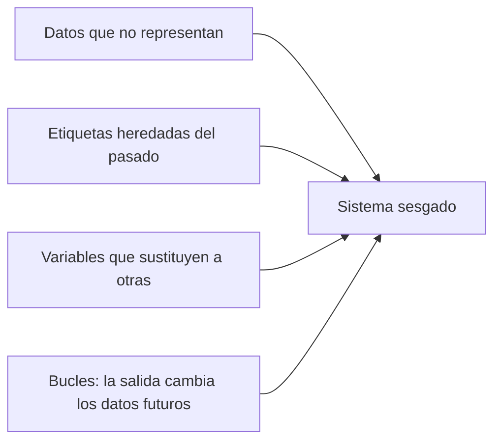
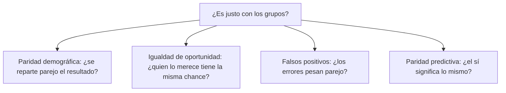

<!-- _class: lead -->

# M2 - Sesgo y equidad

### IA, ética y criterio profesional

**Rogelio Arriaga - Raptor Dev Services**

<!--
Módulo de 90 minutos, abierto a cualquier carrera. Hilo conductor: de dónde sale el sesgo, cómo se mide la
equidad y por qué sus definiciones no pueden cumplirse todas a la vez. Las cuentas son sencillas (porcentajes
de una tabla de 2 x 2) y se hacen en la actividad. Los casos reales tienen fuente primaria y fecha; los demás
se rotulan "Caso hipotético".
Preparar: calculadora o la hoja de cálculo del participante, y la hoja de la actividad (practica.md).
-->

---

## La frase de hoy

> Hay definiciones de equidad que no se pueden cumplir al mismo tiempo. Hay que elegir, y decirlo.

Un sistema justo "en general" no existe como especificación. Existe un sistema que cumple **una** definición de justicia, y deja sin cumplir otras.

---

## Objetivo del módulo

Al terminar podrás:

- Explicar de dónde sale el sesgo de un sistema, sin que nadie haya querido discriminar.
- Leer una tabla de aciertos y errores por grupo y calcular cuatro medidas de equidad.
- Mostrar con números que dos medidas de equidad no pueden cumplirse a la vez cuando los grupos son distintos en su base.
- Decir qué tipo de equidad persigue un sistema y a quién deja fuera.

---

## Agenda

| Bloque | Qué vemos | Min |
|---|---|---|
| 1 | De dónde sale el sesgo | 25 |
| 2 | Cómo se mide la equidad: cuatro definiciones | 25 |
| 3 | Por qué chocan: un caso real y uno hipotético | 20 |
| 4 | Actividad: medir y elegir | 15 |
| 5 | Cierre, tarea y quiz | 5 |

---

## El problema de partida

Una financiera ficticia quiere automatizar la aprobación de créditos para ahorrar tiempo. El sistema se evalúa y alguien pregunta:

> "¿Es justo con todos los grupos?"

La pregunta parece simple. Hoy veremos que tiene al menos cuatro respuestas distintas, que no coinciden, y que cada una protege a alguien diferente.

**Caso hipotético:** la financiera y todos sus datos son inventados para la clase.

---

<!-- _class: lead -->

# Tema 1
## De dónde sale el sesgo

---

## Dos sentidos de la palabra

| Sentido estadístico | Sentido social |
|---|---|
| Un error sistemático: el sistema se equivoca siempre hacia el mismo lado | Un trato desigual que no se puede justificar |
| Se mide en los datos | Se juzga con valores y con la ley |
| Puede ser inocuo | Puede dañar a personas concretas |

En el curso hablamos del segundo, pero suele empezar en el primero. Y ninguno requiere mala intención.

---

## Tres familias de sesgo, según el NIST

El marco de gestión de riesgos de IA del NIST (AI RMF 1.0, 2023) reconoce tres categorías:

- **Sistémico:** presente en los datos, en las normas y prácticas de las organizaciones a lo largo del ciclo de vida del sistema y en la sociedad que lo usa.
- **Computacional y estadístico:** en los datos y en los procesos algorítmicos; suele venir de muestras no representativas.
- **Cognitivo humano:** cómo una persona percibe la información del sistema o cómo piensa sobre su propósito y funciones.

El mismo documento señala que cualquiera de las tres **puede darse sin prejuicio, parcialidad ni intención discriminatoria**.

Fuente: NIST AI 100-1 (2023), sección 3.7.

---

## Cuatro puertas de entrada

Veamos cada una con un ejemplo. Los dos primeros ya los conoces; los otros dos son nuevos.

---

## Puerta 1: datos que no representan

- En Gender Shades (2018), los conjuntos de prueba IJB-A y Adience eran en su gran mayoría de personas de piel clara: 79.6 % y 86.2 %.
- Con un conjunto balanceado, tres sistemas comerciales tuvieron errores de hasta 34.7 % en mujeres de piel oscura y de 0.8 % como máximo en hombres de piel clara.

Lo que falló: **quién estaba en los datos de prueba**. El sistema aprobaba el examen que se le puso.

Fuente: Buolamwini y Gebru (2018), PMLR 81:77-91.

---

## Puerta 2: etiquetas heredadas del pasado

**Caso hipotético.** Una empresa ficticia entrena un sistema con sus decisiones de contratación de los últimos diez años y le pide que aprenda "qué candidatos tuvieron éxito".

- Si en esos años se contrató sobre todo a un tipo de perfil, "éxito" significará ese perfil.
- El sistema no inventa el sesgo: lo **reproduce con consistencia** y a mayor velocidad.
- El NIST lo dice en general: los sistemas pueden aumentar la velocidad y la escala de los sesgos y amplificar daños.

La etiqueta ("contratado", "pagó", "reincidió") es una medida del pasado, no una verdad sobre las personas.

---

## Puerta 3: variables que sustituyen a otras

**Caso hipotético.** Para "evitar discriminar", la financiera ficticia borra la columna de género. Pero conserva el código postal, el tipo de empleo y el horario de compras.

- Si esas variables se relacionan con el grupo que se quiso proteger, el sistema puede **reconstruir** la información borrada.
- Quitar la columna no quita el efecto.
- El NIST advierte que el sesgo es más amplio que el balance demográfico y la representatividad de los datos.

Por eso medir resultados por grupo importa más que revisar qué columnas se usaron.

---

## Puerta 4: el bucle

El Reglamento (UE) 2024/1689, artículo 10, apartado 2, letra f), pide examinar los sesgos posibles, "especialmente cuando las salidas de datos influyan en las informaciones de entrada de futuras operaciones".

- Un sistema que decide a quién se revisa más genera más datos de esas personas.
- Esos datos alimentan el siguiente ciclo y refuerzan lo que ya decidió.
- El error se **autoconfirma**.

Fuente: texto consolidado del Reglamento (UE) 2024/1689, 27 de julio de 2026.

---

## Error típico 1: "si no usa el género, no discrimina"

| Lo que se cree | Lo que se debe revisar |
|---|---|
| Revisar las columnas | Medir resultados por grupo |
| Que el equipo tenga buena fe | Qué datos y etiquetas se usaron |
| Que el sistema sea "objetivo" | Quién eligió qué contaba como éxito |
| Que el sesgo "se corrige solo con más datos" | Si los datos nuevos vienen de decisiones del propio sistema |

<!--
Pausa: preguntar al grupo si conocen un caso donde una decisión "neutral" haya afectado más a un grupo. No
registrar nombres de personas ni datos personales; trabajar con ejemplos generales.
-->

---

## El marco legal, en dos líneas

- **México:** el artículo 1o., quinto párrafo, de la Constitución prohíbe toda discriminación motivada por origen étnico o nacional, género, edad, discapacidades, condición social, condiciones de salud, religión, opiniones, preferencias sexuales, estado civil o cualquier otra que atente contra la dignidad humana y busque anular o menoscabar derechos y libertades.
- **Unión Europea:** el Reglamento 2024/1689 pide a los sistemas de alto riesgo prácticas de gobierno de datos que incluyan examinar y mitigar sesgos (art. 10, apdo. 2, letras f y g) y conjuntos de datos suficientemente representativos (apdo. 3). Evaluar la solvencia de personas físicas figura entre los usos de alto riesgo (anexo III, punto 5, letra b), salvo la detección de fraudes.

Fuentes: CPEUM, texto vigente con última reforma DOF 07-10-2026; Reglamento (UE) 2024/1689.

---

<!-- _class: lead -->

# Tema 2
## Cómo se mide la equidad

---

## Primero, la tabla de aciertos y errores

Para cada grupo se puede armar una tabla de 2 x 2 con lo que **el sistema decidió** y lo que **después ocurrió**:

| | Pagó | No pagó |
|---|---|---|
| **Aprobado** | Acierto (aprobó a quien pagó) | Error: aprobó a quien no pagó |
| **Rechazado** | Error: rechazó a quien habría pagado | Acierto (rechazó a quien no pagó) |

En la vida real hay un problema: de quien se rechaza **no se observa** qué habría pasado. La actividad lo supone conocido para poder enseñar el cálculo.

---

## Cuatro medidas, cuatro ideas de justicia

| Medida | Cómo se calcula | Idea de justicia que expresa |
|---|---|---|
| **Paridad demográfica** | Aprobados / solicitantes, por grupo | Que cada grupo reciba el beneficio en la misma proporción |
| **Igualdad de oportunidad** | Aprobados entre quienes sí pagaron, por grupo | Que quien merece el crédito tenga la misma probabilidad de recibirlo |
| **Igualdad en falsos positivos** | Aprobados entre quienes no pagaron, por grupo | Que el costo de equivocarse a favor sea parejo |
| **Paridad predictiva** | Pagaron entre los aprobados, por grupo | Que "aprobado" signifique lo mismo en todos los grupos |

Con "igualdad de oportunidad" más "igualdad en falsos positivos" se tiene lo que algunos textos llaman *equalized odds*.

---

## Cada una responde a una pregunta distinta

No son "versiones más o menos estrictas" de lo mismo. Son criterios distintos, con filosofías distintas de justicia detrás. *AI Fairness* (Leben), cap. 2, los ordena por teorías; el cap. 1 explica por qué medir la equidad es ya un problema.

---

## Demostración con números ficticios

**Caso hipotético: grupo A y grupo B, 100 solicitudes cada uno.** En el grupo A pagan 60; en el B, 30. Un sistema ficticio decide:

| | Grupo A | Grupo B |
|---|---|---|
| Pagarían y fueron aprobados | 48 | 24 |
| Pagarían y fueron rechazados | 12 | 6 |
| No pagarían y fueron aprobados | 16 | 8 |
| No pagarían y fueron rechazados | 24 | 62 |

Calcula en tu cabeza o en papel, para cada grupo: aprobados entre 100; aprobados entre quienes pagaban; aprobados entre quienes no pagaban; pagaron entre los aprobados.

---

## Resultado de las cuatro medidas

| Medida | Grupo A | Grupo B |
|---|---|---|
| Tasa de aprobación (paridad demográfica) | 64 % | 32 % |
| Aprobados entre quienes pagaban (oportunidad) | 80 % | 80 % |
| Aprobados entre quienes no pagaban (falsos positivos) | 40 % | 11.4 % |
| Pagaron entre los aprobados (paridad predictiva) | 75 % | 75 % |

Mismo sistema, mismos datos. Según la medida que elijas, el sistema **cumple** (80 % y 80 %; 75 % y 75 %) o **falla** (64 % y 32 %; 40 % y 11.4 %).

<!--
Dejar que el grupo describa el resultado antes de comentar. Es probable que unas personas digan "es injusto con B
por la tasa de aprobación" y otras "es justo, porque el sí vale lo mismo". Las dos tienen un fundamento.
-->

---

<!-- _class: lead -->

# Tema 3
## Por qué chocan

---

## Un caso real: COMPAS

- **ProPublica, 23 de mayo de 2016** (Angwin, Larson, Mattu, Kirchner): con datos del condado de Broward, Florida, analizó una herramienta de evaluación de riesgo de reincidencia, COMPAS.
- Encontró que entre quienes **no** reincidieron, fueron clasificados como de alto riesgo el **44.9 %** de las personas negras y el **23.5 %** de las blancas.
- Y entre quienes **sí** reincidieron, fueron clasificados como de bajo riesgo el **28.0 %** de las negras y el **47.7 %** de las blancas.

Fuente: ProPublica, "Machine Bias", 23 de mayo de 2016.

---

## La respuesta del fabricante

- Northpointe (hoy equivant) respondió en 2016 con el informe *COMPAS Risk Scales: Demonstrating Accuracy Equity and Predictive Parity*.
- Su argumento: las escalas cumplen **equidad de precisión** y **paridad predictiva**; es decir, el puntaje significa lo mismo para personas negras y blancas.

Dos lecturas del mismo sistema:

| ProPublica | Northpointe |
|---|---|
| Los errores pesan distinto (falsos positivos y falsos negativos por grupo) | El puntaje predice igual de bien en ambos grupos |

Cada una usa **una definición distinta** de equidad. Y no es un problema de mala fe de nadie.

---

## Lo que demostraron después

- **Kleinberg, Mullainathan y Raghavan (2016):** formalizaron tres condiciones de equidad para puntajes de riesgo y probaron que, salvo casos muy especiales, **ninguna forma de predecir puede cumplir las tres a la vez**.
- **Chouldechova (2016):** mostró que cumplir la condición de paridad predictiva puede producir **un impacto desproporcionado considerable cuando la prevalencia del evento difiere entre los grupos**.

Fuentes: Kleinberg et al., arXiv:1609.05807 (ITCS 2017); Chouldechova, arXiv:1610.07524.

---

## La aritmética que lo explica

Con los números ficticios de hace un rato: si dos grupos tienen **bases distintas** (aquí, 60 % y 30 % de quienes pagan), y se exige la **misma** igualdad de oportunidad (80 %) y la **misma** paridad predictiva (75 %), entonces los falsos positivos **no pueden** coincidir.

| Grupo | Base | Falsos positivos |
|---|---|---|
| A | 60 % | 40 % |
| B | 30 % | 11.4 % |

No hay que creerlo: se comprueba con la tabla. Fíjate que, si la base fuera igual en los dos grupos, las tres medidas sí coincidirían.

<!--
Si alguien pregunta "¿y si se mejora el modelo?": solo un modelo perfecto (cero errores) cumple todas a la vez
con bases distintas; fuera de eso, la tensión es matemática, no un defecto de ingeniería. Es el resultado de
Kleinberg et al.
-->

---

## Cambiar una medida rompe otra

**Caso hipotético, con los mismos datos.** Para igualar la tasa de aprobación en B con la de A (64 %), el sistema tendría que aprobar a 32 personas más:

| Grupo B | Antes | Después |
|---|---|---|
| Tasa de aprobación | 32 % | 64 % |
| Aprobados entre quienes pagaban | 80 % | 90 % |
| Aprobados entre quienes no pagaban | 11.4 % | 52.9 % |
| Pagaron entre los aprobados | 75 % | 42.2 % |

Ganamos paridad demográfica. Perdimos paridad predictiva y multiplicamos los falsos positivos por más de cuatro: se aprueba a más gente que no paga, y "aprobado" ya no significa lo mismo en A que en B.

---

## Error típico 2: buscar "la" medida correcta

| Lo que se pretende | Lo que pasa |
|---|---|
| Cumplir todas las definiciones | Con bases distintas, es imposible (salvo casos muy especiales) |
| Elegir la que da mejores números | Escoger la medida que conviene al proveedor |
| Elegir en silencio | Quien queda fuera de la medida elegida no se entera |

La salida honesta es **elegir con criterio, escribir por qué y avisar a quién perjudica**. El NIST dice que las normas de equidad pueden ser complejas y de difícil definición porque la percepción de equidad cambia entre culturas y según la aplicación.

---

## Cómo elegir: mira quién paga cada error

| En un sistema de... | Un falso positivo significa | Un falso negativo significa |
|---|---|---|
| Crédito | Prestar a quien no paga | Negarle un crédito a quien lo habría pagado |
| Detección médica (hipotético) | Una alarma que se descarta con otra prueba | No detectar un problema a tiempo |
| Justicia penal (como en COMPAS) | Etiquetar como de alto riesgo a quien no reincidirá | Etiquetar como de bajo riesgo a quien sí reincidirá |

Pregunta de diseño: **¿qué error es más caro para la persona, y quién lo carga?** De la respuesta sale la medida que se prioriza.

---

## Equidad no es lo mismo que exactitud

- Un sistema que se equivoca poco **en promedio** puede equivocarse mucho con un grupo pequeño (lo vimos en Gender Shades).
- Mitigar un sesgo medido no vuelve justo al sistema: el NIST advierte que un sistema con sesgos dañinos mitigados no es necesariamente justo; puede seguir siendo inaccesible para personas con discapacidad o acentuar desigualdades existentes.
- *AI Fairness* (Leben), cap. 8, trata el choque entre equidad y exactitud; *Awkward Intelligence* (Zweig), cap. 8, el tema de algoritmos, discriminación e ideología.

---

## Qué le preguntarías a un sistema real

1. ¿Qué decide y a quién afecta?
2. ¿Cómo se midió la equidad, y con qué definición?
3. ¿Se midieron los resultados por grupo, o solo el promedio?
4. ¿De dónde vienen las etiquetas? ¿Reflejan decisiones del pasado?
5. ¿Qué error es peor para la persona y quién lo carga?
6. ¿Quién puede impugnar una decisión y en cuánto tiempo?

Estas seis preguntas son la base del proyecto final del curso.

---

## Práctica de la sesión

- **Actividad (15 min):** con un conjunto ficticio de solicitudes de crédito, calcular dos definiciones de equidad y mostrar que no se pueden cumplir a la vez (`practica.md`).
- En pareja: una persona calcula y la otra revisa cada porcentaje.
- Al final, escribir una frase de decisión: qué medida priorizarías y a quién deja fuera.

---

<!-- _class: lead -->

# Cierre
## Lo que te llevas

---

## Conclusiones del módulo

- El sesgo entra por datos que no representan, etiquetas del pasado, variables sustitutas y bucles; no requiere mala intención.
- Quitar una columna no quita el efecto: se mide el resultado por grupo.
- Cuatro medidas de equidad responden a cuatro ideas de justicia distintas.
- Con bases distintas entre grupos, **no se pueden cumplir todas a la vez**; así lo mostraron Kleinberg et al. y Chouldechova, y así sale en la tabla de la actividad.
- Elegir una medida es una decisión ética: se escribe, se justifica y se comunica.

---

## Para la próxima

- **Actividad:** medir dos definiciones y mostrar que chocan (`practica.md`).
- **Tarea:** analizar la equidad de un sistema de decisión, con las seis preguntas (`tarea.md`).
- **Quiz:** en la plataforma, 12 preguntas, se contestan 10 por intento.
- **Libros:** *AI Fairness* (Leben), caps. 1 a 3, 5 y 8; *A Citizen's Guide to Artificial Intelligence* (Zerilli et al., 2021), cap. 3; *Responsible AI in the Enterprise* (Masood y Dawe, 2023), cap. 2; *Inteligencia artificial* (Mitchell, 2024), cap. 7.

<!--
Siguiente módulo: transparencia y explicación. Hoy vimos que una decisión puede ser desigual; el módulo 3 se
pregunta cómo se le explica esa decisión a quien la recibe, para que pueda impugnarla.
-->

---

## Referencias del módulo

- Angwin, J., Larson, J., Mattu, S. y Kirchner, L. (2016, 23 de mayo). Machine Bias. *ProPublica*. https://www.propublica.org/article/machine-bias-risk-assessments-in-criminal-sentencing
- Buolamwini, J. y Gebru, T. (2018). Gender Shades: Intersectional accuracy disparities in commercial gender classification. *Proceedings of Machine Learning Research, 81*, 77-91. https://proceedings.mlr.press/v81/buolamwini18a.html
- Chouldechova, A. (2016). Fair prediction with disparate impact: A study of bias in recidivism prediction instruments. arXiv:1610.07524. https://arxiv.org/abs/1610.07524
- Constitución Política de los Estados Unidos Mexicanos, art. 1o. Texto vigente, última reforma DOF 07-10-2026. https://www.diputados.gob.mx/LeyesBiblio/pdf/CPEUM.pdf
- Kleinberg, J., Mullainathan, S. y Raghavan, M. (2016). Inherent trade-offs in the fair determination of risk scores. arXiv:1609.05807. https://arxiv.org/abs/1609.05807
- National Institute of Standards and Technology. (2023). *Artificial Intelligence Risk Management Framework (AI RMF 1.0)* (NIST AI 100-1), sec. 3.7. https://doi.org/10.6028/NIST.AI.100-1
- Northpointe. (2016). *COMPAS Risk Scales: Demonstrating Accuracy Equity and Predictive Parity* (respuesta a ProPublica; disponible en el sitio de equivant).
- Reglamento (UE) 2024/1689 (Reglamento de Inteligencia Artificial), arts. 10 y anexo III. Texto consolidado a 27 de julio de 2026.
