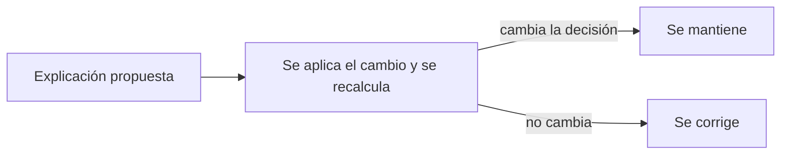

<!-- _class: lead -->

# M3 - Transparencia y explicación

### IA, ética y criterio profesional

**Rogelio Arriaga - Raptor Dev Services**

<!--
Módulo de 90 minutos, abierto a cualquier carrera, sin código. Hilo conductor: de la caja negra a la
explicación útil. Se trabaja con una regla de puntaje FICTICIA, de aritmética simple, que permite calcular una
decisión, explicarla y comprobar si la explicación es verdadera. Las normas se citan contra el texto oficial,
con su fecha. Preparar: calculadora y la hoja de la actividad (practica.md).
-->

---

## La frase de hoy

> Una decisión que no se puede explicar a quien la recibe no se puede impugnar.

Explicar no es un adorno de cortesía. Es lo que permite que una persona compruebe, corrija o discuta lo que un sistema decidió sobre ella.

---

## Objetivo del módulo

Al terminar podrás:

- Distinguir transparencia, explicabilidad e interpretabilidad.
- Decir a quién se le debe una explicación y de qué tipo.
- Redactar, sin tecnicismos, la explicación de una decisión automatizada y comprobar que sea **verdadera**, **comprensible**, **accionable** y **contestable**.
- Nombrar qué reconocen la UE y México sobre decisiones automatizadas, con artículo.

---

## Agenda

| Bloque | Qué vemos | Min |
|---|---|---|
| 1 | Cajas negras y tres palabras que se confunden | 20 |
| 2 | A quién se le explica y qué tipo de explicación | 25 |
| 3 | Qué dicen las normas | 15 |
| 4 | Actividad: explicar una decisión | 25 |
| 5 | Cierre, tarea y quiz | 5 |

---

## El problema de partida

**Caso hipotético.** Una persona solicita un crédito en una financiera ficticia. Recibe este mensaje:

> "Su solicitud no fue aprobada. Su perfil no cumple con nuestras políticas."

Preguntas:

1. ¿Qué datos usaron?
2. ¿Qué pesó más?
3. ¿Qué podría cambiar para que sea distinto?
4. ¿A quién reclama?

El mensaje no contesta ninguna. Hoy aprendemos a escribir uno que sí.

---

<!-- _class: lead -->

# Tema 1
## Cajas negras y tres palabras

---

## Qué es una caja negra

Un sistema es una **caja negra** para alguien cuando esa persona ve lo que entra y lo que sale, pero no por qué una cosa produjo la otra.

Hay tres razones distintas de opacidad, y se atienden de forma distinta:

| Razón | Ejemplo | Qué se hace |
|---|---|---|
| **Técnica** | El comportamiento está en millones de valores numéricos | Técnicas de explicación; modelos más simples cuando el caso lo permite |
| **Comercial** | El proveedor no revela su funcionamiento | Documentación, auditoría y exigencias contractuales o legales |
| **De comprensión** | La documentación existe, pero está escrita para especialistas | Explicaciones adaptadas a cada audiencia |

*A Citizen's Guide to Artificial Intelligence* (Zerilli et al.), cap. 2, trata la transparencia; *Machines We Trust* (Pelillo y Scantamburlo), cap. 5, las reglas de decisión inescrutables.

---

## Tres palabras que se confunden

El marco de gestión de riesgos de IA del NIST (AI RMF 1.0, 2023) las separa:

| Palabra | Qué es | Pregunta que contesta |
|---|---|---|
| **Transparencia** | Información sobre el sistema y lo que ocurrió en él | ¿Qué pasó? |
| **Explicabilidad** | Representación de los mecanismos que operan en el sistema | ¿Cómo se tomó la decisión? |
| **Interpretabilidad** | El significado de la salida en el contexto del propósito del sistema | ¿Por qué, y qué significa para quien la recibe? |

El NIST aclara que son características **distintas que se apoyan entre sí**.

Fuente: NIST AI 100-1 (2023), sec. 3.4 y 3.5.

---

## Para qué sirve explicar

Según el NIST, los sistemas explicables:

- ayudan a quienes operan, supervisan o usan el sistema a entender mejor su funcionamiento y su confiabilidad;
- se **depuran y monitorean** con más facilidad;
- se prestan mejor a la **documentación, la auditoría y el gobierno**.

Y el riesgo por falta de explicabilidad se puede manejar describiendo cómo funcionan los sistemas, con descripciones **adaptadas** al rol, conocimiento y habilidad de cada persona.

La explicación sirve a quien decide, a quien audita y a quien recibe la decisión. No es la misma para los tres.

---

## Error típico 1: "es un algoritmo, no se puede explicar"

| Lo que se dice | Lo que conviene preguntar |
|---|---|
| "Nadie sabe cómo funciona" | ¿Quién la diseñó, con qué datos y qué decidió? |
| "Es demasiado complejo" | ¿Hay una versión más simple que sirva a este caso? |
| "Es propiedad intelectual" | ¿Qué se puede decir sin revelar el diseño? (qué datos, qué pesó, qué cambiaría el resultado) |

Aun sin abrir la caja se puede explicar **la decisión concreta**, por ejemplo con un cambio contrafactual. Esa distinción ocupa el resto del módulo.

---

## Dos niveles: el sistema y la decisión

| Explicación **global** | Explicación **local** |
|---|---|
| Cómo funciona el sistema en general | Por qué se tomó **esta** decisión sobre **esta** persona |
| Para auditoría, regulador, quien supervisa | Para quien recibe la decisión |
| "Usa antigüedad, deuda e historial" | "Su deuda mensual y un atraso pesaron más" |

*Responsible AI in the Enterprise* (Masood y Dawe, 2023), cap. 3, recorre las técnicas con nombre propio (SHAP, LIME, importancia de variables, anclas, gráficas de dependencia parcial y explicaciones contrafactuales); en el cap. 7 las herramientas de nube y de equidad.

<!--
No hace falta que nadie recuerde los nombres de las técnicas. Lo que cuenta es la idea: algunas estiman cuánto
pesó cada dato en una decisión puntual; otras describen el sistema completo.
-->

---

## La explicación contrafactual

Una forma de explicar que **no requiere abrir la caja**:

> "Si tu ingreso fuera X en vez de Y, la decisión habría sido distinta."

- Dice qué cambio mínimo en la situación daría otro resultado.
- Sirve para entender, para impugnar y para saber qué hacer.
- Wachter, Mittelstadt y Russell (2017-2018) la proponen para explicar decisiones automatizadas sin revelar la lógica interna del sistema.

Fuente: Wachter, Mittelstadt y Russell, "Counterfactual Explanations without Opening the Black Box: Automated Decisions and the GDPR", *Harvard Journal of Law & Technology* (2018), arXiv:1711.00399.

---

<!-- _class: lead -->

# Tema 2
## A quién se le explica, y cómo

---

## Cuatro audiencias, cuatro explicaciones

| Quién | Qué necesita saber | Para qué |
|---|---|---|
| **La persona afectada** | Qué se decidió, qué pesó y qué podría cambiar | Entender, corregir o impugnar |
| **Quien opera o supervisa el sistema** | Capacidades, límites y cuándo no confiar en él | Usarlo bien y detectar errores |
| **Quien audita o regula** | Datos, diseño, pruebas y registros | Comprobar que cumple |
| **Quien lo construye** | Dónde y por qué falla | Corregirlo |

Una explicación pensada para la cuarta fila y entregada a la primera es, en la práctica, una **no explicación**.

---

## Cinco condiciones de una explicación buena

1. **Verdadera:** refleja lo que realmente pesó en la decisión, no una justificación posterior que suena bien.
2. **Comprensible:** sin tecnicismos para quien la lee.
3. **Accionable:** dice qué se puede cambiar, y solo propone cambios que la persona puede hacer.
4. **Completa en lo importante:** incluye los factores principales, no una lista infinita ni una sola variable al azar.
5. **Contestable:** indica a dónde acudir y cómo pedir que una persona la revise.

Son criterios de la clase, y la práctica los pone a prueba con una cuenta.

---

## Una regla de puntaje ficticia

**Caso hipotético.** Una financiera ficticia puntúa solicitudes con esta regla, que cabe en una servilleta. Se aprueba con **600 puntos o más**.

| Concepto | Puntos |
|---|---|
| Base | 300 |
| Antigüedad laboral | 15 por año, hasta 8 años (máximo 120) |
| Deuda mensual sobre ingreso | 150 menos 3 por cada punto porcentual (de 0 a 150; en 50 % o más, 0) |
| Atrasos en los últimos 12 meses | 150 menos 50 por atraso (mínimo 0) |

Máximo posible: 720. Nada de esto es una fórmula real de ninguna institución: se inventó para poder hacer las cuentas a mano.

---

## Apliquémosla a una persona

**Caso hipotético.** Persona M: 2 años de antigüedad, deuda mensual del 40 % del ingreso, 1 atraso en 12 meses.

| Concepto | Cuenta | Puntos |
|---|---|---|
| Base | | 300 |
| Antigüedad | 15 x 2 | 30 |
| Deuda | 150 - 3 x 40 | 30 |
| Atrasos | 150 - 50 x 1 | 100 |
| **Total** | | **460** |

460 es menor que 600: **rechazada**. Faltan 140 puntos.

---

## Qué pesó más

Una manera de ordenar: cuántos puntos **perdió** la persona frente al máximo de cada concepto.

| Concepto | Máximo | Obtuvo | Perdió |
|---|---|---|---|
| Deuda | 150 | 30 | **120** |
| Antigüedad | 120 | 30 | **90** |
| Atrasos | 150 | 100 | **50** |

Lo que más pesó en contra: la deuda; luego la antigüedad; luego el atraso.

Ojo: esta forma de ordenar **es una elección**. Otra elección (por ejemplo, comparar con la persona promedio) puede dar otro orden. Toda explicación dice contra qué se compara.

---

## La explicación contrafactual de M

¿Qué cambio mínimo, que M **sí pueda hacer**, daría 600 o más?

| Cambio | Resultado |
|---|---|
| Deuda del 10 % y cero atrasos | 600: **aprueba** |
| Deuda del 10 % y un atraso | 550: no |
| Deuda del 0 % y un atraso | 580: no |
| Antigüedad de 8 años y nada más | 550: no |

Con los atrasos hay un matiz: **el pasado no se puede cambiar**. Lo accionable es "doce meses sin atrasos". Y eso solo se sabe haciendo la cuenta, no adivinando.

---

## Tres versiones del mensaje

| # | Texto | Veredicto |
|---|---|---|
| 1 | "Su perfil no cumple con nuestras políticas." | No dice nada que se pueda comprobar ni cambiar |
| 2 | "Se rechazó por antigüedad laboral insuficiente." | Suena concreto, pero **no es la causa principal**: con 8 años, M seguiría rechazada (550) |
| 3 | "Su deuda mensual (40 % de sus ingresos) y un atraso en los últimos 12 meses pesaron más. Con deuda del 10 % o menos y 12 meses sin atrasos, el resultado habría sido distinto. Para pedir que una persona revise su caso, escriba a [canal]." | Verdadera, comprensible, accionable y contestable |

<!--
La versión 2 es la importante. Una explicación puede ser concreta y estar mal: mencionar un factor que no
cambia el resultado. Por eso la práctica comprueba cada explicación con una cuenta.
-->

---

## Error típico 2: la explicación que suena bien pero no es la causa

- Es la más peligrosa, porque **parece** una respuesta y cierra la conversación.
- Aparece cuando alguien escribe la razón "a posteriori", por intuición, y no la deriva de lo que el sistema hizo.
- La comprobación es barata: **aplica el cambio que la explicación propone y recalcula**. Si el resultado no cambia, la explicación es falsa o incompleta.

---

## Error típico 3: explicar de más y de menos

| De menos | De más |
|---|---|
| "Políticas de la empresa" | Una tabla de 40 variables con pesos |
| Un solo factor sin contexto | Fórmulas y jerga sin glosario |
| Sin canal para impugnar | Revela datos personales de otras personas |

Una buena explicación elige los **factores principales**, los dice en el idioma de quien la recibe y cuida la privacidad de terceros.

---

<!-- _class: lead -->

# Tema 3
## Qué dicen las normas

---

## Unión Europea: derecho a explicación

**Reglamento (UE) 2024/1689, artículo 86.** Toda persona afectada por una decisión que el responsable del despliegue adopte con base en un sistema de IA de alto riesgo del anexo III (con excepción de los del punto 2), y que produzca efectos jurídicos o la afecte considerablemente de modo similar, con efecto perjudicial para su salud, seguridad o derechos fundamentales, tiene derecho a obtener **explicaciones claras y significativas** sobre el papel del sistema en la decisión y los principales elementos de esta.

- Aplica a los sistemas de alto riesgo del anexo III. Entre ellos, evaluar la solvencia de personas físicas o su calificación crediticia (punto 5, letra b), salvo detectar fraudes financieros.
- No se aplica si el derecho ya está previsto de otro modo en el Derecho de la Unión (apdo. 3).

Texto consolidado a 27 de julio de 2026.

---

## Unión Europea: lo que se le explica a quien opera

- **Artículo 13:** los sistemas de alto riesgo deben tener un nivel de transparencia suficiente para que los responsables del despliegue interpreten y usen correctamente sus resultados, con instrucciones de uso claras (finalidad, nivel de precisión, circunstancias que afecten el resultado).
- **Artículo 14:** deben poder ser vigilados de manera efectiva por personas físicas; quien supervisa debe poder entender las capacidades y limitaciones del sistema.
- **Artículo 50, apartado 1:** los sistemas destinados a interactuar con personas deben informar que se interactúa con un sistema de IA, salvo que sea evidente.

Son tres niveles: **persona afectada** (art. 86), **quien opera** (arts. 13 y 14) y **quien conversa con el sistema** (art. 50).

---

## Unión Europea: decisiones solo automatizadas

**Reglamento (UE) 2016/679 (RGPD), artículo 22.**

- La persona interesada tiene derecho a **no ser objeto de una decisión basada únicamente en tratamiento automatizado** (incluida la elaboración de perfiles) que produzca efectos jurídicos o la afecte significativamente de modo similar.
- Hay excepciones (necesidad para un contrato, autorización legal o consentimiento explícito).
- En los casos de contrato y consentimiento, el responsable debe adoptar medidas que incluyan, **como mínimo**, el derecho a obtener intervención humana, a expresar su punto de vista y a **impugnar la decisión** (apdo. 3).

---

## México: oposición al tratamiento automatizado

**Ley Federal de Protección de Datos Personales en Posesión de los Particulares** (nueva ley publicada en el DOF el 20 de marzo de 2025; texto vigente, última reforma DOF 14-11-2025), **artículo 26, fracción II:**

- La persona titular tiene derecho, en todo momento y por causa legítima, a **oponerse** al tratamiento de sus datos cuando estos sean objeto de un tratamiento **automatizado** que le produzca efectos jurídicos no deseados o afecte de manera significativa sus intereses, derechos o libertades, y esté destinado a evaluar **sin intervención humana** aspectos como su rendimiento profesional, situación económica, estado de salud, preferencias sexuales, fiabilidad o comportamiento.
- No procede si el tratamiento es necesario para cumplir una obligación legal impuesta al responsable.

La redacción es distinta a la europea: en México es un derecho de **oposición**, no una prohibición general.

---

## Estados Unidos: una advertencia útil

El 26 de mayo de 2022, la Oficina para la Protección Financiera del Consumidor (CFPB) emitió la Circular 2022-03: quien use algoritmos complejos para decidir un crédito debe poder dar a la persona rechazada **una declaración precisa de los motivos**.

- Que un algoritmo sea difícil de interpretar **no excusa** una explicación inexacta o ausente.
- Es una circular de una autoridad de un país; no aplica en México.

Fuente: CFPB, Circular 2022-03, 26 de mayo de 2022. La circular se refiere a la Ley de Igualdad de Oportunidades de Crédito (ECOA) y a su Regulación B.

---

## Lo que las normas piden, y lo que no

| Piden | No piden (en los artículos citados) |
|---|---|
| Explicaciones claras y significativas sobre el papel del sistema y los elementos principales | Publicar el código ni los pesos |
| Posibilidad de intervención humana e impugnación | Que la persona entienda matemáticas |
| Instrucciones de uso para quien opera | Que todo sistema sea "interpretable por diseño" |

El estándar práctico es el de la clase: **la persona debe poder entender qué pasó y qué hacer**.

Las leyes cambian con rapidez; lo citado es a noviembre de 2026.

---

## Aplicación de la sesión

- **Actividad (25 min):** con la regla de puntaje ficticia, calcular tres decisiones, redactar la explicación de una de ellas para la persona afectada y comprobarla (`practica.md`).
- Las cinco condiciones de la clase sirven de lista de verificación.
- Al final: ¿qué canal de impugnación incluirías y quién lo atendería?

<!--
Insistir en la comprobación: redactar es la mitad del trabajo. La otra mitad es aplicar el cambio propuesto y
recalcular. Eso distingue una explicación de una disculpa.
-->

---

<!-- _class: lead -->

# Cierre
## Lo que te llevas

---

## Conclusiones del módulo

- Transparencia, explicabilidad e interpretabilidad son características distintas que se apoyan entre sí.
- Aunque no se abra la caja, se puede explicar **la decisión concreta**, por ejemplo con una explicación contrafactual.
- Una buena explicación es verdadera, comprensible, accionable, completa en lo importante y contestable.
- Se comprueba aplicando el cambio propuesto y recalculando.
- La UE reconoce derecho a explicación en ciertos sistemas de alto riesgo (art. 86) y límites a las decisiones solo automatizadas (RGPD, art. 22); México reconoce un derecho de oposición (LFPDPPP, art. 26, fr. II).

---

## Para la próxima

- **Actividad:** calcular tres decisiones y explicar una (`practica.md`).
- **Tarea:** explicar la decisión de un sistema real o hipotético a quien la recibe (`tarea.md`).
- **Quiz:** en la plataforma, 12 preguntas, se contestan 10 por intento.
- **Libros:** *A Citizen's Guide to Artificial Intelligence* (Zerilli et al., 2021), cap. 2; *Responsible AI in the Enterprise* (Masood y Dawe, 2023), caps. 3 y 7; *Machines We Trust* (Pelillo y Scantamburlo, 2021), caps. 4 y 5.

<!--
Siguiente módulo: responsabilidad, juicio humano y trabajo. Hoy vimos cómo explicar una decisión; en el
módulo 4 la pregunta es quién responde cuando la decisión sale mal y cómo se decide antes.
-->

---

## Referencias del módulo

- Consumer Financial Protection Bureau. (2022, 26 de mayo). *Consumer Financial Protection Circular 2022-03: Adverse action notification requirements in connection with credit decisions based on complex algorithms*. https://www.consumerfinance.gov/compliance/circulars/circular-2022-03-adverse-action-notification-requirements-in-connection-with-credit-decisions-based-on-complex-algorithms/
- Ley Federal de Protección de Datos Personales en Posesión de los Particulares. Nueva ley publicada en el DOF el 20 de marzo de 2025; texto vigente, última reforma DOF 14-11-2025, art. 26. https://www.diputados.gob.mx/LeyesBiblio/pdf/LFPDPPP.pdf
- National Institute of Standards and Technology. (2023). *Artificial Intelligence Risk Management Framework (AI RMF 1.0)* (NIST AI 100-1), secs. 3.4 y 3.5. https://doi.org/10.6028/NIST.AI.100-1
- Reglamento (UE) 2016/679 (Reglamento General de Protección de Datos), art. 22.
- Reglamento (UE) 2024/1689 (Reglamento de Inteligencia Artificial), arts. 13, 14, 50 y 86, y anexo III. Texto consolidado a 27 de julio de 2026.
- Wachter, S., Mittelstadt, B. y Russell, C. (2018). Counterfactual explanations without opening the black box: Automated decisions and the GDPR. *Harvard Journal of Law & Technology, 31*(2). arXiv:1711.00399. https://arxiv.org/abs/1711.00399
