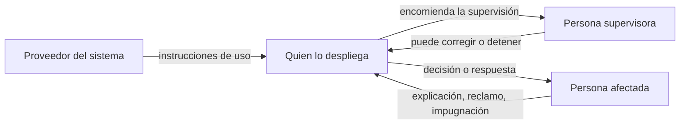
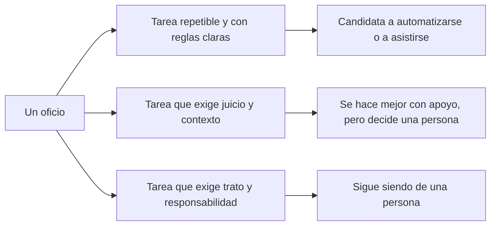

<!-- _class: lead -->

# M4 - Responsabilidad, juicio humano y trabajo

### IA, ética y criterio profesional

**Rogelio Arriaga - Raptor Dev Services**

<!--
Módulo de 90 minutos, sin código, abierto a cualquier carrera. Hilo conductor: cuando un sistema con IA falla,
alguien responde; la pregunta es quién, y se decide ANTES de que falle. De ahí a la supervisión humana que sí
funciona (y la que solo existe en el papel) y a lo que la IA cambia en el trabajo.
Preparar: los roles del debate de la actividad (están en practica.md) y una hoja por equipo.
Todas las cifras y fechas de esta clase tienen su fuente en la lámina o en las notas; las que cambian con el
tiempo llevan "a noviembre de 2026".
-->

---

## Una pregunta para empezar

Un asistente automático de una tienda en línea le dice a un cliente algo que la política de la tienda no dice.

- El cliente actúa conforme a lo que le dijeron.
- La tienda responde: "eso lo dijo el sistema, no nosotros".

¿Quién debe responder?

<!--
Dejar que el grupo vote antes de ver el caso real. Anotar los votos: se retoman después de la lámina de la decisión.
No dar la respuesta todavía.
-->

---

## Objetivo del módulo

Al terminar podrás:

- Explicar por qué responde una persona u organización y no "el sistema", con un caso real y con la forma en que el Reglamento de IA de la Unión Europea reparte los papeles.
- Distinguir una supervisión humana que funciona de una que solo existe en el papel.
- Reconocer el sesgo de automatización en tu propio trabajo.
- Proponer quién responde y quién supervisa en un sistema con IA, antes de que falle.

<!--
Lecturas del módulo (libros, solo por capítulo, ver README del curso): How Humans Judge Machines (Hidalgo),
caps. 1 a 3 y 7; A Citizen's Guide to Artificial Intelligence (Zerilli et al., 2021), caps. 4, 5 y 9;
Robot-Proof (Aoun, edición revisada de 2024), caps. 1 y 2.
-->

---

## Agenda

| Bloque | Qué vemos | Min |
|---|---|---|
| 1 | Cómo juzgamos a las máquinas y a las personas | 15 |
| 2 | Quién responde cuando falla | 25 |
| 3 | Control humano: el real y el de papel | 25 |
| 4 | El efecto en el trabajo | 15 |
| 5 | Cierre, actividad, tarea y quiz | 10 |

---

## Por qué importa

- Un sistema no puede ser parte en un contrato, ni firmar, ni pagar una multa: quien responde es una persona o una organización.
- Si no se decide antes quién responde, se decide después, en un conflicto, y casi siempre en contra de quien tiene menos poder.
- "La decisión la tomó el algoritmo" describe una cadena de decisiones humanas: quién lo eligió, quién lo configuró, quién lo usó y quién lo dejó sin vigilar.

---

<!-- _class: lead -->

# Tema 1
## Cómo juzgamos a las máquinas

---

## Dos varas para el mismo error

Cuando un error lo comete una persona, preguntamos por su intención, su descuido y sus circunstancias.

Cuando lo comete una máquina, solemos preguntar otra cosa:

| Pregunta | Para una persona | Para un sistema |
|---|---|---|
| ¿Quiso hacerlo? | Cuenta mucho | No aplica: no hay intención |
| ¿Pudo evitarlo? | Se valora con su formación y contexto | Se valora con el diseño, las pruebas y la vigilancia |
| ¿Quién paga? | Ella, su empleador o su aseguradora | Quien lo diseñó, quien lo puso en operación o ambos |

El libro de Hidalgo (*How Humans Judge Machines*, caps. 1 a 3 y 7) estudia justamente esta diferencia: cómo juzgamos a las máquinas frente a las personas. Aquí tomamos la pregunta, no sus resultados: **la ley y los contratos no juzgan intenciones de máquinas; reparten responsabilidad entre personas.**

<!--
Aclarar que no se presentan resultados del libro: se cita como lectura. Lo que sí se afirma está en el texto
legal de las láminas siguientes.
-->

---

## Un sistema no tiene papel propio en el Reglamento de IA

El Reglamento (UE) 2024/1689 define a las personas y organizaciones que intervienen (art. 3):

| Papel | Quién es, según el Reglamento |
|---|---|
| **Proveedor** | Quien desarrolla un sistema de IA, o lo manda desarrollar, y lo introduce en el mercado o lo pone en servicio con su propio nombre o marca, de pago o gratis |
| **Responsable del despliegue** | Quien utiliza un sistema de IA bajo su propia autoridad, salvo que sea una actividad personal no profesional |
| **Persona afectada** | Quien recibe los efectos de lo que el sistema produce; el art. 2, apartado 1, letra g, la incluye en el ámbito de aplicación (personas afectadas ubicadas en la Unión) |

Fuente: Reglamento (UE) 2024/1689, texto consolidado al 27-07-2026, art. 3, puntos 3 y 4, y art. 2.

La pregunta "¿quién responde?" empieza por ubicar **en qué papel estás tú**: si compras un sistema y lo usas con tus clientes, eres responsable del despliegue.

---

## Caso real: Moffatt contra Air Canada

**Fuente:** *Moffatt v. Air Canada*, 2024 BCCRT 149, Civil Resolution Tribunal de Columbia Británica (Canadá), decisión del 14 de febrero de 2024.

- Un cliente le preguntó al chatbot del sitio de la aerolínea cómo funcionaba la tarifa por duelo. El chatbot le dijo que podía pedirla con el boleto ya comprado, y le puso un enlace a una página donde la política decía otra cosa.
- La aerolínea sostuvo que no debía responder por lo que dijera su chatbot.
- El tribunal rechazó ese argumento. Resolvió por **declaración negligente** (negligent misrepresentation): la aerolínea tenía un deber de cuidado con el cliente y lo incumplió, y el cliente confió de manera razonable.
- Ordenó pagar 650.88 dólares canadienses de daños, 36.14 de intereses y 125 de cuotas del tribunal: 812.02 en total.

<!--
Nota sobre fuentes: el texto de la decisión se publica en el sitio del Civil Resolution Tribunal y en CanLII, pero
desde este servidor no se pudo abrir (devuelve 403). Los montos y los fundamentos están tomados de la cobertura
que cita la decisión (CTV News, febrero de 2024, y los análisis de despachos canadienses). Antes de proyectarla,
confirmar los montos contra el PDF de la decisión. No se cita ninguna frase textual del tribunal.
Preguntar: ¿coincide con lo que votaron al inicio?
-->

---

## Lo que el caso enseña, y lo que no

| Enseña | No enseña |
|---|---|
| Una empresa respondió por lo que dijo su asistente automático | Que exista una regla general para todos los países |
| Poner el sistema en la cara del cliente lo vuelve parte del servicio | Que el sistema tenga que ser perfecto |
| "Está en otra página" no borró el error | Cómo se resolvería en México |

- Es una decisión de un tribunal de reclamaciones menores de una provincia canadiense: ilustra una línea de razonamiento, no es ley en México.
- El monto fue pequeño. Lo importante es el principio: **quien despliega responde por lo que su sistema le dice a la gente.**

---

## La cadena de responsabilidad



- Cada flecha es una obligación que alguien tiene que poder cumplir.
- Si una flecha no tiene responsable con nombre, la cadena se rompe ahí.

---

## Lo que le toca a quien despliega

El Reglamento de IA, art. 26 (obligaciones de los responsables del despliegue de sistemas de alto riesgo), pide entre otras cosas:

- Usar el sistema **conforme a las instrucciones de uso** del proveedor (apartado 1).
- **Encomendar la supervisión humana a personas físicas con la competencia, la formación y la autoridad necesarias** (apartado 2).
- Vigilar el funcionamiento y, si hay motivos para creer que usarlo según las instrucciones presenta un riesgo, **informar al proveedor y a la autoridad y suspender el uso** (apartado 5).

Fuente: Reglamento (UE) 2024/1689, texto consolidado al 27-07-2026, art. 26, apartados 1, 2 y 5.

Tres palabras clave de la regla: **competencia, formación, autoridad.** Un supervisor sin autoridad para detener el sistema no cumple el espíritu de la norma.

<!--
Aplicabilidad: los arts. 14 y 26 están en el capítulo III, secciones 2 y 3. Según el art. 113 modificado por el
Reglamento (UE) 2026/1744, las secciones 1 a 3 se aplican desde el 2 de diciembre de 2027 a los sistemas de alto
riesgo del anexo III y desde el 2 de agosto de 2028 a los del anexo I. A noviembre de 2026 todavía no son
exigibles; la siguiente lámina lo explica.
-->

---

## Cuándo se aplica, a noviembre de 2026

| Parte del Reglamento | Desde cuándo se aplica |
|---|---|
| Capítulos I y II (objeto, alfabetización, prácticas prohibidas) | 2 de febrero de 2025, salvo algunas prohibiciones nuevas, desde el 2 de diciembre de 2026 |
| Obligaciones para sistemas de alto riesgo del anexo III (empleo, crédito, educación, entre otros) | 2 de diciembre de 2027 |
| Alto riesgo ligado a productos del anexo I | 2 de agosto de 2028 |

Fuente: Reglamento (UE) 2024/1689, art. 113, en la redacción dada por el Reglamento (UE) 2026/1744 del 8 de julio de 2026.

- Las fechas se movieron: para los sistemas de alto riesgo la fecha inicial era el 2 de agosto de 2026, y el Reglamento (UE) 2026/1744 la pospuso por el retraso en las normas técnicas, según sus considerandos. **Revisa siempre la versión vigente.**
- Aunque una obligación aún no se exija, es un buen estándar para tu propio diseño.

---

## Quién responde en México

- México no tiene una ley general de inteligencia artificial publicada, a noviembre de 2026: el texto vigente de la Constitución (última reforma DOF 07-10-2026) no menciona la IA, y una iniciativa para facultar al Congreso a legislar en la materia se recibió el 5 de agosto de 2026 (Gaceta Parlamentaria del 17-08-2026).
- Eso **no significa vacío**: el derecho civil, el laboral, el de protección de datos, el de consumo y el penal ya existen y se aplican a quien usa un sistema.
- Ejemplo de una regla ya vigente: el art. 87 de la Ley Federal del Derecho de Autor (reformado el 14-05-2026) protege la imagen y la voz de las personas artistas intérpretes, y esa protección abarca los resultados generados por sistemas de IA.

Fuentes: CPEUM, texto vigente; Gaceta Parlamentaria, año XXIX, núm. 7105; LFDA, última reforma DOF 14-05-2026.

<!--
Verificar el estado a la fecha de la clase: puede haberse aprobado algo después de agosto de 2026. La búsqueda
se hizo en el texto vigente de la CPEUM del 07-10-2026 y en la Gaceta del 17-08-2026.
-->

---

## Error típico: "lo dijo la IA"

| Frase | Por qué no se sostiene |
|---|---|
| "Fue un error del sistema" | Alguien eligió el sistema, lo configuró y lo dejó operando |
| "El proveedor es el culpable" | Puede serlo en parte; quien lo despliega tiene obligaciones propias (art. 26) |
| "Lo revisó una persona" | ¿Con qué tiempo, información y autoridad? Una firma no es una revisión |
| "Nadie podía prever eso" | El art. 14, apartado 2, habla de los riesgos del uso conforme a la finalidad prevista y también del "uso indebido razonablemente previsible": lo previsible se considera |

---

<!-- _class: lead -->

# Tema 2
## Control humano: el real y el de papel

---

## Qué pide el Reglamento de IA a la supervisión humana

Art. 14, apartado 4: el sistema debe ofrecerse de tal modo que las personas que lo supervisan puedan, según proceda y de manera proporcionada:

```
a) entender las capacidades y limitaciones del sistema y vigilarlo
b) ser conscientes de la tendencia a confiar en exceso en sus resultados (sesgo de automatización)
c) interpretar correctamente los resultados
d) decidir no usar el sistema, o descartar, invalidar o revertir sus resultados
e) intervenir o interrumpir el sistema con un botón de parada o similar
```

Fuente: Reglamento (UE) 2024/1689, texto consolidado al 27-07-2026, art. 14, apartado 4 (resumido).

Las cinco son capacidades de **quien supervisa**, no del sistema: entender, desconfiar, interpretar, rechazar y detener.

---

## Tres papeles de una persona frente a un sistema

Clasificación de este curso, para analizar casos (no es un término legal):

| Papel | Qué pasa | Ejemplo ilustrativo |
|---|---|---|
| **Decide** | El sistema propone; la persona analiza y decide con otras fuentes | Una médica usa una sugerencia como segunda opinión |
| **Valida** | El sistema decide por defecto; la persona confirma o corrige | Un analista aprueba lo que el sistema ya clasificó |
| **Se entera** | El sistema decide; la persona recibe un aviso | Un candidato rechazado por un filtro que nadie revisó |

Cuanto más se parece el papel a "valida" o "se entera", más hay que cuidar que la supervisión sea real.

---

## Sesgo de automatización

**Definición del propio Reglamento (art. 14, apartado 4, letra b):** "la posible tendencia a confiar automáticamente o en exceso en los resultados de salida generados por un sistema de IA", en particular cuando el sistema da información o recomendaciones para que una persona decida.

Lo que dice la investigación:

- Skitka, Mosier y Burdick (1999), en un estudio con ayuda automatizada, describen dos errores: de **omisión** (no notar un evento porque el sistema no lo señaló) y de **comisión** (hacer lo que el sistema recomienda aunque lo contradigan otros indicadores válidos).
- Parasuraman y Manzey (2010), en una revisión de estudios, concluyen que el sesgo de automatización aparece tanto en personas novatas como en expertas y que **no se previene solo con capacitación ni con instrucciones**.

Fuentes: Skitka, Mosier y Burdick (1999), *International Journal of Human-Computer Studies*, 51, 991-1006. Parasuraman y Manzey (2010), *Human Factors*, 52(3), 381-410.

<!--
Los resúmenes son de los resúmenes (abstracts) de los artículos; no se tuvo acceso al texto completo, así que no
se citan cifras de ellos.
Mensaje: no es un defecto de personas distraídas. Es un efecto documentado, y la capacitación sola no lo quita;
hay que rediseñar el proceso.
-->

---

## Demostración: la lista que "ya está revisada"

Ejemplo ilustrativo. Un sistema marca solicitudes de apoyo como "aprobar" o "revisar". Una persona debe confirmar.

| Solicitud | Marca del sistema | Lo que la persona ve |
|---|---|---|
| 1 | aprobar | Nombre y monto |
| 2 | aprobar | Nombre y monto |
| 3 | revisar | Nombre, monto y alertas |

Preguntas para el grupo:

1. ¿Qué solicitudes va a mirar con atención una persona con cien más en la bandeja?
2. ¿Qué error no va a notar nadie? (pista: la 1 y la 2 no muestran por qué se aprobaron)
3. ¿Qué cambiarías en la pantalla y en el proceso, no en la persona?

---

## Supervisión real o de papel: señales

| Señal | De papel | Real |
|---|---|---|
| Tiempo | La persona tiene segundos por caso | El tiempo se calculó con el caso más difícil |
| Información | Solo ve la recomendación | Ve los datos, el motivo y la incertidumbre |
| Autoridad | Rechazar exige justificar y tiene castigo | Rechazar es normal, sin costo para la persona |
| Medición | Se premia la velocidad | Se mide también cuántas veces corrige y si acierta |
| Preparación | Se capacitó una vez | Practica con casos donde el sistema falla a propósito |
| Registro | Solo queda "aprobado" | Queda quién, cuándo y por qué |

Criterios de este curso, derivados del art. 14 y del art. 26 del Reglamento de IA. Sirven para evaluar un caso concreto.

---

## Y el marco de NIST

El *AI Risk Management Framework 1.0* (NIST AI 100-1, enero de 2023) organiza la gestión de riesgos de IA en cuatro funciones: **Govern, Map, Measure y Manage**.

En la función Map, la subcategoría MAP 3.5 dice que los procesos de supervisión humana se **definen, evalúan y documentan** de acuerdo con las políticas de la organización definidas en Govern.

- Es voluntario, no es ley: el propio documento dice que es voluntario y no específico de un sector.
- Sirve a quien no tiene obligación legal pero sí quiere una forma ordenada de empezar.

Fuente: NIST AI 100-1 (2023), secciones 5.1 a 5.4 y tabla 2 (MAP 3.5).

---

## Derecho a que una persona intervenga o explique

| Norma | Qué da a la persona afectada |
|---|---|
| Reglamento de IA, art. 86 | Para decisiones basadas en la salida de ciertos sistemas de alto riesgo del anexo III, con efectos jurídicos o similares, derecho a **explicaciones claras y significativas** del papel del sistema y de los principales elementos de la decisión |
| RGPD, art. 22 | Derecho a no ser objeto de una decisión basada **únicamente** en tratamiento automatizado con efectos jurídicos o similares, con excepciones; en algunas, derecho a intervención humana, a expresar su punto de vista y a impugnar |
| LFPDPPP (México), art. 26, fr. II | Derecho a **oponerse** al tratamiento automatizado de sus datos que le produzca efectos jurídicos no deseados o afecte significativamente sus intereses, destinado a evaluar **sin intervención humana** aspectos personales como su rendimiento profesional o situación económica |

Fuentes: Reglamento (UE) 2024/1689, art. 86; Reglamento (UE) 2016/679, art. 22; LFPDPPP, última reforma DOF 14-11-2025, art. 26.

---

## Error típico: poner a una persona "para cumplir"

- Se agrega una persona al final del proceso para poder decir que "hay supervisión humana".
- No tiene tiempo, ni contexto, ni autoridad para frenar.
- Cuando algo falla, la responsabilidad cae en esa persona y no en quien diseñó el proceso.

**Regla:** si quien supervisa no puede cambiar el resultado, no está supervisando: está firmando.

---

<!-- _class: lead -->

# Tema 3
## El efecto en el trabajo

---

## Qué dice una proyección de empleadores

El *Future of Jobs Report 2025* del Foro Económico Mundial (enero de 2025), con una encuesta a empleadores, proyecta para 2030:

- Una disrupción equivalente al **22 %** de los empleos actuales.
- **170 millones** de empleos nuevos creados y **92 millones** desplazados: un aumento neto de **78 millones**.

Fuente: World Economic Forum, *Future of Jobs Report 2025* (enero de 2025), comunicado de prensa del 7-01-2025.

Cómo leerlo:

- Es una **proyección** basada en lo que los empleadores esperan, no una medición de lo que ya pasó.
- El 22 % es disrupción (empleos que cambian, se crean o se pierden), no pérdida de empleos.
- Un saldo neto positivo no dice quién gana y quién pierde: pueden ser personas, lugares y oficios distintos.

<!--
Las cifras se verificaron en el comunicado del WEF de enero de 2025 (170 millones, 92 millones, 78 millones, 22 %).
A noviembre de 2026 puede haber una edición más reciente del informe: revisar antes de dar la clase.
-->

---

## Tareas, no oficios

Una forma útil de pensar el efecto de la IA en tu trabajo:



- Un oficio es un paquete de tareas: la IA cambia el paquete antes de cambiar el oficio.
- Qué tareas caen en cada columna depende de tu oficio y de la tecnología **de este año**: se revisa cada año.

(Marco de análisis del curso, no una predicción.)

---

## Preguntas para tu oficio

1. De lo que hiciste esta semana, ¿qué tareas son repetibles y con reglas claras?
2. ¿Cuáles exigen que alguien responda con su nombre ante otra persona?
3. Si una herramienta hace la primera, ¿quién revisa y con qué criterio?
4. ¿Qué habilidad tuya vale más cuando el borrador es barato: elegir, verificar, decidir, explicar?
5. ¿Qué te falta aprender para supervisar bien la herramienta que ya usas?

Lecturas para profundizar: *Robot-Proof* (Aoun, 2024), caps. 1 y 2; *A Citizen's Guide to Artificial Intelligence* (Zerilli et al., 2021), cap. 9 (Employment).

---

## Error típico en el tema del trabajo

| Error | Corrección |
|---|---|
| "La IA va a quitar todos los empleos" | Ninguna fuente de la clase dice eso; las proyecciones hablan de disrupción y de saldos netos, con incertidumbre |
| "Nada cambia, es una moda" | Las tareas sí cambian: lo documentan las propias proyecciones de empleadores |
| "Solo importa el empleo" | También importan las condiciones: vigilancia del desempeño, ritmos, asignación de tareas |
| "Aprender a usar la herramienta basta" | Hay que aprender a **supervisarla**: ver el tema 2 |

El Reglamento de IA considera de alto riesgo, en el anexo III, ciertos sistemas usados para contratar, asignar tareas, supervisar y evaluar el rendimiento o decidir promociones y ceses de relaciones laborales.

---

<!-- _class: lead -->

# Cierre

---

## Lo que te llevas

- Un sistema no responde: responde quien lo elige, lo despliega o lo vigila.
- Se decide antes: **quién decide, quién supervisa, quién responde ante la persona afectada y quién puede detenerlo.**
- Supervisar es poder entender, desconfiar, interpretar, rechazar y detener; una firma sola no lo es.
- El sesgo de automatización es un efecto documentado: se rediseña el proceso, no se regaña a la persona.
- En el trabajo cambian las tareas primero. Mira las proyecciones con sus límites.

---

## Actividad: debate con roles

Caso hipotético (completo en `practica.md`): una clínica ficticia usa un sistema que ordena a los pacientes por urgencia y una enfermera confirma la lista.

- Roles: la clínica, la proveedora del sistema, la enfermera, una paciente afectada, una autoridad de salud.
- Cada rol defiende quién debió responder y qué se debió decidir antes.
- Cierra cada equipo con una tabla de cuatro filas: decide, supervisa, responde, puede detener.

Tarea: asignar los papeles en un sistema real de tu entorno (ver `tarea.md`).

---

## Para llevar a tu trabajo

1. Antes de usar un sistema con IA con clientes o con el público, escribe quién responde si falla.
2. Dale a quien supervisa tiempo, información y autoridad para rechazar.
3. Pide al proveedor sus instrucciones de uso y sus límites por escrito.
4. Registra qué decide la IA, qué decide una persona y por qué.
5. Revisa cada año qué tareas de tu oficio cambiaron.

**Quiz:** 12 preguntas en la plataforma.

---

## Referencias

- Reglamento (UE) 2024/1689 del Parlamento Europeo y del Consejo, de 13 de junio de 2024 (Reglamento de Inteligencia Artificial), texto consolidado al 27-07-2026: arts. 2, 3, 14, 26, 86, 113 y anexo III.
- Reglamento (UE) 2026/1744 del Parlamento Europeo y del Consejo, de 8 de julio de 2026 (modifica el Reglamento 2024/1689), art. 113 modificado.
- Reglamento (UE) 2016/679 (RGPD), art. 22.
- Ley Federal de Protección de Datos Personales en Posesión de los Particulares, última reforma DOF 14-11-2025, art. 26.
- Ley Federal del Derecho de Autor, última reforma DOF 14-05-2026, art. 87.
- Constitución Política de los Estados Unidos Mexicanos, texto vigente, última reforma DOF 07-10-2026, art. 73.
- Gaceta Parlamentaria, Cámara de Diputados, año XXIX, núm. 7105, 17-08-2026.
- NIST (2023). *Artificial Intelligence Risk Management Framework (AI RMF 1.0)*, NIST AI 100-1. https://doi.org/10.6028/NIST.AI.100-1
- *Moffatt v. Air Canada*, 2024 BCCRT 149 (Civil Resolution Tribunal de Columbia Británica, 14-02-2024).
- Skitka, L. J., Mosier, K. L. y Burdick, M. (1999). Does automation bias decision-making? *International Journal of Human-Computer Studies*, 51(5), 991-1006.
- Parasuraman, R. y Manzey, D. H. (2010). Complacency and bias in human use of automation: an attentional integration. *Human Factors*, 52(3), 381-410. https://doi.org/10.1177/0018720810376055
- World Economic Forum (2025). *Future of Jobs Report 2025*. https://www.weforum.org/publications/the-future-of-jobs-report-2025/

Libros (solo por capítulo): Hidalgo, *How Humans Judge Machines*, caps. 1-3 y 7. Zerilli et al. (2021), *A Citizen's Guide to Artificial Intelligence*, caps. 4, 5 y 9. Aoun (2024), *Robot-Proof*, caps. 1 y 2.
