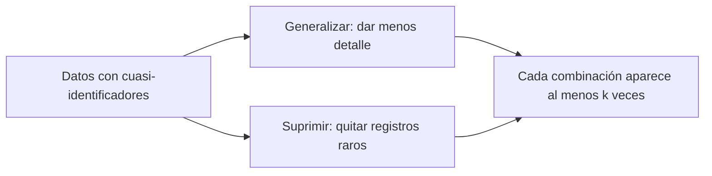

<!-- _class: lead -->

# M5 - Privacidad

### IA, ética y criterio profesional

**Rogelio Arriaga - Raptor Dev Services**

<!--
Módulo de 90 minutos, sin código, abierto a cualquier carrera. Hilo conductor: los datos personales entran a la IA
en dos momentos (cuando se entrena y cuando se usa), "quitar el nombre" no hace anónimo un conjunto de datos, y
hay una idea de protección con respaldo matemático (privacidad diferencial) que se explica sin fórmulas.
Preparar: las dos tablas de la actividad (practica.md), impresas, y una moneda por persona para la demostración de
respuesta aleatorizada.
Los casos reales (Sweeney, Netflix Prize) y las leyes tienen su fuente en la lámina. Lo ficticio dice
"Ejemplo ilustrativo".
-->

---

## Una pregunta para empezar

Una clínica publica un archivo con las consultas del año para que investigadores lo estudien. Le quitó el nombre, el teléfono y el correo de cada persona. Dejó el código postal, la fecha de nacimiento y el sexo.

¿Es anónimo?

<!--
Que el grupo vote antes de ver el caso. No dar la respuesta todavía: se retoma después de la lámina de Sweeney.
-->

---

## Objetivo del módulo

Al terminar podrás:

- Decir qué es un dato personal y qué un dato sensible, con la definición de las leyes.
- Explicar en qué momentos entran los datos personales a un sistema de IA y qué regla aplica a cada uno.
- Mostrar que quitar el nombre no hace anónimo un conjunto de datos, con casos reales y con un ejercicio propio.
- Explicar con tus palabras qué es el k-anonimato y qué es la privacidad diferencial, y cuándo ayudan.
- Detectar un riesgo de privacidad antes de compartir o entrenar con datos.

<!--
Libros del módulo (solo por capítulo): A Citizen's Guide to Artificial Intelligence (Zerilli et al., 2021), cap. 6
(Privacy); Hands-On Differential Privacy (Cowan, Pereira y Shemate, 2024), caps. 1 y 2, y cap. 11 (Protecting Your
Data Against Privacy Attacks). Solo los conceptos.
-->

---

## Agenda

| Bloque | Qué vemos | Min |
|---|---|---|
| 1 | Datos personales, en el entrenamiento y en el uso | 25 |
| 2 | Quitar el nombre no basta: reidentificación y k-anonimato | 30 |
| 3 | Privacidad diferencial: la idea | 20 |
| 4 | Cierre, actividad, tarea y quiz | 15 |

---

## Por qué importa

- Los sistemas de IA se alimentan de datos, y muchos datos son de personas.
- Un dato que parece inocuo puede dejar de serlo al cruzarse con otro.
- Una vez que un dato salió o entró a un modelo, recuperarlo es difícil o imposible.
- La ley mexicana y la europea ya piden cosas concretas a quien trata datos personales.

---

<!-- _class: lead -->

# Tema 1
## Datos personales: al entrenar y al usar

---

## Qué es un dato personal

| Norma | Definición |
|---|---|
| LFPDPPP (México), art. 2, fr. V | "Cualquier información concerniente a una persona identificada o identificable." Una persona es identificable cuando su identidad puede determinarse **directa o indirectamente** a través de cualquier información |
| RGPD (UE), art. 4, punto 1 | Toda información sobre una persona física identificada o identificable; es identificable quien puede ser identificado, directa o indirectamente, en particular mediante un identificador (nombre, número, datos de localización, identificador en línea o elementos de su identidad física, económica, cultural o social, entre otros) |

Fuentes: LFPDPPP, última reforma DOF 14-11-2025; Reglamento (UE) 2016/679, art. 4.

La palabra que importa es **identificable**: no hace falta el nombre, basta con que se pueda llegar a la persona, aunque sea por otro camino.

---

## Datos sensibles

LFPDPPP, art. 2, fr. VI: datos personales que afectan la esfera más íntima de la persona, o cuya utilización indebida puede dar origen a discriminación o conlleva un riesgo grave. De forma enunciativa, no limitativa, los que puedan revelar:

- origen racial o étnico,
- estado de salud presente o futuro,
- información genética,
- creencias religiosas, filosóficas y morales,
- opiniones políticas,
- preferencia sexual.

La lista es abierta ("enunciativa más no limitativa"): lo que decide es el riesgo de discriminación o de daño grave.

Un dato que no parece sensible puede **inferirse** a partir de otros: por eso la reidentificación importa.

---

## Dos momentos en los que los datos entran a la IA

| Momento | Qué pasa | Pregunta clave |
|---|---|---|
| **Al entrenar** | Los datos de muchas personas se usan para construir el modelo | ¿Para qué se recabaron? ¿Se avisó? ¿Se necesitan todos? |
| **Al usar** | Alguien escribe o sube datos a una herramienta | ¿Dónde se guardan? ¿Quién los ve? ¿Se reutilizan para entrenar? |

- En el primero, la responsabilidad es de quien arma o ajusta el modelo.
- En el segundo, **es tuya**: tú decides qué escribes en una herramienta.

---

## Al entrenar: la finalidad

Las dos leyes parten de la misma idea: los datos se recaban para algo, y ese algo limita lo que se puede hacer después.

| Norma | Qué dice |
|---|---|
| LFPDPPP, art. 11 | El tratamiento se limita a las finalidades del aviso de privacidad; si se quiere otra finalidad, se requiere **obtener de nuevo el consentimiento** |
| LFPDPPP, art. 12 | El tratamiento será el necesario, adecuado y relevante; en datos sensibles, limitar el periodo al mínimo indispensable |
| RGPD, art. 5, apartado 1, letras b y c | Fines determinados, explícitos y legítimos, sin tratamiento posterior incompatible (limitación de la finalidad); datos adecuados, pertinentes y limitados a lo necesario (minimización) |

Aplicado a la IA: **los datos que una persona entregó para una cosa no se pueden usar para entrenar un modelo con otro fin sin revisar si el aviso de privacidad y el consentimiento lo cubren.**

---

## Los ocho principios de la LFPDPPP

Art. 5: el responsable debe observar los principios de:

1. licitud,
2. finalidad,
3. lealtad,
4. consentimiento,
5. calidad,
6. proporcionalidad,
7. información y
8. responsabilidad.

Fuente: LFPDPPP, última reforma DOF 14-11-2025, art. 5.

Para un proyecto con IA, se vuelven preguntas: ¿es legal recabarlos? ¿para qué? ¿se engañó a alguien? ¿hay consentimiento? ¿son exactos? ¿son los necesarios? ¿se informó? ¿quién responde?

---

## Al usar: lo que escribes en una herramienta

OWASP, en su lista de riesgos de aplicaciones con LLM (edición 2025), pone en el segundo lugar la **divulgación de información sensible** (LLM02:2025):

- Incluye datos personales, financieros, historiales médicos, datos confidenciales de negocio, credenciales y documentos legales.
- Las personas usuarias deben saber que pueden dar datos sensibles sin querer, y que luego aparezcan en la salida del modelo.
- Las aplicaciones deben sanear los datos para que no entren al entrenamiento y ofrecer términos de uso claros y la posibilidad de excluirse.

Fuente: OWASP Top 10 for LLM Applications, versión 2.0 (2025), LLM02:2025.

Lo que cada herramienta hace con lo que escribes **depende de su contrato y de su configuración**: se lee, no se supone.

---

## Regla de tres colores

Clasificación de este curso, para decidir rápido qué datos van a una herramienta de IA. Ajústala a tu organización.

| Color | Qué datos | Qué hacer |
|---|---|---|
| **Rojo** | Datos sensibles, credenciales, expedientes, información de terceros sin autorización | No se escriben en ninguna herramienta de IA externa |
| **Amarillo** | Datos personales ordinarios o confidenciales del negocio | Solo con una herramienta autorizada por la organización, con contrato que defina su uso y retención, y reduciendo al mínimo |
| **Verde** | Información pública o inventada para el caso | Se puede usar |

Regla de oro: **ante la duda, es amarillo y se pregunta.**

---

## Error típico: "es público, entonces lo puedo usar"

- La LFPDPPP define **fuente de acceso público** como las bases de datos, sistemas o archivos que, **por disposición de ley**, pueden ser consultados públicamente (art. 2, fr. X). No toda página de internet cumple eso.
- Aun cuando los datos estén en una fuente de acceso público, el art. 9 solo habla de la exención del consentimiento; el art. 13 obliga al responsable a velar por los principios de la Ley.
- Que una foto o un comentario esté en una red social no responde a la pregunta "¿para qué la quiso mostrar la persona?".

| Frase | Qué falta |
|---|---|
| "Está en internet" | Saber si es una fuente de acceso público conforme a la ley |
| "Ya lo tenía el cliente" | Saber si la nueva finalidad estaba en el aviso |
| "Solo lo pegué para que me ayudara" | Saber dónde se guarda y quién lo puede ver |

---

<!-- _class: lead -->

# Tema 2
## Quitar el nombre no basta

---

## Volvamos a la pregunta inicial

El archivo de la clínica no tiene nombres, pero sí **código postal, fecha de nacimiento y sexo**.

- Cada uno de esos datos, por separado, no identifica a nadie.
- **Juntos** pueden señalar a una sola persona.
- Si alguien más tiene otra lista con esos tres datos **y nombres** (un padrón, una lista de socios, un registro público), basta cruzar las dos.

A estos datos que no identifican solos, pero sí combinados, se les llama **cuasi-identificadores** (término de la literatura de privacidad).

---

## Caso real: el gobernador de Massachusetts

**Fuente:** Sweeney, L. (2002). k-anonymity: a model for protecting privacy. *International Journal of Uncertainty, Fuzziness and Knowledge-Based Systems*, 10(5), 557-570.

- Una comisión de seguros de salud de empleados del estado de Massachusetts publicó datos de atenciones médicas **sin nombres**.
- Sweeney los cruzó con la lista de votantes de Cambridge, que sí trae nombres y datos demográficos.
- Con ese cruce, identificó los registros médicos del gobernador del estado.

La publicación creyó haber protegido a las personas quitando el nombre. El cruce con **otra lista** las desprotegió.

<!--
Fuente primaria: el artículo de Sweeney (2002), que describe el ejemplo. No se citan cifras de detalle del ejemplo
(fechas de publicación, precio de la lista de votantes) porque no se verificaron en el texto completo.
-->

---

## Cuánta gente es única con tres datos

Sweeney (2000), con datos del censo de Estados Unidos de 1990, estimó que el **87 %** de la población de ese país (216 millones de 248 millones) era única con solo tres datos: código postal de cinco dígitos, sexo y fecha de nacimiento completa.

Golle (2006), con el censo del año 2000, revisó el cálculo y obtuvo **63 %**.

| Estudio | Datos | Resultado |
|---|---|---|
| Sweeney (2000) | Censo de EE. UU. de 1990 | 87 % únicas |
| Golle (2006) | Censo de EE. UU. del año 2000 | 63 % únicas |

**Lectura:** el porcentaje cambia con los datos y el método, pero en ambos casos es una proporción muy grande de personas.

Fuentes: Sweeney, L. (2000). *Simple demographics often identify people uniquely*, Carnegie Mellon University, Data Privacy Working Paper 3. Golle, P. (2006). *Revisiting the uniqueness of simple demographics in the US population*.

<!--
Son cifras de Estados Unidos y de los censos citados. No se pueden aplicar a México sin un estudio equivalente.
-->

---

## Caso real: el concurso de Netflix

**Fuente:** Narayanan, A. y Shmatikov, V. (2008). Robust de-anonymization of large sparse datasets. *IEEE Symposium on Security and Privacy*, 111-125. https://doi.org/10.1109/SP.2008.33

- Netflix publicó, para su concurso de recomendaciones (Netflix Prize), calificaciones de películas de sus suscriptores sin nombres.
- Los autores tomaron como información externa una base pública de calificaciones, la Internet Movie Database (IMDb).
- Con pocas calificaciones conocidas de una persona lograron identificar sus registros en el conjunto de Netflix, y con ellos preferencias que la persona no había hecho públicas, incluso políticas aparentes.

**Lección:** no hace falta una dirección ni un teléfono. Un patrón de comportamiento (qué ves, cuándo, con qué calificación) puede ser tan único como un nombre.

---

## Demostración con un ejemplo mínimo

Ejemplo ilustrativo (todo inventado). Tabla A es la "anónima"; la tabla B es un padrón de socios.

| Tabla A (sin nombre) | CP | Nacimiento | Sexo | Motivo |
|---|---|---|---|---|
| Folio 05 | 87320 | 1978-01-25 | F | Control de hipertensión |

| Tabla B (con nombre) | CP | Nacimiento | Sexo |
|---|---|---|---|
| Paola Montes Cruz | 87320 | 1978-01-25 | F |
| Sergio Lara Ochoa | 87320 | 1978-01-25 | M |

- Con CP y nacimiento hay **dos** candidatos. Con el sexo, **una**.
- Lo hiciste con una lista pequeña. Con una grande, el cruce es el mismo y lo hace un programa.

(En `practica.md` haces el ejercicio completo con dos tablas.)

---

## Seudonimizar no es anonimizar

| Término | Qué dice la norma | Qué significa en la práctica |
|---|---|---|
| **Seudonimización** (RGPD, art. 4, punto 5) | Tratar los datos de modo que ya no puedan atribuirse a una persona sin usar información adicional, que se guarda por separado con medidas técnicas y organizativas | Cambiar el nombre por un código, y guardar la tabla de códigos aparte. Quien tenga ambas puede volver a la persona |
| **Disociación** (LFPDPPP, art. 2, fr. IX) | Procedimiento por el cual los datos **no pueden asociarse a la persona titular ni permitir, por su estructura, contenido o grado de desagregación, la identificación de la misma** | Tiene que funcionar de verdad: la condición incluye el grado de desagregación |

- El RGPD presenta la seudonimización como una medida de seguridad y de protección desde el diseño (arts. 25 y 32), no como el fin de los datos personales.
- La LFPDPPP, art. 9, fr. III, exime de recabar consentimiento cuando los datos se someten a un procedimiento previo de disociación. **Esa exención se cae si el procedimiento no cumple la definición**, y la lámina anterior muestra cómo se incumple.

---

## k-anonimato

Idea de Sweeney (2002): un conjunto de datos publicado da **k-anonimato** si la información de cada persona no se puede distinguir de la de por lo menos **k - 1** personas más del mismo conjunto, en los cuasi-identificadores.



- **Generalizar:** en lugar de la fecha completa, el año o la década; en lugar de 5 dígitos de código postal, 3.
- **Suprimir:** quitar los registros que siguen siendo únicos.
- Con **k = 1** cualquiera es único; con **k = 2** cada persona se confunde con al menos otra.
- Se paga con **menos detalle**: es una decisión entre protección y utilidad.

---

## Lo que el k-anonimato no resuelve

Ejemplo ilustrativo. Un grupo de dos personas indistinguibles (k = 2):

| Folio | CP | Nacimiento | Sexo | Motivo |
|---|---|---|---|---|
| A08 | 87330 | 1985-04-14 | F | Consulta general |
| A09 | 87330 | 1985-04-14 | F | Consulta general |

- Nadie sabe cuál es cuál, **pero las dos tienen el mismo motivo**: quien sepa que su conocida está en ese grupo sabe su motivo.
- El k-anonimato protege contra el cruce por cuasi-identificadores, no contra que el grupo comparta el dato sensible.
- Tampoco protege si quien ataca tiene **más** información sobre la persona.

Por eso se estudian protecciones más fuertes. *Hands-On Differential Privacy* (Cowan et al., 2024), cap. 11, trata los ataques a datos tabulares, entre ellos el cruce de registros y las vulnerabilidades del k-anonimato.

---

## Error típico en reidentificación

| Error | Corrección |
|---|---|
| "Quité nombre, teléfono y correo" | Revisa los cuasi-identificadores: fecha de nacimiento, código postal, sexo, puesto, fechas de eventos |
| "Nadie tiene esa otra lista" | Tú no lo sabes; los padrones, las redes sociales y las filtraciones existen |
| "Son pocos datos, no pasa nada" | Pocos datos combinados pueden ser únicos (Sweeney, 2000; Golle, 2006) |
| "Lo generalicé y ya" | Comprueba cuántas veces aparece cada combinación (k), no lo supongas |
| "Como no hay nombres, no es dato personal" | Si la persona es identificable, sí lo es (LFPDPPP, art. 2, fr. V) |

---

<!-- _class: lead -->

# Tema 3
## Privacidad diferencial: la idea

---

## El problema: las estadísticas también filtran

Ejemplo ilustrativo (calificaciones inventadas). Un grupo publica la calificación promedio de las 10 personas que lo forman: 8.1. Cuando Ana se da de baja, publica el promedio de las 9 restantes: 8.0.

| | Personas | Promedio | Suma |
|---|---|---|---|
| Con Ana | 10 | 8.1 | 81 |
| Sin Ana | 9 | 8.0 | 72 |

- La resta de las dos sumas es 81 - 72 = **9**: la calificación de Ana.
- Nadie publicó un dato individual. Se publicaron **dos estadísticas** y bastó restarlas.

A esto se le llama ataque por **diferencias** (differencing attack). *Hands-On Differential Privacy*, cap. 11, lo incluye entre los ataques a datos tabulares.

---

## La idea de la privacidad diferencial

Propuesta por Dwork, McSherry, Nissim y Smith (2006): proteger a las personas **añadiendo ruido aleatorio a los resultados**, de un tamaño calibrado a cuánto puede cambiar el resultado si una sola persona entra o sale (su **sensibilidad**).

```
Idea, sin fórmulas:
  1. Quien consulta recibe una respuesta con un poco de ruido.
  2. El ruido es suficiente para que la respuesta casi no cambie
     si una persona cualquiera está o no está en los datos.
  3. Por eso, de la respuesta no se puede saber con certeza
     si tu información estaba incluida.
```

Fuente: Dwork, C., McSherry, F., Nissim, K. y Smith, A. (2006). *Calibrating noise to sensitivity in private data analysis*. Theory of Cryptography Conference (TCC 2006), LNCS 3876, 265-284.

- La protección se vuelve una propiedad **del método** que se puede razonar y demostrar, no de que "ya nadie lo vio".
- Es la dirección de la que parten los capítulos 1 y 2 de *Hands-On Differential Privacy*.

---

## Con ruido, el ataque por diferencias falla

Mismo ejemplo ilustrativo, con ruido aleatorio en cada promedio publicado:

| | Promedio real | Promedio publicado (con ruido) |
|---|---|---|
| Con Ana | 8.1 | 8.3 |
| Sin Ana | 8.0 | 7.9 |

- Al restar las sumas con los promedios ruidosos (8.3 × 10 - 7.9 × 9) se obtiene 11.9: ni siquiera es una calificación posible, y mucho menos la de Ana.
- Cuanto más ruido, más protección y **menos exactitud** para quien usa la estadística.
- Los valores ruidosos de la tabla son inventados para ilustrar; en una implementación real el ruido sale de una distribución y de un parámetro de privacidad.

**Costo:** exactitud. **Beneficio:** una garantía sobre lo que se puede deducir de la persona.

---

## Una variante con monedas: respuesta aleatorizada

Se pregunta algo delicado ("¿has copiado en un examen?") sin que quien pregunta sepa la respuesta de nadie:

1. Cada persona tira una moneda, sin que nadie la vea.
2. Si sale cara, responde con la verdad.
3. Si sale cruz, tira una segunda moneda: cara responde "sí" y cruz responde "no", sin importar la verdad.

- Cualquier "sí" individual tiene una explicación inocente: pudo ser la moneda.
- Aun así, el **grupo** permite estimar la proporción real: si la fracción de "sí" observada es q, la proporción real es 2q - 0.5.
- Con 100 personas y 40 respuestas "sí", la estimación es 2 × 0.4 - 0.5 = 0.30, es decir, 30 %.

La técnica de respuesta aleatorizada es anterior (Warner, 1965, en otra versión) y es uno de los ejemplos con que *Hands-On Differential Privacy* introduce el tema en el cap. 1.

<!--
Verificación de la aritmética: P(sí) = 0.5 p + 0.5 × 0.5 = 0.5 p + 0.25, de donde p = 2q - 0.5. Se comprobó con un
script (resultado exacto para q = 0.40: p = 0.30). Es la variante con moneda; Warner (1965) usó dos versiones de la
pregunta. En clase, hacer la dinámica con una moneda por persona.
-->

---

## Qué sí y qué no es la privacidad diferencial

| Sí | No |
|---|---|
| Una garantía matemática sobre lo que se puede deducir de una persona a partir de los resultados | No es "borrar el nombre" ni un permiso para publicar lo que sea |
| Pensada para estadísticas y resultados agregados | No sirve para publicar los registros individuales tal cual |
| Gasta un "presupuesto" de privacidad: cada consulta resta algo | No se puede consultar sin límite y seguir protegiendo |
| Se paga con exactitud | No es gratis: hay que decidir cuánta exactitud se cede |

Los capítulos 12 y 13 de *Hands-On Differential Privacy* tratan cómo definir ese presupuesto y planear un primer proyecto; en este curso solo interesa la idea.

---

## Antes de compartir o entrenar: siete preguntas

1. ¿Qué datos personales hay, y cuáles son sensibles?
2. ¿Para qué se recabaron y cubre el aviso de privacidad este nuevo uso?
3. ¿Necesito todos los campos? (Minimiza.)
4. ¿Qué cuasi-identificadores quedan y con qué otra lista se podrían cruzar?
5. ¿Cuántas veces aparece cada combinación (k)? ¿Hay grupos que comparten el dato sensible?
6. ¿A dónde van los datos, quién los ve y cuánto tiempo se guardan?
7. ¿Quién responde si se filtran y a quién se avisa?

Si no puedes contestar una, **todavía no es momento de compartir.**

---

<!-- _class: lead -->

# Cierre

---

## Lo que te llevas

- Un dato es personal si la persona es **identificable**, directa o indirectamente.
- Los datos entran a la IA al **entrenar** (finalidad y consentimiento) y al **usar** (tú decides qué escribes).
- Quitar el nombre no anonimiza: los cuasi-identificadores, cruzados con otra lista, señalan a una persona.
- El k-anonimato y la privacidad diferencial ayudan, con límites y con costo de exactitud.
- Las preguntas antes de compartir valen más que las herramientas.

---

## Actividad: reidentificar en un conjunto "anónimo"

Con dos tablas ficticias (en `practica.md`):

1. Cruza la tabla "anónima" de una clínica con el padrón de un club y reidentifica a las personas.
2. Mira qué pasa si omites un dato del cruce.
3. Generaliza y suprime hasta lograr k = 2.
4. Haz la dinámica de la moneda y estima una proporción.

Tarea: auditar un conjunto de datos de tu entorno antes de compartirlo (ver `tarea.md`).

---

## Referencias

- Ley Federal de Protección de Datos Personales en Posesión de los Particulares, última reforma DOF 14-11-2025, arts. 2, 5, 9, 11 y 12.
- Reglamento (UE) 2016/679 (RGPD), arts. 4, 5, 25 y 32.
- OWASP (2024). *OWASP Top 10 for LLM Applications 2025*, LLM02:2025 Sensitive Information Disclosure.
- Sweeney, L. (2002). k-anonymity: a model for protecting privacy. *International Journal of Uncertainty, Fuzziness and Knowledge-Based Systems*, 10(5), 557-570.
- Sweeney, L. (2000). *Simple demographics often identify people uniquely*. Carnegie Mellon University, Data Privacy Working Paper 3. https://dataprivacylab.org/projects/identifiability/paper1.pdf
- Golle, P. (2006). *Revisiting the uniqueness of simple demographics in the US population*. https://crypto.stanford.edu/~pgolle/papers/census.html
- Narayanan, A. y Shmatikov, V. (2008). Robust de-anonymization of large sparse datasets. *IEEE Symposium on Security and Privacy*, 111-125. https://doi.org/10.1109/SP.2008.33
- Dwork, C., McSherry, F., Nissim, K. y Smith, A. (2006). Calibrating noise to sensitivity in private data analysis. *Theory of Cryptography Conference*, LNCS 3876, 265-284.
- Warner, S. L. (1965). Randomized response: a survey technique for eliminating evasive answer bias. *Journal of the American Statistical Association*, 60(309), 63-69.

Libros (solo por capítulo): Zerilli et al. (2021), *A Citizen's Guide to Artificial Intelligence*, cap. 6. Cowan, Pereira y Shemate (2024), *Hands-On Differential Privacy*, caps. 1, 2, 11, 12 y 13.
