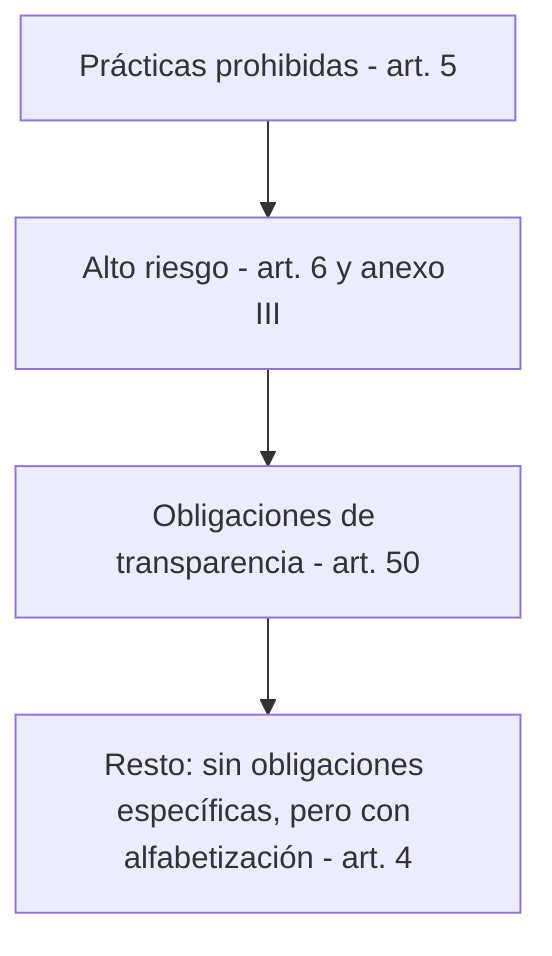

<!-- _class: lead -->

# M6 - Regulación y uso profesional de la IA

### IA, ética y criterio profesional

**Rogelio Arriaga - Raptor Dev Services**

<!--
Módulo de 90 minutos, sin código, abierto a cualquier carrera. Cierra el curso: del panorama regulatorio (qué
dicen hoy las leyes, a noviembre de 2026) a lo que se vuelve concreto en un equipo: una política de uso de IA.
Preparar: la plantilla de política (practica.md) impresa o en pantalla, y el estado de las leyes del día de la
clase (la regulación cambia rápido; las fechas de esta clase son del texto consolidado al 27-07-2026).
Lecturas del módulo: 11-vibe-coding/03-ai-workflow.md y la nota nueva 11-vibe-coding/11-etica-y-uso-responsable.md.
Libros (solo por capítulo): A Citizen's Guide to Artificial Intelligence (Zerilli et al., 2021), caps. 8 y 10;
Moral Codes (Blackwell, 2024), caps. 1 a 3 y 11.
-->

---

## Una pregunta para empezar

Un compañero de tu equipo pega en un asistente de IA el código de un cliente, con una base de datos de ejemplo que trae nombres y teléfonos reales, para que "le arregle un error".

- ¿Qué pudo salir mal?
- ¿Quién responde si esos datos salen de donde no debían?
- ¿Qué regla habría evitado el problema?

<!--
Dejar que el grupo conteste antes de avanzar. Anotar las respuestas: al final del módulo, la política que escriban
debe cubrir cada una.
-->

---

## Objetivo del módulo

Al terminar podrás:

- Ubicar los tres enfoques con que hoy se regula la IA y qué dice, a noviembre de 2026, la Unión Europea y qué hay en México.
- Explicar la clasificación por riesgo del Reglamento de IA europeo y por qué puede alcanzarte aunque no vivas en Europa.
- Hacer las preguntas correctas sobre un sistema de IA que usa el gobierno.
- Escribir y defender la política de uso de IA de un equipo: qué datos no se comparten, qué se revisa y quién firma.

---

## Agenda

| Bloque | Qué vemos | Min |
|---|---|---|
| 1 | Panorama regulatorio: UE, México y marcos voluntarios | 30 |
| 2 | Algoritmos en el gobierno | 15 |
| 3 | Uso profesional: datos, propiedad intelectual, revisión y política de equipo | 30 |
| 4 | Cierre, actividad, tarea y quiz | 15 |

---

## Por qué importa

- Usar IA en el trabajo es una decisión de **seguridad** (qué datos salen), de **propiedad intelectual** (qué se puede usar y quién es dueño) y de **responsabilidad** (quién responde).
- Las reglas cambian rápido: lo que hoy no es obligatorio puede serlo en un año. Un equipo con una política escrita se adapta; uno sin política improvisa.
- Las leyes sirven aunque no te obliguen todavía: son un buen estándar para tus propias reglas.

---

<!-- _class: lead -->

# Tema 1
## Panorama regulatorio, a noviembre de 2026

---

## Tres caminos para regular

Clasificación de este curso para ordenar el panorama (no es una taxonomía oficial):

| Camino | Qué es | Ejemplo en esta clase |
|---|---|---|
| **Ley específica por riesgo** | Una ley que clasifica los usos de la IA por su riesgo y pone obligaciones según el nivel | Reglamento (UE) 2024/1689 |
| **Marco voluntario** | Guía que una organización decide adoptar; no es ley | NIST AI RMF 1.0 (2023) |
| **Leyes que ya existían, aplicadas a la IA** | Datos personales, derechos de autor, consumo, civil, penal... aplican a quien usa IA | En México: LFPDPPP, LGPDPPSO, LFDA, entre otras |

Un mismo proyecto puede quedar bajo los tres a la vez.

---

## El Reglamento de IA de la UE: la idea

Reglamento (UE) 2024/1689, "Reglamento de Inteligencia Artificial": normas armonizadas para la IA en la Unión Europea. Clasifica por **nivel de riesgo**:



Fuente: Reglamento (UE) 2024/1689, texto consolidado al 27-07-2026.

- Cuanto más arriba, más grave el riesgo y más fuerte la regla: de la prohibición a la transparencia.
- Los sistemas de uso general (los modelos de lenguaje) tienen además reglas propias en el capítulo V.

<!--
Nota: el esquema simplifica; la clasificación completa tiene más categorías (por ejemplo, modelos de IA de uso
general con riesgo sistémico, capítulo V). Se enseña la idea por niveles.
-->

---

## Prácticas prohibidas (art. 5)

Quedan prohibidas, entre otras:

| Práctica | En palabras sencillas |
|---|---|
| Técnicas subliminales o manipuladoras | Alterar el comportamiento de una persona de modo que provoque perjuicios considerables |
| Explotar vulnerabilidades | Aprovechar la edad, una discapacidad o una situación social o económica de una persona |
| Puntuación ciudadana | Clasificar personas según su comportamiento social o rasgos, con trato perjudicial injustificado |
| Evaluar el riesgo de delinquir solo con el perfil | Predecir que alguien cometerá un delito basándose únicamente en su perfil o personalidad |
| Bases de reconocimiento facial por extracción no selectiva | Armarlas con imágenes de internet o de cámaras de circuito cerrado |
| Inferir emociones en el trabajo y en la escuela | Salvo motivos médicos o de seguridad |
| Categorización biométrica que infiere raza, opiniones, religión, vida o preferencia sexual | |
| Identificación biométrica remota en tiempo real en espacios públicos para garantizar el cumplimiento del Derecho | Con excepciones estrictamente definidas |

Desde el **2 de diciembre de 2026** se suman dos prohibiciones nuevas (letras b bis y b ter): generar o manipular imágenes, vídeos o audios realistas de las partes íntimas de una persona identificable o en actividades sexualmente explícitas **sin su consentimiento**, y generar o manipular el material y los espectáculos que define el art. 2, letras c y e, de la Directiva 2011/93/UE (abuso sexual de menores).

Fuente: Reglamento (UE) 2024/1689, art. 5, en la redacción dada por el Reglamento (UE) 2026/1744.

---

## Alto riesgo: los ámbitos del anexo III

Un sistema de IA es de alto riesgo, entre otros casos, si se usa en alguno de estos ámbitos (anexo III):

1. Biometría (identificación remota, categorización por rasgos sensibles, reconocimiento de emociones).
2. Infraestructuras críticas (tráfico rodado, agua, gas, calefacción, electricidad, infraestructuras digitales críticas).
3. **Educación y formación profesional**: acceso, evaluación del aprendizaje, vigilancia de exámenes.
4. **Empleo y gestión de trabajadores**: contratación y selección, decisiones sobre condiciones, promoción y despido, asignación de tareas, evaluación del rendimiento.
5. **Acceso a servicios esenciales**: prestaciones públicas, **solvencia crediticia**, seguros de vida y de salud, llamadas de emergencia.
6. Garantía del cumplimiento del Derecho.
7. Migración, asilo y control fronterizo.
8. Administración de justicia y procesos democráticos.

Fuente: Reglamento (UE) 2024/1689, anexo III (resumido).

Si tu trabajo toca alguno de estos ámbitos, el sistema que uses o construyas probablemente caiga aquí.

---

## Qué se exige en alto riesgo

A grandes rasgos (capítulo III, secciones 2 y 3):

- Requisitos del sistema: entre otros, **supervisión humana** (art. 14, módulo 4).
- Obligaciones de quien lo despliega: usar el sistema según las instrucciones, encomendar la supervisión a personas competentes, vigilar y suspender si hay riesgo (art. 26, módulo 4).
- Derecho de la persona afectada a **explicaciones claras y significativas** (art. 86, módulo 3).

**Cuándo:** a noviembre de 2026 todavía no se aplican. Según el art. 113 en la redacción del Reglamento (UE) 2026/1744 (8 de julio de 2026): desde el **2 de diciembre de 2027** para los sistemas del art. 6, apartado 2, y anexo III; desde el **2 de agosto de 2028** para los ligados a productos del anexo I.

Los sistemas de alto riesgo para uso de las **autoridades públicas** ya en el mercado tienen hasta el **2 de agosto de 2030** para adoptar las medidas necesarias (art. 111, apartado 2).

---

## Transparencia (art. 50)

Aplica desde el **2 de agosto de 2026**. Lo que pide, en resumen:

| Quién | Qué debe hacer |
|---|---|
| Proveedores de sistemas que **interactúan con personas** | Diseñarlos para que la persona sepa que interactúa con IA, salvo que sea evidente |
| Proveedores de sistemas que **generan contenido sintético** (audio, imagen, vídeo o texto) | Marcar las salidas en un formato legible por máquina para poder detectar que son artificiales |
| Responsables del despliegue de **ultrafalsificaciones** (deepfakes) | Hacer público que el contenido fue generado o manipulado artificialmente |
| Responsables del despliegue que generan **texto para informar al público** sobre asuntos de interés público | Divulgar que es artificial, salvo que haya revisión humana o control editorial con responsabilidad editorial |

Para el marcado del art. 50, apartado 2, los proveedores cuyos sistemas ya estaban en el mercado antes del 2 de agosto de 2026 tienen hasta el **2 de diciembre de 2026** (art. 111, apartado 4, añadido por el Reglamento 2026/1744).

Fuente: Reglamento (UE) 2024/1689, arts. 50 y 111, y art. 113.

---

## Alfabetización en IA (art. 4)

Los proveedores y los responsables del despliegue de sistemas de IA **adoptarán medidas para apoyar la alfabetización en IA de su personal** y de quienes operen y usen los sistemas en su nombre, teniendo en cuenta sus conocimientos, experiencia, educación y formación y el contexto de uso.

- Se aplica desde el **2 de febrero de 2025** (capítulo I).
- No exige garantizar un nivel específico de alfabetización de ninguna persona en particular.

Fuente: Reglamento (UE) 2024/1689, art. 4, en la redacción dada por el Reglamento (UE) 2026/1744, y art. 113.

**Este curso es una forma de cumplir el espíritu de esta regla:** conocer capacidades y límites antes de usar un sistema.

---

## Calendario, a noviembre de 2026

| Fecha | Qué empieza a aplicarse |
|---|---|
| 2 de febrero de 2025 | Capítulos I y II: objeto, alfabetización (art. 4) y prácticas prohibidas (art. 5) |
| 2 de agosto de 2025 | Capítulo III, sección 4; capítulos V, VII y XII y art. 78 (salvo el art. 101) |
| 2 de agosto de 2026 | Fecha general de aplicación: incluye el art. 50 (transparencia) |
| 2 de diciembre de 2026 | Prohibiciones nuevas (art. 5, letras b bis y b ter); plazo para el marcado de sistemas anteriores (art. 50, apartado 2) |
| 2 de diciembre de 2027 | Alto riesgo del anexo III (empleo, educación, crédito...) |
| 2 de agosto de 2028 | Alto riesgo ligado a productos del anexo I |

Fuente: Reglamento (UE) 2024/1689, art. 113, en la redacción dada por el Reglamento (UE) 2026/1744 del 8 de julio de 2026.

**Revisa la versión vigente el día que lo uses:** estas fechas cambiaron una vez, por el retraso en las normas técnicas.

---

## ¿Y si no estoy en Europa?

El Reglamento se aplica (art. 2, apartado 1) a:

- proveedores que introduzcan sistemas o modelos en el mercado de la Unión, estén donde estén;
- responsables del despliegue establecidos en la Unión;
- **proveedores y responsables del despliegue de países terceros, cuando los resultados de salida del sistema se utilicen en la Unión**;
- personas afectadas ubicadas en la Unión, entre otros.

Las multas del art. 99: hasta **35 millones de euros o el 7 %** del volumen de negocios mundial por incumplir las prohibiciones del art. 5; hasta **15 millones o el 3 %** por incumplir otras obligaciones de los operadores, la cifra que resulte mayor en una empresa.

Fuente: Reglamento (UE) 2024/1689, arts. 2 y 99, apartados 3 y 4.

Si vendes un servicio en México cuyos resultados se usan en la UE, el Reglamento puede alcanzarte.

---

## NIST AI RMF: el marco voluntario

*Artificial Intelligence Risk Management Framework (AI RMF 1.0)*, NIST AI 100-1, enero de 2023.

Cuatro funciones: **Govern** (cultura y políticas de la organización, que cruza a las demás), **Map** (entender el contexto y los riesgos), **Measure** (medirlos y evaluarlos) y **Manage** (priorizarlos y actuar).

Características de un sistema confiable, según el marco: válido y confiable; seguro; protegido y resiliente; con rendición de cuentas y transparente; explicable e interpretable; con privacidad reforzada; y justo, con sesgos dañinos gestionados.

- Es voluntario: el propio documento lo describe como voluntario, que preserva derechos, no específico de un sector y aplicable a cualquier caso de uso.
- Úsalo como esqueleto de tu política: Govern es tu política; Map, qué sistemas usas y para qué; Measure, cómo compruebas; Manage, qué haces cuando algo falla.

Fuente: NIST AI 100-1 (2023).

---

## En México: lo que ya existe

A noviembre de 2026 no hay una ley general de IA publicada: el texto vigente de la Constitución (última reforma DOF 07-10-2026) no menciona la IA y una iniciativa para facultar al Congreso a legislar en la materia (reforma del art. 73, fr. XVII) se recibió el 5 de agosto de 2026 (Gaceta Parlamentaria, 17-08-2026). **Verifica su estado el día de la clase.**

Reglas que ya se aplican a quien usa IA:

| Norma | Qué te importa |
|---|---|
| LFPDPPP (DOF 14-11-2025) | Principios (art. 5), finalidad y nuevo consentimiento (art. 11), oposición al tratamiento automatizado sin intervención humana (art. 26, fr. II) |
| LGPDPPSO (DOF 14-11-2025) | Lo mismo para el sector público: oposición al tratamiento automatizado (art. 41, fr. II) |
| LFDA (DOF 14-05-2026) | Imagen y voz de las personas artistas, incluidos los resultados generados por IA (art. 87 y art. 118, fr. VII); programas de computación, incluidos los de IA (art. 102) |

Las leyes civil, laboral, de consumo y penal también aplican a quien causa un daño con IA.

---

<!-- _class: lead -->

# Tema 2
## Algoritmos en el gobierno

---

## Por qué es distinto cuando lo usa el gobierno

| Diferencia | Consecuencia |
|---|---|
| La persona no puede elegir irse a otro proveedor | La confianza y la reparación tienen que estar en la ley |
| El Estado decide sobre derechos: prestaciones, permisos, sanciones | Una decisión equivocada puede quitar algo básico |
| La autoridad debe fundar y motivar sus actos | "Lo dijo el sistema" no es una motivación |

En México, el art. 16 constitucional exige que el acto de molestia provenga de mandamiento escrito de la autoridad competente **que funde y motive la causa legal del procedimiento**.

Fuente: CPEUM, art. 16, primer párrafo, texto vigente (última reforma DOF 07-10-2026).

<!--
La relación entre el art. 16 y los sistemas automatizados es un razonamiento del curso, no una resolución
judicial: se presenta como pregunta, no como regla ya aplicada a la IA.
-->

---

## Qué dice el Reglamento de IA de los usos públicos

Son de alto riesgo, entre otros, los sistemas que usan las autoridades o que se usan en su nombre para:

- evaluar la admisibilidad de personas a prestaciones y servicios esenciales de asistencia pública, incluidos los de salud, y concederlos, reducirlos o retirarlos (anexo III, punto 5, letra a);
- evaluar riesgos de delitos o de reincidencia, polígrafos y herramientas similares (anexo III, punto 6);
- evaluar riesgos de migración, examinar solicitudes de asilo o visado (anexo III, punto 7);
- ayudar a una autoridad judicial a investigar e interpretar hechos y ley (anexo III, punto 8).

Y quedan **prohibidos** la puntuación ciudadana y la evaluación del riesgo de cometer un delito basada solo en el perfil (art. 5).

Fuente: Reglamento (UE) 2024/1689, anexo III y art. 5.

*A Citizen's Guide to Artificial Intelligence* (Zerilli et al., 2021), cap. 8, "Algorithms in Government", es la lectura de profundización.

---

## Las preguntas de la guía

El **proyecto final** del curso te pide evaluar un sistema de IA público con seis preguntas. Son las mismas que usaste en los módulos:

| Pregunta | Módulo |
|---|---|
| ¿Qué decide o recomienda el sistema? | 1 |
| ¿A quién afecta? ¿Qué sesgo puede tener? | 2 |
| ¿Cómo se explica la decisión a la persona afectada? | 3 |
| ¿Quién responde y quién supervisa? | 4 |
| ¿Qué datos usa y cómo los protege? | 5 |
| ¿Qué norma le aplica y quién lo vigila? | 6 |

---

<!-- _class: lead -->

# Tema 3
## Uso profesional de la IA

---

## Cuatro riesgos de usar IA en el trabajo

| Riesgo | Ejemplo ilustrativo | Dónde lo viste |
|---|---|---|
| **Datos** | Pegar la base de un cliente en un asistente | Módulo 5 |
| **Propiedad intelectual** | Usar un fragmento sin saber su licencia, o creer que lo generado es de nadie o de cualquiera | Esta clase |
| **Exactitud** | Dar por buena una cifra, una cita o una ley inventada | Módulos 1 y 3 |
| **Responsabilidad** | Entregar un trabajo sin revisarlo y decir "lo hizo la IA" | Módulo 4 |

---

## Propiedad intelectual: lo que dice la ley mexicana

La Ley Federal del Derecho de Autor (última reforma DOF 14-05-2026):

- **Autor** es la persona física que ha creado una obra literaria y artística (art. 12).
- Los **programas de computación**, incluidos los de inteligencia artificial, se protegen en los mismos términos que las obras literarias (art. 102).
- Salvo pacto en contrario, los derechos patrimoniales sobre un programa creado por empleados en el ejercicio de sus funciones o siguiendo instrucciones del empleador **corresponden al empleador** (art. 103).
- La **imagen y la voz** de las personas artistas intérpretes solo pueden usarse con su consentimiento expreso, y esa protección abarca los resultados generados por sistemas de IA (art. 87).

Lo que la ley no resuelve en estas líneas es cómo se trata el material que genera una herramienta: **revisa la ley y el contrato vigentes y los términos de la herramienta** antes de construir sobre lo que genera.

---

## Qué revisar de una herramienta

Antes de usar una herramienta de IA para trabajo de la organización, lee y registra:

| Pregunta | Dónde se busca |
|---|---|
| ¿Qué hace con lo que escribo? ¿Lo guarda, lo usa para entrenar? | Términos de uso, política de privacidad, configuración |
| ¿Puedo excluir mis datos del entrenamiento? | Configuración y contrato (OWASP LLM02 pide ofrecer esa opción) |
| ¿Quién es dueño de la salida? ¿Hay restricciones de uso? | Términos de servicio |
| ¿Dónde se guardan los datos y quién los ve? | Política de privacidad y contrato |
| ¿Tiene un plan para organizaciones con contrato propio? | Oferta comercial |

**Si no puedes responder estas preguntas, la herramienta no está autorizada para datos amarillos ni rojos.**

(Los términos cambian; se revisan en el momento de usar la herramienta, no en una clase.)

---

## La revisión humana: qué se delega y qué no

De la nota `11-vibe-coding/03-ai-workflow.md`:

| Tarea | ¿Delegar? | Por qué |
|---|---|---|
| Código repetitivo, pruebas de caso feliz | Sí | Predecible, bajo riesgo |
| Documentación de métodos públicos | Sí | Formato repetitivo |
| Diseño de arquitectura | No directo | La IA no conoce las restricciones del negocio |
| Decisiones de seguridad | Parcial | La IA propone, una persona verifica contra la política |
| Lógica crítica de negocio | Parcial | La IA escribe, una persona valida con quien decide |

Regla: **el humano nunca desaparece.** Decide qué hacer, valida y mantiene el contexto que la IA no tiene. Lo viste en el módulo 4: sin tiempo, información y autoridad, esa revisión es de papel.

*Moral Codes* (Blackwell, 2024), caps. 2 y 11, tratan cuándo la IA genera código y cómo usar estas herramientas para programar.

---

## Seguridad: lo que puede hacer un asistente con permisos

OWASP, en su lista de 2025, incluye entre los riesgos de aplicaciones con LLM:

- **LLM02 Divulgación de información sensible:** el módulo 5.
- **LLM06 Agencia excesiva:** un sistema con más herramientas, permisos o autonomía de los que la tarea requiere.
- **LLM09 Desinformación:** respuestas falsas dichas con seguridad, y decisiones tomadas con ellas.

Para una política de equipo, se traduce en tres reglas:

1. Un asistente con acceso a archivos, correo o producción tiene los permisos **mínimos** que la tarea necesita.
2. Lo que importa (un pago, un borrado, un envío) pasa por **una persona** antes de ejecutarse.
3. Toda cita, cifra o referencia de una herramienta se **verifica** contra la fuente.

Fuente: OWASP Top 10 for LLM Applications 2025; detalle en `11-vibe-coding/10-seguridad-llm.md`.

---

## Transparencia hacia quien recibe tu trabajo

- La persona que recibe un texto, una imagen, un informe o un código tiene derecho a saber **cuándo es obra de una herramienta** si eso cambia cómo debe leerlo.
- El Reglamento de IA lo exige en ciertos casos (art. 50): saber que se interactúa con IA, marcar el contenido sintético, divulgar ultrafalsificaciones y texto para informar al público sin revisión editorial.
- Aunque tu caso no caiga en la ley, es una buena práctica profesional: **declara qué herramienta usaste y para qué, y quién revisó.**

Ejemplo ilustrativo de una nota al pie de un informe: "Borrador de la sección 2 generado con una herramienta de IA a partir de las notas del equipo; revisado y corregido por [persona responsable]."

---

## La política de uso de IA de un equipo

Una política es **corta, concreta y firmada**. Ocho apartados:

| # | Apartado | Pregunta que contesta |
|---|---|---|
| 1 | Alcance | ¿A quién y a qué aplica? |
| 2 | Herramientas autorizadas | ¿Cuáles se pueden usar y para qué? |
| 3 | Datos | ¿Qué datos no se comparten? (rojo, amarillo, verde) |
| 4 | Revisión humana | ¿Qué se revisa, quién y con qué criterio? |
| 5 | Propiedad intelectual | ¿Qué se puede usar y qué se declara? |
| 6 | Transparencia | ¿Qué se dice a quien recibe el trabajo? |
| 7 | Incidentes | ¿Qué se hace si se filtra algo o se publica algo falso, y a quién se avisa? |
| 8 | Responsable y revisión | ¿Quién firma, y cada cuándo se revisa? |

La plantilla completa, con ejemplos, está en la nota `11-vibe-coding/11-etica-y-uso-responsable.md`.

---

## Un ejemplo de apartado bien escrito

Ejemplo ilustrativo del apartado 3, "Datos":

```
Datos rojos (no se escriben en ninguna herramienta de IA externa):
  - datos personales sensibles de clientes o empleados,
  - credenciales, llaves y tokens,
  - contratos y expedientes legales.

Datos amarillos (solo en herramientas autorizadas del apartado 2):
  - código propio sin secretos,
  - datos personales ordinarios, reducidos al mínimo y sin
    identificadores directos.

Datos verdes:
  - información pública y datos inventados para el caso.

Si dudas, es amarillo y preguntas a [responsable].
```

Cada regla se puede **comprobar**: alguien puede mirar un caso y decir si se cumplió.

---

## Errores típicos al escribir la política

| Error | Por qué falla | Qué hacer |
|---|---|---|
| "Prohibido usar IA" | Sin una opción autorizada, el riesgo es que cada persona use la suya sin reglas | Autoriza herramientas concretas y di para qué |
| "Usa tu criterio" | No se puede comprobar | Escribe reglas por tipo de dato y de tarea |
| Una política de 30 páginas | Nadie la lee | Una o dos páginas, con ejemplos |
| Sin responsable | Cuando falla, nadie responde | Una persona firma y revisa |
| Sin fecha de revisión | La regulación y las herramientas cambian | Revisión cada seis meses o cuando cambie una ley |
| Copiar la de otra empresa | No cubre tus datos ni tus clientes | Parte de una plantilla y adáptala |

---

<!-- _class: lead -->

# Cierre

---

## Lo que te llevas

- Hay tres caminos de regulación: ley por riesgo, marco voluntario y leyes que ya existían. En México, a noviembre de 2026, aplica el tercero.
- El Reglamento de IA europeo clasifica por riesgo y puede alcanzar a quien usa sus resultados en la Unión. Las fechas cambiaron una vez: revisa la versión vigente.
- Los sistemas del gobierno exigen más preguntas: fundar, motivar, explicar.
- La política de uso de IA de un equipo es corta, concreta, comprobable y firmada.

---

## Actividad: escribe la política de tu equipo

En `practica.md`:

1. Parte de la plantilla de ocho apartados.
2. Escríbela para un equipo ficticio de software (Caso hipotético).
3. Pruébala contra tres situaciones: si la política no las resuelve, la rehaces.
4. **Verlo fallar:** encuentra el caso que tu política permite pero no debería.

Tarea: política de un equipo de tu entorno y su defensa (ver `tarea.md`).

---

## Cierre del curso

Pasaste por seis preguntas. Llévalas contigo a cualquier sistema de IA que te toque usar, comprar o juzgar:

1. ¿Qué es y qué no es? (Módulo 1)
2. ¿A quién afecta y a quién deja fuera? (Módulo 2)
3. ¿Se puede explicar? (Módulo 3)
4. ¿Quién responde? (Módulo 4)
5. ¿Qué datos usa? (Módulo 5)
6. ¿Qué regla le aplica y qué reglas pondrías tú? (Módulo 6)

**Quiz:** 12 preguntas en la plataforma.

---

## Referencias

- Reglamento (UE) 2024/1689 del Parlamento Europeo y del Consejo, de 13 de junio de 2024 (Reglamento de Inteligencia Artificial), texto consolidado al 27-07-2026: arts. 2, 4, 5, 14, 26, 50, 86, 99, 111 y 113 y anexo III.
- Reglamento (UE) 2026/1744 del Parlamento Europeo y del Consejo, de 8 de julio de 2026, que modifica el Reglamento 2024/1689 (DO L de 24-07-2026).
- Ley Federal de Protección de Datos Personales en Posesión de los Particulares, última reforma DOF 14-11-2025, arts. 5, 11 y 26.
- Ley General de Protección de Datos Personales en Posesión de Sujetos Obligados, última reforma DOF 14-11-2025, art. 41.
- Ley Federal del Derecho de Autor, última reforma DOF 14-05-2026, arts. 12, 87, 102, 103 y 118.
- Constitución Política de los Estados Unidos Mexicanos, texto vigente, última reforma DOF 07-10-2026, arts. 16 y 73.
- Gaceta Parlamentaria, Cámara de Diputados, año XXIX, núm. 7105, 17-08-2026.
- NIST (2023). *Artificial Intelligence Risk Management Framework (AI RMF 1.0)*, NIST AI 100-1. https://doi.org/10.6028/NIST.AI.100-1
- OWASP (2024). *OWASP Top 10 for LLM Applications 2025*: LLM02, LLM06 y LLM09.
- Notas del repositorio: `11-vibe-coding/03-ai-workflow.md`, `10-seguridad-llm.md` y `11-etica-y-uso-responsable.md`.

Libros (solo por capítulo): Zerilli et al. (2021), *A Citizen's Guide to Artificial Intelligence*, caps. 8 (Algorithms in Government) y 10 (Oversight and Regulation). Blackwell (2024), *Moral Codes*, caps. 1, 2, 3 y 11.
