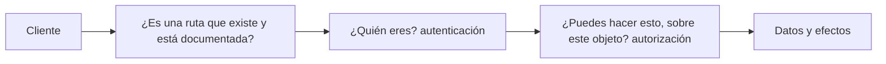
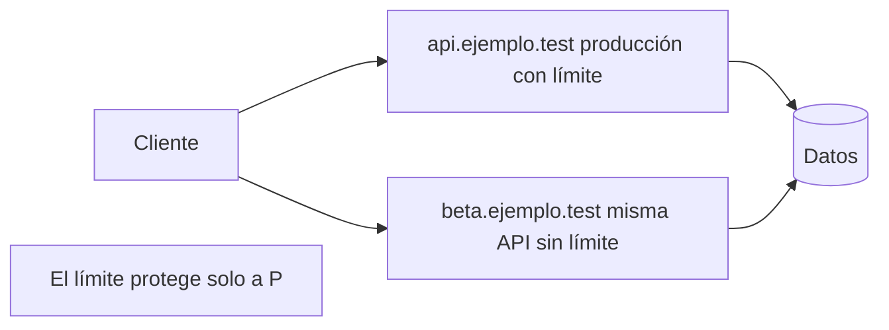

<!-- _class: lead -->

# Módulo 1 - Superficie e inventario

### La API que nadie documentó es la que nadie protegió

**Rogelio Arriaga - Raptor Dev Services**

<!--
Este módulo no enseña a atacar: enseña a saber qué tienes expuesto, cómo comprobarlo con una prueba y qué ve alguien que mira tu API desde fuera. Todo el código sale de cursos/api-security/referencia y corre con dotnet test.
-->

---

## Agenda del módulo

| Bloque | Qué hacemos | Tiempo aprox. |
|---|---|---|
| Apertura | Lema, alcance, marco legal y ético | 10 min |
| Parte 1 | Cómo funciona la seguridad de una API: quién decide qué, y dónde | 22 min |
| Parte 2 | El OWASP API Security Top 10 de 2023 como mapa del curso | 16 min |
| Parte 3 | La superficie: qué es, qué la agranda y qué ve quien mira desde fuera | 24 min |
| Parte 4 | El inventario como prueba automatizada | 30 min |
| Parte 5 | Laboratorios: la API de referencia y crAPI | 10 min |
| Cierre | Práctica, tarea y quiz | 8 min |

<!-- Descanso de 10 minutos entre la Parte 2 y la Parte 3. -->

---

## El lema del módulo

> La API que nadie documentó es la que nadie protegió.

- Nadie protege lo que no sabe que existe: no la revisa, no la actualiza, no la vigila.
- Una ruta de depuración, una versión vieja o un servidor de pruebas con datos reales siguen respondiendo mientras nadie los mira.
- Hoy el criterio no es "qué tan bien protegí la API", sino **"¿sé cuántas rutas tiene mi API y quién puede llamar cada una?"**

---

## Al terminar puedes

- Explicar en qué se diferencia la seguridad de una API de la de una página web.
- Nombrar las diez clases de riesgo del OWASP API Security Top 10 de 2023 y decir en qué módulo se estudia cada una.
- Levantar el inventario de una API: rutas, verbos, versiones, entornos y quién puede llamar cada una.
- Escribir una prueba que falla cuando aparece una ruta que nadie documentó.
- Explicar por qué una política por omisión que exige sesión protege a las rutas del futuro.

---

## Alcance de este módulo

| Sí | No |
|---|---|
| Inventariar **tu** API y el laboratorio de práctica | Escanear servicios de otras personas o empresas |
| Leer la documentación y las rutas que una API publica de sí misma | Cargas de ataque o listas de rutas para probar a ciegas |
| Escribir pruebas defensivas que se corren en tu máquina | Procedimientos de explotación |
| Laboratorios hechos para practicar, con su guía oficial | "Probar nada más para ver" un sistema real |

**Marco legal y ético.** Solo se prueba lo que es tuyo o lo que tienes autorizado por escrito. En México, el acceso sin autorización a sistemas informáticos es delito (Código Penal Federal, arts. 211 bis 1 a 211 bis 7; el módulo 1 de Ciberseguridad lo desarrolla y la carta de autorización de ese curso es la que se usa aquí). Los laboratorios de este curso son la API de referencia del repositorio (código propio) y aplicaciones construidas para practicar.

---

<!-- _class: lead -->

# Parte 1
## Cómo funciona la seguridad de una API

---

## Una API no tiene pantalla

Una página web protege con lo que **muestra**: si el botón no aparece, el usuario no lo pulsa. Una API protege con lo que **responde**: quien llama no usa tu pantalla, llama directamente a la ruta.

| | Página web | API |
|---|---|---|
| Quién llama | Un navegador con tu pantalla | Cualquier programa que sepa hablar HTTP |
| Qué protege | Lo que se ve y lo que se puede pulsar | Lo que cada ruta acepta y devuelve |
| Dónde se decide el permiso | En el servidor (y se esconde en la pantalla) | **Solo** en el servidor |
| Quién conoce las rutas | Quien usa la pantalla | Quien lea la documentación, el cliente móvil o las respuestas |

Regla de partida: **el cliente no es de fiar**. Todo lo que el cliente manda se vuelve a comprobar en el servidor.

---

## Los cuatro controles de cada solicitud

Cada llamada a una API debería pasar por cuatro preguntas, **en este orden**:



1. **Existe:** la ruta está en el inventario.
2. **Autenticación:** el token o la llave son válidos (módulo 2).
3. **Autorización:** esa persona puede usar esa función (BFLA) sobre ese objeto (BOLA) y esas propiedades (módulo 3).
4. **Efecto:** lo que devuelve o cambia respeta límites y reglas de negocio (módulos 4 y 5).

Una API insegura casi siempre tiene los primeros pasos bien y falla en el tercero.

---

## Lo que dice una solicitud HTTP

```http
GET /api/pedidos/100 HTTP/1.1
Host: api.ejemplo.test
Authorization: Bearer <token>
Accept: application/json
```

- **Método:** `GET` pide, `POST` crea o ejecuta, `PATCH` cambia parte, `DELETE` borra. RFC 9110, sección 9, define los métodos; `GET` es **seguro** (no debe cambiar nada) e idempotente.
- **Ruta:** `/api/pedidos/100`: el `100` es un identificador que **elige el cliente**.
- **Cabeceras:** quién eres (`Authorization`), qué formato aceptas.
- **Cuerpo:** en `POST` y `PATCH`, lo que el cliente quiere cambiar.

Tres cosas controla quien llama: el método, la ruta (incluidos sus identificadores) y el cuerpo. Todas se vuelven a validar.

Fuente: RFC 9110 (*HTTP Semantics*), sección 9.2.

---

## Una API se llama sola

- Los clientes móviles y las aplicaciones de una sola página llevan **tus rutas dentro**: quien tenga la aplicación las puede leer.
- Otros programas (integraciones, automatizaciones, pruebas) llaman sin interfaz.
- La documentación (OpenAPI) se publica **para** que la usen, y por eso también describe tu API a quien la mire.

No es una falla: es la naturaleza de una API. La consecuencia es que **la seguridad no puede depender de que nadie conozca una ruta**. A eso se le llama seguridad por oscuridad, y el inventario es lo contrario.

---

## Error típico: "esa ruta no la conoce nadie"

Una ruta de prueba, `GET /api/v0/debug/estado`, creada para un diagnóstico y olvidada:

- No sale en la documentación.
- El cliente móvil no la usa.
- Se cree que nadie la encuentra.

Pero responde. Y quien la encuentre no necesita adivinar nada si **tu propio código la delata**: bitácoras, mensajes de error, una versión anterior de la documentación, el repositorio.

**Corrección:** el inventario se calcula del código y se compara con la documentación en una prueba. Lo que no está documentado, falla la prueba. Lo vemos en la Parte 4.

---

<!-- _class: lead -->

# Parte 2
## El OWASP API Security Top 10 (2023)

---

## La lista

OWASP publica una lista de los diez riesgos más importantes de las APIs. La edición vigente a noviembre de 2026 es la de 2023.

| Id | Categoría | Módulo |
|---|---|---|
| API1:2023 | Broken Object Level Authorization (BOLA) | 3 |
| API2:2023 | Broken Authentication | 2 |
| API3:2023 | Broken Object Property Level Authorization | 3 y 5 |
| API4:2023 | Unrestricted Resource Consumption | 4 |
| API5:2023 | Broken Function Level Authorization (BFLA) | 3 |
| API6:2023 | Unrestricted Access to Sensitive Business Flows | 5 |
| API7:2023 | Server Side Request Forgery (SSRF) | 5 |
| API8:2023 | Security Misconfiguration | 6 |
| API9:2023 | Improper Inventory Management | **1 (hoy)** |
| API10:2023 | Unsafe Consumption of APIs | 5 |

Fuente: OWASP API Security Project, *OWASP API Security Top 10 2023* (api-security.owasp.org/editions/2023/en/0x11-t10).

---

## Cómo se lee cada riesgo en este curso

Para **cada** clase de falla el curso sigue el mismo recorrido:

| Paso | Pregunta | Dónde queda |
|---|---|---|
| Explicar | ¿Qué es y por qué ocurre? | La clase |
| Detectar | ¿Cómo lo vería quien revisa mi código, mis pruebas o mis bitácoras? | La clase y la práctica |
| Corregir | ¿Cómo queda el código en C# y ASP.NET Core? | La clase |
| Verificar | ¿Qué prueba falla si alguien quita la corrección? | **La práctica: "verlo fallar"** |

Una clase de falla sin su prueba no está cerrada: vuelve en el siguiente cambio.

---

## Relación con otros cursos

| Si ya llevaste | Qué cubre | Qué agrega este curso |
|---|---|---|
| `/web-security/` | OWASP Top 10 de aplicaciones web | La misma idea aplicada a la API: objetos, funciones y flujos de negocio |
| `/dotnet-backend/` (JWT y autenticación) | Cómo se emite y valida un token | Cómo se **audita** que la validación sea completa (módulo 2) |
| `/pentesting-with-kali/` y `/blue-team/` | Metodología y detección | La parte que es solo de APIs |

Este curso **no repite** esos contenidos: los enlaza cuando hace falta.

---

## ASVS y WSTG: dos referencias más

- **ASVS** (*Application Security Verification Standard*): lista de requisitos verificables. La versión 5.0.0 se publicó el 30 de mayo de 2025 (a noviembre de 2026 es la estable).
- **WSTG** (*Web Security Testing Guide*): guía de pruebas. La versión estable a noviembre de 2026 es la 4.2.

El Top 10 dice **qué** riesgos importan; ASVS dice **qué verificar**; WSTG dice **cómo probar**. En el módulo 6 usamos las tres para armar el informe.

Fuentes: asvs.owasp.org y wstg.owasp.org.

---

<!-- _class: lead -->

# Parte 3
## La superficie

---

## Qué es la superficie de ataque de una API

Es **todo lo que alguien puede alcanzar y usar**: rutas, versiones, hosts, entornos, documentación, y también los datos que viajan por cada una.

OWASP la describe en API9:2023 (*Improper Inventory Management*) como el riesgo de **perder el rastro** de lo que se expone:

- Versiones viejas que siguen corriendo sin parches.
- Funciones de administración que quedaron en una versión antigua.
- Servidores que no son de producción con datos reales.
- Documentación desactualizada que hace más difícil encontrar y arreglar fallas.
- Datos compartidos con terceros sin saber por qué ni cuáles.

Fuente: OWASP, API9:2023 (api-security.owasp.org/editions/2023/en/0xa9-improper-inventory-management).

---

## Un ejemplo de cómo se pierde el rastro

El propio OWASP lo ilustra: un límite de peticiones que se aplicó **solo** en la puerta de producción y no en un servidor beta que ejecuta la misma API.



La protección estaba bien hecha, **en un solo lugar**. El inventario es lo que impide que el segundo lugar exista sin que lo sepas.

Fuente: OWASP, API9:2023, escenario de ataque.

---

## Qué mira quien analiza una API desde fuera

A nivel conceptual, el reconocimiento (*reconnaissance*) de una API se apoya en lo que la API **ya publica de sí misma**:

| Fuente | Qué revela | Cómo se reduce |
|---|---|---|
| Documentación pública (OpenAPI, Swagger UI) | Todas las rutas, parámetros y formatos | Publicar solo lo necesario y proteger la de uso interno |
| Aplicación móvil o web | Las rutas que el cliente usa | No poner funciones de administración en el mismo host |
| Versiones en la ruta (`/v1`, `/v2`) | Que existen versiones anteriores | Retirar las viejas con plan y fecha |
| Respuestas de error | El framework, la base de datos, rutas internas | Errores genéricos con identificador (módulo 4) |
| Cabeceras | Servidor y versión | Quitar las que no hacen falta |

Libros: *Hacking APIs* (Ball, 2022), cap. 6 (Discovery), y *Pentesting APIs* (Harley, 2024), cap. 3 (*API Reconnaissance and Information Gathering*) describen esta fase desde el lado de quien prueba. Aquí la leemos desde el lado de quien **defiende**.

---

## Lo que tú puedes ver de tu propia API

Quien defiende tiene una ventaja que nadie más tiene: el **código**.

| Pregunta | Dónde está la respuesta |
|---|---|
| ¿Qué rutas existen de verdad? | El registro de rutas del framework (`EndpointDataSource` en ASP.NET Core) |
| ¿Cuáles dije que existen? | El documento OpenAPI o el contrato del equipo |
| ¿Cuáles exigen sesión? | La política por omisión y los metadatos de cada ruta |
| ¿Cuáles son públicas a propósito? | Los atributos `AllowAnonymous` |
| ¿Qué entornos y hosts hay? | La configuración de despliegue, los registros DNS, el proxy |

Si **las dos listas no coinciden**, hay un hallazgo. Esa es toda la idea del módulo.

---

## ASP.NET Core genera el documento por ti

En ASP.NET Core (.NET 10) el paquete `Microsoft.AspNetCore.OpenApi` genera el documento OpenAPI a partir de las rutas:

```csharp
// Fragmento: no forma parte del código de referencia del curso.
builder.Services.AddOpenApi();

var app = builder.Build();

if (app.Environment.IsDevelopment())
{
    app.MapOpenApi();   // expone el documento serializado en JSON
}
```

La documentación oficial aclara que ese endpoint se limita al entorno `Development` para reducir el riesgo de exponer información sensible en producción.

Dos ideas: el documento **sale del código** (no se escribe a mano y se desactualiza), y **no se publica en producción sin decidirlo**.

Fuente: Microsoft Learn, *Overview of OpenAPI support in ASP.NET Core API apps* (aspnetcore-10.0, consultada en noviembre de 2026).

---

## La ficha de inventario

OWASP recomienda mantener un inventario de **hosts**, con su entorno, su audiencia y su versión, y de los servicios integrados y sus flujos de datos. En la práctica, una tabla:

| Campo | Ejemplo ilustrativo |
|---|---|
| Host | `api.ejemplo.test` |
| Entorno | Producción |
| Audiencia | Pública: aplicación móvil y web |
| Versión | v1 (v0 retirada el 2026-06-30, ejemplo ilustrativo) |
| Autenticación | JWT de acceso, 15 min |
| Documento | `/openapi/v1.json`, solo en Development |
| Terceros que reciben datos | Pasarela de pagos (pedido y monto) |
| Dueño | Equipo de pedidos |
| Retiro previsto | Ninguno |

Una ficha por host y entorno. Lo que no tiene dueño es lo que se olvida.

---

## Error típico: proteger producción y olvidar el resto

- El límite de peticiones, el WAF y el monitoreo se configuran en producción.
- El servidor de **pruebas** tiene la misma API, con datos copiados de producción "para probar con datos reales".
- Nadie lo vigila: no está en el inventario.

**Corrección** (la de OWASP): las protecciones cubren **todas** las versiones y entornos expuestos; los datos de producción no van a entornos que no son de producción, o esos entornos se protegen igual.

**Prueba:** la ficha de inventario no debe tener filas "sin dueño" ni "sin autenticación definida". Es una revisión, no solo una prueba automática.

---

<!-- _class: lead -->

# Parte 4
## El inventario como prueba

---

## La API de práctica

El repositorio trae una API pequeña, con datos ficticios, en `cursos/api-security/referencia/`:

| Ruta | Para qué |
|---|---|
| `POST /api/auth/login` | Emite un JWT (público) |
| `GET /api/perfil`, `PATCH /api/perfil` | El perfil de quien llama |
| `GET /api/pedidos`, `GET /api/pedidos/{id}` | Pedidos propios |
| `POST /api/pedidos/{id}/cupon` | Aplicar un cupón |
| `GET /api/productos` | Catálogo con búsqueda |
| `POST /api/vistas-previas` | Pedir que la API visite una URL |
| `GET /api/admin/usuarios`, `GET /api/reportes/resumen` | Funciones de administración |

Es **Ejemplo ilustrativo**: negocio y datos ficticios. Compila con .NET 10 y se prueba con `dotnet test`.

---

## El contrato: una lista, un archivo

El equipo mantiene un archivo con las rutas que **debe** haber, `rutas-documentadas.txt`:

```text
POST /api/auth/login
GET /api/perfil
PATCH /api/perfil
GET /api/pedidos
GET /api/pedidos/{id:int}
...
```

Una línea por ruta: `VERBO /ruta`. Es el contrato mínimo. En un proyecto real el contrato es el documento OpenAPI; aquí es una lista porque se lee en una pantalla y no depende de herramientas externas.

**Quien agrega una ruta agrega su línea.** Si no, la prueba falla y el cambio no se integra.

---

## Calcular lo que la aplicación expone de verdad

```csharp {1-4|5-10|*}
foreach (var fuente in fabrica.Services.GetServices<EndpointDataSource>())
    foreach (var e in fuente.Endpoints.OfType<RouteEndpoint>())
    {
        var verbos = e.Metadata.GetMetadata<HttpMethodMetadata>()?.HttpMethods ?? [];
        foreach (var v in verbos.Where(v => v != "OPTIONS"))
        {
            reales.Add($"{v} {e.RoutePattern.RawText}");
            if (e.Metadata.GetMetadata<IAllowAnonymous>() is not null)
                anonimas.Add($"{v} {e.RoutePattern.RawText}");
        }
    }
```

- `EndpointDataSource` es el registro de rutas que ASP.NET Core usa para despachar cada solicitud: **no se puede olvidar una ruta ahí**.
- Cada ruta trae metadatos: sus verbos y si permite acceso anónimo.
- Con eso se calculan las rutas reales y cuáles son públicas.

Es el código de `Modulo1Tests.Comparar` en la referencia.

---

## Comparar y fallar

```csharp
return new Diferencias(
    reales.Except(documentadas).Order().ToList(),      // existen y nadie las documentó
    documentadas.Except(reales).Order().ToList(),      // documentadas, pero ya no existen
    anonimas.Except(["POST /api/auth/login"]).Order().ToList()); // públicas que no deberían serlo
```

Tres resultados, tres significados:

| Lista | Qué significa |
|---|---|
| Sin documentar | Hay una ruta que el equipo no declaró: puede ser descuido o puede ser una ruta de depuración |
| Fantasma | El contrato dice una ruta que ya no existe: la documentación mintió |
| Anónimas inesperadas | Una ruta sin sesión que no es el login |

Una API correcta devuelve **tres listas vacías**.

---

## La política por omisión: las rutas del futuro

```csharp
builder.Services.AddAuthorization(o =>
{
    // Todo lo que no diga lo contrario exige sesión: una ruta nueva nace protegida.
    o.FallbackPolicy = new AuthorizationPolicyBuilder().RequireAuthenticatedUser().Build();
    o.AddPolicy("Admin", p => p.RequireRole("admin"));
});
```

- Sin `FallbackPolicy`, una ruta nueva **sin atributo** queda abierta. Alguien tiene que acordarse de proteger cada ruta.
- Con ella, lo seguro es el comportamiento por omisión y lo público requiere **decirlo**: `.AllowAnonymous()`.

La prueba `Una_ruta_que_nadie_documento_no_responde_sin_sesion` comprueba la consecuencia: una ruta que ni existe responde 401 sin sesión.

Fuente: Microsoft Learn, *Policy-based authorization in ASP.NET Core*, sección "Require global user authentication" (aspnetcore-10.0, consultada en noviembre de 2026).

---

## Verlo fallar

La referencia trae un interruptor del laboratorio que deja una ruta de depuración olvidada:

```csharp
// Solo con Lab:RutaOlvidada: una ruta que nadie documentó
if (lab.RutaOlvidada) app.MapGet("/api/v0/debug/estado", () => "ok").AllowAnonymous();
```

Con la ruta encendida, la prueba que antes pasaba dice:

```text
Assert.Empty() Failure: Collection was not empty
Collection: ["GET /api/v0/debug/estado"]
```

Salida real de `dotnet test` en el contenedor de pruebas (SDK de .NET 10). El mensaje **nombra la ruta**: no hay que buscar nada.

**Los interruptores `Lab:*` existen solo en la aplicación de práctica.** Cada uno reintroduce una falla clásica para que su prueba se vea fallar. Todos arrancan apagados y una prueba (`Todos_los_interruptores_del_laboratorio_arrancan_apagados`) lo vigila.

---

## Qué detecta esta prueba y qué no

| Detecta | No detecta |
|---|---|
| Una ruta nueva sin su línea en el contrato | Una ruta que existe en **otro** host o entorno |
| Una ruta pública que no es el login | Que la ruta documentada tenga un permiso demasiado amplio (módulo 3) |
| Un contrato que dejó de ser cierto | Una API vieja que sigue corriendo en otro proceso |
| Cambios hechos por cualquier persona del equipo | Lo que no está en este código: proxy, gateway, otros servicios |

El inventario del código es **la mitad**. La otra mitad es la ficha de hosts y entornos (Parte 3), que se revisa a mano y con el DNS, el proxy y el despliegue.

---

## Cómo se vería en tus bitácoras

Quien analiza una API desde fuera deja rastro. Señales que una bitácora de acceso permite buscar (conceptual):

- Muchas solicitudes a rutas **que no existen** (404) desde la misma dirección en poco tiempo.
- Solicitudes a rutas de versiones que ya retiraste.
- Solicitudes a documentación o a rutas de administración desde fuera de la red esperada.
- Un cliente que recorre identificadores en orden (lo vemos en el módulo 3).

Una ruta olvidada con la política por omisión **responde 401**, y ese 401 también aparece en la bitácora: es una señal útil.

Qué hacer con esas bitácoras (reglas de detección, alertas) es del curso `/blue-team/`.

---

## Mapa de la sesión de práctica

Lo que hacemos hoy:

1. Correr las pruebas de seguridad de la API de referencia y leer el inventario que imprime.
2. **Verlo fallar:** encender la ruta olvidada y leer qué ruta nombra la prueba.
3. Escribir el contrato `rutas-documentadas.txt` de **tu** API (o de la API de práctica del curso).
4. Armar la ficha de inventario de un entorno.
5. Opcional, en tu máquina de laboratorio: crAPI. Solo reconocimiento: qué rutas usa su aplicación.

---

<!-- _class: lead -->

# Parte 5
## Laboratorios

---

## Dos laboratorios, dos propósitos

| Laboratorio | Para qué | Dónde corre |
|---|---|---|
| **API de referencia** (`referencia/`) | Código **propio** que se ejecuta, se rompe y se arregla con pruebas | Tu máquina, con `dotnet test` |
| **crAPI** (OWASP) | Una API **hecha para practicar** con las clases de falla del Top 10 | Una máquina virtual tuya, red aislada |

El código nuestro se puede arreglar. El de crAPI **no**: el ejercicio con crAPI es reconocer, entender y escribir la prueba defensiva equivalente en tu propia API.

---

## crAPI

- *completely ridiculous API*, proyecto de OWASP: una API "vulnerable por diseño" para aprender los diez riesgos más críticos de las APIs. Licencia Apache-2.0.
- Repositorio: `github.com/OWASP/crAPI`. Su README indica instalarlo desde `deploy/docker` con Docker Compose.
- La aplicación web queda en el puerto 8888 y el correo de prueba (Mailhog) en el 8025.
- Los retos están documentados por el propio proyecto en `docs/challenges.md`.

> **No se ejecutó al escribir el curso.** Sigue la guía oficial del proyecto, en tu máquina virtual de laboratorio, y apunta la versión que instalaste. Los pasos de instalación pueden cambiar entre versiones.

Fuente: README del repositorio OWASP/crAPI (consultado en noviembre de 2026).

---

## Dónde va el laboratorio

Los cursos `/blue-team/` y `/pentesting-with-kali/` usan una red aislada **solo anfitrión**, `192.168.56.0/24`. Si ya la tienes, puedes poner crAPI en una máquina de esa red (por ejemplo `192.168.56.50`, dirección ficticia de este curso) y llamarla desde tu máquina anfitrión.

Reglas del laboratorio:

- Red solo anfitrión: sin salida a Internet ni a tu red de casa.
- crAPI **no** se publica ni se deja prendida.
- Las capturas y notas no incluyen datos reales: en crAPI te registras con un correo inventado.
- Nada de lo que aprendas se prueba contra un sistema que no sea tuyo.

---

## Tu práctica de hoy

Todo en tu máquina, con la carta de autorización del módulo 1 de Ciberseguridad como marco:

1. `dotnet test --filter "Categoria=Seguridad"` en la referencia, y leer el inventario impreso por `El_inventario_se_puede_listar`.
2. **Verlo fallar:** encender `RutaOlvidada` y leer el resultado.
3. Contrato de rutas de tu API y la prueba que lo compara.
4. Ficha de inventario de un entorno.
5. Opcional: reconocimiento de crAPI (rutas que usa su aplicación) y su mapa contra el Top 10.

---

<!-- _class: lead -->

# Cierre

## Lo que te llevas

- Una API se protege en el servidor: cada ruta decide sola, sin depender de la pantalla.
- El Top 10 de 2023 es el mapa del curso: cada módulo cubre sus clases de falla con explicación, detección, corrección y prueba.
- La superficie es todo lo que se puede alcanzar. El inventario se calcula del código, se compara con el contrato y se complementa con la ficha de hosts y entornos.
- La política por omisión exige sesión: las rutas del futuro nacen protegidas.
- Un hallazgo sin prueba vuelve. Esta clase terminó con una prueba que falla cuando aparece una ruta sin documentar.

**Siguiente módulo:** Autenticación, JWT y OAuth.

---

## Referencias

- OWASP. *OWASP API Security Top 10 2023*; API9:2023 *Improper Inventory Management*. api-security.owasp.org
- OWASP. *Application Security Verification Standard 5.0.0*. asvs.owasp.org
- OWASP. *Web Security Testing Guide v4.2*. wstg.owasp.org
- Microsoft. *Overview of OpenAPI support in ASP.NET Core API apps*; *Policy-based authorization in ASP.NET Core*. learn.microsoft.com
- IETF. *RFC 9110: HTTP Semantics*. rfc-editor.org/rfc/rfc9110
- OWASP crAPI. README y `docs/challenges.md`. github.com/OWASP/crAPI
- *Hacking APIs* (Ball, 2022), caps. 0 a 3 y 6. *Pentesting APIs* (Harley, 2024), caps. 1 a 3. *Web Application Security* (Hoffman, 2.ª ed.), caps. 2 a 5. *Attack Surface Management* (Eddings y Kaufmann, 2025), caps. 1, 2, 4 y 5. *Defensive Security Handbook* (Berlin et al., 2024), cap. 2.
