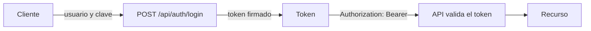
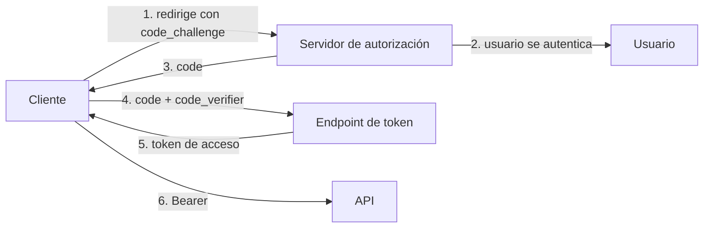

<!-- _class: lead -->

# Módulo 2 - Autenticación, JWT y OAuth

### Un JWT firmado con una llave débil es una contraseña escrita en el token

**Rogelio Arriaga - Raptor Dev Services**

<!--
Este módulo audita cómo una API emite y valida tokens. No se enseña a forjar tokens contra sistemas: cada falla se estudia como "qué es, cómo se detecta, cómo se corrige y qué prueba la cierra", con el código de cursos/api-security/referencia.
-->

---

## Agenda del módulo

| Bloque | Qué hacemos | Tiempo aprox. |
|---|---|---|
| Apertura | Lema, alcance, marco legal y ético | 8 min |
| Parte 1 | API2:2023 Broken Authentication: dónde falla la autenticación de una API | 18 min |
| Parte 2 | Qué es un JWT y qué garantiza (y qué no) | 22 min |
| Parte 3 | Las fallas de validación de JWT y su corrección, con pruebas | 32 min |
| Parte 4 | OAuth 2.0 y OpenID Connect: quién emite, quién valida | 22 min |
| Parte 5 | Login: credenciales, límite de intentos y respuestas | 10 min |
| Cierre | Práctica, tarea y quiz | 8 min |

<!-- Descanso de 10 minutos entre la Parte 2 y la Parte 3. -->

---

## El lema del módulo

> Un JWT firmado con una llave débil es una contraseña escrita en el token.

- La firma es lo único que impide que alguien fabrique un token válido.
- Si la llave se puede adivinar, la firma no protege nada: quien la adivina puede emitir tokens a su nombre.
- Hoy el criterio es **auditable**: la clave mide al menos 256 bits, sale de un secreto aleatorio y la validación comprueba **todo**: firma, algoritmo, emisor, audiencia y vigencia.

---

## Al terminar puedes

- Nombrar las partes de un JWT y decir qué garantiza la firma y qué no.
- Listar lo que una API debe validar en cada token y escribir la prueba de cada punto.
- Configurar `JwtBearer` en ASP.NET Core con validación estricta, incluida la lista de algoritmos permitidos.
- Explicar la diferencia entre OAuth 2.0 (autorización) y OpenID Connect (identidad) y quién valida qué.
- Endurecer un login: misma respuesta para usuario inexistente y clave mala, límite de intentos y clave de firma de al menos 256 bits.

---

## Alcance de este módulo

| Sí | No |
|---|---|
| Auditar cómo **tu** API emite y valida tokens | Fabricar tokens para entrar a sistemas que no son tuyos |
| Pruebas que mandan tokens inválidos a **tu** API y esperan 401 | Procedimientos o herramientas para adivinar llaves de terceros |
| Explicar por qué una llave débil es un riesgo y cómo se corrige | Listas de contraseñas o diccionarios de claves |
| Un laboratorio propio con tokens de ejemplo | Cualquier sistema real |

**Marco legal y ético.** Los tokens de este módulo son de una API de práctica con datos ficticios. Lo que aquí se hace contra "tokens malos" son pruebas **de tu propio código**. Si alguna vez revisas la API de otra persona, necesitas su autorización por escrito (carta del módulo 1 de Ciberseguridad).

---

<!-- _class: lead -->

# Parte 1
## API2:2023 Broken Authentication

---

## Qué es

OWASP define API2:2023 como los **mecanismos de autenticación mal implementados**, que permiten a alguien asumir la identidad de otra persona de forma temporal o permanente.

Dónde suele fallar una API:

| Zona | Ejemplos de falla |
|---|---|
| Credenciales | Se permite probar claves sin límite; se aceptan claves débiles |
| Respuestas del login | El mensaje distingue "usuario no existe" de "clave incorrecta" |
| Tokens | Firma débil, algoritmo no verificado, sin expiración, no se valida la audiencia |
| Recuperación de cuenta | Flujos más débiles que el login |
| Llaves de API | Viajan en la URL, no se rotan, valen para todo |

Fuente: OWASP, API2:2023 *Broken Authentication* (api-security.owasp.org/editions/2023/en/0xa2-broken-authentication).

---

## Autenticar es una decisión de cada solicitud

Una API sin sesión de servidor no "recuerda" quién eres: **cada solicitud trae su prueba** (el token).



- El login se hace **una vez**; el token se manda en cada llamada.
- La API no consulta una base para saber quién eres: **confía en la firma**.
- Por eso cada comprobación del token importa: si falta una, hay una puerta.

---

## Lo que un token no puede hacer

| Un token sí | Un token no |
|---|---|
| Afirmar quién eres (`sub`), para quién es (`aud`) y hasta cuándo vale (`exp`) | Decir que ese objeto es tuyo: eso es autorización (módulo 3) |
| Viajar sin que el servidor guarde estado | Revocarse antes de tiempo, a menos que el servidor guarde una lista |
| Estar firmado para detectar cambios | Ocultar su contenido: **está codificado, no cifrado** |

La última fila se ve en la práctica: la prueba `Un_token_se_lee_sin_la_clave_porque_esta_codificado_no_cifrado` lee el contenido de un token sin conocer la clave. **No pongas secretos en un JWT.**

---

<!-- _class: lead -->

# Parte 2
## Qué es un JWT

---

## Tres partes, separadas por puntos

Un JWT (*JSON Web Token*, RFC 7519) firmado se ve como tres bloques en base64url separados por puntos:

```text
cabecera . cuerpo . firma
```

| Parte | Contiene | Ejemplo ilustrativo |
|---|---|---|
| Cabecera | El algoritmo (`alg`) y el tipo | `{"alg":"HS256","typ":"JWT"}` |
| Cuerpo | Las afirmaciones (*claims*) | `{"sub":"1","role":"cliente","exp":...}` |
| Firma | Un resumen que depende de la cabecera, el cuerpo y la llave | (binario) |

Quien tiene la llave puede **firmar**. Quien tiene la llave (si es simétrica) puede **verificar**. Cualquiera puede **leer** cabecera y cuerpo.

Fuente: RFC 7519 (*JSON Web Token*, mayo de 2015) y RFC 7515 (JWS).

---

## Las afirmaciones que importan

El RFC 7519 define nombres registrados. Las que una API debe mirar:

| Claim | Significado | Qué debe hacer la API |
|---|---|---|
| `iss` | Quién emitió el token | Aceptar solo **tu** emisor |
| `sub` | De quién es | Es el id del usuario |
| `aud` | Para quién es | Si la API no se reconoce en `aud`, **debe rechazarlo** |
| `exp` | Vence | El momento actual debe ser anterior; se permite un margen pequeño |
| `nbf` | No vale antes de | El momento actual debe ser igual o posterior |
| `iat` | Cuándo se emitió | Informativo |
| `jti` | Identificador único | Sirve para listas de revocación o evitar repetición |

Fuente: RFC 7519, sección 4.1 y 7.2.

---

## La firma con HMAC y SHA-256 (HS256)

HS256 firma con una **llave simétrica**: la misma sirve para firmar y para verificar. Es una simulación con el algoritmo real (HMAC con SHA-256 de WebCrypto):

```sim jwt
secreto: secreto-ficticio-de-clase-no-usar-en-produccion
payload: {"sub":"1","role":"cliente"}
```

Prueba en la simulación:

1. Cambia una letra del cuerpo del token: la firma **deja de coincidir**.
2. Cambia el secreto: otro secreto da otra firma.

Conclusión: la firma no esconde nada; **detecta cambios**. Sin la llave no se produce una firma válida.

---

## Cuánto debe medir la llave

RFC 7518, sección 3.2: para HS256 se debe usar una llave **del tamaño de la salida del resumen o mayor**, 256 bits (32 bytes).

```sim jwt
secreto: secreto
payload: {"sub":"1","role":"cliente"}
```

La simulación avisa cuando el secreto mide menos de 256 bits. Una llave corta es **adivinable**: quien tenga un token puede probar llaves candidatas por su cuenta y comprobar la firma sin tocar tu servidor. Por eso la defensa es de **diseño**, no de monitoreo:

- La llave sale de un generador aleatorio, no de una palabra.
- Mide 32 bytes o más.
- Se guarda en un gestor de secretos o en variables de entorno; nunca en el repositorio.

Fuentes: RFC 7518, 3.2; RFC 8725, 3.5 (*Ensure Cryptographic Keys Have Sufficient Entropy*).

---

## Detectar: la llave se valida al arrancar

```csharp
public static class ClavesJwt
{
    /// RFC 7518, 3.2: para HS256 la clave mide 256 bits o mas.
    public const int BytesMinimos = 32;

    public static bool EsValida(string? clave) =>
        !string.IsNullOrWhiteSpace(clave) && Encoding.UTF8.GetByteCount(clave) >= BytesMinimos;
}
```

```csharp {1-3|4-6|*}
builder.Services.AddOptions<OpcionesJwt>().BindConfiguration("Jwt")
    .Validate(o => ClavesJwt.EsValida(o.Clave), "La clave de firma debe medir al menos 256 bits (32 bytes).")
    .Validate(o => !string.IsNullOrWhiteSpace(o.Emisor) && !string.IsNullOrWhiteSpace(o.Audiencia), "Faltan el emisor o la audiencia.")
    .ValidateOnStart();
```

`ValidateOnStart` hace que la aplicación **no arranque** con una clave corta. Es mejor fallar al desplegar que descubrirlo con un incidente.

La prueba `Verlo_fallar_la_aplicacion_no_arranca_con_una_clave_corta` lo comprueba.

---

## Error típico: "es solo para pruebas"

```json
{ "Jwt": { "Clave": "secreto" } }
```

- Se queda en `appsettings.json`, en el repositorio.
- "Después la cambiamos en producción" y nadie lo recuerda.
- El entorno de pruebas usa la misma clave que producción.

**Corrección:** el valor sale de configuración **por entorno** (variables de entorno o gestor de secretos), distinto en cada entorno, y la validación al arrancar impide que una clave corta llegue a ningún lado. Lee `04-backend/10-secretos.md` para el manejo de secretos.

---

## Un JWT está codificado, no cifrado

```csharp
var partes = token.Split('.');
var cabecera = Base64UrlEncoder.Decode(partes[0]);
var cuerpo   = Base64UrlEncoder.Decode(partes[1]);
// cabecera: {"alg":"HS256","typ":"JWT"}
// cuerpo:   {"sub":"1","role":"cliente","exp":...}
```

Cualquiera que reciba el token ve su contenido. De ahí:

- No metas datos personales ni secretos en los claims.
- No tomes decisiones **de seguridad** con un claim que el cliente pueda leer y quiera cambiar: el servidor lo valida con la firma.
- Los claims son una foto del momento en que se emitió el token: si el rol cambia, el token viejo sigue diciendo el rol anterior hasta que expire.

---

<!-- _class: lead -->

# Parte 3
## Validar un JWT: todo, siempre

---

## La lista de comprobación

RFC 8725 (*JSON Web Token Best Current Practices*, febrero de 2020, BCP 225) reúne las prácticas. Las que se vuelven código:

| Práctica | Sección RFC 8725 | En ASP.NET Core |
|---|---|---|
| Verificar el algoritmo | 3.1 | `ValidAlgorithms` |
| Usar algoritmos apropiados | 3.2 | Solo los que tu emisor usa |
| Validar todas las operaciones criptográficas | 3.3 | `ValidateIssuerSigningKey`, `RequireSignedTokens` |
| Llaves con suficiente entropía | 3.5 | `ClavesJwt.EsValida` |
| Validar emisor y sujeto | 3.8 | `ValidateIssuer` |
| Usar y validar la audiencia | 3.9 | `ValidateAudience` |
| No confiar en lo que viene en los claims | 3.10 | Autorizar con datos del servidor |
| Separar tipos de JWT | 3.11, 3.12 | Un `aud` por API, `typ` explícito |

Fuente: RFC 8725, secciones 3.1 a 3.12.

---

## La configuración estricta

```csharp {1-4|5-9|10-14|*}
options.TokenValidationParameters = new TokenValidationParameters
{
    ValidateIssuer = true,
    ValidIssuer = o.Emisor,
    ValidateAudience = true,
    ValidAudience = o.Audiencia,
    ValidateLifetime = true,
    RequireExpirationTime = true,
    RequireSignedTokens = true,
    ValidateIssuerSigningKey = true,
    IssuerSigningKey = new SymmetricSecurityKey(Encoding.UTF8.GetBytes(o.Clave)),
    ValidAlgorithms = [SecurityAlgorithms.HmacSha256],
    ClockSkew = TimeSpan.FromSeconds(30),
    NameClaimType = "sub",
    RoleClaimType = "role",
};
```

Cada línea cierra una clase de token falso. Las pruebas de la siguiente lámina demuestran cuál.

---

## Una línea, una prueba, un token malo

| Línea del código | Token que debe rechazar | Prueba |
|---|---|---|
| `ValidateIssuer` | Emitido por otro emisor | `Un_token_de_otro_emisor_no_entra` |
| `ValidateAudience` | Para otra API | `Un_token_para_otra_audiencia_no_entra` |
| `ValidateLifetime` | Vencido | `Un_token_vencido_no_entra` |
| `RequireExpirationTime` | Sin `exp` | `Un_token_sin_expiracion_no_entra` |
| `RequireSignedTokens` | Sin firma (`alg: none`) | `Un_token_sin_firma_no_entra` |
| `ValidateIssuerSigningKey` | Firmado con otra clave | `Un_token_firmado_con_otra_clave_no_entra` |
| `ValidAlgorithms` | Otro algoritmo, aunque sea la misma clave | `Un_token_con_algoritmo_no_permitido_no_entra` |

Todas esperan **401**. Cada una se midió quitando su línea: la prueba cae. (Tabla de mutaciones en el módulo 6.)

---

## Por qué el algoritmo se fija en el servidor

La cabecera del token dice con qué algoritmo se firmó. **Esa cabecera la escribe quien presenta el token.** Si el servidor hace caso a lo que la cabecera dice, el atacante elige el método con que se le va a comprobar.

- RFC 7518, 3.6: el algoritmo `none` crea un JWS sin firma, y "las implementaciones **no deben** aceptar JWS sin protección por omisión".
- RFC 8725, 3.1: las librerías deben permitir que quien las usa **indique los algoritmos admitidos**, y cada llave debe usarse con **un solo** algoritmo.

Corrección: una lista fija (`ValidAlgorithms = [HmacSha256]`) y `RequireSignedTokens`. La prueba construye un token con otro algoritmo y comprueba que no entra.

Fuentes: RFC 7518, 3.6; RFC 8725, 3.1 (consultados en noviembre de 2026).

---

## Verlo fallar (el método del curso)

Con la línea `ValidAlgorithms = [...]` quitada del código, la suite dice:

```text
Failed ApiSeguridad.Tests.Modulo2Tests.Un_token_con_algoritmo_no_permitido_no_entra
```

Y con `ValidateAudience = false`:

```text
Failed ApiSeguridad.Tests.Modulo2Tests.Un_token_para_otra_audiencia_no_entra
```

Medido al escribir el curso (contenedor del SDK de .NET 10): cada mutación hizo caer **exactamente** la prueba de su línea. Si una prueba **no** cae al quitar su control, la prueba no está probando nada.

> **Hallazgo del propio laboratorio.** Al escribir la prueba de "sin expiración", el token **sí traía** `exp`: el manejador de tokens de la librería agrega una expiración de 60 minutos por omisión cuando no se le da ninguna. La prueba lo apaga (`SetDefaultTimesOnTokenCreation = false`) para fabricar el token sin `exp`. Lección: **comprueba que tu token malo es realmente malo.**

---

## ClockSkew: el margen que se olvida

Al validar `exp`, una librería permite un pequeño margen por diferencias de reloj entre servidores (RFC 7519 lo permite).

- El valor por omisión de `TokenValidationParameters.ClockSkew` es de **5 minutos** (la prueba `El_margen_de_reloj_por_omision_de_la_libreria_es_de_cinco_minutos` lo comprueba en .NET 10).
- Con un token de 15 minutos de vida, eso es un 33 % más de vida **real**.
- La API del curso lo baja a **30 segundos**.

Decisión de diseño, no regla: el margen debe ser el menor que tu infraestructura aguante (relojes sincronizados con NTP).

---

## Vida corta y revocación

| Pregunta | Respuesta de diseño |
|---|---|
| ¿Cuánto vive el token de acceso? | Poco: el de la API de práctica, 15 minutos (`MinutosDeVida`), decisión **ilustrativa** |
| ¿Cómo se "cierra sesión"? | El cliente descarta el token; para invalidarlo antes de `exp` el servidor necesita una lista (por `jti`) |
| ¿Y si cambia el rol de alguien? | El token viejo conserva el rol hasta que expire: vida corta, o consultar el rol en el servidor |
| ¿Y si se filtra un token? | Vida corta limita el daño; rotar la llave invalida **todos** los tokens |

Lee `04-backend/21-jwt.md` y `04-backend/40-session-management.md` para el manejo de renovación y sesiones. El curso `/dotnet-backend/` (unidad de JWT y autenticación) ya cubre cómo se emite y renueva; este módulo se centra en **auditar**.

---

## Asimétrico o simétrico

| | HS256 (simétrico) | RS256 / ES256 (asimétrico) |
|---|---|---|
| Llave | Una sola, compartida | Privada para firmar, pública para verificar |
| ¿Quién puede firmar? | Cualquiera que **verifique** | Solo quien tiene la privada |
| Ideal para | Una sola API que emite y valida | Un emisor y varias APIs que solo verifican |
| Riesgo principal | La llave en muchos lugares | Mezclar algoritmos: una llave debe usarse con un solo algoritmo |

Para varias APIs, lo recomendable es un emisor central (un proveedor de identidad) y llave pública. HS256 en el curso se usa porque se puede reproducir en una sola máquina.

Libro: *The JWT Handbook* (Peyrott, 2018), secciones "JSON Web Signatures" (HS256, RS256 y ES256).

---

<!-- _class: lead -->

# Parte 4
## OAuth 2.0 y OpenID Connect

---

## Quién hace qué

| Actor | Papel |
|---|---|
| **Usuario** (dueño del recurso) | Da o niega permiso |
| **Cliente** | La aplicación que quiere acceder en nombre del usuario |
| **Servidor de autorización** | Autentica al usuario y emite tokens |
| **API** (servidor de recursos) | Recibe el token de acceso y **lo valida** |

- **OAuth 2.0** (RFC 6749) es de **autorización delegada**: "esta aplicación puede leer mis pedidos".
- **OpenID Connect** agrega **identidad** sobre OAuth: un *ID token* que dice quién es el usuario.
- El token de acceso es **para la API**: el cliente no debería interpretarlo; la API lo valida.

Libro: *Keycloak: Identity and Access Management for Modern Applications* (Thorgersen y Silva, 2.ª ed.), caps. 3 a 5.

---

## El flujo recomendado: código de autorización con PKCE



- El **PKCE** (RFC 7636, septiembre de 2015) evita que alguien que intercepte el `code` lo use: el cliente demuestra que es quien lo pidió con un valor que solo él conoce.
- RFC 7636: si el cliente puede usar `S256`, **debe** usarlo.
- RFC 9700 (*Best Current Practice for OAuth 2.0 Security*, enero de 2025, BCP 240): los clientes públicos **deben** usar PKCE y los servidores de autorización **deben** soportarlo.

---

## Lo que ya no se hace

RFC 9700 (a noviembre de 2026, la guía vigente de seguridad de OAuth 2.0):

| Flujo | Qué dice RFC 9700 |
|---|---|
| Implícito (`response_type=token`) | Los clientes **no deberían** usarlo (salvo mitigaciones): usar código de autorización |
| Contraseña del propietario (*Resource Owner Password Credentials*) | **No debe** usarse |
| Código sin PKCE en clientes públicos | Los clientes públicos **deben** usar PKCE |

Al auditar: si una aplicación o un proveedor usa implícito o contraseña directa, es un hallazgo con su guía de migración.

Fuente: RFC 9700, secciones 2.1.1, 2.1.2 y 2.4 (consultado en noviembre de 2026).

---

## Qué valida la API cuando hay un servidor de autorización

Con un servidor de autorización externo (por ejemplo Keycloak), la API **no tiene la llave de firma**: valida con la **llave pública** que el servidor publica.

- La API confirma el emisor (`iss`), la audiencia (`aud`) y la vigencia.
- La API verifica el algoritmo contra su **lista**, no contra la cabecera del token (Parte 3).
- Los permisos finos (roles, ámbitos) se **comprueban en el servidor**, aunque vengan en el token (RFC 8725, 3.10).

```csharp
// Fragmento: validar contra un servidor de autorización externo (no es parte de la referencia).
.AddJwtBearer(o =>
{
    o.Authority = "https://id.ejemplo.test/realms/tienda";   // de aquí salen la llave pública y el emisor
    o.Audience = "api-ejemplo";                               // para quién es el token
});
```

Lee `03-arquitectura/08-keycloak.md` y `04-backend/39-sso-oidc.md` en dev-notes.

---

## Error típico: confundir token de identidad con token de acceso

| Token | Para quién | Qué contiene |
|---|---|---|
| ID token (OpenID Connect) | El **cliente**: sabe quién inició sesión | Identidad del usuario |
| Token de acceso (OAuth 2.0) | La **API**: autoriza la llamada | Ámbitos, audiencia |

Falla frecuente: el cliente manda el **ID token** a la API (que no es para ella) o la API acepta tokens de **cualquier** audiencia.

RFC 8725 (2.8, *Cross-JWT Confusion*, y 3.12) pide que los tokens de distinto tipo tengan reglas de validación **mutuamente excluyentes**. En la práctica: una audiencia por API, y comprobarla.

---

<!-- _class: lead -->

# Parte 5
## El login

---

## Tres decisiones de un login

```csharp {1-3|4-6|7-9}
api.MapPost("/auth/login", (LoginSolicitud s, Almacen datos, EmisorDeTokens emisor) =>
{
    var usuario = datos.Usuarios.FirstOrDefault(u => string.Equals(u.Nombre, s.Usuario, StringComparison.OrdinalIgnoreCase));
    // Mismo trabajo y misma respuesta si el usuario no existe: no se revela quien tiene cuenta.
    var correcta = Contrasenas.Verificar(s.Clave, usuario?.HashContrasena ?? hashFalso);
    return correcta && usuario is not null
        ? Results.Ok(new { token = emisor.Crear(usuario.Id, usuario.Rol) })
        : Results.Problem(statusCode: 401, title: "Credenciales invalidas");
}).AllowAnonymous().RequireRateLimiting("login");
```

1. **Misma respuesta** para "usuario no existe" y "clave mala" (prueba `Usuario_inexistente_y_clave_mala_responden_igual`).
2. **Mismo trabajo**: si el usuario no existe, se verifica contra un hash falso para que no cambie el tiempo.
3. **Límite de intentos**: el sexto intento del minuto recibe 429 (prueba `El_sexto_intento_de_login_en_un_minuto_se_limita`).

---

## Cómo se guarda una contraseña

```csharp
// PBKDF2-HMAC-SHA256, con sal aleatoria de 16 bytes
var hash = Rfc2898DeriveBytes.Pbkdf2(clave, sal, Iteraciones, HashAlgorithmName.SHA256, 32);
```

- El cheat sheet *Password Storage* de OWASP recomienda **Argon2id** como primera opción y, si no se puede, **PBKDF2-HMAC-SHA256 con 600 000 iteraciones** (consultado en noviembre de 2026). La API de práctica usa PBKDF2 porque viene en la biblioteca base de .NET.
- La comparación del hash usa `CryptographicOperations.FixedTimeEquals` (tiempo constante).
- Nunca se guarda la contraseña ni se registra en la bitácora.

Libros: *Serious Cryptography* (Aumasson), caps. 6 y 7 (funciones hash y hash con llave); *Pentesting APIs* (Harley, 2024), cap. 4.

---

## El límite de intentos, bien puesto

```csharp
o.AddPolicy("login", contexto => RateLimitPartition.GetFixedWindowLimiter(
    contexto.Connection.RemoteIpAddress?.ToString() ?? "desconocida",
    _ => new FixedWindowRateLimiterOptions { PermitLimit = 5, Window = TimeSpan.FromMinutes(1), QueueLimit = 0 }));
```

- Una **partición por cliente**: sin ella, el contador es de todos y un solo cliente puede agotarlo (módulo 4).
- Tras un proxy, la dirección que ve la aplicación es la del proxy: hay que configurar los encabezados reenviados (`X-Forwarded-For`) con redes de confianza.
- Un límite por IP no basta contra intentos repartidos: se complementa con un límite **por cuenta** y alertas (curso `/blue-team/`).

Fuente: Microsoft Learn, *Rate limiting middleware in ASP.NET Core* (consultada en noviembre de 2026).

---

## Cómo se vería en tus bitácoras

Señales de un login bajo presión (a nivel conceptual):

- Muchos 401 seguidos al mismo endpoint de login desde pocas direcciones.
- Muchos 429: tu límite está trabajando. Es una **buena** señal si alguien lo dispara.
- Intentos con muchos nombres de usuario distintos desde la misma dirección.
- Un 200 tras una larga racha de 401 sobre la misma cuenta.

Registra **resultado, cuenta (hash o id) y dirección**, no la clave. Qué hacer con la alerta es del curso `/blue-team/`.

---

## Tu práctica de hoy

Todo con la API de referencia:

1. Correr `Modulo2Tests` y leer cada token malo.
2. **Verlo fallar** tres veces: quitar `ValidAlgorithms`, poner `ValidateAudience = false`, y poner una clave corta.
3. Leer el contenido de un token sin la clave (codificado, no cifrado).
4. Comprobar el comportamiento de login: misma respuesta y sexto intento.
5. Auditar la validación de tokens de **tu** API con la lista de la Parte 3 (tabla de la tarea).

---

<!-- _class: lead -->

# Cierre

## Lo que te llevas

- Un JWT está **codificado, no cifrado**. La firma detecta cambios; no oculta contenido.
- La llave de HS256 mide 256 bits o más, sale de un generador aleatorio y se valida al arrancar.
- La API valida **todo**: firma, algoritmo (de una lista fija), emisor, audiencia y vigencia, y lo prueba con un token malo por cada control.
- OAuth 2.0 delega permisos; OpenID Connect agrega identidad. Hoy: código con PKCE, sin implícito ni contraseña directa.
- Un login iguala sus respuestas y limita sus intentos.
- Una prueba que no cae al quitar su control no prueba nada.

**Siguiente módulo:** Autorización rota: BOLA, BOPLA y BFLA.

---

## Referencias

- OWASP. *API2:2023 Broken Authentication*. api-security.owasp.org
- IETF. *RFC 7519: JSON Web Token (JWT)*, mayo de 2015. rfc-editor.org/rfc/rfc7519
- IETF. *RFC 7518: JSON Web Algorithms (JWA)*, secciones 3.2 y 3.6. rfc-editor.org/rfc/rfc7518
- IETF. *RFC 8725: JSON Web Token Best Current Practices*, febrero de 2020 (BCP 225). rfc-editor.org/rfc/rfc8725
- IETF. *RFC 6749: The OAuth 2.0 Authorization Framework*. rfc-editor.org/rfc/rfc6749
- IETF. *RFC 7636: Proof Key for Code Exchange by OAuth Public Clients*, septiembre de 2015. rfc-editor.org/rfc/rfc7636
- IETF. *RFC 9700: Best Current Practice for OAuth 2.0 Security*, enero de 2025 (BCP 240). rfc-editor.org/rfc/rfc9700
- OWASP. *Password Storage Cheat Sheet*. cheatsheetseries.owasp.org
- Microsoft. *Rate limiting middleware in ASP.NET Core*. learn.microsoft.com
- *The JWT Handbook* (Peyrott, 2018), secciones "JSON Web Tokens in Detail" y "JSON Web Signatures". *Pentesting APIs* (Harley, 2024), cap. 4. *Hacking APIs* (Ball, 2022), cap. 8. *Keycloak* (Thorgersen y Silva, 2.ª ed.), caps. 3 a 5. *Identity-Native Infrastructure Access Management* (Kontsevoy et al., 2023), caps. 4 y 5. *Zero Trust Networks* (Rais et al., 2024), cap. 6. *Security and Microservice Architecture on AWS* (Raje, 2021), cap. 2. *Serious Cryptography* (Aumasson), caps. 6 y 7.
