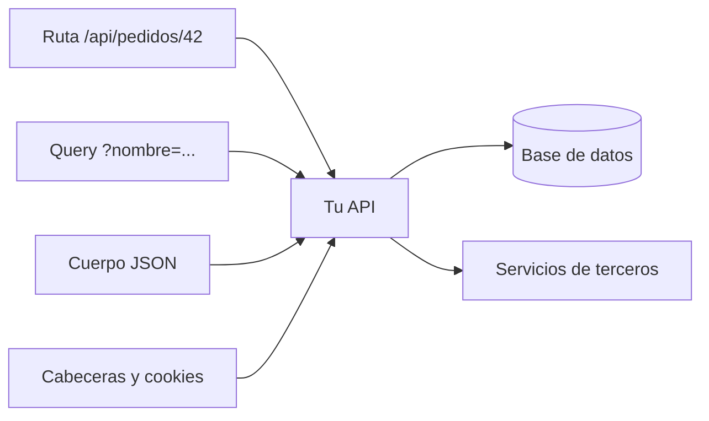
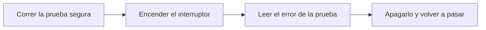

<!-- _class: lead -->

# Módulo 4 - Inyección, errores y límites

### Lo que entra, lo que sale cuando algo falla y cuánto se le permite consumir a un cliente

**Rogelio Arriaga - Raptor Dev Services**

<!--
Este módulo es de defensa. Cada clase de falla se estudia con la misma ruta: qué es, por qué ocurre, cómo se detecta, cómo se corrige y cómo se verifica la corrección. No hay cargas de ataque: la detección de inyección se hace con una prueba inocente (un apóstrofe dentro de un nombre) sobre código propio.
-->

---

## Agenda del módulo

| Bloque | Qué hacemos | Tiempo aprox. |
|---|---|---|
| Apertura | Lema, alcance y la aplicación de práctica | 10 min |
| Parte 1 | Toda entrada es no confiable: validar con lista de permitidos | 14 min |
| Parte 2 | Inyección: datos que se vuelven código | 24 min |
| Parte 3 | Errores: lo que una excepción le cuenta a quien mira | 22 min |
| Parte 4 | Consumo de recursos y límites de peticiones (API4:2023) | 30 min |
| Parte 5 | Verlo fallar: los tres interruptores del laboratorio | 10 min |
| Cierre | Práctica, tarea y quiz | 10 min |

<!-- Descanso de 10 minutos entre la Parte 3 y la Parte 4. -->

---

## El lema del módulo

> Un mensaje de error detallado le cuenta al atacante cómo está hecha su API.

- Una API habla con tres tipos de interlocutor: quien la llama, su base de datos y quien mira sus errores.
- Si confías en lo que llega, **inyección**. Si cuentas de más cuando algo falla, **fuga por error**. Si no pones tope, **consumo sin límite**.
- Las tres fallas se cierran con controles pequeños y se comprueban con pruebas pequeñas.

---

## Al terminar puedes

- Explicar por qué una consulta armada con texto concatenado es el origen de la inyección y por qué parametrizar la cierra.
- Detectar una consulta mal armada con una prueba que no es un ataque.
- Devolver errores en formato de problema (RFC 9457) sin revelar la excepción, y poder rastrearlos por un identificador.
- Poner topes a la paginación, al tamaño del cuerpo y a la frecuencia de las peticiones, y probar que se cumplen.
- Encender una falla en la aplicación de práctica, **verla fallar** y apagarla.

---

## Alcance de este módulo

| Sí | No |
|---|---|
| Qué es la inyección, por qué ocurre, cómo se detecta y se corrige | Cadenas de ataque o listas de entradas "que funcionan" |
| Una prueba de detección con un apóstrofe en un dato legítimo | Pruebas contra servidores que no sean los tuyos |
| Manejo de errores, límites y su verificación con pruebas | Saturar un servicio para "ver si aguanta" fuera de tu laboratorio |
| El código de práctica de este curso, con sus interruptores | Estas fallas en una aplicación real: los interruptores solo existen en la práctica |

**Marco legal y ético.** Todo se hace sobre la aplicación de práctica que viene con el curso, en tu propia computadora. Probar una API que no es tuya, sin autorización escrita, puede constituir un delito aunque "solo estés mirando"; los cursos `/cybersecurity/` y `/cyber-law/` explican el marco y la carta de autorización.

---

## La aplicación de práctica

El código de las prácticas está en `cursos/api-security/referencia/`: una API de ASP.NET Core con .NET 10 y sus pruebas de xUnit.

| Pieza | Para qué sirve en este módulo |
|---|---|
| `Catalogo.cs` | Búsqueda de productos en SQLite en memoria, en versión parametrizada y en versión concatenada |
| `ManejadorDeErrores` (`Infraestructura.cs`) | Convierte cualquier excepción en un problema HTTP sin detalles |
| `AgregarLimites` y `UseTopeDeCuerpo` | Limitador de intentos de login y tope del cuerpo de la petición |
| `Modulo4Tests.cs` | Las pruebas que se ven fallar |
| `LabOpciones` (`Lab.cs`) | Interruptores que reintroducen una falla a propósito, solo en la práctica |

> Datos, usuarios y productos son **ficticios** (Ejemplo ilustrativo). Las pruebas corren con `dotnet test --filter "Categoria=Seguridad"`.

---

<!-- _class: lead -->

# Parte 1
## Toda entrada es no confiable

---

## De dónde llega lo que no controlas



- Ruta, *query string*, cuerpo y cabeceras los escribe el cliente. Un cliente puede ser tu aplicación móvil... o un programa escrito por otra persona.
- Todo lo que viaja ahí tiene que **validarse en el servidor**. La validación del formulario es comodidad del usuario, no una defensa.

---

## Lista de permitidos, no lista de prohibidos

| Enfoque | Cómo piensa | Problema |
|---|---|---|
| Lista de prohibidos | "Rechazo estos caracteres peligrosos" | Siempre falta uno; depende del contexto en que se use el dato |
| **Lista de permitidos** | "Acepto solo esta forma: tipo, largo, rango, formato" | Lo que no cumple se rechaza sin discutir |

Lo que se valida, en este orden:

1. **Tipo:** un `int` es un `int`; el enlace de parámetros de ASP.NET Core ya lo rechaza si no lo es.
2. **Largo y rango:** `nombre` de 1 a 50 caracteres; `limite` de 1 a 50.
3. **Formato:** una fecha, un correo, un identificador con su patrón.
4. **Negocio:** el cupón existe y el pedido es tuyo.

Fuente: OWASP, *Input Validation Cheat Sheet* (cheatsheetseries.owasp.org).

---

## En el código de práctica

```csharp {1-2|4-6|8|*}
// Largo: una busqueda de mas de 50 caracteres no es una busqueda.
if (nombre is { Length: > 50 }) return Results.Problem(statusCode: 400, title: "Busqueda demasiado larga");

// Rango: el cliente sugiere, el servidor decide.
var tamano = Math.Clamp(limite ?? 20, 1, 50);
var pag = Math.Max(pagina ?? 1, 1);

return Results.Ok(new { pagina = pag, limite = tamano, items });
```

- Ejemplo del endpoint `GET /api/productos` de la aplicación de práctica (fragmento).
- Rechazar con **400** cuando el dato no cumple; **acotar** (`Math.Clamp`) cuando un valor fuera de rango no tiene por qué ser un error.
- La respuesta de rechazo es un problema HTTP, no un texto libre. Más adelante, por qué.

---

## Error típico: validar en un solo lugar

| Síntoma | Causa | Corrección |
|---|---|---|
| El formulario web valida, la API acepta cualquier cosa | La validación vive solo en el cliente | Validar en la API, siempre |
| `GET /productos` valida, `POST /productos/importar` no | Cada endpoint valida a su manera | Una regla compartida por tipo de dato |
| Se valida, pero después se concatena | Validar no sustituye parametrizar | Las dos cosas: validar **y** parametrizar |

Lecturas: `04-backend/06-validation.md` (validación centralizada con FluentValidation y un pipeline behavior) y, en el curso `/web-security/`, la sesión de OWASP.

---

<!-- _class: lead -->

# Parte 2
## Inyección: datos que se vuelven código

---

## Qué es y por qué ocurre

**Inyección** es cuando un dato que escribió quien llama termina interpretado como **instrucción** por otro programa: la base de datos, el sistema operativo, un directorio LDAP, el motor de una plantilla.

La causa es siempre la misma: **se armó una instrucción pegando texto** y el programa que la lee no puede distinguir qué parte puso el programador y cuál puso el cliente.

- Es la categoría **A05 Injection** de la lista OWASP Top 10:2025 (top10.owasp.org/2025, a noviembre de 2026).
- En la lista de APIs de 2023 no figura como categoría propia.
- *Pentesting APIs* (Harley, 2024), cap. 5, la trata como "Injection Attacks and Validation Testing"; *Web Application Security* (Hoffman, 2.ª ed.), cap. 13, como "Injection".

---

## Una consulta armada con texto

Dos versiones del mismo método de la aplicación de práctica (`Catalogo.cs`):

```csharp {1-3|5-8}
// VULNERABLE (solo con Lab:SqlConcatenado). No se imita en codigo real.
cmd.CommandText = "SELECT id, nombre, precio FROM productos WHERE nombre LIKE '%"
                  + nombre + "%' ORDER BY id LIMIT " + limite + " OFFSET " + ((pagina - 1) * limite);

// Segura: la sentencia es fija; el dato viaja aparte, como parametro.
cmd.CommandText = "SELECT id, nombre, precio FROM productos WHERE nombre LIKE $patron ORDER BY id LIMIT $limite OFFSET $desde";
cmd.Parameters.AddWithValue("$patron", "%" + nombre + "%");
cmd.Parameters.AddWithValue("$limite", limite);
```

- En la primera, el texto del cliente **forma parte de la sentencia**: si trae una comilla, cambia la estructura.
- En la segunda, la base de datos recibe la **sentencia** y los **datos** por canales distintos: lo que escriba el cliente nunca se lee como SQL.

---

## Verlo: la simulación

Una tabla en memoria con datos ficticios. Compara cómo se evalúa la sentencia concatenada y cómo se enlaza la parametrizada. Escribe un nombre normal y luego uno que lleve un apóstrofe; lee lo que pasa con la estructura de la sentencia.

```sim sqli
usuario: ana
clave: clave-de-ejemplo
fila: 1 | ana | cliente | clave-de-ejemplo
fila: 2 | beto | cliente | otra-clave
fila: 3 | admin | admin | clave-de-admin
```

> Ejemplo ilustrativo: usuarios y claves ficticios. La simulación es una **simulación**, no una base de datos real; los rótulos de la lámina dicen qué simplifica.

---

## Cómo se detecta: una prueba inocente

No hace falta una carga de ataque. Un dato **legítimo** con un apóstrofe basta para saber si la consulta se arma con texto:

```csharp
[Fact]
public async Task Un_apostrofe_en_la_busqueda_es_texto_y_no_rompe_la_consulta()
{
    using var f = new Fabrica();
    using var c = f.ComoUsuario(1);
    var r = await c.GetAsync("/api/productos?nombre=O'Brien");
    Assert.Equal(HttpStatusCode.OK, r.StatusCode);
    Assert.Contains("Cuaderno O'Brien", await r.TextAsync());
}
```

- El catálogo ficticio trae un producto llamado "Cuaderno O'Brien": un nombre real tiene apóstrofe, y un nombre real no debe romper nada.
- Con la consulta parametrizada la prueba pasa. Con la concatenada, la API responde **500**. Eso **es** la detección.

---

## Otras formas de detectarla

| Técnica | Qué busca | Límite |
|---|---|---|
| Prueba de apóstrofe sobre datos legítimos | Que un dato con comilla no cambie el comportamiento | Solo cubre los campos que pruebas |
| Revisión de código | `CommandText = "..." + variable`, `FromSqlRaw($"...{x}")`, `ExecuteSqlRaw` con interpolación | Hay que saber qué buscar |
| Análisis estático (SAST) | El mismo patrón, a escala | Falsos positivos; no ve datos que llegan de otro lado |
| Bitácora de la base de datos | Errores de sintaxis SQL que vienen de la aplicación | Llega tarde: el daño ya pasó |

*Pentesting APIs* (Harley, 2024), cap. 5, y *Bug Bounty Bootcamp* (Li, 2021), cap. 24 ("API Hacking"), describen cómo lo ve un probador; aquí lo importante es **qué buscas en tu propio código**.

---

## Cómo se corrige

1. **Consultas parametrizadas** para todo dato que llegue de fuera.
2. **Lista de permitidos** para lo que no se puede parametrizar: nombres de tabla o de columna, dirección de orden.
3. **Escapar a mano**: desaconsejado. El *SQL Injection Prevention Cheat Sheet* de OWASP lo califica de "strongly discouraged": cambia con el motor y con la configuración.

```csharp
// Lo que el cliente elige se traduce a un valor que TU codigo posee; lo demas se rechaza.
var columna = ordenarPor switch
{
    "nombre" => "nombre",
    "precio" => "precio",
    _ => null,
};
if (columna is null) return Results.Problem(statusCode: 400, title: "Orden no permitido");
```

Fragmento ilustrativo; no forma parte de la aplicación de práctica.

---

## Con EF Core

| Método | ¿Parametriza el dato interpolado? |
|---|---|
| `FromSql($"... {valor}")` | **Sí**: el valor se envuelve en un `DbParameter` |
| `FromSqlInterpolated($"... {valor}")` | **Sí** |
| `FromSqlRaw($"... {valor}")` | **No**: la cadena ya viene armada; "puede ser vulnerable si se usa mal" |
| `FromSqlRaw("... @p", parametro)` | Sí, con el parámetro explícito |

Fuente: Microsoft Learn, *SQL Queries - EF Core* (consultada en noviembre de 2026). La misma página aclara que las bases de datos no permiten parametrizar nombres de columna: ahí aplica la lista de permitidos.

Lectura: `04-backend/17-ef-core.md` y `04-backend/23-dapper.md` para el acceso a datos del curso `/dotnet-backend/`.

---

## Otras inyecciones, a nivel de idea

| Clase | Qué se interpreta | La corrección tiene la misma forma |
|---|---|---|
| SQL | Una sentencia de base de datos relacional | Parámetros |
| NoSQL | Un filtro u operador de una base documental | Construir el filtro con API tipada, no pegando JSON de la entrada |
| Comando de sistema | Una línea de comandos | No invocar un intérprete; pasar argumentos como lista, no como texto |
| LDAP, XPath, plantillas | Una consulta o plantilla | Escapar o parametrizar según el motor, y validar |

- En todas, el patrón es el de la lámina anterior: **separar la instrucción de los datos** y **validar** lo que no se puede separar.
- *Web Application Security* (Hoffman, 2.ª ed.), cap. 13 (ataque) y cap. 31 ("Defending Against Injection", defensa), recorren las clases.

---

## Error típico: "ya filtro las comillas"

| Intento | Por qué no basta |
|---|---|
| Quitar las comillas simples del texto | Rompe nombres legítimos (O'Brien) y deja entradas que no usan comillas |
| Una lista de palabras prohibidas | Siempre falta una; cambia con el motor |
| Confiar en que el ORM "ya lo hace" | Solo lo hace con sus métodos seguros; `FromSqlRaw` con interpolación no |
| Validar y luego concatenar | La validación puede fallar o cambiar; el parámetro no depende de ella |

La corrección que cierra la clase no es "limpiar" el dato: es **no mezclarlo con la instrucción**.

---

## Cómo se verifica la corrección

1. La prueba del apóstrofe **pasa** con la versión parametrizada.
2. **Quita el arreglo** (enciende `Lab:SqlConcatenado`) y comprueba que la prueba **cae**: si no cae, la prueba no mide nada.
3. La prueba se queda en el repositorio: es el seguro contra el siguiente merge.

```text
Pasa    Un_apostrofe_en_la_busqueda_es_texto_y_no_rompe_la_consulta
Falla   Verlo_fallar_con_la_consulta_concatenada_el_apostrofe_da_error_500   (se espera 500 con el interruptor)
```

Un hallazgo cerrado **sin** una prueba que lo demuestre vuelve en el siguiente cambio.

---

<!-- _class: lead -->

# Parte 3
## Errores: lo que una excepción le cuenta a quien mira

---

## Qué filtra un error

Cuando algo falla y la API devuelve la excepción tal cual, la respuesta puede traer:

| Dato en el error | Qué le sirve a quien lo lee |
|---|---|
| Traza de la pila (`at Namespace.Clase...`) | Nombres de clases, rutas y versiones de librerías |
| Mensaje del motor de base de datos | Nombres de tablas y columnas, el motor y su versión |
| Cadena de conexión o ruta de un archivo | Dónde vive la base y con qué cuenta se conecta |
| Diferencias entre "no existe" y "no es tuyo" | Qué identificadores existen (enumeración) |

- Según el *Error Handling Cheat Sheet* de OWASP: las trazas, los errores de SQL y las rutas de archivos ayudan en el reconocimiento y no deben llegar al cliente.
- *Pentesting APIs* (Harley, 2024), cap. 6, "Error Handling and Exception Testing".

---

## El estándar: problemas HTTP (RFC 9457)

El RFC 9457, *Problem Details for HTTP APIs* (julio de 2023), reemplaza al RFC 7807. Define un formato legible por máquinas para describir un error: tipo de medio `application/problem+json`.

| Miembro | Qué dice |
|---|---|
| `type` | URI que identifica el tipo de problema (por omisión, `about:blank`) |
| `title` | Resumen corto del tipo de problema |
| `status` | Código HTTP de esta ocurrencia (informativo) |
| `detail` | Explicación de **esta** ocurrencia, para que el cliente la corrija |
| `instance` | URI de esta ocurrencia concreta |

El propio RFC advierte que un problema puede filtrar información sensible: no pongas en `detail` los internos de la implementación (por ejemplo, un volcado de la pila).

---

## Un manejador global

```csharp {1-2|4-5|7-13|15|*}
public sealed class ManejadorDeErrores(IOptions<LabOpciones> lab, ILogger<ManejadorDeErrores> bitacora, IProblemDetailsService problemas)
    : IExceptionHandler
{
    public async ValueTask<bool> TryHandleAsync(HttpContext contexto, Exception excepcion, CancellationToken ct)
    {
        bitacora.LogError(excepcion, "Error no controlado. TraceId {TraceId}", contexto.TraceIdentifier);
        contexto.Response.StatusCode = StatusCodes.Status500InternalServerError;
        var problema = new ProblemDetails
        {
            Status = StatusCodes.Status500InternalServerError,
            Title = "Error interno",
            Detail = lab.Value.ErroresDetallados ? excepcion.ToString() : null,
        };
        problema.Extensions["traceId"] = contexto.TraceIdentifier;
        return await problemas.TryWriteAsync(new ProblemDetailsContext { HttpContext = contexto, ProblemDetails = problema });
    }
}
```

- El detalle completo va a la **bitácora** del servidor; al cliente, un `traceId` para soporte.
- `Detail` solo se llena con el interruptor del laboratorio: es lo que verás fallar en la práctica.

---

## Registrarlo en el pipeline

```csharp
builder.Services.AddProblemDetails();
builder.Services.AddExceptionHandler<ManejadorDeErrores>();
// ...
var app = builder.Build();
app.UseExceptionHandler();
app.UseStatusCodePages();
```

- `UseExceptionHandler()` va **primero**: captura lo que falle en el resto del pipeline.
- `UseStatusCodePages()` hace que respuestas vacías (404, 401, 403) también salgan como problema.
- En producción no se activa la página de errores del desarrollador (*Error Handling Cheat Sheet*, OWASP). Lectura: `04-backend/08-problem-details.md`.

---

## 4xx y 5xx: quién se equivocó

| Código | Quién falló | Ejemplo en la práctica |
|---|---|---|
| 400 | El cliente mandó un dato inválido | Búsqueda de más de 50 caracteres |
| 401 | No hay sesión o es inválida | Token vencido |
| 404 | El recurso no existe **o no es tuyo** | Pedido ajeno |
| 409 | El estado actual lo impide | Cupón ya usado |
| 422 | El dato está bien formado pero no es admisible | Cupón desconocido |
| 429 | Demasiadas peticiones | Quinto intento de login |
| 500 | Falló el servidor | Excepción no controlada |

Un **500** no debe ocurrir por un dato del cliente: un 500 provocado con una entrada corriente es un hallazgo (como el del apóstrofe).

---

## La prueba del error

```csharp {1-4|5-9|*}
using var f = new Fabrica("ProvocarFalla");
using var admin = f.ComoUsuario(3);
var r = await admin.GetAsync("/api/reportes/resumen");
var cuerpo = await r.TextAsync();
Assert.Equal(HttpStatusCode.InternalServerError, r.StatusCode);
Assert.Equal("application/problem+json", r.Content.Headers.ContentType?.MediaType);
Assert.DoesNotContain("Password", cuerpo);
Assert.DoesNotContain("InvalidOperationException", cuerpo);
Assert.Contains("traceId", cuerpo);
```

- La excepción del laboratorio lleva una cadena de conexión **ficticia** (`Host=db.interna;Password=ejemplo-no-real`).
- La prueba afirma lo que **no** debe estar en el cuerpo, además de lo que sí.
- Con `Lab:ErroresDetallados` encendido, la prueba contraria ("la cadena de conexión aparece") pasa: así sabes que mide algo.

---

## Error típico: el mensaje "útil"

| Respuesta | Por qué es un problema |
|---|---|
| "Usuario no encontrado" / "Contraseña incorrecta" por separado | Revela qué cuentas existen |
| "Error en la columna `RFC_CLIENTE` de la tabla `FACTURAS`" | Cuenta el esquema |
| "Timeout conectando a 10.0.3.14:5432" | Cuenta la red interna |
| Un 403 para pedidos ajenos y un 404 para inexistentes | Permite enumerar identificadores |

Una API segura da la **misma** respuesta en casos que no debe distinguir (el login del módulo 2 y el 404 del módulo 3), y deja el detalle para la bitácora, enlazada por `traceId`.

---

## Una bitácora que sirva sin filtrar

- El `traceId` sale en la respuesta **y** en la entrada de bitácora: soporte busca por él.
- No registres secretos: contraseñas, tokens, cadenas de conexión completas.
- Una falla frecuente de 5xx es una señal: alerta sobre la tasa de errores, no solo sobre su existencia.

*Building Secure and Reliable Systems* (Adkins et al., 2020), cap. 15 ("Investigating Systems"), trata cómo se investiga un sistema a partir de sus registros.

---

<!-- _class: lead -->

# Parte 4
## Consumo de recursos y límites (API4:2023)

---

## Qué dice la categoría

**API4:2023 - Unrestricted Resource Consumption** (OWASP API Security Top 10, 2023): una API que atiende peticiones sin límite consume CPU, memoria, ancho de banda, almacenamiento o servicios de pago de terceros (por ejemplo, el costo de enviar mensajes). Las consecuencias van de la lentitud a la caída o a la factura inesperada.

| Recurso | Cómo se agota sin querer o a propósito | Límite que lo contiene |
|---|---|---|
| Memoria y CPU | Una respuesta con miles de registros | Tope de paginación |
| Ancho de banda y memoria | Un cuerpo de petición gigante | Tope de tamaño del cuerpo |
| Hilos y conexiones | Muchas peticiones lentas | Tiempos máximos y concurrencia |
| La base de datos | Una ráfaga de peticiones caras | Límite de frecuencia por cliente |
| Presupuesto | Un endpoint que dispara mensajes de pago | Límite por cliente y por cuenta |

---

## Límite 1: paginación con tope

```csharp {1-2|3|*}
// El cliente sugiere el tamano de pagina; el servidor decide el maximo.
var tamano = opciones.Value.SinTopeDePagina ? limite ?? 20 : Math.Clamp(limite ?? 20, 1, 50);
var pag = Math.Max(pagina ?? 1, 1);
```

```csharp
[Fact]
public async Task El_cliente_no_decide_cuantos_registros_recibe()
{
    // ... GET /api/productos?limite=100000
    Assert.Equal(50, doc.RootElement.GetProperty("items").GetArrayLength());
}
```

- El catálogo ficticio tiene 120 productos: pedir "100000" devuelve 50. Con `Lab:SinTopeDePagina`, devuelve los 120 (la prueba contraria lo comprueba).
- Un tope por omisión también para el **valor por omisión** (20): sin parámetros, la respuesta ya es acotada.

---

## Límite 2: tamaño del cuerpo

Dos capas:

| Capa | Qué hace | En la práctica |
|---|---|---|
| Kestrel (servidor) | `Limits.MaxRequestBodySize`; la documentación de Kestrel indica por omisión 30 000 000 bytes (unos 28.6 MB) | `ConfigureKestrel(k => k.Limits.MaxRequestBodySize = 64 * 1024)` |
| Aplicación | Rechaza con 413 antes de leer si `Content-Length` pasa el tope | `UseTopeDeCuerpo()` |

```csharp
if (contexto.Request.ContentLength > MaximoCuerpoBytes)
{
    await Results.Problem(statusCode: StatusCodes.Status413PayloadTooLarge, title: "Cuerpo demasiado grande")
        .ExecuteAsync(contexto);
    return;
}
```

- El tope por omisión sirve para un sitio de archivos, no para una API de JSON que recibe objetos de unos cientos de bytes: **ajústalo a tu API**.
- Fuente: Microsoft Learn, *Configure options for the ASP.NET Core Kestrel web server* (consultada en noviembre de 2026).

---

## Límite 3: frecuencia de peticiones

ASP.NET Core trae un middleware de límite de frecuencia (`Microsoft.AspNetCore.RateLimiting`). Cuatro algoritmos:

| Algoritmo | Cómo limita | Cuándo conviene |
|---|---|---|
| Ventana fija (*fixed window*) | N peticiones por ventana de tiempo; al cambiar de ventana se reinicia | Casos simples; login |
| Ventana deslizante (*sliding window*) | Igual, pero la ventana se divide en segmentos y se desliza | Reparto más parejo |
| Cubeta de tokens (*token bucket*) | Se reponen tokens a un ritmo; permite ráfagas controladas | Clientes legítimos con picos |
| Concurrencia (*concurrency*) | Limita las peticiones **simultáneas**, no las de un periodo | Endpoints caros (reportes) |

La documentación aclara que los tres primeros limitan peticiones por periodo y el de concurrencia solo las simultáneas. Fuente: Microsoft Learn, *Rate limiting middleware in ASP.NET Core* (consultada en noviembre de 2026).

---

## Límite por cliente: particiones

```csharp {1-2|3-5|*}
o.RejectionStatusCode = StatusCodes.Status429TooManyRequests;
// Una particion por cliente: sin ella, un solo cliente agota el permiso de todos.
o.AddPolicy("login", contexto => RateLimitPartition.GetFixedWindowLimiter(
    contexto.Connection.RemoteIpAddress?.ToString() ?? "desconocida",
    _ => new FixedWindowRateLimiterOptions { PermitLimit = 5, Window = TimeSpan.FromMinutes(1), QueueLimit = 0 }));
```

```csharp
api.MapPost("/auth/login", ...).AllowAnonymous().RequireRateLimiting("login");
```

- Una **partición** es un cubo de contadores por clave (IP, usuario, llave de API). La documentación presenta la partición como lo que impide que un usuario consuma el límite de todos.
- 5 intentos por minuto y por dirección: el sexto recibe **429**.
- La prueba: `El_sexto_intento_de_login_en_un_minuto_se_limita` (módulo 2).

---

## 429 y `Retry-After`

El RFC 6585 (abril de 2012), sección 4, define el código **429 Too Many Requests**: "el usuario ha enviado demasiadas peticiones en un periodo dado"; la respuesta **puede** incluir `Retry-After` para decir cuánto esperar.

```csharp {3-5|6-7|*}
o.OnRejected = async (contexto, ct) =>
{
    if (contexto.Lease.TryGetMetadata(MetadataName.RetryAfter, out var espera))
        contexto.HttpContext.Response.Headers.RetryAfter =
            ((long)Math.Ceiling(espera.TotalSeconds)).ToString(NumberFormatInfo.InvariantInfo);
    contexto.HttpContext.Response.StatusCode = StatusCodes.Status429TooManyRequests;
    await contexto.HttpContext.Response.WriteAsJsonAsync(new ProblemDetails { Status = 429, Title = "Demasiadas solicitudes" }, options: null, contentType: "application/problem+json", ct);
};
```

El patrón sale de la documentación de ASP.NET Core. No todos los limitadores ofrecen el tiempo de espera: solo se manda `Retry-After` si hay metadatos.

---

## Lo que el limitador no hace

| Advertencia | Fuente y consecuencia |
|---|---|
| Los contadores viven **en memoria de cada instancia** | Con 3 instancias, "100 por minuto" son hasta 300; para un límite global se necesita una capa compartida (puerta de enlace, almacén común) |
| No es defensa contra DDoS | La documentación remite a servicios especializados (WAF, CDN, protección del proveedor) |
| Particionar con datos controlados por el cliente puede agotar memoria | Cada clave distinta crea su limitador; no particiones por un encabezado cualquiera |
| La IP del cliente tras un *proxy* es la del *proxy* | Configura los encabezados reenviados de forma confiable antes de particionar por IP |

Las tres primeras filas salen de Microsoft Learn, *Rate limiting middleware in ASP.NET Core*; la cuarta es criterio del curso.

---

## Orden en el pipeline

```csharp
app.UseExceptionHandler();
app.UseStatusCodePages();
app.UseCabecerasDeApi();
app.UseCors();
app.UseTopeDeCuerpo();
app.UseRateLimiter();
app.UseAuthentication();
app.UseAuthorization();
```

- El **limitador antes de la autenticación**: el login, que es anónimo, también se limita; y la verificación de una contraseña cara (PBKDF2) no se ejecuta si la petición ya fue rechazada.
- La documentación pide `UseRateLimiter` **después** de `UseRouting` cuando se usan políticas por endpoint; en la aplicación de práctica lo confirma la prueba del login (el sexto intento da 429).
- El tope de cuerpo antes de que alguien lo lea.

---

## Error típico: el límite que no limita

| Síntoma | Causa | Corrección |
|---|---|---|
| El límite existe pero un cliente se lo agota a todos | Un solo contador para toda la política | Partición por cliente |
| Se limita por IP y todos los usuarios tras la oficina comparten el límite | Muchos clientes tras una misma dirección | Particionar por usuario autenticado cuando lo hay |
| El límite se salta con varias instancias | Contadores en memoria por instancia | Límite en el borde o en un almacén compartido |
| El límite no está en la ruta cara | Solo se puso en el login | Revisar qué endpoints cuestan más y protegerlos |
| Nadie probó el límite | "Se ve bien en el código" | Una prueba que cuenta los 429 |

---

## Un límite también se prueba

```csharp
for (var i = 0; i < 6; i++)
    estados.Add((await c.PostAsync("/api/auth/login", Ayuda.Json("""{"usuario":"Ana","clave":"incorrecta"}"""))).StatusCode);

Assert.All(estados.Take(5), e => Assert.Equal(HttpStatusCode.Unauthorized, e));
Assert.Equal(HttpStatusCode.TooManyRequests, estados[5]);
```

- Seis intentos con una clave **incorrecta**: cinco 401 y un 429.
- Quita `.RequireRateLimiting("login")` y la prueba cae: el límite es lo que la hace pasar.
- La documentación de ASP.NET Core recomienda además una prueba de carga con tu configuración **antes** de producción.

---

<!-- _class: lead -->

# Parte 5
## Verlo fallar: los tres interruptores

---

## Los interruptores del laboratorio

`LabOpciones` reintroduce a propósito fallas clásicas **solo en la aplicación de práctica**. Todos arrancan apagados y una prueba lo comprueba (`Todos_los_interruptores_del_laboratorio_arrancan_apagados`).

| Interruptor | Falla que enciende | Prueba que la detecta |
|---|---|---|
| `Lab:SqlConcatenado` | Consulta armada con texto | El apóstrofe da 500 |
| `Lab:ErroresDetallados` (con `ProvocarFalla`) | La excepción sale en el cuerpo | La cadena de conexión aparece |
| `Lab:SinTopeDePagina` | El cliente decide cuántos registros recibe | Llegan los 120 productos |

- Cada prueba "Verlo_fallar_..." **espera** el síntoma: pasa cuando la falla está encendida.
- Una aplicación real no tiene estos interruptores. Existen para que veas qué hace una prueba cuando detecta algo.

---

## El ciclo de la práctica



1. Corre `dotnet test --filter "Categoria=Seguridad"` y comprueba que todo pasa.
2. Enciende un interruptor (por prueba, la fábrica de pruebas ya lo hace por ti en las "Verlo_fallar").
3. Lee **qué** dice la prueba que falló: qué valor esperaba y cuál recibió.
4. Apaga el interruptor y vuelve a correr.

---

## Tu práctica de hoy

Todo en tu computadora, con el código de `cursos/api-security/referencia/`:

1. Correr las pruebas de `Modulo4Tests` y leer cada una.
2. **Verlo fallar** con `Lab:SqlConcatenado`: leer el 500 y la traza en la salida de la prueba.
3. **Verlo fallar** con `Lab:ErroresDetallados`: ver la cadena de conexión ficticia en el cuerpo.
4. **Verlo fallar** con `Lab:SinTopeDePagina`: contar los 120 registros.
5. Escribir una prueba nueva: el tope de `pagina` (una página negativa se acota a 1).
6. Quitar `RequireRateLimiting("login")`, comprobar que la prueba del módulo 2 cae y restaurarlo.

Tiempo: 90 minutos. Marco legal y ético al principio de la práctica.

---

<!-- _class: lead -->

# Cierre

## Lo que te llevas

- La inyección nace de **armar instrucciones con texto**; se cierra separando datos de instrucción y validando con lista de permitidos.
- Se detecta con una prueba inocente (un apóstrofe en un dato legítimo) y con revisión de código.
- Un error se devuelve como problema HTTP (RFC 9457) sin la excepción; el detalle va a la bitácora, enlazado por `traceId`.
- API4:2023 se cierra con **topes**: paginación, tamaño del cuerpo y frecuencia por cliente, y cada uno con su prueba.
- Una prueba se valida **quitando el arreglo** y viéndola caer.

**Siguiente módulo:** Lógica de negocio, destinos y exposición de datos; GraphQL.

---

## Referencias

- OWASP. *API Security Top 10 2023* (API4:2023). api-security.owasp.org/editions/2023/en/0x11-t10
- OWASP. *Top 10:2025* (A05 Injection). top10.owasp.org/2025
- OWASP. *SQL Injection Prevention*, *Input Validation* y *Error Handling* Cheat Sheets. cheatsheetseries.owasp.org
- IETF. RFC 9457, *Problem Details for HTTP APIs* (julio de 2023). rfc-editor.org/rfc/rfc9457
- IETF. RFC 6585, *Additional HTTP Status Codes* (abril de 2012), sección 4. rfc-editor.org/rfc/rfc6585
- Microsoft Learn. *Rate limiting middleware in ASP.NET Core*; *Configure options for the ASP.NET Core Kestrel web server*; *SQL Queries - EF Core*. learn.microsoft.com
- Dev Notes: `04-backend/06-validation.md`, `08-problem-details.md`, `12-rate-limiting.md`, `17-ef-core.md`, `23-dapper.md`; `10-cloud/07-seguridad-web.md`.
- *Pentesting APIs* (Harley, 2024), caps. 5 a 7. *Web Application Security* (Hoffman, 2.ª ed.), caps. 13, 14 y 31. *Building Secure and Reliable Systems* (Adkins et al., 2020), cap. 15. *Bug Bounty Bootcamp* (Li, 2021), cap. 24.
